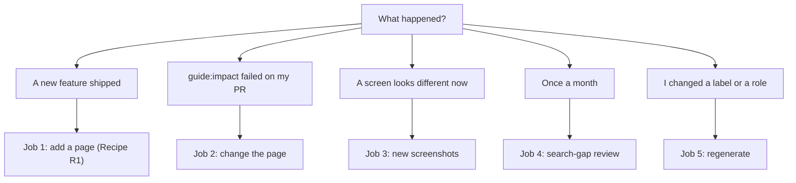
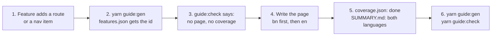
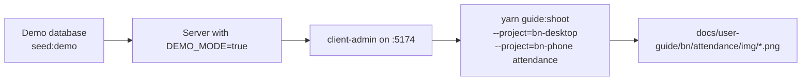
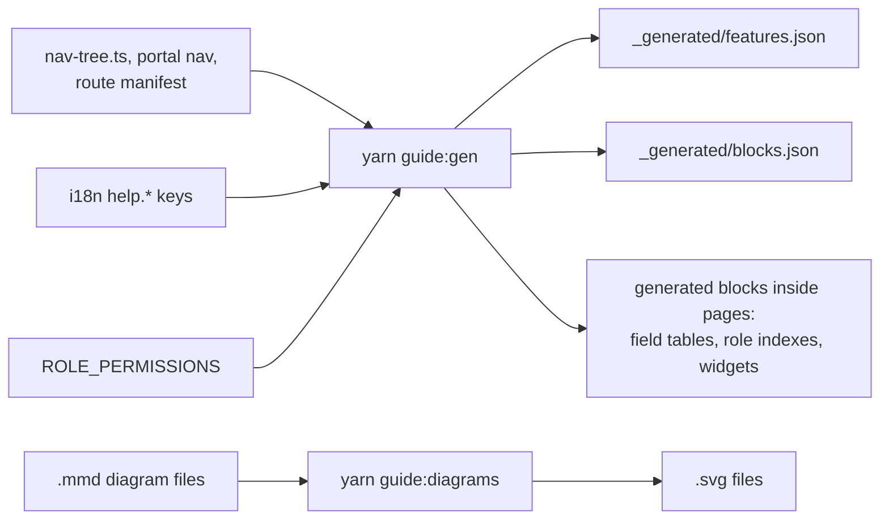

# Keeping the user guide alive: the update runbook

This page is for the person who maintains the guide after Epic 42. It says what to
do, in what order, for the six jobs that come up. Nothing here needs a video: videos
were moved out of this release (D48) and wait in the deferred Epic 85 (#2837).



## What each command does

| Command                        | What it does                                                                                            | Needs                           |
| ------------------------------ | ------------------------------------------------------------------------------------------------------- | ------------------------------- |
| `yarn guide:check`             | Is the guide itself right? Links, anchors, coverage, alt text, generated blocks.                        | Node 24                         |
| `yarn guide:impact`            | Did this branch change code or labels a page documents, without touching the page in bn and en?         | a git history with the base     |
| `yarn guide:gen`               | Rewrites every generated file from the app: `features.json`, `blocks.json`, field tables, role indexes. | Node 24                         |
| `yarn guide:diagrams [prefix]` | Draws `.mmd` files into `.svg` files.                                                                   | `mmdc` (see Job 5)              |
| `yarn guide:shoot`             | Takes screenshots and GIFs by driving the demo school.                                                  | demo school, Playwright (Job 3) |
| `yarn guide:gif`               | Turns a recording into a guide GIF (960 px wide, at most 20 s and 2 MB).                                | `ffmpeg`, `ffprobe`             |
| `yarn guide:card [role]`       | Prints the one-page desk card of a role as a PDF, in bn and en.                                         | Playwright's Chromium           |

CI runs `guide:check` on every pull request and every push to main, and `guide:impact` on every pull request (`.github/workflows/ci.yml`, job
**User guide checks**). The `guide:gen` golden test runs with the normal unit tests.

## Job 1: add a page for a new feature (Recipe R1)

Do this in the same PR as the feature. The full recipe is in
[`39-user-guide.md`](../architecture/39-user-guide.md#recipe-r1--one-feature-page); this is the short
version with the exact order.



1. Run `yarn guide:gen`. The new id appears in `docs/user-guide/_generated/features.json`.
   If the feature is a nav item or a portal item it is picked up by itself. A page about a thing with no
   menu item (for example `help.whatsNew`) is added by hand to the `FIXED` list in
   `client-admin/src/help/guide-gen/features.ts`.
2. Write field help in the i18n files (`help.<field>` in `bn` first, then `en`).
3. Copy [`page-template.md`](page-template.md). Write the **bn** page in
   `docs/user-guide/bn/<section>/<feature>.md`, then the **en** page at the same path. Follow the
   [writing guide](writing-guide.md). Fill `sources`, `labels`, `roles`, `helpIds`.
4. Add the id to `docs/user-guide/coverage.json` as `"done"`. **Never write `"planned"`:** a planned id
   fails `guide:check` (rule `(t)`, D16).
5. Add the page to `docs/user-guide/bn/SUMMARY.md` and `docs/user-guide/en/SUMMARY.md`.
6. Add the page to the **Related pages** list of every page it should point to, and add the link back
   (rule `(p)`: a related link must link back).
7. Run `yarn guide:gen`, then `yarn guide:check`. It must exit 0 and print no problem lines (warnings on stderr are fine).

A route that needs no customer page (a redirect, a platform-only screen) gets an
`"internal: <reason>"` line in `docs/user-guide/route-map.json` instead of a page.

If the PR changes the app in a way no page needs, write one line in the PR body:

```text
User guide: not affected — <reason of at least 10 characters>
```

## Job 2: a PR trips `guide:impact`

`guide:impact` reads the `sources` and `labels` of every page. If a PR changes a file or an i18n key
that a page lists, the page must be changed in the same PR, in both languages.

Example output:

```text
page · why affected · what to do
attendance.attendance · source client-admin/src/routes/attendance/index.tsx · update docs/user-guide/en/attendance/attendance.md
FAIL: update the pages above (bn + en), or add a PR body line: "User guide: not affected — <reason of 10+ characters>"
```

What to do:

1. Open the page it names. Check every claim near the changed code: a button name, a step, a role.
2. Fix the **bn** page, then the **en** page. Bump `lastVerified` in the `guide:meta` comment.
3. If a known problem was fixed, remove its `knownIssues` entry; if you found one, add it (below).
4. Run `yarn guide:gen` (the `appVersion` line and field tables may change) and `yarn guide:check`.
5. If the change really does not affect the page (a rename inside a file, a refactor), use the
   `User guide: not affected — <reason>` line in the PR body. The reason must be a real sentence.

### The `knownIssues` convention

When a page documents behavior that is wrong in the app, do not hide it. Add one line to the page's
`guide:meta` comment:

```yaml
knownIssues:
  - { id: gov-holidays-past-date, checked: 2026-10-24, issue: 1234 } # 1234 is an example number; one plain sentence about it
```

- `id` is a short slug, unique on that page. Never leave it out (an entry with no `id` shows up as `"undefined"`).
- `issue` is the GitHub issue number. Open the issue first; write `null` only for a few days.
- `checked` is the day you last confirmed it is still true. `guide:check` warns when it is older than 30 days
  and when `issue` is `null`. Warnings never fail the check, but clear them.
- When the app is fixed, delete the entry and fix the page text in the same PR.

## Job 3: regenerate screenshots

Screenshots and GIFs come from tours in `e2e/docs/tours/<feature>.tour.ts`. A tour signs in to the demo
school, so it never shows real data.



1. Start the demo school as described in
   [`22-demo-seed.md`](../architecture/22-demo-seed.md#running-the-demo-end-to-end): a `biddaloy_demo*`
   database, `seed:demo`, the server with `DEMO_MODE=true`, `client-admin` on port 5174.
2. Run one language at a time. `GUIDE_LANG` must match the projects:

   ```bash
   GUIDE_LANG=bn yarn guide:shoot --project=bn-desktop --project=bn-phone attendance
   GUIDE_LANG=en yarn guide:shoot --project=en-desktop --project=en-phone attendance
   ```

3. The tour writes framed PNGs (at most 300 KB each) and GIFs (at most 2 MB) into
   `docs/user-guide/<lang>/<section>/img/`. Look at every picture before you commit it.
4. To turn your own recording into a GIF: `yarn guide:gif in.webm out.gif --start 2 --duration 12`.
5. Run `yarn guide:check`. It fails on a PNG over 300 KB, a GIF over 2 MB, and an image without alt text.

**Known problem, not solved.** In this repository's docs environment the capture crashes with
`Invalid hook call` (seen in `PopperContent`) when a tour opens a menu or a dialog. Pages that need those
screenshots still carry `<!-- image pending: ... -->` comments describing the picture that is missing.
The `dashboard` tour says the same at its top. Until someone fixes it, do not fake a picture: leave the
comment, and capture the screens that do not open a menu. When it is fixed, run each tour and delete the
matching `image pending` comments.

## Job 4: the monthly search-gap review

Readers who search and find nothing tell you which page is missing or badly named.

1. In GitBook, open the site's analytics for the last 30 days. (GitBook's menu names change; look for the
   site **Insights** or analytics page and its searches view. Nobody has opened it for this site yet.)
2. In the searches view, look at the words searched most and the searches that returned nothing.
3. For each word that finds nothing, decide:
   - the page exists, but the word is not in it: add the word to the page's `keywords` in `guide:meta`
     (Bangla and English), and into the text if it is a real name for the thing;
   - the page does not exist: that is a Job 1.
4. If page rating is on (see the live checks), also look at the pages with the most "not helpful"
   ratings. Fix the worst three.
5. Write the date and what you changed in the PR that follows. Do this on the first working day of each month.

## Job 5: regenerate generated files

Never fix a generated file by hand. Fix its source and regenerate.



- **`yarn guide:gen`** runs a Vitest golden test in update mode. If it changes files, commit them.
  If you forget, the same test fails in CI.
- **`yarn guide:diagrams [name-prefix]`** draws `docs/user-guide/_diagrams/<name>.<lang>.mmd` into
  `docs/user-guide/<lang>/<section>/diagrams/<name>.svg` and stamps it with the source hash. A diagram
  whose `.mmd` changed but whose `.svg` was not redrawn fails `guide:check` (rule `(g)`).
  It needs `mmdc`: the `MMDC` environment variable, or `node_modules/.bin/mmdc`, or `npx`. To use an
  installed Chrome, set `PUPPETEER_CONFIG` to a Puppeteer config file. The script uses paths relative to the
  repository root, so run it from there. Pass a name prefix to redraw only some diagrams; if other
  `.svg` files change by a few bytes, revert them (`git checkout`).
- **Desk cards.** `yarn guide:card` prints every role's card to
  `docs/user-guide/<lang>/roles/cards/<role>.<lang>.pdf`; `yarn guide:card teacher` prints one role.
  The card reads the five items of the role page's `#tasks` list, so edit the role page, never the PDF.
  Set `GUIDE_BASE_URL` to print the guide's public address on the card, and `CHROME_PATH` to use another
  browser. A card over 300 KB fails.

## Job 6: a role or a permission changed

The role pages (`docs/user-guide/<lang>/roles/`) list "All features" from `ROLE_PERMISSIONS`.

1. Run `yarn guide:gen`. The list in the role page updates by itself.
2. Read the role page's "What you cannot do" and "Your first day" by hand. They are not generated.
3. Read [Roles and permissions](../user-guide/en/administration/roles.md) (and the bn page). Its table is
   also written by hand.
4. Run `yarn guide:card <role>` if the five common tasks changed.

## The checks, in one place

`yarn guide:check` prints one JSON line per problem and exits 1 (warnings go to stderr and never change the exit code). The letter in brackets says which rule failed.

| Rule  | What it means                                                                   |
| ----- | ------------------------------------------------------------------------------- |
| `(a)` | an id in `features.json` is missing from `coverage.json`                        |
| `(b)` | an id is `done` but has no bn or no en page                                     |
| `(c)` | the bn and en pages differ in `feature`, `roles` or `helpIds`                   |
| `(d)` | a relative link or image does not exist                                         |
| `(e)` | a `labels` pattern matches no i18n key                                          |
| `(f)` | a page has no diagram                                                           |
| `(g)` | an `.svg` is missing, or its stamped hash no longer matches its `.mmd`          |
| `(h)` | a PNG is over 300 KB or a GIF over 2 MB                                         |
| `(i)` | a video file is under `docs/` (not allowed, D48)                                |
| `(j)` | a page is not listed in `features.json`                                         |
| `(k)` | a generated block differs from what `guide:gen` writes, or a video block exists |
| `(l)` | a route in the manifest has no page and no `internal:` reason                   |
| `(m)` | a page lacks a required anchor id, or bn and en anchors differ                  |
| `(n)` | `entry` and `#arrive` do not agree                                              |
| `(o)` | a page bolds another page's title without linking it                            |
| `(p)` | a related link does not link back                                               |
| `(q)` | warning only: a `knownIssues` entry is over 30 days old or has no issue number  |
| `(r)` | a page still has `---` frontmatter                                              |
| `(s)` | an image has no meaningful alt text                                             |
| `(t)` | an id in `coverage.json` is still `planned`                                     |

One exception on purpose: portal pages are not checked by `(o)` (their titles are the app's own menu
words). Every id in `coverage.json` is `done`; a `planned` id always fails `(t)`.

## What is not in this runbook

- **Video.** No narrated video, no YouTube upload, no media manifest work in this release (D48). Epic 85
  (#2837) holds that plan.
- **The live GitBook checks** are written in [`gitbook-setup.md`](gitbook-setup.md#live-checks). None has
  been run yet.
