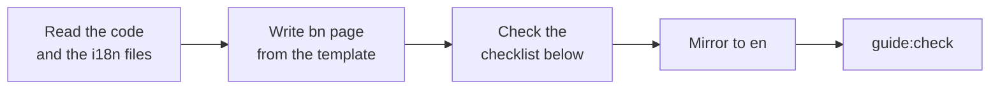
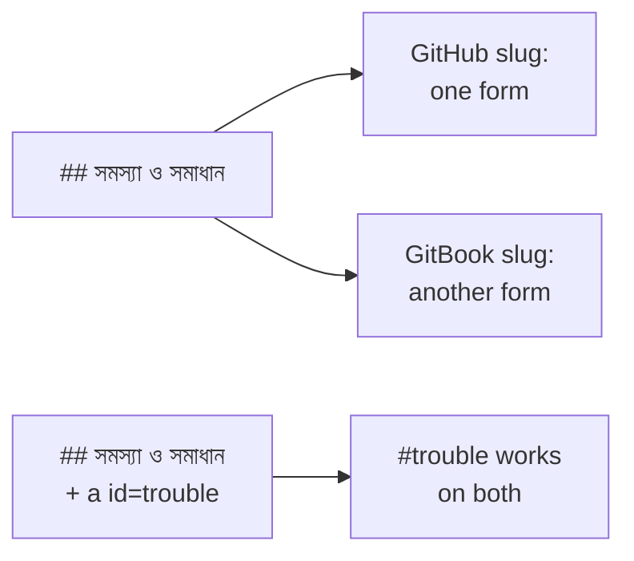

# Writing guide for user-guide pages

Read this before you write or change any page under `docs/user-guide/`. It tells
you **how to write**. The shape of a page (the blocks, their order, their ids) is
in [`page-template.md`](page-template.md), which is locked (Epic 42, D44). Diagrams
are in [`diagram-style.md`](diagram-style.md). How the whole guide is built and
checked is in [`../architecture/25-user-guide.md`](../architecture/25-user-guide.md).
Terms the guide uses are in the glossary
([bn](../user-guide/bn/help/glossary.md), [en](../user-guide/en/help/glossary.md)).

The reference page is
[`docs/user-guide/bn/attendance/attendance.md`](../user-guide/bn/attendance/attendance.md).
When this guide and that page seem to disagree, open an issue; do not guess.



## Who the reader is

The reader is a teacher, headmaster, accountant, office worker, exam controller,
committee member, guardian or student. Many have never used the app. Some read
on a phone, in a classroom, between two classes.

Write like a polite, warm colleague who respects them:

- Always **আপনি**, never "তুমি". In English, "you".
- Verbs: **করুন**, **চাপুন**, **বেছে নিন**. Never "ক্লিক করুন" in one place and
  "চাপুন" in another.
- The reader is important and is not at fault. Say "বার্তা না এলে", not "আপনি ভুল
  করেছেন".

## Rules that apply to every page

| Rule                                      | What it means                                                                                                                                                                |
| ----------------------------------------- | ---------------------------------------------------------------------------------------------------------------------------------------------------------------------------- |
| **Bangla first** (D17)                    | Write the bn page first, in natural, easy Bangla. Then write the en page from it. The en page is not a word-by-word copy, and the bn page is not a translation of en.        |
| **UI words are verbatim** (D17)           | Every button, label, tab and message in bold is copied from `ui/src/i18n/locales/{bn,en}/*.json`. List the keys in `labels` in `guide:meta`.                                 |
| **No jargon**                             | Say "only the administrator", never a permission key such as `ATTENDANCE_CORRECT`. Say "your computer or phone", not "client". Say "saved", not "persisted".                 |
| **Role labels** (D7)                      | Use the role label from the table below, the same on every page. Never a role key (`ADMIN`, `OFFICE_STAFF`) or a permission key. Say "only the admin", not "administrators". |
| **No invented numbers or features** (D26) | Every number, limit, time and feature on a page is checked in code or in the demo app. If you cannot check it, leave it out.                                                 |
| **Nothing the app cannot back up**        | Do not promise what the shipped app does not do. A known problem goes in **জানা সমস্যা**, never a bare "আমরা ঠিক করছি".                                                      |
| **No personal data**                      | Images use the demo school only. No real names, phone numbers or photos.                                                                                                     |

### Role labels

Copied verbatim from `ui/src/i18n/locales/{bn,en}/staff.json` (`roles`). Use these
and no other name. If the UI label changes, change this table and every page.

| Role key          | bn                    | en                   |
| ----------------- | --------------------- | -------------------- |
| `ADMIN`           | অ্যাডমিন              | Admin                |
| `EXECUTIVE`       | একাডেমিক কো-অর্ডিনেটর | Academic coordinator |
| `TEACHER`         | শিক্ষক                | Teacher              |
| `ACCOUNTANT`      | হিসাবরক্ষক            | Accountant           |
| `OFFICE_STAFF`    | অফিস সহকারী           | Office staff         |
| `EXAM_CONTROLLER` | পরীক্ষা নিয়ন্ত্রক    | Exam controller      |
| `COMMITTEE`       | পরিচালনা পর্ষদ সদস্য  | Committee member     |
| `PARENT`          | অভিভাবক               | Parent               |
| `STUDENT`         | শিক্ষার্থী            | Student              |

The role key column is for writers only; it never appears on a page.
(`SUPER_ADMIN` is not in the customer guide, D15.) The pilot page still says
"প্রশাসক" and has a "প্রধান শিক্ষক / অধ্যক্ষ" row; it must move to these labels.

## The first-time teacher test (D42)

A teacher who has never used the app must be able to finish every workflow from
the page alone. Use this as your checklist. Each line says which block of the
template carries it.

| #   | The page must…                                                                                                                                                                         | Carried by (template block) |
| --- | -------------------------------------------------------------------------------------------------------------------------------------------------------------------------------------- | --------------------------- |
| 1   | **Before you start.** Say who can do it (plain role), what must already exist (each a link, e.g. "your class must already have students"), and which device.                           | **শুরুর আগে** + roles table |
| 2   | **Start from the screen the reader sees after signing in**: a sidebar item, or the bottom button on a phone. Never a URL.                                                              | **যেতে হবে** and step 1     |
| 3   | **One action per step.** Exact on-screen word in bold, and where it is ("উপরে ডান দিকে **সংরক্ষণ করুন** চাপুন").                                                                       | numbered steps              |
| 4   | **You will now see.** One "→" line after every step that changes the screen. A screenshot at least for the first and last step.                                                        | "→" lines + figures         |
| 5   | **Phone steps written out** when `devices` has `phone`, because the buttons sit elsewhere.                                                                                             | **ফোনে** paragraph          |
| 6   | **If something goes wrong.** The real messages the screen can show, copied from i18n, and what to do about each. A line for "why can't I see this button?" that links the roles table. | `#trouble` + `#roles`       |
| 7   | **Check it worked.** Where the result shows up afterwards.                                                                                                                             | `#confirm`                  |
| 8   | **Glossary link** the first time a word that is not everyday Bangla appears on the page.                                                                                               | link to `help/glossary.md`  |

**Bad** (bn): fails 2, 3, 4, 6, 7.

> ফি জেনারেট করতে `/fees/generate` এ গিয়ে ফর্ম পূরণ করে সাবমিট করুন। এরপর ইনভয়েস তৈরি হবে।

**Good** (bn):

> **শুরুর আগে:** শ্রেণির জন্য একটি ফি কাঠামো (→ `fee-structures.md`) থাকতে হবে। শুধু অ্যাডমিন বা হিসাবরক্ষক করতে পারেন।
>
> 1. বাম মেনুতে **অর্থ** চাপুন, তারপর **তৈরি হওয়া ফির বিল** চাপুন।
>
>    → বিলের তালিকা আসবে।
>
> 2. উপরে ডান দিকে **ফির বিল তৈরি করুন** চাপুন।
>
>    → একটি ফর্ম খুলবে।

**Bad** (en): fails 2, 3, 4, 6, 7.

> To generate fees go to `/fees/generate`, fill in the form and submit. Invoices will be created.

**Good** (en):

> **Before you start:** the class needs a fee structure (→ `fee-structures.md`). Only an admin or an accountant can do this.
>
> 1. In the left menu press **Finance**, then **Fee bills created**.
>
>    → The list of bills opens.
>
> 2. At the top right press **Create fee bills**.
>
>    → A form opens.

## The 15 points

Where an example shows a path in parentheses after a name, that page does not exist yet. On a real page the name is a live link.

Each point has a rule and one bn and one en example. The examples use the
attendance page, because it is the reference.

### 1. Order and anchors

A page has eleven blocks, in this order. The ids are fixed: the checker and the
in-app help (Epic 44) deep-link to them.

| #   | Block                                                                                | Id             | Required?                                                     |
| --- | ------------------------------------------------------------------------------------ | -------------- | ------------------------------------------------------------- |
| 1   | `guide:meta` comment                                                                 | —              | always                                                        |
| 2   | Title, outcome, **যেতে হবে**, **শুরুর আগে**, object paragraph, quick links, contents | —              | always                                                        |
| 3   | **এই পাতায় যেভাবে আসবেন**                                                           | `arrive`       | only when `entry` has more than `sidebar`/`palette` (point 3) |
| 4   | Main task                                                                            | `task-main`    | always                                                        |
| 5   | How to know it worked                                                                | `confirm`      | every page that saves something                               |
| 6   | Other situations                                                                     | `other`        | always; one H3 per situation, each with id `task-<slug>`      |
| 7   | Problems and fixes                                                                   | `trouble`      | always                                                        |
| 8   | Who can do what                                                                      | `roles`        | always                                                        |
| 9   | Known issues                                                                         | `known-issues` | only when there are any                                       |
| 10  | Learn more (`<details>` blocks, related pages)                                       | `more`         | always                                                        |
| 11  | Footer: version and last-verified date                                               | —              | always                                                        |

Write the heading with its id on the same line:

```markdown
## সমস্যা ও সমাধান <a href="#trouble" id="trouble"></a>
```

**bn example:** `## হাজিরা জমা হয়েছে কি না বুঝবেন কীভাবে <a href="#confirm" id="confirm"></a>`

**en example:** `## How to know the attendance was submitted <a href="#confirm" id="confirm"></a>`

### 2. The opening

In this order, and nothing else before the first task:

1. **One sentence of outcome.** What the reader can do after this page.
2. **যেতে হবে / How to get there.** An exact click path: sidebar group, then item. Then the phone position.
3. **শুরুর আগে / Before you start.** Only what blocks the task if missing. Each item is a link to the page that creates it.
4. **One paragraph naming the object** the page works on, such as "হাজিরার খাতা". From here on, use that name and no other.
5. No promise you did not measure. Not "দুই মিনিটে", not "মাত্র এক ক্লিকে".

**bn example:**

> নিজের শাখার শিক্ষার্থীদের হাজিরা নিন, দেরি বা ছুটি চিহ্নিত করুন, এবং ভুল হলে সংশোধন করুন।
>
> **যেতে হবে:** বাম মেনুতে **উপস্থিতি → উপস্থিতি**। ফোনে স্ক্রিনের নিচের **উপস্থিতি** বোতাম।
> **শুরুর আগে:** আপনার নামে অন্তত একটি শাখা বরাদ্দ থাকতে হবে।
>
> প্রতিটি শাখার প্রতিদিন একটি **হাজিরার খাতা** থাকে। এই পাতায় সেই খাতাই পূরণ করবেন।

**en example:**

> Mark your own section's students present or absent, record late or leave, and correct a mistake.
>
> **How to get there:** in the left menu, **Attendance → Attendance**. On a phone, the **Attendance** button at the bottom of the screen.
> **Before you start:** at least one section must be assigned to you.
>
> Every section has one **attendance register** per day. This page is where you fill it in.

### 3. Arrival paths (D45)

Some pages are reached from somewhere other than the sidebar: a notification, a
dashboard card, a step on another page, a public `/i/<token>` link, a QR code.
List each in `entry` in `guide:meta`. The page then opens with
**এই পাতায় যেভাবে আসবেন** (`#arrive`), with **one numbered path per entry point**.
Each path:

- starts from a screen the reader already knows;
- quotes the message or card **exactly as i18n has it**;
- links the page that owns the earlier steps;
- says what arrives pre-filled.

**bn example:**

> **ড্যাশবোর্ড থেকে:** ড্যাশবোর্ডে **উপস্থিতি নেওয়া বাকি** কার্ডে আজ যেসব শাখার হাজিরা বাকি, তাদের নাম থাকে। একটি নামে চাপুন। → সোজা সেই শাখার হাজিরার খাতা খোলে, আজকের তারিখে; নিচের ধাপ ৩ থেকে শুরু করুন।

**en example:**

> **From the dashboard:** the **Attendance pending** card lists the sections whose register is not done today. Press a name. → That section's register opens, set to today; start at step 3 below.

(Check the card's real English name in `ui/src/i18n/locales/en/dashboard.json` before you copy it.)

### 4. Steps

- **One action per step.** If a step has "and", split it.
- Bold the exact UI word, and say where it is: "উপরে ডান দিকে **সবাই উপস্থিত** চাপুন".
- After every step that changes the screen, a line starting with **→** says what the reader now sees.
- Put the image **after** the step it belongs to.
- Write the phone variant only where it differs. Do not copy all steps.
- The **last step is the action that commits** the change, followed by the exact confirmation message.
- End with a **মনে রাখুন / Remember** note that names what is **not** saved until that last step.

**bn example:**

> 5. নিচে **উপস্থিতি জমা দিন** চাপুন।
>
>    → **উপস্থিতি সংরক্ষিত হয়েছে** বার্তা আসবে, আর অ্যাপ আপনাকে শাখার তালিকায় ফিরিয়ে নেবে।
>
> > **মনে রাখুন:** **উপস্থিতি জমা দিন** না চাপা পর্যন্ত স্কুলের সিস্টেমে কিছু যায় না।

**en example:**

> 5. At the bottom press **Submit attendance**.
>
>    → The **Attendance saved** message appears, and the app takes you back to the list of sections.
>
> > **Remember:** nothing reaches the school's system until you press **Submit attendance**.

### 5. The three save states

Every page that saves something uses these three names, always the same, and a
`#confirm` table:

| bn                           | en                              |
| ---------------------------- | ------------------------------- |
| **শুধু স্ক্রিনে বদলেছে**     | **Changed on screen only**      |
| **এই ডিভাইসে সংরক্ষিত**      | **Saved on this device**        |
| **স্কুলের সিস্টেমে পৌঁছেছে** | **Reached the school's system** |

The `#confirm` section also has:

- **A way to check that does not trust a badge that might be wrong.** Leave the page and open the saved result (for example the list, then the record).
- **What to do if the message does not come**, and whether the data is lost. Say it in one sentence.

Drop a row only when that state cannot occur on that page.

**bn example:**

> **যাচাই করতে চাইলে:** শাখার তালিকায় শাখাটির কার্ডে আবার চাপুন। আপনার দেওয়া চিহ্নগুলো প্রতিটি নামের পাশে দেখা গেলে সেগুলো সিস্টেমে আছে।
>
> **বার্তা না এলে:** [সমস্যা ও সমাধান](#trouble) দেখুন। আপনার চিহ্নগুলো মুছে যায়নি।

**en example:**

> **To check for yourself:** in the list of sections, open the section again. If your marks show beside each name, they are in the system.
>
> **If the message does not appear:** see [Problems and fixes](#trouble). Your marks have not been lost.

### 6. Decision points

Every dialog with two or more buttons gets a table: what you press, what
happens (including what reports will show), and whether it was saved. A
**conflict dialog** also says what each choice replaces or discards, and whether
that is the whole record or only the rows that differ.

**bn example:**

| আপনি চাপলেন                      | কী হবে                                                  | জমা হলো?     |
| -------------------------------- | ------------------------------------------------------- | ------------ |
| **যেভাবে আছে জমা দিন**           | খাতা যেমন আছে তেমনই জমা হয়; অচিহ্নিতরা অচিহ্নিতই থাকে। | হ্যাঁ        |
| **বাকিদের উপস্থিত চিহ্নিত করুন** | বাকিদের উপস্থিত চিহ্নিত করা হয়; তারপর জমা দিতে হবে।    | না, এখনো নয় |
| **বাতিল**                        | কিছুই বদলায় না; খাতায় ফিরে যান।                       | না           |

**en example:**

| You press             | What happens                                                         | Saved?  |
| --------------------- | -------------------------------------------------------------------- | ------- |
| **Submit anyway**     | The register is submitted as it is; unmarked students stay unmarked. | Yes     |
| **Mark rest present** | The rest are marked present; you still have to submit.               | Not yet |
| **Cancel**            | Nothing changes; you go back to the register.                        | No      |

(These rows show the shape. On a real page, check each row in code first, see point 14, and add what reports will show once you have verified it.)

### 7. Problems table

Columns: **what you see** (the exact i18n text, in bold), **what to do**, **who
can help** (a plain role and a link to the page). A symptom that is not a
message (for example "a section is not in the list") is not bold. Put longer
explanations below the table.

**bn example:**

| আপনি যা দেখছেন                  | কী করবেন                                                             | কে সাহায্য করতে পারেন                 |
| ------------------------------- | -------------------------------------------------------------------- | ------------------------------------- |
| **উপস্থিতি সংরক্ষণ করা যায়নি** | ইন্টারনেট দেখে আবার **উপস্থিতি জমা দিন** চাপুন। চিহ্নগুলো থেকে যায়। | অ্যাডমিন (**শিক্ষকের দায়িত্ব** পাতা) |

**en example:**

| What you see                  | What to do                                                                    | Who can help                         |
| ----------------------------- | ----------------------------------------------------------------------------- | ------------------------------------ |
| **Could not save attendance** | Check your internet, then press **Submit attendance** again. Your marks stay. | Admin (**Teacher assignments** page) |

### 8. Roles table

One table replaces per-role sections: one row per role, one column per ability.
A known issue that limits a role sits in that role's row, linked to
`#known-issues`. Use the role labels above (D7). The table is the answer to "why
can't I see this button?".

**bn example:**

| ভূমিকা   | হাজিরা নিতে পারেন | সংশোধন করতে পারেন                                            |
| -------- | ----------------- | ------------------------------------------------------------ |
| শিক্ষক   | হ্যাঁ             | সময়সীমার মধ্যে                                              |
| অ্যাডমিন | হ্যাঁ             | যেকোনো দিন — আপাতত কাজ করছে না, [জানা সমস্যা](#known-issues) |

**en example:**

| Role    | Can mark attendance | Can correct                                                     |
| ------- | ------------------- | --------------------------------------------------------------- |
| Teacher | Yes                 | Within the correction window                                    |
| Admin   | Yes                 | Any day; not working for now, see [Known issues](#known-issues) |

### 9. Known issues

Only when there are any. Table columns: **issue**, **who and when**, **is the
data saved?**, **what to do for now**. Above the table: a line "verified on
version X on date Y". In `guide:meta`, each issue is an entry in `knownIssues`
with a `checked` date. Remove the row when the fix ships. **Never** write a bare
"আমরা ঠিক করছি" / "we are fixing this" without a row.

**bn example:**

> সংস্করণ ০.১.০-এ যাচাই করা, ২০২৬-১০-২৩। ঠিক হলে এই অংশ থেকে সরিয়ে দেওয়া হবে।

| সমস্যা                                 | কার, কখন                      | তথ্য সংরক্ষিত? | আপাতত কী করবেন                         |
| -------------------------------------- | ----------------------------- | -------------- | -------------------------------------- |
| জমা দেওয়ার পর শাখাটি **খসড়া** দেখায় | সবার, প্রতিবার জমা দেওয়ার পর | হ্যাঁ          | কিছু করতে হবে না। হাজিরা সিস্টেমে আছে। |

**en example:**

> Verified on version 0.1.0 on 2026-10-23. This section is removed once the fix ships.

| Issue                                               | Who and when                 | Data saved? | What to do for now                        |
| --------------------------------------------------- | ---------------------------- | ----------- | ----------------------------------------- |
| After submitting, the section still shows **Draft** | Everyone, after every submit | Yes         | Nothing. The attendance is in the system. |

### 10. Learn more

Reference material goes inside `<details>` so the task stays near the top:
parts-of-the-page walkthrough, keyboard shortcuts, the generated field table,
the overview diagram, GIFs. Do not add a video block (D48). **সম্পর্কিত পাতা /
Related pages** comes last: every item is a link plus one sentence on how it
relates.

**bn example:**

```markdown
<details>
<summary><strong>কি-বোর্ড শর্টকাট</strong></summary>

P উপস্থিত · A অনুপস্থিত · L বিলম্বে · V ছুটি

</details>

**সম্পর্কিত পাতা**

- **উপস্থিতির খাতা** (→ `attendance-register.md`) — মাসের সব হাজিরা একসাথে দেখা যায়।
```

**en example:**

```markdown
<details>
<summary><strong>Keyboard shortcuts</strong></summary>

P present · A absent · L late · V leave

</details>

**Related pages**

- **Attendance register** (→ `attendance-register.md`) — shows a whole month of attendance together.
```

### 11. Links (D46)

- Every **bold feature name that has a page** is a link.
- Every related-page link is **reciprocal**: the page you link links back.
- An arrival path links the page that owns the earlier steps. A prerequisite in **শুরুর আগে** links the page that creates it.
- You may only link pages that exist. For a page written in the **same wave**, list the missing link in the PR notes; the wave close adds it.

**bn example:** `অ্যাডমিন **শিক্ষকের দায়িত্ব** পাতা থেকে বরাদ্দ করেন` becomes
``অ্যাডমিন **শিক্ষকের দায়িত্ব** (→ `teacher-assignments.md`) পাতা থেকে বরাদ্দ করেন``.

**en example:** "An admin assigns it on the **Teacher assignments** page" becomes
"An admin assigns it on the **Teacher assignments** (→ `teacher-assignments.md`) page".

### 12. Visual budget

| Rule                                                             |
| ---------------------------------------------------------------- |
| Main path: at most **4 images**.                                 |
| Other images sit beside the dialog or error they explain.        |
| GIFs only inside `<details>`.                                    |
| Phone images `width="300"`. Diagrams `width="720"`.              |
| Every capture is framed by the capture toolkit. Light mode only. |
| Callout numbers in the picture match the caption and the list.   |
| Alt text says what is **in** the picture, not "screenshot".      |

**bn example:**

```html
<figure>
  
  <figcaption><em>ধাপ ৪-এর পর: দুজন অনুপস্থিত, উপরের হিসাবে অনুপস্থিত ২</em></figcaption>
</figure>
```

**en example:**

```html
<figure>
  
  <figcaption><em>After step 4: two students absent, the top count shows Absent 2</em></figcaption>
</figure>
```

### 13. Tone and terminology

- আপনি / করুন / চাপুন. **"চাপুন" on both desktop and phone.**
- No filler: not "ব্যস", "ভয় নেই", "আরও সহজ", "just", "simply", "easy".
- Exact UI strings from i18n, including punctuation.
- Latin digits in input examples (`01712345678`), unless the field accepts Bangla digits (checked in the demo app).
- Each page has a small **terminology table** in your notes (or the PR): feature name as the UI shows it, the everyday action, and the record noun. Use one and keep it. Add the record noun to the glossary.

**bn example:**

| UI-র নাম | সাধারণ কাজ    | খাতা/রেকর্ডের নাম |
| -------- | ------------- | ----------------- |
| উপস্থিতি | হাজিরা নেওয়া | হাজিরার খাতা      |

Bad: "ব্যস, এবার জমা দিন — ভয় নেই, খুব সহজ!" Good: "এবার **উপস্থিতি জমা দিন** চাপুন।"

**en example:**

| UI name    | Everyday action | Record noun         |
| ---------- | --------------- | ------------------- |
| Attendance | Take attendance | attendance register |

Bad: "Just press Submit, it's super easy!" Good: "Now press **Submit attendance**."

### 14. Verify before you write

Every claim about behaviour is checked **first**, in code or in the demo app:

- what a button does to marks that already exist;
- what offline mode does when the tab is closed;
- what each choice in a conflict dialog discards.

Put the source file in `sources` in `guide:meta`. A sentence written from memory is
the usual reason a page is wrong; the pilot found three product bugs this way.
If the app does something surprising, write what it **does**, and add a row in
**জানা সমস্যা**.

**bn example:** the page says "**সবাই উপস্থিত** আগে থেকে দেওয়া চিহ্ন বদলায় না" only after trying it in the demo school and finding the code that does it, and lists that file in `sources`.

**en example:** the page says "**All present** does not change marks you already set" only after trying it in the demo school and finding the code that does it, and lists that file in `sources`.

### 15. Rendering

The same Markdown is shown on GitHub and on GitBook. Use only what both render.

| Works on both                                  | Notes                                                                                               |
| ---------------------------------------------- | --------------------------------------------------------------------------------------------------- |
| Plain Markdown, tables                         | Prettier formats tables; run `yarn prettier --write` on your files.                                 |
| `<figure>`, `<figcaption>`, ``      | `width` is the only sizing.                                                                         |
| `<details>`, `<summary>`                       | Blank line after `<summary>` so Markdown inside renders.                                            |
| `<a href="#id" id="id"></a>` in a heading      | **Required** for every id in the table in point 1.                                                  |
| `` … `` | GitBook only. On GitHub it shows as plain text. Accepted; do not rely on it for anything essential. |

No CSS, no `<div align>`, no `<style>`.

**Why Bangla headings need explicit anchors.** GitHub and GitBook turn a heading
into a link slug differently, and for Bangla they disagree. An explicit
`<a id>` gives both the same ASCII anchor, so links like `#trouble` work
everywhere.



**bn example:** `[সমস্যা ও সমাধান](#trouble)` always works. `[সমস্যা ও সমাধান](#সমস্যা-ও-সমাধান)` may not.

**en example:** `[Problems and fixes](#trouble)` always works, even though the English heading would slug fine on both. Use the id in both languages so the two pages stay identical in shape.

## Checks to run before the PR

Run `yarn guide:check` (is the guide itself right?) and `yarn guide:impact`
(did my change make a page wrong?). `guide:check` includes the alt-text rule
`(s)`: every image needs alt text that says what is in the picture. Then tick
the template's own list ("Before you open the PR" at the end of
[`page-template.md`](page-template.md)) and run `yarn prettier --check` on your
files. [`update-runbook.md`](update-runbook.md) has the full routine.

- [ ] Every item of the first-time teacher test passes.
- [ ] Every one of the 15 points is met, or you wrote why not in the PR.
- [ ] Every bold UI word exists in i18n (`labels`).
- [ ] bn and en pages are a pair: same `feature`, `helpIds`, `roles`.
- [ ] No video block, no `guide:generated:video` marker.
