# SchoolManager-এ স্বাগতম

**কাগজের ঝামেলা কম, স্কুলের জন্য বেশি সময়।**

আপনি প্রধান শিক্ষক, শিক্ষক, হিসাবরক্ষক বা অভিভাবক, যে-ই হোন, এই গাইড আপনার জন্য। এখানে দেখবেন SchoolManager আপনার প্রতিদিনের কাজ কীভাবে সহজ করে, আর নিজের কাজটি কোথা থেকে শুরু করবেন।

[আপনি কে?](#who) · [একজন প্রধান শিক্ষকের সকাল](#morning) · [ড্যাশবোর্ড কীভাবে সাহায্য করে](#dashboard) · [এই গাইড কীভাবে পড়বেন](#how-to-read)

---

## আজকের ঝামেলা 

স্কুলের কাজ এখনো অনেক জায়গায় কাগজে হয়:

- হাজিরার খাতা, যা প্রতিদিন শিক্ষককে হাতে পূরণ করতে হয়।
- ফি আদায়ের খাতা আর রসিদ বই, যেখানে কে কত দিয়েছে খুঁজে পেতে সময় লাগে।
- নম্বরের খাতা, যা জমা পড়ল কি না প্রধান শিক্ষক জানতে চাইলে একে একে জিজ্ঞেস করতে হয়।
- নোটিশ, যা অভিভাবকের কাছে পৌঁছাল কি না কেউ নিশ্চিত নন।

SchoolManager এই কাজগুলো এক জায়গায় আনে। খাতা খুঁজতে হয় না; দরকারি খবর আপনার সামনে আসে।

---

## একজন প্রধান শিক্ষকের সকাল 

ধরা যাক, আপনি স্কুলে পৌঁছে ফোনে বা কম্পিউটারে SchoolManager খুললেন। [সাইন ইন](start/sign-in.md) করার পর প্রথম পাতাই **ড্যাশবোর্ড**।

1. **আপনার করণীয় খুলুন** নামের বার দেখা যায়। তাতে কয়টি জরুরি বিষয়, কয়টি সতর্কতা আর কয়টি রিমাইন্ডার আছে, তা লেখা থাকে। চাপলে **আপনার করণীয়** তালিকা খোলে। <!-- backs: attention.bar.openLabel, attention.modal.title -->
2. নিচে **আজকের শিক্ষার্থী উপস্থিতি** কার্ডে আজ কত শতাংশ এসেছে আর কোন শাখার উপস্থিতি এখনো বাকি, তা দেখা যায়। <!-- backs: widget.attendance-today -->
3. **শিক্ষক ও স্টাফ** কার্ডে আজ কতজন স্টাফ উপস্থিত, কতজন ছুটিতে। <!-- backs: widget.staff-today -->
4. **এ মাসের আদায়** কার্ডে এ মাসের বিলের কতটা আদায় হলো, গত মাসের তুলনায়। <!-- backs: widget.collection-month -->
5. **ঝুঁকিপূর্ণ শিক্ষার্থী** কার্ডে তাদের নাম আসে, যাদের একসাথে দুই বা তার বেশি সতর্ক সংকেত মিলেছে, যেমন টানা অনুপস্থিতি। <!-- backs: widget.at-risk-students -->

এভাবে খাতা না খুলেই স্কুলের অবস্থা আর কোথায় নজর দিতে হবে, তা এক নজরে জানা যায়। কার্ডগুলো অ্যাডমিন ও একাডেমিক কো-অর্ডিনেটরের ড্যাশবোর্ডে আসে; কয়েকটি অফিস সহকারী বা হিসাবরক্ষকেরও আসে। স্কুল যাঁকে এই ভূমিকা দেয়, তিনিই এগুলো দেখেন।

---

## ড্যাশবোর্ড কীভাবে সাহায্য করে 

প্রতিটি ভূমিকার ড্যাশবোর্ডে সেই ভূমিকার সবচেয়ে জরুরি কাজ আগে আসে। নিজের পছন্দমতো কার্ড সাজাতে চাইলে **সাজান** বোতাম আছে। <!-- backs: dashboard.page.customise -->

| ভূমিকা | ড্যাশবোর্ডে সামনে যা আসে |
| ------ | ------ |
| শিক্ষক | **আজকের আমার রুটিন**, **উপস্থিতি নেওয়া বাকি** (কোন শাখার উপস্থিতি নেওয়া হয়নি), **মার্ক জমার সময়সীমা** (কোন নম্বর কবে পর্যন্ত জমা দিতে হবে) <!-- backs: widget.my-routine-today, widget.my-pending-sections, widget.my-mark-deadlines --> |
| হিসাবরক্ষক | **আজকের আদায়**, **বকেয়া কত দিনের**, **অপেক্ষায় থাকা রিমাইন্ডার** (পাঠানোর জন্য তৈরি ফি রিমাইন্ডার) <!-- backs: widget.collection-today, widget.dues-ageing, widget.reminders-pending --> |
| অ্যাডমিন | স্কুলের অবস্থা: উপস্থিতি, স্টাফ, আদায়, মার্ক এন্ট্রি আর যেখানে সমস্যা, সেই **ঝুঁকিপূর্ণ শিক্ষার্থী** <!-- backs: widget.attendance-today, widget.staff-today, widget.collection-month, widget.mark-entry-progress, widget.at-risk-students --> |

### সবাই সিস্টেম ব্যবহার করছেন কি না, নেতারা কীভাবে দেখেন 

স্কুলের কাজ ঠিকমতো চলে তখনই, যখন সবাই সিস্টেমে নিজের কাজটুকু করেন। তাই যাঁরা স্কুল চালান, তাঁরা এই বিষয়গুলো দেখতে পান:

- **উপস্থিতি নেওয়া হয়নি:** কোনো শাখার উপস্থিতি সময়মতো নেওয়া না হলে অ্যাডমিন, একাডেমিক কো-অর্ডিনেটর ও সংশ্লিষ্ট শিক্ষক সতর্কতা পান। **আজকের শিক্ষার্থী উপস্থিতি** কার্ডেও দেখা যায় কোন শাখা বাকি। <!-- backs: alert attendance.not_taken, widget.attendance-today -->
- **নম্বর জমা দেরি:** কোন শাখার নম্বর জমা দিতে দেরি হচ্ছে, তা একাডেমিক কো-অর্ডিনেটর ও পরীক্ষা নিয়ন্ত্রক জানতে পারেন। অনেক দিন দেরি থাকলে বিষয়টি জরুরি হয়ে যায়। **মার্ক এন্ট্রি** কার্ডে কোন শ্রেণি সবচেয়ে পিছিয়ে, তা দেখা যায়। <!-- backs: alert exams.marks_overdue, widget.mark-entry-progress -->
- **শিক্ষক ও স্টাফ:** আজ কে উপস্থিত আর কে ছুটিতে। <!-- backs: widget.staff-today -->

এতে কাউকে ফোন করে জিজ্ঞেস করতে হয় না। সবার কাজ সময়মতো হয়, আর পুরো স্কুলের মান ধীরে ধীরে ভালো হয়।

---

## আপনার তথ্য নিরাপদ 

প্রতিটি স্কুলের তথ্য আলাদা রাখা হয়; এক স্কুল অন্য স্কুলের তথ্য দেখতে পায় না। শিক্ষক শুধু নিজের বরাদ্দ করা শাখার তথ্য দেখতে পান। কেউ বারবার ভুল পাসওয়ার্ড দিলে সাইন ইন কিছুক্ষণের জন্য আটকে যায়। কোনো ব্যবহারকারীকে স্থগিত বা সরিয়ে দিলে তাঁর চলতি সেশন বন্ধ হয়ে যায়। <!-- backs: docs/architecture/08-security.md rules 2, 8; sign-in lockout and tenant separation: 08-security.md, 02-auth-and-multitenancy.md --> আরও জানতে [সাইন ইন করা](start/sign-in.md) পাতা দেখুন।

---

## বাংলায় চলে, ফোনেও চলে 

SchoolManager বাংলা ও ইংরেজি, দুই ভাষাতেই চলে। ভাষা বদলাতে [ভাষা বদলানো](start/language.md) দেখুন। আলাদা অ্যাপ ডাউনলোড করতে হয় না; ফোনের ব্রাউজারে স্কুলের ঠিকানা খুললেই চলে, চাইলে হোম স্ক্রিনে রাখা যায়। দেখুন [ফোনে খোলা ও অ্যাপ হিসেবে ইনস্টল](start/phone.md)।

---

## আপনি কে? 

নিজের ভূমিকা খুঁজে নিন। প্রতিটি ভূমিকার আলাদা পাতা আসছে; আপাতত [ভূমিকা](roles/README.md) পাতা খুলুন।

| আপনি | শুরুতে যা দেখবেন | আপনার পাতা |
| ---- | ---------------- | ---------- |
| প্রধান শিক্ষক / অধ্যক্ষ (অ্যাডমিন বা একাডেমিক কো-অর্ডিনেটর ভূমিকায়) | স্কুলের উপস্থিতি, আদায় আর ঝুঁকিপূর্ণ শিক্ষার্থী <!-- backs: widget.attendance-today, widget.collection-month, widget.at-risk-students --> | [ভূমিকা](roles/README.md) <!-- target: roles/admin.md, 42.6.03 --> |
| শিক্ষক | আজকের রুটিন, উপস্থিতি নেওয়া বাকি, মার্ক জমার সময়সীমা <!-- backs: widget.my-routine-today, widget.my-pending-sections, widget.my-mark-deadlines --> | [ভূমিকা](roles/README.md) <!-- target: roles/teacher.md --> |
| হিসাবরক্ষক | আজকের আদায়, বকেয়া কত দিনের <!-- backs: widget.collection-today, widget.dues-ageing --> | [ভূমিকা](roles/README.md) <!-- target: roles/accountant.md --> |
| অফিস সহকারী | আজকের ভর্তি, আজ যোগ হওয়া শিক্ষার্থী, অভিভাবকের তথ্য অসম্পূর্ণ <!-- backs: widget.admissions-today, widget.students-added-today, widget.guardians-incomplete --> | [ভূমিকা](roles/README.md) <!-- target: roles/office-staff.md --> |
| পরীক্ষা নিয়ন্ত্রক | মার্ক এন্ট্রি, ফলাফল, আসন পরিকল্পনা <!-- backs: widget.mark-entry-progress, widget.results-state, widget.seat-plan-status --> | [ভূমিকা](roles/README.md) <!-- target: roles/exam-controller.md --> |
| পরিচালনা পর্ষদ সদস্য | ভর্তির সংখ্যা, উপস্থিতি, আর্থিক অবস্থা, পাসের হার <!-- backs: widget.committee-enrollment, widget.committee-attendance, widget.committee-finance, widget.committee-pass-rate --> | [ভূমিকা](roles/README.md) <!-- target: roles/committee.md --> |
| অভিভাবক | সন্তান আজ অনুপস্থিত হলে, ফি বকেয়া হলে বা ফলাফল প্রকাশ হলে জানানো হয় <!-- backs: alert child.absent_today, alert fees.overdue_family, alert results.published --> | [ভূমিকা](roles/README.md) <!-- target: roles/parent.md --> |
| শিক্ষার্থী | বাড়ির কাজ জমার দিন, কাল পরীক্ষা, ফলাফল প্রকাশ <!-- backs: alert homework.due_today, alert exams.tomorrow, alert results.published --> | [ভূমিকা](roles/README.md) <!-- target: roles/student.md --> |

---

## এই গাইড কীভাবে পড়বেন 

প্রতিটি পাতা একই ধাঁচে সাজানো, তাই একটি পাতা পড়লেই বাকিগুলো সহজ লাগবে।

- **ধাপে ধাপে নির্দেশনা।** প্রতিটি ধাপে স্ক্রিনের লেখা হুবহু বোল্ডে থাকে, আর ধাপের পর "→" চিহ্নের লাইনে বলা থাকে এখন স্ক্রিনে কী দেখবেন।
- **ছবি।** গুরুত্বপূর্ণ ধাপের পাশে স্ক্রিনের ছবি থাকে, নম্বর দেওয়া চিহ্নসহ।
- **ডায়াগ্রাম।** কাজটি কীভাবে চলে, তা "আরও জানুন" অংশের ছবিতে দেখা যায়।
- **শব্দের মানে।** অচেনা শব্দ পেলে [শব্দকোষ](help/glossary.md) দেখুন।

কোনো পাতা খুঁজে না পেলে [যেকোনো পাতা খুঁজে পাওয়া](start/find-anything.md) দেখুন।

<!-- image pending: img/welcome-01-dashboard-admin.png, img/welcome-02-dashboard-teacher.png, img/welcome-phone-01-teacher.png (screenshot capture currently crashes; shot by e2e/docs/tours/welcome.tour.ts) -->

<strong>SchoolManager এক নজরে</strong>

<strong>স্কুলের একটি দিন</strong>

## এখান থেকে শুরু করুন

SchoolManager-এ নতুন? [শুরু করা](start/README.md) খুলুন।
