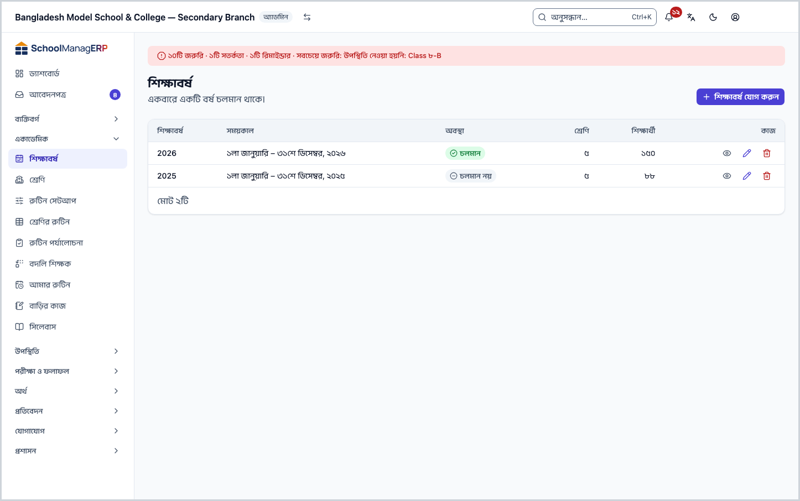
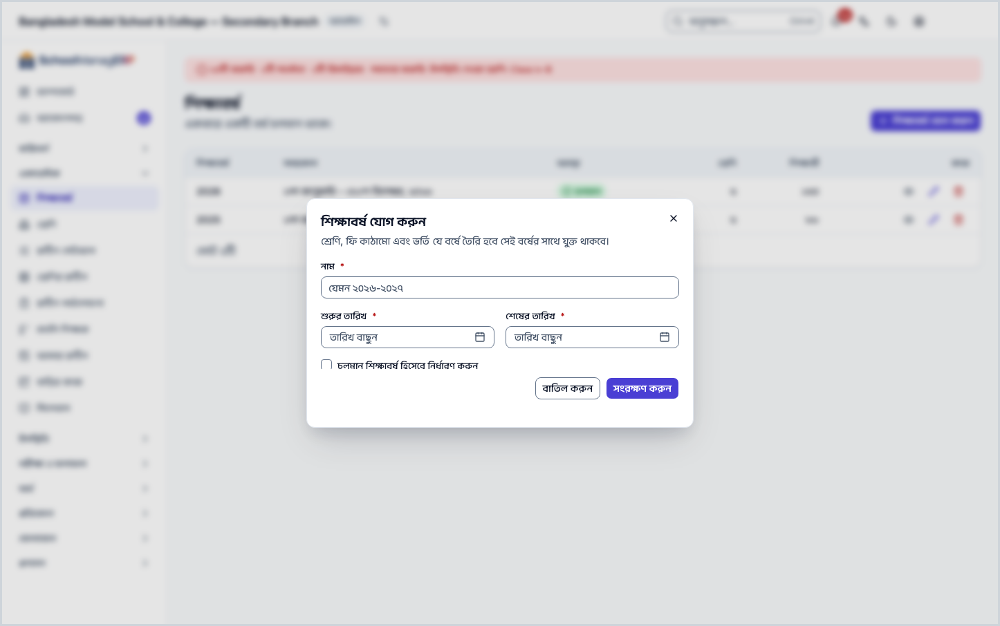
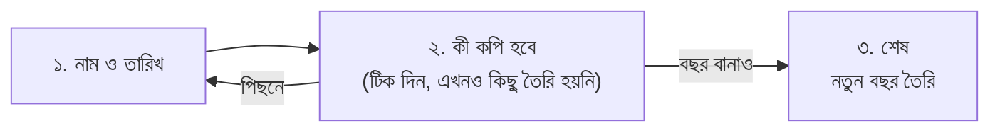

<!-- guide:meta
feature: academics.academicYears
title: শিক্ষাবর্ষ তৈরি ও পরিচালনা
summary: শিক্ষাবর্ষ যোগ করুন, কোনটি চলমান তা ঠিক করুন, বছরের টার্ম সাজান, আর অব্যবহৃত বছর মুছুন।
roles: [ADMIN]
sources:
  - client-admin/src/routes/_staff/academic-years/index.tsx
  - client-admin/src/routes/_staff/academic-years/$academicYearId.tsx
  - client-admin/src/routes/_staff/academic-years/-year-form-dialog.tsx
  - client-admin/src/routes/_staff/academic-years/-set-current-dialog.tsx
  - client-admin/src/routes/_staff/academic-years/-delete-year-dialog.tsx
  - client-admin/src/routes/_staff/academic-years/-close-year-dialog.tsx
  - client-admin/src/routes/_staff/academic-years/$academicYearId_.next.tsx
  - client-admin/src/routes/_staff/academic-years/-next-year/name-step.tsx
  - client-admin/src/routes/_staff/academic-years/-next-year/preview-step.tsx
  - client-admin/src/routes/_staff/academic-years/-next-year/done-step.tsx
  - client-admin/src/routes/_staff/academic-years/-detail/terms-tab.tsx
  - client-admin/src/routes/_staff/academic-years/-detail/classes-tab.tsx
  - client-admin/src/routes/_staff/academic-years/-detail/fee-structures-tab.tsx
  - client-admin/src/routes/_staff/academic-years/-detail/tab-query-state.tsx
  - server/src/modules/academics/academic-year.controller.ts
  - server/src/modules/academics/academic-year.service.ts
labels:
  [
    academicYears:list.*,
    academicYears:form.*,
    academicYears:deleteDialog.*,
    academicYears:setCurrentDialog.*,
    academicYears:detail.*,
    academicYears:nextYear.*,
    academicYears:closeYear.*,
    academicYears:readiness.*,
    academicYears:closedNotice.*,
    nav:items.academicYears,
    nav:groups.academics,
    common:accessDenied.*,
  ]
helpIds:
  [
    academics.academicYears,
    academics.academicYears.action.add,
    academics.academicYears.action.setCurrent,
    academics.academicYears.action.delete,
    academics.academicYears.action.addTerm,
    academics.academicYears.field.isCurrent,
    academics.academicYears.field.dates,
    academics.academicYears.action.edit,
  ]
devices: [desktop]
entry: [sidebar, palette]
keywords:
  [শিক্ষাবর্ষ, সেশন, চলমান বর্ষ, চলতি বছর, টার্ম, সেমিস্টার, নতুন বছর, academic year, session, current year, term, semester]
appVersion: 0.1.0 (1798f8b1f)
owner: tareq89
lastVerified: 2026-10-24
knownIssues: []
-->

# শিক্ষাবর্ষ তৈরি ও পরিচালনা

শিক্ষাবর্ষ যোগ করুন, কোনটি এখন চলছে তা ঠিক করুন, বছরের টার্ম সাজান, আর ভুল করে বানানো বছর মুছে ফেলুন।

**যেতে হবে:** বাম মেনুতে **একাডেমিক → শিক্ষাবর্ষ**। এই পাতার কাজ কম্পিউটারে করুন।
**শুরুর আগে:** আপনি স্কুলের অ্যাডমিন হবেন ([কে কী করতে পারেন](#roles))। বছরটি কবে শুরু আর কবে শেষ, সেই দুটি তারিখ হাতে রাখুন।

স্কুলের প্রায় সব কিছু একটি শিক্ষাবর্ষের ভেতরে থাকে: [শ্রেণি](classes.md), ফি কাঠামো, ভর্তি, পরীক্ষা। একবারে একটি বর্ষই **চলমান** থাকে। নতুন শ্রেণি বানানো বা তালিকা দেখার সময় অ্যাপ সাধারণত চলমান বর্ষটিই আগে বেছে রাখে। তাই নতুন বছর শুরু হলে সেটিকে চলমান করতে ভুলবেন না।

[শিক্ষাবর্ষ যোগ করুন](#task-main) · [চলমান করুন](#task-current) · [টার্ম সাজান](#task-terms) · [পরের বছর বানান](#task-next) · [বছর বন্ধ করুন](#task-close) · [বছর আবার খুলুন](#task-reopen) · [সমস্যা ও সমাধান](#trouble)

**এই পাতায় যা আছে**

- [এই পাতায় যেভাবে আসবেন](#arrive)
- [শিক্ষাবর্ষ যোগ করুন](#task-main)
- [বর্ষ যোগ হয়েছে কি না বুঝবেন কীভাবে](#confirm)
- [অন্য পরিস্থিতিতে](#other)
  - [চলমান শিক্ষাবর্ষ বদলান](#task-current)
  - [এই বছর থেকে পরের বছর বানান](#task-next)
  - [বছর চলমান করার আগে](#task-before-current)
  - [বছর বন্ধ করুন](#task-close)
  - [বছর আবার খুলুন](#task-reopen)
  - [নাম বা তারিখ বদলান](#task-edit)
  - [টার্ম যোগ করুন ও সাজান](#task-terms)
  - [শিক্ষাবর্ষ মুছুন](#task-delete)
  - [বর্ষের পাতা: ট্যাবগুলো](#task-detail)
- [সমস্যা ও সমাধান](#trouble)
- [কে কী করতে পারেন](#roles)
- [আরও জানুন](#more)

---

## এই পাতায় যেভাবে আসবেন 

**বাম মেনু থেকে:** **একাডেমিক → শিক্ষাবর্ষ** চাপুন। নিচের ধাপ ১ থেকে শুরু করুন।

**খোঁজার ঘর থেকে:** উপরের খোঁজার ঘরে (Ctrl+K) **শিক্ষাবর্ষ যোগ করুন** লিখে বেছে নিন। → শিক্ষাবর্ষের তালিকা খোলে, আর **শিক্ষাবর্ষ যোগ করুন** ঘরটি নিজে থেকে খোলা থাকে। নিচের ধাপ ৩ থেকে শুরু করুন। খোঁজার নিয়ম: [যেকোনো পাতা খুঁজে পাওয়া](../start/find-anything.md)।

---

## শিক্ষাবর্ষ যোগ করুন 

1. বাম মেনুতে **একাডেমিক → শিক্ষাবর্ষ** চাপুন।

   → উপরে **শিক্ষাবর্ষ** শিরোনাম, নিচে "একবারে একটি বর্ষ চলমান থাকে।" তালিকার কলাম: **শিক্ষাবর্ষ**, **সময়কাল**, **অবস্থা**, **শ্রেণি**, **শিক্ষার্থী**। কোনো বর্ষ না থাকলে লেখা থাকে **এখনও কোনো শিক্ষাবর্ষ নেই**, সঙ্গে **প্রথম শিক্ষাবর্ষ যোগ করুন** বোতাম।

2. পাতার উপরে **শিক্ষাবর্ষ যোগ করুন** চাপুন।

   → **শিক্ষাবর্ষ যোগ করুন** ঘর খোলে: "শ্রেণি, ফি কাঠামো এবং ভর্তি যে বর্ষে তৈরি হবে সেই বর্ষের সাথে যুক্ত থাকবে।"

3. **নাম** ঘরে বছরের নাম লিখুন, যেমন `২০২৬-২০২৭` বা `২০২৭`।

   → ফাঁকা রাখলে **নাম আবশ্যক** দেখায়।

4. **শুরুর তারিখ** আর **শেষের তারিখ** বেছে নিন।

   → দুটিই লাগবে; না দিলে **শুরু ও শেষের তারিখ আবশ্যক**। শেষের তারিখ শুরুর তারিখের পরে না হলে **শেষের তারিখ অবশ্যই শুরুর তারিখের পরে হতে হবে** দেখায়।

5. এই বছরটিই যদি এখন চলে, **চলমান শিক্ষাবর্ষ হিসেবে নির্ধারণ করুন** ঘরে টিক দিন।

   → ঘরের নিচে একটি সতর্কবার্তা আসে: অন্য যে বর্ষ এখন চলমান, সেটি আর চলমান থাকবে না। **হ্যাঁ, চলমান হিসেবে নির্ধারণ করুন** চাপলে টিক বসে; **বাতিল** চাপলে টিক বসে না।

6. **সংরক্ষণ করুন** চাপুন।

   → ঘর বন্ধ হয়, আর নতুন বর্ষ তালিকায় আসে। টিক দিয়ে থাকলে তার **অবস্থা** ঘরে চলমান চিহ্ন থাকে, আর আগের চলমান বর্ষটি থেকে সেই চিহ্ন সরে যায়।

> **মনে রাখুন:** বর্ষ বানালেই শ্রেণি তৈরি হয় না। এরপর [শ্রেণি](classes.md) পাতায় এই বর্ষের শ্রেণি যোগ করুন। পুরো সেটআপের ক্রম: [স্কুল সাজানোর ধাপ](../admin/setup-order.md#step-2)।

---

## বর্ষ যোগ হয়েছে কি না বুঝবেন কীভাবে 

শিক্ষাবর্ষ শুধু ইন্টারনেট থাকলে সংরক্ষিত হয়; ডিভাইসে জমিয়ে রেখে পরে পাঠানো যায় না। তাই **এই ডিভাইসে সংরক্ষিত** অবস্থা এখানে নেই।

| অবস্থা                       | কীভাবে বুঝবেন                               | এরপর কী                                     |
| ---------------------------- | ------------------------------------------- | ------------------------------------------- |
| **শুধু স্ক্রিনে বদলেছে**     | ঘর খোলা, তথ্য লেখা, কিন্তু ঘর বন্ধ হয়নি    | **সংরক্ষণ করুন** চাপুন                      |
| **স্কুলের সিস্টেমে পৌঁছেছে** | ঘর বন্ধ হয়েছে, আর তালিকায় নতুন বর্ষটি আছে | কাজ শেষ। এবার [শ্রেণি](classes.md) যোগ করুন |

**যাচাই করতে চাইলে:** পাতা রিলোড করুন। তালিকায় বর্ষটি থাকলে সিস্টেমে আছে। নামে চাপলে বর্ষের পাতায় **সময়কাল** দেখে তারিখ মিলিয়ে নিন।

**বার্তা না এলে:** [সমস্যা ও সমাধান](#trouble) দেখুন। ঘরে লেখা তথ্য তখনও ঘরেই থাকে।

---

## অন্য পরিস্থিতিতে 

### চলমান শিক্ষাবর্ষ বদলান 

নতুন বছর শুরু হলে এটি করুন। একবারে একটিই বর্ষ চলমান থাকে।

1. তালিকায় নতুন বর্ষের নামে চাপুন।

   → বর্ষের পাতা খোলে।

2. পাতার উপরে **চলমান হিসেবে নির্ধারণ করুন** চাপুন। (বর্ষটি আগে থেকেই চলমান হলে বোতামটি থাকে না।)

   → **চলমান শিক্ষাবর্ষ নির্ধারণ করুন** ঘর খোলে।

| আপনি চাপলেন                    | কী হবে                                                                         | জমা হলো? |
| ------------------------------ | ------------------------------------------------------------------------------ | -------- |
| **চলমান হিসেবে নির্ধারণ করুন** | এই বর্ষ চলমান হয়; আগের চলমান বর্ষ আর চলমান থাকে না। পুরোনো বছরের তথ্য মোছে না | হ্যাঁ    |
| **বাতিল করুন**                 | কিছুই বদলায় না                                                                | না       |

> **মনে রাখুন:** চলমান বর্ষ বদলালে শিক্ষার্থী নতুন বছরে নিজে থেকে ওঠে না। শিক্ষার্থীদের পরের শ্রেণিতে তোলা আলাদা কাজ।

ঘরটি বছরটির তিনটি সংখ্যাও দেখায়। দেখুন [বছর চলমান করার আগে](#task-before-current)।

ব্যর্থ হলে ঘরে **চলমান শিক্ষাবর্ষ নির্ধারণ করতে ব্যর্থ হয়েছে** দেখায়।

### এই বছর থেকে পরের বছর বানান 

বছর শেষ হয়ে এলে এটি করুন। এই বছরের সাজানো তথ্য নতুন বছরে কপি হয়ে যায়, তাই শ্রেণি, বিষয় আর ফি আবার নতুন করে বানাতে হয় না। শেষ ধাপের আগে কিছুই তৈরি হয় না।

1. বছরের তালিকায় সারির শেষে **পরের বছর বানাও** চাপুন। অথবা বছরটি খুলে **এই বছর থেকে পরের বছর বানাও** চাপুন। যে বছর আগেই বন্ধ হয়েছে, তাতে এই বোতাম থাকে না। (Ctrl+K চেপে **পরের বছর বানাও** লিখলেও হয়; তখন চলমান বছর থেকে শুরু হয়।)

   → **পরের বছর বানাও** পাতা খোলে। ধাপ তিনটি: **নাম ও তারিখ**, **কী কপি হবে**, **শেষ**।

2. **নতুন বছরের নাম**, **প্রথম দিন** আর **শেষ দিন** দেখে নিন, তারপর **এরপর** চাপুন।

   → অ্যাপ নিজেই ভরে দেয়: `২০২৬-২০২৭` হয় `২০২৭-২০২৮`, প্রথম দিন হয় এই বছর শেষ হওয়ার পরের দিন, আর শেষ দিন এক বছর পরের এক দিন আগে। আপনার স্কুলে আলাদা হলে বদলে নিন। নাম খালি থাকলে **একটি নাম লিখুন**, তারিখ না দিলে **প্রথম ও শেষ দিন লিখুন**, আর শেষ দিন প্রথম দিনের পরে না হলে **শেষ দিন প্রথম দিনের পরে হতে হবে** দেখায়।

3. **কী কপি হবে** ধাপে সাতটি ঘর দেখবেন: **শ্রেণি**, **শাখা**, **শ্রেণির বিষয়**, **শিক্ষকের দায়িত্ব**, **ফির কাঠামো**, **গ্রেডিং স্কেল**, **সাময়িক**। প্রতিটিতে লেখা থাকে, যেমন **নতুন ১২ · আগেই আছে ০ · বাদ ০**। যেটা কপি করতে চান না, তার টিক তুলে দিন।

   → **নতুন** মানে যা যোগ হবে। **আগেই আছে** মানে নতুন বছরে যা আগে থেকেই আছে; সেটা যেমন আছে তেমনই থাকবে। **বাদ** মানে যা কপি করা যায়নি। সব টিক তুলে দিলে **কপি করার জন্য অন্তত একটি টিক দিন।** দেখায় আর **বছর বানাও** বন্ধ থাকে।

4. **যে শিক্ষকরা বাদ পড়েছেন** নামে একটি কার্ড এলে সেটি পড়ুন। তাতে প্রতিজন শিক্ষকের নামের সঙ্গে শাখা আর বিষয় লেখা থাকে।

   → নতুন বছরে মিল থাকা শাখা না থাকলে শিক্ষক বাদ পড়েন। শাখাটি যোগ করে আবার **পরের বছর বানাও** চালান; এতে শুধু যা নেই তা যোগ হয়।

5. **বছর বানাও** চাপুন।

   → **শেষ** ধাপ খোলে: **২০২৭-২০২৮ তৈরি হয়েছে**, সঙ্গে ওই তিনটি সংখ্যার যোগফল। কিছু ভুল হলে **কিছুই তৈরি হয়নি। আবার চেষ্টা করুন।** দেখায়, আর অর্ধেক বানানো কোনো বছর পড়ে থাকে না।

6. **২০২৬-২০২৭ থেকে আরও কপি করুন:** লেখার নিচে যা লাগে তা চাপুন। **ক্লাস রুটিন** রুটিন দেখার পাতা খোলে, **ক্যালেন্ডার** ক্যালেন্ডার কপির পাতা খোলে, **জরিমানার নিয়ম** ছোট একটি ঘর খোলে, আর **নিয়মিত ফির সূচি** ফির সূচির পাতা খোলে। তারপর নতুন ফি দেখতে **এরপর: ফির কাঠামো পাতায় ফির পরিমাণ দেখে নিন** চাপুন, অথবা **নতুন বছরে যান**।

| আপনি চাপলেন               | কী হবে                                         | জমা হলো? |
| ------------------------- | ---------------------------------------------- | -------- |
| **বছর বানাও**             | নতুন বছর আর টিক দেওয়া সব কিছু একসাথে তৈরি হয় | হ্যাঁ    |
| **পিছনে** (দ্বিতীয় ধাপে) | নাম ও তারিখে ফিরে যায়; কিছুই তৈরি হয় না      | না       |
| **পিছনে** (প্রথম ধাপে)    | পাতা ছেড়ে বেরিয়ে যায়; কিছুই তৈরি হয় না     | না       |

একই নতুন বছরের জন্য আবার চালানো যায়। **আগেই আছে** জিনিস কখনো বদলায় না, দ্বিগুণও হয় না। এরপর নতুন বছরের প্রথম দিন এলে [নতুন বছরকে চলমান করুন](#task-current)।

### বছর চলমান করার আগে 

**চলমান হিসেবে নির্ধারণ করুন** চাপলে ([চলমান শিক্ষাবর্ষ বদলান](#task-current) দেখুন) ঘরটি আগে যে বছর চলমান করতে যাচ্ছেন তার তিনটি সংখ্যা দেখায়:

> **শ্রেণি: ১২ · শিক্ষকের দায়িত্ব: ৪০ · উত্তীর্ণ করানো চূড়ান্ত: ১**

| সংখ্যা                      | কী দেখে নেবেন                                                                                       |
| --------------------------- | --------------------------------------------------------------------------------------------------- |
| **শ্রেণি**                  | নতুন বছরের শ্রেণিগুলো আছে                                                                           |
| **শিক্ষকের দায়িত্ব**       | শিক্ষকদের বিষয় ও শাখা দেওয়া হয়েছে                                                                |
| **উত্তীর্ণ করানো চূড়ান্ত** | এই বছরের সঙ্গে যুক্ত কতগুলো [উত্তীর্ণ করানোর তালিকা](../exams-results/promotion.md) চূড়ান্ত হয়েছে |

**শিক্ষকের দায়িত্ব** ০ হলে একটি হলুদ লেখা আসে: **এই বছরে শিক্ষকের দায়িত্ব দেওয়া না হওয়া পর্যন্ত শিক্ষকরা কোনো শিক্ষার্থী দেখতে পাবেন না।** এটি শুধু সতর্কতা। তবুও আপনি **চলমান হিসেবে নির্ধারণ করুন** চাপতে পারেন; তখন দায়িত্ব না দেওয়া পর্যন্ত শিক্ষকরা কোনো শিক্ষার্থী দেখবেন না।

### বছর বন্ধ করুন 

বছরের কাজ শেষ হলে বন্ধ করে দিন, যাতে ভুল করে কেউ এর পরীক্ষা, নম্বর বা বিল না বদলায়। পরে চাইলে আবার খোলা যায়।

1. বছরটি চলমান নয় তা দেখে নিন। তারপর বছরটি খুলে **বছর বন্ধ করো** চাপুন। (Ctrl+K → **বছর বন্ধ করো** চাপলে চলমান নয় এমন সবচেয়ে নতুন খোলা বছরটি খোলে।) চলমান বছরে **বছর বন্ধ করো** বোতাম থাকে না: আগে [অন্য বছরকে চলমান করুন](#task-current)।

   → **২০২৬-২০২৭ বন্ধ করুন** ঘর খোলে: "বছর বন্ধ হলে এর পরীক্ষা, নম্বর, বিল, উপস্থিতি ও ভর্তির তথ্য আর বদলানো যাবে না। টাকা নেওয়া যাবে। পরে চাইলে বছরটি আবার খুলতে পারবেন।"

2. **যা আর বদলাবে না** পড়ুন। এতে শুধু সেগুলোই থাকে যার রেকর্ড এই বছরে আছে, সঙ্গে সংখ্যা, যেমন **পরীক্ষা: ৬**, **বিল: ১,২৪০**, **ভর্তি: ৩৮০**। কিছু না থাকলে লেখা থাকে **এই বছরে এখনও কিছু লেখা হয়নি।**

3. **বন্ধ করার আগে দেখে নিন** এলে সেটি পড়ুন। লাইনগুলো হলো **উত্তীর্ণ করানো হয়নি এমন শ্রেণি**, **এখনও সক্রিয় শিক্ষার্থী**, **গ্রুপ বাকি আছে**, **বকেয়া টাকা** আর **ফল প্রকাশ হয়নি**; প্রতিটির পাশে সংখ্যা বা টাকার অঙ্ক।

   → এগুলো শুধু মনে করিয়ে দেওয়া। চাইলে এগুলো রেখেই বন্ধ করা যায়। **গ্রুপ বাকি আছে** মেটাতে দেখুন [অনেক শিক্ষার্থীর গ্রুপ একসাথে ঠিক করুন](../exams-results/promotion.md#task-groups)।

4. লাল বার এসে **এই বছরের একটি উত্তীর্ণ করানোর খসড়া এখনও খোলা। আগে সেটি চূড়ান্ত করুন বা মুছে ফেলুন।** লিখলে **উত্তীর্ণ করানো খুলুন** চাপুন আর খসড়াটি চূড়ান্ত করুন বা মুছুন। তা না করা পর্যন্ত **বছর বন্ধ করো** বন্ধ থাকে।

5. **বছর বন্ধ করো** চাপুন। বাড়তি অনুমোদনের একটি ঘর খোলে; সেটি যা চায় তা শেষ করুন, তাহলে বছর বন্ধ হয়।

   → বছরের পাতায় ধূসর চিহ্ন **… তারিখে বন্ধ হয়েছে** আসে। এই বছরের ভেতরে কাজ করা পাতায় **২০২৬-২০২৭ বন্ধ আছে। এটা বদলাতে হলে শিক্ষাবর্ষ পাতায় গিয়ে বছরটি আবার খুলুন।** দেখায়।

বন্ধ বছরেও টাকা নেওয়া যায়, কিন্তু নতুন বিল করা যায় না। কেউ বন্ধ বছরে কিছু বদলাতে গেলে অ্যাপ বলে **এই বছর বন্ধ। বদলাতে শিক্ষাবর্ষ পাতায় গিয়ে আবার খুলুন।**

### বছর আবার খুলুন 

1. বন্ধ বছরটি খুলে **আবার খোলো** চাপুন।

   → **২০২৬-২০২৭ আবার খুলুন** ঘর জিজ্ঞেস করে: "২০২৬-২০২৭" আবার খুলবেন? এর পরীক্ষা, নম্বর, বিল, উপস্থিতি ও ভর্তির তথ্য আবার বদলানো যাবে।

2. **আবার খোলো** চাপুন। বাড়তি অনুমোদনের ঘরটি শেষ করুন।

   → **বন্ধ হয়েছে** চিহ্ন চলে যায়, বছরটি আবার বদলানো যায়। না হলে **বছর আবার খোলা যায়নি** দেখায়।

### নাম বা তারিখ বদলান 

1. তালিকায় বর্ষের সারির শেষে **সম্পাদনা** চাপুন। (বর্ষের পাতায় উপরেও **সম্পাদনা** আছে।)

   → **শিক্ষাবর্ষ সম্পাদনা করুন** ঘর খোলে, আগের তথ্য ভরা।

2. **নাম**, **শুরুর তারিখ** বা **শেষের তারিখ** বদলান, তারপর **সংরক্ষণ করুন** চাপুন।

   → ঘর বন্ধ হয়, তালিকায় নতুন তথ্য দেখা যায়।

কিছু বদলে **বাতিল** বা ঘরের বাইরে চাপলে অ্যাপ জিজ্ঞেস করে পরিবর্তন ফেলে দেবেন কি না।

### টার্ম যোগ করুন ও সাজান 

টার্ম হলো বছরের ভাগ, যেমন **প্রথম সাময়িক** আর **দ্বিতীয় সাময়িক**। পরীক্ষা ও ফলাফল এই ভাগ ধরে হয়। ট্যাবের নাম আপনার স্কুলের সেটিংস অনুযায়ী **টার্ম**, **সেমিস্টার** বা **ট্রাইমেস্টার** দেখাতে পারে।

1. বর্ষের পাতায় **টার্ম** ট্যাব খুলুন।

   → টার্মের তালিকা: **ক্রম**, **নাম**, **সময়কাল**, **দৈর্ঘ্য** (সপ্তাহে)। না থাকলে **এই শিক্ষাবর্ষের জন্য কোনো টার্ম নির্ধারিত নেই**।

2. **টার্ম যোগ করুন** চাপুন।

   → **টার্ম যোগ করুন** ঘর খোলে।

3. **নাম**, **শুরুর তারিখ**, **শেষের তারিখ** দিয়ে **সংরক্ষণ করুন** চাপুন।

   → টার্মটি তালিকায় আসে। তারিখ বছরের বাইরে গেলে **টার্মের তারিখ অবশ্যই শিক্ষাবর্ষের মধ্যে হতে হবে (…)** দেখায়। অন্য টার্মের সঙ্গে তারিখ মিলে গেলে **"{নাম}" চলতি শিক্ষাবর্ষের একটি বিদ্যমান টার্মের সাথে সাংঘর্ষিক** দেখায়।

4. ক্রম বদলাতে সারির **উপরে সরান** বা **নিচে সরান** তীর চাপুন।

   → সঙ্গে সঙ্গে ক্রম বদলায়। না হলে **ক্রম বদলানো যায়নি** দেখায়।

টার্ম বদলাতে বা মুছতে সারির শেষের **সম্পাদনা** বা **মুছুন** চাপুন। মোছার আগে **টার্ম মুছুন** ঘরে নিশ্চিত করতে হয়; মুছলে ফিরিয়ে আনা যায় না।

### শিক্ষাবর্ষ মুছুন 

শুধু ভুল করে বানানো, খালি বর্ষ মোছা যায়। পুরোনো বছর মুছবেন না; সেটি শুধু চলমান না থাকলেই চলে।

1. তালিকায় বর্ষের সারির শেষে **মুছুন** চাপুন। (বর্ষের পাতায় উপরের **আরও অ্যাকশন** মেনুতেও আছে।)

   → **শিক্ষাবর্ষ মুছুন** ঘর খোলে: "{নাম}" মুছে ফেলবেন? এটি ফিরিয়ে আনা যাবে না।

2. **মুছুন** চাপুন।

| আপনি চাপলেন    | কী হবে                                                                             | জমা হলো? |
| -------------- | ---------------------------------------------------------------------------------- | -------- |
| **মুছুন**      | বর্ষটি তালিকা থেকে চলে যায়; ফেরানো যায় না। বর্ষের পাতা থেকে মুছলে তালিকায় ফেরেন | হ্যাঁ    |
| **বাতিল করুন** | কিছুই বদলায় না                                                                    | না       |

**যে বর্ষ মোছা যায় না:** চলমান বর্ষ, আর যে বর্ষে এখনও শ্রেণি, ফি কাঠামো, শিক্ষার্থী ভর্তির রেকর্ড, পরীক্ষা, শিক্ষার্থীর বিল, কর্মী মূল্যায়ন (এসিআর) বা এর সঙ্গে যুক্ত অন্য কোনো রেকর্ড আছে। টার্ম মোছা আটকায় না; বর্ষের সঙ্গে সেগুলোও যায়। তখন ঘরে কারণ লেখা থাকে। চলমান বর্ষে: **এটি চলতি বছর। আগে অন্য একটি বছরকে চলতি করুন।** ভেতরে তথ্য থাকলে কী আছে তা বলে, যেমন **এই বছরে এখনও শ্রেণি এবং পরীক্ষা আছে। আগে সেগুলো সরিয়ে ফেলুন।** অন্য রেকর্ড থাকলে: **এই বছরটি এখনও অন্য রেকর্ডে ব্যবহার হচ্ছে। আগে সেগুলো সরান বা সরিয়ে নিন।** চলমান হলে আগে অন্য বর্ষকে [চলমান করুন](#task-current)। ভেতরের তথ্য থাকলে বর্ষটি রেখে দিন।

### বর্ষের পাতা: ট্যাবগুলো 

তালিকায় বর্ষের নামে বা **দেখুন**-এ চাপলে তার পাতা খোলে। উপরে নাম, চলমান কি না, আর **সময়কাল**, **শ্রেণি**, **শিক্ষার্থী**, **ফি কাঠামো**-র সংখ্যা।

| ট্যাব         | কী আছে                                                                                             |
| ------------- | -------------------------------------------------------------------------------------------------- |
| **শ্রেণি**    | এই বর্ষের শ্রেণি (**নাম**, **গ্রেড**)। **দেখুন** চাপলে [শ্রেণির পাতা](classes.md#task-detail) খোলে |
| **ফি কাঠামো** | এই বর্ষের ফি কাঠামো: **নাম**, **ধরন**, **শ্রেণি** (সবার জন্য হলে **পুরো বিদ্যালয়**), **পরিমাণ**   |
| **টার্ম**     | বছরের ভাগ; [টার্ম যোগ করুন ও সাজান](#task-terms)                                                   |

---

## সমস্যা ও সমাধান 

| আপনি যা দেখছেন                                                                                    | কী করবেন                                                                                               | কে সাহায্য করতে পারেন |
| ------------------------------------------------------------------------------------------------- | ------------------------------------------------------------------------------------------------------ | --------------------- |
| **এই পাতাটি দেখার অনুমতি আপনার নেই।**                                                             | এই পাতা শুধু অ্যাডমিন দেখেন। **ড্যাশবোর্ডে ফিরে যান** চাপুন।                                           | অ্যাডমিন              |
| **শিক্ষাবর্ষ লোড করতে ব্যর্থ হয়েছে**                                                             | ইন্টারনেট দেখে পাতা রিলোড করুন।                                                                        | অ্যাডমিন              |
| **শিক্ষাবর্ষ সংরক্ষণ করতে ব্যর্থ হয়েছে**                                                         | ইন্টারনেট দেখে আবার **সংরক্ষণ করুন** চাপুন। ঘরের লেখা থেকে যায়।                                       | অ্যাডমিন              |
| **শেষের তারিখ অবশ্যই শুরুর তারিখের পরে হতে হবে**                                                  | শেষের তারিখ শুরুর পরের কোনো দিন দিন।                                                                   | অ্যাডমিন              |
| **এটি চলতি বছর। …**, **এই বছরে এখনও … আছে। …** বা **এই বছরটি এখনও অন্য রেকর্ডে ব্যবহার হচ্ছে। …** | [শিক্ষাবর্ষ মুছুন](#task-delete) দেখুন। সাধারণত বর্ষটি রেখে দেওয়াই ঠিক।                               | অ্যাডমিন              |
| **শিক্ষাবর্ষ মুছতে ব্যর্থ হয়েছে**                                                                | ইন্টারনেট দেখে আবার **মুছুন** চাপুন।                                                                   | অ্যাডমিন              |
| **টার্মের তারিখ অবশ্যই শিক্ষাবর্ষের মধ্যে হতে হবে (…)**                                           | বন্ধনীতে লেখা বছরের তারিখের মধ্যে টার্মের তারিখ দিন, অথবা আগে [বর্ষের তারিখ বদলান](#task-edit)।        | অ্যাডমিন              |
| **"{নাম}" চলতি শিক্ষাবর্ষের একটি বিদ্যমান টার্মের সাথে সাংঘর্ষিক**                                | নামে লেখা টার্মের তারিখের সঙ্গে যেন না মেলে, এমন তারিখ দিন।                                            | অ্যাডমিন              |
| **টার্ম সংরক্ষণ করতে ব্যর্থ হয়েছে**                                                              | ইন্টারনেট দেখে আবার চেষ্টা করুন।                                                                       | অ্যাডমিন              |
| **ক্রম বদলানো যায়নি**                                                                            | পাতা রিলোড করে আবার তীর চাপুন।                                                                         | অ্যাডমিন              |
| নতুন শ্রেণি বা তালিকায় পুরোনো বছর দেখাচ্ছে                                                       | নতুন বর্ষটি [চলমান করুন](#task-current)।                                                               | অ্যাডমিন              |
| **কিছুই তৈরি হয়নি। আবার চেষ্টা করুন।**                                                           | ইন্টারনেট দেখে আবার **বছর বানাও** চাপুন। অর্ধেক বানানো কিছু পড়ে থাকে না।                              | অ্যাডমিন              |
| **কপি করার জন্য অন্তত একটি টিক দিন।**                                                             | **কী কপি হবে** ধাপে অন্তত একটি ঘরে টিক দিন।                                                            | অ্যাডমিন              |
| **যে শিক্ষকরা বাদ পড়েছেন** কার্ডে শিক্ষকের নাম                                                   | নতুন বছরে মিল থাকা শাখা নেই। শাখা যোগ করে আবার [পরের বছর বানান](#task-next)।                           | অ্যাডমিন              |
| কোনো বছরে **পরের বছর বানাও** নেই                                                                  | বছরটি বন্ধ। আগে [আবার খুলুন](#task-reopen)।                                                            | অ্যাডমিন              |
| কোনো বছরে **বছর বন্ধ করো** নেই                                                                    | চলমান বছর বন্ধ করা যায় না। আগে [অন্য বছরকে চলমান করুন](#task-current)।                                | অ্যাডমিন              |
| **এই বছরের একটি উত্তীর্ণ করানোর খসড়া এখনও খোলা। …**                                              | **উত্তীর্ণ করানো খুলুন** চাপুন, তারপর [খসড়াটি চূড়ান্ত করুন বা মুছুন](../exams-results/promotion.md)। | অ্যাডমিন              |
| **বছর বন্ধ করা যায়নি** বা **বছর আবার খোলা যায়নি**                                               | ইন্টারনেট আর অনুমোদনের ঘর দেখে আবার চেষ্টা করুন।                                                       | অ্যাডমিন              |
| **এই বছর বন্ধ। বদলাতে শিক্ষাবর্ষ পাতায় গিয়ে আবার খুলুন।**                                       | বদলানো দরকার হলে [বছরটি আবার খুলুন](#task-reopen)।                                                     | অ্যাডমিন              |

কোনো পাতা বা বোতাম দেখতে না পেলে দেখুন [আমি এটা দেখতে পাচ্ছি না কেন?](../help/cant-see-this.md)।

---

## কে কী করতে পারেন 

| ভূমিকা                                                                                           | তালিকা ও বর্ষের পাতা দেখতে | বর্ষ যোগ, সম্পাদনা, চলমান করা, মোছা, পরের বছর বানানো, বন্ধ ও আবার খোলা | টার্ম যোগ ও বদল |
| ------------------------------------------------------------------------------------------------ | -------------------------- | ---------------------------------------------------------------------- | --------------- |
| অ্যাডমিন                                                                                         | হ্যাঁ                      | হ্যাঁ                                                                  | হ্যাঁ           |
| একাডেমিক কো-অর্ডিনেটর, শিক্ষক, হিসাবরক্ষক, অফিস সহকারী, পরীক্ষা নিয়ন্ত্রক, পরিচালনা পর্ষদ সদস্য | না                         | না                                                                     | না              |

অন্য ভূমিকার বাম মেনুতে **শিক্ষাবর্ষ** থাকে না। পাতাটি খুললে তাঁরা **এই পাতাটি দেখার অনুমতি আপনার নেই।** দেখেন।

---

## আরও জানুন 

<strong>পাতার অংশগুলো</strong> — উপর থেকে নিচে

1. **শিক্ষাবর্ষ** — শিরোনাম ও "একবারে একটি বর্ষ চলমান থাকে।"
2. **শিক্ষাবর্ষ যোগ করুন** — পাতার উপরের বোতাম।
3. **তালিকা** — **শিক্ষাবর্ষ**, **সময়কাল**, **অবস্থা**, **শ্রেণি**, **শিক্ষার্থী**; প্রতি সারির শেষে **দেখুন**, **সম্পাদনা**, **মুছুন**।

<strong>ঘরগুলোর অর্থ</strong>

<!-- guide:generated:fields:academicYears -->

| ঘর                                    | কী লিখবেন                                                                                  | বাধ্যতামূলক? |
| ------------------------------------- | ------------------------------------------------------------------------------------------ | ------------ |
| নাম                                   | বছরের নাম, যেমন ২০২৬-২০২৭।                                                                 | হ্যাঁ        |
| শুরুর তারিখ                           | বছরের প্রথম দিন।                                                                           | হ্যাঁ        |
| শেষের তারিখ                           | বছরের শেষ দিন; শুরুর তারিখের পরে হতে হবে।                                                  | হ্যাঁ        |
| চলমান শিক্ষাবর্ষ হিসেবে নির্ধারণ করুন | টিক দিলে এটি চলমান হয়, আর অন্য চলমান বর্ষ থেকে চিহ্ন সরে যায়। টিক দিলে নিশ্চিত করতে হয়। | না           |
| টার্মের নাম                           | যেমন প্রথম সাময়িক।                                                                        | হ্যাঁ        |
| টার্মের শুরু ও শেষের তারিখ            | বছরের তারিখের মধ্যে, অন্য টার্মের সঙ্গে না মিলিয়ে।                                        | হ্যাঁ        |
| শুরু ও শেষের তারিখ                    | বছরের প্রথম ও শেষ দিন। শেষ দিন প্রথম দিনের পরে হতে হবে।                                    | হ্যাঁ        |

<!-- /guide:generated -->

<strong>শিক্ষাবর্ষ কীভাবে কাজ করে</strong> — বর্ষের ভেতরে টার্ম, শ্রেণি আর ফি

<figure>
  
  <figcaption><em>শিক্ষাবর্ষের ভেতরে কী থাকে</em></figcaption>
</figure>

- একবারে একটি বর্ষ চলমান। নতুন বর্ষ চলমান করলে পুরোনোটি চলমান থাকে না, কিন্তু তার তথ্য থেকে যায়।
- শ্রেণি একটি বর্ষের সঙ্গে বাঁধা; পরে অন্য বর্ষে সরানো যায় না। বিস্তারিত: [স্কুলের সব কিছু কীভাবে জোড়া লাগে](../admin/how-it-works.md#task-structure)।
- টার্ম বছরের ভাগ; পরীক্ষা ও ফলাফল টার্ম ধরে হয়।

**সম্পর্কিত পাতা**

- [**শ্রেণি**](classes.md) — বর্ষের ভেতরে শ্রেণি, শাখা আর বিষয় সাজান।
- [**স্কুল সাজানোর ধাপ**](../admin/setup-order.md) — কোন কাজের পর কোনটি।
- [**স্কুলের সব কিছু কীভাবে জোড়া লাগে**](../admin/how-it-works.md) — বর্ষ, শ্রেণি, শাখার ছবি।
- [**সিলেবাস ও পাঠ পরিকল্পনা**](syllabus.md) — পাঠ পরিকল্পনা একটি শিক্ষাবর্ষের ভেতরে চলে।
- [**তৈরি শিক্ষাক্রম**](../administration/curriculum-preset.md) — একেবারে নতুন স্কুলে একটি তৈরি শিক্ষাক্রম বেছে শিক্ষাবর্ষ, শ্রেণি, বিষয়, গ্রেডিং স্কেল আর পরীক্ষার টেমপ্লেট একবারে তৈরি করুন।
- [**গ্রেডিং পদ্ধতি ঠিক করা**](../exams-results/grading-scales.md) — প্রতি শিক্ষাবর্ষে কত শতাংশ নম্বরে কোন গ্রেড ও জিপিএ, তা ঠিক করুন.
- [**ফি কাঠামো ঠিক করা**](../finance/fee-structures.md) — কোন ফি কত টাকা, তা প্রতি শিক্ষাবর্ষের জন্য লিখে রাখুন.

---

_সংস্করণ ০.১.০ · শেষ যাচাই ২০২৬-১০-২৪_
