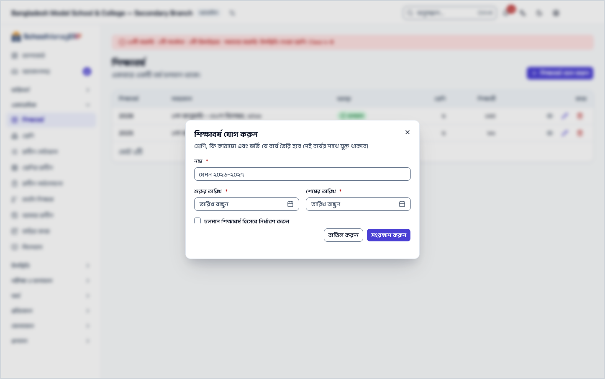
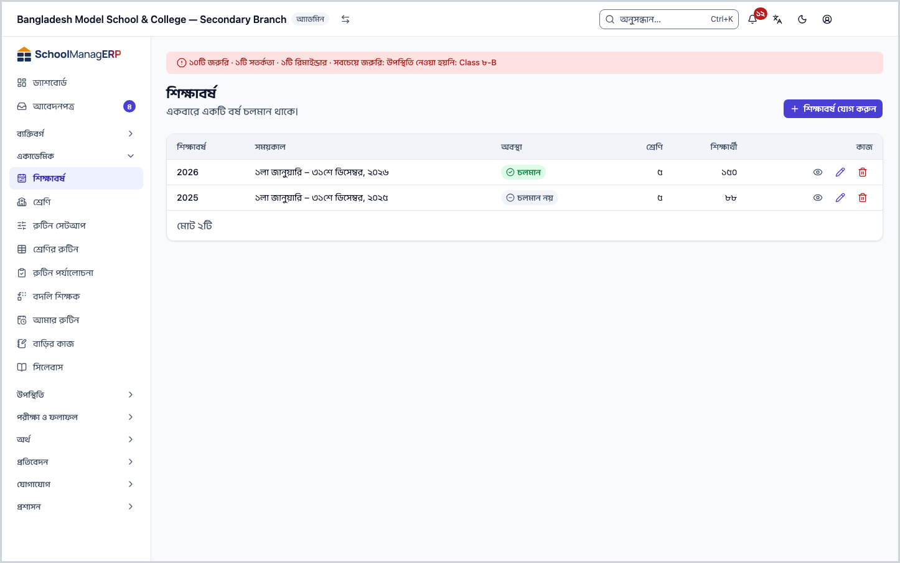

<!-- guide:meta
feature: academics.academicYears
title: শিক্ষাবর্ষ তৈরি ও পরিচালনা
summary: শিক্ষাবর্ষ যোগ করুন, কোনটি চলমান তা ঠিক করুন, বছরের টার্ম সাজান, আর অব্যবহৃত বছর মুছুন।
roles: [ADMIN]
sources:
  - client-admin/src/routes/_staff/academic-years/index.tsx
  - client-admin/src/routes/_staff/academic-years/$academicYearId.tsx
  - client-admin/src/routes/_staff/academic-years/-year-form-dialog.tsx
  - client-admin/src/routes/_staff/academic-years/-set-current-dialog.tsx
  - client-admin/src/routes/_staff/academic-years/-delete-year-dialog.tsx
  - client-admin/src/routes/_staff/academic-years/-detail/terms-tab.tsx
  - client-admin/src/routes/_staff/academic-years/-detail/classes-tab.tsx
  - client-admin/src/routes/_staff/academic-years/-detail/fee-structures-tab.tsx
  - client-admin/src/routes/_staff/academic-years/-detail/tab-query-state.tsx
  - server/src/modules/academics/academic-year.controller.ts
  - server/src/modules/academics/academic-year.service.ts
labels:
  [
    academicYears:list.*,
    academicYears:form.*,
    academicYears:deleteDialog.*,
    academicYears:setCurrentDialog.*,
    academicYears:detail.*,
    nav:items.academicYears,
    nav:groups.academics,
    common:accessDenied.*,
  ]
helpIds:
  [
    academics.academicYears,
    academics.academicYears.action.add,
    academics.academicYears.action.setCurrent,
    academics.academicYears.action.delete,
    academics.academicYears.action.addTerm,
    academics.academicYears.field.isCurrent,
    academics.academicYears.field.dates,
    academics.academicYears.action.edit,
  ]
devices: [desktop]
entry: [sidebar, palette]
keywords:
  [শিক্ষাবর্ষ, সেশন, চলমান বর্ষ, চলতি বছর, টার্ম, সেমিস্টার, নতুন বছর, academic year, session, current year, term, semester]
appVersion: 0.1.0 (1798f8b1f)
owner: tareq89
lastVerified: 2026-10-24
knownIssues: []
-->

# শিক্ষাবর্ষ তৈরি ও পরিচালনা

শিক্ষাবর্ষ যোগ করুন, কোনটি এখন চলছে তা ঠিক করুন, বছরের টার্ম সাজান, আর ভুল করে বানানো বছর মুছে ফেলুন।

**যেতে হবে:** বাম মেনুতে **একাডেমিক → শিক্ষাবর্ষ**। এই পাতার কাজ কম্পিউটারে করুন।
**শুরুর আগে:** আপনি স্কুলের অ্যাডমিন হবেন ([কে কী করতে পারেন](#roles))। বছরটি কবে শুরু আর কবে শেষ, সেই দুটি তারিখ হাতে রাখুন।

স্কুলের প্রায় সব কিছু একটি শিক্ষাবর্ষের ভেতরে থাকে: [শ্রেণি](classes.md), ফি কাঠামো, ভর্তি, পরীক্ষা। একবারে একটি বর্ষই **চলমান** থাকে। নতুন শ্রেণি বানানো বা তালিকা দেখার সময় অ্যাপ সাধারণত চলমান বর্ষটিই আগে বেছে রাখে। তাই নতুন বছর শুরু হলে সেটিকে চলমান করতে ভুলবেন না।

[শিক্ষাবর্ষ যোগ করুন](#task-main) · [চলমান করুন](#task-current) · [টার্ম সাজান](#task-terms) · [মুছুন](#task-delete) · [সমস্যা ও সমাধান](#trouble)

**এই পাতায় যা আছে**

- [এই পাতায় যেভাবে আসবেন](#arrive)
- [শিক্ষাবর্ষ যোগ করুন](#task-main)
- [বর্ষ যোগ হয়েছে কি না বুঝবেন কীভাবে](#confirm)
- [অন্য পরিস্থিতিতে](#other)
  - [চলমান শিক্ষাবর্ষ বদলান](#task-current)
  - [নাম বা তারিখ বদলান](#task-edit)
  - [টার্ম যোগ করুন ও সাজান](#task-terms)
  - [শিক্ষাবর্ষ মুছুন](#task-delete)
  - [বর্ষের পাতা: ট্যাবগুলো](#task-detail)
- [সমস্যা ও সমাধান](#trouble)
- [কে কী করতে পারেন](#roles)
- [আরও জানুন](#more)

---

## এই পাতায় যেভাবে আসবেন 

**বাম মেনু থেকে:** **একাডেমিক → শিক্ষাবর্ষ** চাপুন। নিচের ধাপ ১ থেকে শুরু করুন।

**খোঁজার ঘর থেকে:** উপরের খোঁজার ঘরে (Ctrl+K) **শিক্ষাবর্ষ যোগ করুন** লিখে বেছে নিন। → শিক্ষাবর্ষের তালিকা খোলে, আর **শিক্ষাবর্ষ যোগ করুন** ঘরটি নিজে থেকে খোলা থাকে। নিচের ধাপ ৩ থেকে শুরু করুন। খোঁজার নিয়ম: [যেকোনো পাতা খুঁজে পাওয়া](../start/find-anything.md)।

---

## শিক্ষাবর্ষ যোগ করুন 

1. বাম মেনুতে **একাডেমিক → শিক্ষাবর্ষ** চাপুন।

   → উপরে **শিক্ষাবর্ষ** শিরোনাম, নিচে "একবারে একটি বর্ষ চলমান থাকে।" তালিকার কলাম: **শিক্ষাবর্ষ**, **সময়কাল**, **অবস্থা**, **শ্রেণি**, **শিক্ষার্থী**। কোনো বর্ষ না থাকলে লেখা থাকে **এখনও কোনো শিক্ষাবর্ষ নেই**, সঙ্গে **প্রথম শিক্ষাবর্ষ যোগ করুন** বোতাম।

2. পাতার উপরে **শিক্ষাবর্ষ যোগ করুন** চাপুন।

   → **শিক্ষাবর্ষ যোগ করুন** ঘর খোলে: "শ্রেণি, ফি কাঠামো এবং ভর্তি যে বর্ষে তৈরি হবে সেই বর্ষের সাথে যুক্ত থাকবে।"

3. **নাম** ঘরে বছরের নাম লিখুন, যেমন `২০২৬-২০২৭` বা `২০২৭`।

   → ফাঁকা রাখলে **নাম আবশ্যক** দেখায়।

4. **শুরুর তারিখ** আর **শেষের তারিখ** বেছে নিন।

   → দুটিই লাগবে; না দিলে **শুরু ও শেষের তারিখ আবশ্যক**। শেষের তারিখ শুরুর তারিখের পরে না হলে **শেষের তারিখ অবশ্যই শুরুর তারিখের পরে হতে হবে** দেখায়।

5. এই বছরটিই যদি এখন চলে, **চলমান শিক্ষাবর্ষ হিসেবে নির্ধারণ করুন** ঘরে টিক দিন।

   → ঘরের নিচে একটি সতর্কবার্তা আসে: অন্য যে বর্ষ এখন চলমান, সেটি আর চলমান থাকবে না। **হ্যাঁ, চলমান হিসেবে নির্ধারণ করুন** চাপলে টিক বসে; **বাতিল** চাপলে টিক বসে না।

6. **সংরক্ষণ করুন** চাপুন।

   → ঘর বন্ধ হয়, আর নতুন বর্ষ তালিকায় আসে। টিক দিয়ে থাকলে তার **অবস্থা** ঘরে চলমান চিহ্ন থাকে, আর আগের চলমান বর্ষটি থেকে সেই চিহ্ন সরে যায়।

> **মনে রাখুন:** বর্ষ বানালেই শ্রেণি তৈরি হয় না। এরপর [শ্রেণি](classes.md) পাতায় এই বর্ষের শ্রেণি যোগ করুন। পুরো সেটআপের ক্রম: [স্কুল সাজানোর ধাপ](../admin/setup-order.md#step-2)।

---

## বর্ষ যোগ হয়েছে কি না বুঝবেন কীভাবে 

শিক্ষাবর্ষ শুধু ইন্টারনেট থাকলে সংরক্ষিত হয়; ডিভাইসে জমিয়ে রেখে পরে পাঠানো যায় না। তাই **এই ডিভাইসে সংরক্ষিত** অবস্থা এখানে নেই।

| অবস্থা                       | কীভাবে বুঝবেন                               | এরপর কী                                     |
| ---------------------------- | ------------------------------------------- | ------------------------------------------- |
| **শুধু স্ক্রিনে বদলেছে**     | ঘর খোলা, তথ্য লেখা, কিন্তু ঘর বন্ধ হয়নি    | **সংরক্ষণ করুন** চাপুন                      |
| **স্কুলের সিস্টেমে পৌঁছেছে** | ঘর বন্ধ হয়েছে, আর তালিকায় নতুন বর্ষটি আছে | কাজ শেষ। এবার [শ্রেণি](classes.md) যোগ করুন |

**যাচাই করতে চাইলে:** পাতা রিলোড করুন। তালিকায় বর্ষটি থাকলে সিস্টেমে আছে। নামে চাপলে বর্ষের পাতায় **সময়কাল** দেখে তারিখ মিলিয়ে নিন।

**বার্তা না এলে:** [সমস্যা ও সমাধান](#trouble) দেখুন। ঘরে লেখা তথ্য তখনও ঘরেই থাকে।

---

## অন্য পরিস্থিতিতে 

### চলমান শিক্ষাবর্ষ বদলান 

নতুন বছর শুরু হলে এটি করুন। একবারে একটিই বর্ষ চলমান থাকে।

1. তালিকায় নতুন বর্ষের নামে চাপুন।

   → বর্ষের পাতা খোলে।

2. পাতার উপরে **চলমান হিসেবে নির্ধারণ করুন** চাপুন। (বর্ষটি আগে থেকেই চলমান হলে বোতামটি থাকে না।)

   → **চলমান শিক্ষাবর্ষ নির্ধারণ করুন** ঘর খোলে।

| আপনি চাপলেন                    | কী হবে                                                                         | জমা হলো? |
| ------------------------------ | ------------------------------------------------------------------------------ | -------- |
| **চলমান হিসেবে নির্ধারণ করুন** | এই বর্ষ চলমান হয়; আগের চলমান বর্ষ আর চলমান থাকে না। পুরোনো বছরের তথ্য মোছে না | হ্যাঁ    |
| **বাতিল করুন**                 | কিছুই বদলায় না                                                                | না       |

> **মনে রাখুন:** চলমান বর্ষ বদলালে শিক্ষার্থী নতুন বছরে নিজে থেকে ওঠে না। শিক্ষার্থীদের পরের শ্রেণিতে তোলা আলাদা কাজ।

ব্যর্থ হলে ঘরে **চলমান শিক্ষাবর্ষ নির্ধারণ করতে ব্যর্থ হয়েছে** দেখায়।

### নাম বা তারিখ বদলান 

1. তালিকায় বর্ষের সারির শেষে **সম্পাদনা** চাপুন। (বর্ষের পাতায় উপরেও **সম্পাদনা** আছে।)

   → **শিক্ষাবর্ষ সম্পাদনা করুন** ঘর খোলে, আগের তথ্য ভরা।

2. **নাম**, **শুরুর তারিখ** বা **শেষের তারিখ** বদলান, তারপর **সংরক্ষণ করুন** চাপুন।

   → ঘর বন্ধ হয়, তালিকায় নতুন তথ্য দেখা যায়।

কিছু বদলে **বাতিল** বা ঘরের বাইরে চাপলে অ্যাপ জিজ্ঞেস করে পরিবর্তন ফেলে দেবেন কি না।

### টার্ম যোগ করুন ও সাজান 

টার্ম হলো বছরের ভাগ, যেমন **প্রথম সাময়িক** আর **দ্বিতীয় সাময়িক**। পরীক্ষা ও ফলাফল এই ভাগ ধরে হয়। ট্যাবের নাম আপনার স্কুলের সেটিংস অনুযায়ী **টার্ম**, **সেমিস্টার** বা **ট্রাইমেস্টার** দেখাতে পারে।

1. বর্ষের পাতায় **টার্ম** ট্যাব খুলুন।

   → টার্মের তালিকা: **ক্রম**, **নাম**, **সময়কাল**, **দৈর্ঘ্য** (সপ্তাহে)। না থাকলে **এই শিক্ষাবর্ষের জন্য কোনো টার্ম নির্ধারিত নেই**।

2. **টার্ম যোগ করুন** চাপুন।

   → **টার্ম যোগ করুন** ঘর খোলে।

3. **নাম**, **শুরুর তারিখ**, **শেষের তারিখ** দিয়ে **সংরক্ষণ করুন** চাপুন।

   → টার্মটি তালিকায় আসে। তারিখ বছরের বাইরে গেলে **টার্মের তারিখ অবশ্যই শিক্ষাবর্ষের মধ্যে হতে হবে (…)** দেখায়। অন্য টার্মের সঙ্গে তারিখ মিলে গেলে **"{নাম}" চলতি শিক্ষাবর্ষের একটি বিদ্যমান টার্মের সাথে সাংঘর্ষিক** দেখায়।

4. ক্রম বদলাতে সারির **উপরে সরান** বা **নিচে সরান** তীর চাপুন।

   → সঙ্গে সঙ্গে ক্রম বদলায়। না হলে **ক্রম বদলানো যায়নি** দেখায়।

টার্ম বদলাতে বা মুছতে সারির শেষের **সম্পাদনা** বা **মুছুন** চাপুন। মোছার আগে **টার্ম মুছুন** ঘরে নিশ্চিত করতে হয়; মুছলে ফিরিয়ে আনা যায় না।

### শিক্ষাবর্ষ মুছুন 

শুধু ভুল করে বানানো, খালি বর্ষ মোছা যায়। পুরোনো বছর মুছবেন না; সেটি শুধু চলমান না থাকলেই চলে।

1. তালিকায় বর্ষের সারির শেষে **মুছুন** চাপুন। (বর্ষের পাতায় উপরের **আরও অ্যাকশন** মেনুতেও আছে।)

   → **শিক্ষাবর্ষ মুছুন** ঘর খোলে: "{নাম}" মুছে ফেলবেন? এটি ফিরিয়ে আনা যাবে না।

2. **মুছুন** চাপুন।

| আপনি চাপলেন    | কী হবে                                                                             | জমা হলো? |
| -------------- | ---------------------------------------------------------------------------------- | -------- |
| **মুছুন**      | বর্ষটি তালিকা থেকে চলে যায়; ফেরানো যায় না। বর্ষের পাতা থেকে মুছলে তালিকায় ফেরেন | হ্যাঁ    |
| **বাতিল করুন** | কিছুই বদলায় না                                                                    | না       |

**যে বর্ষ মোছা যায় না:** চলমান বর্ষ, আর যে বর্ষে এখনও শ্রেণি, ফি কাঠামো, শিক্ষার্থী ভর্তির রেকর্ড, পরীক্ষা, শিক্ষার্থীর বিল, কর্মী মূল্যায়ন (এসিআর) বা এর সঙ্গে যুক্ত অন্য কোনো রেকর্ড আছে। টার্ম মোছা আটকায় না; বর্ষের সঙ্গে সেগুলোও যায়। তখন ঘরে কারণ লেখা থাকে। চলমান বর্ষে: **এটি চলতি বছর। আগে অন্য একটি বছরকে চলতি করুন।** ভেতরে তথ্য থাকলে কী আছে তা বলে, যেমন **এই বছরে এখনও শ্রেণি এবং পরীক্ষা আছে। আগে সেগুলো সরিয়ে ফেলুন।** অন্য রেকর্ড থাকলে: **এই বছরটি এখনও অন্য রেকর্ডে ব্যবহার হচ্ছে। আগে সেগুলো সরান বা সরিয়ে নিন।** চলমান হলে আগে অন্য বর্ষকে [চলমান করুন](#task-current)। ভেতরের তথ্য থাকলে বর্ষটি রেখে দিন।

### বর্ষের পাতা: ট্যাবগুলো 

তালিকায় বর্ষের নামে বা **দেখুন**-এ চাপলে তার পাতা খোলে। উপরে নাম, চলমান কি না, আর **সময়কাল**, **শ্রেণি**, **শিক্ষার্থী**, **ফি কাঠামো**-র সংখ্যা।

| ট্যাব         | কী আছে                                                                                             |
| ------------- | -------------------------------------------------------------------------------------------------- |
| **শ্রেণি**    | এই বর্ষের শ্রেণি (**নাম**, **গ্রেড**)। **দেখুন** চাপলে [শ্রেণির পাতা](classes.md#task-detail) খোলে |
| **ফি কাঠামো** | এই বর্ষের ফি কাঠামো: **নাম**, **ধরন**, **শ্রেণি** (সবার জন্য হলে **পুরো বিদ্যালয়**), **পরিমাণ**   |
| **টার্ম**     | বছরের ভাগ; [টার্ম যোগ করুন ও সাজান](#task-terms)                                                   |

---

## সমস্যা ও সমাধান 

| আপনি যা দেখছেন                                                                                    | কী করবেন                                                                                        | কে সাহায্য করতে পারেন |
| ------------------------------------------------------------------------------------------------- | ----------------------------------------------------------------------------------------------- | --------------------- |
| **এই পাতাটি দেখার অনুমতি আপনার নেই।**                                                             | এই পাতা শুধু অ্যাডমিন দেখেন। **ড্যাশবোর্ডে ফিরে যান** চাপুন।                                    | অ্যাডমিন              |
| **শিক্ষাবর্ষ লোড করতে ব্যর্থ হয়েছে**                                                             | ইন্টারনেট দেখে পাতা রিলোড করুন।                                                                 | অ্যাডমিন              |
| **শিক্ষাবর্ষ সংরক্ষণ করতে ব্যর্থ হয়েছে**                                                         | ইন্টারনেট দেখে আবার **সংরক্ষণ করুন** চাপুন। ঘরের লেখা থেকে যায়।                                | অ্যাডমিন              |
| **শেষের তারিখ অবশ্যই শুরুর তারিখের পরে হতে হবে**                                                  | শেষের তারিখ শুরুর পরের কোনো দিন দিন।                                                            | অ্যাডমিন              |
| **এটি চলতি বছর। …**, **এই বছরে এখনও … আছে। …** বা **এই বছরটি এখনও অন্য রেকর্ডে ব্যবহার হচ্ছে। …** | [শিক্ষাবর্ষ মুছুন](#task-delete) দেখুন। সাধারণত বর্ষটি রেখে দেওয়াই ঠিক।                        | অ্যাডমিন              |
| **শিক্ষাবর্ষ মুছতে ব্যর্থ হয়েছে**                                                                | ইন্টারনেট দেখে আবার **মুছুন** চাপুন।                                                            | অ্যাডমিন              |
| **টার্মের তারিখ অবশ্যই শিক্ষাবর্ষের মধ্যে হতে হবে (…)**                                           | বন্ধনীতে লেখা বছরের তারিখের মধ্যে টার্মের তারিখ দিন, অথবা আগে [বর্ষের তারিখ বদলান](#task-edit)। | অ্যাডমিন              |
| **"{নাম}" চলতি শিক্ষাবর্ষের একটি বিদ্যমান টার্মের সাথে সাংঘর্ষিক**                                | নামে লেখা টার্মের তারিখের সঙ্গে যেন না মেলে, এমন তারিখ দিন।                                     | অ্যাডমিন              |
| **টার্ম সংরক্ষণ করতে ব্যর্থ হয়েছে**                                                              | ইন্টারনেট দেখে আবার চেষ্টা করুন।                                                                | অ্যাডমিন              |
| **ক্রম বদলানো যায়নি**                                                                            | পাতা রিলোড করে আবার তীর চাপুন।                                                                  | অ্যাডমিন              |
| নতুন শ্রেণি বা তালিকায় পুরোনো বছর দেখাচ্ছে                                                       | নতুন বর্ষটি [চলমান করুন](#task-current)।                                                        | অ্যাডমিন              |

কোনো পাতা বা বোতাম দেখতে না পেলে দেখুন [আমি এটা দেখতে পাচ্ছি না কেন?](../help/cant-see-this.md)।

---

## কে কী করতে পারেন 

| ভূমিকা                                                                                           | তালিকা ও বর্ষের পাতা দেখতে | বর্ষ যোগ, সম্পাদনা, চলমান করা, মোছা | টার্ম যোগ ও বদল |
| ------------------------------------------------------------------------------------------------ | -------------------------- | ----------------------------------- | --------------- |
| অ্যাডমিন                                                                                         | হ্যাঁ                      | হ্যাঁ                               | হ্যাঁ           |
| একাডেমিক কো-অর্ডিনেটর, শিক্ষক, হিসাবরক্ষক, অফিস সহকারী, পরীক্ষা নিয়ন্ত্রক, পরিচালনা পর্ষদ সদস্য | না                         | না                                  | না              |

অন্য ভূমিকার বাম মেনুতে **শিক্ষাবর্ষ** থাকে না। পাতাটি খুললে তাঁরা **এই পাতাটি দেখার অনুমতি আপনার নেই।** দেখেন।

---

## আরও জানুন 

<strong>পাতার অংশগুলো</strong> — উপর থেকে নিচে

1. **শিক্ষাবর্ষ** — শিরোনাম ও "একবারে একটি বর্ষ চলমান থাকে।"
2. **শিক্ষাবর্ষ যোগ করুন** — পাতার উপরের বোতাম।
3. **তালিকা** — **শিক্ষাবর্ষ**, **সময়কাল**, **অবস্থা**, **শ্রেণি**, **শিক্ষার্থী**; প্রতি সারির শেষে **দেখুন**, **সম্পাদনা**, **মুছুন**।

<strong>ঘরগুলোর অর্থ</strong>

<!-- guide:generated:fields:academicYears -->

| ঘর                                    | কী লিখবেন                                                                                  | বাধ্যতামূলক? |
| ------------------------------------- | ------------------------------------------------------------------------------------------ | ------------ |
| নাম                                   | বছরের নাম, যেমন ২০২৬-২০২৭।                                                                 | হ্যাঁ        |
| শুরুর তারিখ                           | বছরের প্রথম দিন।                                                                           | হ্যাঁ        |
| শেষের তারিখ                           | বছরের শেষ দিন; শুরুর তারিখের পরে হতে হবে।                                                  | হ্যাঁ        |
| চলমান শিক্ষাবর্ষ হিসেবে নির্ধারণ করুন | টিক দিলে এটি চলমান হয়, আর অন্য চলমান বর্ষ থেকে চিহ্ন সরে যায়। টিক দিলে নিশ্চিত করতে হয়। | না           |
| টার্মের নাম                           | যেমন প্রথম সাময়িক।                                                                        | হ্যাঁ        |
| টার্মের শুরু ও শেষের তারিখ            | বছরের তারিখের মধ্যে, অন্য টার্মের সঙ্গে না মিলিয়ে।                                        | হ্যাঁ        |
| শুরু ও শেষের তারিখ                    | বছরের প্রথম ও শেষ দিন। শেষ দিন প্রথম দিনের পরে হতে হবে।                                    | হ্যাঁ        |

<!-- /guide:generated -->

<strong>শিক্ষাবর্ষ কীভাবে কাজ করে</strong> — বর্ষের ভেতরে টার্ম, শ্রেণি আর ফি

<figure>
  
  <figcaption><em>শিক্ষাবর্ষের ভেতরে কী থাকে</em></figcaption>
</figure>

- একবারে একটি বর্ষ চলমান। নতুন বর্ষ চলমান করলে পুরোনোটি চলমান থাকে না, কিন্তু তার তথ্য থেকে যায়।
- শ্রেণি একটি বর্ষের সঙ্গে বাঁধা; পরে অন্য বর্ষে সরানো যায় না। বিস্তারিত: [স্কুলের সব কিছু কীভাবে জোড়া লাগে](../admin/how-it-works.md#task-structure)।
- টার্ম বছরের ভাগ; পরীক্ষা ও ফলাফল টার্ম ধরে হয়।

**সম্পর্কিত পাতা**

- [**শ্রেণি**](classes.md) — বর্ষের ভেতরে শ্রেণি, শাখা আর বিষয় সাজান।
- [**স্কুল সাজানোর ধাপ**](../admin/setup-order.md) — কোন কাজের পর কোনটি।
- [**স্কুলের সব কিছু কীভাবে জোড়া লাগে**](../admin/how-it-works.md) — বর্ষ, শ্রেণি, শাখার ছবি।
- [**সিলেবাস ও পাঠ পরিকল্পনা**](syllabus.md) — পাঠ পরিকল্পনা একটি শিক্ষাবর্ষের ভেতরে চলে।
- [**তৈরি শিক্ষাক্রম**](../administration/curriculum-preset.md) — একেবারে নতুন স্কুলে একটি তৈরি শিক্ষাক্রম বেছে শিক্ষাবর্ষ, শ্রেণি, বিষয়, গ্রেডিং স্কেল আর পরীক্ষার টেমপ্লেট একবারে তৈরি করুন।
- [**গ্রেডিং পদ্ধতি ঠিক করা**](../exams-results/grading-scales.md) — প্রতি শিক্ষাবর্ষে কত শতাংশ নম্বরে কোন গ্রেড ও জিপিএ, তা ঠিক করুন.
- [**ফি কাঠামো ঠিক করা**](../finance/fee-structures.md) — কোন ফি কত টাকা, তা প্রতি শিক্ষাবর্ষের জন্য লিখে রাখুন.

---

_সংস্করণ ০.১.০ · শেষ যাচাই ২০২৬-১০-২৪_
