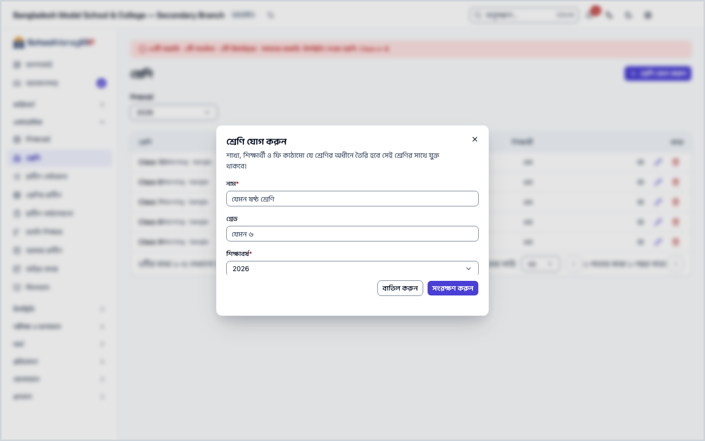
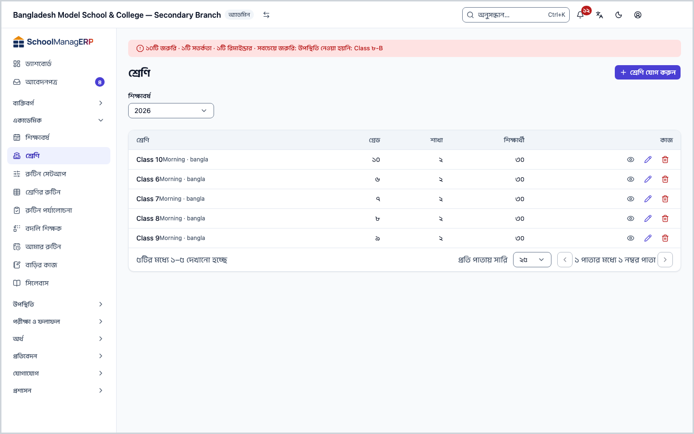

<!-- guide:meta
feature: academics.classes
title: শ্রেণি, শাখা ও বিষয় সাজানো
summary: শিক্ষাবর্ষে শ্রেণি যোগ করুন, শ্রেণিতে শাখা খুলুন, বিষয় যুক্ত করুন আর শাখায় শিক্ষক দিন।
roles: [ADMIN]
sources:
  - client-admin/src/routes/_staff/classes/index.tsx
  - client-admin/src/routes/_staff/classes/$classId.tsx
  - client-admin/src/routes/_staff/classes/-class-form-dialog.tsx
  - client-admin/src/routes/_staff/classes/-delete-class-dialog.tsx
  - client-admin/src/routes/_staff/classes/-section-form-dialog.tsx
  - client-admin/src/routes/_staff/classes/-delete-section-dialog.tsx
  - client-admin/src/routes/_staff/classes/-sections-panel.tsx
  - client-admin/src/routes/_staff/classes/-attach-subject-dialog.tsx
  - client-admin/src/routes/_staff/classes/-remove-subject-dialog.tsx
  - client-admin/src/routes/_staff/classes/-assign-teacher-dialog.tsx
  - client-admin/src/routes/_staff/classes/-dialog-kit.tsx
  - client-admin/src/routes/_staff/classes/-detail/sections-tab.tsx
  - client-admin/src/routes/_staff/classes/-detail/students-tab.tsx
  - client-admin/src/routes/_staff/classes/-detail/fee-structures-tab.tsx
  - client-admin/src/routes/_staff/classes/-detail/teachers-tab.tsx
  - client-admin/src/routes/_staff/classes/-detail/subjects-tab.tsx
  - client-admin/src/routes/_staff/classes/-detail/homework-tab.tsx
  - client-admin/src/routes/_staff/classes/-detail/performance-tab.tsx
  - client-admin/src/routes/_staff/classes/-detail/tab-query-state.tsx
  - server/src/modules/classes/classes.controller.ts
  - server/src/modules/classes/classes.service.ts
labels:
  [
    classes:list.*,
    classes:classForm.*,
    classes:sectionForm.*,
    classes:deleteClassDialog.*,
    classes:deleteSectionDialog.*,
    classes:sections.*,
    classes:detail.*,
    classes:subjects.*,
    classes:subjectAttachForm.*,
    classes:removeSubjectDialog.*,
    classes:assignTeacherForm.*,
    classes:assignmentType.*,
    classes:assignDialog.*,
    nav:items.classes,
    nav:groups.academics,
    common:accessDenied.*,
  ]
helpIds:
  [
    academics.classes,
    academics.classes.action.add,
    academics.classes.action.delete,
    academics.classes.action.addSection,
    academics.classes.action.deleteSection,
    academics.classes.action.attachSubject,
    academics.classes.action.assignTeacher,
    academics.classes.field.grade,
    academics.classes.field.shift,
    academics.classes.field.version,
    academics.classes.field.group,
    academics.classes.field.capacity,
    academics.classes.action.edit,
  ]
devices: [desktop]
entry: [sidebar, palette]
keywords:
  [শ্রেণি, ক্লাস, শাখা, সেকশন, শিফট, ভার্সন, গ্রুপ, বিষয়, শ্রেণি শিক্ষক, ধারণক্ষমতা, class, section, shift, version, group, subject, class teacher]
appVersion: 0.1.0 (1798f8b1f)
owner: tareq89
lastVerified: 2026-10-24
knownIssues: []
-->

# শ্রেণি, শাখা ও বিষয় সাজানো

শিক্ষাবর্ষে শ্রেণি যোগ করুন, প্রতিটি শ্রেণিতে শাখা খুলুন, বিষয় যুক্ত করুন, আর শাখায় শিক্ষক দিন।

**যেতে হবে:** বাম মেনুতে **একাডেমিক → শ্রেণি**। এই পাতার কাজ কম্পিউটারে করুন।
**শুরুর আগে:** আপনি স্কুলের অ্যাডমিন হবেন ([কে কী করতে পারেন](#roles))। অন্তত একটি [শিক্ষাবর্ষ](academic-years.md) আগে থেকে থাকতে হবে।

শ্রেণি থাকে একটি শিক্ষাবর্ষের ভেতরে, যেমন **২০২৭** বর্ষের **ষষ্ঠ শ্রেণি**। শ্রেণির ভেতরে থাকে **শাখা**, যেমন **ক** আর **খ**। শিক্ষার্থী ভর্তি হয় শাখায়, শ্রেণিতে সরাসরি নয়। তাই শ্রেণি বানানোর পর অন্তত একটি শাখা খুলতে হয়।

[শ্রেণি যোগ করুন](#task-main) · [শাখা খুলুন](#task-sections) · [বিষয় যুক্ত করুন](#task-subjects) · [শিক্ষক দিন](#task-teachers) · [সমস্যা ও সমাধান](#trouble)

**এই পাতায় যা আছে**

- [এই পাতায় যেভাবে আসবেন](#arrive)
- [শ্রেণি যোগ করুন](#task-main)
- [শ্রেণি যোগ হয়েছে কি না বুঝবেন কীভাবে](#confirm)
- [অন্য পরিস্থিতিতে](#other)
  - [শাখা খুলুন](#task-sections)
  - [শিফট, ভার্সন ও গ্রুপ কী](#task-labels)
  - [বিষয় যুক্ত করুন](#task-subjects)
  - [শাখায় শিক্ষক দিন](#task-teachers)
  - [তালিকা ছাঁকুন](#task-find)
  - [শ্রেণি সম্পাদনা করুন](#task-edit)
  - [শাখা বা শ্রেণি মুছুন](#task-delete)
  - [শ্রেণির পাতা: ট্যাবগুলো](#task-detail)
- [সমস্যা ও সমাধান](#trouble)
- [কে কী করতে পারেন](#roles)
- [আরও জানুন](#more)

---

## এই পাতায় যেভাবে আসবেন 

**বাম মেনু থেকে:** **একাডেমিক → শ্রেণি** চাপুন। নিচের ধাপ ১ থেকে শুরু করুন।

**খোঁজার ঘর থেকে:** উপরের খোঁজার ঘরে (Ctrl+K) **শ্রেণি যোগ করুন** লিখে বেছে নিন। → শ্রেণির তালিকা খোলে, আর **শ্রেণি যোগ করুন** ঘরটি নিজে থেকে খোলা থাকে। নিচের ধাপ ৩ থেকে শুরু করুন। খোঁজার নিয়ম: [যেকোনো পাতা খুঁজে পাওয়া](../start/find-anything.md)।

**শিক্ষাবর্ষের পাতা থেকে:** [শিক্ষাবর্ষ](academic-years.md#task-detail)-এর পাতার **শ্রেণি** ট্যাবে কোনো শ্রেণির **দেখুন** চাপলে সরাসরি সেই শ্রেণির পাতা খোলে।

---

## শ্রেণি যোগ করুন 

1. বাম মেনুতে **একাডেমিক → শ্রেণি** চাপুন।

   → উপরে **শ্রেণি** শিরোনাম। তালিকায় **শ্রেণি**, **গ্রেড**, **শাখা**, **শিক্ষার্থী** কলাম। শুরুতে শুধু চলমান শিক্ষাবর্ষের শ্রেণি দেখায়।

2. পাতার উপরে **শ্রেণি যোগ করুন** চাপুন।

   → **শ্রেণি যোগ করুন** ঘর খোলে।

3. **নাম** ঘরে শ্রেণির নাম লিখুন, যেমন `ষষ্ঠ শ্রেণি`।

   → ফাঁকা রাখলে **নাম আবশ্যক** দেখায়।

4. চাইলে **গ্রেড** ঘরে শ্রেণির সংখ্যা লিখুন, যেমন `৬`। বাংলা বা ইংরেজি, দুই অঙ্কেই চলে।

   → গ্রেড দিয়ে শ্রেণিগুলো ক্রমে সাজে। শূন্য, ঋণাত্মক বা ভগ্নাংশ দিলে **গ্রেড অবশ্যই একটি ধনাত্মক পূর্ণসংখ্যা হতে হবে** দেখায়।

5. **শিক্ষাবর্ষ** ঘরে বর্ষ বেছে নিন। তালিকা যে বর্ষে ছাঁকা ছিল, সেটি আগে থেকে বাছা থাকে।

   → বর্ষ না বাছলে **শিক্ষাবর্ষ আবশ্যক** দেখায়। পরে শ্রেণিকে অন্য বর্ষে সরানো যায় না, তাই ঠিক বর্ষটি বাছুন।

6. আপনার স্কুলে একাধিক শিফট বা ভার্সন থাকলে **শিফট** আর **ভার্সন** ঘরও দেখা যায়। দরকার হলে বেছে নিন; না লাগলে **নেই** রাখুন। এগুলো কী: [শিফট, ভার্সন ও গ্রুপ কী](#task-labels)।

7. **সংরক্ষণ করুন** চাপুন।

   → ঘর বন্ধ হয়, আর নতুন শ্রেণি তালিকায় আসে। শিফট বা ভার্সন দিলে নামের নিচে ছোট করে লেখা থাকে, যেমন **প্রভাতি · বাংলা**। **শাখা** কলামে শূন্য।

> **মনে রাখুন:** শাখা ছাড়া শ্রেণিতে কাউকে ভর্তি করা যায় না। এখনই শ্রেণির নামে চেপে [শাখা খুলুন](#task-sections)।

---

## শ্রেণি যোগ হয়েছে কি না বুঝবেন কীভাবে 

শ্রেণির তথ্য শুধু ইন্টারনেট থাকলে সংরক্ষিত হয়; ডিভাইসে জমিয়ে রেখে পরে পাঠানো যায় না। তাই **এই ডিভাইসে সংরক্ষিত** অবস্থা এখানে নেই।

| অবস্থা                       | কীভাবে বুঝবেন                                 | এরপর কী                      |
| ---------------------------- | --------------------------------------------- | ---------------------------- |
| **শুধু স্ক্রিনে বদলেছে**     | ঘর খোলা, তথ্য লেখা, কিন্তু ঘর বন্ধ হয়নি      | **সংরক্ষণ করুন** চাপুন       |
| **স্কুলের সিস্টেমে পৌঁছেছে** | ঘর বন্ধ হয়েছে, আর তালিকায় নতুন শ্রেণিটি আছে | [শাখা খুলুন](#task-sections) |

**যাচাই করতে চাইলে:** পাতা রিলোড করুন। শ্রেণিটি না দেখালে উপরের **শিক্ষাবর্ষ** ছাঁকনিতে ঠিক বর্ষ বাছা আছে কি না দেখুন।

**বার্তা না এলে:** [সমস্যা ও সমাধান](#trouble) দেখুন। ঘরে লেখা তথ্য তখনও ঘরেই থাকে।

---

## অন্য পরিস্থিতিতে 

### শাখা খুলুন 

1. তালিকায় শ্রেণির নামে চাপুন।

   → শ্রেণির পাতা খোলে, **শাখা** ট্যাব সামনে। লেখা থাকে "শিক্ষার্থীরা এই শ্রেণির একটি নির্দিষ্ট শাখায় ভর্তি হয়।" শাখা না থাকলে **এখনও কোনো শাখা নেই**।

2. **শাখা যোগ করুন** চাপুন।

   → **শাখা যোগ করুন** ঘর খোলে।

3. **শাখার নাম** লিখুন, যেমন `ক`।

   → ফাঁকা রাখলে **শাখার নাম আবশ্যক** দেখায়।

4. চাইলে **ধারণক্ষমতা** দিন, যেমন `৪০`। স্কুলে একাধিক গ্রুপ থাকলে **গ্রুপ** ঘরও আসে, যেমন **বিজ্ঞান**।

   → ধারণক্ষমতা শুধু একটি সংখ্যা যা তালিকায় দেখায়; এর বেশি শিক্ষার্থী ভর্তি করলেও অ্যাপ আটকায় না। শূন্য বা ভগ্নাংশ দিলে **ধারণক্ষমতা অবশ্যই একটি ধনাত্মক পূর্ণসংখ্যা হতে হবে** দেখায়।

5. **সংরক্ষণ করুন** চাপুন।

   → শাখাটি তালিকায় আসে: **শাখা**, (গ্রুপ থাকলে **গ্রুপ**), **ধারণক্ষমতা**, **ভর্তিকৃত**। ধারণক্ষমতা না দিলে **—** দেখায়।

শাখা বদলাতে সারির শেষে **সম্পাদনা** চাপুন; খোলা ঘরের শিরোনাম **শাখা সম্পাদনা করুন**।

### শিফট, ভার্সন ও গ্রুপ কী 

তিনটিই ঐচ্ছিক লেবেল। স্কুলের সেটিংসে কোনোটির অন্তত দুটি নাম থাকলে তবেই ঘরটি দেখা যায়; একটিমাত্র থাকলে ঘরটি লুকানো থাকে।

| লেবেল      | কিসের গায়ে | উদাহরণ                                                                                |
| ---------- | ----------- | ------------------------------------------------------------------------------------- |
| **শিফট**   | শ্রেণি      | একই স্কুলে সকালে আর দুপুরে ক্লাস: **প্রভাতি** ও **দিবা** শিফটের আলাদা **ষষ্ঠ শ্রেণি** |
| **ভার্সন** | শ্রেণি      | একই শ্রেণি দুই মাধ্যমে: **বাংলা** ভার্সন আর **ইংরেজি** ভার্সন                         |
| **গ্রুপ**  | শাখা        | নবম শ্রেণির **ক** শাখা **বিজ্ঞান**, **খ** শাখা **ব্যবসায় শিক্ষা**                    |

শিফট বা ভার্সন আলাদা হলে একই বর্ষে একই নামের দুটি শ্রেণি রাখা যায়। নামগুলো কোথায় ঠিক করা হয় আর কীভাবে বদলায়: [শিফট, ভার্সন বা গ্রুপের নাম বদলাতে চাইলে](../admin/how-it-works.md#task-rename-labels)। পুরো ছবি: [শিক্ষাবর্ষ, শ্রেণি, শাখা](../admin/how-it-works.md#task-structure)।

### বিষয় যুক্ত করুন 

1. শ্রেণির পাতায় **বিষয়** ট্যাব খুলুন।

   → **বিষয়সমূহ** তালিকা: **বিষয়**, **কোড**, **ঐচ্ছিক**। না থাকলে **এখনও কোনো বিষয় যুক্ত করা হয়নি**।

2. **বিষয় যোগ করুন** চাপুন।

   → **বিষয় যোগ করুন** ঘর খোলে। **বিষয়** তালিকায় স্কুলের চালু বিষয়গুলো নাম ও কোডসহ আসে; যা আগেই যুক্ত, তা আসে না।

3. **বিষয়** বেছে নিন। সবাই না পড়লে **ঐচ্ছিক বিষয়** ঘরে টিক দিন।

   → বিষয় না বাছলে **বিষয় আবশ্যক** দেখায়।

4. **যোগ করুন** চাপুন।

   → বিষয়টি তালিকায় আসে; ঐচ্ছিক হলে পাশে **ঐচ্ছিক** চিহ্ন।

বিষয় সরাতে সারির **অপসারণ** চাপুন, তারপর **বিষয় অপসারণ করুন** ঘরে **অপসারণ** চাপুন। এটি ফিরিয়ে আনা যায় না; দরকার হলে আবার যোগ করতে হয়।

### শাখায় শিক্ষক দিন 

শিক্ষক বাছতে হলে তাঁর আগে থেকে শিক্ষক প্রোফাইল থাকতে হবে ([শিক্ষক প্রোফাইল দিন](../people/staff.md#task-teacher))।

1. শ্রেণির পাতায় **শিক্ষক** ট্যাব খুলুন।

   → প্রতিটি শাখার জন্য আলাদা কার্ড, তাতে কে কোন দায়িত্বে আছেন। কেউ না থাকলে **এই শাখায় কোনো শিক্ষক নিয়োজিত নেই**। শাখাই না থাকলে **এই শ্রেণিতে এখনও কোনো শাখা নেই**।

2. শাখার কার্ডে **নিয়োগ** চাপুন।

   → **শিক্ষক নিয়োগ করুন** ঘর খোলে।

3. **শিক্ষক** বেছে নিন। **নিয়োগের ধরন** থেকে **শ্রেণি শিক্ষক**, **সহকারী শ্রেণি শিক্ষক** বা **বিষয় শিক্ষক** বাছুন। **বিষয় শিক্ষক** বাছলে **বিষয়**ও দিতে হয়।

   → শাখায় আগে থেকে শ্রেণি শিক্ষক থাকলে আর নতুন কাউকে **শ্রেণি শিক্ষক** বাছলে সতর্কবার্তা আসে: **{নাম} আর শ্রেণি শিক্ষক থাকবেন না, তাঁর জায়গায় নতুন শিক্ষক হবেন**।

4. **নিয়োগ করুন** চাপুন।

   → শিক্ষক কার্ডের তালিকায় আসেন, নামের নিচে দায়িত্ব (যেমন **বিষয় শিক্ষক · গণিত**)।

কাউকে সরাতে নামের পাশে **অপসারণ** চাপুন, তারপর **শিক্ষকের নিয়োগ বাতিল করবেন?** ঘরে **অপসারণ**। পরে আবার নিয়োগ দেওয়া যায়। সব শ্রেণির দায়িত্ব এক জায়গায়: [শিক্ষকের দায়িত্ব](../people/teaching-assignments.md)।

### তালিকা ছাঁকুন 

| ঘর             | কী বাছবেন                                                                   |
| -------------- | --------------------------------------------------------------------------- |
| **শিক্ষাবর্ষ** | না বাছলে চলমান বর্ষ। অন্য বর্ষ, বা সব বর্ষ একসঙ্গে দেখতে **সকল শিক্ষাবর্ষ** |
| **শিফট**       | একটি শিফট, বা **সকল শিফট**। স্কুলে দুই বা তার বেশি শিফট থাকলে তবেই ঘরটি আসে |
| **ভার্সন**     | একটি ভার্সন, বা **সকল ভার্সন**। দুই বা তার বেশি ভার্সন থাকলে তবেই আসে       |

কিছু না মিললে **এই ফিল্টারে কোনো শ্রেণি মেলেনি** দেখায়। ছাঁকনি শুধু দেখার জন্য; কিছু বদলায় না।

### শ্রেণি সম্পাদনা করুন 

1. তালিকায় শ্রেণির সারির শেষে **সম্পাদনা** চাপুন। (শ্রেণির পাতায় উপরেও **সম্পাদনা** আছে।)

   → **শ্রেণি সম্পাদনা করুন** ঘর খোলে। এখানে **শিক্ষাবর্ষ** ঘর থাকে না; বর্ষ বদলানো যায় না।

2. **নাম**, **গ্রেড**, **শিফট** বা **ভার্সন** বদলে **সংরক্ষণ করুন** চাপুন। গ্রেড মুছে ফাঁকা রাখলে গ্রেড মুছে যায়।

### শাখা বা শ্রেণি মুছুন 

শুধু ভুল করে বানানো, খালি শাখা বা শ্রেণি মোছা যায়।

**শাখা মুছতে:** শাখা ট্যাবে সারির শেষে **মুছুন** চাপুন। **শাখা মুছুন** ঘরে **মুছুন** চাপুন।

**শ্রেণি মুছতে:** তালিকায় সারির শেষে **মুছুন** চাপুন (শ্রেণির পাতায় উপরেও আছে)। **শ্রেণি মুছুন** ঘরে **মুছুন** চাপুন।

| আপনি চাপলেন    | কী হবে                                                                            | জমা হলো? |
| -------------- | --------------------------------------------------------------------------------- | -------- |
| **মুছুন**      | শাখা বা শ্রেণিটি চলে যায়; ফেরানো যায় না। শ্রেণির পাতা থেকে মুছলে তালিকায় ফেরেন | হ্যাঁ    |
| **বাতিল করুন** | কিছুই বদলায় না                                                                   | না       |

**যে শাখা মোছা যায় না:** যাতে এখনও শিক্ষার্থী আছে বা ছিল (চলে যাওয়া শিক্ষার্থীর রেকর্ডও গোনা হয়), অথবা যার হাজিরা, নম্বর বা রুটিনের মতো রেকর্ড আছে। তখন দেখায় **এই শাখায় এখনও শিক্ষার্থী ভর্তি আছে, তাই এটি মোছা যাবে না। আগে শিক্ষার্থীদের অন্য শাখায় সরান।** শাখার শিক্ষক-দায়িত্ব মোছা আটকায় না; শাখার সঙ্গে সেগুলোও যায়।

**যে শ্রেণি মোছা যায় না:** যাতে শিক্ষার্থী বা শাখা আছে, অথবা পরীক্ষা, ফি কাঠামো, বাড়ির কাজের মতো রেকর্ড আছে। তখন ঘরে কারণটি লেখা থাকে:

| কারণ                                   | ঘরে যা দেখায়                                                                                                   | বোতাম                                         |
| -------------------------------------- | --------------------------------------------------------------------------------------------------------------- | --------------------------------------------- |
| শিক্ষার্থী আছে                         | **এই শ্রেণিতে এখনও শিক্ষার্থী আছে। আগে তাদের অন্য শ্রেণিতে সরান।**                                              | **শিক্ষার্থী স্থানান্তর করুন**, **বন্ধ করুন** |
| শিক্ষার্থী নেই, কিন্তু শাখা আছে        | **এই শ্রেণিতে এখনও শাখা আছে। আগে শাখাগুলো মুছুন।**                                                              | **বন্ধ করুন**                                 |
| অন্য রেকর্ড (যেমন পরীক্ষা, বাড়ির কাজ) | **এই শ্রেণি এখনও {রেকর্ড} এ ব্যবহৃত হচ্ছে। আগে সেগুলো সরান বা স্থানান্তর করুন।**, যেমন "পরীক্ষা এবং বাড়ির কাজ" | **বন্ধ করুন**                                 |

**শিক্ষার্থী স্থানান্তর করুন** শ্রেণির **শিক্ষার্থী** ট্যাব খোলে। আবার **মুছুন** চাপার সুযোগ থাকে না, কারণ আবারও আটকাবে।

### শ্রেণির পাতা: ট্যাবগুলো 

তালিকায় শ্রেণির নামে বা **দেখুন**-এ চাপলে তার পাতা খোলে। উপরে নাম, আর **গ্রেড**, **শিক্ষাবর্ষ**, (থাকলে **শিফট**, **ভার্সন**), **শাখা**-র সংখ্যা।

| ট্যাব            | কী আছে                                                                                                                   |
| ---------------- | ------------------------------------------------------------------------------------------------------------------------ |
| **শাখা**         | শাখার তালিকা; [শাখা খুলুন](#task-sections)                                                                               |
| **শিক্ষার্থী**   | এই শ্রেণির শিক্ষার্থী: **নাম**, **রোল**, **শাখা**, **অবস্থা**; **দেখুন** চাপলে [শিক্ষার্থীর পাতা](../people/students.md) |
| **ফি কাঠামো**    | এই শ্রেণির ফি কাঠামো: **নাম**, **ধরন**, **পরিমাণ**                                                                       |
| **শিক্ষক**       | শাখা ধরে শিক্ষক; [শাখায় শিক্ষক দিন](#task-teachers)                                                                     |
| **বিষয়**        | শ্রেণির বিষয়; [বিষয় যুক্ত করুন](#task-subjects)                                                                        |
| **বাড়ির কাজ**   | **মোট বাড়ির কাজ**, **সম্পন্নের হার**, **বকেয়া**, **পাঠ্যক্রম সম্পন্নের হার**                                           |
| **পারফরম্যান্স** | পরীক্ষার নম্বরের সারসংক্ষেপ; যাঁর নম্বর দেখার অনুমতি আছে শুধু তিনি দেখেন                                                 |

---

## সমস্যা ও সমাধান 

| আপনি যা দেখছেন                                                                                                  | কী করবেন                                                                                                                                                                                            | কে সাহায্য করতে পারেন |
| --------------------------------------------------------------------------------------------------------------- | --------------------------------------------------------------------------------------------------------------------------------------------------------------------------------------------------- | --------------------- |
| **এই পাতাটি দেখার অনুমতি আপনার নেই।**                                                                           | এই পাতা শুধু অ্যাডমিন দেখেন। **ড্যাশবোর্ডে ফিরে যান** চাপুন।                                                                                                                                        | অ্যাডমিন              |
| **শ্রেণি লোড করতে ব্যর্থ হয়েছে**                                                                               | ইন্টারনেট দেখে পাতা রিলোড করুন।                                                                                                                                                                     | অ্যাডমিন              |
| **শিক্ষাবর্ষ আবশ্যক**, আর **শিক্ষাবর্ষ** তালিকা ফাঁকা                                                           | আগে একটি [শিক্ষাবর্ষ যোগ করুন](academic-years.md#task-main)।                                                                                                                                        | অ্যাডমিন              |
| **শ্রেণি সংরক্ষণ করতে ব্যর্থ হয়েছে**                                                                           | ইন্টারনেট দেখুন। একই বর্ষে একই নাম, শিফট ও ভার্সনের শ্রেণি আগে থেকে আছে কি না দেখুন (ইংরেজি বড়-ছোট হাতের অক্ষর একই ধরা হয়; মুছে ফেলা শ্রেণির নাম আবার ব্যবহার করা যায়); থাকলে নাম বা শিফট বদলান। | অ্যাডমিন              |
| **শাখা সংরক্ষণ করতে ব্যর্থ হয়েছে**                                                                             | ইন্টারনেট দেখে আবার **সংরক্ষণ করুন** চাপুন। এই শ্রেণিতে একই নামের শাখা আগে থেকে আছে কি না দেখুন (বড়-ছোট হাতের অক্ষর একই ধরা হয়, তাই `a` আর `A` একই)।                                              | অ্যাডমিন              |
| **এই শ্রেণিতে এখনও শিক্ষার্থী আছে। …**, **এই শ্রেণিতে এখনও শাখা আছে। …** বা **এই শ্রেণি এখনও … ব্যবহৃত হচ্ছে।** | [শাখা বা শ্রেণি মুছুন](#task-delete) দেখুন। সাধারণত শ্রেণিটি রেখে দেওয়াই ঠিক।                                                                                                                      | অ্যাডমিন              |
| **এই শাখায় এখনও শিক্ষার্থী ভর্তি আছে, তাই এটি মোছা যাবে না। আগে শিক্ষার্থীদের অন্য শাখায় সরান।**              | শিক্ষার্থীদের অন্য শাখায় সরান ([শিক্ষার্থী](../people/students.md)), অথবা শাখাটি রেখে দিন।                                                                                                         | অ্যাডমিন              |
| **শ্রেণি মুছতে ব্যর্থ হয়েছে** বা **শাখা মুছতে ব্যর্থ হয়েছে**                                                  | ইন্টারনেট দেখে আবার **মুছুন** চাপুন।                                                                                                                                                                | অ্যাডমিন              |
| **বিষয় যুক্ত করতে ব্যর্থ হয়েছে**                                                                              | ইন্টারনেট দেখে আবার **যোগ করুন** চাপুন।                                                                                                                                                             | অ্যাডমিন              |
| **এই শিক্ষক ইতিমধ্যে এই শাখার শ্রেণি শিক্ষক বা সহকারী শ্রেণি শিক্ষক**                                           | একজন একই শাখায় শ্রেণি শিক্ষক আর সহকারী দুটোই হতে পারেন না। অন্য ধরন বা অন্য শিক্ষক বাছুন।                                                                                                          | অ্যাডমিন              |
| **এই শিক্ষক ইতিমধ্যে এই শাখায় এই বিষয়ের জন্য নিয়োজিত আছেন**                                                  | নতুন করে দিতে হবে না। **শিক্ষক** ট্যাবে দেখে নিন।                                                                                                                                                   | অ্যাডমিন              |
| **শিক্ষক নিয়োগ করতে ব্যর্থ হয়েছে**                                                                            | ইন্টারনেট দেখে আবার **নিয়োগ করুন** চাপুন।                                                                                                                                                          | অ্যাডমিন              |
| **শিক্ষক** তালিকায় কাঙ্ক্ষিত শিক্ষক নেই                                                                        | তাঁকে আগে [শিক্ষক প্রোফাইল দিন](../people/staff.md#task-teacher)।                                                                                                                                   | অ্যাডমিন              |
| তালিকায় শ্রেণিটি নেই                                                                                           | উপরের **শিক্ষাবর্ষ** ছাঁকনিতে ঠিক বর্ষ বা **সকল শিক্ষাবর্ষ** বাছুন।                                                                                                                                 | অ্যাডমিন              |
| **শিফট** বা **গ্রুপ** ঘর দেখা যাচ্ছে না                                                                         | সেটিংসে অন্তত দুটি নাম না থাকলে ঘরটি আসে না। নাম যোগ করুন: [শিফট, ভার্সন বা গ্রুপ](../admin/how-it-works.md#task-rename-labels)।                                                                    | অ্যাডমিন              |

---

## কে কী করতে পারেন 

| ভূমিকা                                                                                           | তালিকা ও শ্রেণির পাতা দেখতে | শ্রেণি, শাখা, বিষয় যোগ, বদল, মোছা | শাখায় শিক্ষক দেওয়া ও সরানো |
| ------------------------------------------------------------------------------------------------ | --------------------------- | ---------------------------------- | ---------------------------- |
| অ্যাডমিন                                                                                         | হ্যাঁ                       | হ্যাঁ                              | হ্যাঁ                        |
| একাডেমিক কো-অর্ডিনেটর, শিক্ষক, হিসাবরক্ষক, অফিস সহকারী, পরীক্ষা নিয়ন্ত্রক, পরিচালনা পর্ষদ সদস্য | না                          | না                                 | না                           |

অন্য ভূমিকার বাম মেনুতে **শ্রেণি** থাকে না। পাতাটি খুললে তাঁরা **এই পাতাটি দেখার অনুমতি আপনার নেই।** দেখেন। শিক্ষক নিজের শাখা দেখেন নিজের পাতাগুলোতে, এখানে নয়।

---

## আরও জানুন 

<strong>পাতার অংশগুলো</strong> — উপর থেকে নিচে

1. **শ্রেণি** — শিরোনাম।
2. **শ্রেণি যোগ করুন** — পাতার উপরের বোতাম।
3. **ছাঁকনির সারি** — **শিক্ষাবর্ষ**, আর থাকলে **শিফট** ও **ভার্সন**।
4. **তালিকা** — **শ্রেণি**, **গ্রেড**, **শাখা**, **শিক্ষার্থী**; প্রতি সারির শেষে **দেখুন**, **সম্পাদনা**, **মুছুন**।

<strong>ঘরগুলোর অর্থ</strong>

<!-- guide:generated:fields:classes -->

| ঘর           | কী লিখবেন                                                                   | বাধ্যতামূলক? |
| ------------ | --------------------------------------------------------------------------- | ------------ |
| নাম (শ্রেণি) | শ্রেণির নাম, যেমন ষষ্ঠ শ্রেণি।                                              | হ্যাঁ        |
| গ্রেড        | শ্রেণির সংখ্যা, যেমন ৬; ধনাত্মক পূর্ণসংখ্যা। শ্রেণি ক্রমে সাজাতে কাজে লাগে। | না           |
| শিক্ষাবর্ষ   | কোন বর্ষের শ্রেণি। শুধু যোগ করার সময় বাছা যায়, পরে বদলায় না।             | হ্যাঁ        |
| শিফট         | যেমন প্রভাতি বা দিবা। স্কুলে দুই বা তার বেশি শিফট থাকলে তবেই আসে।           | না           |
| ভার্সন       | যেমন বাংলা বা ইংরেজি। দুই বা তার বেশি ভার্সন থাকলে তবেই আসে।                | না           |
| শাখার নাম    | যেমন ক।                                                                     | হ্যাঁ        |
| ধারণক্ষমতা   | শাখায় কতজন বসতে পারে, যেমন ৪০। শুধু দেখানোর জন্য; বেশি ভর্তি আটকায় না।    | না           |
| গ্রুপ        | যেমন বিজ্ঞান। দুই বা তার বেশি গ্রুপ থাকলে তবেই আসে।                         | না           |
| বিষয়        | স্কুলের চালু বিষয় থেকে একটি।                                               | হ্যাঁ        |
| ঐচ্ছিক বিষয় | সবাই না পড়লে টিক দিন।                                                      | না           |
| শিক্ষক       | যাঁর শিক্ষক প্রোফাইল আছে।                                                   | হ্যাঁ        |
| নিয়োগের ধরন | শ্রেণি শিক্ষক, সহকারী শ্রেণি শিক্ষক বা বিষয় শিক্ষক।                        | হ্যাঁ        |

<!-- /guide:generated -->

<strong>শ্রেণি কীভাবে কাজ করে</strong> — বর্ষ থেকে শাখা, তারপর শিক্ষার্থী ও শিক্ষক

<figure>
  
  <figcaption><em>শ্রেণি থেকে শাখা, শিক্ষার্থী ও শিক্ষক</em></figcaption>
</figure>

<figure>
  
  <figcaption><em>শিফট ও ভার্সন শ্রেণির লেবেল, গ্রুপ শাখার লেবেল</em></figcaption>
</figure>

- শিক্ষার্থী ভর্তি হয় শাখায়। তাই শ্রেণির পর শাখা, তারপর [শিক্ষার্থী](../people/students.md)।
- শিক্ষক শাখা দেখেন তখনই, যখন তাঁকে শাখায় দায়িত্ব দেওয়া হয়। তারপর তিনি সেই শাখার [হাজিরা](../attendance/attendance.md) নিতে পারেন।
- সেটআপের পুরো ক্রম: [স্কুল সাজানোর ধাপ](../admin/setup-order.md#step-3)।

**সম্পর্কিত পাতা**

- [**শিক্ষাবর্ষ**](academic-years.md) — শ্রেণি যে বর্ষের ভেতরে থাকে।
- [**শিক্ষকের দায়িত্ব**](../people/teaching-assignments.md) — সব শ্রেণির শিক্ষক-দায়িত্ব এক জায়গায়।
- [**শিক্ষার্থী**](../people/students.md) — শাখায় শিক্ষার্থী ভর্তি করুন।
- [**স্কুল সাজানোর ধাপ**](../admin/setup-order.md) — কোন কাজের পর কোনটি।
- [**বাড়ির কাজ দেওয়া**](homework.md) — শাখাকে বাড়ির কাজ দেওয়া।
- [**নিজের শ্রেণির খবর এক পাতায় দেখা**](my-class.md) — শ্রেণিশিক্ষক এক পাতায় নিজের শাখা দেখেন।
- [**সিলেবাস ও পাঠ পরিকল্পনা**](syllabus.md) — শাখার বিষয়ের পাঠ পরিকল্পনা।
- [**তৈরি শিক্ষাক্রম**](../administration/curriculum-preset.md) — একেবারে নতুন স্কুলে একটি তৈরি শিক্ষাক্রম বেছে শিক্ষাবর্ষ, শ্রেণি, বিষয়, গ্রেডিং স্কেল আর পরীক্ষার টেমপ্লেট একবারে তৈরি করুন।
- [**পরীক্ষা তৈরি ও সাজানো**](../exams-results/exams.md) — শ্রেণির জন্য পরীক্ষা যোগ করুন, প্রতিটি বিষয়ের অংশ ও নম্বর ঠিক করুন, সময়সূচি দিন।
- [**গ্রেডিং পদ্ধতি ঠিক করা**](../exams-results/grading-scales.md) — প্রতি শিক্ষাবর্ষে কত শতাংশ নম্বরে কোন গ্রেড ও জিপিএ, তা ঠিক করুন.
- [**ফি কাঠামো ঠিক করা**](../finance/fee-structures.md) — কোন ফি কত টাকা, তা প্রতি শিক্ষাবর্ষের জন্য লিখে রাখুন.

---

_সংস্করণ ০.১.০ · শেষ যাচাই ২০২৬-১০-২৪_
