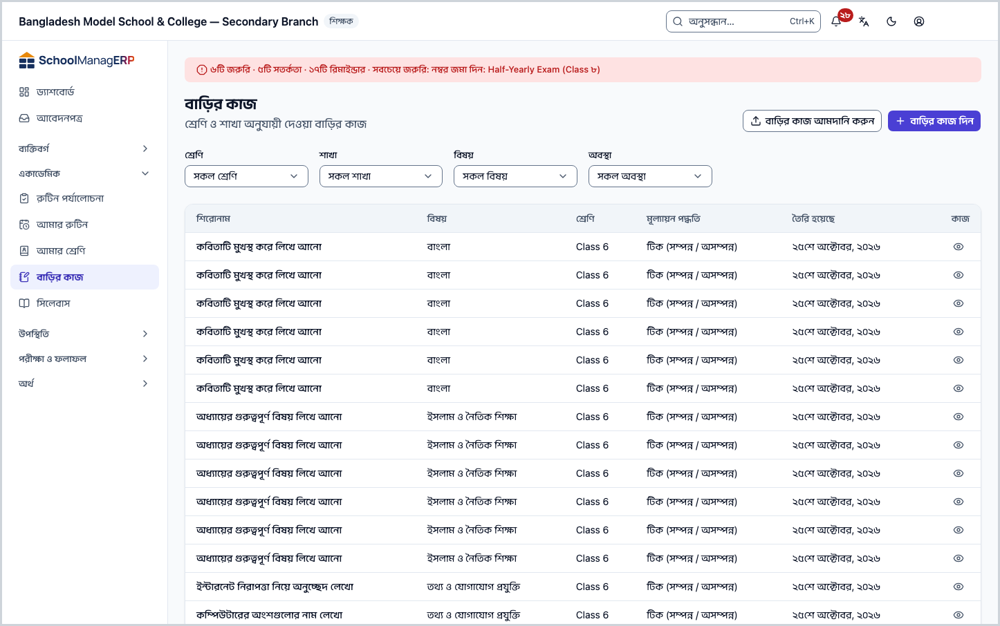
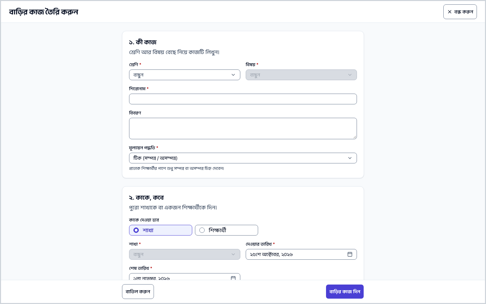
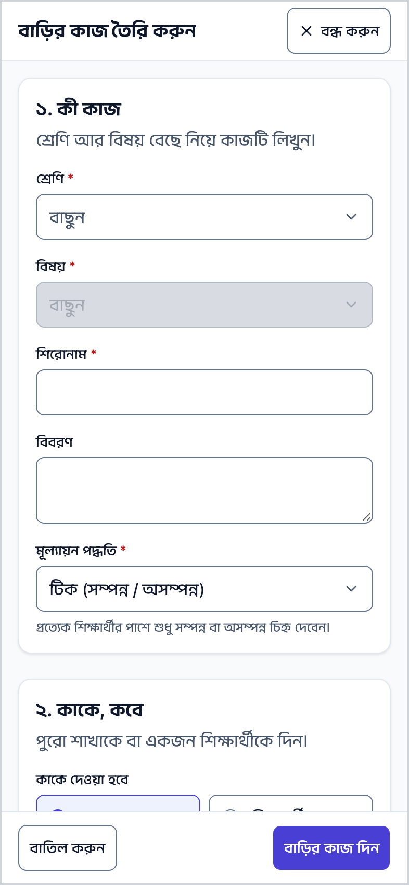
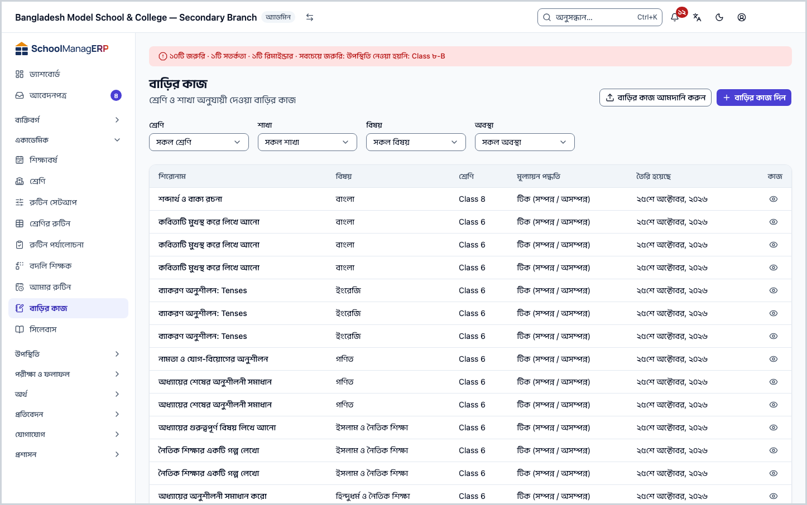
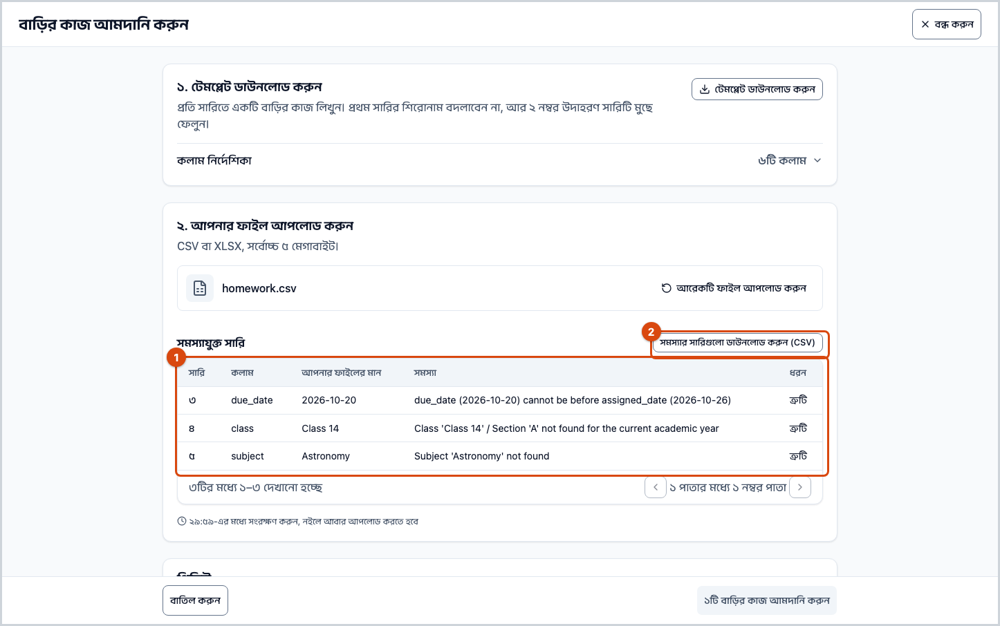

<!-- guide:meta
feature: academics.homework
title: বাড়ির কাজ দেওয়া
summary: শ্রেণি ও বিষয়ের জন্য বাড়ির কাজ তৈরি করে কোনো শাখা বা একজন শিক্ষার্থীকে দিন, একই কাজ আরও শাখায় দিন, দেওয়া কাজ বদলান বা নিষ্ক্রিয় করুন, প্রত্যেক শিক্ষার্থীর কাজ দেখুন, আর অনেক কাজ একসঙ্গে ফাইল থেকে আমদানি করুন।
roles: [ADMIN, TEACHER]
sources:
  - client-admin/src/routes/_staff/academics/homework/index.tsx
  - client-admin/src/routes/_staff/academics/homework/new.tsx
  - client-admin/src/routes/_staff/academics/homework/$homeworkId.tsx
  - client-admin/src/routes/_staff/academics/homework/import.tsx
  - client-admin/src/routes/_staff/academics/homework/-assign-homework-form.tsx
  - client-admin/src/routes/_staff/academics/homework/-submission-grid.tsx
  - server/src/modules/homework/homework.controller.ts
  - server/src/modules/homework/homework.service.ts
  - server/src/modules/homework/homework-access.service.ts
  - server/src/modules/homework/homework-submission.service.ts
  - server/src/modules/homework/homework-bulk-upload.controller.ts
  - server/src/modules/homework/homework-bulk-upload.service.ts
  - server/src/modules/homework/homework-bulk-upload.parser.ts
labels:
  [
    homework:list.*,
    homework:detail.*,
    homework:grid.*,
    homework:form.*,
    homework:import.*,
    bulkImport:*,
    nav:items.homework,
    nav:groups.academics,
    common:accessDenied.*,
  ]
helpIds:
  [
    academics.homework,
    academics.homework.action.assign,
    academics.homework.action.assignAgain,
    academics.homework.action.import,
    academics.homework.field.gradingMode,
    academics.homework.field.target,
    academics.homework.field.dueDate,
  ]
devices: [desktop, phone]
entry: [sidebar, palette, dashboard:homework-to-check, dashboard:homework-submission-rate, page:academics.myClass]
keywords:
  [বাড়ির কাজ, হোমওয়ার্ক, অ্যাসাইনমেন্ট, শেষ তারিখ, মূল্যায়ন পদ্ধতি, আমদানি, এক্সেল, homework, assignment, classwork, due date, import, excel, csv]
appVersion: 0.1.0 (e424f8fc4)
owner: tareq89
lastVerified: 2026-10-24
knownIssues: []
-->

# বাড়ির কাজ দেওয়া

একটি শ্রেণির একটি বিষয়ের জন্য বাড়ির কাজ তৈরি করুন, আর তা পুরো শাখাকে বা একজন শিক্ষার্থীকে দিন।

**যেতে হবে:** বাম মেনুতে **একাডেমিক → বাড়ির কাজ**। ফোনেও চলে; তালিকা তখন কার্ড হয়ে দেখায়।
**শুরুর আগে:** শ্রেণিতে শাখা আর বিষয় থাকতে হবে ([শ্রেণি, শাখা ও বিষয়](classes.md))। শিক্ষক হলে ওই শ্রেণির শাখায় আপনার দায়িত্ব থাকতে হবে ([শিক্ষকের দায়িত্ব](../people/teaching-assignments.md))।

**বাড়ির কাজ** দুই ধাপে চলে। প্রথমে কাজটি নিজে: কোন শ্রেণির, কোন বিষয়ের, কী লিখতে হবে, আর কীভাবে মূল্যায়ন হবে। তারপর **দেওয়া**: কাজটি কোন শাখা বা কোন শিক্ষার্থী পাবে, কবে দেওয়া হলো আর কবে শেষ। একটি কাজ একাধিক শাখায় দেওয়া যায়, প্রতিবার আলাদা তারিখে।

[বাড়ির কাজ দিন](#task-main) · [আরও শাখায় দিন](#task-assign-again) · [কাজ দেখুন](#task-check) · [ফাইল থেকে আমদানি](#task-import) · [সমস্যা ও সমাধান](#trouble)

**এই পাতায় যা আছে**

- [এই পাতায় যেভাবে আসবেন](#arrive)
- [বাড়ির কাজ দিন](#task-main)
- [বাড়ির কাজ দেওয়া হয়েছে কি না বুঝবেন কীভাবে](#confirm)
- [অন্য পরিস্থিতিতে](#other)
  - [একজন শিক্ষার্থীকে দিন](#task-student)
  - [একই কাজ আরও শাখায় দিন](#task-assign-again)
  - [Excel বা CSV ফাইল থেকে বাড়ির কাজ আমদানি করুন](#task-import)
  - [মূল্যায়ন পদ্ধতি কোনটি বাছবেন](#task-grading)
  - [তালিকা ছাঁকুন](#task-find)
  - [কাজের পাতা দেখুন](#task-detail)
  - [দেওয়া কাজ বদলান, শেষ তারিখ সরান বা নিষ্ক্রিয় করুন](#task-change)
  - [শিক্ষার্থীদের কাজ দেখুন](#task-check)
- [সমস্যা ও সমাধান](#trouble)
- [কে কী করতে পারেন](#roles)
- [আরও জানুন](#more)

---

## এই পাতায় যেভাবে আসবেন 

**বাম মেনু থেকে:** **একাডেমিক → বাড়ির কাজ** চাপুন। নিচের ধাপ ১ থেকে শুরু করুন।

**খোঁজার ঘর থেকে:** উপরের খোঁজার ঘরে (Ctrl+K) **বাড়ির কাজ** লিখে বেছে নিন। খোঁজার নিয়ম: [যেকোনো পাতা খুঁজে পাওয়া](../start/find-anything.md)।

**ড্যাশবোর্ড থেকে:** শিক্ষকের **দেখার বাকি হোমওয়ার্ক** কার্ডে **জমা দেখুন** চাপলে কার্ডের প্রথম কাজটির **কাজ দেখা** তালিকা খোলে ([শিক্ষার্থীদের কাজ দেখুন](#task-check))। অ্যাডমিনের বাড়ির কাজ জমার হারের কার্ড থেকে এই তালিকা খোলে। কার্ডগুলোর কথা: [ড্যাশবোর্ডের কার্ড](../dashboard/widgets.md)।

**আমার শ্রেণি থেকে:** শ্রেণি শিক্ষক [আমার শ্রেণি](my-class.md#task-cards)-র **বাড়ির কাজ** কার্ডে শাখার মোট, সম্পন্ন আর অসম্পন্ন কাজের সংখ্যা দেখেন। কাজ দিতে এই পাতায় আসুন।

---

## বাড়ির কাজ দিন 

1. বাম মেনুতে **একাডেমিক → বাড়ির কাজ** চাপুন।

   → উপরে **বাড়ির কাজ** শিরোনাম, নিচে লেখা **শ্রেণি ও শাখা অনুযায়ী দেওয়া বাড়ির কাজ**। তালিকায় **শিরোনাম**, **বিষয়**, **শ্রেণি**, **মূল্যায়ন পদ্ধতি**, **তৈরি হয়েছে** কলাম, নতুনটি আগে। কিছু না থাকলে **এখনো কোনো বাড়ির কাজ নেই**।

2. পাতার উপরে **বাড়ির কাজ দিন** চাপুন।

   → **বাড়ির কাজ তৈরি করুন** পাতা খোলে, দুই অংশে: **১. কী কাজ** আর **২. কাকে, কবে**।

3. **১. কী কাজ** অংশে **শ্রেণি** বাছুন, তারপর **বিষয়**।

   → **বিষয়** তালিকায় শুধু ওই শ্রেণিতে যুক্ত বিষয়গুলো আসে। শ্রেণি বদলালে বিষয়, শাখা আর শিক্ষার্থী মুছে যায়; আবার বাছতে হয়। না বাছলে **একটি শ্রেণি বাছুন।** বা **একটি বিষয় বাছুন।** দেখায়।

4. **শিরোনাম** লিখুন, যেমন `অনুশীলনী ৩.২, ১ থেকে ৫ নম্বর`। চাইলে **বিবরণ**-এ বিস্তারিত লিখুন।

   → শিরোনাম ফাঁকা রাখলে **একটি শিরোনাম লিখুন।** দেখায়। বিবরণ ঐচ্ছিক।

5. **মূল্যায়ন পদ্ধতি** বাছুন: **টিক (সম্পন্ন / অসম্পন্ন)**, **আংশিক সম্পন্নতা** বা **নম্বর**। শুরুতে **টিক** বাছা থাকে। কোনটি কখন: [মূল্যায়ন পদ্ধতি কোনটি বাছবেন](#task-grading)।

6. **২. কাকে, কবে** অংশে **কাকে দেওয়া হবে**-তে **শাখা** রাখুন, আর **শাখা** ঘরে শাখা বাছুন।

   → না বাছলে **একটি শাখা বাছুন।** দেখায়। একজনকে দিতে চাইলে: [একজন শিক্ষার্থীকে দিন](#task-student)।

7. **দেওয়ার তারিখ** আর **শেষ তারিখ** দেখে নিন। শুরুতে দেওয়ার তারিখ আজ, শেষ তারিখ সাত দিন পরে।

   → শেষ তারিখ দেওয়ার তারিখের আগে হলে **শেষ তারিখ অবশ্যই দেওয়ার তারিখের সমান বা তার পরে হতে হবে।** দেখায়। একই দিন চলে।

8. নিচে **বাড়ির কাজ দিন** চাপুন।

   → কাজটি তৈরি হয়ে শাখাকে দেওয়া হয়, আর সরাসরি তার পাতা খোলে।

**ফোনে** পাতাটি পুরো পর্দা জুড়ে খোলে; ঘরগুলো একটির নিচে একটি, আর **বাড়ির কাজ দিন** বোতাম নিচে।

> **মনে রাখুন:** **বাড়ির কাজ দিন** চাপার আগে কিছুই জমা হয় না। মাঝপথে **বাতিল করুন** চাপলে অ্যাপ জিজ্ঞেস করে লেখা ফেলে দেবেন কি না।

---

## বাড়ির কাজ দেওয়া হয়েছে কি না বুঝবেন কীভাবে 

বাড়ির কাজ শুধু ইন্টারনেট থাকলে জমা হয়; ডিভাইসে জমিয়ে রেখে পরে পাঠানো যায় না। তাই **এই ডিভাইসে সংরক্ষিত** অবস্থা এখানে নেই।

| অবস্থা                       | কীভাবে বুঝবেন                                          | এরপর কী                  |
| ---------------------------- | ------------------------------------------------------ | ------------------------ |
| **শুধু স্ক্রিনে বদলেছে**     | **বাড়ির কাজ তৈরি করুন** পাতা খোলা, ঘর পূরণ করা        | **বাড়ির কাজ দিন** চাপুন |
| **স্কুলের সিস্টেমে পৌঁছেছে** | কাজের নিজের পাতা খুলেছে, শিরোনামে আপনার দেওয়া শিরোনাম | কাজ শেষ                  |

**যাচাই করতে চাইলে:** **বাড়ির কাজ** তালিকায় ফিরে যান। নতুন কাজটি সবার উপরে থাকে। **শাখা** ছাঁকনিতে শাখাটি বাছলে কাজটি সেখানেও আসে।

**কোনো পাতা না খুললে:** [সমস্যা ও সমাধান](#trouble) দেখুন। ঘরে লেখা তথ্য তখনও ঘরেই থাকে।

---

## অন্য পরিস্থিতিতে 

### একজন শিক্ষার্থীকে দিন 

যেমন কেউ অসুস্থ থাকায় পিছিয়ে পড়েছে, তাকে আলাদা কাজ।

1. **২. কাকে, কবে** অংশে **কাকে দেওয়া হবে**-তে **শিক্ষার্থী** বাছুন।
2. আগে **শাখা** বাছুন, তারপর **শিক্ষার্থী**।

   → **শিক্ষার্থী** তালিকায় শুধু ওই শাখার শিক্ষার্থী আসে। না বাছলে **একজন শিক্ষার্থী বাছুন।** দেখায়।

3. তারিখ দেখে **বাড়ির কাজ দিন** চাপুন।

   → কাজটি শুধু সেই শিক্ষার্থী পায়।

### একই কাজ আরও শাখায় দিন 

একই শ্রেণির অন্য শাখা বা অন্য শিক্ষার্থীকে একই কাজ দিতে নতুন করে লিখতে হয় না।

1. তালিকায় কাজের সারিতে **দেখুন** চাপুন।
2. কাজের পাতার উপরে **শাখা বা শিক্ষার্থীকে দিন** চাপুন।

   → একই নামের ঘর খোলে, উপরে কাজের শিরোনাম আর শ্রেণি। শ্রেণি ও বিষয় বদলানো যায় না; শুধু একই শ্রেণির শাখা বা শিক্ষার্থী বাছা যায়।

3. **কাকে দেওয়া হবে**, **শাখা** (বা **শিক্ষার্থী**), **দেওয়ার তারিখ** আর **শেষ তারিখ** দিন।
4. **দিন** চাপুন।

   → ঘর বন্ধ হয়, আর বার্তা আসে **দেওয়া হয়েছে। শেষ তারিখ {তারিখ}।**

| আপনি চাপলেন    | কী হবে                                     | জমা হলো? |
| -------------- | ------------------------------------------ | -------- |
| **দিন**        | কাজটি নতুন শাখা বা শিক্ষার্থীকে দেওয়া হয় | হ্যাঁ    |
| **বাতিল করুন** | ঘর বন্ধ হয়, কিছুই বদলায় না               | না       |

### Excel বা CSV ফাইল থেকে বাড়ির কাজ আমদানি করুন 

অনেক শাখার জন্য অনেক কাজ একসঙ্গে দিতে, যেমন পুরো সপ্তাহের, একটি ফাইল থেকে আমদানি করুন। ফাইলের প্রতিটি সারি একটি কাজ, যা একটি শাখাকে দেওয়া হয়।

**১. টেমপ্লেট ডাউনলোড করুন**

1. **বাড়ির কাজ** তালিকার উপরে **বাড়ির কাজ আমদানি করুন** চাপুন।

   → **বাড়ির কাজ আমদানি করুন** পাতা খোলে, তিন অংশ: **১. টেমপ্লেট ডাউনলোড করুন**, **২. আপনার ফাইল আপলোড করুন**, **৩. ফলাফল**।

2. **টেমপ্লেট ডাউনলোড করুন** চাপুন।

   → `homework-import-template.csv` ফাইল নামে। প্রথম সারিতে কলামের শিরোনাম, দ্বিতীয় সারিতে একটি উদাহরণ।

**২. ফাইল পূরণ করুন**

3. ফাইলটি Excel বা Google Sheets-এ খুলুন। প্রথম সারির শিরোনাম বদলাবেন না, আর উদাহরণের সারিটি মুছে ফেলুন।
4. প্রতি সারিতে একটি কাজ লিখুন। কোন কলামে কী: পাতার **কলাম নির্দেশিকা** খুললেও দেখা যায়।

| কলামের শিরোনাম  | কী লিখবেন                                                                 | আবশ্যক? |
| --------------- | ------------------------------------------------------------------------- | ------- |
| `class`         | চলতি শিক্ষাবর্ষের শ্রেণির নাম, অ্যাপে যেমন লেখা, যেমন `Class 5`           | হ্যাঁ   |
| `section`       | সেই শ্রেণির শাখা, যেমন `A`                                                | হ্যাঁ   |
| `subject`       | স্কুলের একটি বিষয়ের নাম, যেমন `Mathematics`                              | হ্যাঁ   |
| `assigned_date` | দেওয়ার তারিখ, বছর-মাস-দিন ক্রমে, যেমন `2026-10-01`                       | হ্যাঁ   |
| `due_date`      | শেষ তারিখ, একই ক্রমে, যেমন `2026-10-05`; দেওয়ার তারিখের আগে হতে পারবে না | হ্যাঁ   |
| `description`   | কাজের ছোট বিবরণ, যেমন `অনুশীলনী ৩.২`; ফাঁকা রাখা যায়                     | না      |

ফাইলে শিরোনাম বা মূল্যায়ন পদ্ধতির কলাম নেই। আমদানি হওয়া প্রতিটি কাজের শিরোনাম অ্যাপ নিজে বানায় বিষয় আর দেওয়ার তারিখ দিয়ে, যেমন **Mathematics — 2026-10-01**, আর মূল্যায়ন পদ্ধতি হয় **টিক (সম্পন্ন / অসম্পন্ন)**।

5. ফাইলটি CSV বা XLSX হিসেবে সংরক্ষণ করুন। ফাইল ৫ মেগাবাইটের বেশি নয়, আর শিরোনামের সারি বাদে সর্বোচ্চ ২০০০ সারি।

**৩. আপলোড করুন আর সমস্যা দেখুন**

6. **২. আপনার ফাইল আপলোড করুন** অংশে **ফাইল বাছাই করুন** চাপুন, ফাইল বাছুন।

   → লেখা আসে **ফাইল পাওয়া গেছে। এখন যাচাই করা হচ্ছে।** অ্যাপ প্রতিটি সারি মিলিয়ে দেখে: শ্রেণি-শাখা চলতি বর্ষে আছে কি না, বিষয় আছে কি না, তারিখ ঠিক কি না, আর শিক্ষক হলে ওই শাখা-বিষয়ে আপনার দায়িত্ব আছে কি না।

7. ফল দেখুন।

   → সব ঠিক থাকলে **প্রিভিউ** অংশে **কোনো সমস্যা নেই** চিহ্ন, লেখা যেমন **১২টি বাড়ির কাজ তৈরি হবে।**, আর প্রথম ২০টি সারি (**শ্রেণি · শাখা · বিষয়**, **দেওয়ার তারিখ**, **শেষ তারিখ**)।

   → কোনো সারিতে সমস্যা থাকলে **সমস্যাযুক্ত সারি** টেবিল আসে: **সারি** (ফাইলের কোন সারি), **কলাম**, **আপনার ফাইলের মান**, **সমস্যা**, **ধরন**। নিচের বোতামে আমদানি বন্ধ থাকে।

**৪. সমস্যার সারি ঠিক করুন**

8. **সমস্যার সারিগুলো ডাউনলোড করুন (CSV)** চাপলে সমস্যার তালিকা ফাইলে নামে; পাশে রেখে কাজ করা সহজ।
9. নিজের ফাইলে সেই সারিগুলো ঠিক করুন। সাধারণ কারণ:

   - শ্রেণি বা শাখার নাম অ্যাপের নামের সঙ্গে মেলেনি, বা শ্রেণিটি চলতি শিক্ষাবর্ষের নয়।
   - দুটি শ্রেণির একই নাম আর একই শাখা থাকায় অ্যাপ বুঝতে পারেনি কোনটি (যেমন দুই শিফটে `Class 6` / `A`)। অ্যাডমিন একটির নাম আলাদা করলে তবে চলে।
   - বিষয়ের নাম মেলেনি, বা একই নামের দুটি বিষয় আছে।
   - শেষ তারিখ দেওয়ার তারিখের আগে, বা তারিখ বছর-মাস-দিন ক্রমে নয়।
   - শিক্ষক হলে: ওই শাখা-বিষয়ে আপনার দায়িত্ব নেই।

10. **আরেকটি ফাইল আপলোড করুন** চাপুন, ঠিক করা পুরো ফাইলটি আবার আপলোড করুন।

> **মনে রাখুন:** একটি সারিতেও সমস্যা থাকলে কোনো কাজই আমদানি হয় না। শুধু ভুল সারি নয়, পুরো ফাইল আবার আপলোড করুন; আগের ভালো সারি দুবার তৈরি হবে না, কারণ আগেরবার কিছুই জমা হয়নি।

**৫. আমদানি নিশ্চিত করুন**

11. সমস্যা না থাকলে নিচে **{সংখ্যা}টি বাড়ির কাজ আমদানি করুন** চাপুন। যাচাইয়ের পর পাশে সময় দেখায়, যেমন **২৯:৪০-এর মধ্যে সংরক্ষণ করুন, নইলে আবার আপলোড করতে হবে**; ৩০ মিনিট পেরোলে আবার আপলোড করতে হয়।

→ **৩. ফলাফল** অংশে **সম্পন্ন** চিহ্ন আর লেখা যেমন **১২টি বাড়ির কাজ তৈরি হয়েছে।** উপরে বার্তাও আসে।

12. **বাড়ির কাজে ফিরে যান** চাপুন।

→ নতুন কাজগুলো তালিকায় আসে।

| আপনি চাপলেন                           | কী হবে                                    | জমা হলো? |
| ------------------------------------- | ----------------------------------------- | -------- |
| **{সংখ্যা}টি বাড়ির কাজ আমদানি করুন** | ফাইলের সব কাজ তৈরি হয়ে শাখায় দেওয়া হয় | হ্যাঁ    |
| **আরেকটি ফাইল আপলোড করুন**            | এই ফাইল বাদ, নতুন ফাইল বাছা যায়          | না       |
| **বাতিল করুন**                        | অ্যাপ জিজ্ঞেস করে, তারপর তালিকায় ফেরে    | না       |

<figure>
  
  <figcaption><em>আমদানি: একটি সারিও ভুল থাকলে কিছুই জমা হয় না</em></figcaption>
</figure>

### মূল্যায়ন পদ্ধতি কোনটি বাছবেন 

| পদ্ধতি                       | কখন বাছবেন                                                       |
| ---------------------------- | ---------------------------------------------------------------- |
| **টিক (সম্পন্ন / অসম্পন্ন)** | প্রত্যেক শিক্ষার্থীর পাশে শুধু সম্পন্ন বা অসম্পন্ন চিহ্ন দেবেন।  |
| **আংশিক সম্পন্নতা**          | প্রত্যেক শিক্ষার্থীর জন্য অসম্পন্ন, আংশিক বা সম্পন্ন বেছে নেবেন। |
| **নম্বর**                    | প্রত্যেক শিক্ষার্থীকে নম্বর দেবেন।                               |

কাজ তৈরির পর পদ্ধতি বদলানো যায় না। প্রত্যেক শিক্ষার্থীকে টিক, সম্পন্নতা বা নম্বর দেন [কাজ দেখা](#task-check) তালিকায়।

### তালিকা ছাঁকুন 

| ঘর         | কী বাছবেন                                                             |
| ---------- | --------------------------------------------------------------------- |
| **শ্রেণি** | একটি শ্রেণি, বা **সকল শ্রেণি**                                        |
| **শাখা**   | বাছা শ্রেণির একটি শাখা, বা **সকল শাখা**। শ্রেণি বদলালে শাখা মুছে যায় |
| **বিষয়**  | একটি বিষয়, বা **সকল বিষয়**                                          |
| **অবস্থা** | **সক্রিয়**, **নিষ্ক্রিয়** বা **প্রতিস্থাপিত**, বা **সকল অবস্থা**    |

ছাঁকনি শুধু দেখার জন্য; কিছু বদলায় না।

### কাজের পাতা দেখুন 

তালিকায় **দেখুন** চাপলে কাজের পাতা খোলে। উপরে শিরোনাম, আর **বিষয়**, **শ্রেণি**, **মূল্যায়ন পদ্ধতি**, **তৈরি হয়েছে**। নিচে **বিবরণ**; না থাকলে **কোনো বিবরণ নেই।** উপরে **শাখা বা শিক্ষার্থীকে দিন** বোতাম ([একই কাজ আরও শাখায় দিন](#task-assign-again))।

বিবরণের নিচে **কারা এই বাড়ির কাজ পেয়েছে** কার্ড। প্রতিটি সারি একটি শাখা (**শাখা ক**) বা একজন শিক্ষার্থী (**রহিমা আক্তার · শাখা খ**)। সারিতে আছে **দেওয়ার তারিখ**, **শেষ তারিখ** আর **অবস্থা** (**সক্রিয়**, **নিষ্ক্রিয়** বা **প্রতিস্থাপিত**)। সক্রিয় সারি আগে আসে। কাউকে দেওয়া না হলে দেখায় **এখনো কাউকে দেওয়া হয়নি**।

সারির অবস্থা অনুযায়ী বোতাম:

| সারির অবস্থা     | সারিতে যে বোতাম থাকে                                         |
| ---------------- | ------------------------------------------------------------ |
| **সক্রিয়**      | **কাজ দেখুন**, **শেষ তারিখ**, **বদলান**, **নিষ্ক্রিয় করুন** |
| **নিষ্ক্রিয়**   | **কাজ দেখুন**, **আবার সক্রিয় করুন**                         |
| **প্রতিস্থাপিত** | শুধু **কাজ দেখুন**                                           |

শিক্ষক শুধু নিজের শাখার সারি দেখেন। কার্ডে সর্বোচ্চ ১০০টি সারি দেখানো হয়, সক্রিয়গুলো আগে। ঠিক ১০০টি দেখালে নিচে লেখা আসে **শুধু প্রথম ১০০টি সারি দেখানো হচ্ছে, সক্রিয়গুলো আগে। পুরনো সারি এখানে নেই।**

### দেওয়া কাজ বদলান, শেষ তারিখ সরান বা নিষ্ক্রিয় করুন 

তিনটিই কাজ করে **কারা এই বাড়ির কাজ পেয়েছে** কার্ডের একটি সারিতে।

**শেষ তারিখ সরাতে:** সারিতে **শেষ তারিখ** চাপুন। **শেষ তারিখ বদলান** বাক্স খোলে। নতুন তারিখ বেছে **সংরক্ষণ করুন** চাপুন। দেখাবে **শেষ তারিখ এখন {date}।** আগে জমা দেওয়া কাজ থেকে যায়। শেষ তারিখ দেওয়ার তারিখের আগে হতে পারে না (**শেষ তারিখ অবশ্যই দেওয়ার তারিখের সমান বা তার পরে হতে হবে।**)।

**অন্য কাউকে দিতে:** সারিতে **বদলান** চাপুন। **দেওয়া কাজটি বদলান** বাক্স খোলে, সারির শাখা বা শিক্ষার্থী আর তারিখ আগে থেকে বসানো। নতুন শাখা বা শিক্ষার্থী আর তারিখ বেছে **সংরক্ষণ করুন** চাপুন। দেখাবে **বদলানো হয়েছে। শেষ তারিখ {date}।**

> **মনে রাখুন:** **বদলান** পুরনো সারি বদলায় না। পুরনো সারি তালিকায় **প্রতিস্থাপিত** হয়ে থেকে যায়, আর একটি নতুন **সক্রিয়** সারি তৈরি হয়। আগে জমা দেওয়া কাজ পুরনো সারিতেই থাকে; নতুন সারির শিক্ষার্থীরা শূন্য থেকে শুরু করে।

**নিষ্ক্রিয় করতে:** সারিতে **নিষ্ক্রিয় করুন** চাপুন, তারপর প্রশ্নের বাক্সে আবার **নিষ্ক্রিয় করুন** চাপুন। শিক্ষার্থী ও অভিভাবকেরা আর কাজটি দেখেন না, কেউ জমাও দিতে পারে না। আগে জমা দেওয়া কাজ থেকে যায়। দেখাবে **নিষ্ক্রিয় করা হয়েছে।**

**আবার সক্রিয় করতে:** **নিষ্ক্রিয়** সারিতে **আবার সক্রিয় করুন** চাপুন, তারপর প্রশ্নের বাক্সে **আবার সক্রিয় করুন** চাপুন। শিক্ষার্থী ও অভিভাবকেরা আবার কাজটি দেখেন, আর শেষ তারিখ পর্যন্ত জমা দিতে পারেন। দেখাবে **আবার সক্রিয় করা হয়েছে।**

> **মনে রাখুন:** **বদলান** শুধু **সক্রিয়** সারির জন্য। **নিষ্ক্রিয়** সারি অন্য কাউকে দিতে আগে **আবার সক্রিয় করুন** চাপুন। একটি শাখা বা শিক্ষার্থীর একই বাড়ির কাজের **সক্রিয়** সারি একটির বেশি হতে পারে না। আগে থেকে থাকলে **আবার সক্রিয় করুন** বা **বাড়ির কাজ দিন** কাজ করে না; তার ওই সারিতে **শেষ তারিখ** চাপুন, অথবা আগে সেই সারি **নিষ্ক্রিয় করুন**।

**অভিভাবকেরা কি জানতে পারেন?** স্কুল [সেটিংসে](../administration/settings.md) **বাড়ির কাজ দিলে বা বদলালে অভিভাবককে এসএমএস পাঠান** চালু রাখলে, শেষ তারিখ সরালে, সারি নিষ্ক্রিয় করলে বা অন্য কাউকে দিলে অভিভাবকেরা আবার এসএমএস পান। নতুন শাখা বা শিক্ষার্থী "নতুন বাড়ির কাজ"-এর এসএমএস পায়, আর পুরনোটিকে জানানো হয় যে কাজটি বাতিল। **আবার সক্রিয় করুন** চাপলে এসএমএস যায় না। টিকবক্স বন্ধ থাকলে কোনো এসএমএস যায় না।

| আপনি চাপলেন                                 | যা হয়                                                          | জমা হলো? |
| ------------------------------------------- | --------------------------------------------------------------- | -------- |
| **সংরক্ষণ করুন** (শেষ তারিখ)                | শুধু ওই সারির শেষ তারিখ বদলায়                                  | হ্যাঁ    |
| **সংরক্ষণ করুন** (বদলান)                    | পুরনো সারি **প্রতিস্থাপিত** হয়, নতুন **সক্রিয়** সারি তৈরি হয় | হ্যাঁ    |
| **নিষ্ক্রিয় করুন** / **আবার সক্রিয় করুন** | সারির অবস্থা বদলায়; জমা দেওয়া কাজ থেকে যায়                   | হ্যাঁ    |
| **বাতিল করুন** বা বাক্স বন্ধ করা            | কিছু বদলায় না                                                  | না       |

### শিক্ষার্থীদের কাজ দেখুন 

এখানে কাজের [মূল্যায়ন পদ্ধতি](#task-grading) অনুযায়ী প্রত্যেক শিক্ষার্থীকে টিক, সম্পন্নতা বা নম্বর দেন।

1. কাজের পাতায় **কারা এই বাড়ির কাজ পেয়েছে** কার্ডে কোনো সারিতে **কাজ দেখুন** চাপুন।

   → পুরো পাতা জুড়ে একটি তালিকা খোলে, নাম **কাজ দেখা · শাখা ক** (বা শিক্ষার্থীর নাম)। কারা থাকে: শাখার সারিতে শাখার প্রত্যেক সক্রিয় শিক্ষার্থী; শিক্ষার্থীর সারিতে শুধু সেই শিক্ষার্থী। সারিতে যার কাজ আগে থেকে আছে, সে অন্য শাখায় গেলেও তালিকায় থাকে। **প্রতিস্থাপিত** সারিতে নতুন কেউ যোগ হয় না; শুধু যাদের কাজ আগে থেকে আছে, তারাই থাকে। প্রত্যেকের পাশে রোল, নাম আর একটি চিহ্ন: **জমা দেওয়া হয়নি**, **জমা দেওয়া হয়েছে**, **আংশিক** বা **সম্পন্ন**।

2. প্রত্যেক শিক্ষার্থীর জন্য বাছুন:

   | মূল্যায়ন পদ্ধতি             | প্রতি সারিতে কী করবেন                                                                                         |
   | ---------------------------- | ------------------------------------------------------------------------------------------------------------- |
   | **টিক (সম্পন্ন / অসম্পন্ন)** | যে কাজটি করেছে, তার ঘরে টিক দিন                                                                               |
   | **আংশিক সম্পন্নতা**          | **সম্পন্ন**, **আংশিক** বা **সম্পন্ন হয়নি** বাছুন                                                             |
   | **নম্বর**                    | ০ থেকে ৯,৯৯৯-এর মধ্যে পূর্ণ সংখ্যা লিখুন; নম্বর না থাকলে খালি রাখুন। নম্বর লিখলে সারিটি **সম্পন্ন** হয়ে যায় |

3. নিচে **সংরক্ষণ করুন** চাপুন। একবার চাপলেই বদলানো সব সারি একসঙ্গে জমা হয়।

   → দেখাবে **সংরক্ষণ হয়েছে।** চিহ্নগুলো নতুন অবস্থা দেখায়।

- কিছু না বদলানো পর্যন্ত **সংরক্ষণ করুন** চাপা যায় না।
- কোনো শিক্ষার্থী ফাইল জমা দিয়ে থাকলে আর আপনি টিক তুলে দিলে বা **সম্পন্ন হয়নি** বাছলে, সারিটি **জমা দেওয়া হয়নি** নয়, **জমা দেওয়া হয়েছে**-তে ফেরে: তার জমা দেওয়া ফাইল থেকে যায়।
- না জমা করা বদল রেখে তালিকা বন্ধ করলে অ্যাপ আগে জিজ্ঞেস করে। ব্রাউজারের **Back** বোতামও একই প্রশ্ন করে; থাকতে চাইলে **সম্পাদনা চালিয়ে যান** চাপুন।
- শিক্ষক শুধু নিজের দায়িত্বের শাখা ও বিষয়ের সারি খুলতে পারেন।

---

---

## সমস্যা ও সমাধান 

| আপনি যা দেখছেন                                                                                                                               | কী করবেন                                                                                                                                                                                                                                   | কে সাহায্য করতে পারেন |
| -------------------------------------------------------------------------------------------------------------------------------------------- | ------------------------------------------------------------------------------------------------------------------------------------------------------------------------------------------------------------------------------------------ | --------------------- |
| **বাড়ির কাজ লোড করা যায়নি।**                                                                                                               | ইন্টারনেট দেখে পাতা রিলোড করুন।                                                                                                                                                                                                            | অ্যাডমিন              |
| **কিছু একটা ভুল হয়েছে। আবার চেষ্টা করুন।**                                                                                                  | ইন্টারনেট দেখে আবার চাপুন। শিক্ষক হলে: বাছা শ্রেণি-বিষয় বা শাখায় আপনার দায়িত্ব আছে কি না দেখুন ([শিক্ষকের দায়িত্ব](../people/teaching-assignments.md))। শ্রেণির তালিকায় সব শ্রেণি আসে, কিন্তু জমা হয় শুধু নিজের দায়িত্বের শ্রেণিতে। | অ্যাডমিন              |
| **বাড়ির কাজ তৈরি হয়েছে, কিন্তু দেওয়া যায়নি। এর বিস্তারিত পাতা থেকে আবার চেষ্টা করুন:**                                                   | কাজটি তৈরি হয়ে আছে, শুধু শাখায় যায়নি। **বাড়ির কাজে যান** চাপুন, তারপর [শাখা বা শিক্ষার্থীকে দিন](#task-assign-again)। নতুন করে তৈরি করবেন না, তাহলে দুটি হবে।                                                                          | অ্যাডমিন              |
| **বাড়ির কাজ পাওয়া যায়নি।** বা "পাওয়া যায়নি" পাতা                                                                                        | লিংকটি পুরনো, বা কাজটি আপনার দায়িত্বের বাইরে। তালিকা থেকে খুলুন।                                                                                                                                                                          | অ্যাডমিন              |
| শিক্ষক হিসেবে তালিকা ফাঁকা                                                                                                                   | চলমান শিক্ষাবর্ষে আপনার কোনো শাখার দায়িত্ব নেই। অ্যাডমিনকে জানান।                                                                                                                                                                         | অ্যাডমিন              |
| **বিষয়** তালিকা ফাঁকা                                                                                                                       | শ্রেণিতে কোনো বিষয় যুক্ত নেই। [বিষয় যুক্ত করুন](classes.md#task-subjects)।                                                                                                                                                               | অ্যাডমিন              |
| **এই ফাইলের ধরন সমর্থিত নয় — একটি .csv বা .xlsx ফাইল বেছে নিন**                                                                             | ফাইলটি CSV বা XLSX হিসেবে সংরক্ষণ করুন।                                                                                                                                                                                                    | —                     |
| **ফাইলটি অনেক বড় — একটি ছোট ফাইল বেছে নিন**                                                                                                 | ৫ মেগাবাইটের বেশি। ফাইলটি দুই ভাগ করুন।                                                                                                                                                                                                    | —                     |
| **আমদানি ব্যর্থ হয়েছে।**                                                                                                                    | ইন্টারনেট দেখে আবার আপলোড করুন। প্রথম সারির শিরোনাম টেমপ্লেটের মতো আছে কি না, আর সারি ২০০০-এর বেশি কি না দেখুন।                                                                                                                            | অ্যাডমিন              |
| **ফাইলটি পড়া যায়নি। …**, **কিছু কলাম নেই। নমুনা ফাইলের কলামগুলো ব্যবহার করুন।**, **ফাইলে সারি অনেক বেশি। …** বা **ফাইলে কোনো সারি নেই। …** | পুরো ফাইলটিই যাচাই করা যায়নি। বাক্যে যা বলা আছে তা-ই করুন: .xlsx বা .csv হিসেবে আবার সংরক্ষণ করুন, প্রথম সারির শিরোনাম টেমপ্লেটের মতো রাখুন, বা ফাইল ছোট ছোট ভাগ করুন। তারপর আবার আপলোড করুন।                                             | —                     |
| **সময় শেষ — ফাইলটি আবার আপলোড করুন**                                                                                                        | যাচাইয়ের ৩০ মিনিট পেরিয়েছে। একই ফাইল আবার আপলোড করে নিশ্চিত করুন।                                                                                                                                                                        | —                     |
| **এই পাতাটি দেখার অনুমতি আপনার নেই।**                                                                                                        | এই পাতা শুধু অ্যাডমিন আর শিক্ষকের। **ড্যাশবোর্ডে ফিরে যান** চাপুন।                                                                                                                                                                         | অ্যাডমিন              |
| **কারা এই কাজ পেয়েছে তা দেখানো যায়নি।**                                                                                                    | **আবার চেষ্টা করুন** চাপুন। ইন্টারনেট দেখুন।                                                                                                                                                                                               | অ্যাডমিন              |
| **এই সারিটি আগেই বদলানো হয়েছে। তালিকা এখন হালনাগাদ।**                                                                                       | একটু আগে কেউ সারিটি বদলেছেন। তালিকা আবার দেখুন; পুরনো সারি এখন **প্রতিস্থাপিত**।                                                                                                                                                           | —                     |
| **এই বাড়ির কাজ আগেই ওই শাখা বা শিক্ষার্থীকে দেওয়া আছে। অন্য কাউকে বাছুন, অথবা আগের সারিটি বদলান।**                                         | ওই শাখা বা শিক্ষার্থী এই বাড়ির কাজ আগেই **সক্রিয়** সারিতে পেয়েছে। ওই সারিতে **শেষ তারিখ** চাপুন, অথবা আগে সেটি **নিষ্ক্রিয় করুন**।                                                                                                     | —                     |
| **শিক্ষার্থীদের কাজ দেখানো যায়নি।**                                                                                                         | **আবার চেষ্টা করুন** চাপুন। ইন্টারনেট দেখুন।                                                                                                                                                                                               | অ্যাডমিন              |
| **এই তালিকা খোলা যাচ্ছে না। হয়তো এটি এমন শাখার, যেখানে আপনি পড়ান না।**                                                                     | লিংকটি পুরনো, বা সারিটি আপনার দায়িত্বের বাইরে। **বন্ধ করুন** চাপুন, তারপর কাজের পাতা থেকে **কাজ দেখুন** খুলুন।                                                                                                                            | অ্যাডমিন              |
| **আপনি কাজ করার সময় তালিকাটি বদলেছে। তালিকা এখন হালনাগাদ; দেখে আবার সংরক্ষণ করুন।**                                                         | আপনার বদল জমা হয়নি। তালিকা দেখে আবার বাছুন, তারপর **সংরক্ষণ করুন** চাপুন।                                                                                                                                                                 | —                     |
| **নম্বর ০ থেকে ৯,৯৯৯-এর মধ্যে পূর্ণ সংখ্যা হতে হবে।**                                                                                        | ওই সারির নম্বর ঠিক করুন। কিছুই জমা হয়নি।                                                                                                                                                                                                  | —                     |
| **এখানে এখনো কোনো শিক্ষার্থী নেই**                                                                                                           | শাখায় কোনো সক্রিয় শিক্ষার্থী নেই, কেউ কাজও জমা দেয়নি। আগে শাখায় শিক্ষার্থী যোগ করুন।                                                                                                                                                   | অ্যাডমিন              |

---

## কে কী করতে পারেন 

| ভূমিকা                                                                                   | তালিকা ও কাজের পাতা                      | কাজ তৈরি ও দেওয়া                   | বদলানো, নিষ্ক্রিয় করা, কাজ দেখা            | ফাইল থেকে আমদানি                    |
| ---------------------------------------------------------------------------------------- | ---------------------------------------- | ----------------------------------- | ------------------------------------------- | ----------------------------------- |
| অ্যাডমিন                                                                                 | হ্যাঁ, স্কুলের সব কাজ                    | হ্যাঁ, যেকোনো শ্রেণি ও শাখায়       | হ্যাঁ, সব সারিতে                            | হ্যাঁ, যেকোনো শাখায়                |
| শিক্ষক                                                                                   | শুধু নিজের দায়িত্বের শ্রেণি-বিষয়ের কাজ | শুধু নিজের দায়িত্বের শাখা ও বিষয়ে | শুধু নিজের দায়িত্বের শাখা ও বিষয়ের সারিতে | শুধু নিজের দায়িত্বের শাখা ও বিষয়ে |
| একাডেমিক কো-অর্ডিনেটর, হিসাবরক্ষক, অফিস সহকারী, পরীক্ষা নিয়ন্ত্রক, পরিচালনা পর্ষদ সদস্য | না                                       | না                                  | না                                          | না                                  |

**অ্যাডমিন** স্কুলের সব বাড়ির কাজ দেখেন, আর যেকোনো শ্রেণি, শাখা বা শিক্ষার্থীকে কাজ দিতে ও আমদানি করতে পারেন।

**শিক্ষক** দেখেন ও দেন শুধু চলমান শিক্ষাবর্ষের নিজের দায়িত্ব অনুযায়ী। **শ্রেণি শিক্ষক** বা **সহকারী শ্রেণি শিক্ষক** নিজের শাখায় যেকোনো বিষয়ের কাজ দিতে পারেন; **বিষয় শিক্ষক** শুধু নিজের বিষয়ের, নিজের শাখায়। অন্য শাখায় দিতে চাইলে জমা হয় না, আর আমদানিতে সেই সারি সমস্যা হিসেবে আসে। তালিকায় অন্য শিক্ষকের দায়িত্বের শ্রেণি-বিষয়ের কাজ দেখেন না।

**অন্য সব ভূমিকা** বাম মেনুতে **বাড়ির কাজ** দেখেন না। পাতাটি খুললে **এই পাতাটি দেখার অনুমতি আপনার নেই।** দেখায়। শিক্ষার্থী আর অভিভাবক নিজের কাজ দেখেন নিজেদের অ্যাপে, এই পাতায় নয়।

---

## আরও জানুন 

<strong>পাতার অংশগুলো</strong> — উপর থেকে নিচে

1. **বাড়ির কাজ** — শিরোনাম, নিচে **শ্রেণি ও শাখা অনুযায়ী দেওয়া বাড়ির কাজ**।
2. **বাড়ির কাজ আমদানি করুন** আর **বাড়ির কাজ দিন** — উপরের বোতাম।
3. **ছাঁকনির সারি** — **শ্রেণি**, **শাখা**, **বিষয়**, **অবস্থা**।
4. **তালিকা** — **শিরোনাম**, **বিষয়**, **শ্রেণি**, **মূল্যায়ন পদ্ধতি**, **তৈরি হয়েছে**; প্রতি সারির শেষে **দেখুন**।

<strong>ঘরগুলোর অর্থ</strong>

<!-- guide:generated:fields:homework -->

| ঘর               | কী লিখবেন                                                         | বাধ্যতামূলক?      |
| ---------------- | ----------------------------------------------------------------- | ----------------- |
| শ্রেণি           | কোন শ্রেণির কাজ। পরে বদলায় না।                                   | হ্যাঁ             |
| বিষয়            | শ্রেণিতে যুক্ত একটি বিষয়। পরে বদলায় না।                         | হ্যাঁ             |
| শিরোনাম          | কাজের ছোট নাম, যেমন অনুশীলনী ৩.২।                                 | হ্যাঁ             |
| বিবরণ            | কী করতে হবে, বিস্তারিত।                                           | না                |
| মূল্যায়ন পদ্ধতি | টিক, আংশিক সম্পন্নতা বা নম্বর। শুরুতে টিক। পরে বদলায় না।         | হ্যাঁ             |
| কাকে দেওয়া হবে  | পুরো শাখা, বা একজন শিক্ষার্থী।                                    | হ্যাঁ             |
| শাখা             | শ্রেণির একটি শাখা। শিক্ষার্থী বাছতে হলেও আগে শাখা।                | হ্যাঁ             |
| শিক্ষার্থী       | শাখার একজন। শুধু শিক্ষার্থীকে দিলে আসে।                           | শিক্ষার্থীকে দিলে |
| দেওয়ার তারিখ    | কবে দেওয়া হলো। শুরুতে আজ।                                        | হ্যাঁ             |
| শেষ তারিখ        | কবের মধ্যে করতে হবে। শুরুতে সাত দিন পরে; দেওয়ার তারিখের আগে নয়। | হ্যাঁ             |

<!-- /guide:generated -->

<strong>বাড়ির কাজ কীভাবে কাজ করে</strong> — কাজ তৈরি, তারপর দেওয়া

<figure>
  
  <figcaption><em>একটি কাজ, অনেক শাখায় দেওয়া যায়</em></figcaption>
</figure>

- কাজ থাকে শ্রেণি আর বিষয়ের সঙ্গে; শাখা বা শিক্ষার্থী আসে দেওয়ার সময়। তাই একই কাজ একই শ্রেণির একাধিক শাখায় দেওয়া যায়, অন্য শ্রেণিতে নয়।
- শ্রেণি শিক্ষক নিজের শাখার মোট, সম্পন্ন আর অসম্পন্ন কাজ দেখেন [আমার শ্রেণি](my-class.md#task-cards)-তে। অ্যাডমিন শ্রেণি ধরে দেখেন [শ্রেণির পাতার](classes.md#task-detail) **বাড়ির কাজ** ট্যাবে।

**সম্পর্কিত পাতা**

- [**শ্রেণি, শাখা ও বিষয়**](classes.md) — শ্রেণিতে বিষয় আর শাখা যোগ করুন।
- [**শিক্ষকের দায়িত্ব**](../people/teaching-assignments.md) — কোন শিক্ষক কোন শাখা-বিষয়ে।
- [**আমার শ্রেণি**](my-class.md) — শ্রেণি শিক্ষকের শাখার সারাংশ।
- [**সিলেবাস ও পাঠ পরিকল্পনা**](syllabus.md) — শ্রেণি-বিষয়ের টপিক আর শাখার পাঠ পরিকল্পনা।
- [**হোমওয়ার্ক (অভিভাবক ও শিক্ষার্থী)**](../portal/homework.md) — অভিভাবক ও শিক্ষার্থী যা দেখেন।

---

_সংস্করণ ০.১.০ · শেষ যাচাই ২০২৬-১০-২৪_
