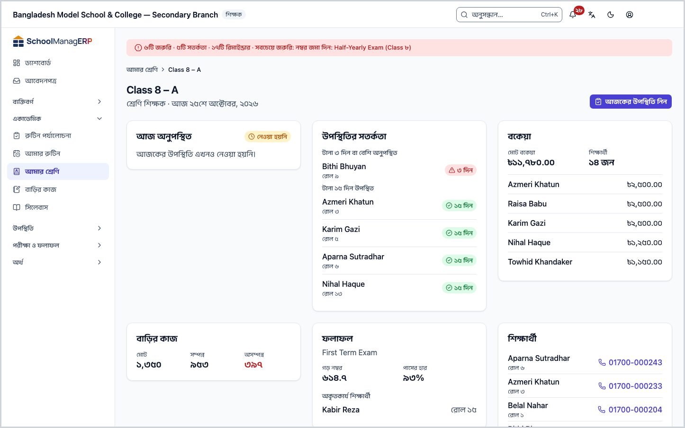
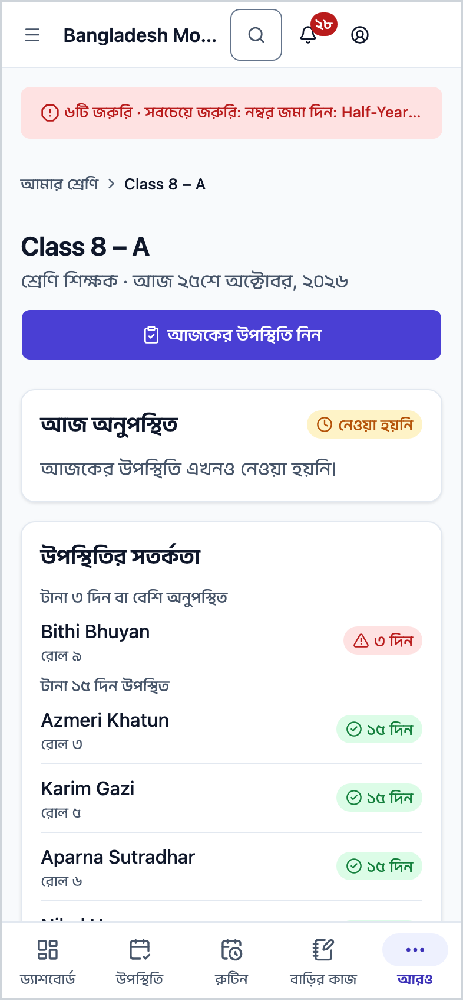

<!-- guide:meta
feature: academics.myClass
title: নিজের শ্রেণির খবর এক পাতায় দেখা
summary: যে শাখার আপনি শ্রেণি শিক্ষক, তার আজকের অনুপস্থিত, সতর্কতা, বকেয়া, বাড়ির কাজ, ফলাফল আর শিক্ষার্থীর তালিকা এক জায়গায় দেখুন, আর এক চাপে উপস্থিতি নিন।
roles: [TEACHER]
sources:
  - client-admin/src/routes/_staff/my-class/index.tsx
  - client-admin/src/routes/_staff/my-class/$sectionId.tsx
  - client-admin/src/routes/_staff/my-class/-cards.tsx
  - client-admin/src/routes/_staff/my-class/-arrival-add-dialog.tsx
  - server/src/modules/classes/my-class.controller.ts
  - server/src/modules/classes/teacher-scope.service.ts
labels:
  [
    myClass:*,
    nav:items.myClass,
    nav:groups.academics,
    common:accessDenied.*,
  ]
helpIds:
  [
    academics.myClass,
    academics.myClass.action.takeAttendance,
  ]
devices: [desktop, phone]
entry: [sidebar, palette, dashboard:class-teacher-streaks]
keywords:
  [আমার শ্রেণি, শ্রেণি শিক্ষক, সহকারী শ্রেণি শিক্ষক, আমার শাখা, অনুপস্থিত, বকেয়া, ফলাফল, my class, class teacher, homeroom, form master, my section]
appVersion: 0.1.0 (e424f8fc4)
owner: tareq89
lastVerified: 2026-10-24
knownIssues: []
-->

# নিজের শ্রেণির খবর এক পাতায় দেখা

যে শাখার আপনি শ্রেণি শিক্ষক, তার আজকের সব দরকারি খবর এক পাতায় দেখুন, আর এক চাপে আজকের উপস্থিতি নিন।

**যেতে হবে:** বাম মেনুতে **একাডেমিক → আমার শ্রেণি**। ফোনেও একই পাতা, কার্ডগুলো একটির নিচে একটি।
**শুরুর আগে:** অ্যাডমিন আপনাকে চলমান শিক্ষাবর্ষের কোনো শাখায় **শ্রেণি শিক্ষক** বা **সহকারী শ্রেণি শিক্ষক** করেছেন ([শাখায় শিক্ষক দিন](classes.md#task-teachers))। শুধু বিষয় শিক্ষক হলে এই পাতা ফাঁকা থাকে।

**আমার শ্রেণি** মানে আপনার নিজের শাখার এক নজরের খাতা, যেমন **ষষ্ঠ শ্রেণি – ক**। এখানে কিছু লেখা বা বদলানো হয় না; শুধু দেখা যায়। কাজ করতে হলে কার্ড থেকে সংশ্লিষ্ট পাতায় যান, যেমন উপস্থিতির খাতা।

[শাখার পাতা খুলুন](#task-main) · [উপস্থিতি নিন](#task-attendance) · [কার্ডগুলো পড়ুন](#task-cards) · [সমস্যা ও সমাধান](#trouble)

**এই পাতায় যা আছে**

- [এই পাতায় যেভাবে আসবেন](#arrive)
- [শাখার পাতা খুলুন](#task-main)
- [ঠিক শাখা খুলেছে কি না বুঝবেন কীভাবে](#confirm)
- [অন্য পরিস্থিতিতে](#other)
  - [আজকের উপস্থিতি নিন](#task-attendance)
  - [ছয়টি কার্ড কী বলে](#task-cards)
  - [অভিভাবককে ফোন করুন](#task-call)
  - [একাধিক শাখার দায়িত্ব থাকলে](#task-many)
- [সমস্যা ও সমাধান](#trouble)
- [কে কী করতে পারেন](#roles)
- [আরও জানুন](#more)

---

## এই পাতায় যেভাবে আসবেন 

**বাম মেনু থেকে:** **একাডেমিক → আমার শ্রেণি** চাপুন। নিচের ধাপ ১ থেকে শুরু করুন।

**খোঁজার ঘর থেকে:** উপরের খোঁজার ঘরে (Ctrl+K) লিখুন **আমার শ্রেণি খুলুন**, বা সরাসরি উপস্থিতির জন্য **আমার শ্রেণির উপস্থিতি নিন**। আপনার একটিমাত্র শাখা থাকলে দ্বিতীয়টি সোজা আজকের উপস্থিতির খাতা খোলে; একাধিক থাকলে আগে শাখা বাছতে হয়। খোঁজার নিয়ম: [যেকোনো পাতা খুঁজে পাওয়া](../start/find-anything.md)।

**ড্যাশবোর্ড থেকে:** **আমার শ্রেণির ধারাবাহিকতা** কার্ডে চাপলে সেই শাখার এই পাতা খোলে। কার্ডটির কথা: [ড্যাশবোর্ডের কার্ড](../dashboard/widgets.md)।

---

## শাখার পাতা খুলুন 

1. বাম মেনুতে **একাডেমিক → আমার শ্রেণি** চাপুন।

   → আপনার একটিমাত্র শাখা থাকলে সরাসরি সেই শাখার পাতা খোলে; ধাপ ৩-এ যান। দুই বা তার বেশি থাকলে **আমার শ্রেণি** শিরোনামের নিচে লেখা থাকে **কোন শাখা দেখবেন, বাছুন।** আর প্রতিটি শাখার একটি কার্ড। কোনো শাখা না থাকলে **এখনো কোনো শাখা নেই**।

2. যে শাখা দেখতে চান, তার কার্ডে চাপুন। কার্ডে শ্রেণি ও শাখার নাম (যেমন **ষষ্ঠ শ্রেণি – ক**) আর নিচে আপনার দায়িত্ব, **শ্রেণি শিক্ষক** বা **সহকারী শ্রেণি শিক্ষক**।

   → শাখার পাতা খোলে।

3. পাতার উপরে দেখুন।

   → শিরোনামে শাখার নাম, নিচে আপনার দায়িত্ব আর আজকের তারিখ, যেমন **শ্রেণি শিক্ষক · আজ ২৪ অক্টোবর ২০২৬**। ডানে **আজকের উপস্থিতি নিন** বোতাম, যাতে আগে থেকে ফোকাস থাকে।

4. নিচে ছয়টি কার্ড পড়ুন: **আজ অনুপস্থিত**, **উপস্থিতির সতর্কতা**, **বকেয়া**, **বাড়ির কাজ**, **ফলাফল**, **শিক্ষার্থী**। প্রতিটির অর্থ: [ছয়টি কার্ড কী বলে](#task-cards)।

   → কম্পিউটারে তিন কলামে, ফোনে এক কলামে।

**ফোনে** একই ক্রমে কার্ডগুলো একটির নিচে একটি আসে, আর **আজকের উপস্থিতি নিন** বোতাম পুরো চওড়া।

> **মনে রাখুন:** এই পাতা শুধু দেখার। এখানে কিছু চাপলে কিছুই জমা হয় না; কাজ হয় যে পাতায় নিয়ে যায়, সেখানে।

---

## ঠিক শাখা খুলেছে কি না বুঝবেন কীভাবে 

এই পাতায় কিছু সংরক্ষণ হয় না, তাই তিন অবস্থার টেবিল এখানে নেই। শুধু মিলিয়ে নিন:

- শিরোনামে আপনার শাখার নাম আছে, যেমন **ষষ্ঠ শ্রেণি – ক**।
- নিচের লাইনে আপনার দায়িত্ব আর **আজ**-এর তারিখ ঠিক আছে।
- **শিক্ষার্থী** কার্ডে চেনা নাম আসছে।

**যাচাই করতে চাইলে:** পাতা রিলোড করুন। কার্ডের সংখ্যা সবসময় সার্ভার থেকে নতুন করে আসে।

**কোনো কার্ড না এলে:** [সমস্যা ও সমাধান](#trouble) দেখুন। একটি কার্ড আটকালেও বাকিগুলো দেখায়।

---

## অন্য পরিস্থিতিতে 

### আজকের উপস্থিতি নিন 

1. শাখার পাতার উপরে **আজকের উপস্থিতি নিন** চাপুন।

   → এই শাখার আজকের তারিখের উপস্থিতির খাতা খোলে।

2. খাতায় উপস্থিতি দিন আর জমা দিন। ধাপগুলো: [উপস্থিতি নিন](../attendance/attendance.md#task-main)।

3. এই পাতায় ফিরে আসুন।

   → **আজ অনুপস্থিত** কার্ডে এখন অনুপস্থিতদের নাম আর পাশে মোট সংখ্যা, যেমন **২ জন**।

### ছয়টি কার্ড কী বলে 

প্রতিটি কার্ড আলাদাভাবে লোড হয়। একটিতে সমস্যা হলে সেখানে **এই কার্ডটি লোড করা যায়নি।** আর **আবার চেষ্টা করুন** বোতাম আসে; বাকি কার্ডগুলো ঠিকই দেখায়।

| কার্ড                 | কী দেখায়                                                                                                                                                                                                                       | কিছু না থাকলে                      |
| --------------------- | ------------------------------------------------------------------------------------------------------------------------------------------------------------------------------------------------------------------------------- | ---------------------------------- |
| **আজ অনুপস্থিত**      | আজ যারা অনুপস্থিত, নাম ও রোলসহ, প্রথম ৫ জন। পাশে মোট সংখ্যা। ৫ জনের বেশি হলে **সব দেখুন** চাপলে আজকের উপস্থিতির খাতা খোলে। আজ কেউ খাতায় কিছু না দিলে পাশে **নেওয়া হয়নি** চিহ্ন আর লেখা **আজকের উপস্থিতি এখনও নেওয়া হয়নি।** | **আজ কেউ অনুপস্থিত নেই।**          |
| **উপস্থিতির সতর্কতা** | তিন দলে শিক্ষার্থী: **টানা ৩ দিন বা বেশি অনুপস্থিত**, **টানা ৩ দিন বা বেশি দেরিতে এসেছে**, **টানা ১৫ দিন উপস্থিত**। পাশে কত দিন, যেমন **৪ দিন**                                                                                 | **এখন কোনো সতর্কতা নেই।**          |
| **বকেয়া**            | **মোট বকেয়া** টাকা আর কতজন **শিক্ষার্থী**-র বকেয়া। নিচে যাঁর বকেয়া সবচেয়ে বেশি, এমন ৫ জন                                                                                                                                    | **কোনো বকেয়া নেই।**               |
| **বাড়ির কাজ**        | এই শাখার বাড়ির কাজের তিনটি সংখ্যা: **মোট**, **সম্পন্ন**, **অসম্পন্ন**। অসম্পন্ন শূন্যের বেশি হলে লাল রঙে                                                                                                                       | **এখনও কোনো বাড়ির কাজ নেই।**      |
| **ফলাফল**             | শ্রেণির সবশেষ প্রকাশিত পরীক্ষা: নাম, **গড় নম্বর**, **পাসের হার**। কেউ ফেল করলে **অকৃতকার্য শিক্ষার্থী** তালিকা, প্রথম ৫ জন                                                                                                     | **এখনও কোনো ফলাফল নেই।**           |
| **শিক্ষার্থী**        | নাম অনুযায়ী প্রথম ৫ জন, রোল আর মূল অভিভাবকের ফোন। ৫ জনের বেশি হলে **সব দেখুন** চাপলে এই শাখায় ছাঁকা [শিক্ষার্থী](../people/students.md) তালিকা খোলে                                                                           | **এই শাখায় কোনো শিক্ষার্থী নেই।** |

বাড়ির কাজের বিস্তারিত: [বাড়ির কাজ](homework.md)। **বকেয়া** কার্ডে **সব দেখুন** শুধু তাঁর জন্য আসে, যাঁর ফি আদায়ের অনুমতি আছে; শিক্ষকের তা নেই, তাই শিক্ষক এখানে শুধু প্রথম ৫ জন দেখেন।

### আগমন বার্তার অনুরোধে সাড়া দিন 

অভিভাবক চাইলে সন্তান স্কুলে পৌঁছালে তাঁকে বার্তা যায়। কত বার যাবে, আপনি ঠিক করেন। আপনার শাখার পাতায় **আগমন বার্তা** কার্ডে অনুরোধগুলো দেখা যায়। সাড়া দেওয়ার মতো অনুরোধ থাকলে লেখা থাকে **{n}টি অপেক্ষায়**।

1. **অপেক্ষায়** অংশে শিক্ষার্থী আর অভিভাবককে খুঁজুন। প্রতিটির জন্য **একবার** (শিশু পরের বার পৌঁছালে একটি বার্তা), **প্রতিদিন** অথবা **এখন না** চাপুন।

   → যে অনুরোধ নিলেন তা **চালু** অংশে চলে যায়, সঙ্গে চিহ্ন: **একবার** বা **প্রতিদিন**।

2. পরে বদলাতে সারিতেই **প্রতিদিন করুন** বা **একবার করুন** চাপুন। সারির **চাই না** চাপলে বার্তা বন্ধ হয়। **একবার**-এর বার্তা চলে গেলে চিহ্নে লেখা থাকে **হয়ে গেছে**।

কার্ডে **অ্যাডমিন ঠিক করেছেন** লেখা থাকলে অ্যাডমিন এটা ঠিক করে দিয়েছেন, আপনি বদলাতে পারবেন না। **কোনো অভিভাবক এখনও আগমন বার্তা চাননি।** লেখা থাকলে সাড়া দেওয়ার কিছু নেই। অভিভাবকের নামের নিচে **অভিভাবক সব বার্তা বন্ধ রেখেছেন। কিছু পাঠানো হবে না।** মানে তিনি সব বার্তা বন্ধ করে রেখেছেন। সেটিংসে স্কুল আগমন বার্তা বন্ধ করে রাখলে কিছু বদলাতে গেলে দেখবেন **এই স্কুলে আগমন বার্তা বন্ধ আছে।**

### অভিভাবককে নিজে যোগ করুন 

1. **আগমন বার্তা** কার্ডে **নিজে যোগ করুন** চাপুন।
2. **শিক্ষার্থী** আর **অভিভাবক** বাছুন, **কত বার** অংশে কত বার যাবে তা বাছুন।
3. **যোগ করুন** চাপুন।

   → **আগমন বার্তা চালু হয়েছে**। অভিভাবক এখন **চালু** অংশে। শিক্ষার্থীর অভিভাবক না থাকলে লেখা আসে **এই শিক্ষার্থীর এখনও কোনো অভিভাবক নেই।**

### অভিভাবককে ফোন করুন 

1. **শিক্ষার্থী** কার্ডে শিক্ষার্থীর নামের পাশে ফোন নম্বরে চাপুন।

   → ফোনে সরাসরি কল করার পর্দা খোলে। কম্পিউটারে কম্পিউটারের ফোন-অ্যাপ খুলতে চায়, যদি থাকে।

নম্বরের বদলে **ফোন নেই** লেখা থাকলে ওই শিক্ষার্থীর কোনো অভিভাবকের ফোন রাখা নেই। অফিসকে জানান; নম্বর যোগ হয় [অভিভাবক](../people/guardians.md) পাতায়।

### একাধিক শাখার দায়িত্ব থাকলে 

শাখা বাছার পাতায় প্রতিটি শাখার কার্ড আসে, শ্রেণির গ্রেড অনুযায়ী সাজানো। অন্য শাখায় যেতে বাম মেনু থেকে আবার **আমার শ্রেণি** চাপুন আর অন্য কার্ড বাছুন।

শুধু চলমান শিক্ষাবর্ষের শাখা আসে। গত বছরের শাখা এখানে দেখা যায় না।

---

## সমস্যা ও সমাধান 

| আপনি যা দেখছেন                                                                          | কী করবেন                                                                                                                                                                                | কে সাহায্য করতে পারেন |
| --------------------------------------------------------------------------------------- | --------------------------------------------------------------------------------------------------------------------------------------------------------------------------------------- | --------------------- |
| **এখনো কোনো শাখা নেই** আর **আপনি এখনো কোনো শাখার শ্রেণি শিক্ষক নন — অ্যাডমিনকে জানান।** | অ্যাডমিনকে বলুন আপনাকে চলমান বর্ষের শাখায় **শ্রেণি শিক্ষক** বা **সহকারী শ্রেণি শিক্ষক** করতে ([শাখায় শিক্ষক দিন](classes.md#task-teachers))। শুধু বিষয় শিক্ষক হলে এখানে কিছু আসে না। | অ্যাডমিন              |
| **আপনার শাখার তালিকা আনা যায়নি।**                                                      | ইন্টারনেট দেখে **আবার চেষ্টা করুন** চাপুন।                                                                                                                                              | অ্যাডমিন              |
| **এই শাখার তথ্য আনা যায়নি।**                                                           | ইন্টারনেট দেখে **আবার চেষ্টা করুন** চাপুন।                                                                                                                                              | অ্যাডমিন              |
| **এই কার্ডটি লোড করা যায়নি।**                                                          | ওই কার্ডেই **আবার চেষ্টা করুন** চাপুন। বাকি কার্ড ঠিক থাকে।                                                                                                                             | অ্যাডমিন              |
| শাখার পাতায় "পাওয়া যায়নি" ধরনের পাতা                                                 | লিংকটি এমন শাখার, যার শ্রেণি শিক্ষক আপনি নন, বা যা নেই। বাম মেনু থেকে **আমার শ্রেণি** খুলুন।                                                                                            | অ্যাডমিন              |
| **আজ অনুপস্থিত** কার্ডে **নেওয়া হয়নি**                                                | আজকের খাতায় এখনও কেউ কিছু দেয়নি। [আজকের উপস্থিতি নিন](#task-attendance)।                                                                                                              | —                     |
| **এই পাতাটি দেখার অনুমতি আপনার নেই।**                                                   | এই পাতা শুধু শিক্ষকের। **ড্যাশবোর্ডে ফিরে যান** চাপুন।                                                                                                                                  | অ্যাডমিন              |

---

## কে কী করতে পারেন 

| ভূমিকা                                                                                             | এই পাতা দেখতে | কোন শাখা দেখেন                                                    |
| -------------------------------------------------------------------------------------------------- | ------------- | ----------------------------------------------------------------- |
| শিক্ষক                                                                                             | হ্যাঁ         | শুধু চলমান বর্ষে যেসব শাখার শ্রেণি শিক্ষক বা সহকারী শ্রেণি শিক্ষক |
| অ্যাডমিন, একাডেমিক কো-অর্ডিনেটর, হিসাবরক্ষক, অফিস সহকারী, পরীক্ষা নিয়ন্ত্রক, পরিচালনা পর্ষদ সদস্য | না            | —                                                                 |

**শিক্ষক** বাম মেনুতে **আমার শ্রেণি** দেখেন। তিনি দেখেন শুধু সেই শাখা, যেখানে তাঁকে **শ্রেণি শিক্ষক** বা **সহকারী শ্রেণি শিক্ষক** করা হয়েছে, আর তা চলমান শিক্ষাবর্ষের। শুধু বিষয় শিক্ষকের দায়িত্বের শাখা, অন্য শিক্ষকের শাখা বা গত বছরের শাখা দেখেন না; অন্য শাখার লিংক খুললে "পাওয়া যায়নি" পাতা আসে। **বকেয়া** কার্ডে তিনি সংখ্যা দেখেন, কিন্তু **সব দেখুন** দিয়ে পুরো বকেয়ার তালিকায় যেতে পারেন না।

**অন্য সব ভূমিকা** (অ্যাডমিনও) বাম মেনুতে **আমার শ্রেণি** দেখেন না। পাতাটি খুললে **এই পাতাটি দেখার অনুমতি আপনার নেই।** দেখায়। অ্যাডমিন শাখার খবর দেখেন [শ্রেণি](classes.md#task-detail) পাতায়।

---

## আরও জানুন 

<strong>পাতার অংশগুলো</strong> — উপর থেকে নিচে

1. **শিরোনাম** — শ্রেণি ও শাখার নাম, নিচে আপনার দায়িত্ব আর আজকের তারিখ।
2. **আজকের উপস্থিতি নিন** — উপরের ডানের বোতাম।
3. **আজ অনুপস্থিত**, **উপস্থিতির সতর্কতা**, **বকেয়া** — প্রথম সারির কার্ড।
4. **বাড়ির কাজ**, **ফলাফল**, **শিক্ষার্থী** — দ্বিতীয় সারির কার্ড।

<strong>আমার শ্রেণি কীভাবে কাজ করে</strong> — দায়িত্ব থেকে পাতা

<figure>
  
  <figcaption><em>এক শাখা, এক পাতা: উপরে উপস্থিতি, নিচে ছয় কার্ড</em></figcaption>
</figure>

<figure>
  
  <figcaption><em>কয়টি শাখা থাকলে কী খোলে</em></figcaption>
</figure>

- এই পাতার শাখা আসে **শ্রেণি শিক্ষক** ও **সহকারী শ্রেণি শিক্ষক** দায়িত্ব থেকে। দায়িত্ব কে কোথায় পেয়েছেন: [শিক্ষকের দায়িত্ব](../people/teaching-assignments.md)।
- উপস্থিতির সতর্কতা আসে উপস্থিতির খাতা থেকে; খাতা না নিলে কার্ড ফাঁকা থাকে।

**সম্পর্কিত পাতা**

- [**উপস্থিতি**](../attendance/attendance.md) — আজকের খাতা পূরণ করুন।
- [**বাড়ির কাজ**](homework.md) — শাখায় বাড়ির কাজ দিন।
- [**শ্রেণি**](classes.md) — অ্যাডমিন এখানে শাখায় শ্রেণি শিক্ষক দেন।
- [**শিক্ষার্থী**](../people/students.md) — শাখার সব শিক্ষার্থী।
- [**সিলেবাস ও পাঠ পরিকল্পনা**](syllabus.md) — আপনার শাখার পাঠ পরিকল্পনা আর কে পিছিয়ে।

---

_সংস্করণ ০.১.০ · শেষ যাচাই ২০২৬-১০-২৪_
