<!-- guide:meta
feature: academics.myCoordination
title: আপনার সমন্বয়ের শ্রেণিগুলোতে কী বাকি তা দেখা
summary: শ্রেণি বা বিষয় সমন্বয়ক হিসেবে দেখুন আজ কোন শাখায় হাজিরা হয়নি, কার নম্বর বাকি, কে কী পড়ান, আর সেই শিক্ষকদের একটি বার্তা পাঠান।
roles: [TEACHER]
sources:
  - client-admin/src/routes/_staff/my-coordination/index.tsx
  - client-admin/src/routes/_staff/my-coordination/-cards.tsx
  - client-admin/src/routes/_staff/my-coordination/-notify-dialog.tsx
  - server/src/modules/classes/coordination.controller.ts
  - server/src/modules/classes/coordination.service.ts
labels:
  [
    coordination:*,
    nav:items.myCoordination,
    nav:groups.academics,
    common:accessDenied.*,
  ]
helpIds:
  [
    academics.myCoordination,
  ]
devices: [desktop, phone]
entry: [sidebar, palette]
keywords:
  [আমার সমন্বয়, সমন্বয়ক, শ্রেণি সমন্বয়ক, বিষয় সমন্বয়ক, আজকের হাজিরা, নম্বর বাকি, শিক্ষকদের জানান, my coordination, coordinator, class coordinator, subject coordinator]
appVersion: 0.1.0
owner: tareq89
lastVerified: 2026-10-31
knownIssues: []
-->

# আপনার সমন্বয়ের শ্রেণিগুলোতে কী বাকি তা দেখা

আপনি **শ্রেণি সমন্বয়ক** বা **বিষয় সমন্বয়ক** হলে এই পাতায় আপনার প্রতিটি শ্রেণিতে আজ কী বাকি তা দেখবেন, আর শিক্ষকদের মনে করিয়ে দিতে পারবেন।

**কোথায় যাবেন:** বাঁ পাশের মেনুতে **একাডেমিক → আমার সমন্বয়**।
**শুরুর আগে:** অ্যাডমিনকে আপনাকে এ বছরের অন্তত একটি শ্রেণির সমন্বয়ক করতে হবে ([শিক্ষককে সমন্বয়ক করুন](../people/teaching-assignments.md#task-coordinators))। না হলে পাতায় লেখা থাকে **আপনি এখনো কোনো শ্রেণির সমন্বয়ক নন — অ্যাডমিনকে বলুন।**

[আপনার শ্রেণিগুলো দেখুন](#task-main) · [শিক্ষকদের জানান](#task-notify) · [সমস্যা ও সমাধান](#trouble)

**এই পাতায়**

- [এই পাতায় কীভাবে আসবেন](#arrive)
- [আপনার শ্রেণিগুলো দেখুন](#task-main)
- [পাতাটি হালনাগাদ কি না বুঝবেন কীভাবে](#confirm)
- [অন্য পরিস্থিতিতে](#other)
  - [শিক্ষকদের জানান](#task-notify)
  - [অন্য দিনের অবস্থা দেখুন](#task-date)
- [সমস্যা ও সমাধান](#trouble)
- [কে কী করতে পারেন](#roles)
- [আরও জানুন](#more)

---

## এই পাতায় কীভাবে আসবেন 

**বাঁ পাশের মেনু থেকে:** **একাডেমিক → আমার সমন্বয়** চাপুন।

**খোঁজার ঘর থেকে:** ওপরের খোঁজার ঘরে (Ctrl+K) **আমার সমন্বয় খুলুন** লিখুন, অথবা সরাসরি বার্তা পাঠাতে **শিক্ষকদের জানান**। খোঁজার নিয়ম: [যেকোনো পাতা খুঁজে পাওয়া](../start/find-anything.md)।

---

## আপনার শ্রেণিগুলো দেখুন 

1. বাঁ পাশের মেনুতে **একাডেমিক → আমার সমন্বয়** চাপুন।

   → আপনার প্রতিটি শ্রেণির জন্য একটি কার্ড। বিষয় সমন্বয়কের কার্ডে বিষয়ের নাম থাকে, যেমন **শুধু গণিত**।

2. **আজকের হাজিরা** দেখুন। প্রতিটি শাখার একটি সারি: **নেওয়া হয়েছে** (কে নিয়েছেন) অথবা **নেওয়া হয়নি**।

   → সারি চাপলে সেই শাখার হাজিরা খাতা খোলে। আপনি পড়তে পারবেন, বদলাতে পারবেন না।

3. **নম্বর বাকি** দেখুন। প্রতিটি সারি একটি পরীক্ষা, বিষয় ও শাখা, যার নম্বর এখনো জমা হয়নি, সঙ্গে শিক্ষকের নাম।

   → সারি চাপলে সেই নম্বরপত্র খোলে (শুধু পড়া)। বিষয় সমন্বয়ক শুধু নিজের বিষয়ের নম্বরপত্র দেখেন।

4. **শিক্ষক** দেখুন: এই শ্রেণিতে কে কোন শাখা ও বিষয় পড়ান।

   → কার্ডের ওপরে **শিক্ষার্থী দেখুন** চাপলে শ্রেণির শিক্ষার্থী তালিকা খোলে।

> **মনে রাখবেন:** এই পাতা শুধু দেখায়। সমন্বয়ক কখনো নম্বর বা হাজিরা বদলান না।

---

## পাতাটি হালনাগাদ কি না বুঝবেন কীভাবে 

এই পাতায় কিছু সংরক্ষণ হয় না। শুধু দেখে নিন:

- কার্ডের ওপরের **তারিখ** আপনার চাওয়া দিনটি।
- কোনো শিক্ষক এইমাত্র খাতা জমা দিলে পাতা আবার খুললে সেই শাখায় **নেওয়া হয়েছে** দেখায়।
- শিক্ষক নম্বরপত্র জমা দিলে সেটি **নম্বর বাকি** থেকে সরে যায়।

---

## অন্য পরিস্থিতিতে 

### শিক্ষকদের জানান 

1. শ্রেণির কার্ডে **শিক্ষকদের জানান** চাপুন (ফোনে পর্দার নিচের বোতাম)।

   → **শিক্ষকদের জানান** ডায়ালগ খোলে। শ্রেণির সব শিক্ষকের পাশে আগে থেকেই টিক দেওয়া।

2. যাঁকে জানাতে চান না, তাঁর টিক তুলে দিন।

3. **বার্তা** লিখুন, যেমন "বৃহস্পতিবারের মধ্যে প্রথম সাময়িকের নম্বর জমা দিন।" (৫০০ অক্ষর পর্যন্ত)।

4. **পাঠান** চাপুন।

   → **২ জন শিক্ষককে বার্তা পাঠানো হয়েছে।** টিক দেওয়া প্রত্যেক শিক্ষক তাঁর সতর্কতায় একটি বার্তা পান। এটি ৭ দিন থাকে।

### অন্য দিনের অবস্থা দেখুন 

কার্ডের ওপরের **তারিখ** বদলান। তখন **আজকের হাজিরা** সেই দিনের খাতা দেখায়। **নম্বর বাকি** সেই দিন বা তার আগে শেষ হওয়া পরীক্ষা গোনে।

---

## সমস্যা ও সমাধান 

| কী দেখছেন                                                    | কী করবেন                                                                                     | কে সাহায্য করতে পারেন |
| ------------------------------------------------------------ | -------------------------------------------------------------------------------------------- | --------------------- |
| **আপনি এখনো কোনো শ্রেণির সমন্বয়ক নন — অ্যাডমিনকে বলুন।**    | অ্যাডমিনকে বলুন [আপনাকে সমন্বয়ক করতে](../people/teaching-assignments.md#task-coordinators)। | অ্যাডমিন              |
| **আপনার শ্রেণিগুলো আনা গেল না।**                             | ইন্টারনেট দেখুন, তারপর **আবার চেষ্টা করুন** চাপুন।                                           | অ্যাডমিন              |
| **বাছাই করা কোনো শিক্ষক আপনার সমন্বয়ের শ্রেণিতে পড়ান না।** | শ্রেণির অন্তত একজন শিক্ষকে টিক দিয়ে আবার **পাঠান** চাপুন।                                   | —                     |
| **এই পাতায় আপনার প্রবেশাধিকার নেই।**                        | এই পাতা শুধু শিক্ষকদের জন্য। **ড্যাশবোর্ডে ফিরুন** চাপুন।                                    | অ্যাডমিন              |

---

## কে কী করতে পারেন 

| ভূমিকা                                                                                    | এই পাতা দেখতে পারেন | কী দেখেন                         |
| ----------------------------------------------------------------------------------------- | ------------------- | -------------------------------- |
| শিক্ষক                                                                                    | হ্যাঁ               | শুধু এ বছর যেসব শ্রেণির সমন্বয়ক |
| অ্যাডমিন, একাডেমিক কো-অর্ডিনেটর, হিসাবরক্ষক, অফিস সহকারী, পরীক্ষা নিয়ন্ত্রক, পর্ষদ সদস্য | না                  | —                                |

**শিক্ষক** কোনো শ্রেণির সমন্বয়ক না হলেও বাঁ পাশের মেনুতে **আমার সমন্বয়** দেখেন; তখন পাতা খালি থাকে। সমন্বয়কেরা তাঁদের শ্রেণির **উপস্থিতি নেওয়া হয়নি** (সতর্কতার ধাপ থেকে) ও **নম্বর জমা দেরি** সতর্কতাও পান: [সতর্কতা দেখা ও মেটানো](../dashboard/alerts.md)।

**অ্যাডমিন** আগে থেকেই সব শ্রেণি দেখেন; তিনি [শিক্ষকের দায়িত্ব](../people/teaching-assignments.md#task-coordinators) পাতায় সমন্বয়ক দেন ও সরান।

---

## আরও জানুন 

<strong>আমার সমন্বয় কীভাবে কাজ করে</strong>

<figure>
  
  <figcaption><em>এক পাতায়: কী বাকি, আর কাকে মনে করাবেন</em></figcaption>
</figure>

**সম্পর্কিত পাতা**

- [**শিক্ষকের দায়িত্ব**](../people/teaching-assignments.md) — কে কোন শ্রেণির সমন্বয়ক।
- [**আমার শ্রেণি**](my-class.md) — শ্রেণি শিক্ষকের নিজের শাখার পাতা।

---

_সংস্করণ ০.১.০ · সর্বশেষ যাচাই ২০২৬-১০-৩১_
