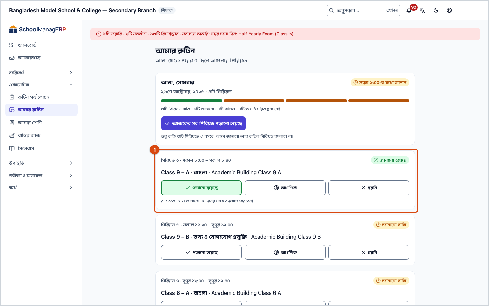
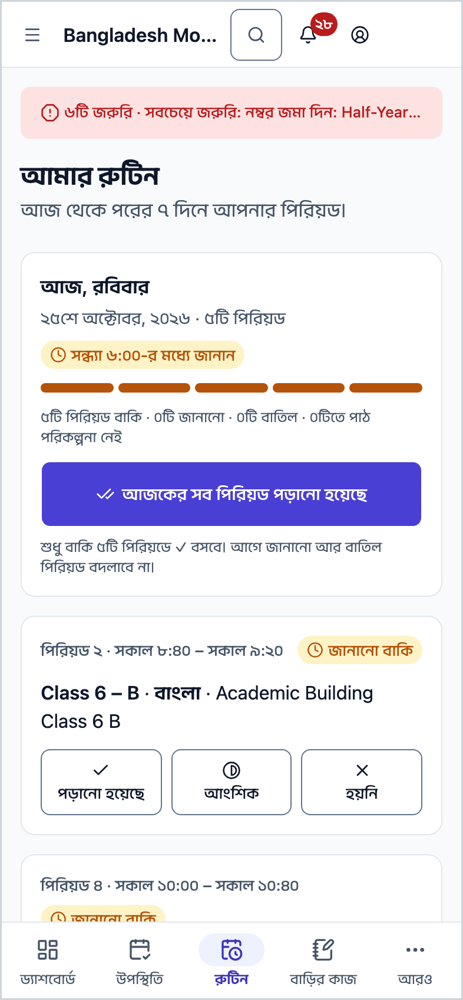

<!-- guide:meta
feature: academics.myRoutine
title: আমার রুটিন দেখা ও পিরিয়ড জানানো
summary: শিক্ষক আজকের আর পরের দিনগুলোর নিজের পিরিয়ড দেখেন, কার বদলে পড়াচ্ছেন তা দেখেন, আর প্রতিটি পিরিয়ড পড়ানো হলো কি না জানান।
roles: [ADMIN, TEACHER, EXECUTIVE, OFFICE_STAFF, EXAM_CONTROLLER]
sources:
  - client-admin/src/routes/_staff/routines/my.tsx
  - client-admin/src/routes/_staff/routines/-marking/dates.ts
  - client-admin/src/routes/_staff/routines/-marking/due-banner.tsx
  - client-admin/src/routes/_staff/routines/-marking/day-summary-card.tsx
  - client-admin/src/routes/_staff/routines/-marking/period-card.tsx
  - client-admin/src/routes/_staff/routines/-marking/not-taught-dialog.tsx
  - client-admin/src/routes/_staff/routines/-marking/next-days.tsx
  - client-admin/src/nav-tree.ts
  - client-admin/src/action-registry.ts
  - server/src/modules/routines/resolve-routine.controller.ts
  - server/src/modules/routines/resolve-routine.service.ts
  - server/src/modules/study-plans/lesson-deliveries.service.ts
labels:
  [
    routines:myRoutine.*,
    routines:marking.*,
    routines:agenda.*,
    nav:items.myRoutine,
    nav:groups.academics,
    nav:bottomNavCells.routine,
  ]
helpIds:
  [
    academics.myRoutine,
    academics.myRoutine.action.allTaught,
    academics.myRoutine.action.reportPast,
    academics.myRoutine.field.lessonStatus,
    academics.myRoutine.field.notTaughtReason,
  ]
devices: [desktop, phone]
entry: [sidebar, palette, page:dashboard]
keywords:
  [আমার রুটিন, রুটিন, আজকের পিরিয়ড, পিরিয়ড জানান, পড়ানো হয়েছে, বদলি, পাঠ, my routine, timetable, today, lesson, taught, routine, agenda]
appVersion: 0.1.0 (e81ef857f)
owner: tareq89
lastVerified: 2026-10-24
knownIssues: []
-->

# আমার রুটিন দেখা ও পিরিয়ড জানানো

আজ আর পরের কয়েক দিনে আপনার কোন পিরিয়ড কখন, কোন শাখায়, তা দেখুন, আর প্রতিটি পিরিয়ড পড়ানো হলো কি না জানান।

**যেতে হবে:** বাম মেনুতে **একাডেমিক → আমার রুটিন**। ফোনে স্ক্রিনের নিচের **রুটিন** বোতাম (শিক্ষকের জন্য)।
**শুরুর আগে:** আপনার অ্যাকাউন্টের সঙ্গে একটি শিক্ষক প্রোফাইল থাকতে হবে ([কর্মী যোগ করা ও পরিচালনা](../people/staff.md#task-teacher)), আর স্কুলের রুটিন পর্যালোচনায় পাঠানো বা প্রকাশিত হতে হবে ([রুটিন পর্যালোচনা ও প্রকাশ করা](routine-review.md))।

এই পাতা আপনার নিজের **দিনের রুটিন**: আজকের প্রতিটি পিরিয়ডের একটি কার্ড, আর নিচে পরের দিনগুলো। পাঠ পরিকল্পনা থাকলে প্রতিটি পিরিয়ড শেষে জানাতে হয় সেটি **পড়ানো হয়েছে**, **আংশিক** না **হয়নি**। একে বলি "পিরিয়ড জানানো"।

[আজকের পিরিয়ড জানান](#task-main) · [সব একসাথে](#task-all) · [আগের দিন জানান](#task-past) · [পরের দিনগুলো](#task-next) · [সমস্যা ও সমাধান](#trouble)

**এই পাতায় যা আছে**

- [এই পাতায় যেভাবে আসবেন](#arrive)
- [আজকের পিরিয়ড দেখুন ও জানান](#task-main)
- [জানানো হয়েছে কি না বুঝবেন কীভাবে](#confirm)
- [অন্য পরিস্থিতিতে](#other)
  - [আজকের সব পিরিয়ড একসাথে জানান](#task-all)
  - [পিরিয়ড হয়নি জানান](#task-not-taught)
  - [গতকাল বা আগের দিনের পিরিয়ড জানান](#task-past)
  - [বদলি বা বাতিল পিরিয়ড](#task-cover)
  - [পরের দিনগুলোর পিরিয়ড দেখুন](#task-next)
- [সমস্যা ও সমাধান](#trouble)
- [কে কী করতে পারেন](#roles)
- [আরও জানুন](#more)

---

## এই পাতায় যেভাবে আসবেন 

**বাম মেনু বা ফোনের নিচের বোতাম থেকে:** **একাডেমিক → আমার রুটিন**, অথবা ফোনে নিচের **রুটিন** চাপুন। নিচের ধাপ ১ থেকে শুরু করুন।

**খোঁজার ঘর থেকে:** উপরের খোঁজার ঘরে (Ctrl+K) **আমার রুটিন খুলুন** বা **আজকের পাঠ জানান** লিখে বেছে নিন। → এই পাতা খোলে, আজকের দিনে। খোঁজার নিয়ম: [যেকোনো পাতা খুঁজে পাওয়া](../start/find-anything.md)।

**ড্যাশবোর্ড থেকে:** শিক্ষকের [ড্যাশবোর্ডে](../dashboard/dashboard.md) **আজকের আমার রুটিন** কার্ডে আজকের পিরিয়ডগুলো থাকে; পুরো সপ্তাহ দেখতে কার্ড থেকে আমার রুটিনে আসা যায়। (কার্ডের বোতামের নাম অ্যাপে চালিয়ে দেখা হয়নি।)

---

## আজকের পিরিয়ড দেখুন ও জানান 

1. বাম মেনুতে **একাডেমিক → আমার রুটিন** চাপুন। ফোনে নিচের **রুটিন** চাপুন।

   → উপরে **আমার রুটিন**: "আজ থেকে পরের ৭ দিনে আপনার পিরিয়ড।" তার নিচে **আজ, {বার}** কার্ড: কয়টি পিরিয়ড, **{সময়}-র মধ্যে জানান**, আর কয়টি বাকি, জানানো, বাতিল ও পাঠ পরিকল্পনা ছাড়া।

2. প্রতিটি পিরিয়ডের কার্ড দেখুন: উপরে **পিরিয়ড {নম্বর} · {সময়}**, ডানে অবস্থা (**জানানো বাকি**, **জানানো হয়েছে** ইত্যাদি)। তার নিচে শাখা · বিষয় · কক্ষ, আর পাঠ পরিকল্পনা থাকলে **আজকের পাঠ**: "পাঠ {নম্বর}: {শিরোনাম}"।

3. পিরিয়ড শেষে কার্ডের নিচে তিনটির একটি চাপুন: **পড়ানো হয়েছে**, **আংশিক** বা **হয়নি**।

   → **পড়ানো হয়েছে** বা **আংশিক** চাপলেই সংরক্ষিত হয়; কার্ডে **জানানো হয়েছে** আসে, নিচে "{সময়}-এ জানানো। ৭ দিনের মধ্যে বদলাতে পারবেন।" **আংশিক** দিলে লেখা থাকে **একই পাঠ চলবে**। **হয়নি** চাপলে কারণ জানতে চাওয়া হয়: [পিরিয়ড হয়নি জানান](#task-not-taught)।

> **মনে রাখুন:** আলাদা কোনো জমা দেওয়ার বোতাম নেই; বোতাম চাপলেই জানানো হয়। ভুল হলে ৭ দিনের মধ্যে অন্য বোতাম চেপে বদলান। পাঠ পরিকল্পনা ছাড়া পিরিয়ডে কিছু জানাতে হয় না।

যে পিরিয়ডের পাঠ পরিকল্পনা নেই, তার কার্ডে **পাঠ পরিকল্পনা নেই** আর লেখা "এই শাখার {বিষয়}-এর পাঠ পরিকল্পনা এখনো নেই, তাই কিছু জানাতে হবে না।" অনুমতি থাকলে **পাঠ পরিকল্পনা বানান** বোতামও থাকে।

---

## জানানো হয়েছে কি না বুঝবেন কীভাবে 

পিরিয়ড জানানো শুধু ইন্টারনেট থাকলে সংরক্ষিত হয়। ফোনে জমিয়ে রেখে পরে পাঠানো যায় না, তাই **এই ডিভাইসে সংরক্ষিত** অবস্থা এখানে নেই।

| অবস্থা                       | কীভাবে বুঝবেন                                                                  | এরপর কী                                          |
| ---------------------------- | ------------------------------------------------------------------------------ | ------------------------------------------------ |
| **শুধু স্ক্রিনে বদলেছে**     | **পিরিয়ড হয়নি কেন?** ঘর খোলা, অথবা বোতাম চাপার পর কার্ড এখনো **জানানো বাকি** | কারণ দিয়ে জমা দিন, বা ইন্টারনেট দেখে আবার চাপুন |
| **স্কুলের সিস্টেমে পৌঁছেছে** | কার্ডে **জানানো হয়েছে** আর "{সময়}-এ জানানো" লেখা                             | কাজ শেষ                                          |

**যাচাই করতে চাইলে:** পাতা রিলোড করুন। কার্ডে **জানানো হয়েছে** আর আপনার বাছা বোতাম চিহ্নিত থাকলে সিস্টেমে আছে।

**জানানো না হলে:** কার্ডে **সংরক্ষণ হয়নি। আবার চেষ্টা করুন।** দেখায়, আর আগের অবস্থা ফিরে আসে। ইন্টারনেট দেখে আবার চাপুন।

---

## অন্য পরিস্থিতিতে 

### আজকের সব পিরিয়ড একসাথে জানান 

1. **আজ, {বার}** কার্ডে **আজকের সব পিরিয়ড পড়ানো হয়েছে** চাপুন। (বোতামটি শুধু আজকের দিনে, আর কোনো পিরিয়ড বাকি থাকলে থাকে।)

   → শুধু বাকি পিরিয়ডগুলোতে **পড়ানো হয়েছে** বসে। নিচে লেখা থাকে: "শুধু বাকি {সংখ্যা}টি পিরিয়ডে ✓ বসবে। আগে জানানো আর বাতিল পিরিয়ড বদলাবে না।"

### পিরিয়ড হয়নি জানান 

1. কার্ডে **হয়নি** চাপুন।

   → **পিরিয়ড হয়নি কেন?** ঘর খোলে; উপরে লেখা থাকে আজকের পাঠ পরের পিরিয়ডে সরে যাবে।

2. **কারণ** থেকে একটি বেছে নিন: **শিক্ষক অনুপস্থিত**, **স্কুল বন্ধ**, **পরীক্ষা** বা **অন্য**।

3. **অন্য** বাছলে **কী হয়েছিল** ঘরে এক লাইনে লিখুন। (অন্যগুলোর বেলায় ঐচ্ছিক।)

   → কারণ না বাছলে, বা **অন্য**-তে কিছু না লিখলে জমার বোতাম বন্ধ থাকে।

4. **হয়নি হিসেবে জানান** চাপুন।

   → ঘর বন্ধ হয়, কার্ডে **জানানো হয়েছে** আর **পাঠ সরে গেছে — পরের পিরিয়ডে হবে**।

### গতকাল বা আগের দিনের পিরিয়ড জানান 

আগের দিনের পিরিয়ড জানানো বাকি থাকলে আজকের পাতার উপরে একটি সতর্কবার্তা আসে, যেমন **গতকালের {সংখ্যা}টি পিরিয়ড জানানো হয়নি**। নিচে লেখা থাকে আর কত স্কুল-দিন না জানালে প্রধান শিক্ষক ও অ্যাডমিন জানবেন, অথবা **প্রধান শিক্ষক ও অ্যাডমিনকে জানানো হয়েছে।**

1. সতর্কবার্তার **গতকালের পিরিয়ড জানান** (বা **{বার}-এর পিরিয়ড জানান**) চাপুন।

   → সেই দিনের কার্ডগুলো খোলে; উপরে **{বার}, {তারিখ}** আর **আজকে ফিরুন**।

2. আগের মতো প্রতিটি কার্ডে বোতাম চাপুন ([ধাপ ৩](#task-main))।

3. শেষে **আজকে ফিরুন** চাপুন।

আজ থেকে ৭ দিন পেছন পর্যন্ত জানাতে বা বদলাতে পারেন। এর চেয়ে পুরোনো দিন এই পাতায় খোলে না; পুরোনো দিনের লিংক খুললে আজকের দিন আসে। কোনো কার্ডে বোতাম বন্ধ থাকলে লেখা থাকে **এখন শুধু অ্যাডমিন বদলাতে পারবেন।**

### বদলি বা বাতিল পিরিয়ড 

- অ্যাডমিন আপনাকে কারও [বদলি শিক্ষক](routine-substitutions.md) করলে সেদিনের কার্ডে লেখা থাকে **{নাম}-এর বদলে পড়াচ্ছেন**।
- কোনো পিরিয়ড বাতিল হলে কার্ডে **হয়নি · বাতিল**: "পিরিয়ডটি রুটিনে বাতিল করা হয়েছে, তাই নিজে থেকেই জানানো হয়েছে। আপনার কিছু করতে হবে না।"
- আপনি অনুমোদিত ছুটিতে থাকলে **হয়নি · ছুটিতে**: "আপনি অনুমোদিত ছুটিতে ছিলেন, তাই নিজে থেকেই জানানো হয়েছে।"
- ছুটির দিন আর সাপ্তাহিক ছুটির দিনে কোনো পিরিয়ড আসে না; দিনটিতে লেখা থাকে **কোনো পিরিয়ড নেই।** ছুটির হিসাব: [ক্যালেন্ডারে ছুটি](../people/calendar.md#task-offdays)।

### পরের দিনগুলোর পিরিয়ড দেখুন 

1. পাতার নিচে **পরের দিনগুলো** অংশে যান।

   → শুধু যেসব দিনে পিরিয়ড আছে: **{বার}, {তারিখ}**, নিচে "{সংখ্যা}টি পিরিয়ড · প্রথমটি {শাখা}"।

2. একটি দিনে চাপুন।

   → সেই দিনের পিরিয়ডগুলো খোলে: পিরিয়ড, শাখা, বিষয়, আর পাঠ থাকলে পাঠের নাম। আবার চাপলে বন্ধ হয়।

> **মনে রাখুন:** আগামী দিনের পিরিয়ড এখান থেকে জানানো যায় না; শুধু দেখা যায়।

---

## সমস্যা ও সমাধান 

| আপনি যা দেখছেন                                                            | কী করবেন                                                                                                                   | কে সাহায্য করতে পারেন |
| ------------------------------------------------------------------------- | -------------------------------------------------------------------------------------------------------------------------- | --------------------- |
| **আপনার জন্য কোনো রুটিন নেই**                                             | আপনার অ্যাকাউন্টে শিক্ষক প্রোফাইল নেই। শিক্ষক হলে অ্যাডমিনকে [শিক্ষক প্রোফাইল](../people/staff.md#task-teacher) দিতে বলুন। | অ্যাডমিন              |
| **এখনো রুটিন প্রকাশিত হয়নি**                                             | স্কুলের রুটিন এখনো ড্রাফট। অ্যাডমিন [পর্যালোচনায় পাঠালে বা প্রকাশ করলে](routine-review.md) দেখা যাবে।                     | অ্যাডমিন              |
| **কোনো পিরিয়ড নেই।**                                                     | আজ আপনার কোনো পিরিয়ড নেই, বা আজ ছুটি। ভুল মনে হলে অ্যাডমিনকে বলুন।                                                        | অ্যাডমিন              |
| **আপনার রুটিন লোড করা যায়নি। আপনার সংযোগ পরীক্ষা করে আবার চেষ্টা করুন।** | ইন্টারনেট দেখে **আবার চেষ্টা করুন** চাপুন।                                                                                 | —                     |
| **সংরক্ষণ হয়নি। আবার চেষ্টা করুন।**                                      | ইন্টারনেট দেখে বোতামটি আবার চাপুন।                                                                                         | —                     |
| **এখন শুধু অ্যাডমিন বদলাতে পারবেন।**                                      | এই কার্ডে আপনি জানাতে পারবেন না। অ্যাডমিনকে বদলাতে বলুন।                                                                   | অ্যাডমিন              |
| কোনো পিরিয়ড ভুল শাখায় বা ভুল সময়ে                                      | রুটিন প্রকাশিত হলে [রুটিন পর্যালোচনা](routine-review.md#task-request) থেকে **পরিবর্তনের অনুরোধ করুন**।                     | অ্যাডমিন              |

---

## কে কী করতে পারেন 

| ভূমিকা                                                 | নিজের পিরিয়ড দেখতে                                               | পিরিয়ড জানাতে                                      |
| ------------------------------------------------------ | ----------------------------------------------------------------- | --------------------------------------------------- |
| শিক্ষক                                                 | হ্যাঁ, রুটিন পর্যালোচনায় বা প্রকাশিত হলে                         | হ্যাঁ, আজ থেকে ৭ দিন পেছন পর্যন্ত                   |
| অ্যাডমিন                                               | শিক্ষক প্রোফাইল থাকলে; না থাকলে **শ্রেণির রুটিন দেখুন** বোতাম আসে | শিক্ষক প্রোফাইল থাকলে, এই পাতায় ৭ দিন পেছন পর্যন্ত |
| একাডেমিক কো-অর্ডিনেটর, অফিস সহকারী, পরীক্ষা নিয়ন্ত্রক | শিক্ষক প্রোফাইল থাকলে, রুটিন পর্যালোচনায় বা প্রকাশিত হলে         | শিক্ষক প্রোফাইল থাকলে                               |
| হিসাবরক্ষক, পরিচালনা পর্ষদ সদস্য                       | পাতাটি দেখেন না                                                   | না                                                  |

শিক্ষার্থী ও অভিভাবক প্রকাশিত রুটিন দেখেন নিজেদের পোর্টালে।

---

## আরও জানুন 

<strong>পাতার অংশগুলো</strong> — উপর থেকে নিচে

1. আগের দিন বাকি থাকলে সতর্কবার্তা ও **গতকালের পিরিয়ড জানান**।
2. **আজ, {বার}** কার্ড — কয়টি পিরিয়ড, জানানোর সময়সীমা, হিসাব, **আজকের সব পিরিয়ড পড়ানো হয়েছে**।
3. প্রতিটি পিরিয়ডের কার্ড — শাখা, বিষয়, কক্ষ, আজকের পাঠ, **পড়ানো হয়েছে** / **আংশিক** / **হয়নি**।
4. **পরের দিনগুলো**।

<strong>আমার রুটিনে শিক্ষকের দিন</strong>

<figure>
  
  <figcaption><em>পিরিয়ড দেখা ও জানানো</em></figcaption>
</figure>

- রুটিন **পর্যালোচনায়** থাকলেও শিক্ষক এখানে নিজের পিরিয়ড দেখেন, যাতে প্রকাশের আগে ভুল ধরা যায়।
- **{সময়}-র মধ্যে জানান** সময়সীমা স্কুলের পাঠ পরিকল্পনার সেটিং থেকে আসে; সেটিং না থাকলে সন্ধ্যা ৬টা।

<strong>ঘরগুলোর সংক্ষিপ্ত সাহায্য (? বোতাম)</strong>

<!-- guide:generated:fields:routines -->

| ঘর                                        | কী লিখবেন                                                                                                                                    | বাধ্যতামূলক?                |
| ----------------------------------------- | -------------------------------------------------------------------------------------------------------------------------------------------- | --------------------------- |
| পড়ানোর অবস্থা                            | প্রতিটি পিরিয়ডের জন্য "পড়ানো হয়েছে", "আংশিক" বা "হয়নি" বাছুন। "হয়নি" বাছলে কারণ জানতে চায়।                                             | হ্যাঁ                       |
| কারণ (হয়নি)                              | শিক্ষক অনুপস্থিত, স্কুল বন্ধ, পরীক্ষা বা অন্য। "অন্য" বাছলে এক লাইনে লিখুন। পাঠটি পরের পিরিয়ডে চলে যায়।                                    | হ্যাঁ, পড়ানো না হলে        |
| শিক্ষক                                    | এই পিরিয়ডের জন্য এক বা একাধিক শিক্ষক।                                                                                                       | হ্যাঁ                       |
| পুনরাবৃত্তি                               | প্রতি সপ্তাহে, এক সপ্তাহ পরপর (১ম বা ২য় সপ্তাহ বাছুন) অথবা মাসে একবার (মাসে নির্বাচিত বারটির ১ম, ২য়, ৩য়, ৪র্থ, ৫ম বা শেষ উপস্থিতি বাছুন)। | হ্যাঁ                       |
| পিরিয়ডের মাঝের বিরতি (মিনিট)             | ০ থেকে ১২০। নতুন পিরিয়ডের সারি আগেরটি শেষ হওয়ার এত মিনিট পরে শুরু হয়।                                                                     | না                          |
| এক শিক্ষক দিনে সর্বোচ্চ কয় পিরিয়ড নেবেন | ১ বা তার বেশি; ফাঁকা রাখলে কোনো সীমা নেই। সীমা ছাড়ালে রুটিন সেভ হয় না।                                                                     | না                          |
| পরপর সর্বোচ্চ কয় পিরিয়ড                 | ১ বা তার বেশি; ফাঁকা রাখলে কোনো সীমা নেই। সীমা ছাড়ালেও সেভ হয়, শুধু সতর্কতা দেখায়।                                                        | না                          |
| পিরিয়ড বাতিল                             | সেই তারিখে কেউ পড়াবেন না হলে টিক দিন। সাপ্তাহিক রুটিন নিজে বদলায় না।                                                                       | না                          |
| বদলি শিক্ষক                               | সেই তারিখে পিরিয়ডটি কে পড়াবেন। আগে থেকে নির্ধারিত শিক্ষক বা ওই সময়ে অন্য ক্লাস থাকা শিক্ষক হতে পারবেন না।                                 | হ্যাঁ, পিরিয়ড বাতিল না হলে |
| শিফটের নাম                                | শিফটের নাম, যেমন সকাল বা দিন।                                                                                                                | হ্যাঁ                       |
| দিন শুরু                                  | এই শিফটে স্কুলের দিন কখন শুরু হয়। নতুন শিফটে আগে থেকে ৮:০০ বসানো থাকে।                                                                      | হ্যাঁ                       |
| দিন শেষ                                   | এই শিফটে স্কুলের দিন কখন শেষ হয়। শুরুর সময়ের পরে হতে হবে। নতুন শিফটে আগে থেকে ১৬:০০ বসানো থাকে।                                            | হ্যাঁ                       |
| কক্ষ নং                                   | কক্ষের নম্বর বা নাম, যেমন ১০১। অবশ্যই দিতে হবে।                                                                                              | হ্যাঁ                       |

<!-- /guide:generated -->

**সম্পর্কিত পাতা**

- [**রুটিন পর্যালোচনা ও প্রকাশ করা**](routine-review.md) — নিজের পিরিয়ড নিয়ে পরিবর্তনের অনুরোধ সেখান থেকে পাঠান।
- [**বদলি শিক্ষক রেকর্ড করা**](routine-substitutions.md) — অ্যাডমিন কাকে কার বদলে দিলেন, তা এখানে কার্ডে দেখায়।

---

_সংস্করণ ০.১.০ · শেষ যাচাই ২০২৬-১০-২৪_
