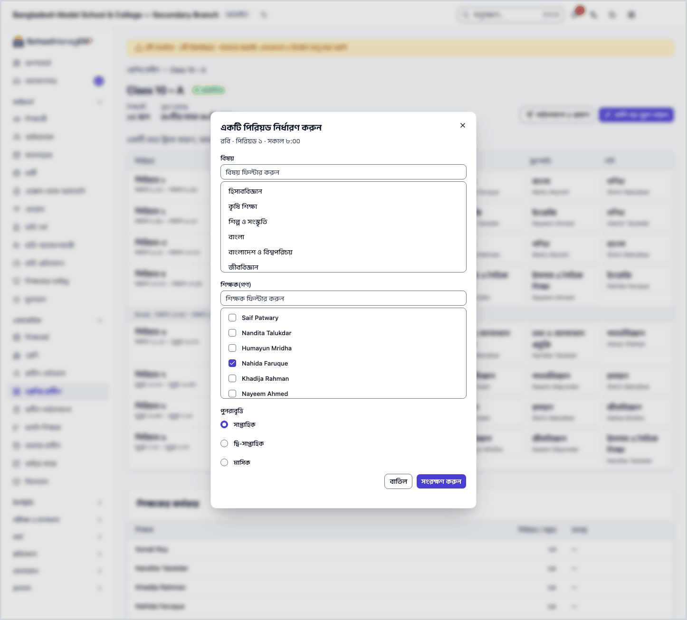
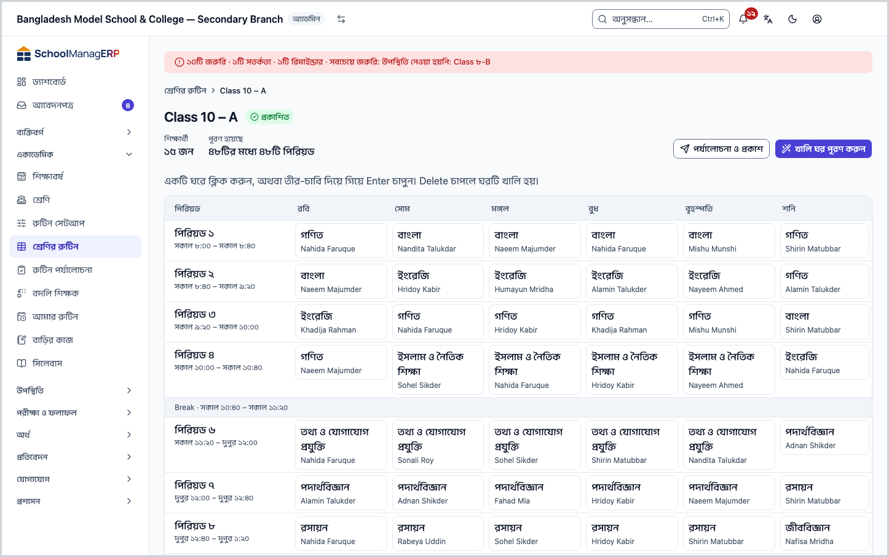

<!-- guide:meta
feature: academics.routineBuilder
title: শ্রেণির সাপ্তাহিক রুটিন সাজানো
summary: প্রতিটি শাখার সাপ্তাহিক রুটিনের ছকে বিষয় ও শিক্ষক বসান, নিয়মের সংঘাত দেখুন, খালি ঘর একসাথে পূরণ করুন আর শিক্ষকের কর্মভার মিলিয়ে নিন।
roles: [ADMIN]
sources:
  - client-admin/src/routes/_staff/routines/index.tsx
  - client-admin/src/routes/_staff/routines/$sectionId.tsx
  - client-admin/src/routes/_staff/routines/-builder-day-list.tsx
  - client-admin/src/routes/_staff/routines/-cell-picker.tsx
  - client-admin/src/routes/_staff/routines/-conflict-list.tsx
  - client-admin/src/routes/_staff/routines/-fill-assist-dialog.tsx
  - client-admin/src/routes/_staff/routines/-workload-panel.tsx
  - client-admin/src/route-permissions.ts
  - server/src/modules/routines/routine-slots.controller.ts
  - server/src/modules/routines/routine-slots.service.ts
  - server/src/modules/routines/constraint-check.ts
  - server/src/modules/routines/greedy-fill.service.ts
  - server/src/modules/routines/workload.service.ts
  - server/src/modules/routines/routine.service.ts
labels:
  [
    routines:builderList.*,
    routines:builder.*,
    routines:grid.*,
    routines:cellPicker.*,
    routines:conflictList.*,
    routines:workloadPanel.*,
    routines:fillAssist.*,
    routines:review.stateLabel.*,
    nav:items.routineBuilder,
    nav:groups.academics,
  ]
helpIds:
  [
    academics.routineBuilder,
    academics.routineBuilder.action.fillAssist,
    academics.routineBuilder.action.clearCell,
    academics.routineBuilder.field.teachers,
    academics.routineBuilder.field.recurrence,
    academics.routineBuilder.action.review,
  ]
devices: [desktop]
entry: [sidebar, palette]
keywords:
  [রুটিন, শ্রেণির রুটিন, ক্লাস রুটিন, সাপ্তাহিক রুটিন, পিরিয়ড, ছক, শিক্ষক, বিষয়, কর্মভার, routine, timetable, grid, builder]
appVersion: 0.1.0 (e81ef857f)
owner: tareq89
lastVerified: 2026-10-24
knownIssues: []
-->

# শ্রেণির সাপ্তাহিক রুটিন সাজানো

প্রতিটি শাখার সাপ্তাহিক রুটিনে কোন দিন কোন পিরিয়ডে কোন বিষয়, কে পড়াবেন, তা বসান।

**যেতে হবে:** বাম মেনুতে **একাডেমিক → শ্রেণির রুটিন**। এই পাতার কাজ কম্পিউটারে করুন; ছকটি বড় স্ক্রিনের জন্য।
**শুরুর আগে:** আপনি স্কুলের অ্যাডমিন হবেন ([কে কী করতে পারেন](#roles))। এগুলো আগে থেকে থাকতে হবে:

- শিফট আর তার পিরিয়ডের সময়: [**রুটিন সেটআপ**](routine-setup.md)।
- শ্রেণি ও শাখা, আর শ্রেণির একটি শিফট (শ্রেণির পাতায় ঠিক হয়)।
- চলতি শিক্ষাবর্ষের জন্য একটি রুটিন। না থাকলে শাখা খুললে **এখনো কোনো রুটিন নেই** দেখায়; সেখানে **রুটিন তৈরি করুন** চাপুন, একটি নতুন **ড্রাফট** রুটিন তৈরি হয়।
- শিক্ষককে শাখা ও বিষয়ের দায়িত্ব: [**শিক্ষককে শ্রেণি-শাখার দায়িত্ব দেওয়া**](../people/teaching-assignments.md)। না দিলেও বসানো যায়, কিন্তু সতর্কতা আসে, আর **খালি ঘর পূরণ করুন** শুধু দায়িত্ব পাওয়া শিক্ষকদেরই বসায়।

এই পাতায় প্রতিটি শাখার একটি **রুটিনের ছক** নিয়ে কাজ। ছকের কলাম সপ্তাহের দিন (সাপ্তাহিক ছুটির দিন বাদে), সারি পিরিয়ড। প্রতিটি ঘরে একটি বিষয় আর এক বা একাধিক শিক্ষক বসে। স্কুলের সব শাখার রুটিন মিলে একটাই রুটিন, যার অবস্থা (**ড্রাফট**, **পর্যালোচনায়**, **প্রকাশিত**) দেখা যায় ছকের উপরে।

[ঘর পূরণ করুন](#task-main) · [খালি ঘর একসাথে পূরণ](#task-fill) · [ঘর খালি করুন](#task-clear) · [সংঘাত ও সতর্কতা](#task-conflicts) · [সমস্যা ও সমাধান](#trouble)

**এই পাতায় যা আছে**

- [একটি ঘরে পিরিয়ড বসান](#task-main)
- [সংরক্ষণ হয়েছে কি না বুঝবেন কীভাবে](#confirm)
- [অন্য পরিস্থিতিতে](#other)
  - [সংঘাত ও সতর্কতা](#task-conflicts)
  - [দুই সপ্তাহে বা মাসে একবারের পিরিয়ড](#task-recurrence)
  - [খালি ঘর একসাথে পূরণ করুন](#task-fill)
  - [ঘর বদলান বা খালি করুন](#task-clear)
  - [প্রকাশিত রুটিনে বদল](#task-published)
  - [শিক্ষকের কর্মভার দেখুন](#task-workload)
- [সমস্যা ও সমাধান](#trouble)
- [কে কী করতে পারেন](#roles)
- [আরও জানুন](#more)

---

## একটি ঘরে পিরিয়ড বসান 

1. বাম মেনুতে **একাডেমিক → শ্রেণির রুটিন** চাপুন।

   → **শ্রেণির রুটিন** পাতা খোলে: "শ্রেণি বেছে একটি শাখা খুলুন, তারপর সাপ্তাহিক রুটিন সাজান।" নিচে প্রথম শ্রেণির শাখার তালিকা: **শাখা**, **শিক্ষার্থী**।

2. **শ্রেণি** ঘর থেকে শ্রেণি বেছে নিন।

   → সেই শ্রেণির শাখাগুলো তালিকায় আসে।

3. শাখার নামে, বা সারির শেষে **রুটিন সাজান** চাপুন।

   → উপরে **{শ্রেণি} – {শাখা}**, রুটিনের অবস্থা, **শিক্ষার্থী** আর **পূরণ হয়েছে** ("…টির মধ্যে …টি পিরিয়ড")। নিচে **সাপ্তাহিক রুটিনের ছক**। খালি ঘরে লেখা **খালি**, বিরতির সারিতে **বিরতি**।

4. যে দিন ও পিরিয়ডে বসাবেন, সেই খালি ঘরে চাপুন। (কি-বোর্ডে তীর-চাবি দিয়ে গিয়ে Enter চাপলেও হয়।)

   → **একটি পিরিয়ড নির্ধারণ করুন** ঘর খোলে, উপরে দিন · পিরিয়ড · সময়।

5. **বিষয়** তালিকা থেকে একটি বিষয় বেছে নিন। লম্বা তালিকায় **বিষয় ফিল্টার করুন** ঘরে লিখে খুঁজুন।

6. **শিক্ষক(গণ)** তালিকা থেকে এক বা একাধিক শিক্ষক বেছে নিন।

   → বিষয় আর অন্তত একজন শিক্ষক না বাছা পর্যন্ত **সংরক্ষণ করুন** বন্ধ থাকে।

   চাইলে **কক্ষ (ঐচ্ছিক)** থেকে একটি কক্ষ বাছুন। কক্ষ আসে [রুটিন সেটআপ](routine-setup.md#task-rooms) থেকে; না বাছলে **কোনো কক্ষ নয়** থাকে।

7. **পুনরাবৃত্তি**-তে সাধারণত **সাপ্তাহিক** রাখুন। (অন্যগুলোর জন্য [দুই সপ্তাহে বা মাসে একবারের পিরিয়ড](#task-recurrence)।)

8. **সংরক্ষণ করুন** চাপুন।

   → ঘর বন্ধ হয়, **সংরক্ষিত হয়েছে** বার্তা আসে, আর ছকের ঘরে বিষয় ও শিক্ষকের নাম দেখায়। **পূরণ হয়েছে** সংখ্যা এক বাড়ে।

> **মনে রাখুন:** **সংরক্ষণ করুন** না চাপা পর্যন্ত কিছুই সিস্টেমে যায় না। রুটিন **ড্রাফট** থাকা পর্যন্ত শিক্ষক, শিক্ষার্থী বা অভিভাবক কেউ এটি নিজেদের রুটিনে দেখেন না; সবাইকে দেখাতে [**রুটিন পর্যালোচনা**](routine-review.md) পাতা থেকে প্রকাশ করতে হয়।

ঘরে চাপার বদলে ঘরে গিয়ে সরাসরি একটি অক্ষর টাইপ করলেও ঘরটি খোলে, আর সেই অক্ষর দিয়ে বিষয় খোঁজা শুরু হয়।

---

## সংরক্ষণ হয়েছে কি না বুঝবেন কীভাবে 

রুটিনের ঘর শুধু ইন্টারনেট থাকলে সংরক্ষিত হয়। তাই **এই ডিভাইসে সংরক্ষিত** অবস্থা এখানে নেই।

| অবস্থা                       | কীভাবে বুঝবেন                                                          | এরপর কী                                 |
| ---------------------------- | ---------------------------------------------------------------------- | --------------------------------------- |
| **শুধু স্ক্রিনে বদলেছে**     | **একটি পিরিয়ড নির্ধারণ করুন** ঘর খোলা, বিষয়-শিক্ষক বাছা              | **সংরক্ষণ করুন** চাপুন                  |
| **স্কুলের সিস্টেমে পৌঁছেছে** | **সংরক্ষিত হয়েছে** বার্তা এসেছে, ঘরে বিষয় ও শিক্ষকের নাম দেখা যাচ্ছে | কাজ শেষ। সব শাখা হলে পর্যালোচনায় পাঠান |

**যাচাই করতে চাইলে:** **শ্রেণির রুটিন**-এ ফিরে শাখাটি আবার খুলুন। ঘরে নাম থাকলে সিস্টেমে আছে। অথবা [**রুটিন পর্যালোচনা**](routine-review.md) পাতায় **শ্রেণি ও শাখা** ছাঁকনিতে শাখাটি বেছে পিরিয়ডটি খুঁজুন।

**বার্তা না এলে:** খোলা ঘরে **এটি সংরক্ষণ করা যাবে না** দেখালে [সংঘাত ও সতর্কতা](#task-conflicts) দেখুন; অন্য বার্তা এলে [সমস্যা ও সমাধান](#trouble)। খোলা ঘরের বাছাই হারায় না।

---

## অন্য পরিস্থিতিতে 

### সংঘাত ও সতর্কতা 

সংরক্ষণের সময় রুটিনটি নিয়মের সঙ্গে মেলানো হয়। দুই রকম ফল:

**কড়া নিয়ম (সংরক্ষণ হয় না):** খোলা ঘরের ভেতরেই **এটি সংরক্ষণ করা যাবে না** শিরোনামে কারণ দেখায়। ঘর খোলা থাকে; বাছাই বদলে আবার **সংরক্ষণ করুন** চাপুন।

| বার্তা                                                                       | মানে                                                                      |
| ---------------------------------------------------------------------------- | ------------------------------------------------------------------------- |
| **বিরতির সময়ে পিরিয়ড বসানো যায় না।**                                      | সারিটি বিরতি ([রুটিন সেটআপ](routine-setup.md#task-periods))               |
| **এই সময়ে শিক্ষক অন্য একটি শাখায় পড়াচ্ছেন।**                              | একই সময়ে শিক্ষক অন্য শাখায় বসানো আছেন                                   |
| **এই পিরিয়ডের একজন শিক্ষক {দিন} {পিরিয়ড} সময়ে {প্রতিষ্ঠান}-এ পড়াচ্ছেন।** | শিক্ষক একই সময়ে আপনার প্রতিষ্ঠানের অন্য একটি ক্যাম্পাসে (ব্রাঞ্চে) পড়ান |
| **এই শাখার এই সময়ে আগে থেকেই একটি পিরিয়ড আছে।**                            | ঘরটি আগে থেকেই পূরণ                                                       |
| **এই সময়ে কক্ষটি আগে থেকেই ব্যবহৃত হচ্ছে।**                                 | একই কক্ষে একই সময়ে অন্য পিরিয়ড                                          |
| **এতে শিক্ষকের দিনের সর্বোচ্চ পিরিয়ডের সীমা পার হয়ে যাবে।**                | [রুটিনের নিয়ম](routine-setup.md#task-rules)-এর দৈনিক সীমা                |

**নরম নিয়ম (সংরক্ষণ হয়, তবে সতর্কতা):** ঘর বন্ধ হয়ে **সংরক্ষিত হয়েছে** আসে, আর ছকের উপরে **মনে রাখুন** শিরোনামে লেখা থাকে। ঘরটিতে সতর্কতার চিহ্ন থাকে।

| বার্তা                                                 | কী করবেন                                                                                   |
| ------------------------------------------------------ | ------------------------------------------------------------------------------------------ |
| **এই শিক্ষক এই শাখার এই বিষয়ের জন্য নিয়োগ পাননি।**   | ঠিক থাকলে [শিক্ষকের দায়িত্ব](../people/teaching-assignments.md) পাতায় তাঁকে দায়িত্ব দিন |
| **একজন শিক্ষক সীমার চেয়ে বেশি টানা পিরিয়ড পড়াবেন।** | চাইলে অন্য পিরিয়ডে সরান; নইলে যেমন আছে রাখুন                                              |

### দুই সপ্তাহে বা মাসে একবারের পিরিয়ড 

1. **একটি পিরিয়ড নির্ধারণ করুন** ঘরে **পুনরাবৃত্তি** থেকে **দ্বি-সাপ্তাহিক** বা **মাসিক** বাছুন।

   → **কোন সপ্তাহে** ঘর আসে।

2. **দ্বি-সাপ্তাহিক** হলে **প্রথম সপ্তাহ** বা **দ্বিতীয় সপ্তাহ**; **মাসিক** হলে **সংস্করণ ১** থেকে **সংস্করণ ৪**-এর একটি বেছে নিন। এতে ঠিক হয় পিরিয়ডটি কোন সপ্তাহে হবে।

3. **সংরক্ষণ করুন** চাপুন।

   → ছকের ঘরে **দ্বি-সাপ্তাহিক** বা **মাসিক** লেখা দেখায়।

সপ্তাহ গোনা শুরু হয় শিক্ষাবর্ষের শুরুর তারিখ থেকে। একই ঘরে দুটি ভিন্ন সপ্তাহের দুটি পিরিয়ড রাখা যায় কি না, তা অ্যাপে চালিয়ে দেখা হয়নি।

### খালি ঘর একসাথে পূরণ করুন 

1. শাখার ছকের উপরে **খালি ঘর পূরণ করুন** চাপুন।

   → **বাকি পিরিয়ডগুলো পূরণ করুন** ঘর খোলে: "শুধু প্রিভিউ — নিশ্চিত না করা পর্যন্ত কিছু সংরক্ষণ হবে না। ইতিমধ্যে পূর্ণ থাকা ঘরগুলো কখনও পরিবর্তন হবে না।" নিচে প্রস্তাবের তালিকা: দিন · পিরিয়ড, আর বিষয় · শিক্ষক।

2. তালিকা দেখে নিন। প্রস্তাব শুধু সেই শিক্ষকদের নিয়ে, যাঁরা [শিক্ষকের দায়িত্ব](../people/teaching-assignments.md) পাতায় এই শাখার ওই বিষয়ের দায়িত্ব পেয়েছেন; যাঁর পিরিয়ড কম, তিনি আগে আসেন।

   → কিছু না থাকলে **পূরণ করার কিছু নেই।**

3. **{সংখ্যা} পিরিয়ড পূরণ করুন** চাপুন।

   → ঘর বন্ধ হয়, আর ছকে নতুন পিরিয়ডগুলো দেখায়।

| আপনি চাপলেন                    | কী হবে                                                                                                                         | জমা হলো?             |
| ------------------------------ | ------------------------------------------------------------------------------------------------------------------------------ | -------------------- |
| **{সংখ্যা} পিরিয়ড পূরণ করুন** | প্রস্তাবগুলো একটি একটি করে সংরক্ষণ হয়। মাঝপথে কোনোটি আটকালে কারণ দেখায়; যেগুলো হয়ে গেছে সেগুলো থাকে, বাকিগুলো ঘরে থেকে যায় | হ্যাঁ, যতগুলো হয়েছে |
| **বাতিল**                      | কিছুই বদলায় না                                                                                                                | না                   |

### ঘর বদলান বা খালি করুন 

**বদলাতে:** পূরণ করা ঘরে চাপুন। আগের বিষয়-শিক্ষক বাছা অবস্থায় ঘর খোলে। বদলে **সংরক্ষণ করুন** চাপুন। বদল কার্যকর হয় আজ থেকে; আগের দিনগুলোর জন্য পুরোনো পিরিয়ডই থাকে।

এই দুই ক্ষেত্রে বদল জমা হয় না, দেখায় **এই পিরিয়ডে বদলি বা খোলা পরিবর্তনের অনুরোধ আছে। আগে সেগুলো নিষ্পত্তি করুন, অথবা পরবর্তী তারিখ থেকে বদলান।**:

- পিরিয়ডটির জন্য আজ বা পরের কোনো দিনের [বদলি শিক্ষক](routine-substitutions.md) রাখা আছে, অথবা
- পিরিয়ডটি আজই বসানো, আর এটি নিয়ে কোনো শিক্ষকের পরিবর্তনের অনুরোধ এখনো খোলা।

আগে সেই বদলিগুলো মুছুন ([বদলি মুছুন](routine-substitutions.md#task-correct)), বা অনুরোধটির নিষ্পত্তি করুন ([পরিবর্তনের অনুরোধ গ্রহণ বা প্রত্যাখ্যান](routine-review.md#task-resolve))। তারপর ঘরটি আবার বদলান।

**খালি করতে:** কি-বোর্ডে ঘরে গিয়ে Delete চাপুন।

→ কোনো প্রশ্ন ছাড়াই ঘরটি **খালি** হয়, আর **পিরিয়ড মুছে ফেলা হয়েছে** বার্তা আসে। **এই পিরিয়ডটি মোছা যায়নি — আবার চেষ্টা করুন।** এলে পিরিয়ডটি থেকে যায়; ইন্টারনেট দেখে আবার Delete চাপুন।

> **মনে রাখুন:** Delete চাপার পর ফেরানোর বোতাম নেই। ভুল করে খালি করলে আবার বসান। রুটিন **ড্রাফট** বা **পর্যালোচনায়** থাকলে পিরিয়ডটি পুরোপুরি মুছে যায়। **প্রকাশিত** রুটিনে আগে থেকে চলা পিরিয়ড মোছে না; গতকাল পর্যন্ত চলেছে বলে বন্ধ হয়, যাতে আগের দিনের হিসাব ঠিক থাকে।

### প্রকাশিত রুটিনে বদল 

রুটিন প্রকাশের পরও এই পাতা থেকে ঘর বসানো, বদলানো আর খালি করা যায়। তখন:

- বদল কার্যকর হয় স্কুলের আজকের তারিখ থেকে; আগের তারিখে বদল করা যায় না।
- রুটিন আর **ড্রাফট**-এ ফেরানো যায় না।
- শুধু একদিনের জন্য কেউ অনুপস্থিত হলে রুটিন বদলাবেন না; [**বদলি শিক্ষক**](routine-substitutions.md) রেকর্ড করুন।

### শিক্ষকের কর্মভার দেখুন 

ছকের নিচে **শিক্ষকের কর্মভার** অংশ: প্রতিজন শিক্ষকের **পিরিয়ড / সপ্তাহ** আর **অবস্থা**। যিনি কোনো দিনে [দৈনিক সীমা](routine-setup.md#task-rules) পার করেছেন, তাঁর পাশে **দৈনিক সীমার বেশি**। উপরে লেখা থাকে কতজন শিক্ষকের কোনো পিরিয়ড নির্ধারিত নেই, আর নিচে **মোট …টি পিরিয়ড**। এটি পুরো রুটিনের হিসাব, শুধু এই শাখার নয়।

---

## সমস্যা ও সমাধান 

| আপনি যা দেখছেন                                                                                                | কী করবেন                                                                                                                                                            | কে সাহায্য করতে পারেন |
| ------------------------------------------------------------------------------------------------------------- | ------------------------------------------------------------------------------------------------------------------------------------------------------------------- | --------------------- |
| **এখনো কোনো শ্রেণি নেই**                                                                                      | **শ্রেণিতে যান** চাপুন, আগে শ্রেণি ও শাখা যোগ করুন।                                                                                                                 | অ্যাডমিন              |
| **কোনো শাখা নেই**                                                                                             | **শ্রেণি খুলুন** চাপুন, শ্রেণিতে শাখা যোগ করুন।                                                                                                                     | অ্যাডমিন              |
| **শ্রেণির শিফট ঠিক করা নেই**                                                                                  | **শ্রেণি খুলুন** চাপুন, শ্রেণিকে একটি শিফট দিন। শিফট না থাকলে আগে [রুটিন সেটআপ](routine-setup.md) করুন।                                                             | অ্যাডমিন              |
| **এখনো কোনো রুটিন নেই**                                                                                       | **রুটিন তৈরি করুন** চাপুন। চলতি শিক্ষাবর্ষের জন্য একটি নতুন **ড্রাফট** রুটিন তৈরি হয়। **রুটিন তৈরি করা যায়নি — আবার চেষ্টা করুন।** এলে ইন্টারনেট দেখে আবার চাপুন। | অ্যাডমিন              |
| **কোন শাখা, বোঝা যাচ্ছে না**                                                                                  | পুরোনো লিংক থেকে এসেছেন। **শ্রেণির রুটিন** চাপুন, তালিকা থেকে শাখা খুলুন।                                                                                           | অ্যাডমিন              |
| **শাখা পাওয়া যায়নি।**                                                                                       | শাখাটি হয়তো মুছে গেছে। **শ্রেণির রুটিন** চাপুন, আবার বাছুন।                                                                                                        | অ্যাডমিন              |
| **শ্রেণির তালিকা আনা যায়নি। সংযোগ দেখে আবার চেষ্টা করুন।**                                                   | ইন্টারনেট দেখে আবার চেষ্টা করুন।                                                                                                                                    | অ্যাডমিন              |
| **সংরক্ষণ করা যায়নি — আবার চেষ্টা করুন।**                                                                    | ইন্টারনেট দেখে আবার **সংরক্ষণ করুন**।                                                                                                                               | অ্যাডমিন              |
| **এই পিরিয়ডে বদলি বা খোলা পরিবর্তনের অনুরোধ আছে। আগে সেগুলো নিষ্পত্তি করুন, অথবা পরবর্তী তারিখ থেকে বদলান।** | পিরিয়ডটির আজ ও পরের দিনের বদলি মুছুন, বা খোলা অনুরোধটির নিষ্পত্তি করুন। দেখুন [ঘর বদলান বা খালি করুন](#task-clear)।                                                | অ্যাডমিন              |
| **এটি সংরক্ষণ করা যাবে না**                                                                                   | নিচে লেখা কারণ দেখুন: [সংঘাত ও সতর্কতা](#task-conflicts)।                                                                                                           | অ্যাডমিন              |
| **পূরণ করার মতো পিরিয়ড খুঁজে পাওয়া যায়নি। এটি বন্ধ করে আবার চেষ্টা করুন।**                                 | ঘর বন্ধ করে আবার **খালি ঘর পূরণ করুন** চাপুন।                                                                                                                       | অ্যাডমিন              |
| **এই রুটিনের ছকের জন্য বড় স্ক্রিন প্রয়োজন — ল্যান্ডস্কেপ বা বড় উইন্ডো চেষ্টা করুন।**                       | কম্পিউটারে খুলুন, বা উইন্ডো বড় করুন।                                                                                                                               | —                     |
| ছকে শুক্র-শনি (বা অন্য কোনো দিন) নেই                                                                          | সেটি স্কুলের সাপ্তাহিক ছুটির দিন। বদলাতে [ক্যালেন্ডারে ছুটি](../people/calendar.md#task-offdays) দেখুন।                                                             | অ্যাডমিন              |
| শিক্ষক তালিকায় কাউকে পাচ্ছেন না                                                                              | তাঁর শিক্ষক প্রোফাইল আছে কি না দেখুন: [কর্মী যোগ করা ও পরিচালনা](../people/staff.md#task-teacher)।                                                                  | অ্যাডমিন              |

---

## কে কী করতে পারেন 

| ভূমিকা                                                                                           | শ্রেণির রুটিন দেখতে ও সাজাতে |
| ------------------------------------------------------------------------------------------------ | ---------------------------- |
| অ্যাডমিন                                                                                         | হ্যাঁ                        |
| একাডেমিক কো-অর্ডিনেটর, শিক্ষক, হিসাবরক্ষক, অফিস সহকারী, পরীক্ষা নিয়ন্ত্রক, পরিচালনা পর্ষদ সদস্য | না                           |

যাঁদের অনুমতি নেই, তাঁদের বাম মেনুতে **শ্রেণির রুটিন** থাকে না। শিক্ষক নিজের রুটিন দেখেন [**আমার রুটিন**](my-routine.md) পাতায়।

---

## আরও জানুন 

<strong>পাতার অংশগুলো</strong> — উপর থেকে নিচে

1. **{শ্রেণি} – {শাখা}** — শিরোনাম, রুটিনের অবস্থা, **শিক্ষার্থী**, **পূরণ হয়েছে**।
2. **পর্যালোচনা ও প্রকাশ** ও **খালি ঘর পূরণ করুন** — উপরের দুটি বোতাম।
3. **সাপ্তাহিক রুটিনের ছক** — দিন × পিরিয়ড।
4. **শিক্ষকের কর্মভার** — শিক্ষক ধরে পিরিয়ডের হিসাব।

<strong>কি-বোর্ড</strong>

তীর-চাবি: ঘর থেকে ঘরে যান · Enter: ঘর খুলুন · Delete: ঘর খালি করুন · কোনো অক্ষর: ঘর খুলে সেই অক্ষর দিয়ে বিষয় খুঁজুন।

<strong>একটি ঘর পূরণ করলে কী হয়</strong>

<figure>
  
  <figcaption><em>ঘর পূরণ ও নিয়ম মেলানো</em></figcaption>
</figure>

<strong>পুরো রুটিনের কাজ একসাথে</strong> — সেটআপ থেকে বদলি শিক্ষক

<figure>
  
  <figcaption><em>রুটিন তৈরি থেকে বদলি শিক্ষক পর্যন্ত</em></figcaption>
</figure>

1. [রুটিন সেটআপ](routine-setup.md): শিফট, পিরিয়ডের সময়, নিয়ম।
2. এই পাতা: প্রতিটি শাখার ছক।
3. [রুটিন পর্যালোচনা](routine-review.md): পর্যালোচনায় পাঠান, তারপর প্রকাশ করুন।
4. শিক্ষক দেখেন [আমার রুটিন](my-routine.md) পাতায়।
5. কেউ অনুপস্থিত হলে [বদলি শিক্ষক](routine-substitutions.md)।

<strong>ঘরগুলোর সংক্ষিপ্ত সাহায্য (? বোতাম)</strong>

<!-- guide:generated:fields:routines -->

| ঘর                                        | কী লিখবেন                                                                                                                                    | বাধ্যতামূলক?                |
| ----------------------------------------- | -------------------------------------------------------------------------------------------------------------------------------------------- | --------------------------- |
| পড়ানোর অবস্থা                            | প্রতিটি পিরিয়ডের জন্য "পড়ানো হয়েছে", "আংশিক" বা "হয়নি" বাছুন। "হয়নি" বাছলে কারণ জানতে চায়।                                             | হ্যাঁ                       |
| কারণ (হয়নি)                              | শিক্ষক অনুপস্থিত, স্কুল বন্ধ, পরীক্ষা বা অন্য। "অন্য" বাছলে এক লাইনে লিখুন। পাঠটি পরের পিরিয়ডে চলে যায়।                                    | হ্যাঁ, পড়ানো না হলে        |
| শিক্ষক                                    | এই পিরিয়ডের জন্য এক বা একাধিক শিক্ষক।                                                                                                       | হ্যাঁ                       |
| পুনরাবৃত্তি                               | প্রতি সপ্তাহে, এক সপ্তাহ পরপর (১ম বা ২য় সপ্তাহ বাছুন) অথবা মাসে একবার (মাসে নির্বাচিত বারটির ১ম, ২য়, ৩য়, ৪র্থ, ৫ম বা শেষ উপস্থিতি বাছুন)। | হ্যাঁ                       |
| পিরিয়ডের মাঝের বিরতি (মিনিট)             | ০ থেকে ১২০। নতুন পিরিয়ডের সারি আগেরটি শেষ হওয়ার এত মিনিট পরে শুরু হয়।                                                                     | না                          |
| এক শিক্ষক দিনে সর্বোচ্চ কয় পিরিয়ড নেবেন | ১ বা তার বেশি; ফাঁকা রাখলে কোনো সীমা নেই। সীমা ছাড়ালে রুটিন সেভ হয় না।                                                                     | না                          |
| পরপর সর্বোচ্চ কয় পিরিয়ড                 | ১ বা তার বেশি; ফাঁকা রাখলে কোনো সীমা নেই। সীমা ছাড়ালেও সেভ হয়, শুধু সতর্কতা দেখায়।                                                        | না                          |
| পিরিয়ড বাতিল                             | সেই তারিখে কেউ পড়াবেন না হলে টিক দিন। সাপ্তাহিক রুটিন নিজে বদলায় না।                                                                       | না                          |
| বদলি শিক্ষক                               | সেই তারিখে পিরিয়ডটি কে পড়াবেন। আগে থেকে নির্ধারিত শিক্ষক বা ওই সময়ে অন্য ক্লাস থাকা শিক্ষক হতে পারবেন না।                                 | হ্যাঁ, পিরিয়ড বাতিল না হলে |
| শিফটের নাম                                | শিফটের নাম, যেমন সকাল বা দিন।                                                                                                                | হ্যাঁ                       |
| দিন শুরু                                  | এই শিফটে স্কুলের দিন কখন শুরু হয়। নতুন শিফটে আগে থেকে ৮:০০ বসানো থাকে।                                                                      | হ্যাঁ                       |
| দিন শেষ                                   | এই শিফটে স্কুলের দিন কখন শেষ হয়। শুরুর সময়ের পরে হতে হবে। নতুন শিফটে আগে থেকে ১৬:০০ বসানো থাকে।                                            | হ্যাঁ                       |
| কক্ষ নং                                   | কক্ষের নম্বর বা নাম, যেমন ১০১। অবশ্যই দিতে হবে।                                                                                              | হ্যাঁ                       |

<!-- /guide:generated -->

**সম্পর্কিত পাতা**

- [**রুটিনের শিফট, পিরিয়ড, কক্ষ ও নিয়ম ঠিক করা**](routine-setup.md) — ছকের পিরিয়ড আর নিয়ম এখান থেকে আসে।
- [**রুটিন পর্যালোচনা ও প্রকাশ করা**](routine-review.md) — সাজানো রুটিন পর্যালোচনায় পাঠান ও প্রকাশ করুন।
- [**বদলি শিক্ষক রেকর্ড করা**](routine-substitutions.md) — একদিনের অনুপস্থিতিতে রুটিন না বদলে বদলি দিন।
- [**শিক্ষককে শ্রেণি-শাখার দায়িত্ব দেওয়া**](../people/teaching-assignments.md) — কোন শিক্ষক কোন শাখার কোন বিষয় পড়ান; খালি ঘর পূরণ এখান থেকে শিক্ষক নেয়।
- [**উপস্থিতি নেওয়া**](../attendance/attendance.md) — পিরিয়ড-ভিত্তিক হাজিরার জন্য রুটিন লাগে।
- [**রুটিন**](../portal/routine.md) — অভিভাবক ও শিক্ষার্থী রুটিন যেভাবে দেখেন।

---

_সংস্করণ ০.১.০ · শেষ যাচাই ২০২৬-১০-২৪_
