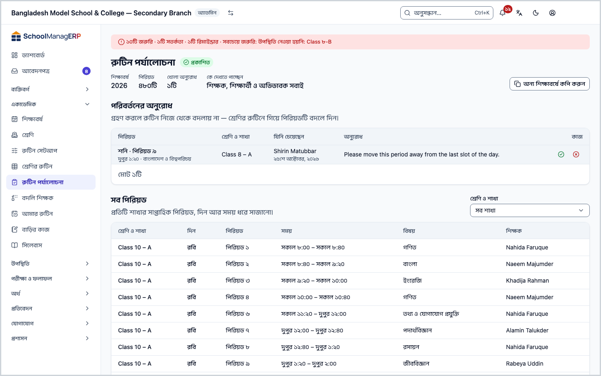

<!-- guide:meta
feature: academics.routineReview
title: রুটিন পর্যালোচনা ও প্রকাশ করা
summary: সাজানো রুটিনের সব পিরিয়ড এক তালিকায় দেখুন, শিক্ষকদের দেখার জন্য পর্যালোচনায় পাঠান, প্রকাশ করুন, শিক্ষকের পরিবর্তনের অনুরোধ সামলান, আর রুটিন অন্য শিক্ষাবর্ষে কপি করুন।
roles: [ADMIN, TEACHER, EXECUTIVE, OFFICE_STAFF, EXAM_CONTROLLER]
sources:
  - client-admin/src/routes/_staff/routines/review.tsx
  - client-admin/src/routes/_staff/routines/-publish-dialog.tsx
  - client-admin/src/routes/_staff/routines/-change-request-dialog.tsx
  - client-admin/src/routes/_staff/routines/-change-request-list.tsx
  - client-admin/src/route-permissions.ts
  - client-admin/src/nav-tree.ts
  - shared/src/enums/permissions.ts
  - server/src/modules/routines/routine-slots.controller.ts
  - server/src/modules/routines/routine-state.service.ts
  - server/src/modules/routines/change-requests.controller.ts
  - server/src/modules/routines/change-requests.service.ts
  - server/src/modules/routines/copy-routine.service.ts
  - server/src/modules/routines/resolve-routine.service.ts
labels:
  [
    routines:review.*,
    routines:publishDialog.*,
    routines:changeRequestDialog.*,
    routines:changeRequestList.*,
    routines:agenda.periodLabel,
    nav:items.routineReview,
    nav:groups.academics,
  ]
helpIds:
  [
    academics.routineReview,
    academics.routineReview.action.submitForReview,
    academics.routineReview.action.publish,
    academics.routineReview.action.copyYear,
    academics.routineReview.action.requestChange,
    academics.routineReview.action.resolveRequest,
  ]
devices: [desktop, phone]
entry: [sidebar, palette, page:academics.routineBuilder]
keywords:
  [রুটিন, পর্যালোচনা, প্রকাশ, ড্রাফট, পরিবর্তনের অনুরোধ, কপি, শিক্ষাবর্ষ, routine, review, publish, change request, copy year]
appVersion: 0.1.0 (e81ef857f)
owner: tareq89
lastVerified: 2026-10-24
knownIssues:
  - { id: teacher-sees-draft-periods, checked: 2026-10-24, issue: null }
  - { id: coordinator-no-full-view, checked: 2026-10-24, issue: null }
  - { id: request-outcome-not-shown, checked: 2026-10-24, issue: null }
-->

# রুটিন পর্যালোচনা ও প্রকাশ করা

সাজানো রুটিন শিক্ষকদের দেখার জন্য পর্যালোচনায় পাঠান, তারপর সবার জন্য প্রকাশ করুন। শিক্ষক এখান থেকে নিজের পিরিয়ড দেখেন আর পরিবর্তনের অনুরোধ পাঠান।

**যেতে হবে:** বাম মেনুতে **একাডেমিক → রুটিন পর্যালোচনা**। প্রকাশের কাজ কম্পিউটারে করুন; শিক্ষক ফোনেও নিজের পিরিয়ড দেখতে পারেন।
**শুরুর আগে:** চলতি শিক্ষাবর্ষের রুটিনে অন্তত কিছু পিরিয়ড বসানো থাকতে হবে: [**শ্রেণির সাপ্তাহিক রুটিন সাজানো**](routine-builder.md)। পর্যালোচনায় পাঠানো ও প্রকাশ শুধু অ্যাডমিন করেন ([কে কী করতে পারেন](#roles))।

এই পাতায় চলতি শিক্ষাবর্ষের **রুটিন** নিয়ে কাজ। রুটিনের তিনটি অবস্থা:

| অবস্থা           | কে দেখতে পাচ্ছেন (পাতায় যেমন লেখা) | ফেরানো যায়?                   |
| ---------------- | ----------------------------------- | ------------------------------ |
| **ড্রাফট**       | শুধু যাঁরা রুটিন সাজান              | —                              |
| **পর্যালোচনায়** | শিক্ষকরা, শুধু নিজের পিরিয়ড        | হ্যাঁ, **ড্রাফটে ফিরিয়ে নিন** |
| **প্রকাশিত**     | শিক্ষক, শিক্ষার্থী ও অভিভাবক সবাই   | না, কখনো না                    |

[প্রকাশ করুন](#task-main) · [পরিবর্তনের অনুরোধ (শিক্ষক)](#task-request) · [অনুরোধ সামলান](#task-resolve) · [অন্য শিক্ষাবর্ষে কপি](#task-copy) · [সমস্যা ও সমাধান](#trouble)

**এই পাতায় যা আছে**

- [এই পাতায় যেভাবে আসবেন](#arrive)
- [রুটিন পর্যালোচনায় পাঠান ও প্রকাশ করুন](#task-main)
- [প্রকাশ হয়েছে কি না বুঝবেন কীভাবে](#confirm)
- [অন্য পরিস্থিতিতে](#other)
  - [পর্যালোচনা থেকে ড্রাফটে ফিরিয়ে নিন](#task-withdraw)
  - [সব পিরিয়ডের তালিকা দেখুন](#task-list)
  - [শিক্ষক: পরিবর্তনের অনুরোধ করুন](#task-request)
  - [পরিবর্তনের অনুরোধ গ্রহণ বা প্রত্যাখ্যান করুন](#task-resolve)
  - [অন্য শিক্ষাবর্ষে কপি করুন](#task-copy)
- [সমস্যা ও সমাধান](#trouble)
- [কে কী করতে পারেন](#roles)
- [জানা সমস্যা](#known-issues)
- [আরও জানুন](#more)

---

## এই পাতায় যেভাবে আসবেন 

**বাম মেনু থেকে:** **একাডেমিক → রুটিন পর্যালোচনা** চাপুন। নিচের ধাপ ১ থেকে শুরু করুন।

**খোঁজার ঘর থেকে:** উপরের খোঁজার ঘরে (Ctrl+K) **রুটিন পর্যালোচনা** লিখে বেছে নিন। খোঁজার নিয়ম: [যেকোনো পাতা খুঁজে পাওয়া](../start/find-anything.md)।

**শ্রেণির রুটিন থেকে:** কোনো শাখার ছকের উপরে **পর্যালোচনা ও প্রকাশ** চাপুন ([শ্রেণির রুটিন](routine-builder.md))। → এই পাতা খোলে, সব শাখার পিরিয়ডসহ; নিচের ধাপ ২ থেকে শুরু করুন। রুটিন না থাকলে শাখার পাতার **রুটিন পর্যালোচনা খুলুন** বোতামও এখানে আনে।

---

## রুটিন পর্যালোচনায় পাঠান ও প্রকাশ করুন 

1. বাম মেনুতে **একাডেমিক → রুটিন পর্যালোচনা** চাপুন।

   → উপরে **রুটিন পর্যালোচনা**, পাশে অবস্থা (যেমন **ড্রাফট**)। তথ্য: **শিক্ষাবর্ষ**, **পিরিয়ড**, **কে দেখতে পাচ্ছেন**। নিচে **সব পিরিয়ড** তালিকা।

2. **সব পিরিয়ড** তালিকা দেখে নিন সব শাখা পূরণ হয়েছে কি না ([সব পিরিয়ডের তালিকা দেখুন](#task-list))।

3. উপরে **পর্যালোচনার জন্য জমা দিন** চাপুন।

   → **আপডেট হয়েছে** বার্তা আসে। অবস্থা হয় **পর্যালোচনায়**, আর **কে দেখতে পাচ্ছেন**-এ লেখা "শিক্ষকরা, শুধু নিজের পিরিয়ড"। শিক্ষকরা এখন [আমার রুটিন](my-routine.md) পাতায় নিজের পিরিয়ড দেখেন। শিক্ষার্থী ও অভিভাবক এখনো দেখেন না।

4. শিক্ষকদের দেখে নিতে বলুন। ঠিক থাকলে উপরে **প্রকাশ করুন** চাপুন।

   → **এই রুটিন প্রকাশ করুন** ঘর খোলে: "প্রকাশের পর রুটিন আর ড্রাফটে ফেরানো যায় না। পরে কিছু বদলাতে হলে শ্রেণির রুটিনে নতুন তারিখ থেকে বদলান।"

5. ঘরের **প্রকাশ করুন** চাপুন।

   → **প্রকাশিত হয়েছে** বার্তা আসে। অবস্থা হয় **প্রকাশিত**, **কে দেখতে পাচ্ছেন**-এ "শিক্ষক, শিক্ষার্থী ও অভিভাবক সবাই"। পাতায় **পরিবর্তনের অনুরোধ** অংশ আসে।

| আপনি চাপলেন     | কী হবে                                                                                                    | জমা হলো? |
| --------------- | --------------------------------------------------------------------------------------------------------- | -------- |
| **প্রকাশ করুন** | রুটিন সবার জন্য খোলে; শিক্ষার্থী ও অভিভাবকও পোর্টালে দেখেন। আর কখনো ড্রাফট বা পর্যালোচনায় ফেরানো যায় না | হ্যাঁ    |
| **বাতিল করুন**  | কিছুই বদলায় না; রুটিন **পর্যালোচনায়** থাকে                                                              | না       |

> **মনে রাখুন:** প্রকাশ ফেরানো যায় না। তবে প্রকাশের পরও [শ্রেণির রুটিন](routine-builder.md#task-published) থেকে আজকের তারিখ থেকে ঘর বদলানো যায়। একদিনের অনুপস্থিতির জন্য রুটিন না বদলে [বদলি শিক্ষক](routine-substitutions.md) দিন।

---

## প্রকাশ হয়েছে কি না বুঝবেন কীভাবে 

এই পাতার কাজ শুধু ইন্টারনেট থাকলে হয়। তাই **এই ডিভাইসে সংরক্ষিত** অবস্থা এখানে নেই।

| অবস্থা                       | কীভাবে বুঝবেন                                                          | এরপর কী                    |
| ---------------------------- | ---------------------------------------------------------------------- | -------------------------- |
| **শুধু স্ক্রিনে বদলেছে**     | **এই রুটিন প্রকাশ করুন** ঘর খোলা                                       | ঘরের **প্রকাশ করুন** চাপুন |
| **স্কুলের সিস্টেমে পৌঁছেছে** | **প্রকাশিত হয়েছে** বা **আপডেট হয়েছে** বার্তা, আর উপরের অবস্থা বদলেছে | কাজ শেষ                    |

**যাচাই করতে চাইলে:** পাতা রিলোড করুন। উপরের অবস্থা **প্রকাশিত** দেখালে রুটিন প্রকাশিত। কোনো শিক্ষককে তাঁর [আমার রুটিন](my-routine.md) খুলে দেখতে বলুন।

**বার্তা না এলে:** **আপডেট করা যায়নি — আবার চেষ্টা করুন।** বা **প্রকাশ করা যায়নি — আবার চেষ্টা করুন।** এলে অবস্থা বদলায়নি; রিলোড করে দেখে আবার চাপুন। রুটিনের পিরিয়ড কিছুই হারায় না।

---

## অন্য পরিস্থিতিতে 

### পর্যালোচনা থেকে ড্রাফটে ফিরিয়ে নিন 

রুটিন **পর্যালোচনায়** থাকলে উপরে **ড্রাফটে ফিরিয়ে নিন** চাপুন।

→ **আপডেট হয়েছে** বার্তা আসে, অবস্থা হয় **ড্রাফট**। শিক্ষকরা আর আমার রুটিনে পিরিয়ড দেখেন না। পিরিয়ডগুলো মোছে না। প্রকাশিত রুটিনে এই বোতাম থাকে না।

### সব পিরিয়ডের তালিকা দেখুন 

অ্যাডমিন **সব পিরিয়ড** তালিকা দেখেন: **শ্রেণি ও শাখা**, **দিন**, **পিরিয়ড**, **সময়**, **বিষয়**, **শিক্ষক**। তালিকা শ্রেণি-শাখা, তারপর দিন, তারপর পিরিয়ড ধরে সাজানো; এক পাতায় ২৫টি।

1. ডান দিকে **শ্রেণি ও শাখা** ঘর থেকে একটি শাখা বেছে নিন।

   → শুধু সেই শাখার পিরিয়ড। আবার সব দেখতে **সব শাখা** বাছুন।

কিছু না থাকলে **এখনো কোনো পিরিয়ড নেই** আর **শ্রেণির রুটিন খুলুন** বোতাম দেখায়।

### শিক্ষক: পরিবর্তনের অনুরোধ করুন 

শিক্ষক এই পাতায় শুধু **আমার পিরিয়ড** দেখেন ("আপনার সাপ্তাহিক পিরিয়ড।")। রুটিন প্রকাশিত হলে নিজের কোনো পিরিয়ড নিয়ে আপত্তি জানাতে পারেন।

1. বাম মেনুতে **একাডেমিক → রুটিন পর্যালোচনা** চাপুন। (ফোনে মেনু খুলে একই জায়গায়।)

   → **আমার পিরিয়ড** তালিকা। রুটিন এখনো প্রকাশিত না হলে উপরে লেখা: **রুটিন প্রকাশিত হওয়ার পরই পরিবর্তনের অনুরোধ করা যাবে।**

2. যে পিরিয়ড নিয়ে বলবেন, তার সারির শেষে **পরিবর্তনের অনুরোধ করুন** চাপুন।

   → **পরিবর্তনের অনুরোধ করুন** ঘর খোলে, উপরে দিন · পিরিয়ড · বিষয়।

3. **কী বদলানো দরকার** ঘরে লিখুন, যেমন "এটি আমার অন্য একটি পিরিয়ডের সাথে মিলে যাচ্ছে।" (৫০০ অক্ষর পর্যন্ত।)

   → ঘর ফাঁকা থাকলে **পাঠান** বন্ধ থাকে।

4. **পাঠান** চাপুন।

   → **পাঠানো হয়েছে** বার্তা আসে, ঘর বন্ধ হয়।

<!-- image pending: শিক্ষকের আমার পিরিয়ড তালিকা ও পরিবর্তনের অনুরোধ করুন ঘর, শিক্ষক, phone -->

| আপনি চাপলেন    | কী হবে                                                                      | জমা হলো? |
| -------------- | --------------------------------------------------------------------------- | -------- |
| **পাঠান**      | অনুরোধ অ্যাডমিনের **পরিবর্তনের অনুরোধ** তালিকায় যায়। রুটিন নিজে বদলায় না | হ্যাঁ    |
| **বাতিল করুন** | কিছুই যায় না                                                               | না       |

> **মনে রাখুন:** অনুরোধ পাঠালেই রুটিন বদলায় না; অ্যাডমিন সিদ্ধান্ত নেন। অনুরোধের ফল এই পাতায় দেখা যায় না: [জানা সমস্যা](#known-issues)।

### পরিবর্তনের অনুরোধ গ্রহণ বা প্রত্যাখ্যান করুন 

রুটিন প্রকাশিত হলে অ্যাডমিনের পাতায় **পরিবর্তনের অনুরোধ** অংশ থাকে, উপরের তথ্যে **খোলা অনুরোধ** সংখ্যা।

1. তালিকায় অনুরোধ দেখুন: **পিরিয়ড**, **শ্রেণি ও শাখা**, **যিনি চেয়েছেন**, **অনুরোধ**।

   → কিছু না থাকলে **কোনো খোলা অনুরোধ নেই**।

2. সারির শেষে **গ্রহণ করুন** বা **প্রত্যাখ্যান করুন** চাপুন।

   → **অনুরোধটি গ্রহণ করবেন?** বা **অনুরোধটি প্রত্যাখ্যান করবেন?** ঘর খোলে।

3. চাইলে **শিক্ষকের জন্য নোট (ঐচ্ছিক)** লিখুন।

4. ঘরের **গ্রহণ করুন** বা **প্রত্যাখ্যান করুন** চাপুন।

   → **সমাধান হয়েছে** বার্তা আসে, আর অনুরোধটি তালিকা থেকে সরে যায়।

| আপনি চাপলেন           | কী হবে                                                    | জমা হলো? |
| --------------------- | --------------------------------------------------------- | -------- |
| **গ্রহণ করুন**        | অনুরোধ বন্ধ হয় "গ্রহণ" হিসেবে। রুটিন নিজে থেকে বদলায় না | হ্যাঁ    |
| **প্রত্যাখ্যান করুন** | অনুরোধ বন্ধ হয় "প্রত্যাখ্যান" হিসেবে                     | হ্যাঁ    |
| **বাতিল করুন**        | অনুরোধ খোলা থাকে                                          | না       |

> **মনে রাখুন:** "গ্রহণ করলে রুটিন নিজে থেকে বদলায় না — শ্রেণির রুটিনে গিয়ে পিরিয়ডটি বদলে দিন।" গ্রহণ করার পর [শ্রেণির রুটিন](routine-builder.md#task-clear) থেকে ঘরটি বদলান। একবার সমাধান করা অনুরোধ আবার খোলা যায় না।

### অন্য শিক্ষাবর্ষে কপি করুন 

নতুন শিক্ষাবর্ষের রুটিন শূন্য থেকে না সাজিয়ে এই বছরেরটি কপি করুন।

1. উপরে **অন্য শিক্ষাবর্ষে কপি করুন** চাপুন।

   → একই নামের ঘর খোলে: "এই রুটিনের সব পিরিয়ড বেছে নেওয়া শিক্ষাবর্ষের একটি নতুন ড্রাফটে কপি হবে। যে পিরিয়ডের শাখা বা বিষয় ওই বছরে নেই, সেগুলো বাদ পড়বে আর গুনে দেখানো হবে।"

2. **কোন শিক্ষাবর্ষে** থেকে বছর বেছে নিন। (চলতি বছর তালিকায় থাকে না।)

3. **কপি করুন** চাপুন।

   → **কপি হয়েছে — {সংখ্যা}টি পিরিয়ড বাদ পড়েছে** বার্তা আসে।

| আপনি চাপলেন    | কী হবে                                                                          | জমা হলো? |
| -------------- | ------------------------------------------------------------------------------- | -------- |
| **কপি করুন**   | ওই বছরের জন্য নতুন **ড্রাফট** রুটিন তৈরি হয়। এই বছরের রুটিন যেমন ছিল তেমন থাকে | হ্যাঁ    |
| **বাতিল করুন** | কিছুই বদলায় না                                                                 | না       |

যে বছরে আগে থেকেই রুটিন আছে, সেখানে কপি হয় না; **কপি করা যায়নি — আবার চেষ্টা করুন।** আসে। এই পাতা সবসময় চলতি শিক্ষাবর্ষের রুটিন দেখায়; কপি করা রুটিন দেখা যাবে সেই বছর চলতি হলে।

---

## সমস্যা ও সমাধান 

| আপনি যা দেখছেন                                                                  | কী করবেন                                                                                                                              | কে সাহায্য করতে পারেন |
| ------------------------------------------------------------------------------- | ------------------------------------------------------------------------------------------------------------------------------------- | --------------------- |
| **এখনো কোনো রুটিন নেই**                                                         | চলতি শিক্ষাবর্ষের রুটিন তৈরি হয়নি। আগের বছর থেকে কপি করতে হয়; দেখুন [শ্রেণির রুটিনের জানা সমস্যা](routine-builder.md#known-issues)। | অ্যাডমিন              |
| **আপনার কোনো পিরিয়ড নেই**                                                      | আপনার অ্যাকাউন্টের সঙ্গে শিক্ষক প্রোফাইল নেই। শিক্ষক হলে অ্যাডমিনকে [শিক্ষক প্রোফাইল](../people/staff.md#task-teacher) দিতে বলুন।     | অ্যাডমিন              |
| **আমার পিরিয়ড** খালি                                                           | আপনাকে এখনো কোনো পিরিয়ড দেওয়া হয়নি, অথবা রুটিন ড্রাফট। অ্যাডমিনকে জিজ্ঞেস করুন।                                                    | অ্যাডমিন              |
| **রুটিন প্রকাশিত হওয়ার পরই পরিবর্তনের অনুরোধ করা যাবে।**                       | রুটিন প্রকাশের পর আবার আসুন।                                                                                                          | অ্যাডমিন              |
| **রুটিন লোড করা যায়নি। আপনার সংযোগ পরীক্ষা করে আবার চেষ্টা করুন।**             | ইন্টারনেট দেখে **আবার চেষ্টা করুন** চাপুন।                                                                                            | —                     |
| **আপডেট করা যায়নি — আবার চেষ্টা করুন।**                                        | পাতা রিলোড করুন; হয়তো অন্য কেউ এর মধ্যে অবস্থা বদলেছেন। তারপর আবার চেষ্টা করুন।                                                      | অ্যাডমিন              |
| **প্রকাশ করা যায়নি — আবার চেষ্টা করুন।**                                       | রিলোড করে দেখুন অবস্থা **পর্যালোচনায়** কি না। হলে আবার **প্রকাশ করুন**।                                                              | অ্যাডমিন              |
| **পাঠানো যায়নি — আবার চেষ্টা করুন।**                                           | ইন্টারনেট দেখে আবার **পাঠান** চাপুন। লেখা ঘরে থাকে।                                                                                   | অ্যাডমিন              |
| **পরিবর্তনের অনুরোধ লোড করা যায়নি। আপনার সংযোগ পরীক্ষা করে আবার চেষ্টা করুন।** | **আবার চেষ্টা করুন** চাপুন।                                                                                                           | অ্যাডমিন              |
| **সমাধান করা যায়নি — আবার চেষ্টা করুন।**                                       | রিলোড করুন; অন্য কেউ হয়তো আগেই সমাধান করেছেন।                                                                                        | অ্যাডমিন              |
| **কপি করা যায়নি — আবার চেষ্টা করুন।**                                          | বেছে নেওয়া বছরে আগে থেকেই রুটিন আছে কি না দেখুন। থাকলে কপি হবে না।                                                                   | অ্যাডমিন, সহায়তা     |

---

## কে কী করতে পারেন 

| ভূমিকা                                                 | এই পাতায় কী দেখেন                                                                | পর্যালোচনায় পাঠানো, প্রকাশ, কপি, অনুরোধ সামলানো | পরিবর্তনের অনুরোধ পাঠাতে           |
| ------------------------------------------------------ | --------------------------------------------------------------------------------- | ------------------------------------------------ | ---------------------------------- |
| অ্যাডমিন                                               | সব শাখার সব পিরিয়ড                                                               | হ্যাঁ                                            | না (তিনি নিজেই বদলাতে পারেন)       |
| শিক্ষক                                                 | শুধু নিজের পিরিয়ড                                                                | না                                               | হ্যাঁ, রুটিন প্রকাশের পর           |
| একাডেমিক কো-অর্ডিনেটর, অফিস সহকারী, পরীক্ষা নিয়ন্ত্রক | শিক্ষক প্রোফাইল থাকলে নিজের পিরিয়ড; নইলে কিছুই না — [জানা সমস্যা](#known-issues) | না                                               | শিক্ষক প্রোফাইল থাকলে, প্রকাশের পর |
| হিসাবরক্ষক, পরিচালনা পর্ষদ সদস্য                       | পাতাটি দেখেন না                                                                   | না                                               | না                                 |

যাঁদের অনুমতি নেই, তাঁদের বাম মেনুতে **রুটিন পর্যালোচনা** থাকে না।

---

## জানা সমস্যা 

সংস্করণ ০.১.০-এ কোড দেখে যাচাই করা, ২০২৬-১০-২৪। অ্যাপে চালিয়ে দেখা হয়নি। ঠিক হলে এই অংশ থেকে সরিয়ে দেওয়া হবে।

| সমস্যা                                                                                                                                             | কার, কখন                        | তথ্য সংরক্ষিত? | আপাতত কী করবেন                                               |
| -------------------------------------------------------------------------------------------------------------------------------------------------- | ------------------------------- | -------------- | ------------------------------------------------------------ |
| রুটিন **ড্রাফট** থাকলেও শিক্ষক এই পাতার **আমার পিরিয়ড** তালিকায় নিজের পিরিয়ড দেখেন, যদিও পাতায় লেখা থাকে ড্রাফট "শুধু যাঁরা রুটিন সাজান" দেখেন | শিক্ষক, রুটিন ড্রাফট থাকার সময় | প্রযোজ্য নয়   | ড্রাফটের পিরিয়ড চূড়ান্ত নয়, শিক্ষকদের এ কথা জানিয়ে রাখুন |
| একাডেমিক কো-অর্ডিনেটর পুরো রুটিন দেখতে পান না; শিক্ষক প্রোফাইল না থাকলে **আপনার কোনো পিরিয়ড নেই** দেখেন                                           | একাডেমিক কো-অর্ডিনেটর, সবসময়   | প্রযোজ্য নয়   | পুরো রুটিন দেখতে অ্যাডমিনের সাহায্য নিন                      |
| শিক্ষক অনুরোধ পাঠানোর পর তা গ্রহণ না প্রত্যাখ্যান হলো, বা অ্যাডমিনের নোট, অ্যাপের কোনো পাতায় দেখতে পান না                                         | শিক্ষক, অনুরোধ পাঠানোর পর       | হ্যাঁ          | অ্যাডমিন শিক্ষককে সরাসরি জানিয়ে দিন                         |

---

## আরও জানুন 

<strong>পাতার অংশগুলো</strong> — অ্যাডমিন যেমন দেখেন

1. **রুটিন পর্যালোচনা** — শিরোনাম, অবস্থা, আর **শিক্ষাবর্ষ**, **পিরিয়ড**, **খোলা অনুরোধ**, **কে দেখতে পাচ্ছেন**।
2. উপরের বোতাম — **অন্য শিক্ষাবর্ষে কপি করুন**, আর অবস্থা অনুযায়ী **পর্যালোচনার জন্য জমা দিন** অথবা **ড্রাফটে ফিরিয়ে নিন** ও **প্রকাশ করুন**।
3. **পরিবর্তনের অনুরোধ** — শুধু প্রকাশিত রুটিনে।
4. **সব পিরিয়ড** — **শ্রেণি ও শাখা** ছাঁকনিসহ তালিকা।

<strong>রুটিনের তিন অবস্থা ও কে দেখেন</strong>

<figure>
  
  <figcaption><em>ড্রাফট, পর্যালোচনায়, প্রকাশিত</em></figcaption>
</figure>

- প্রকাশিত রুটিন শিক্ষার্থী ও অভিভাবক পোর্টালে দেখেন।
- ক্যালেন্ডারের ছুটির দিনে রুটিনের পিরিয়ড হয় না: [ক্যালেন্ডারে ছুটি](../people/calendar.md#task-offdays)।

**সম্পর্কিত পাতা**

- [**শ্রেণির সাপ্তাহিক রুটিন সাজানো**](routine-builder.md) — পিরিয়ড বসানো ও বদলানো হয় সেখানে।
- [**আমার রুটিন দেখা ও পিরিয়ড জানানো**](my-routine.md) — শিক্ষক পর্যালোচনায় ও প্রকাশের পর নিজের রুটিন সেখানে দেখেন।

---

_সংস্করণ ০.১.০ · শেষ যাচাই ২০২৬-১০-২৪_
