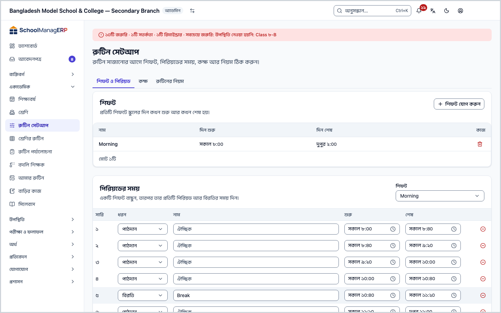
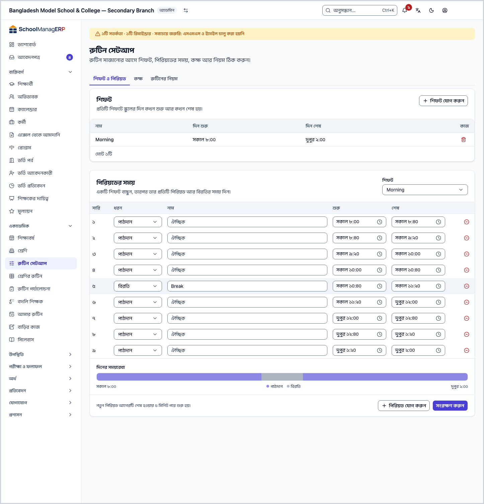

<!-- guide:meta
feature: academics.routineSetup
title: রুটিনের শিফট, পিরিয়ড, কক্ষ ও নিয়ম ঠিক করা
summary: রুটিন সাজানোর আগে স্কুলের শিফট, প্রতিটি শিফটের পিরিয়ড ও বিরতির সময়, কক্ষের তালিকা আর রুটিনের নিয়ম ঠিক করুন।
roles: [ADMIN]
sources:
  - client-admin/src/routes/_staff/routines/setup.tsx
  - client-admin/src/routes/_staff/routines/-setup/shifts-panel.tsx
  - client-admin/src/routes/_staff/routines/-setup/period-slots-panel.tsx
  - client-admin/src/routes/_staff/routines/-setup/rooms-panel.tsx
  - client-admin/src/routes/_staff/routines/-setup/routine-settings-panel.tsx
  - client-admin/src/route-permissions.ts
  - server/src/modules/routines/shifts.controller.ts
  - server/src/modules/routines/shifts.service.ts
  - server/src/modules/routines/period-slots.service.ts
  - server/src/modules/routines/rooms.controller.ts
  - server/src/modules/routines/rooms.service.ts
  - server/src/modules/routines/constraint-check.ts
labels:
  [
    routines:setupPage.*,
    routines:shiftsPanel.*,
    routines:periodSlotsPanel.*,
    routines:roomsPanel.*,
    routines:settingsPanel.*,
    routines:save.*,
    routines:delete.*,
    nav:items.routineSetup,
    nav:groups.academics,
  ]
helpIds:
  [
    academics.routineSetup,
    academics.routineSetup.action.deleteShift,
    academics.routineSetup.action.savePeriods,
    academics.routineSetup.field.changeover,
    academics.routineSetup.field.maxPeriodsPerDay,
    academics.routineSetup.field.maxConsecutive,
  ]
devices: [desktop]
entry: [sidebar, palette]
keywords:
  [রুটিন, রুটিন সেটআপ, শিফট, পিরিয়ড, বিরতি, কক্ষ, রুম, নিয়ম, পিরিয়ডের সময়, routine, timetable, shift, period, room]
appVersion: 0.1.0 (e81ef857f)
owner: tareq89
lastVerified: 2026-10-24
knownIssues: []
-->

# রুটিনের শিফট, পিরিয়ড, কক্ষ ও নিয়ম ঠিক করা

রুটিন সাজানোর আগে স্কুলের দিন কখন শুরু ও শেষ হয়, কোন পিরিয়ড কখন, কোন কোন কক্ষে ক্লাস হয়, আর একজন শিক্ষক দিনে কয়টি পিরিয়ড নেবেন, তা ঠিক করুন।

**যেতে হবে:** বাম মেনুতে **একাডেমিক → রুটিন সেটআপ**। এই পাতার কাজ কম্পিউটারে করুন।
**শুরুর আগে:** আপনি স্কুলের অ্যাডমিন হবেন ([কে কী করতে পারেন](#roles))। স্কুলের সময়সূচি (কোন ঘণ্টা কখন বাজে) হাতে রাখুন।

এই পাতায় তিনটি ট্যাব: **শিফট ও পিরিয়ড**, **কক্ষ**, **রুটিনের নিয়ম**। এখানে যা ঠিক করবেন, তা দিয়েই [**শ্রেণির রুটিন**](routine-builder.md) পাতার ছক তৈরি হয়: ছকের প্রতিটি সারি একটি পিরিয়ড। একটি [শিফট](../help/glossary.md#shift) মানে স্কুলের একটি পালা, যেমন সকালের শিফট বা দিনের শিফট।

[শিফট যোগ করুন](#task-main) · [পিরিয়ডের সময় দিন](#task-periods) · [কক্ষ যোগ করুন](#task-rooms) · [রুটিনের নিয়ম](#task-rules) · [সমস্যা ও সমাধান](#trouble)

**এই পাতায় যা আছে**

- [শিফট যোগ করুন](#task-main)
- [সংরক্ষণ হয়েছে কি না বুঝবেন কীভাবে](#confirm)
- [অন্য পরিস্থিতিতে](#other)
  - [শিফটের পিরিয়ডের সময় দিন](#task-periods)
  - [কক্ষ যোগ করুন](#task-rooms)
  - [রুটিনের নিয়ম ঠিক করুন](#task-rules)
  - [শিফট বা কক্ষ বদলান](#task-edit)
  - [শিফট বা কক্ষ মুছুন](#task-delete)
- [সমস্যা ও সমাধান](#trouble)
- [কে কী করতে পারেন](#roles)
- [আরও জানুন](#more)

---

## শিফট যোগ করুন 

1. বাম মেনুতে **একাডেমিক → রুটিন সেটআপ** চাপুন।

   → উপরে **রুটিন সেটআপ** শিরোনাম, নিচে "রুটিন সাজানোর আগে শিফট, পিরিয়ডের সময়, কক্ষ আর নিয়ম ঠিক করুন।" **শিফট ও পিরিয়ড** ট্যাব খোলা থাকে।

2. **শিফট** অংশে **শিফট যোগ করুন** চাপুন।

   → **শিফট যোগ করুন** ঘর খোলে।

3. **নাম** ঘরে শিফটের নাম লিখুন, যেমন `সকাল`।

   → ফাঁকা রাখলে **শিফটের একটি নাম লিখুন।** দেখায়।

4. **দিন শুরু** আর **দিন শেষ** সময় দিন। নতুন ঘরে আগে থেকে ৮:০০ আর ১৬:০০ বসানো থাকে।

   → শেষের সময় শুরুর আগে হলে **দিন শেষের সময় শুরুর পরে হতে হবে।** দেখায়, আর **যোগ করুন** বোতাম বন্ধ থাকে।

5. **যোগ করুন** চাপুন।

   → ঘর বন্ধ হয়, আর নতুন শিফট **শিফট** তালিকায় আসে: **নাম**, **দিন শুরু**, **দিন শেষ**।

> **মনে রাখুন:** শিফট যোগ করলেই রুটিন তৈরি হয় না। এরপর [শিফটের পিরিয়ডের সময় দিন](#task-periods), আর প্রতিটি শ্রেণিকে শ্রেণির পাতা থেকে একটি শিফট দিন। শিফট ছাড়া শ্রেণির রুটিনে **শ্রেণির শিফট ঠিক করা নেই** দেখায়।

---

## সংরক্ষণ হয়েছে কি না বুঝবেন কীভাবে 

এই পাতার কিছুই ফোন বা কম্পিউটারে জমিয়ে রেখে পরে পাঠানো যায় না; ইন্টারনেট থাকলেই সংরক্ষিত হয়। তাই **এই ডিভাইসে সংরক্ষিত** অবস্থা এখানে নেই।

| অবস্থা                       | কীভাবে বুঝবেন                                                                            | এরপর কী                                |
| ---------------------------- | ---------------------------------------------------------------------------------------- | -------------------------------------- |
| **শুধু স্ক্রিনে বদলেছে**     | শিফট বা কক্ষের ঘর এখনো খোলা; অথবা পিরিয়ডের সারি বদলেছেন কিন্তু **সংরক্ষণ করুন** চাপেননি | **যোগ করুন** বা **সংরক্ষণ করুন** চাপুন |
| **স্কুলের সিস্টেমে পৌঁছেছে** | শিফট বা কক্ষ তালিকায় এসেছে; পিরিয়ড বা নিয়মের বেলায় **সংরক্ষিত হয়েছে** বার্তা এসেছে  | কাজ শেষ                                |

**যাচাই করতে চাইলে:** পাতা রিলোড করুন। শিফট, পিরিয়ডের সারি, কক্ষ আর নিয়মের সংখ্যা যেমন রেখেছিলেন তেমন থাকলে সেগুলো সিস্টেমে আছে।

**বার্তা না এলে:** [সমস্যা ও সমাধান](#trouble) দেখুন। পিরিয়ডের সারিগুলো স্ক্রিনে থেকে যায়; পাতা না ছাড়লে আবার **সংরক্ষণ করুন** চাপা যায়।

---

## অন্য পরিস্থিতিতে 

### শিফটের পিরিয়ডের সময় দিন 

1. **শিফট ও পিরিয়ড** ট্যাবে নিচের **পিরিয়ডের সময়** অংশে যান। **শিফট** ঘর থেকে শিফটটি বেছে নিন।

   → শিফটের দিনের একটি সময়রেখা আর পিরিয়ডের সারির তালিকা দেখায়। কোনো সারি না থাকলে লেখা: "এই শিফটে এখনো কোনো পিরিয়ড নেই। “পিরিয়ড যোগ করুন” চাপুন।" কোনো শিফটই না থাকলে **আগে একটি শিফট যোগ করুন** দেখায়।

2. **পিরিয়ড যোগ করুন** চাপুন।

   → নতুন সারি আসে। প্রথম সারি শিফটের **দিন শুরু** থেকে, পরের সারি আগের সারি শেষ হওয়ার কিছু মিনিট পরে শুরু হয় (মিনিট আসে [রুটিনের নিয়ম](#task-rules) থেকে)। প্রতিটি নতুন সারি ৪০ মিনিটের।

3. প্রতিটি সারিতে **ধরন** বাছুন: **পাঠদান** বা **বিরতি**। চাইলে **নাম** দিন (যেমন `টিফিন`; ঐচ্ছিক)। তারপর **শুরু** আর **শেষ** সময় ঠিক করুন।

   → কোনো সারির সময় ভুল হলে সারির নিচে লাল লেখা আসে: **শেষের সময় শুরুর পরে হতে হবে।**, **শিফটের সময়ের (…) মধ্যে রাখুন।** বা **উপরের সারি শেষ হওয়ার আগেই শুরু হচ্ছে।** তখন **সংরক্ষণ করুন** বন্ধ থাকে।

4. ভুল সারি বাদ দিতে সারির পাশের সরানোর বোতাম চাপুন। বাকি সারিগুলোর নম্বর নিজে থেকে ঠিক হয়।

5. **সংরক্ষণ করুন** চাপুন।

   → **সংরক্ষিত হয়েছে** বার্তা আসে।

> **মনে রাখুন:** **সংরক্ষণ করুন** না চাপা পর্যন্ত কিছুই সিস্টেমে যায় না। না চেপে পাতা ছাড়তে চাইলে অ্যাপ সতর্ক করে। **বিরতি** সারিতে শ্রেণির রুটিনে কোনো পিরিয়ড বসানো যায় না।

পরেও সময় বদলাতে পারেন, শ্রেণির রুটিনে পিরিয়ড বসানোর পরেও। সারিগুলোর নিচে লেখা থাকে: **সময় বদলালে আগের দিনগুলোতেও নতুন সময় দেখাবে।** তবে কোনো সারি সরালে, বা **পাঠদান** সারিকে **বিরতি** করলে, আর সেই পিরিয়ড রুটিনে বা পাঠের রেকর্ডে আগে থেকে ব্যবহৃত হলে, সংরক্ষণ হয় না: **আপনি যে পিরিয়ডটি মুছেছেন বা বিরতি করেছেন সেটি রুটিনে বা পাঠের রেকর্ডে ব্যবহৃত হচ্ছে। সেটি ফিরিয়ে আনুন। শুধু ক্লাস রুটিনে থাকলে আগে রুটিন থেকে সরিয়ে দিতে পারেন।**

### কক্ষ যোগ করুন 

1. **কক্ষ** ট্যাব চাপুন।

   → **কক্ষের তালিকা**। কিছু না থাকলে **এখনো কোনো কক্ষ নেই**।

2. **কক্ষ যোগ করুন** চাপুন।

   → **কক্ষ যোগ করুন** ঘর খোলে।

3. **কক্ষ নং** লিখুন (বাধ্যতামূলক)। চাইলে **ভবন** আর **ধারণক্ষমতা** (১ বা বেশি) দিন।

4. **যোগ করুন** চাপুন।

   → ঘর বন্ধ হয়, আর তালিকায় **কক্ষ {নম্বর}** আসে।

> **মনে রাখুন:** কক্ষের তালিকা পরীক্ষার আসন বিন্যাসেও কাজে লাগে।

### রুটিনের নিয়ম ঠিক করুন 

1. **রুটিনের নিয়ম** ট্যাব চাপুন।

   → লেখা থাকে: "রুটিন সাজানোর সময় এই নিয়মগুলো মিলিয়ে দেখা হয়।" তিনটি ঘর:

   | ঘর                                                | কী দেবেন                                                                      |
   | ------------------------------------------------- | ----------------------------------------------------------------------------- |
   | **দুই পিরিয়ডের মাঝে ফাঁক (মিনিট)**               | ০ থেকে ১২০। নতুন পিরিয়ডের সারি আগেরটি শেষ হওয়ার এত মিনিট পরে শুরু হয়       |
   | **একজন শিক্ষক দিনে সর্বোচ্চ কয়টি পিরিয়ড নেবেন** | ১ বা বেশি; খালি রাখলে কোনো সীমা নেই। এই সীমা পার হলে রুটিনে সংরক্ষণ হয় না    |
   | **টানা সর্বোচ্চ কয়টি পিরিয়ড**                   | ১ বা বেশি; খালি রাখলে কোনো সীমা নেই। পার হলে সংরক্ষণ হয়, শুধু সতর্কতা দেখায় |

2. সংখ্যা বদলে **সংরক্ষণ করুন** চাপুন।

   → **সংরক্ষিত হয়েছে** বার্তা আসে। ভুল সংখ্যা দিলে ঘরের নিচে **১ বা তার বেশি একটি পূর্ণ সংখ্যা দিন, অথবা সীমা না চাইলে খালি রাখুন।** বা **০ থেকে ১২০-এর মধ্যে একটি পূর্ণ সংখ্যা দিন।** দেখায়।

> **মনে রাখুন:** নতুন নিয়ম শুধু এরপর যে পিরিয়ড বসাবেন বা বদলাবেন, তাতে মেলানো হয়। আগে থেকে বসানো পিরিয়ড নিজে থেকে সরে যায় না। (কোড দেখে বোঝা; অ্যাপে চালিয়ে দেখা হয়নি।)

### শিফট বা কক্ষ বদলান 

1. **শিফট** বা **কক্ষের তালিকা**-য় সারির শেষে **সম্পাদনা** চাপুন।

   → **শিফট সম্পাদনা** বা **কক্ষ সম্পাদনা** ঘর খোলে, আগের তথ্য ভরা থাকে।

2. নাম, সময় বা কক্ষের তথ্য বদলে **সংরক্ষণ** চাপুন।

   → ঘর বন্ধ হয়, তালিকায় বদলটি দেখা যায়।

শিফটের দিন তার পিরিয়ডগুলোর চেয়ে ছোট করা যায় না। নতুন সময়ের বাইরে কোনো পিরিয়ড পড়লে দেখায় **এই শিফটের কিছু পিরিয়ড এই সময়ের বাইরে পড়ে। আগে পিরিয়ডের সময় বদলান।**

### শিফট বা কক্ষ মুছুন 

1. **শিফট** বা **কক্ষের তালিকা**-য় সারির শেষে **মুছুন** চাপুন।

   → **{নাম} মুছবেন?** বা **কক্ষ {নম্বর} মুছবেন?** ঘর খোলে: মুছলে আর ফেরানো যাবে না।

| আপনি চাপলেন    | কী হবে                                                                                     | জমা হলো? |
| -------------- | ------------------------------------------------------------------------------------------ | -------- |
| **মুছে ফেলুন** | শিফট বা কক্ষ তালিকা থেকে চলে যায়। তবে ব্যবহারে থাকলে মোছা হয় না, বার্তা আসে (নিচে দেখুন) | হ্যাঁ    |
| **বাতিল করুন** | কিছুই বদলায় না                                                                            | না       |

- যে শিফটে এখনো পিরিয়ডের সারি আছে, তা মোছা যায় না: **এই শিফটে এখনো পিরিয়ডের সময় দেওয়া আছে, তাই মোছা যাবে না। আগে পিরিয়ডের সময় থেকে সারিগুলো সরান।**
- যে কক্ষ রুটিনে বা পরীক্ষার আসন বিন্যাসে ব্যবহার হচ্ছে, তা মোছা যায় না: **রুটিনের কিছু পিরিয়ড এই কক্ষে বসানো আছে, তাই মোছা যাবে না। আগে সেই পিরিয়ডগুলো অন্য কক্ষে সরান।** (আসন বিন্যাসের বেলাতেও এই একই লেখা আসে।)

---

## সমস্যা ও সমাধান 

| আপনি যা দেখছেন                                                                              | কী করবেন                                                                                                                    | কে সাহায্য করতে পারেন |
| ------------------------------------------------------------------------------------------- | --------------------------------------------------------------------------------------------------------------------------- | --------------------- |
| **এই পাতাটি দেখার অনুমতি আপনার নেই।**                                                       | রুটিন সেটআপ শুধু অ্যাডমিন করেন। অ্যাডমিনকে বলুন।                                                                            | অ্যাডমিন              |
| **শিফটটি যোগ করা যায়নি। আবার চেষ্টা করুন।**                                                | ইন্টারনেট দেখে আবার **যোগ করুন** চাপুন। ঘরের লেখা থেকে যায়।                                                                | অ্যাডমিন              |
| **এই নামটি ঠিক নয়। দেখে আবার চেষ্টা করুন।**                                                | নামটি বদলে লিখুন।                                                                                                           | অ্যাডমিন              |
| **কিছু সারির সময় ঠিক নেই। লাল লেখা দেখে ঠিক করে আবার সংরক্ষণ করুন।**                       | লাল লেখা থাকা সারির সময় ঠিক করুন, তারপর **সংরক্ষণ করুন**।                                                                  | অ্যাডমিন              |
| **আপনি যে পিরিয়ডটি মুছেছেন বা বিরতি করেছেন সেটি রুটিনে বা পাঠের রেকর্ডে ব্যবহৃত হচ্ছে। …** | সারিটি আগের মতো ফিরিয়ে আনুন। শুধু ক্লাস রুটিনে থাকলে আগে সেখান থেকে সরান ([শ্রেণির রুটিন](routine-builder.md#task-clear))। | অ্যাডমিন              |
| **এই শিফটের কিছু পিরিয়ড এই সময়ের বাইরে পড়ে। আগে পিরিয়ডের সময় বদলান।**                  | শিফটের দিন বড় করুন, অথবা আগে [পিরিয়ডের সময়](#task-periods) বদলান।                                                        | অ্যাডমিন              |
| **পিরিয়ডের সময় সংরক্ষণ করা যায়নি। আবার চেষ্টা করুন।**                                    | ইন্টারনেট দেখে আবার **সংরক্ষণ করুন** চাপুন। সারিগুলো স্ক্রিনে থাকে।                                                         | অ্যাডমিন              |
| **কক্ষটি যোগ করা যায়নি। আবার চেষ্টা করুন।**                                                | ইন্টারনেট দেখে আবার চেষ্টা করুন।                                                                                            | অ্যাডমিন              |
| **নিয়মগুলো সংরক্ষণ করা যায়নি। সংখ্যাগুলো দেখে আবার চেষ্টা করুন।**                         | সংখ্যাগুলো সীমার মধ্যে আছে কি না দেখুন, তারপর আবার **সংরক্ষণ করুন**।                                                        | অ্যাডমিন              |
| **শিফটটি মোছা যায়নি। আবার চেষ্টা করুন।** বা **কক্ষটি মোছা যায়নি। আবার চেষ্টা করুন।**      | ইন্টারনেট দেখে আবার **মুছুন** চাপুন।                                                                                        | অ্যাডমিন              |

---

## কে কী করতে পারেন 

| ভূমিকা                                                                                           | রুটিন সেটআপ দেখতে ও বদলাতে |
| ------------------------------------------------------------------------------------------------ | -------------------------- |
| অ্যাডমিন                                                                                         | হ্যাঁ                      |
| একাডেমিক কো-অর্ডিনেটর, শিক্ষক, হিসাবরক্ষক, অফিস সহকারী, পরীক্ষা নিয়ন্ত্রক, পরিচালনা পর্ষদ সদস্য | না                         |

যাঁদের অনুমতি নেই, তাঁদের বাম মেনুতে **রুটিন সেটআপ** থাকে না।

---

## আরও জানুন 

<strong>পাতার অংশগুলো</strong> — তিনটি ট্যাব

1. **শিফট ও পিরিয়ড** — উপরে **শিফট** তালিকা ও **শিফট যোগ করুন**; নিচে **পিরিয়ডের সময়**: শিফট বাছাই, **দিনের সময়রেখা**, সারির তালিকা, **পিরিয়ড যোগ করুন**, **সংরক্ষণ করুন**।
2. **কক্ষ** — **কক্ষের তালিকা** (**কক্ষ নং**, **ভবন**, **ধারণক্ষমতা**) ও **কক্ষ যোগ করুন**।
3. **রুটিনের নিয়ম** — তিনটি সংখ্যার ঘর ও **সংরক্ষণ করুন**।

<strong>রুটিন সেটআপ কীভাবে কাজ করে</strong> — শিফট থেকে শ্রেণির ছক

<figure>
  
  <figcaption><em>শিফট থেকে শ্রেণির রুটিনের ছক</em></figcaption>
</figure>

- শ্রেণির রুটিনের ছকে কোন কোন দিন আসবে, তা ঠিক হয় স্কুলের সাপ্তাহিক ছুটি থেকে: [ক্যালেন্ডারে ছুটি](../people/calendar.md#task-offdays)।
- শ্রেণিকে কোন শিফট দেবেন, তা শ্রেণির পাতায় ঠিক হয়।

<strong>পুরো রুটিনের কাজ একসাথে</strong> — সেটআপ থেকে বদলি শিক্ষক

<figure>
  
  <figcaption><em>রুটিন তৈরি থেকে বদলি শিক্ষক পর্যন্ত</em></figcaption>
</figure>

<strong>ঘরগুলোর সংক্ষিপ্ত সাহায্য (? বোতাম)</strong>

<!-- guide:generated:fields:routines -->

| ঘর                                        | কী লিখবেন                                                                                                                       | বাধ্যতামূলক?                |
| ----------------------------------------- | ------------------------------------------------------------------------------------------------------------------------------- | --------------------------- |
| পড়ানোর অবস্থা                            | প্রতিটি পিরিয়ডের জন্য "পড়ানো হয়েছে", "আংশিক" বা "হয়নি" বাছুন। "হয়নি" বাছলে কারণ জানতে চায়।                                | হ্যাঁ                       |
| কারণ (হয়নি)                              | শিক্ষক অনুপস্থিত, স্কুল বন্ধ, পরীক্ষা বা অন্য। "অন্য" বাছলে এক লাইনে লিখুন। পাঠটি পরের পিরিয়ডে চলে যায়।                       | হ্যাঁ, পড়ানো না হলে        |
| শিক্ষক                                    | এই পিরিয়ডের জন্য এক বা একাধিক শিক্ষক।                                                                                          | হ্যাঁ                       |
| পুনরাবৃত্তি                               | প্রতি সপ্তাহে, এক সপ্তাহ পরপর (১ম বা ২য় সপ্তাহ বাছুন) অথবা মাসে একবার (মাসের কোন বার, বা শেষ বার বাছুন)।                       | হ্যাঁ                       |
| পিরিয়ডের মাঝের বিরতি (মিনিট)             | নতুন পিরিয়ড আগেরটি শেষ হওয়ার এত মিনিট পরে শুরু হয়। ০ থেকে ১২০-এর মধ্যে পূর্ণ সংখ্যা।                                         | না                          |
| এক শিক্ষক দিনে সর্বোচ্চ কয় পিরিয়ড নেবেন | এক শিক্ষক এক দিনে সর্বোচ্চ কয়টি পিরিয়ড নিতে পারবেন। কমপক্ষে ১; খালি রাখলে কোনো সীমা নেই। রুটিন সাজানোর সময় মিলিয়ে দেখা হয়। | না                          |
| পরপর সর্বোচ্চ কয় পিরিয়ড                 | এক শিক্ষক পরপর সর্বোচ্চ কয়টি পিরিয়ড নিতে পারবেন। কমপক্ষে ১; খালি রাখলে কোনো সীমা নেই। রুটিন সাজানোর সময় মিলিয়ে দেখা হয়।    | না                          |
| পিরিয়ড বাতিল                             | সেই তারিখে কেউ পড়াবেন না হলে টিক দিন। সাপ্তাহিক রুটিন নিজে বদলায় না।                                                          | না                          |
| বদলি শিক্ষক                               | সেই তারিখে পিরিয়ডটি কে পড়াবেন। আগে থেকে নির্ধারিত শিক্ষক বা ওই সময়ে অন্য ক্লাস থাকা শিক্ষক হতে পারবেন না।                    | হ্যাঁ, পিরিয়ড বাতিল না হলে |

<!-- /guide:generated -->

**সম্পর্কিত পাতা**

- [**শ্রেণির রুটিন**](routine-builder.md) — এখানকার পিরিয়ড দিয়ে প্রতিটি শাখার সাপ্তাহিক রুটিন সাজান।
- [**সিট প্ল্যান তৈরি ও প্রকাশ**](../exams-results/seat-plans.md) — পরীক্ষার বিষয় আর কক্ষ বেছে কোন শিক্ষার্থী কোন কক্ষে কোন আসনে বসবে তা তৈরি করুন, দরকারে আসন বদলান, কক্ষে পরিদর্শক দিন, তারপর প্রকাশ করুন।

---

_সংস্করণ ০.১.০ · শেষ যাচাই ২০২৬-১০-২৪_
