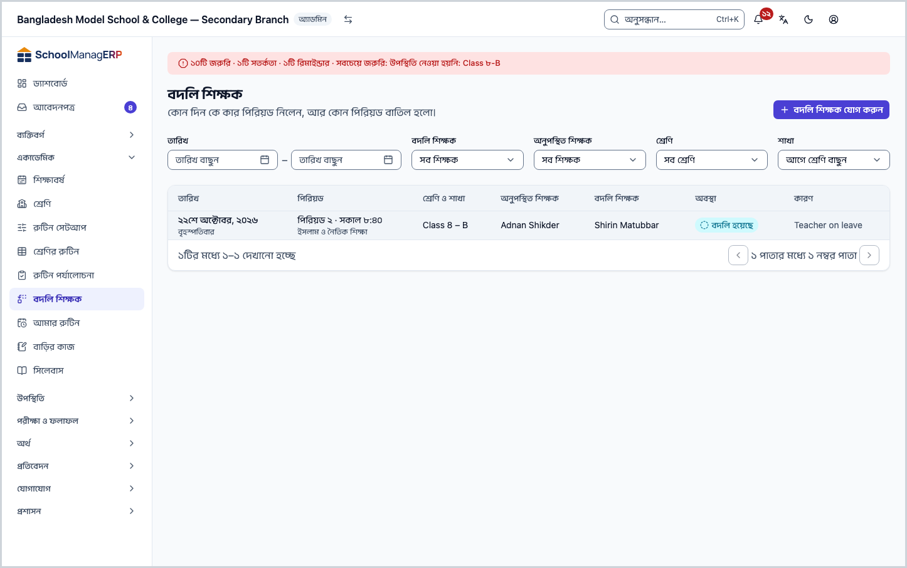
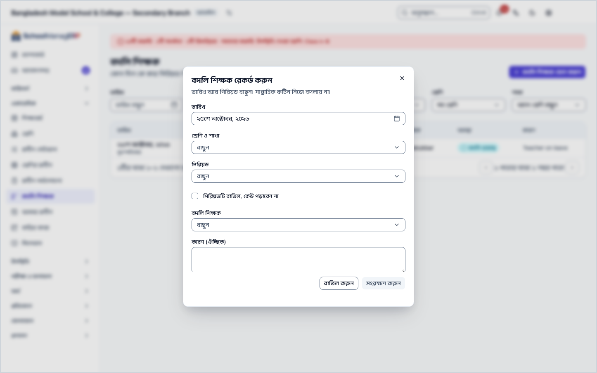

<!-- guide:meta
feature: academics.routineSubstitutions
title: বদলি শিক্ষক রেকর্ড করা
summary: কোনো শিক্ষক অনুপস্থিত হলে নির্দিষ্ট দিনের নির্দিষ্ট পিরিয়ডে বদলি শিক্ষক দিন বা পিরিয়ডটি বাতিল করুন; সাপ্তাহিক রুটিন বদলায় না। আগের বদলির তালিকা ছেঁকে দেখুন।
roles: [ADMIN]
sources:
  - client-admin/src/routes/_staff/routines/substitutions.tsx
  - client-admin/src/routes/_staff/routines/-substitution-dialog.tsx
  - client-admin/src/route-permissions.ts
  - server/src/modules/routines/substitutions.controller.ts
  - server/src/modules/routines/substitutions.service.ts
  - server/src/modules/routines/teacher-busy.service.ts
  - server/src/modules/routines/resolve-routine.service.ts
labels:
  [
    routines:substitutionsPage.*,
    routines:substitutionDialog.*,
    routines:agenda.periodLabel,
    nav:items.routineSubstitutions,
    nav:groups.academics,
  ]
helpIds:
  [
    academics.routineSubstitutions,
    academics.routineSubstitutions.action.add,
    academics.routineSubstitutions.field.cancelled,
    academics.routineSubstitutions.field.substituteTeacher,
  ]
devices: [desktop]
entry: [sidebar, palette]
keywords:
  [বদলি, বদলি শিক্ষক, অনুপস্থিত শিক্ষক, পিরিয়ড বাতিল, প্রক্সি, প্রক্সি ক্লাস, substitute, substitution, cover, proxy, cancel period]
appVersion: 0.1.0 (e81ef857f)
owner: tareq89
lastVerified: 2026-10-24
knownIssues: []
-->

# বদলি শিক্ষক রেকর্ড করা

কোনো শিক্ষক কোনো দিন অনুপস্থিত হলে তাঁর পিরিয়ডে অন্য একজন শিক্ষক দিন, অথবা পিরিয়ডটি বাতিল করুন।

**যেতে হবে:** বাম মেনুতে **একাডেমিক → বদলি শিক্ষক**। এই পাতার কাজ কম্পিউটারে করুন।
**শুরুর আগে:** আপনি স্কুলের অ্যাডমিন হবেন ([কে কী করতে পারেন](#roles))। চলতি শিক্ষাবর্ষের রুটিনে সেই শাখার পিরিয়ড বসানো থাকতে হবে: [**শ্রেণির সাপ্তাহিক রুটিন সাজানো**](routine-builder.md)।

এই পাতায় **বদলি শিক্ষকের তালিকা** নিয়ে কাজ: কোন দিন কে কার পিরিয়ড নিলেন, আর কোন পিরিয়ড বাতিল হলো। একটি বদলি শুধু একটি তারিখের একটি পিরিয়ডের জন্য। সাপ্তাহিক রুটিন যেমন ছিল তেমনই থাকে; স্থায়ীভাবে শিক্ষক বদলাতে [শ্রেণির রুটিন](routine-builder.md#task-clear) থেকে ঘর বদলান।

[বদলি শিক্ষক দিন](#task-main) · [পিরিয়ড বাতিল করুন](#task-cancel) · [তালিকা ছাঁকুন](#task-filter) · [সমস্যা ও সমাধান](#trouble)

**এই পাতায় যা আছে**

- [বদলি শিক্ষক দিন](#task-main)
- [বদলি রেকর্ড হয়েছে কি না বুঝবেন কীভাবে](#confirm)
- [অন্য পরিস্থিতিতে](#other)
  - [পিরিয়ড বাতিল করুন](#task-cancel)
  - [ভুল বদলি ঠিক করুন](#task-correct)
  - [তালিকা ছাঁকুন](#task-filter)
- [সমস্যা ও সমাধান](#trouble)
- [কে কী করতে পারেন](#roles)
- [আরও জানুন](#more)

---

## বদলি শিক্ষক দিন 

1. বাম মেনুতে **একাডেমিক → বদলি শিক্ষক** চাপুন।

   → উপরে **বদলি শিক্ষক**, নিচে "কোন দিন কে কার পিরিয়ড নিলেন, আর কোন পিরিয়ড বাতিল হলো।" তার নিচে ছাঁকনি আর তালিকা।

2. উপরে **বদলি শিক্ষক যোগ করুন** চাপুন।

   → **বদলি শিক্ষক রেকর্ড করুন** ঘর খোলে: "তারিখ আর পিরিয়ড বাছুন। সাপ্তাহিক রুটিন নিজে বদলায় না।" **তারিখ** ঘরে আজকের তারিখ বসানো থাকে।

3. দরকার হলে **তারিখ** বদলান।

4. **শ্রেণি ও শাখা** ঘর থেকে শাখা বেছে নিন।

   → তালিকায় শুধু সেই শাখাগুলো, যাদের রুটিনে ওই তারিখে পিরিয়ড চালু আছে।

5. **পিরিয়ড** ঘর থেকে পিরিয়ড বেছে নিন। প্রতিটির পাশে লেখা থাকে পিরিয়ড · সময় · বিষয় · শিক্ষক।

   → শুধু ওই বারের পিরিয়ড আসে। কিছু না থাকলে **{বার} শাখাটির কোনো পিরিয়ড নেই।** দেখায়।

6. **বদলি শিক্ষক** ঘর থেকে যিনি পড়াবেন তাঁকে বেছে নিন।

   → পিরিয়ডের নিজের শিক্ষকরা এই তালিকায় আসেন না।

7. চাইলে **কারণ (ঐচ্ছিক)** লিখুন, যেমন `অসুস্থতার ছুটি` (২৮০ অক্ষর পর্যন্ত)।

8. **সংরক্ষণ করুন** চাপুন।

   → ঘর বন্ধ হয়, **সংরক্ষিত হয়েছে** বার্তা আসে, আর তালিকায় নতুন সারি আসে, **অবস্থা** ঘরে **বদলি হয়েছে**।

| আপনি চাপলেন      | কী হবে                                                                                                                                     | জমা হলো? |
| ---------------- | ------------------------------------------------------------------------------------------------------------------------------------------ | -------- |
| **সংরক্ষণ করুন** | সেই দিনের পিরিয়ডটি বদলি শিক্ষকের নামে যায়। তিনি সেদিন [আমার রুটিন](my-routine.md)-এ পিরিয়ডটি দেখেন, লেখা থাকে "{নাম}-এর বদলে পড়াচ্ছেন" | হ্যাঁ    |
| **বাতিল করুন**   | কিছুই রেকর্ড হয় না                                                                                                                        | না       |

> **মনে রাখুন:** **সংরক্ষণ করুন** না চাপা পর্যন্ত কিছুই সিস্টেমে যায় না। তারিখ, পিরিয়ড আর বদলি শিক্ষক (বা বাতিলের টিক) না বাছা পর্যন্ত বোতাম বন্ধ থাকে। বদলি শিক্ষক সেই সময়ে অন্য কোনো পিরিয়ডে ব্যস্ত থাকলে সংরক্ষণ হয় না।

---

## বদলি রেকর্ড হয়েছে কি না বুঝবেন কীভাবে 

বদলি শুধু ইন্টারনেট থাকলে সংরক্ষিত হয়। তাই **এই ডিভাইসে সংরক্ষিত** অবস্থা এখানে নেই।

| অবস্থা                       | কীভাবে বুঝবেন                                         | এরপর কী                            |
| ---------------------------- | ----------------------------------------------------- | ---------------------------------- |
| **শুধু স্ক্রিনে বদলেছে**     | **বদলি শিক্ষক রেকর্ড করুন** ঘর খোলা                   | **সংরক্ষণ করুন** চাপুন             |
| **স্কুলের সিস্টেমে পৌঁছেছে** | **সংরক্ষিত হয়েছে** বার্তা এসেছে, তালিকায় সারিটি আছে | কাজ শেষ। বদলি শিক্ষককে জানিয়ে দিন |

**যাচাই করতে চাইলে:** **তারিখ** ছাঁকনিতে সেই দিনটি দিন, অথবা **বদলি শিক্ষক** ছাঁকনিতে তাঁর নাম বেছে নিন। সারিটি এলে সিস্টেমে আছে।

**বার্তা না এলে:** ঘরের নিচে লাল লেখা দেখুন, তারপর [সমস্যা ও সমাধান](#trouble)। ঘরের বাছাই হারায় না।

---

## অন্য পরিস্থিতিতে 

### পিরিয়ড বাতিল করুন 

কেউ পড়াবেন না, এমন হলে:

1. **বদলি শিক্ষক যোগ করুন** চাপুন। **তারিখ**, **শ্রেণি ও শাখা** আর **পিরিয়ড** বেছে নিন (উপরের ধাপ ৩–৫)।

2. **পিরিয়ডটি বাতিল, কেউ পড়াবেন না** টিক দিন।

   → **বদলি শিক্ষক** ঘর সরে যায়।

3. চাইলে **কারণ (ঐচ্ছিক)** লিখে **সংরক্ষণ করুন** চাপুন।

   → তালিকায় সারির **অবস্থা** ঘরে **পিরিয়ড বাতিল**। শিক্ষকের আমার রুটিনে সেদিনের পিরিয়ডে **হয়নি · বাতিল** দেখায়, আর তাঁকে পিরিয়ডটি নিজে জানাতে হয় না।

### ভুল বদলি ঠিক করুন 

একই তারিখের একই পিরিয়ডের জন্য আবার **বদলি শিক্ষক যোগ করুন** দিয়ে রেকর্ড করুন। নতুনটি আগেরটির জায়গা নেয়; দুটি সারি হয় না। বাতিলকে বদলিতে, বা বদলিকে বাতিলে, এভাবেই বদলানো যায়। এটা চলে শুধু আজ বা পরের কোনো তারিখের জন্য: আগের তারিখের বদলি রেকর্ডের অংশ, তার উপর আবার জমা হয় না (দেখায় **সংরক্ষণ করা যায়নি — আবার চেষ্টা করুন।**)।

একটি সারি পুরোপুরি মুছতে তালিকায় সারির শেষে **মুছুন** চাপুন। **{তারিখ} তারিখের বদলি মুছবেন?** ঘরে লেখা থাকে: "সেই তারিখে পিরিয়ডটি আবার নিয়মিত শিক্ষকের কাছে ফিরে যাবে।" **মুছুন** চাপুন; **মুছে ফেলা হয়েছে** বার্তা আসে। **মোছা যায়নি — আবার চেষ্টা করুন।** এলে সারিটি থেকে যায়; ইন্টারনেট দেখে আবার চেষ্টা করুন। আগের তারিখের বদলি মোছা যায় না: সেই সারিতে **মুছুন** বোতামই থাকে না, কারণ তা রেকর্ডের অংশ।

### তালিকা ছাঁকুন 

| ছাঁকনি               | কী বাছবেন                                                                   |
| -------------------- | --------------------------------------------------------------------------- |
| **তারিখ**            | **থেকে** আর **পর্যন্ত** দুটি তারিখ                                          |
| **বদলি শিক্ষক**      | যিনি পড়িয়েছেন। না বাছলে **সব শিক্ষক**                                     |
| **অনুপস্থিত শিক্ষক** | যাঁর পিরিয়ড ছিল। না বাছলে **সব শিক্ষক**                                    |
| **শ্রেণি**           | একটি শ্রেণি। না বাছলে **সব শ্রেণি**                                         |
| **শাখা**             | আগে শ্রেণি বাছতে হয় (**আগে শ্রেণি বাছুন**); তারপর একটি শাখা বা **সব শাখা** |

তালিকার কলাম: **তারিখ**, **পিরিয়ড**, **শ্রেণি ও শাখা**, **অনুপস্থিত শিক্ষক**, **বদলি শিক্ষক**, **অবস্থা**, **কারণ**। নতুন তারিখ আগে। কিছু না মিললে **কোনো বদলি শিক্ষক নেই**, আর **ফিল্টার মুছুন** চাপলে সব ছাঁকনি সরে যায়।

> **মনে রাখুন:** ছাঁকনি শুধু দেখার জন্য; এতে কোনো রেকর্ড বদলায় না।

---

## সমস্যা ও সমাধান 

| আপনি যা দেখছেন                                                                                                                            | কী করবেন                                                                                                                                              | কে সাহায্য করতে পারেন |
| ----------------------------------------------------------------------------------------------------------------------------------------- | ----------------------------------------------------------------------------------------------------------------------------------------------------- | --------------------- |
| **এই শিক্ষাবর্ষের এখনো কোনো রুটিন নেই।**                                                                                                  | আগে রুটিন সাজান: [শ্রেণির রুটিন](routine-builder.md)।                                                                                                 | অ্যাডমিন              |
| **আগে তারিখ বাছুন।**                                                                                                                      | **তারিখ** ঘরে একটি তারিখ দিন।                                                                                                                         | অ্যাডমিন              |
| **{বার} শাখাটির কোনো পিরিয়ড নেই।**                                                                                                       | তারিখটি ঠিক কি না দেখুন; ওই বারে শাখাটির রুটিনে পিরিয়ড নেই।                                                                                          | অ্যাডমিন              |
| **বেছে নেওয়া তারিখে এই পিরিয়ডটি হয় না (এটি হয়তো দুই সপ্তাহে বা মাসে একবার হয়)। অন্য তারিখ বাছুন।**                                   | পিরিয়ডটি দ্বি-সাপ্তাহিক বা মাসিক; যে সপ্তাহে হয়, সেই তারিখ বাছুন।                                                                                   | অ্যাডমিন              |
| **এই শিক্ষকই এই পিরিয়ডটি পড়ান। অন্য কাউকে বেছে নিন।**                                                                                   | যাঁকে বেছেছেন তিনিই পিরিয়ডটির নিজের শিক্ষক। অন্য শিক্ষক বাছুন।                                                                                       | অ্যাডমিন              |
| **এই শিক্ষকের {শুরু} থেকে {শেষ} পর্যন্ত অন্য ক্লাস আছে। অন্য কাউকে বেছে নিন।** বা **এই শিক্ষক সেই সময়ে ফাঁকা নেই। অন্য কাউকে বেছে নিন।** | বদলি শিক্ষক সেই সময় ব্যস্ত। অন্য শিক্ষক বাছুন।                                                                                                       | অ্যাডমিন              |
| **সংরক্ষণ করা যায়নি — আবার চেষ্টা করুন।**                                                                                                | ইন্টারনেট দেখে আবার **সংরক্ষণ করুন** চাপুন। আগের তারিখের কোনো বদলির উপর আবার রেকর্ড করতে চাইলে তা বদলানো যায় না: [ভুল বদলি ঠিক করুন](#task-correct)। | অ্যাডমিন              |
| কোনো সারিতে **মুছুন** বোতাম নেই                                                                                                           | তারিখটি আজকের আগের। কে পিরিয়ডটি নিয়েছিলেন, তার রেকর্ড হিসেবে সারিটি থেকে যায়।                                                                      | —                     |
| **বদলি শিক্ষকের তালিকা আনা যায়নি। সংযোগ দেখে আবার চেষ্টা করুন।**                                                                         | ইন্টারনেট দেখে আবার চেষ্টা করুন।                                                                                                                      | অ্যাডমিন              |
| **শ্রেণি ও শাখা** তালিকায় শাখাটি নেই                                                                                                     | ওই তারিখে শাখার কোনো পিরিয়ড চালু নেই। তারিখ দেখুন।                                                                                                   | অ্যাডমিন              |

---

## কে কী করতে পারেন 

| ভূমিকা                                                                                           | বদলির তালিকা দেখতে | বদলি দিতে বা পিরিয়ড বাতিল করতে |
| ------------------------------------------------------------------------------------------------ | ------------------ | ------------------------------- |
| অ্যাডমিন                                                                                         | হ্যাঁ              | হ্যাঁ                           |
| একাডেমিক কো-অর্ডিনেটর, শিক্ষক, হিসাবরক্ষক, অফিস সহকারী, পরীক্ষা নিয়ন্ত্রক, পরিচালনা পর্ষদ সদস্য | না                 | না                              |

বদলি শিক্ষক নিজের বদলির পিরিয়ড দেখেন [**আমার রুটিন**](my-routine.md) পাতায়। যাঁদের অনুমতি নেই, তাঁদের বাম মেনুতে **বদলি শিক্ষক** থাকে না।

---

## আরও জানুন 

<strong>বদলি কীভাবে কাজ করে</strong> — শুধু একটি দিনের জন্য

<figure>
  
  <figcaption><em>একদিনের বদলি, সাপ্তাহিক রুটিন অপরিবর্তিত</em></figcaption>
</figure>

- বদলি দেওয়া যায় শুধু রুটিনে সত্যি যেদিন পিরিয়ডটি হয়, সেদিনের জন্য। দ্বি-সাপ্তাহিক বা মাসিক পিরিয়ডে ভুল সপ্তাহ বাছলে আটকে যায়।
- বদলি শিক্ষক একই সময়ে অন্য পিরিয়ডে থাকলে বদলি হয় না।

<strong>ঘরগুলোর সংক্ষিপ্ত সাহায্য (? বোতাম)</strong>

<!-- guide:generated:fields:routines -->

| ঘর                                        | কী লিখবেন                                                                                                                                    | বাধ্যতামূলক?                |
| ----------------------------------------- | -------------------------------------------------------------------------------------------------------------------------------------------- | --------------------------- |
| পড়ানোর অবস্থা                            | প্রতিটি পিরিয়ডের জন্য "পড়ানো হয়েছে", "আংশিক" বা "হয়নি" বাছুন। "হয়নি" বাছলে কারণ জানতে চায়।                                             | হ্যাঁ                       |
| কারণ (হয়নি)                              | শিক্ষক অনুপস্থিত, স্কুল বন্ধ, পরীক্ষা বা অন্য। "অন্য" বাছলে এক লাইনে লিখুন। পাঠটি পরের পিরিয়ডে চলে যায়।                                    | হ্যাঁ, পড়ানো না হলে        |
| শিক্ষক                                    | এই পিরিয়ডের জন্য এক বা একাধিক শিক্ষক।                                                                                                       | হ্যাঁ                       |
| পুনরাবৃত্তি                               | প্রতি সপ্তাহে, এক সপ্তাহ পরপর (১ম বা ২য় সপ্তাহ বাছুন) অথবা মাসে একবার (মাসে নির্বাচিত বারটির ১ম, ২য়, ৩য়, ৪র্থ, ৫ম বা শেষ উপস্থিতি বাছুন)। | হ্যাঁ                       |
| পিরিয়ডের মাঝের বিরতি (মিনিট)             | ০ থেকে ১২০। নতুন পিরিয়ডের সারি আগেরটি শেষ হওয়ার এত মিনিট পরে শুরু হয়।                                                                     | না                          |
| এক শিক্ষক দিনে সর্বোচ্চ কয় পিরিয়ড নেবেন | ১ বা তার বেশি; ফাঁকা রাখলে কোনো সীমা নেই। সীমা ছাড়ালে রুটিন সেভ হয় না।                                                                     | না                          |
| পরপর সর্বোচ্চ কয় পিরিয়ড                 | ১ বা তার বেশি; ফাঁকা রাখলে কোনো সীমা নেই। সীমা ছাড়ালেও সেভ হয়, শুধু সতর্কতা দেখায়।                                                        | না                          |
| পিরিয়ড বাতিল                             | সেই তারিখে কেউ পড়াবেন না হলে টিক দিন। সাপ্তাহিক রুটিন নিজে বদলায় না।                                                                       | না                          |
| বদলি শিক্ষক                               | সেই তারিখে পিরিয়ডটি কে পড়াবেন। আগে থেকে নির্ধারিত শিক্ষক বা ওই সময়ে অন্য ক্লাস থাকা শিক্ষক হতে পারবেন না।                                 | হ্যাঁ, পিরিয়ড বাতিল না হলে |
| শিফটের নাম                                | শিফটের নাম, যেমন সকাল বা দিন।                                                                                                                | হ্যাঁ                       |
| দিন শুরু                                  | এই শিফটে স্কুলের দিন কখন শুরু হয়। নতুন শিফটে আগে থেকে ৮:০০ বসানো থাকে।                                                                      | হ্যাঁ                       |
| দিন শেষ                                   | এই শিফটে স্কুলের দিন কখন শেষ হয়। শুরুর সময়ের পরে হতে হবে। নতুন শিফটে আগে থেকে ১৬:০০ বসানো থাকে।                                            | হ্যাঁ                       |
| কক্ষ নং                                   | কক্ষের নম্বর বা নাম, যেমন ১০১। অবশ্যই দিতে হবে।                                                                                              | হ্যাঁ                       |

<!-- /guide:generated -->

**সম্পর্কিত পাতা**

- [**শ্রেণির সাপ্তাহিক রুটিন সাজানো**](routine-builder.md) — স্থায়ী বদল সেখানে; এখানে শুধু একদিনের।
- [**আমার রুটিন দেখা ও পিরিয়ড জানানো**](my-routine.md) — বদলি শিক্ষক সেদিনের পিরিয়ড সেখানে দেখেন।
- [**কর্মীর উপস্থিতি ও ছুটি**](../attendance/staff-attendance.md) — শিক্ষক ছুটিতে থাকলে বদলি লাগে।

---

_সংস্করণ ০.১.০ · শেষ যাচাই ২০২৬-১০-২৪_
