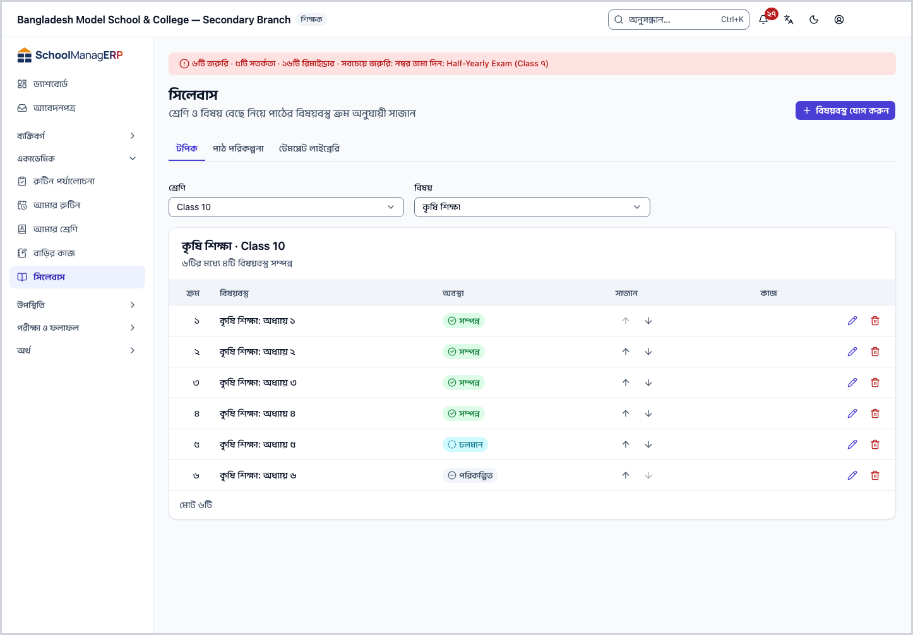
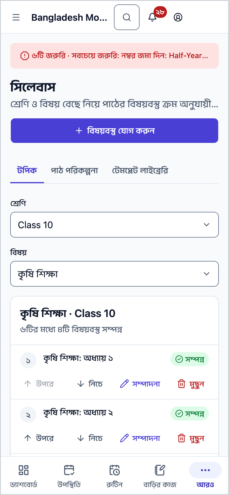
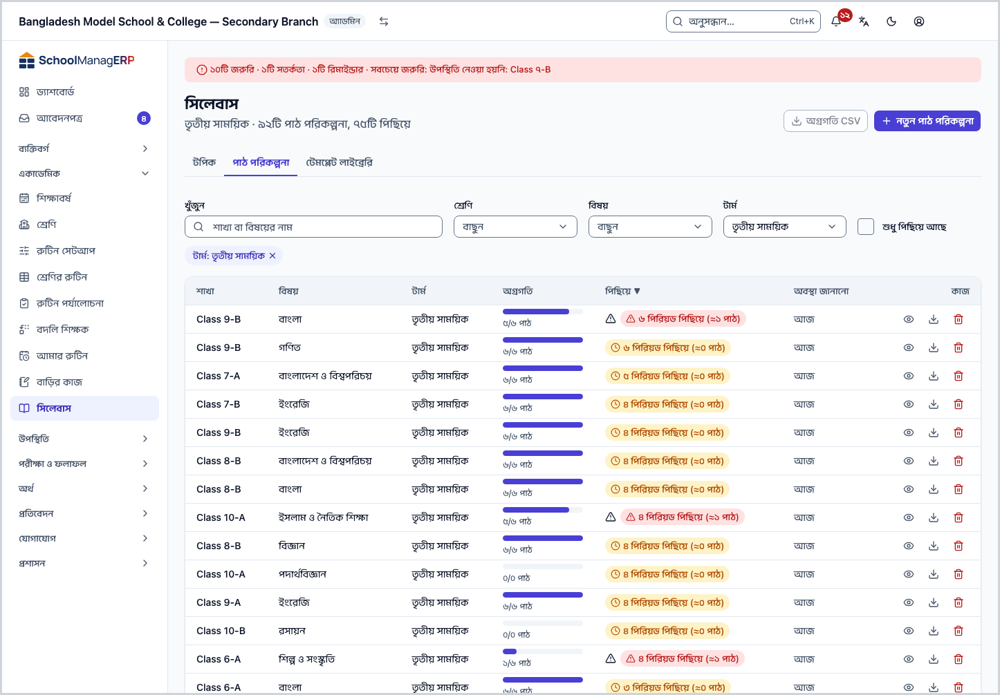
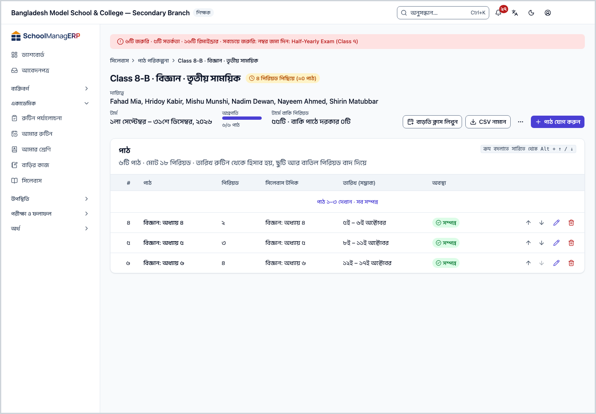
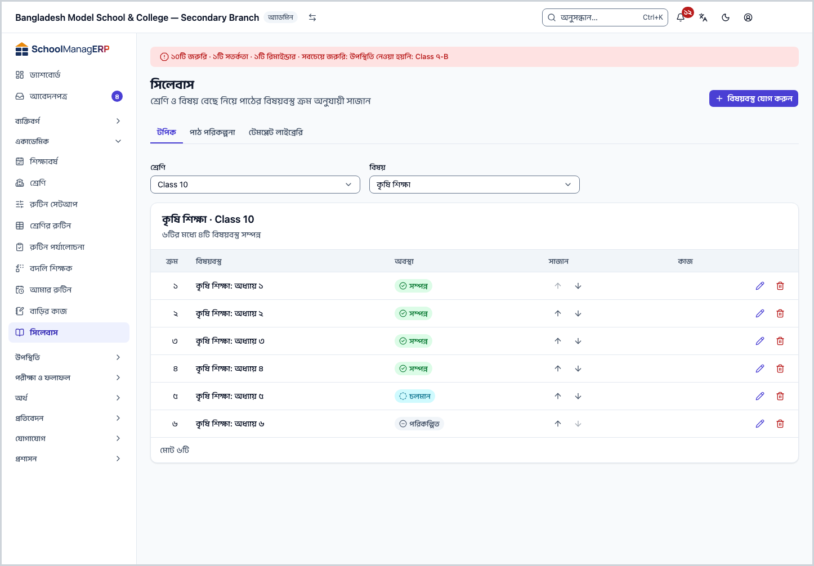

<!-- guide:meta
feature: academics.syllabus
title: সিলেবাস ও পাঠ পরিকল্পনা
summary: শ্রেণি ও বিষয়ের সিলেবাস টপিক ক্রমে সাজান, প্রতিটি শাখার বিষয়ের জন্য পাঠ পরিকল্পনা বানান, আর দেখুন কোন শাখা পিছিয়ে আছে।
roles: [ADMIN, TEACHER, EXECUTIVE]
sources:
  - client-admin/src/routes/_staff/academics/syllabus/index.tsx
  - client-admin/src/routes/_staff/academics/syllabus/-topics-tab.tsx
  - client-admin/src/routes/_staff/academics/syllabus/-syllabus-topic-form.tsx
  - client-admin/src/routes/_staff/academics/syllabus/-plans-tab.tsx
  - client-admin/src/routes/_staff/academics/syllabus/-create-plan/create-plan-wizard.tsx
  - client-admin/src/routes/_staff/academics/syllabus/-library/library-tab.tsx
  - client-admin/src/routes/_staff/academics/study-plans/$planId.tsx
  - server/src/modules/homework/syllabus.controller.ts
  - server/src/modules/homework/syllabus.service.ts
  - server/src/modules/study-plans/study-plans.controller.ts
  - server/src/modules/study-plans/study-plans.service.ts
  - server/src/modules/study-plans/study-plan-templates.controller.ts
  - server/src/modules/study-plans/lesson-deliveries.service.ts
labels:
  [
    syllabus:list.*,
    syllabus:form.*,
    syllabus:tabs.*,
    syllabus:topics.*,
    studyPlans:list.*,
    studyPlans:create.*,
    studyPlans:library.*,
    studyPlans:detail.*,
    studyPlans:lesson.*,
    studyPlans:actions.*,
    studyPlans:extra.*,
    studyPlans:copy.*,
    studyPlans:markers.*,
    studyPlans:owner.*,
    nav:items.syllabus,
    nav:groups.academics,
    common:accessDenied.*,
  ]
helpIds:
  [
    academics.syllabus,
    academics.syllabus.action.deleteTopic,
    academics.syllabus.action.createPlan,
    academics.syllabus.action.deletePlan,
    academics.syllabus.action.copyToSection,
    academics.syllabus.field.topicStatus,
    academics.syllabus.field.term,
    academics.syllabus.field.periods,
    academics.syllabus.action.addTemplate,
    academics.syllabus.action.addTemplateCsv,
    academics.syllabus.action.copyToMine,
  ]
devices: [desktop, phone]
entry: [sidebar, palette]
keywords:
  [সিলেবাস, টপিক, বিষয়বস্তু, পাঠ পরিকল্পনা, পাঠ, পিছিয়ে, টেমপ্লেট, বাড়তি ক্লাস, পরীক্ষার সিলেবাস, syllabus, topic, study plan, lesson plan, template, behind]
appVersion: 0.1.0 (e424f8fc4)
owner: tareq89
lastVerified: 2026-10-24
knownIssues: []
-->

# সিলেবাস ও পাঠ পরিকল্পনা

একটি শ্রেণির একটি বিষয়ে কী কী পড়ানো হবে তা ক্রমে সাজান, আর প্রতিটি শাখায় কবে কোন পাঠ হবে তার পরিকল্পনা রাখুন।

**যেতে হবে:** বাম মেনুতে **একাডেমিক → সিলেবাস**। ফোনেও চলে।
**শুরুর আগে:** শ্রেণিতে বিষয় আর শাখা থাকতে হবে ([শ্রেণি, শাখা ও বিষয়](classes.md))। পাঠের তারিখ দেখতে শ্রেণির রুটিন প্রকাশিত থাকতে হবে।

পাতায় তিনটি ট্যাব। **টপিক** ট্যাবে শ্রেণি ও বিষয়ের সিলেবাস: বিষয়বস্তুর তালিকা, ক্রম অনুযায়ী। **পাঠ পরিকল্পনা** ট্যাবে প্রতিটি শাখার প্রতিটি বিষয়ের পাঠের তালিকা; তারিখ আসে রুটিন থেকে, তাই কোন শাখা পিছিয়ে আছে তা দেখা যায়। **টেমপ্লেট লাইব্রেরি** ট্যাবে স্কুলের তৈরি পাঠ পরিকল্পনার ছাঁচ, যা কপি করে নতুন পরিকল্পনা বানানো যায়।

[টপিক যোগ করুন](#task-main) · [পাঠ পরিকল্পনা বানান](#task-plan-create) · [পরিকল্পনায় পাঠ সাজান](#task-plan-detail) · [সমস্যা ও সমাধান](#trouble)

**এই পাতায় যা আছে**

- [এই পাতায় যেভাবে আসবেন](#arrive)
- [সিলেবাসে টপিক যোগ করুন](#task-main)
- [টপিক জমা হয়েছে কি না বুঝবেন কীভাবে](#confirm)
- [অন্য পরিস্থিতিতে](#other)
  - [টপিকের ক্রম, অবস্থা বদলান বা মুছুন](#task-topic-edit)
  - [পাঠ পরিকল্পনা: কোন শাখা পিছিয়ে](#task-plans)
  - [নতুন পাঠ পরিকল্পনা বানান](#task-plan-create)
  - [পরিকল্পনার পাতায় পাঠ সাজান](#task-plan-detail)
  - [বাড়তি ক্লাস, অন্য শাখায় কপি, পরীক্ষার চিহ্ন](#task-plan-actions)
  - [টেমপ্লেট লাইব্রেরি](#task-library)
- [সমস্যা ও সমাধান](#trouble)
- [কে কী করতে পারেন](#roles)
- [আরও জানুন](#more)

---

## এই পাতায় যেভাবে আসবেন 

**বাম মেনু থেকে:** **একাডেমিক → সিলেবাস** চাপুন। পাতা খোলে **টপিক** ট্যাবে।

**খোঁজার ঘর থেকে:** উপরের খোঁজার ঘরে (Ctrl+K) **সিলেবাস** লিখে বেছে নিন। খোঁজার নিয়ম: [যেকোনো পাতা খুঁজে পাওয়া](../start/find-anything.md)।

**পরিকল্পনার লিংক থেকে:** কেউ একটি পাঠ পরিকল্পনার লিংক পাঠালে সরাসরি সেই পরিকল্পনার পাতা খোলে ([পরিকল্পনার পাতায় পাঠ সাজান](#task-plan-detail))।

---

## সিলেবাসে টপিক যোগ করুন 

1. বাম মেনুতে **একাডেমিক → সিলেবাস** চাপুন।

   → উপরে **সিলেবাস** শিরোনাম, নিচে লেখা **শ্রেণি ও বিষয় বেছে নিয়ে পাঠের বিষয়বস্তু ক্রম অনুযায়ী সাজান**। **টপিক** ট্যাব খোলা, আর লেখা **সিলেবাস দেখতে একটি শ্রেণি ও বিষয় নির্বাচন করুন।**

2. **শ্রেণি** আর **বিষয়** বাছুন।

   → নিচে ওই শ্রেণি-বিষয়ের টপিক তালিকা আসে: **ক্রম**, **বিষয়বস্তু**, **অবস্থা**। উপরে অগ্রগতি, যেমন **১২টির মধ্যে ৫টি বিষয়বস্তু সম্পন্ন**। কিছু না থাকলে **এখনো কোনো বিষয়বস্তু নেই**।

3. উপরে **বিষয়বস্তু যোগ করুন** চাপুন। শ্রেণি আর বিষয় দুটোই বাছা না থাকলে বোতামটি আসে না।

   → **বিষয়বস্তু যোগ করুন** নামে ছোট জানালা খোলে।

4. **নাম** লিখুন, যেমন `অধ্যায় ৩: ভগ্নাংশ`। চাইলে **বিবরণ** লিখুন।

   → নাম ফাঁকা রাখলে **একটি বিষয়বস্তুর নাম লিখুন।** দেখায়।

5. **অবস্থা** দেখে নিন: **পরিকল্পিত**, **চলমান** বা **সম্পন্ন**। শুরুতে **পরিকল্পিত** বাছা থাকে।

6. **সংরক্ষণ করুন** চাপুন।

   → জানালা বন্ধ হয়, আর নতুন টপিক তালিকার সবার শেষে আসে।

**ফোনে** তালিকা টেবিলের বদলে একটির নিচে একটি সারি হয়ে দেখায়; প্রতি সারির নিচে **উপরে**, **নিচে**, **সম্পাদনা**, **মুছুন** বোতাম।

> **মনে রাখুন:** টপিক পুরো শ্রেণির জন্য, শাখা ধরে নয়। শিক্ষক শুধু সেই শ্রেণি-বিষয়ে টপিক যোগ করতে পারেন, যেখানে তিনি বিষয় শিক্ষক ([কে কী করতে পারেন](#roles))।

---

## টপিক জমা হয়েছে কি না বুঝবেন কীভাবে 

সিলেবাস শুধু ইন্টারনেট থাকলে জমা হয়; ডিভাইসে জমিয়ে রেখে পরে পাঠানো যায় না।

| অবস্থা                       | কীভাবে বুঝবেন                                         | এরপর কী                |
| ---------------------------- | ----------------------------------------------------- | ---------------------- |
| **শুধু স্ক্রিনে বদলেছে**     | **বিষয়বস্তু যোগ করুন** জানালা খোলা, ঘর পূরণ করা      | **সংরক্ষণ করুন** চাপুন |
| **স্কুলের সিস্টেমে পৌঁছেছে** | জানালা বন্ধ, টপিকটি তালিকায়, অগ্রগতির সংখ্যা বেড়েছে | কাজ শেষ                |

**জানালা বন্ধ না হলে:** জানালায় **কিছু ভুল হয়েছে। আবার চেষ্টা করুন।** দেখায়। [সমস্যা ও সমাধান](#trouble) দেখুন।

---

## অন্য পরিস্থিতিতে 

### টপিকের ক্রম, অবস্থা বদলান বা মুছুন 

- **ক্রম বদলাতে:** সারির **উপরে** বা **নিচে** তীর চাপুন। টপিক এক ঘর সরে যায়। না হলে **বিষয়বস্তু পুনর্বিন্যাস করা যায়নি। আবার চেষ্টা করুন।** দেখায়।
- **অবস্থা বা নাম বদলাতে:** **সম্পাদনা** চাপুন, **বিষয়বস্তু সম্পাদনা করুন** জানালায় বদলে **সংরক্ষণ করুন**।
- **মুছতে:** **মুছুন** চাপুন। অ্যাপ জিজ্ঞেস করে **"{নাম}" মুছবেন? এটি পূর্বাবস্থায় ফেরানো যাবে না।** আবার **মুছুন** চাপলে মুছে যায়।

| আপনি চাপলেন         | কী হবে                           | ফেরানো যায়?              |
| ------------------- | -------------------------------- | ------------------------- |
| **উপরে** / **নিচে** | পাশের টপিকের সঙ্গে জায়গা বদলায় | হ্যাঁ, উল্টো তীর চাপুন    |
| **সংরক্ষণ করুন**    | নাম, বিবরণ বা অবস্থা বদলায়      | হ্যাঁ, আবার সম্পাদনা করুন |
| **মুছুন**           | টপিক মুছে যায়                   | না                        |

পাঠ পরিকল্পনা থাকলে টপিকের নিচে ছোট লেখায় দেখায় কতটি শাখায় পড়ানো হয়েছে, যেমন **৪টি শাখার ২টিতে পড়ানো হয়েছে**।

### পাঠ পরিকল্পনা: কোন শাখা পিছিয়ে 

**পাঠ পরিকল্পনা** ট্যাব চাপুন। উপরে লেখা থাকে, যেমন **প্রথম টার্ম · ১৮টি পাঠ পরিকল্পনা, ৩টি পিছিয়ে**।

| কলাম              | কী দেখায়                                                                   |
| ----------------- | --------------------------------------------------------------------------- |
| **শাখা**          | শ্রেণি ও শাখা                                                               |
| **বিষয়**         | পরিকল্পনার বিষয়                                                            |
| **টার্ম**         | কোন টার্মের পরিকল্পনা, বা **পুরো বছর**                                      |
| **অগ্রগতি**       | কতটি পাঠ হয়েছে, যেমন **৭/২০ পাঠ**                                          |
| **পিছিয়ে**       | **সময়মতো**, বা যেমন **৩ পিরিয়ড পিছিয়ে (≈২ পাঠ)**                         |
| **অবস্থা জানানো** | শেষ কবে পিরিয়ড জানানো হয়েছে: **আজ**, **গতকাল**, বা যেমন **৩ দিন জানাননি** |

উপরে **খুঁজুন** (শাখা বা বিষয়ের নাম), **শ্রেণি**, **বিষয়**, **টার্ম** দিয়ে ছাঁকুন। **শুধু পিছিয়ে আছে** টিক দিলে শুধু পিছিয়ে থাকা পরিকল্পনা আসে। অ্যাডমিন আর একাডেমিক কো-অর্ডিনেটর একটি শ্রেণি আর টার্ম বেছে **অগ্রগতি CSV** চাপলে অগ্রগতি ফাইলে নামে; শ্রেণি বা টার্ম না বাছলে বোতাম কাজ করে না।

পাঠ কখন "হয়েছে" ধরা হয়: শিক্ষক তাঁর রুটিনের পিরিয়ডে পড়ানো হয়েছে কি না জানান। শিক্ষক ছুটিতে থাকলে আর বদলি না থাকলে, বা পিরিয়ড বাতিল হলে, অ্যাপ নিজেই ওই পিরিয়ড "পড়ানো হয়নি" হিসেবে লিখে রাখে। পিরিয়ড জানানো না হলে শিক্ষককে মনে করিয়ে দেওয়া হয়, আর বেশি দেরি হলে একাডেমিক কো-অর্ডিনেটর ও অ্যাডমিনকে জানানো হয়। কবে কতবার জানানো হয় তা স্কুলের সেটিং অনুযায়ী; অ্যাপে চালিয়ে দেখা হয়নি।

### নতুন পাঠ পরিকল্পনা বানান 

প্রতিটি শাখার প্রতিটি বিষয়ের প্রতি টার্মে একটি পরিকল্পনাই হয়।

1. **পাঠ পরিকল্পনা** ট্যাবে উপরে **নতুন পাঠ পরিকল্পনা** চাপুন।

   → **নতুন পাঠ পরিকল্পনা** খোলে, উপরে ধাপ: **শাখা · বিষয় · টার্ম**, **কীভাবে শুরু**, **প্রিভিউ**, **সংরক্ষণ**।

2. **শ্রেণি**, **শাখা**, **বিষয়** আর **টার্ম** বাছুন (টার্ম না থাকলে **পুরো বছর**)। **পরের ধাপ** চাপুন।

   → আগের টার্মে এই শাখা-বিষয়ের কিছু পাঠ বাকি থাকলে জিজ্ঞেস করে, যেমন **আগের টার্মের বাকি ৪টি পাঠ যোগ করবেন?** হ্যাঁ বললে সেগুলো নতুন পরিকল্পনার শুরুতে বসে।

3. **বাকি পাঠ কোথা থেকে আসবে?** বাছুন:
   - **খালি থেকে** — পরে একটি একটি করে পাঠ লিখবেন।
   - **লাইব্রেরি থেকে** — স্কুলের টেমপ্লেট কপি করে নিজের মতো বদলান।
   - **CSV থেকে** — Excel-এ লেখা ফাইল তুলুন। কলামের নমুনা পেতে **নমুনা নামান** চাপুন। কলাম চারটি: `title`, `periods`, `topic`, `notes`।

4. **প্রিভিউ**-তে কোন পাঠ রাখবেন **রাখুন** টিক দিয়ে বাছুন। পাঠ বেশি হলে লেখা আসে টার্মে আনুমানিক কতটি পিরিয়ড আছে আর পাঠগুলোতে কতটি লাগবে।

5. **পরিকল্পনা সংরক্ষণ করুন** চাপুন।

   → পরিকল্পনাটি তৈরি হয়, আর সরাসরি তার পাতা খোলে।

<figure>
  
  <figcaption><em>সংরক্ষণ চাপার আগে কিছুই জমা হয় না</em></figcaption>
</figure>

### পরিকল্পনার পাতায় পাঠ সাজান 

তালিকায় একটি পরিকল্পনা খুললে তার পাতা আসে। উপরে **দায়িত্বে** (কোন শিক্ষক), **টার্ম**, **অগ্রগতি**, আর **টার্মে বাকি পিরিয়ড**। নিচে **পাঠ** তালিকা: **#**, **পাঠ**, **পিরিয়ড**, **সিলেবাস টপিক**, **তারিখ (সম্ভাব্য)**, **অবস্থা** (**সম্পন্ন**, **চলছে**, **আসছে**)।

তারিখ অ্যাপ নিজে হিসাব করে, রুটিন থেকে, ছুটি আর বাতিল পিরিয়ড বাদ দিয়ে। রুটিন প্রকাশ না হলে লেখা আসে **শ্রেণির রুটিন প্রকাশ হলে তারিখ দেখা যাবে।** টার্মে না কুলালে পাঠের পাশে **এই টার্মে কুলাবে না**।

- **পাঠ যোগ করতে:** **পাঠ যোগ করুন** চাপুন। **পাঠের নাম** আর **কত পিরিয়ড লাগবে** লিখুন (১ থেকে ২০); চাইলে **সিলেবাস টপিক** আর **নোট বা লিংক**।
- **ক্রম বদলাতে:** সারির তীর চাপুন, বা সারিতে থেকে Alt + ↑ / ↓।
- **পাঠ মুছতে:** **পাঠ মুছুন** চাপুন। অ্যাপ জিজ্ঞেস করে, আর মুছলে পরের পাঠগুলো এক ধাপ উপরে ওঠে।

একটি পরিকল্পনায় সর্বোচ্চ ৪০০টি পাঠ রাখা যায়।

### বাড়তি ক্লাস, অন্য শাখায় কপি, পরীক্ষার চিহ্ন 

পরিকল্পনার পাতার উপরের বোতামগুলো:

| বোতাম                          | কী করে                                                                                                  | কে দেখেন                        |
| ------------------------------ | ------------------------------------------------------------------------------------------------------- | ------------------------------- |
| **বাড়তি ক্লাস লিখুন**         | রুটিনের বাইরে নেওয়া একটি ক্লাস লিখে রাখে: **তারিখ**, **পিরিয়ড**, **নোট**                              | যিনি পরিকল্পনা বদলাতে পারেন     |
| **CSV নামান**                  | পাঠের তালিকা ফাইলে নামায়; পরে **CSV থেকে** শুরুতে কাজে লাগে                                            | সবাই                            |
| **অন্য শাখায় কপি**            | একই বছরের অন্য শাখায় একই পাঠ তালিকা কপি করে                                                            | যিনি পরিকল্পনা বদলাতে পারেন     |
| **লাইব্রেরিতে রাখুন**          | এই পাঠ তালিকা টেমপ্লেট হিসেবে লাইব্রেরিতে রাখে                                                          | অ্যাডমিন, একাডেমিক কো-অর্ডিনেটর |
| **পরীক্ষার সিলেবাস চিহ্ন দিন** | কোন পরীক্ষার সিলেবাস কোন পাঠ পর্যন্ত তা চিহ্ন দেয়; তালিকায় দেখায় **{পরীক্ষা}-এর সিলেবাস এই পর্যন্ত** | যিনি পরিকল্পনা বদলাতে পারেন     |
| **দায়িত্ব বদলান**             | পরিকল্পনার দায়িত্ব **রুটিনের শিক্ষক** থেকে **নির্দিষ্ট শিক্ষক**-এ দেয়                                 | শুধু অ্যাডমিন                   |
| **পরিকল্পনা মুছুন**            | পাঠের তালিকা মুছে দেয়; জানানো পিরিয়ড থেকে যায়                                                        | যিনি পরিকল্পনা বদলাতে পারেন     |

- **বাড়তি ক্লাস:** ৭ দিনের বেশি পুরনো দিনের জন্য শিক্ষক লিখতে পারেন না, শুধু অ্যাডমিন। রুটিনেই ওই পিরিয়ডে বিষয়টি থাকলে বাড়তি ক্লাস নয়, **আমার রুটিন** থেকে জানাতে বলে।
- **অন্য শাখায় কপি:** শিক্ষক শুধু সেই শাখায় কপি করতে পারেন যেখানে তিনি বিষয়টি পড়ান। ওই শাখায় এই টার্মের পরিকল্পনা আগে থেকে থাকলে কপি হয় না।
- **পরিকল্পনা মুছুন:** অ্যাপ জিজ্ঞেস করে **{শাখা}-এর পাঠ পরিকল্পনা মুছবেন? জানানো পিরিয়ড থাকবে, পাঠের তালিকা মুছে যাবে।** এই অ্যাপ থেকে ফেরানো যায় না।

### টেমপ্লেট লাইব্রেরি 

**টেমপ্লেট লাইব্রেরি** ট্যাবে স্কুলের পাঠ পরিকল্পনার ছাঁচ, শ্রেণি আর বিষয় কোড ধরে সাজানো, যাতে প্রতি বছর কাজে লাগে। কলাম: **বিষয় · কোড**, **টেমপ্লেটের নাম**, **পাঠ**, **পিরিয়ড**, **শেষ হালনাগাদ**।

- **দেখতে:** সারিতে **দেখুন** চাপলে পাঠগুলো দেখায়।
- **নিজের পরিকল্পনা বানাতে:** **আমার পরিকল্পনায় কপি করুন** চাপুন। [নতুন পাঠ পরিকল্পনা](#task-plan-create) খোলে, টেমপ্লেট বাছা অবস্থায়। কপি আলাদা; পরে টেমপ্লেট বদলালে কপি বদলায় না।
- **টেমপ্লেট যোগ করতে** (অ্যাডমিন, একাডেমিক কো-অর্ডিনেটর): **টেমপ্লেট যোগ করুন** চাপুন, **উৎস** হিসেবে **পাঠ পরিকল্পনা থেকে** বা **CSV ফাইল থেকে** বাছুন। অথবা উপরে **CSV থেকে যোগ করুন**। একই নামে দুটি টেমপ্লেট হয় না।
- **মুছতে:** অ্যাপ বলে আগে কপি করা পরিকল্পনার পাঠ থেকে যাবে।

---

## সমস্যা ও সমাধান 

| আপনি যা দেখছেন                                                  | কী করবেন                                                                                                                                                                          | কে সাহায্য করতে পারেন |
| --------------------------------------------------------------- | --------------------------------------------------------------------------------------------------------------------------------------------------------------------------------- | --------------------- |
| **সিলেবাস বিষয়বস্তু লোড করা যায়নি।**                          | ইন্টারনেট দেখে পাতা রিলোড করুন।                                                                                                                                                   | অ্যাডমিন              |
| টপিক জানালায় **কিছু ভুল হয়েছে। আবার চেষ্টা করুন।**            | ইন্টারনেট দেখুন। শিক্ষক হলে: এই শ্রেণি-বিষয়ে আপনি বিষয় শিক্ষক কি না দেখুন ([শিক্ষকের দায়িত্ব](../people/teaching-assignments.md))। শুধু শ্রেণি শিক্ষক হলে টপিক বদলানো যায় না। | অ্যাডমিন              |
| **বিষয়বস্তুটি মোছা যায়নি। আবার চেষ্টা করুন।**                 | ইন্টারনেট দেখে আবার চাপুন; শিক্ষক হলে উপরের সারির মতো দায়িত্ব দেখুন।                                                                                                             | অ্যাডমিন              |
| **পাঠ পরিকল্পনা আনা যায়নি।**                                   | ইন্টারনেট দেখে পাতা রিলোড করুন।                                                                                                                                                   | অ্যাডমিন              |
| **{শাখা}-এর {টার্ম}-এ {বিষয়}-এর পাঠ পরিকল্পনা আগে থেকেই আছে।** | নতুন না বানিয়ে **সেটি খুলুন** চাপুন।                                                                                                                                             | —                     |
| **{শাখা}-এ আপনি {বিষয়} পড়ান না।**                             | পরিকল্পনা বানাতে পারেন রুটিনে বা দায়িত্বে ওই শাখা-বিষয়ের শিক্ষক। অ্যাডমিনকে জানান।                                                                                              | অ্যাডমিন              |
| **{শ্রেণি}-এ {বিষয়} পড়ানো হয় না।**                           | শ্রেণিতে বিষয়টি যুক্ত নেই। [বিষয় যুক্ত করুন](classes.md#task-subjects)।                                                                                                         | অ্যাডমিন              |
| **পাঠ পরিকল্পনা তৈরি হয়েছে, কিন্তু পাঠগুলো যোগ করা যায়নি।**   | পরিকল্পনা আছে, পাঠ নেই। পরিকল্পনার পাতায় গিয়ে **পাঠ যোগ করুন**। নতুন করে বানাবেন না।                                                                                            | —                     |
| **শুধু আপনার পড়ানো বিষয়ের পরিকল্পনা বদলাতে পারবেন।**          | আপনি শ্রেণি শিক্ষক বলে দেখতে পাচ্ছেন, কিন্তু বদলাতে পারেন শুধু যিনি পরিকল্পনার দায়িত্বে।                                                                                         | অ্যাডমিন              |
| **৭ দিনের বেশি পুরোনো দিন শুধু অ্যাডমিন লিখতে পারবেন।**         | অ্যাডমিনকে বাড়তি ক্লাসটি লিখতে বলুন।                                                                                                                                             | অ্যাডমিন              |
| **এই দিনের এই পিরিয়ড আগেই জানানো হয়েছে।**                     | ওই পিরিয়ড আগেই লেখা আছে; অন্য পিরিয়ড বাছুন।                                                                                                                                     | —                     |
| **এই পাঠ পরিকল্পনা দেখার অনুমতি আপনার নেই।**                    | পরিকল্পনাটি আপনার শাখা বা বিষয়ের নয়।                                                                                                                                            | অ্যাডমিন              |
| **পাঠ পরিকল্পনা পাওয়া যায়নি।** বা "পাওয়া যায়নি" পাতা        | লিংকটি পুরনো, বা পরিকল্পনা মুছে ফেলা হয়েছে। তালিকা থেকে খুলুন।                                                                                                                   | অ্যাডমিন              |
| তারিখের জায়গায় **শ্রেণির রুটিন প্রকাশ হলে তারিখ দেখা যাবে।**  | শ্রেণির রুটিন এখনও প্রকাশিত হয়নি। অ্যাডমিনকে প্রকাশ করতে বলুন।                                                                                                                   | অ্যাডমিন              |
| শিক্ষক হিসেবে **পাঠ পরিকল্পনা** তালিকা ফাঁকা                    | আপনি কোনো পরিকল্পনার দায়িত্বে নেই, আর কোনো শাখার শ্রেণি শিক্ষকও নন।                                                                                                              | অ্যাডমিন              |
| **এই পাতাটি দেখার অনুমতি আপনার নেই।**                           | এই পাতা শুধু অ্যাডমিন, শিক্ষক আর একাডেমিক কো-অর্ডিনেটরের। **ড্যাশবোর্ডে ফিরে যান** চাপুন।                                                                                         | অ্যাডমিন              |

---

## কে কী করতে পারেন 

| ভূমিকা                                                            | টপিক                               | পাঠ পরিকল্পনা                                                              | টেমপ্লেট লাইব্রেরি           |
| ----------------------------------------------------------------- | ---------------------------------- | -------------------------------------------------------------------------- | ---------------------------- |
| অ্যাডমিন                                                          | সব দেখেন, সব বদলান                 | সব দেখেন, সব বদলান, দায়িত্ব বদলান                                         | দেখেন, কপি করেন, যোগ ও মোছেন |
| শিক্ষক                                                            | সব দেখেন; বদলান শুধু নিজের বিষয়ের | দেখেন নিজের দায়িত্বের আর নিজের শ্রেণির শাখার; বদলান শুধু নিজের দায়িত্বের | দেখেন, কপি করেন              |
| একাডেমিক কো-অর্ডিনেটর                                             | সব দেখেন, বদলান না                 | সব দেখেন, বদলান না                                                         | দেখেন, যোগ ও মোছেন           |
| হিসাবরক্ষক, অফিস সহকারী, পরীক্ষা নিয়ন্ত্রক, পরিচালনা পর্ষদ সদস্য | না                                 | না                                                                         | না                           |

**অ্যাডমিন** সব শ্রেণির টপিক আর সব শাখার পরিকল্পনা দেখেন ও বদলান। শুধু অ্যাডমিন **দায়িত্ব বদলান** দেখেন, আর ৭ দিনের বেশি পুরনো দিনের বাড়তি ক্লাস লিখতে পারেন।

**শিক্ষক** সব শ্রেণির টপিক দেখেন, কিন্তু যোগ, বদল বা মুছতে পারেন শুধু যে শ্রেণি-বিষয়ে তিনি বিষয় শিক্ষক। পাঠ পরিকল্পনার তালিকায় দেখেন দুই রকম পরিকল্পনা: যেগুলোর দায়িত্বে তিনি (রুটিনে ওই শাখা-বিষয়ের শিক্ষক, রুটিন না থাকলে বিষয় শিক্ষকের দায়িত্ব, বা অ্যাডমিন যাঁকে দায়িত্ব দিয়েছেন), আর যে শাখার তিনি শ্রেণি শিক্ষক সেই শাখার সব পরিকল্পনা। বদলাতে পারেন শুধু প্রথম রকমেরগুলো। অন্য শাখার পরিকল্পনার লিংক খুললে **এই পাঠ পরিকল্পনা দেখার অনুমতি আপনার নেই।** দেখায়। টেমপ্লেট যোগ বা মুছতে পারেন না।

**একাডেমিক কো-অর্ডিনেটর** সব টপিক আর সব পরিকল্পনা দেখেন, অগ্রগতি CSV নামাতে পারেন, আর টেমপ্লেট লাইব্রেরি সামলান (**টেমপ্লেট যোগ করুন**, **লাইব্রেরিতে রাখুন**, মুছুন)। টপিক বা পরিকল্পনা বদলাতে, নতুন পরিকল্পনা বানাতে বা **আমার পরিকল্পনায় কপি করুন** চাপতে পারেন না; ওই বোতামগুলো দেখেন না।

**অন্য সব কর্মী ভূমিকা** বাম মেনুতে **সিলেবাস** দেখেন না। পাতাটি খুললে **এই পাতাটি দেখার অনুমতি আপনার নেই।** দেখায়। শিক্ষার্থী আর অভিভাবক সিলেবাস দেখেন নিজেদের অ্যাপে, এই পাতায় নয়।

---

## আরও জানুন 

<strong>পাতার অংশগুলো</strong> — উপর থেকে নিচে

1. **সিলেবাস** — শিরোনাম, নিচে ট্যাব অনুযায়ী ছোট লেখা।
2. **উপরের বোতাম** — **টপিক** ট্যাবে **বিষয়বস্তু যোগ করুন**; **পাঠ পরিকল্পনা** ট্যাবে **নতুন পাঠ পরিকল্পনা** ও **অগ্রগতি CSV**; লাইব্রেরিতে **টেমপ্লেট যোগ করুন** ও **CSV থেকে যোগ করুন**।
3. **ট্যাব** — **টপিক**, **পাঠ পরিকল্পনা**, **টেমপ্লেট লাইব্রেরি**।
4. **ট্যাবের ভেতর** — বাছাই বা ছাঁকনি, তারপর তালিকা।

<strong>ঘরগুলোর অর্থ</strong>

<!-- guide:generated:fields:syllabus -->

| ঘর               | কী লিখবেন                                          | বাধ্যতামূলক? |
| ---------------- | -------------------------------------------------- | ------------ |
| নাম (টপিক)       | সিলেবাসের একটি অংশের নাম, যেমন অধ্যায় ৩: ভগ্নাংশ। | হ্যাঁ        |
| বিবরণ (টপিক)     | টপিকে কী আছে, বিস্তারিত।                           | না           |
| অবস্থা (টপিক)    | পরিকল্পিত, চলমান বা সম্পন্ন। শুরুতে পরিকল্পিত।     | হ্যাঁ        |
| টার্ম            | কোন টার্মের পরিকল্পনা। টার্ম না থাকলে পুরো বছর।    | হ্যাঁ        |
| পাঠের নাম        | একটি পাঠের নাম, সর্বোচ্চ ২০০ অক্ষর।                | হ্যাঁ        |
| কত পিরিয়ড লাগবে | পাঠটি পড়াতে কতটি পিরিয়ড, ১ থেকে ২০।              | হ্যাঁ        |
| সিলেবাস টপিক     | পাঠটি কোন টপিকের।                                  | না           |
| নোট বা লিংক      | নিজের জন্য নোট বা কোনো লিংক, সর্বোচ্চ ২০০০ অক্ষর।  | না           |

<!-- /guide:generated -->

<strong>সিলেবাস কীভাবে কাজ করে</strong> — টপিক থেকে পাঠ, পাঠ থেকে অগ্রগতি

<figure>
  
  <figcaption><em>টপিক শ্রেণির, পরিকল্পনা শাখার</em></figcaption>
</figure>

- টপিক থাকে শ্রেণি আর বিষয়ের সঙ্গে; পরিকল্পনা থাকে শাখা, বিষয় আর টার্মের সঙ্গে। তাই একই শ্রেণির চারটি শাখার চারটি আলাদা পরিকল্পনা হয়, কিন্তু টপিক একটাই তালিকা।
- পাঠের তারিখ কেউ হাতে লেখেন না। অ্যাপ রুটিনের পিরিয়ড, ছুটি আর বাতিল পিরিয়ড দেখে হিসাব করে, তাই রুটিন বদলালে তারিখও বদলায়।
- শ্রেণি শিক্ষক নিজের শাখার সারাংশ দেখেন [আমার শ্রেণি](my-class.md)-তে; বাড়ির কাজ দিতে [বাড়ির কাজ দেওয়া](homework.md)।

**সম্পর্কিত পাতা**

- [**শ্রেণি, শাখা ও বিষয়**](classes.md) — শ্রেণিতে বিষয় আর শাখা যোগ করুন।
- [**শিক্ষাবর্ষ তৈরি ও পরিচালনা**](academic-years.md) — বছর আর টার্ম।
- [**শিক্ষকের দায়িত্ব**](../people/teaching-assignments.md) — কোন শিক্ষক কোন শাখা-বিষয়ে।
- [**বাড়ির কাজ দেওয়া**](homework.md) — শাখায় বাড়ির কাজ দিন।
- [**আমার শ্রেণি**](my-class.md) — শ্রেণি শিক্ষকের শাখার সারাংশ।
- [**সিলেবাস (অভিভাবক ও শিক্ষার্থী)**](../portal/syllabus.md) — অভিভাবক ও শিক্ষার্থী সিলেবাস যেভাবে দেখেন।

---

_সংস্করণ ০.১.০ · শেষ যাচাই ২০২৬-১০-২৪_
