<!-- guide:meta
feature: admin.createSchool
title: স্কুল তৈরি করা ও সেটআপ উইজার্ড
summary: নিজের স্কুল খুলুন, ফোন যাচাই করুন, তারপর সেটআপ উইজার্ডে স্কুলের প্রথম সাজানো শেষ করুন।
roles: [ADMIN]
sources:
  - client-admin/src/routes/register.tsx
  - client-admin/src/features/registration/register-flow.tsx
  - client-admin/src/features/registration/register-details-form.tsx
  - client-admin/src/features/registration/register-code-step.tsx
  - client-admin/src/features/registration/register-password-step.tsx
  - client-admin/src/features/onboarding/welcome-wizard.tsx
  - client-admin/src/features/onboarding/welcome-gate.ts
  - client-admin/src/features/onboarding/setup-checklist-card.tsx
labels:
  [
    register:title,
    register:steps.*,
    register:social.*,
    register:fields.*,
    register:terms,
    register:continue,
    register:otp.*,
    register:password.*,
    register:errors.*,
    register:validation.*,
    onboardingSetup:*,
    onboardingPeople:*,
    setupChecklist:title,
  ]
helpIds: [admin.createSchool, admin.createSchool.action.continue, admin.createSchool.action.verify]
devices: [desktop, phone]
entry: [public]
keywords: [স্কুল খুলুন, নিবন্ধন, সাইন আপ, উইজার্ড, ওটিপি, register, sign up, wizard, welcome, OTP]
appVersion: 0.1.0 (beb2d2e77)
owner: tareq89
lastVerified: 2026-10-24
knownIssues: []
-->

# স্কুল তৈরি করা ও সেটআপ উইজার্ড

নিজের স্কুল খুলুন, মোবাইল নম্বর যাচাই করুন, আর উইজার্ড ধরে স্কুলের প্রথম সাজানো শেষ করুন।

**যেতে হবে:** সাইন ইনের আগে। অ্যাপের ঠিকানার শেষে **/register** লিখে খুলুন। ঠিকানা আপনাকে যিনি অ্যাপ দিয়েছেন, তাঁর কাছ থেকে নিন। ফোনেও একই।
**শুরুর আগে:** বাংলাদেশের একটি মোবাইল নম্বর হাতে রাখুন, কারণ সেই নম্বরে একটি কোড আসবে। সেই নম্বর বা ইমেইল দিয়ে আগে আরেকটি স্কুল খোলা থাকলে চলবে না।

যিনি স্কুল খোলেন, তিনি সেই স্কুলের **অ্যাডমিন** হন। এই পাতায় তিনটি অংশ: **আপনার স্কুল খুলুন** ফর্ম, **সেটআপ উইজার্ড**, আর উইজার্ড শেষে ড্যাশবোর্ডে থেকে যাওয়া **স্কুল সাজানো শেষ করুন** কার্ড।

[স্কুল খুলুন](#task-main) · [উইজার্ড](#task-wizard) · [গুগল বা ফেসবুক দিয়ে](#task-social) · [সমস্যা ও সমাধান](#trouble)

**এই পাতায় যা আছে**

- [এই পাতায় যেভাবে আসবেন](#arrive)
- [স্কুল খুলুন](#task-main)
- [স্কুল খোলা হয়েছে কি না বুঝবেন কীভাবে](#confirm)
- [অন্য পরিস্থিতিতে](#other)
  - [সেটআপ উইজার্ড ধাপে ধাপে](#task-wizard)
  - [গুগল বা ফেসবুক দিয়ে খুলতে চাইলে](#task-social)
  - [পরে আবার সাইন ইন করলে](#task-signin)
- [সমস্যা ও সমাধান](#trouble)
- [কে কী করতে পারেন](#roles)
- [আরও জানুন](#more)

---

## এই পাতায় যেভাবে আসবেন 

**সরাসরি ঠিকানা থেকে**

1. অ্যাপের ঠিকানার শেষে **/register** লিখে খুলুন। → **আপনার স্কুল খুলুন** পাতা খোলে। নিচের ধাপ ১ থেকে শুরু করুন।

**গুগল বা ফেসবুকের পর ফিরে এসে**

1. ফর্মের ওপরে **গুগল দিয়ে চালিয়ে যান** বা **ফেসবুক দিয়ে চালিয়ে যান** চাপুন এবং সেখানকার ধাপ শেষ করুন।
2. অ্যাপে ফিরে আসুন। → পাতায় "গুগল দিয়ে চালিয়ে যাচ্ছেন" বা "ফেসবুক দিয়ে চালিয়ে যাচ্ছেন" লেখা থাকে। বাকি তথ্য দিতে [গুগল বা ফেসবুক দিয়ে খুলতে চাইলে](#task-social) দেখুন।

আগেই সাইন ইন করা থাকলে এই পাতা খুলবে না, সোজা অ্যাপে চলে যাবেন।

---

## স্কুল খুলুন 

1. **আপনার স্কুল খুলুন** পাতায় **আপনার নাম** লিখুন।

2. **স্কুলের নাম**, **দেশ**, **স্কুলের ঠিকানা** আর **মোবাইল নম্বর** লিখুন। **ইমেইল** ঐচ্ছিক। পরে যাচাই করা যাবে।

   → ঘরগুলো ভরা থাকে।

3. **আমি শর্তাবলি ও গোপনীয়তা নীতিতে সম্মত** ঘরে টিক দিন।
4. পাতায় রোবট-যাচাই (আপনি রোবট নন, তা দেখানোর ঘর) থাকলে সেটি শেষ করুন।
5. **এগিয়ে যান** চাপুন।

   → পাতার নাম বদলে **আমরা যে কোড পাঠিয়েছি তা লিখুন** হয়। আপনার নম্বরে ৬ অঙ্কের একটি কোড যায়।

<!-- image pending: img/create-school-01-details.png — Create your school form: 1 name, school name, country, address and phone fields, 2 the terms tick box, 3 the Continue button -->

6. কোডটি লিখে **যাচাই করুন** চাপুন।

   → কোড ঠিক হলে আপনি নিজে থেকেই সাইন ইন হয়ে যান।

   কোড না এলে প্রথমে অপেক্ষা করুন। "..সেকেন্ড পরে আবার পাঠান" লেখা থাকলে সময় শেষ হলে **আবার কোড পাঠান** চাপুন। নম্বর ভুল হলে **নম্বর বদলান** চাপুন।

7. কখনো **পাসওয়ার্ড দিন** পাতা আসে। পাসওয়ার্ড লিখে **সংরক্ষণ করে এগিয়ে যান** চাপুন। পাতায় **এখন নয়** বোতাম থাকলে তা চেপে পাসওয়ার্ড ছাড়াই এগোতে পারেন।

   → সেটআপ উইজার্ড খোলে, শিরোনাম **আপনার স্কুল সাজান**।

<!-- image pending: img/create-school-02-code.png — The code step: 1 the 6-digit code boxes, 2 Verify, 3 Send the code again -->

> **মনে রাখুন:** **যাচাই করুন** না চাপা পর্যন্ত স্কুল খোলা হয় না। পাতাটি বন্ধ করে দিলে আবার ধাপ ১ থেকে শুরু করতে হবে।

---

## স্কুল খোলা হয়েছে কি না বুঝবেন কীভাবে 

| অবস্থা                       | কীভাবে বুঝবেন                                                                     | এরপর কী                                                            |
| ---------------------------- | --------------------------------------------------------------------------------- | ------------------------------------------------------------------ |
| **স্কুলের সিস্টেমে পৌঁছেছে** | কোড যাচাইয়ের পরে (আর পাসওয়ার্ড দিলে তার পরে) **আপনার স্কুল সাজান** উইজার্ড খোলে | উইজার্ড শেষ করুন, অথবা **পরে করব** (উইজার্ড বন্ধ করার বোতাম) চাপুন |

এখানে শুধু এই অবস্থাটিই ঘটে।

**যাচাই করতে চাইলে:** পাতাটি বন্ধ করে অ্যাপ আবার খুলুন, তারপর [সাইন ইন](../start/sign-in.md) করুন। আপনার স্কুল ঢুকতে পারলে খোলা হয়েছে।

**উইজার্ড না এলে:** [সমস্যা ও সমাধান](#trouble) দেখুন।

---

## অন্য পরিস্থিতিতে 

### সেটআপ উইজার্ড ধাপে ধাপে 

উইজার্ডে ওপরে তিনটি ধাপ: **সাজানো**, **মানুষ যোগ**, **শেষ**।

1. **আপনি কীভাবে স্কুল সাজাতে চান?** পাতায় তিনটি পথের একটি বেছে নিন।

   | আপনি চাপলেন                     | কী হবে                                                                                | জমা হলো?         |
   | ------------------------------- | ------------------------------------------------------------------------------------- | ---------------- |
   | **ধাপে ধাপে** (**সবচেয়ে সহজ**) | আপনাকে কয়েকটি প্রশ্ন করা হয়। নাম, লোগো আর তৈরি শিক্ষাক্রম চলতে চলতেই সংরক্ষিত হয়   | হ্যাঁ, ধাপে ধাপে |
   | **এক্সেল ফাইল থেকে**            | একটি ফাইল নামিয়ে পূরণ করে আপলোড করতে হয়                                             | না, এখনো নয়     |
   | **পরে করব**                     | **আপনার মানুষদের যোগ করুন** ধাপে যান, যেখানে কাউকে যোগ না করেই **পরের ধাপ** চাপা যায় | না               |

2. **ধাপে ধাপে** বেছে থাকলে তিনটি পাতা আসে। প্রতিটির নিচে **পরের ধাপ** চাপুন, ফিরতে **পিছনে**।
   - **আপনার স্কুল:** **স্কুলের নাম (ইংরেজিতে)** আর **স্কুলের নাম (বাংলায়)** লিখুন। বাংলা নাম ঐচ্ছিক। চাইলে **স্কুলের লোগো** দিন। ইংরেজি নাম খালি রাখলে **স্কুলের নাম লিখুন।** লেখা আসে।
   - **ক্লাস ও বিষয়:** তৈরি একটি তালিকা বেছে নিন, অথবা **নিজে সাজাব** চাপুন, অথবা **এই ধাপ বাদ দিন**। স্কুলে আগেই ক্লাস বা শিক্ষার্থী থাকলে তৈরি তালিকা বসে না।
   - **সেকশন:** প্রতিটি ক্লাসের জন্য কয়টি সেকশন হবে সেই সংখ্যা দিন (ক, খ ইত্যাদি নাম নিজে থেকে হয়ে যায়), তারপর **শাখা তৈরি করুন** চাপুন।

   → "..টি সেকশন তৈরি হয়েছে" লেখা আসে।

3. **এক্সেল ফাইল থেকে** বেছে থাকলে তিনটি কাজ: **নমুনা ফাইল নামান**, ফাইলটি পূরণ করুন (প্রতিটি শিটে একটি উদাহরণ সারি আছে), তারপর **ফাইল আপলোড করুন**। ফাইলে সমস্যা থাকলে সংখ্যাসহ লেখা আসে আর **সমস্যার তালিকা নামান** দিয়ে তালিকা পাওয়া যায়। ঠিক থাকলে **এগুলো তৈরি হবে** তালিকা দেখে **এগুলো তৈরি করুন** চাপুন।

   → **আপনার স্কুল সাজানো হয়েছে।** লেখা আসে।

4. **আপনার মানুষদের যোগ করুন** পাতায় শিক্ষার্থী আর শিক্ষক-কর্মী যোগ করুন: **একজন একজন করে যোগ করুন** অথবা **এক্সেল ফাইল আপলোড করুন**। এখনই না করলে কিছু যোগ না করেই **পরের ধাপ** চাপুন। পরে **ব্যক্তিবর্গ › শিক্ষার্থী** আর **ব্যক্তিবর্গ › কর্মী** থেকে করা যায়।
5. **আপনার স্কুল তৈরি** পাতায় কয়টি ক্লাস, শাখা, শিক্ষার্থী আর কর্মী তৈরি হলো তা দেখুন। **এরপর কী করবেন** অংশে **ফি ঠিক করুন**, **অভিভাবকদের ডাকুন**, **বার্তার সেটিং করুন** আছে। **ড্যাশবোর্ডে যান** চাপুন।

   → ড্যাশবোর্ড খোলে। উইজার্ডে যা বাকি রয়ে গেছে, তা **স্কুল সাজানো শেষ করুন** কার্ডে দেখা যায়।

উইজার্ডের নিচে **আমরা সাজিয়ে দিই? আমাদের সঙ্গে কথা বলুন** লিংক থাকলে সেখানে চাপলে সাহায্য পাবেন।

> **মনে রাখুন:** **ধাপে ধাপে** পথে নাম, লোগো আর শিক্ষাক্রম চলতে চলতেই সংরক্ষিত হয়, আর সেকশন তৈরি হয় **শাখা তৈরি করুন** চাপলে। এক্সেলে **এগুলো তৈরি করুন** না চাপা পর্যন্ত কিছু তৈরি হয় না। এক্সেল ফাইল শুধু নতুন জিনিস যোগ করে। আপনার আগের কিছু বদলায় না, মুছেও যায় না।

<!-- image pending: img/create-school-03-wizard-doors.png — The setup wizard: 1 the three ways, 2 the step bar at the top -->

কোন কাজ কোন ক্রমে করবেন তা [স্কুল সাজানোর ক্রম](setup-order.md) পাতায় আছে।

### গুগল বা ফেসবুক দিয়ে খুলতে চাইলে 

1. **আপনার স্কুল খুলুন** পাতার ওপরে **গুগল দিয়ে চালিয়ে যান** বা **ফেসবুক দিয়ে চালিয়ে যান** চাপুন। বোতাম না থাকলে সাধারণ ফর্মই ভরুন।

   → গুগল বা ফেসবুকের পাতা খোলে।

2. সেখানকার ধাপ শেষ করে অ্যাপে ফিরুন।

   → "গুগল দিয়ে চালিয়ে যাচ্ছেন" লেখা আসে। আপনার নাম ও ইমেইল আগে থেকে বসানো থাকতে পারে।

3. বাকি ঘরগুলো (স্কুলের নাম, দেশ, ঠিকানা, মোবাইল নম্বর) পূরণ করুন, আর [স্কুল খুলুন](#task-main)-এর ধাপ ৩ থেকে চালিয়ে যান।

### পরে আবার সাইন ইন করলে 

পরের বার সাধারণ [সাইন ইন](../start/sign-in.md) পাতা দিয়ে ঢুকুন। উইজার্ড একবারই আসে: যখন অ্যাডমিন অসম্পূর্ণ স্কুলের ড্যাশবোর্ডে প্রথম নামেন। উইজার্ড শেষ করলে, অথবা উইজার্ডের বন্ধ করার বোতাম **পরে করব** চাপলে (এতে কার্ডও লুকানো হয়) আর আসে না। শেষ করার পর বাকি কাজ ড্যাশবোর্ডের কার্ডে থাকে।

---

## সমস্যা ও সমাধান 

| আপনি যা দেখছেন                                                                                                                    | কী করবেন                                                                             | কে সাহায্য করতে পারেন |
| --------------------------------------------------------------------------------------------------------------------------------- | ------------------------------------------------------------------------------------ | --------------------- |
| **এই নম্বরটি এখনো চলে না। বাংলাদেশের মোবাইল নম্বর দিন।**                                                                          | বাংলাদেশের মোবাইল নম্বর দিন।                                                         | —                     |
| **এই নম্বর বা ইমেইল দিয়ে আগেই আরেকটি স্কুল খোলা আছে। সাইন ইন করুন।**                                                             | [সাইন ইন](../start/sign-in.md) করুন। একই নম্বর দিয়ে দ্বিতীয়বার স্কুল খোলা যায় না। | —                     |
| **এই নম্বর বা ইমেইলে একটি ট্রায়াল স্কুল আগেই আছে। সাইন ইন করুন।**                                                                | সাইন ইন করুন।                                                                        | —                     |
| **আপনার আগেই অ্যাকাউন্ট আছে। সাইন ইন করে এগিয়ে যান।**                                                                            | সাইন ইন করুন।                                                                        | —                     |
| **আপনি রোবট নন, তা দেখাতে যাচাইটি শেষ করুন।**                                                                                     | রোবট-যাচাইয়ের ঘরটি শেষ করে আবার **এগিয়ে যান** চাপুন।                               | —                     |
| **রোবট-যাচাইটি লোড হয়নি। ইন্টারনেট সংযোগ দেখুন, এই পেজের জন্য কোনো ব্লকার চালু থাকলে বন্ধ করুন, তারপর পেজটি আবার লোড করুন।**     | লেখাটি যা বলছে তা-ই করুন: সংযোগ দেখুন, ব্লকার বন্ধ করুন, পাতাটি আবার খুলুন।          | —                     |
| **কোডটি ঠিক নয়। দেখে আবার লিখুন।**                                                                                               | কোড দেখে আবার লিখুন।                                                                 | —                     |
| **কোডটির সময় শেষ। নতুন কোড চান।**                                                                                                | **আবার কোড পাঠান** চাপুন।                                                            | —                     |
| **অনেকবার ভুল হয়েছে। কিছুক্ষণ পরে আবার চেষ্টা করুন।**                                                                            | কিছুক্ষণ অপেক্ষা করে আবার চেষ্টা করুন।                                               | —                     |
| **আপনি অনেকবার কোড চেয়েছেন। পিছনে গিয়ে আবার শুরু করুন।**                                                                        | **নম্বর বদলান** চাপুন বা পাতা আবার খুলে শুরু করুন।                                   | —                     |
| **এই সাইন-আপের সময় শেষ। আবার শুরু করুন।**                                                                                        | ফর্মটি আবার ভরুন। আগের তথ্য ফর্মে থাকে।                                              | —                     |
| **এখন নিবন্ধন করা যাচ্ছে না। পরে আবার চেষ্টা করুন।**                                                                              | কিছুক্ষণ পরে আবার চেষ্টা করুন।                                                       | —                     |
| **ওই অ্যাকাউন্ট দিয়ে নিবন্ধন করা যায়নি। আবার চেষ্টা করুন, অথবা নিচের ফর্মটি পূরণ করুন।**                                        | আবার চেষ্টা করুন, অথবা সাধারণ ফর্মটি ভরুন।                                           | —                     |
| **ওই অ্যাকাউন্ট দিয়ে নিবন্ধন বাতিল হয়েছে। চাইলে নিচের ফর্মটি পূরণ করুন।**                                                       | সাধারণ ফর্মটি ভরুন।                                                                  | —                     |
| **কিছু একটা ভুল হয়েছে। আবার চেষ্টা করুন।**                                                                                       | আবার চেষ্টা করুন।                                                                    | —                     |
| একটি ঘরের নিচে **এই ঘরটি পূরণ করুন।**, **সঠিক মোবাইল নম্বর লিখুন।**, **সঠিক ইমেইল ঠিকানা লিখুন।** বা **এগোতে হলে সম্মত হতে হবে।** | সেই ঘর ঠিক করুন।                                                                     | —                     |
| সাজানোর কার্ড নেই                                                                                                                 | [স্কুল সাজানোর ক্রম](setup-order.md) পাতার সমস্যা-তালিকা দেখুন।                      | অ্যাডমিন              |

---

## কে কী করতে পারেন 

| ভূমিকা    | স্কুল খুলতে পারেন                      | উইজার্ড ও সাজানোর কার্ড |
| --------- | -------------------------------------- | ----------------------- |
| অ্যাডমিন  | হ্যাঁ, যিনি স্কুল খোলেন তিনিই অ্যাডমিন | হ্যাঁ                   |
| অন্য সবাই | না, তাঁদের অ্যাডমিন যুক্ত করেন         | না                      |

---

## আরও জানুন 

<strong>স্কুল খোলা থেকে ড্যাশবোর্ড পর্যন্ত</strong>

<figure>
  
</figure>

- যে নম্বর বা ইমেইল দিয়ে স্কুল খুলেছেন, তা-ই আপনার লগইন।
- একজন মানুষের লগইন একটিই, আর প্রতিটি ব্রাঞ্চ আলাদা স্কুল।
- যে স্কুল এই উইজার্ড আসার আগে থেকেই চালু ছিল, সেখানে উইজার্ড আর সাজানোর কার্ড আসে না।

**সম্পর্কিত পাতা**

- [**স্কুল সাজানোর ক্রম**](setup-order.md): উইজার্ডের পরের কাজগুলো।
- [**স্কুলের সব কিছু কীভাবে জোড়া লাগে**](how-it-works.md): স্কুলের গঠন।

---

_সংস্করণ ০.১.০ · সর্বশেষ যাচাই ২০২৬-১০-২৪_
