<!-- guide:meta
feature: admin.howItWorks
title: স্কুলের সব কিছু কীভাবে জোড়া লাগে
summary: ব্রাঞ্চ, শিফট, ভার্সন, গ্রুপ, শ্রেণি, শাখা, মানুষ, ভূমিকা আর ফি কীভাবে একে অপরের সঙ্গে যুক্ত, পাঁচটি ছবিতে দেখুন।
roles: [ADMIN]
sources:
  - client-admin/src/features/onboarding/setup-checklist-card.tsx
  - client-admin/src/pages/settings/OrganisationSection.tsx
  - client-admin/src/pages/SchoolSettingsPage.tsx
  - shared/src/enums/permissions.ts
labels:
  [
    nav:groups.*,
    nav:tenantBar.*,
    nav:userMenu.schoolInvites,
    classes:list.shiftLabel,
    classes:list.versionLabel,
    classes:sectionForm.groupLabel,
    settings:organisation.*,
    settings:categories.school,
    setupChecklist:*,
  ]
helpIds: [admin.howItWorks]
devices: [desktop, phone]
entry: []
keywords: [গঠন, ব্রাঞ্চ, শিফট, ভার্সন, গ্রুপ, শ্রেণি, ভূমিকা, ফি, structure, branch, shift, version, group, roles, how it works]
appVersion: 0.1.0 (beb2d2e77)
owner: tareq89
lastVerified: 2026-10-24
knownIssues: []
-->

# স্কুলের সব কিছু কীভাবে জোড়া লাগে

কিছু সাজানোর আগে দেখে নিন স্কুলের অংশগুলো কীভাবে সাজানো, তাহলে প্রতিটি ধাপ কেন আছে তা বুঝতে সহজ হবে।

**যেতে হবে:** এটি অ্যাপের কোনো পাতা নয়, এই গাইডের পাতা। **প্রশাসকের জন্য** অংশের প্রথম পাতা থেকে এখানে আসুন।
**শুরুর আগে:** কিছু লাগে না। স্কুল তৈরি করা না থাকলে আগে [স্কুল তৈরি করা ও সেটআপ উইজার্ড](create-school.md) পড়ুন।

এই পাতায় আপনার **স্কুল** নিয়েই কথা। স্কুল মানে একটি প্রতিষ্ঠান, যার নিজের শ্রেণি, শিক্ষার্থী, কর্মী আর ফি আছে। নিচে পাঁচটি ছবি আছে। প্রতিটি ছবির পরে অল্প কয়েক বাক্য আর একটি উদাহরণ।

[স্কুল ও তার ব্রাঞ্চ](#task-branches) · [শিক্ষাবর্ষ, শ্রেণি, শাখা](#task-structure) · [কে কী দেখেন](#task-roles) · [ফির পথ](#task-money) · [একদিনের হাজিরা](#task-attendance) · [সমস্যা ও সমাধান](#trouble)

**এই পাতায় যা আছে**

- [পাঁচটি ছবিতে স্কুলের গঠন](#task-main)
  - [স্কুল ও তার ব্রাঞ্চ](#task-branches)
  - [শিক্ষাবর্ষ, শ্রেণি, শাখা](#task-structure)
  - [কে কী দেখেন](#task-roles)
  - [ফির পথ](#task-money)
  - [একদিনের হাজিরা](#task-attendance)
- [আপনার স্কুল ঠিকঠাক সাজানো হয়েছে কি না বুঝবেন কীভাবে](#confirm)
- [অন্য পরিস্থিতিতে](#other)
  - [আপনার একটিই স্কুল হলে](#task-single-school)
  - [শিফট, ভার্সন বা গ্রুপের নাম বদলাতে চাইলে](#task-rename-labels)
- [সমস্যা ও সমাধান](#trouble)
- [কে কী করতে পারেন](#roles)
- [আরও জানুন](#more)

---

## পাঁচটি ছবিতে স্কুলের গঠন 

ছবির রং দেখে বুঝবেন কে কী করেন। কমলা বক্স অ্যাডমিন বা হিসাবরক্ষক, নীল বক্স শিক্ষক, সবুজ বক্স অভিভাবক ও শিক্ষার্থী। রং ছাড়াও প্রতিটি বক্সে ভূমিকার নাম লেখা আছে।

### স্কুল ও তার ব্রাঞ্চ 

<figure>
  
</figure>

- **প্রতিটি ব্রাঞ্চ আলাদা একটি স্কুল।** তার নিজের শ্রেণি, শিক্ষার্থী, কর্মী আর ফি থাকে, আর নিজের **EIIN / নিবন্ধন নম্বর** রাখা যায়।
- এক স্কুলের শিক্ষার্থী বা ফি অন্য স্কুলে মেশে না।
- একজন মানুষের লগইন একটিই। তিনি একাধিক স্কুলে থাকতে পারেন।
- একাধিক স্কুলে থাকলে উপরের **স্কুল বা ভূমিকা পরিবর্তন করুন** মেনু থেকে এক স্কুল থেকে আরেক স্কুলে যান।
- অন্য স্কুল কাউকে নিজে থেকে যুক্ত করে না। আমন্ত্রণ আসে, আর তিনি **অ্যাকাউন্ট মেনু** → **স্কুলের আমন্ত্রণ** থেকে **গ্রহণ করুন** চাপলে তবেই যুক্ত হন।

**উদাহরণ:** ধরুন আপনার একটি উচ্চ বিদ্যালয় আর একটি কলেজ ব্রাঞ্চ আছে। অ্যাপে এ দুটি দুটি আলাদা স্কুল। রহিম স্যার দুই জায়গায় পড়ান। তাঁর লগইন একটিই, কিন্তু কর্মী-তথ্য, হাজিরা আর ছুটি দুই স্কুলে আলাদা।

### শিক্ষাবর্ষ, শ্রেণি, শাখা 

<figure>
  
</figure>

- স্কুলের প্রতিটি **শ্রেণি** একটি **শিক্ষাবর্ষের** ভেতরে থাকে। একটি স্কুলে একসঙ্গে একটিই চলতি শিক্ষাবর্ষ থাকে।
- প্রতিটি শ্রেণির ভেতরে এক বা একাধিক **শাখা** থাকে। শিক্ষার্থী ভর্তি হয় একটি নির্দিষ্ট শাখায়।
- **শিফট** আর **ভার্সন** শ্রেণির লেবেল। **গ্রুপ** শাখার লেবেল। তিনটিই ঐচ্ছিক। ব্যবহার না করলে **নেই** থাকে।
- একই শিক্ষাবর্ষে একই নামের, একই শিফট ও ভার্সনের দুটি শ্রেণি হয় না। শিফট বা ভার্সন আলাদা হলে একই নামের দুটি শ্রেণি হতে পারে।
- নাম আপনি নিজে ঠিক করেন: **সেটিংস** → **স্কুল** বিভাগে **শিফট, ভার্সন ও গ্রুপ** অংশে।
- এই শব্দগুলোর সহজ মানে [শব্দকোষে](../help/glossary.md#shift) আছে।

**উদাহরণ:** ধরুন আপনার স্কুলে প্রভাতী ও দিবা শিফট আছে। আপনি **শিফট** তালিকায় "প্রভাতী" আর "দিবা" যোগ করলেন। এবার একই শিক্ষাবর্ষে "নবম শ্রেণি" দুবার খুলতে পারবেন: একটি প্রভাতী শিফটের, একটি দিবা শিফটের। নবম শ্রেণির "ক" শাখার **গ্রুপ** "বিজ্ঞান", "খ" শাখার "ব্যবসায় শিক্ষা"।

### কে কী দেখেন 

<figure>
  
</figure>

- স্কুলের তথ্য একটাই। কে কতটুকু দেখবেন তা ঠিক করে তাঁর **ভূমিকা**।
- **অ্যাডমিন** স্কুল সাজান: শিক্ষাবর্ষ, শ্রেণি, কর্মী, সেটিংস। এসব পাতা শুধু অ্যাডমিনের।
- **শিক্ষক** শুধু সেই শাখা দেখেন, যা তাঁকে [শিক্ষকের দায়িত্ব](../help/glossary.md#teacher-assignment) পাতায় দেওয়া হয়েছে। দায়িত্ব না দিলে তিনি কোনো শাখা দেখেন না।
- **হিসাবরক্ষক** ফি কাঠামো, ফির বিল আর পেমেন্ট দেখেন। তিনি শিক্ষার্থী ও অভিভাবকও যোগ করতে পারেন।
- **অভিভাবক** আর **শিক্ষার্থী** শুধু নিজেদের তথ্য দেখেন, নিজেদের পোর্টালে।
- আরও ভূমিকা আছে (যেমন একাডেমিক কো-অর্ডিনেটর, অফিস সহকারী)। সব ভূমিকার তালিকা **ভূমিকা** অংশে আছে।

**উদাহরণ:** ধরুন নবম শ্রেণির "ক" শাখার শিক্ষক করিম স্যারকে আপনি ওই শাখার দায়িত্ব দিলেন। তিনি সাইন ইন করে শুধু ওই শাখার শিক্ষার্থী আর হাজিরা দেখবেন। ফি-র পাতা তাঁর কাছে থাকবে না। ওই শাখার এক শিক্ষার্থীর মা নিজের পোর্টালে শুধু নিজের সন্তানের তথ্য দেখবেন।

### ফির পথ 

<figure>
  
</figure>

- প্রথমে অ্যাডমিন বা হিসাবরক্ষক একটি **ফি কাঠামো** ঠিক করেন: কোন শ্রেণি কোন খাতে কত টাকা দেবে।
- তারপর **ফির বিল তৈরি** করলে প্রত্যেক শিক্ষার্থীর নামে **বকেয়া** তৈরি হয়।
- টাকা নিলে হিসাবরক্ষক **পেমেন্ট রেকর্ড করেন**। তখন **রসিদ** তৈরি হয়। অ্যাপে রসিদ **চালান** তালিকায় থাকে।
- অভিভাবক নিজের পোর্টালে **ফি ও চালান** থেকে বকেয়া ও রসিদ দেখেন।
- এই পথের শুরু ফি কাঠামোয়। কাঠামো না থাকলে বিল তৈরি হয় না।

**উদাহরণ:** ধরুন নবম শ্রেণির মাসিক বেতন ৫০০ টাকা। আপনি ফি কাঠামোয় তা লিখলেন, তারপর জানুয়ারির ফির বিল তৈরি করলেন। রিয়ার নামে ৫০০ টাকা বকেয়া হলো। রিয়ার বাবা ৫০০ টাকা দিলেন, হিসাবরক্ষক পেমেন্ট রেকর্ড করলেন। রিয়ার বকেয়া শূন্য, আর রসিদ তৈরি।

### একদিনের হাজিরা 

<figure>
  
</figure>

- প্রতিটি শাখার প্রতিদিন একটি **হাজিরার খাতা** থাকে। শিক্ষক তা পূরণ করে জমা দেন।
- জমা দেওয়া খাতা থেকে **উপস্থিতি প্রতিবেদন** আর মাস অনুযায়ী **উপস্থিতির খাতা** তৈরি হয়।
- সময়মতো হাজিরা না নিলে শিক্ষকের কাছে সতর্কতা যায়।
- শিক্ষক হাজিরা নিতে পারেন তখনই, যখন তাঁকে ওই শাখার দায়িত্ব দেওয়া আছে। তাই শ্রেণি, শাখা আর শিক্ষকের দায়িত্ব আগে ঠিক করুন।

**উদাহরণ:** ধরুন নবম শ্রেণির "ক" শাখার হাজিরা সময়মতো নেওয়া হয়নি। করিম স্যার একটি সতর্কতা পাবেন। তিনি হাজিরা নিয়ে জমা দিলে ওই দিনের খাতা প্রতিবেদনে আর মাসের খাতায় যুক্ত হয়ে যাবে।

---

## আপনার স্কুল ঠিকঠাক সাজানো হয়েছে কি না বুঝবেন কীভাবে 

এই পাতা কিছু সংরক্ষণ করে না। তাই এখানে তিনটি অবস্থার কোনোটিই ঘটে না। স্কুল কতদূর সাজানো হয়েছে তা দেখার জায়গা ড্যাশবোর্ড।

**যাচাই করতে চাইলে:** ড্যাশবোর্ডে **স্কুল সাজানো শেষ করুন** কার্ড খুলুন। সেখানে লেখা থাকে "৮টির মধ্যে ৩টি শেষ" ধরনের একটি সংখ্যা। প্রতিটি সারিতে **শেষ** বা **বাকি** লেখা থাকে। একটি সারিতে চাপলে সেই কাজের পাতা খোলে। পুরো তালিকা কোন ক্রমে করবেন তা [সেটআপের ক্রম](setup-order.md) পাতায় আছে।

> **মনে রাখুন:** সব সারি **শেষ** হয়ে গেলে, অথবা আপনি **লুকান** চাপলে কার্ডটি আর দেখা যায় না।

---

## অন্য পরিস্থিতিতে 

### আপনার একটিই স্কুল হলে 

প্রথম ছবিটি আপনার জন্য নয়। উপরের **স্কুল বা ভূমিকা পরিবর্তন করুন** মেনুরও দরকার হবে না। বাকি চারটি ছবি আপনার স্কুলের জন্য একই রকম।

### শিফট, ভার্সন বা গ্রুপের নাম বদলাতে চাইলে 

1. বাম মেনুতে **প্রশাসন → সেটিংস** চাপুন।

   → সেটিংসের পাতা খোলে।

2. **স্কুল** বিভাগে নিচে **শিফট, ভার্সন ও গ্রুপ** অংশ খুঁজুন।

   → **শিফট**, **ভার্সন** আর **গ্রুপ**-এর তিনটি তালিকা দেখা যায়।

3. যে নামটি বদলাবেন তার পাশে **নাম পরিবর্তন** চাপুন।

   → নামের জায়গায় একটি লেখার ঘর খোলে।

4. নতুন নাম লিখে ঘরের পাশের **সংরক্ষণ করুন** চাপুন।

   → তালিকায় নতুন নামটি দেখা যায়। তবে এখনো স্কুলের সিস্টেমে যায়নি।

5. অংশের নিচের **সংরক্ষণ করুন** চাপুন।

   → **সংরক্ষিত হয়েছে** বার্তা আসে। যে শ্রেণি বা শাখায় আগের নাম ছিল, সেখানে নতুন নাম দেখা যায়।

> **মনে রাখুন:** অংশের নিচের **সংরক্ষণ করুন** না চাপা পর্যন্ত নাম বদল সিস্টেমে যায় না। এক বারে একটি তালিকায় একটি নামই বদলানো যায়।

---

## সমস্যা ও সমাধান 

| আপনি যা দেখছেন                                                                  | কী করবেন                                                                                                 | কে সাহায্য করতে পারেন                 |
| ------------------------------------------------------------------------------- | -------------------------------------------------------------------------------------------------------- | ------------------------------------- |
| **"..." এখনও শ্রেণি বা শাখায় ব্যবহার হচ্ছে, তাই মোছা যাবে না। বরং নাম বদলান।** | নামটি মুছবেন না। **নাম পরিবর্তন** চাপুন।                                                                 | অ্যাডমিন                              |
| শ্রেণি যোগ করার সময় শিফট বা ভার্সনের তালিকায় আমার নাম নেই                     | আগে **সেটিংস** → **স্কুল** → **শিফট, ভার্সন ও গ্রুপ**-এ নামটি যোগ করুন। তারপর শ্রেণি যোগ করুন।           | অ্যাডমিন                              |
| এক স্কুলের শিক্ষার্থী আমার অন্য স্কুলে দেখা যায় না                             | ঠিকই আছে, প্রতিটি ব্রাঞ্চ আলাদা স্কুল। উপরের **স্কুল বা ভূমিকা পরিবর্তন করুন** মেনু থেকে সেই স্কুলে যান। | অ্যাডমিন                              |
| একজন শিক্ষক কোনো শাখাই দেখছেন না                                                | শিক্ষকের দায়িত্ব দেওয়া হয়নি। [শিক্ষকের দায়িত্ব](../help/glossary.md#teacher-assignment) দেখুন।       | অ্যাডমিন (**শিক্ষকের দায়িত্ব** পাতা) |

---

## কে কী করতে পারেন 

| ভূমিকা     | স্কুল সাজাতে পারেন (শ্রেণি, শিক্ষাবর্ষ, কর্মী, সেটিংস)           | কী দেখেন                       |
| ---------- | ---------------------------------------------------------------- | ------------------------------ |
| অ্যাডমিন   | হ্যাঁ                                                            | সব                             |
| শিক্ষক     | না                                                               | দায়িত্ব পাওয়া শাখা           |
| হিসাবরক্ষক | না, শুধু ফি কাঠামো, ফির বিল, পেমেন্ট আর শিক্ষার্থী ও অভিভাবক যোগ | শিক্ষার্থী, ফি, পেমেন্ট, চালান |
| অভিভাবক    | না                                                               | নিজের সন্তানের তথ্য            |
| শিক্ষার্থী | না                                                               | নিজের তথ্য                     |

বাকি ভূমিকার জন্য **ভূমিকা** (→ `../roles/README.md`) অংশ দেখুন।

---

## আরও জানুন 

<strong>কেন প্রতিটি ব্রাঞ্চ আলাদা স্কুল</strong>

- এক স্কুলের শিক্ষার্থী, ফি আর হিসাব অন্য স্কুলের সঙ্গে মিশে যাওয়ার সুযোগ থাকে না।
- প্রতিটি ব্রাঞ্চের নিজের **EIIN / নিবন্ধন নম্বর** রাখা যায়।
- শিফট, ভার্সন আর গ্রুপ শুধু একই স্কুলের ভেতরের লেবেল। সেগুলো দিয়ে ব্রাঞ্চ বোঝানো হয় না।

**সম্পর্কিত পাতা**

- [**স্কুল তৈরি করা ও সেটআপ উইজার্ড**](create-school.md): স্কুল খোলা আর প্রথম সেটআপ।
- [**সেটআপের ক্রম**](setup-order.md): কোন কাজ কোন ক্রমে করবেন।

---

_সংস্করণ ০.১.০ · সর্বশেষ যাচাই ২০২৬-১০-২৪_
