<!-- guide:meta
feature: admin.scenarios
title: স্কুলের নমুনা: কোনটি আপনার?
summary: আপনার স্কুলের মতো একটি তৈরি এক্সেল ফাইল বেছে নিন, নিজের তথ্য বসান, আর নতুন স্কুলের সেটআপ উইজার্ডে তুলুন।
roles: [ADMIN]
sources:
  - server/src/scripts/guide-scenarios/scenarios.ts
  - client-admin/src/features/onboarding/excel/excel-setup.tsx
  - client-admin/src/features/onboarding/setup-doors.tsx
labels: [onboardingSetup:excel.*, onboardingSetup:doors.*, onboardingSetup:support, backup:diffTabName.*, nav:tenantBar.switchSchoolOrRole]
helpIds: [admin.scenarios]
devices: [desktop, phone]
entry: [page:admin.createSchool, page:admin.setupOrder]
keywords: [নমুনা, এক্সেল, উদাহরণ স্কুল, মাদ্রাসা, কেমব্রিজ, শিফট, ব্রাঞ্চ, scenario, excel, template, sample school]
appVersion: 0.1.0 (6b36c2549)
owner: tareq89
lastVerified: 2026-10-24
knownIssues: []
-->

# স্কুলের নমুনা: কোনটি আপনার?

আপনার স্কুলের মতো একটি তৈরি এক্সেল ফাইল বেছে নিন, নিজের তথ্য বসান, আর এক বারে স্কুল সাজান।

**যেতে হবে:** এটি পড়ার পাতা, অ্যাপের কোনো মেনুতে নেই। ফাইল তোলা হয় নতুন স্কুলের সেটআপ উইজার্ডে।
**শুরুর আগে:** আপনি নতুন স্কুলের অ্যাডমিন হবেন, আর উইজার্ড এখনো বন্ধ করেননি। কম্পিউটারে এক্সেল (বা এমন কোনো প্রোগ্রাম যা `.xlsx` খোলে) লাগবে।

পাঁচটি নমুনা আছে। প্রতিটির একটি এক্সেল ফাইল, শুধু স্কুল অ্যান্ড কলেজের তিনটি (প্রতি ব্রাঞ্চে একটি)। সব নাম, ফোন আর টাকা উদাহরণ। তুলে দেওয়ার আগে নিজের তথ্য বসাবেন।

[কোনটি আপনার](#task-main) · [ঠিক হলো কি না](#confirm) · [সমস্যা ও সমাধান](#trouble)

**এই পাতায় যা আছে**

- [এই পাতায় যেভাবে আসবেন](#arrive)
- [নমুনা বেছে নিন আর তুলুন](#task-main)
- [ঠিকঠাক হয়েছে কি না বুঝবেন কীভাবে](#confirm)
- [অন্য পরিস্থিতিতে](#other)
- [সমস্যা ও সমাধান](#trouble)
- [কে কী করতে পারেন](#roles)
- [আরও জানুন](#more)

---

## এই পাতায় যেভাবে আসবেন 

**স্কুল তৈরির পাতা থেকে**

1. [স্কুল তৈরি করা ও সেটআপ উইজার্ড](create-school.md) পাতার উইজার্ড অংশ পড়ুন, সেখান থেকে এই পাতায় আসুন। → এই পাতা খোলে।

**সাজানোর ক্রমের পাতা থেকে**

1. [স্কুল সাজানোর ক্রম](setup-order.md) পাতার [ধাপ ৫: শিক্ষার্থী](setup-order.md#step-5)-এ নমুনার কথা আছে, সেখান থেকে এই পাতায় আসুন। → এই পাতা খোলে।

---

## নমুনা বেছে নিন আর তুলুন 

**কোনটি আপনার?**

| নমুনা                                                                                   | শিফট          | ভার্সন          | ব্রাঞ্চ | গ্রুপ                         | মাধ্যম বা বোর্ড            | শ্রেণি     | ফাইল                                                                                                                                                                                                             |
| --------------------------------------------------------------------------------------- | ------------- | --------------- | ------- | ----------------------------- | -------------------------- | ---------- | ---------------------------------------------------------------------------------------------------------------------------------------------------------------------------------------------------------------- |
| [প্রাথমিক, এক শিফট](scenarios/primary-single-shift.md)                                  | ১টি (নাম নেই) | নেই             | ১       | নেই                           | বাংলা                      | Class 1–5  | [primary-school.xlsx](../admin-setup/scenarios/files/primary-school.xlsx)                                                                                                                                        |
| [উচ্চ বিদ্যালয়, দুই শিফট দুই ভার্সন](scenarios/high-school-two-shifts-two-versions.md) | Morning, Day  | Bangla, English | ১       | নেই                           | বাংলা ও ইংরেজি             | Class 6–10 | [high-school-two-shifts.xlsx](../admin-setup/scenarios/files/high-school-two-shifts.xlsx)                                                                                                                        |
| [স্কুল অ্যান্ড কলেজ, তিন ব্রাঞ্চ](scenarios/school-college-three-branches.md)           | নেই           | নেই             | ৩       | Science, Commerce, Humanities | বাংলা                      | Class 9–12 | [১](../admin-setup/scenarios/files/school-and-college-branch-1.xlsx), [২](../admin-setup/scenarios/files/school-and-college-branch-2.xlsx), [৩](../admin-setup/scenarios/files/school-and-college-branch-3.xlsx) |
| [নূরানী মাদ্রাসা](scenarios/nurani-madrasa.md)                                          | Morning       | নেই             | ১       | নেই                           | মাদ্রাসা (যাচাই করা হয়নি) | Class 1–5  | [nurani-madrasa.xlsx](../admin-setup/scenarios/files/nurani-madrasa.xlsx)                                                                                                                                        |
| [ইংরেজি মাধ্যম, কেমব্রিজ](scenarios/english-medium-cambridge.md)                        | নেই           | English         | ১       | নেই                           | কেমব্রিজ (যাচাই করা হয়নি) | Year 7–11  | [cambridge-english-medium.xlsx](../admin-setup/scenarios/files/cambridge-english-medium.xlsx)                                                                                                                    |

- ছোট স্কুল, একটিই শিফট, ১ম থেকে ৫ম: **প্রাথমিক, এক শিফট**।
- সকাল-দিন দুই শিফট, বাংলা-ইংরেজি দুই ভার্সন: **উচ্চ বিদ্যালয়**।
- কয়েক জায়গায় ব্রাঞ্চ, একাদশ-দ্বাদশে গ্রুপ: **স্কুল অ্যান্ড কলেজ**।
- কুরআন ও আরবিসহ প্রাথমিক: **নূরানী মাদ্রাসা**।
- Year 7–11, সব পড়া ইংরেজিতে: **ইংরেজি মাধ্যম**।

আপনার স্কুল হুবহু কোনোটির মতো না হলে সবচেয়ে কাছেরটি নিন, তারপর এক্সেলে শ্রেণি, শাখা বা বিষয়ের সারি বদলান।

**সাধারণ চারটি ধাপ** (প্রতিটি নমুনার পাতায় বিস্তারিত):

1. নমুনার ফাইলটি নামান।
2. এক্সেলে খুলে উদাহরণের নাম, ফোন, কর্মী আর ফির টাকা নিজের তথ্য দিয়ে বদলান।

   > **মনে রাখুন:** শিটগুলোর ঘর একে অপরকে দেখায়। শ্রেণি, শিফট, ভার্সন বা বছরের নাম বদলালে এক্সেলের **Find and Replace** দিয়ে পুরো ফাইলে **Replace All** করুন। `id` কলাম ছোঁবেন না।

3. সেটআপ উইজার্ডে **এক্সেল ফাইল থেকে** বেছে নিন, **ফাইল আপলোড করুন** চাপুন, তারপর **এগুলো তৈরি হবে** তালিকা দেখে **এগুলো তৈরি করুন** চাপুন ([সেটআপ উইজার্ড ধাপে ধাপে](create-school.md#task-wizard))। উইজার্ডের **নমুনা ফাইল নামান** অ্যাপের নিজের খালি নমুনা; এই পাতার ফাইলগুলো আলাদা।

   → **আপনার স্কুল সাজানো হয়েছে।** লেখা আসে।

4. বাকি কাজ নিজে করুন: আসল ফির টাকা, কর্মী ও ভূমিকা, রুটিন ([স্কুল সাজানোর ক্রম](setup-order.md))।

---

## ঠিকঠাক হয়েছে কি না বুঝবেন কীভাবে 

| অবস্থা                       | কীভাবে বুঝবেন                                                                                                                                                             | এরপর কী                                                                           |
| ---------------------------- | ------------------------------------------------------------------------------------------------------------------------------------------------------------------------- | --------------------------------------------------------------------------------- |
| **তৈরি হওয়ার আগে**          | **এগুলো তৈরি হবে** তালিকায় প্রতিটি শিটের (**শিক্ষাবর্ষ**, **শ্রেণি**, **শাখা**, **বিষয়**, **ব্যবহারকারী**, **অভিভাবক**, **শিক্ষার্থী**, **ফি কাঠামো**) সংখ্যা দেখা যায় | সংখ্যা নমুনার পাতার টেবিলের সঙ্গে মিলিয়ে নিন (আপনি সারি যোগ বা বাদ দিলে সেই মতো) |
| **স্কুলের সিস্টেমে পৌঁছেছে** | **আপনার স্কুল সাজানো হয়েছে।** লেখা আসে                                                                                                                                   | উইজার্ডের পরের ধাপে যান                                                           |

**যাচাই করতে চাইলে:** শ্রেণির তালিকা খুলে দেখুন নমুনার শ্রেণিগুলো আছে কি না।

---

## অন্য পরিস্থিতিতে 

**কয়েকটি ব্রাঞ্চ থাকলে:** প্রতিটি ব্রাঞ্চ আলাদা স্কুল। প্রতিটি স্কুলে তার নিজের ফাইল তুলুন। এক স্কুল থেকে আরেকটিতে যেতে **স্কুল বা ভূমিকা পরিবর্তন করুন** ব্যবহার করুন। বাড়তি ব্রাঞ্চের স্কুল অ্যাডমিন নিজে কীভাবে খোলেন, তা আমরা যাচাই করতে পারিনি; SchoolManager দলকে খুলে দিতে বলুন। বিস্তারিত: [তিন ব্রাঞ্চের স্কুল অ্যান্ড কলেজ](scenarios/school-college-three-branches.md)।

**উইজার্ড বন্ধ করে ফেললে:** উইজার্ড একবারই আসে। **পরে করব** চাপলে আর ফেরে না। পরে এই ফাইল তোলার অন্য পথ আছে কি না, আমরা যাচাই করতে পারিনি। উইজার্ডের নিচের **আমরা সাজিয়ে দিই? আমাদের সঙ্গে কথা বলুন** লিংক দিয়ে, বা সরাসরি SchoolManager দলকে জিজ্ঞেস করুন। সেটিংসের ব্যাকআপ থেকে ফেরত আনা ব্যবহার করবেন না: তাতে স্কুলের এখনকার তথ্য ফাইলের তথ্য দিয়ে বদলে যায়।

**আপনার ধরনের স্কুল তালিকায় না থাকলে:** সবচেয়ে কাছের নমুনা নিন আর এক্সেলে বদলান।

---

## সমস্যা ও সমাধান 

| আপনি যা দেখছেন                                                                             | কী করবেন                                                                                                                             | কে সাহায্য করতে পারেন |
| ------------------------------------------------------------------------------------------ | ------------------------------------------------------------------------------------------------------------------------------------ | --------------------- |
| **এটি নমুনা ফাইল নয়। ওপর থেকে নমুনা ফাইলটি নামিয়ে সেটিই ব্যবহার করুন।**                  | এই গাইডের নমুনা ফাইলটি আবার নামান। `_meta` শিট বদলাবেন না।                                                                           | SchoolManager দল      |
| **এটি সঠিক .xlsx ফাইল নয়। নমুনা ফাইলটি এক্সেলে .xlsx হিসেবে সেভ করে আবার আপলোড করুন।**    | এক্সেলে **Save As** চেপে `.xlsx` ধরন বেছে নিন, তারপর সেই ফাইল আপলোড করুন।                                                            | —                     |
| **ফাইলটি পড়ার জন্য অনেক বড়। এটি আপনার পূরণ করা নমুনা ফাইল কি না দেখে নিন।**              | অন্য ফাইল নয়, আপনার পূরণ করা নমুনা ফাইলটিই আপলোড করুন।                                                                              | SchoolManager দল      |
| **নমুনা ফাইলটি অ্যাপের অন্য একটি সংস্করণে তৈরি। ওপর থেকে আবার নামিয়ে সেটি ব্যবহার করুন।** | এই পাতা থেকে নমুনা আবার নামিয়ে তাতে আপনার তথ্য দিন।                                                                                 | —                     |
| **এখন আরেকটি ফাইল যাচাই হচ্ছে। এক মিনিট অপেক্ষা করে আবার চেষ্টা করুন।**                    | এক মিনিট অপেক্ষা করে আবার আপলোড করুন।                                                                                                | —                     |
| **..টি সমস্যা পাওয়া গেছে — ফাইলে ঠিক করে আবার আপলোড করুন**                                | **সমস্যার তালিকা নামান** চাপুন, তালিকা ধরে ফাইল ঠিক করুন, আবার আপলোড করুন। নাম বদলের পর শিটগুলো না মিললে **Replace All** আবার দেখুন। | —                     |
| **যেগুলো তৈরি হয়ে গেছে: …। সমস্যাটি ঠিক করে আবার আপলোড করুন।**                            | লেখার কথামতো সমস্যা ঠিক করে আবার আপলোড করুন।                                                                                         | SchoolManager দল      |
| উইজার্ড আর আসে না                                                                          | ওপরের [উইজার্ড বন্ধ করে ফেললে](#other) দেখুন।                                                                                        | SchoolManager দল      |

---

## কে কী করতে পারেন 

| ভূমিকা    | ফাইল তুলতে পারেন                   |
| --------- | ---------------------------------- |
| অ্যাডমিন  | হ্যাঁ, নতুন স্কুলের সেটআপ উইজার্ডে |
| অন্য সবাই | না                                 |

---

## আরও জানুন 

<strong>শিক্ষাবর্ষ, শ্রেণি, শাখা কীভাবে জোড়া</strong>

<figure>
  
</figure>

- প্রতিটি ফাইলে ৯টি শিট: `_meta`, `academic_years`, `classes`, `sections`, `subjects`, `users`, `guardians`, `students`, `fee_structures`।
- ফাইল শুধু নতুন জিনিস যোগ করে, আগের কিছু বদলায় না।
- প্রতিটি ফাইলে দুজন উদাহরণ কর্মী থাকে: একজন শিক্ষক আর একজন হিসাবরক্ষক।

**আরও পড়ুন**

- [**স্কুল তৈরি করা ও সেটআপ উইজার্ড**](create-school.md): ফাইল কোথায় তুলবেন।
- [**স্কুল সাজানোর ক্রম**](setup-order.md): ফাইল তোলার পরের কাজ।
- [**স্কুলের সব কিছু কীভাবে জোড়া লাগে**](how-it-works.md): শিফট, ভার্সন, গ্রুপ আর ব্রাঞ্চ।

---

_সংস্করণ ০.১.০ · সর্বশেষ যাচাই ২০২৬-১০-২৪_
