<!-- sub-page of admin.scenarios; no guide:meta because features.json lists one page for the feature; no video (D48) -->

# তিন ব্রাঞ্চের স্কুল অ্যান্ড কলেজ সাজান

তিনটি এক্সেল ফাইল দিয়ে তিনটি ব্রাঞ্চে ৯ম থেকে ১২শ শ্রেণি, বিজ্ঞান, ব্যবসায় আর মানবিক গ্রুপসহ সাজান।

ধরুন **সবুজবাগ স্কুল অ্যান্ড কলেজ** (উদাহরণের প্রতিষ্ঠান, আসল নয়)। তিন জায়গায় তিনটি ব্রাঞ্চ। প্রতিটি ব্রাঞ্চে ৯ম থেকে ১২শ শ্রেণি, আর প্রতিটি শ্রেণিতে Science, Commerce, Humanities তিন গ্রুপের তিনটি শাখা। আপনার প্রতিষ্ঠান এমন হলে এই পাতা আপনার জন্য।

<figure>
  
</figure>

---

## এক্সেল ফাইলে যা তৈরি হয়

ফাইলে ৯টি শিট। `_meta` শিটটি ফাইলের পরিচয়, সেটি বদলাবেন না। শিটের নাম ইংরেজিতে থাকে; অ্যাপে সেগুলোর বাংলা নাম দেখা যায়।

| শিট              | অ্যাপে নাম  | সারি |
| ---------------- | ----------- | ---- |
| `academic_years` | শিক্ষাবর্ষ  | ১    |
| `classes`        | শ্রেণি      | ৪    |
| `sections`       | শাখা        | ১২   |
| `subjects`       | বিষয়       | ৮    |
| `users`          | ব্যবহারকারী | ২    |
| `guardians`      | অভিভাবক     | ২৪   |
| `students`       | শিক্ষার্থী  | ২৪   |
| `fee_structures` | ফি কাঠামো   | ৪    |

এই সংখ্যা **একটি** ফাইলের; তিনটি ফাইলই একই রকম। Class 9 থেকে Class 12; প্রতিটি শ্রেণিতে ৩টি শাখা S, C, H, যাদের গ্রুপ Science, Commerce, Humanities। প্রতি শাখায় ২ জন শিক্ষার্থী। শিক্ষাবর্ষের নাম দুই বছর জোড়া দিয়ে লেখা (চলতি বছর ও পরের বছর)। তিন ফাইল মিলিয়ে: ১২টি শ্রেণি, ৩৬টি শাখা, ৭২ জন শিক্ষার্থী, ১২টি ফি সারি। রেজিস্ট্রেশন নম্বর ফাইলভেদে SC1-, SC2-, SC3- দিয়ে শুরু। পুরো অ্যাপে একটি রেজিস্ট্রেশন নম্বর একবারই থাকতে পারে, তাই তিন ফাইলের নম্বর আলাদা রাখা হয়েছে।

**বিষয়:** ৮টি: BAN বাংলা, ENG ইংরেজি, MATH গণিত, SCI বিজ্ঞান, SOC বাংলাদেশ ও বিশ্বপরিচয়, PHY পদার্থবিজ্ঞান, ACC হিসাববিজ্ঞান, CIV পৌরনীতি।

**ব্যবহারকারী** শিটে দুজন উদাহরণ কর্মী: একজন শিক্ষক আর একজন হিসাবরক্ষক (ইমেইল `@guide.example`)। সব নাম উদাহরণ: শিক্ষার্থী "Demo Student …", অভিভাবক "Demo Guardian …", ফোন 01700000001 থেকে শুরু। প্রতিটি শ্রেণির "Monthly tuition" ফি 500.00, এটিও উদাহরণ। শিক্ষাবর্ষ চলতি সময়ের; তারিখ `academic_years` শিটে আছে।

---

## ধাপে ধাপে

1. তিনটি ফাইল নামান, প্রতিটি ব্রাঞ্চের জন্য একটি (নিচের [ফাইল নামান](#download) অংশে লিংক)।

2. প্রতিটি ফাইল এক্সেলে খুলুন, উদাহরণের তথ্য নিজের তথ্য দিয়ে বদলান:
   - শিক্ষার্থী আর অভিভাবকের নাম ও ফোন।
   - দুজন উদাহরণ কর্মী: নিজের কর্মী বসান, অথবা সারি দুটি মুছে দিন।
   - ফির টাকা (500.00 শুধু উদাহরণ)।
   - বিষয়ের তালিকা, যদি আপনার আলাদা হয়।
   - `academic_years` শিটের তারিখ দেখে নিন।

   > **মনে রাখুন:** ঘরগুলো একে অপরকে দেখায়। `sections` আর `students` শিটের `class`, `academic_year`, `section` কলামে শ্রেণির নাম, বছর, শিফট আর ভার্সন একসঙ্গে লেখা থাকে (যেমন উচ্চ বিদ্যালয়ের ফাইলে: `Class 6|…|Morning|Bangla`)। কোনো শ্রেণি, শিফট, ভার্সন বা বছরের নাম বদলালে এক্সেলের **Find and Replace** দিয়ে পুরো ফাইলে **Replace All** করুন, যাতে সব শিট মিলে থাকে। `id` কলাম ছোঁবেন না।

3. প্রতিটি ফাইল আলাদা স্কুলে তুলুন। এখানে প্রতিটি ব্রাঞ্চ আলাদা একটি স্কুল ([স্কুল ও তার ব্রাঞ্চ](../how-it-works.md#task-branches))। ব্রাঞ্চ ১-এর স্কুলে `school-and-college-branch-1.xlsx`, ব্রাঞ্চ ২-এর স্কুলে `school-and-college-branch-2.xlsx`, ব্রাঞ্চ ৩-এর স্কুলে `school-and-college-branch-3.xlsx`। প্রতিটি স্কুলের নিজের সেটআপ উইজার্ডে **এক্সেল ফাইল থেকে** বেছে নিন, তারপর **ফাইল আপলোড করুন** চাপুন ([সেটআপ উইজার্ড ধাপে ধাপে](../create-school.md#task-wizard))। **এগুলো তৈরি হবে** তালিকা দেখে **এগুলো তৈরি করুন** চাপুন। এক স্কুল থেকে আরেক স্কুলে যেতে ওপরের **স্কুল বা ভূমিকা পরিবর্তন করুন** মেনু ব্যবহার করুন।

   → প্রতিটি স্কুলে **আপনার স্কুল সাজানো হয়েছে।** লেখা আসে।

   > **জানা নেই:** দ্বিতীয় আর তৃতীয় ব্রাঞ্চের স্কুল একজন অ্যাডমিন নিজে কীভাবে খোলেন, তা আমরা অ্যাপে খুঁজে পাইনি। স্কুলগুলো খুলে দিতে SchoolManager দলকে বলুন।

4. এরপর নিজে হাতে করুন (অ্যাপ এগুলো নিজে করে না):
   - আসল ফির টাকা ঠিক করুন: [ধাপ ৭: ফি কাঠামো](../setup-order.md#step-7)।
   - কর্মী আর তাঁদের ভূমিকা, আর কোন শিক্ষক কোন শ্রেণি পড়ান: [ধাপ ৬: কর্মী ও ভূমিকা](../setup-order.md#step-6)।
   - ক্লাসের রুটিন: [ধাপ ৮: রুটিন](../setup-order.md#step-8)।
   - **প্রশাসন → সেটিংস**-এর **স্কুল** বিভাগে **শিফট, ভার্সন ও গ্রুপ** অংশ খুলুন। ফাইলের কোনো শিফট, ভার্সন বা গ্রুপের নাম সেখানে না থাকলে যোগ করুন। ফাইল তোলার পর নামগুলো সেখানে নিজে থেকে আসে কি না, আমরা যাচাই করতে পারিনি।

> **উইজার্ড আর না এলে:** উইজার্ড একবারই আসে। আগে **পরে করব** চেপে বন্ধ করে থাকলে আর ফেরে না। পরে এই ফাইল তোলার অন্য কোনো পথ আছে কি না, আমরা যাচাই করতে পারিনি। SchoolManager দলকে জিজ্ঞেস করুন (উইজার্ডের নিচে **আমরা সাজিয়ে দিই? আমাদের সঙ্গে কথা বলুন** লিংক)। সেটিংসের ব্যাকআপ থেকে ফেরত আনার পথ ব্যবহার করবেন না: সেটি স্কুলের এখনকার তথ্য ফাইলের তথ্য দিয়ে বদলে দেয়।

---

## ফাইল নামান 

- [school-and-college-branch-1.xlsx](../../admin-setup/scenarios/files/school-and-college-branch-1.xlsx)
- [school-and-college-branch-2.xlsx](../../admin-setup/scenarios/files/school-and-college-branch-2.xlsx)
- [school-and-college-branch-3.xlsx](../../admin-setup/scenarios/files/school-and-college-branch-3.xlsx)

---

## সম্পর্কিত পাতা

- [স্কুলের নমুনা: কোনটি আপনার?](../scenarios.md)
- [স্কুল তৈরি করা ও সেটআপ উইজার্ড](../create-school.md)
- [স্কুল সাজানোর ক্রম](../setup-order.md)
- [স্কুলের সব কিছু কীভাবে জোড়া লাগে](../how-it-works.md)

---

_সংস্করণ ০.১.০ · সর্বশেষ যাচাই ২০২৬-১০-২৪_
