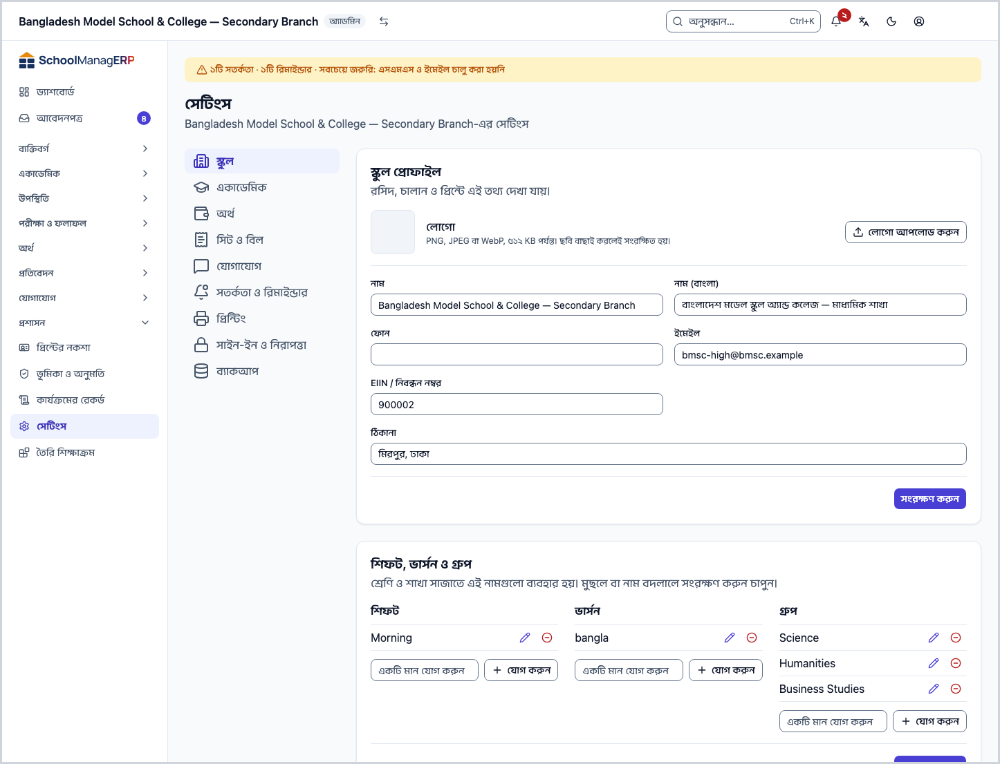
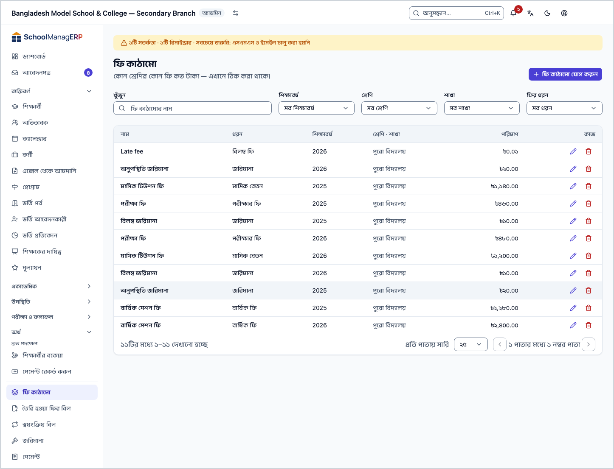

<!-- guide:meta
feature: admin.setupOrder
title: স্কুল সাজানোর ক্রম
summary: নতুন স্কুলে কোন কাজ কোন ক্রমে করবেন, ড্যাশবোর্ডের সাজানোর তালিকা ধরে ধাপে ধাপে।
roles: [ADMIN]
sources:
  - client-admin/src/features/onboarding/setup-checklist-card.tsx
  - client-admin/src/features/onboarding/welcome-wizard.tsx
  - client-admin/src/features/onboarding/setup-doors.tsx
  - client-admin/src/routes/_staff/dashboard.tsx
labels:
  [
    setupChecklist:*,
    onboardingSetup:doors.*,
    onboardingSetup:guided.*,
    onboardingPeople:summary.*,
    curriculumPreset:title,
    curriculumPreset:submit,
    classes:sections.addSection,
    students:list.importStudents,
    guardians:invite.*,
  ]
helpIds: [admin.setupOrder, admin.setupOrder.action.continueSetup]
devices: [desktop, phone]
entry: [dashboard:setup-checklist, page:admin.createSchool]
keywords: [সেটআপ, ক্রম, চেকলিস্ট, স্কুল সাজান, setup, order, checklist, onboarding]
appVersion: 0.1.0 (beb2d2e77)
owner: tareq89
lastVerified: 2026-10-24
knownIssues: []
-->

# স্কুল সাজানোর ক্রম

নতুন স্কুলের কাজগুলো কোন ক্রমে করলে একটার পর একটা সহজে হয়, তা এখানে পাবেন।

**যেতে হবে:** ড্যাশবোর্ডে **স্কুল সাজানো শেষ করুন** কার্ড। কার্ডে চাপলে প্রতিটি সারি তার কাজের পাতায় নিয়ে যায়। ফোনেও একই কার্ড ড্যাশবোর্ডে থাকে।
**শুরুর আগে:** আপনি স্কুলের অ্যাডমিন হবেন। স্কুল তৈরি করা না থাকলে আগে [স্কুল তৈরি করা ও সেটআপ উইজার্ড](create-school.md) দেখুন। কীসের সঙ্গে কী যুক্ত তা আগে বুঝতে চাইলে [স্কুলের সব কিছু কীভাবে জোড়া লাগে](how-it-works.md) পড়ুন।

এই পাতায় আপনার **সাজানোর তালিকা** নিয়ে কথা। ড্যাশবোর্ডের কার্ডে আটটি সারি আছে। প্রতিটি সারিতে **শেষ** বা **বাকি** লেখা থাকে। নিচের নয়টি ধাপ সেই ক্রমেই সাজানো, শুধু শিক্ষাবর্ষ আর রুটিন কার্ডে নেই বলে আলাদা ধাপ হিসেবে মাঝে বসানো হয়েছে।

[ধাপগুলো দেখুন](#task-main) · [সব ঠিক আছে কি না](#confirm) · [আগেই ক্লাস থাকলে](#task-existing) · [সমস্যা ও সমাধান](#trouble)

**এই পাতায় যা আছে**

- [এই পাতায় যেভাবে আসবেন](#arrive)
- [নয়টি ধাপ](#task-main)
- [ঠিকঠাক হয়েছে কি না বুঝবেন কীভাবে](#confirm)
- [অন্য পরিস্থিতিতে](#other)
  - [আগেই ক্লাস বা শিক্ষার্থী থাকলে](#task-existing)
  - [উইজার্ডে বন্ধ করার "পরে করব" চাপলে](#task-later)
- [সমস্যা ও সমাধান](#trouble)
- [কে কী করতে পারেন](#roles)
- [আরও জানুন](#more)

---

## এই পাতায় যেভাবে আসবেন 

**ড্যাশবোর্ড থেকে**

1. ড্যাশবোর্ডে **স্কুল সাজানো শেষ করুন** কার্ড দেখুন। তাতে "৮টির মধ্যে ৩টি শেষ" ধরনের একটি লেখা থাকে।
2. যে সারিতে **বাকি** লেখা, সেটিতে চাপুন। → সেই কাজের পাতা খোলে। নিচের সংশ্লিষ্ট ধাপ থেকে শুরু করুন।

**সেটআপ উইজার্ডের শেষ পাতা থেকে**

1. উইজার্ডের শেষে **আপনার স্কুল তৈরি** পাতায় **এরপর কী করবেন** অংশে **ফি ঠিক করুন**, **অভিভাবকদের ডাকুন**, **বার্তার সেটিং করুন** আছে। উইজার্ড কীভাবে চলে তা [স্কুল তৈরি করা ও সেটআপ উইজার্ড](create-school.md) পাতায় আছে।
2. **ড্যাশবোর্ডে যান** চাপুন। → ড্যাশবোর্ডে একই কার্ড দেখা যায়। নিচের ধাপ ৭ থেকে শুরু করুন।

---

## নয়টি ধাপ 

ক্রম মেনে চললে সবচেয়ে সহজ, কারণ পরের কাজ আগের কাজের ওপর দাঁড়ায়: শাখা না থাকলে শিক্ষার্থী ভর্তি করা যায় না, শ্রেণি না থাকলে ফি কাঠামো বানানো যায় না।

### ধাপ ১: স্কুলের পরিচয় 

1. ড্যাশবোর্ডের কার্ডে **স্কুলের পরিচয়** চাপুন।

   → **সেটিংস**-এর **স্কুল** বিভাগ খোলে, আর **স্কুল প্রোফাইল** অংশ দেখা যায়।

2. **নাম (বাংলা)** লিখুন। চাইলে **লোগো আপলোড করুন** দিয়ে লোগো দিন। **EIIN / নিবন্ধন নম্বর** থাকলে সেটিও দিন।
3. অংশের নিচের **সংরক্ষণ করুন** চাপুন।

   → **সংরক্ষিত হয়েছে** বার্তা আসে। কার্ডে **স্কুলের পরিচয়** সারিতে **শেষ** লেখা হয়।

বাংলা নাম বা লোগো, দুটির একটি থাকলেই সারিটি **শেষ** হয়।

### ধাপ ২: শিক্ষাবর্ষ 

শ্রেণি একটি শিক্ষাবর্ষের ভেতরে থাকে, তাই শিক্ষাবর্ষ আগে লাগে। এটি কার্ডের আটটি সারির মধ্যে নেই।

- **ধাপ ৩-এ তৈরি শিক্ষাক্রম নিলে:** শিক্ষাবর্ষ নিজে থেকে তৈরি হয়। এই ধাপে কিছু করতে হবে না।
- **নিজে শ্রেণি বানালে:** বাম মেনুতে **একাডেমিক → শিক্ষাবর্ষ** (→ [শিক্ষাবর্ষ তৈরি ও পরিচালনা](../academics/academic-years.md)) খুলে আগে একটি শিক্ষাবর্ষ বানান।

### ধাপ ৩: তৈরি শিক্ষাক্রম, অথবা নিজে শ্রেণি 

কার্ডের সারির নাম **ক্লাস**। এটি **শেষ** হয় একটি শ্রেণি থাকলেই।

**তৈরি শিক্ষাক্রম নিতে চাইলে:**

1. বাম মেনুতে **প্রশাসন → তৈরি শিক্ষাক্রম** (→ `../administration/curriculum-preset.md`) চাপুন।

   → **শিক্ষাক্রম বেছে নিন**, **অপশন**, **নিশ্চিত করুন**, এই তিন ধাপের পাতা খোলে।

2. একটি শিক্ষাক্রম বেছে নিন, **অপশন** ঠিক করুন, তারপর **এই শিক্ষাক্রম ব্যবহার করুন** চাপুন।

   → শিক্ষাক্রমের নাম লিখে নিশ্চিত করতে বলে।

3. নিশ্চিত করুন।

   → শিক্ষাবর্ষ, শ্রেণি, বিষয়, গ্রেডিং পদ্ধতি আর পরীক্ষার কাঠামো একসঙ্গে তৈরি হয়।

> **মনে রাখুন:** তৈরি শিক্ষাক্রম শুধু একেবারে নতুন স্কুলে বসানো যায়, অর্থাৎ যে স্কুলে এখনো কোনো শ্রেণি বা শিক্ষার্থী নেই। কিছু শিক্ষাক্রমের পাশে **যাচাই করা হয়নি** লেখা থাকে। তখন বিষয় আর নম্বর নিজে মিলিয়ে নিন।

**নিজে শ্রেণি বানাতে চাইলে:** বাম মেনুতে **একাডেমিক → শ্রেণি** (→ [শ্রেণি, শাখা ও বিষয় সাজানো](../academics/classes.md)) খুলে **শ্রেণি যোগ করুন** চাপুন। শিফট বা ভার্সন লাগলে আগে [স্কুলের গঠন](how-it-works.md#task-structure) দেখুন।

<!-- image pending: img/setup-03-curriculum-preset.png — Ready-made curriculum page: 1 the three steps, 2 a curriculum card, 3 the Use this curriculum button -->

### ধাপ ৪: শাখা 

কার্ডের সারির নাম **সেকশন**। একটি শাখা থাকলেই এটি **শেষ**।

1. বাম মেনুতে **একাডেমিক → শ্রেণি** চাপুন।

   → শ্রেণির তালিকা খোলে।

2. যে শ্রেণির শাখা বানাবেন, তার সারিতে **দেখুন** চাপুন। **শাখা** ট্যাব খুলুন।

   → সেই শ্রেণির শাখার তালিকা দেখা যায়।

3. **শাখা যোগ করুন** চাপুন। নাম লিখে **সংরক্ষণ করুন** চাপুন।

   → নতুন শাখাটি তালিকায় আসে।

### ধাপ ৫: শিক্ষার্থী 

কার্ডের সারির নাম **শিক্ষার্থী**। একজন শিক্ষার্থী থাকলেই এটি **শেষ**।

1. বাম মেনুতে **ব্যক্তিবর্গ → শিক্ষার্থী** (→ [শিক্ষার্থী যোগ করা ও তাদের তথ্য দেখা](../people/students.md)) চাপুন।

   → শিক্ষার্থীর তালিকা খোলে।

2. অনেক শিক্ষার্থী একসঙ্গে যোগ করতে **শিক্ষার্থী আমদানি** চাপুন। এক্সেল ফাইল বানানোর নিয়ম ও নমুনা (→ [স্কুলের নমুনা: কোনটি আপনার?](scenarios.md)) দেখুন। ফাইল আপলোড করুন।

   → ফাইল আগে যাচাই হয়।

3. যাচাই ঠিক থাকলে নিশ্চিত করুন।

   → শিক্ষার্থীরা তালিকায় যুক্ত হয়।

অভিভাবকদের আমন্ত্রণ পাঠানো ধাপ ৯-এ।

<!-- image pending: img/setup-05-import-students.png — Students page: 1 the Import students button, 2 the check result before confirming -->

### ধাপ ৬: কর্মী ও ভূমিকা 

কার্ডের সারির নাম **কর্মী**। দুজন আলাদা মানুষ কর্মী হলে এটি **শেষ**। যিনি একসঙ্গে অ্যাডমিন ও শিক্ষক, তিনি একজন হিসেবেই গোনা হয়। পরিচালনা পর্ষদ সদস্য এই গণনায় ধরা হয় না।

1. বাম মেনুতে **ব্যক্তিবর্গ → কর্মী** (→ [কর্মী যোগ করা ও পরিচালনা](../people/staff.md)) চাপুন।

   → কর্মীর তালিকা খোলে।

2. একজন একজন করে যোগ করুন। প্রতিজনের **ভূমিকা** ঠিক করুন (অ্যাডমিন, শিক্ষক, হিসাবরক্ষক ইত্যাদি)। অনেকজন একসঙ্গে যোগ করতে **এক্সেল থেকে আমদানি** (→ [এক্সেল থেকে কর্মী যোগ করা](../people/staff-import.md)) দেখুন। সেই ফাইলে **ভূমিকা** কলাম দেখে শিক্ষক আর অন্য কর্মীকে আলাদা করা হয়।

   → কর্মী তালিকায় আসেন।

3. শিক্ষককে শাখা দিন। **ব্যক্তিবর্গ → শিক্ষকের দায়িত্ব** (→ [শিক্ষককে শ্রেণি-শাখার দায়িত্ব দেওয়া](../people/teaching-assignments.md)) পাতায় দায়িত্ব না দিলে শিক্ষক কোনো শাখা দেখেন না।

> **মনে রাখুন:** কর্মী যোগ করলেই কাজ শেষ হয় না। দায়িত্ব না দিলে শিক্ষক হাজিরা নিতে পারবেন না।

### ধাপ ৭: ফি কাঠামো 

কার্ডের সারির নাম **ফি**। একটি ফি কাঠামো থাকলেই এটি **শেষ**।

1. বাম মেনুতে **অর্থ → ফি কাঠামো** (→ `../finance/fee-structures.md`) চাপুন।

   → ফি কাঠামোর তালিকা খোলে।

2. কোন শ্রেণি কোন খাতে কত টাকা দেবে, তা লিখে সংরক্ষণ করুন।

   → কাঠামো তালিকায় আসে। কার্ডে **ফি** সারিতে **শেষ** লেখা হয়।

ফির বিল তৈরি আর পেমেন্ট নেওয়ার ধাপ এই পাতায় নেই। সেগুলো ফির পথের (→ [পাঁচটি ছবির চতুর্থটি](how-it-works.md#task-money)) পরের অংশ।

### ধাপ ৮: রুটিন 

এটি কার্ডের সারির মধ্যে নেই। শ্রেণি, শাখা আর কর্মী তৈরি হয়ে গেলে তবেই সাজান।

বাম মেনুতে **একাডেমিক → রুটিন সেটআপ** (→ [রুটিনের শিফট, পিরিয়ড, কক্ষ ও নিয়ম ঠিক করা](../academics/routine-setup.md)) চাপুন। এরপর রুটিন বানানোর ধাপ সেই পাতায় আছে।

### ধাপ ৯: চালু করুন 

কার্ডের শেষ দুটি সারি: **অভিভাবকদের ডাকুন** আর **বার্তার সেটিং**।

1. কার্ডে **অভিভাবকদের ডাকুন** চাপুন।

   → অভিভাবকের তালিকার পাতায় **অভিভাবকদের আমন্ত্রণ জানান** খোলে।

2. **আমন্ত্রণ প্রিভিউ করুন** চাপুন। কাদের আমন্ত্রণ যাবে আর কারা বাদ পড়ল দেখে নিন।

   → "..জন অভিভাবককে আমন্ত্রণ জানানো হবে — ..জন বাদ পড়েছে।" লেখা আসে। এখনো কিছু যায়নি।

3. ঠিক থাকলে **আমন্ত্রণ পাঠান** চাপুন।

   → আমন্ত্রণ যায়। নিশ্চিত না করা পর্যন্ত কিছু পাঠানো হয় না।

4. কার্ডে **বার্তার সেটিং** চাপুন। **যোগাযোগ** বিভাগে এসএমএস বা ইমেইল চালু করুন।

   → এসএমএস বা ইমেইলের একটি চালু হলে সারিটি **শেষ** হয়। **অভিভাবকদের ডাকুন** সারিটি **শেষ** হয় অন্তত একজন অভিভাবক যোগ দিলে।

সব সারি **শেষ** হলে কার্ডটি আর ড্যাশবোর্ডে দেখা যায় না।

> **মনে রাখুন:** **আমন্ত্রণ পাঠান** না চাপা পর্যন্ত কোনো অভিভাবকের কাছে কিছু যায় না।

---

## ঠিকঠাক হয়েছে কি না বুঝবেন কীভাবে 

| অবস্থা                       | কীভাবে বুঝবেন                                                             | এরপর কী                  |
| ---------------------------- | ------------------------------------------------------------------------- | ------------------------ |
| **স্কুলের সিস্টেমে পৌঁছেছে** | কার্ডের সারিতে **শেষ** লেখা, আর ওপরে "৮টির মধ্যে ..টি শেষ" সংখ্যা বেড়েছে | পরের **বাকি** সারিতে যান |

সারির **শেষ** চিহ্ন স্কুলের আসল তথ্য দেখে প্রতিবার হিসাব হয়। অন্য পথে একটি শ্রেণি বানালেও **ক্লাস** সারি **শেষ** হয়ে যায়।

**যাচাই করতে চাইলে:** ড্যাশবোর্ড ছেড়ে সংশ্লিষ্ট তালিকায় যান, যেমন **একাডেমিক → শ্রেণি**। আপনার বানানো জিনিস সেখানে থাকলে সিস্টেমে আছে।

**টিক না পড়লে:** [সমস্যা ও সমাধান](#trouble) দেখুন। আপনার দেওয়া তথ্য মুছে যায়নি।

---

## অন্য পরিস্থিতিতে 

### আগেই ক্লাস বা শিক্ষার্থী থাকলে 

তৈরি শিক্ষাক্রম বসানো যাবে না, তাই ধাপ ৩-এর প্রথম পথ আপনার জন্য নয়। **নিজে শ্রেণি বানাতে চাইলে** পথটি ধরুন। বাকি ধাপগুলো একই।

### উইজার্ডে বন্ধ করার "পরে করব" চাপলে 

সেটআপ উইজার্ডে বন্ধ করার একটি বোতাম **পরে করব** আছে। তা চাপলে ড্যাশবোর্ডে যাবেন, আর **স্কুল সাজানো শেষ করুন** কার্ডও **লুকান** চাপার মতো লুকিয়ে যাবে। আপনার বানানো কিছু হারায় না। এই পাতার ধাপ ১ থেকে মেনু ধরে কাজ করুন। (শুরুর তিন পথের **পরে করব** আলাদা: সেটি শুধু **আপনার মানুষদের যোগ করুন** ধাপে নিয়ে যায়।)

---

## সমস্যা ও সমাধান 

| আপনি যা দেখছেন                                                                                   | কী করবেন                                                                                                                                                                            | কে সাহায্য করতে পারেন |
| ------------------------------------------------------------------------------------------------ | ----------------------------------------------------------------------------------------------------------------------------------------------------------------------------------- | --------------------- |
| **আপনার স্কুলে আগেই ক্লাস বা শিক্ষার্থী আছে, তাই তৈরি তালিকা বসানো যাবে না।** (উইজার্ডের বার্তা) | তৈরি শিক্ষাক্রমের বদলে **একাডেমিক → শ্রেণি** থেকে নিজে শ্রেণি বানান।                                                                                                                | অ্যাডমিন              |
| ড্যাশবোর্ডে **স্কুল সাজানো শেষ করুন** কার্ড নেই                                                  | কার্ড হয় আগে **লুকান** (বা উইজার্ডের **পরে করব**) চাপা হয়েছে, নয়তো সব সারি **শেষ** হয়েছে। এই স্কুল আগে থেকেই চালু ছিল বলেও কার্ড না থাকতে পারে। ধাপগুলো এই পাতা থেকে নিজে করুন। | অ্যাডমিন              |
| কর্মী যোগ করেছি কিন্তু **কর্মী** সারি **বাকি**                                                   | সারিটি **শেষ** হতে দুজন আলাদা মানুষ লাগে। একজন অ্যাডমিন ও শিক্ষক হলে সেটি এক জন।                                                                                                    | অ্যাডমিন              |
| **সেটআপ শেষ হিসেবে সংরক্ষণ করা যায়নি। আপনি তবুও ড্যাশবোর্ডে যেতে পারেন।**                       | **ড্যাশবোর্ডে যান** চাপুন। কাজগুলো ড্যাশবোর্ডের কার্ড থেকেই চলবে।                                                                                                                   | অ্যাডমিন              |

---

## কে কী করতে পারেন 

| ভূমিকা      | সাজানোর তালিকা দেখতে ও কাজ করতে পারেন                                  |
| ----------- | ---------------------------------------------------------------------- |
| অ্যাডমিন    | হ্যাঁ                                                                  |
| শিক্ষক      | না                                                                     |
| হিসাবরক্ষক  | না। শুধু ধাপ ৫ (শিক্ষার্থী) আর ধাপ ৭ (**অর্থ → ফি কাঠামো**) করতে পারেন |
| অন্য ভূমিকা | না                                                                     |

**স্কুল সাজানো শেষ করুন** কার্ড শুধু অ্যাডমিন দেখেন।

---

## আরও জানুন 

<strong>উইজার্ডের তিনটি পথের মানে</strong>

<figure>
  
</figure>

- **ধাপে ধাপে:** স্কুলের নাম আর লোগো, তৈরি শিক্ষাক্রম, তারপর প্রতিটি শ্রেণির শাখা।
- **এক্সেল ফাইল থেকে:** একটি নমুনা ফাইলে শিক্ষাবর্ষ, শ্রেণি, শাখা, বিষয় আর ফি লিখে আপলোড। ফাইল শুধু নতুন জিনিস যোগ করে। আপনার আগের কিছু বদলায় না, মুছেও যায় না।
- **পরে করব:** **আপনার মানুষদের যোগ করুন** ধাপে যায়।

**সম্পর্কিত পাতা**

- [**স্কুল তৈরি করা ও সেটআপ উইজার্ড**](create-school.md): স্কুল খোলা ও উইজার্ড।
- [**স্কুলের সব কিছু কীভাবে জোড়া লাগে**](how-it-works.md): পাঁচটি ছবিতে স্কুলের গঠন।
- [**শিক্ষাবর্ষ তৈরি ও পরিচালনা**](../academics/academic-years.md): ধাপ ২: আগে শিক্ষাবর্ষ বানান।
- [**শ্রেণি, শাখা ও বিষয় সাজানো**](../academics/classes.md): ধাপ ৩: নিজে শ্রেণি, শাখা ও বিষয় বানানো।
- [**শিক্ষার্থী যোগ করা ও তাদের তথ্য দেখা**](../people/students.md): ধাপ ৫: শিক্ষার্থী যোগ বা আমদানি।
- [**তৈরি শিক্ষাক্রম**](../administration/curriculum-preset.md) — একেবারে নতুন স্কুলে একটি তৈরি শিক্ষাক্রম বেছে শিক্ষাবর্ষ, শ্রেণি, বিষয়, গ্রেডিং স্কেল আর পরীক্ষার টেমপ্লেট একবারে তৈরি করুন।

---

_সংস্করণ ০.১.০ · সর্বশেষ যাচাই ২০২৬-১০-২৪_
