<!-- guide:meta
feature: administration.admissionWidgets
title: স্কুলের ওয়েবসাইটে ভর্তি
summary: স্কুলের ওয়েবসাইটের ভর্তির তিনটি অংশ চালু বা বন্ধ করুন, রাউন্ড কখন দেখাবে ঠিক করুন, আর জানুন অভিভাবক কী দেখেন।
roles: [ADMIN]
sources:
  - site/src/themes/basic/sections/admissions.astro
  - site/src/themes/basic/sections/admission-result.astro
  - site/src/themes/basic/sections/admission-lists.astro
  - server/src/modules/website/public/feeds/admissions.feed.ts
  - client-admin/src/features/admission/desk/RoundWizard.tsx
labels: [admission-desk:wizard.alwaysShow, admission-desk:wizard.alwaysShowHint, admission-desk:wizard.siteEditor, admission-desk:wizard.siteTitle]
helpIds: [administration.admissionWidgets]
devices: [desktop]
entry: [page:administration.website]
keywords: [ওয়েবসাইট, উইজেট, ভর্তি, আবেদন বোতাম, ফল, তালিকা, সবসময় দেখান]
appVersion: 0.1.0 (fb8af6c63)
owner: tareq89
lastVerified: 2026-11-16
knownIssues: []
-->

# স্কুলের ওয়েবসাইটে ভর্তি

স্কুলের ওয়েবসাইটে ভর্তির তিনটি অংশ আছে। কোনগুলো দেখাবে আর রাউন্ড কখন দেখাবে, তা আপনি ঠিক করেন।

**যেতে হবে:** **অ্যাডমিনিস্ট্রেশন → ওয়েবসাইট**, তারপর **পাতা** ট্যাব, তারপর **ভর্তি** পাতা।
**শুরুর আগে:** আপনি অ্যাডমিন হবেন ([কে কী করতে পারেন](#roles))। ওয়েবসাইট প্রকাশ করা থাকতে হবে: [স্কুলের ওয়েবসাইট](website.md#task-publish)।

[অংশ চালু করুন](#task-main) · [রাউন্ড চলার সময়ই দেখান](#task-always) · [অভিভাবক কী দেখেন](#task-guardian) · [সমস্যা ও সমাধান](#trouble)

<figure>
  
  <figcaption><em>ওয়েবসাইটে কী দেখাবে কীসে ঠিক হয়</em></figcaption>
</figure>

---

## এখানে কীভাবে আসবেন 

**ওয়েবসাইট পাতা থেকে:** [স্কুলের ওয়েবসাইট](website.md#task-admission) খুলে **ওয়েবসাইটে ভর্তি** অংশ দেখুন। **রাউন্ড থেকে:** রাউন্ড বানানোর **প্রকাশ** ধাপে **ওয়েবসাইটে কোথায় দেখাবে ঠিক করুন** চাপুন।

---

## অংশ চালু করুন 

1. **অ্যাডমিনিস্ট্রেশন → ওয়েবসাইট → পাতা → ভর্তি** খুলুন।
2. প্রতিটি অংশ চালু বা বন্ধ করুন:

   | অংশ | অভিভাবক কী পান | শুরুতে |
   | --- | --- | --- |
   | **ভর্তি তথ্য** | আপনার লেখা আর প্রতিটি রাউন্ডের **শেষ তারিখ** সহ **আবেদন করুন** বোতাম। | চালু |
   | **ভর্তির ফলাফল দেখুন** | রোল নম্বর ও ফোন দেওয়ার ঘর। | বন্ধ |
   | **ভর্তির তালিকা** | প্রকাশ হওয়া তালিকা, রোল নম্বরসহ। | বন্ধ |

3. **খসড়া সংরক্ষণ** চাপুন, তারপর **সারসংক্ষেপ** ট্যাবে **প্রকাশ** চাপুন।

   → ওয়েবসাইটের ভর্তি পাতায় অংশগুলো দেখা যায়।

> **মনে রাখুন:** ফল প্রকাশের সময় হলেই **ভর্তির ফলাফল দেখুন** ও **ভর্তির তালিকা** চালু করুন ([ভর্তির ফল প্রকাশ](../people/admission-publish.md))।

---

## ঠিকমতো হলো কীভাবে বুঝবেন 

ওয়েবসাইটের `/bn/admissions/` পাতা খুলুন। প্রতিটি চলমান রাউন্ডের **আবেদন করুন** বোতাম সেখানে আছে। আগের ধাপে যে অংশগুলো চালু করেছেন (আবেদন, ফলাফল, তালিকা), সেগুলোও পাতায় দেখা যাচ্ছে কি না মিলিয়ে নিন।

---

## অন্য পরিস্থিতিতে 

### রাউন্ড চলার সময়ই দেখান 

রাউন্ড বানানোর **প্রকাশ** ধাপে **ওয়েবসাইটে সবসময় দেখান** ঘর শুরুতে বন্ধ: "বন্ধ থাকলে শুধু ভর্তি চলার সময় দেখাবে।" তখন রাউন্ড তার শুরু আর শেষ তারিখের মধ্যে দেখায়। সেই তারিখের বাইরেও দেখাতে চাইলে চালু করুন।

### অভিভাবক কী দেখেন 

- **আবেদন করুন** রাউন্ডের ফর্ম খোলে; ধাপগুলো [ভর্তি রাউন্ড](../people/admission-intakes.md#task-site)-এ লেখা আছে।
- **ভর্তির ফলাফল দেখুন** ফল আর প্রবেশপত্র দেখায়।
- **ভর্তির তালিকা** শুধু রোল নম্বর দেখায়, নাম নয়; **নাম সহ তালিকা** চালু করলে ভিন্ন।
- রাউন্ড চলার সময় হোম পাতায় **ভর্তি চলছে — আবেদন করুন** ফিতাও দেখায়। তা নিজেই সরে যায়।

---

## সমস্যা ও সমাধান 

| আপনি যা দেখছেন | কী করবেন | কে সাহায্য করতে পারেন |
| --- | --- | --- |
| একটি রাউন্ড দেখাচ্ছে না | তারিখ দেখুন, অথবা **ওয়েবসাইটে সবসময় দেখান** চালু করুন। | অ্যাডমিন |
| **এখনও কোনো তালিকা প্রকাশ হয়নি** | তালিকা প্রকাশ করুন: [ভর্তির ফল প্রকাশ](../people/admission-publish.md)। | অ্যাডমিন |
| অংশটি নেই | **ভর্তি** পাতায় অংশ চালু করে ওয়েবসাইট প্রকাশ করুন। | অ্যাডমিন |

---

## কে কী করতে পারেন 

| ভূমিকা | অংশ চালু বা বন্ধ |
| --- | --- |
| অ্যাডমিন | হ্যাঁ |
| অন্য ভূমিকা | না |

---

## আরও জানুন 

<strong>ওয়েবসাইট পাতায় একই কথা সংক্ষেপে</strong>

[স্কুলের ওয়েবসাইট](website.md#task-admission) পাতায় তিনটি অংশ সংক্ষেপে আছে। এই পাতা বাছাইগুলো বুঝিয়ে বলে।

**সম্পর্কিত পাতা**

- [**স্কুলের ওয়েবসাইট**](website.md) — পুরো ওয়েবসাইট বদলান ও প্রকাশ করুন।
- [**ভর্তি রাউন্ড ও অনলাইন ভর্তির ফর্ম**](../people/admission-intakes.md) — রাউন্ড আর অভিভাবকের ধাপ।
- [**ভর্তির ফল প্রকাশ**](../people/admission-publish.md) — তালিকার অংশ ভরুন।

---

_সংস্করণ ০.১.০ · শেষ যাচাই ২০২৬-১১-১৬_
