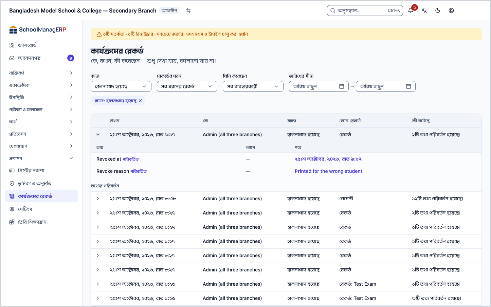

<!-- guide:meta
feature: administration.auditLogs
title: কার্যক্রমের রেকর্ড
summary: স্কুলে কে, কখন, কী তৈরি করেছেন, বদলেছেন বা মুছেছেন, আর কে সাইন ইন করেছেন, তা নতুন থেকে পুরোনো ক্রমে দেখুন; ছেঁকে খুঁজুন আর একটি সারি খুলে আগে-পরে মেলান। রেকর্ড শুধু দেখা যায়, বদলানো যায় না।
roles: [ADMIN]
sources:
  - client-admin/src/routes/_staff/audit-logs/index.tsx
  - client-admin/src/routes/_staff/audit-logs/-diff-panel.tsx
  - client-admin/src/routes/_staff/audit-logs/-humanize.ts
  - server/src/modules/audit/audit.controller.ts
  - server/src/modules/audit/audit.service.ts
  - server/src/modules/audit/redact.util.ts
labels: [auditLogs:*, nav:items.auditLogs, nav:groups.administration]
helpIds: [administration.auditLogs, administration.auditLogs.action.expand, administration.auditLogs.field.performedBy]
devices: [desktop]
entry: [sidebar, palette]
keywords:
  [কার্যক্রমের রেকর্ড, নিরীক্ষা, অডিট, কে বদলেছে, ইতিহাস, সাইন ইন, audit log, audit trail, history, who changed]
appVersion: 0.1.0 (63bfc7884)
owner: tareq89
lastVerified: 2026-10-25
knownIssues: []
-->

# কার্যক্রমের রেকর্ড

স্কুলে কে, কখন, কী করেছেন, এক তালিকায় দেখুন।

**যেতে হবে:** বাম মেনুতে **প্রশাসন → কার্যক্রমের রেকর্ড**। এই পাতা কম্পিউটারে দেখুন।
**শুরুর আগে:** আপনি অ্যাডমিন হবেন। অন্য ভূমিকার মেনুতে এই পাতা থাকে না ([কে কী করতে পারেন](#roles))।

কেউ অ্যাপে কোনো রেকর্ড তৈরি করলে, বদলালে বা মুছলে, অথবা সাইন ইন করলে, স্কুলের সিস্টেম একটি লাইন লিখে রাখে। এই পাতায় সেই লাইনগুলো দেখা যায়। পাতাটি শুধু দেখার জন্য: এখানে এমন কোনো বোতাম নেই যা কিছু বদলায়, আর একবার লেখা রেকর্ড কেউই বদলাতে বা মুছতে পারেন না।

[রেকর্ড দেখুন](#task-main) · [একটি কাজ খুঁজুন](#task-filter) · [আগে ও পরে মেলান](#task-diff) · [সমস্যা ও সমাধান](#trouble)

**এই পাতায় যা আছে**

- [রেকর্ড দেখুন](#task-main)
- [ঠিক রেকর্ডটি পেলেন কি না](#confirm)
- [অন্য পরিস্থিতিতে](#other)
  - [একটি নির্দিষ্ট কাজ খুঁজুন](#task-filter)
  - [কী বদলেছে, আগে ও পরে মেলান](#task-diff)
- [সমস্যা ও সমাধান](#trouble)
- [কে কী করতে পারেন](#roles)
- [আরও জানুন](#more)

---

## রেকর্ড দেখুন 

1. বাম মেনুতে **প্রশাসন** চাপুন, তারপর **কার্যক্রমের রেকর্ড** চাপুন।

   → উপরে লেখা **কার্যক্রমের রেকর্ড**, নিচে "কে, কখন, কী করেছেন — শুধু দেখা যায়, বদলানো যায় না।" তারপর ছাঁকনি আর তালিকা। প্রতিটি সারিতে: **কখন**, **কে**, **কাজ**, **কোন রেকর্ড**, **কী ঘটেছে**।

2. সবচেয়ে নতুন কাজটি সবার উপরে। পুরোনো কাজ দেখতে নিচে পরের পাতায় যান।

   → শুরুতে এক পাতায় ২৫টি সারি থাকে। নিচ থেকে এক পাতায় কয়টি দেখবেন, তা বদলানো যায়, সর্বোচ্চ ১০০টি।

**সারিগুলো পড়বেন কীভাবে**

| কলাম           | কী দেখায়                                                                                                                                         |
| -------------- | ------------------------------------------------------------------------------------------------------------------------------------------------- |
| **কখন**        | তারিখ ও সময়, স্কুলের সময় অঞ্চলে (আপনার ফোন বা কম্পিউটারের নয়)।                                                                                 |
| **কে**         | যিনি কাজটি করেছেন, তাঁর নাম। কর্মীকে পরে সরিয়ে দেওয়া হলেও নাম থাকে। কোনো মানুষ না করলে লেখা থাকে **সিস্টেম**।                                   |
| **কাজ**        | যেমন **তৈরি হয়েছে**, **হালনাগাদ হয়েছে**, **মুছে ফেলা হয়েছে**, **সাইন ইন**, **সাইন ইন ব্যর্থ**, **পেমেন্ট রেকর্ড হয়েছে**, **সেটিংস পরিবর্তন**। |
| **কোন রেকর্ড** | রেকর্ডের ধরন আর নাম, যেমন **শিক্ষার্থী: …**। নাম না পেলে শুধু ধরন।                                                                                |
| **কী ঘটেছে**   | এক লাইনে সহজ কথায়, যেমন **৩টি তথ্য পরিবর্তন হয়েছে।**                                                                                            |

---

## ঠিক রেকর্ডটি পেলেন কি না 

এই পাতা কিছু সংরক্ষণ করে না; এটি স্কুলের সিস্টেমে যা আছে, সরাসরি তাই দেখায়। তাই "স্ক্রিনে আছে কিন্তু সংরক্ষিত হয়নি" অবস্থা এখানে নেই।

| আপনি দেখছেন                   | এর মানে                                         | এরপর কী                                     |
| ----------------------------- | ----------------------------------------------- | ------------------------------------------- |
| খোঁজা কাজটির সারি             | কাজটি সত্যিই হয়েছিল, ওই সময়ে, ওই মানুষের হাতে | সারি খুলে [আগে ও পরে](#task-diff) মেলান     |
| **কোনো রেকর্ড পাওয়া যায়নি** | এই ছাঁকনিতে কোনো কাজ নেই                        | **সব ফিল্টার মুছুন** চাপুন, বা তারিখ বাড়ান |

---

## অন্য পরিস্থিতিতে 

### একটি নির্দিষ্ট কাজ খুঁজুন 

উদাহরণ: "গত সপ্তাহে কে একজন শিক্ষার্থীর তথ্য বদলেছেন?"

1. **রেকর্ডের ধরন**-এ **শিক্ষার্থী** বাছুন।
2. **কাজ**-এ **হালনাগাদ হয়েছে** বাছুন।
3. **তারিখের সীমা**-য় **শুরুর তারিখ** আর **শেষ তারিখ** দিন।

   → তালিকা সাথে সাথে ছোট হয়। শেষ তারিখের পুরো দিনটি ধরা হয়।

4. কোনো একজনের কাজ দেখতে **যিনি করেছেন** থেকে তাঁর নাম বাছুন।

সব ছাঁকনি একসাথে মুছতে **সব ফিল্টার মুছুন** চাপুন। ছাঁকনি পাতার ঠিকানায় থাকে, তাই ঠিকানাটি বুকমার্ক করলে পরে একই তালিকা খোলে।

### কী বদলেছে, আগে ও পরে মেলান 

1. সারির পাশের খোলার চিহ্ন চাপুন।

   → সারির নিচে **তথ্যের পরিবর্তন** খোলে: **তথ্য**, **আগে**, **পরে**। বদলানো প্রতিটি তথ্যের পাশে লেখা **পরিবর্তিত**।

2. যা বদলায়নি সেগুলোও দেখতে **…টি অপরিবর্তিত তথ্য দেখুন** চাপুন।

সাইন ইন বা রিমাইন্ডারের মতো ঘটনায় কোনো তথ্য বদলায় না। তখন লেখা থাকে: "এই এন্ট্রিটি একটি ঘটনার রেকর্ড, সম্পাদনার নয়, তাই কোনো তথ্য পরিবর্তন হয়নি।"

> **মনে রাখুন:** পাসওয়ার্ড, টোকেন আর গোপন চাবি রেকর্ডে লেখার আগেই মুছে দেওয়া হয়। তাদের জায়গায় **আগে** বা **পরে** কলামে `[REDACTED]` দেখায়, আসল মান কখনো নয়।

---

## সমস্যা ও সমাধান 

| আপনি যা দেখছেন                                                  | কী করবেন                                                                                                                             | কে সাহায্য করতে পারেন |
| --------------------------------------------------------------- | ------------------------------------------------------------------------------------------------------------------------------------ | --------------------- |
| **নিরীক্ষার ইতিহাস লোড করা যায়নি।**                            | পাতা রিলোড করুন। ইন্টারনেট সংযোগ দেখুন।                                                                                              | —                     |
| **এই প্রতিষ্ঠানে এখনো কোনো কার্যক্রম রেকর্ড হয়নি।**            | নতুন স্কুলে এটি স্বাভাবিক। কেউ কিছু করলেই সারি আসবে।                                                                                 | —                     |
| **এই ফিল্টারে কোনো কার্যক্রম নেই।**                             | **সব ফিল্টার মুছুন** চাপুন, অথবা তারিখের সীমা বড় করুন।                                                                              | —                     |
| **যিনি করেছেন** তালিকায় একজন কর্মীর নাম নেই                    | তালিকায় প্রথম ১০০ জন ব্যবহারকারী আসেন। নাম না পেলে তারিখ আর রেকর্ডের ধরন দিয়ে ছেঁকে **কে** কলামে খুঁজুন।                           | অ্যাডমিন              |
| **কে** কলামে **সিস্টেম**                                        | কাজটি কোনো মানুষ করেননি, স্কুলের সিস্টেম নিজে করেছে (যেমন স্বয়ংক্রিয় কাজ)।                                                         | —                     |
| একটি ভুল রেকর্ড মুছতে বা ঠিক করতে চান                           | তা করা যায় না; রেকর্ড ইচ্ছা করেই বদলানো যায় না। মূল তথ্যটি ঠিক করুন, সেটিও একটি নতুন সারি হিসেবে আসবে।                             | —                     |
| আপনার নিজের মূল্যায়ন বা আপনাকে নিয়ে কোনো ঘটনার সারি দেখছেন না | এটি ইচ্ছাকৃত: কেউ নিজের মূল্যায়ন (এসিআর) বা নিজের বিষয়ে লেখা কর্মী-ঘটনার (staff incident) সারি এই তালিকায় দেখেন না, অ্যাডমিনও না। | —                     |

<!-- unverified: রেকর্ড কতদিন রাখা হয় (retention) কোডে পাওয়া যায়নি; কোনো মুছে ফেলার নিয়ম লেখা হয়নি, তাই পাতায় সময়সীমা বলা হয়নি। -->

---

## কে কী করতে পারেন 

| ভূমিকা                                                | এই পাতা দেখা | একটি রেকর্ডের নিজস্ব **কার্যক্রম** ঘর দেখা | রেকর্ড বদলানো বা মোছা |
| ----------------------------------------------------- | ------------ | ------------------------------------------ | --------------------- |
| অ্যাডমিন                                              | হ্যাঁ        | হ্যাঁ                                      | না, কেউ পারেন না      |
| হিসাবরক্ষক, একাডেমিক কো-অর্ডিনেটর, শিক্ষক             | না           | হ্যাঁ, যে রেকর্ড তিনি দেখতে পান            | না                    |
| অফিস সহকারী, পরীক্ষা নিয়ন্ত্রক, পরিচালনা পর্ষদ সদস্য | না           | না                                         | না                    |

পুরো স্কুলের তালিকা শুধু অ্যাডমিন দেখেন। কয়েকটি ভূমিকা একটি নির্দিষ্ট রেকর্ডের (যেমন একজন শিক্ষার্থীর) পাতায় শুধু সেই রেকর্ডের ইতিহাস দেখতে পান। অন্য স্কুলের কোনো সারি কখনো এই তালিকায় আসে না।

---

## আরও জানুন 

<strong>পাতার অংশগুলো, ওপর থেকে নিচে</strong> — কার্যক্রমের রেকর্ড

- **কার্যক্রমের রেকর্ড** শিরোনাম আর "শুধু দেখা যায়, বদলানো যায় না" লাইন। কোনো বোতাম নেই।
- ছাঁকনি — **কাজ**, **রেকর্ডের ধরন**, **যিনি করেছেন**, **তারিখের সীমা** (**শুরুর তারিখ**, **শেষ তারিখ**)।
- তালিকা — **কখন**, **কে**, **কাজ**, **কোন রেকর্ড**, **কী ঘটেছে**; কোনো কলাম চেপে সাজানো যায় না, ক্রম সবসময় নতুন থেকে পুরোনো।
- খোলা সারি — **তথ্যের পরিবর্তন**: **তথ্য**, **আগে**, **পরে**।
- পাতা বদলানো আর এক পাতায় কয়টি সারি।

<strong>রেকর্ড কীভাবে জমে</strong> — লেখা, আটকানো আর দেখা

<figure>
  
  <figcaption><em>কার্যক্রমের রেকর্ড কীভাবে জমে</em></figcaption>
</figure>

- **বদলানো যায় না:** স্কুলের ডেটাবেসে একটি তালা আছে, যা রেকর্ড বদলানো বা মোছা আটকে দেয়। অ্যাপের কোনো ভূমিকাই এটি পার হতে পারে না।
- **শুধু নিজের স্কুল:** প্রতিটি সারি একটি স্কুলের; তালিকা শুধু আপনার স্কুলের সারি আনে।
- **ক্রম:** সবসময় নতুন থেকে পুরোনো। তালিকা অন্যভাবে সাজানো যায় না, যাতে রেকর্ডের আসল ক্রম ভুল না দেখায়।

<strong>ঘরগুলোর সংক্ষিপ্ত সাহায্য (? বোতাম)</strong>

<!-- guide:generated:fields:auditLogs -->

| ঘর          | কী লিখবেন                                                      | বাধ্যতামূলক? |
| ----------- | -------------------------------------------------------------- | ------------ |
| যিনি করেছেন | একজনের করা কাজই দেখায়। সবার কাজ দেখতে "সব ব্যবহারকারী" রাখুন। | না           |

<!-- /guide:generated -->

**সম্পর্কিত পাতা**

- [**ভূমিকা ও অনুমতি**](roles.md) — কোন ভূমিকা কী করতে পারে।
- [**কর্মী**](../people/staff.md) — যাঁদের নাম **কে** কলামে আসে।
- [**তৈরি শিক্ষাক্রম**](curriculum-preset.md) — প্রয়োগ করলে যা তৈরি হয়।

- [**স্কুলের সেটিংস ঠিক করা**](settings.md) — স্কুলের সেটিংস

---

_সংস্করণ ০.১.০ · শেষ যাচাই ২০২৬-১০-২৫_
