<!-- guide:meta
feature: administration.curriculumPreset
title: তৈরি শিক্ষাক্রম
summary: একেবারে নতুন স্কুলে একটি তৈরি শিক্ষাক্রম বেছে শিক্ষাবর্ষ, শ্রেণি, বিষয়, গ্রেডিং স্কেল আর পরীক্ষার টেমপ্লেট একবারে তৈরি করুন। স্কুলে আগে থেকে শ্রেণি, বিষয়, শিক্ষার্থী বা পরীক্ষা থাকলে যোগ করা যায় না, আর যোগ করলে নিজে ফেরানো যায় না।
roles: [ADMIN]
sources:
  - client-admin/src/routes/_staff/curriculum-preset.tsx
  - client-admin/src/pages/curriculum-preset/CurriculumPresetPage.tsx
  - client-admin/src/pages/curriculum-preset/PresetCards.tsx
  - client-admin/src/pages/curriculum-preset/PresetPreviewSheet.tsx
  - client-admin/src/pages/curriculum-preset/ApplyOptionsForm.tsx
  - client-admin/src/pages/curriculum-preset/ConfirmApplyDialog.tsx
  - client-admin/src/pages/curriculum-preset/BlockedState.tsx
  - client-admin/src/pages/curriculum-preset/AppliedSummary.tsx
  - client-admin/src/components/PresetWarningBanner.tsx
  - server/src/modules/presets/presets.controller.ts
  - server/src/modules/presets/preset-apply.controller.ts
  - server/src/modules/presets/preset-apply.service.ts
  - server/src/modules/presets/preset-blockers.ts
  - server/src/modules/presets/preset-reset.service.ts
  - server/src/modules/presets/packs/index.ts
labels:
  [
    curriculumPreset:*,
    presetWarning:*,
    presetReset:*,
    nav:items.curriculumPreset,
    nav:groups.administration,
  ]
helpIds:
  [
    administration.curriculumPreset,
    administration.curriculumPreset.action.apply,
    administration.curriculumPreset.field.stages,
    administration.curriculumPreset.field.confirmName,
  ]
devices: [desktop]
entry: [sidebar, palette]
keywords:
  [তৈরি শিক্ষাক্রম, শিক্ষাক্রম, কারিকুলাম, এনসিটিবি, মাদ্রাসা, নতুন স্কুল, শ্রেণি তৈরি, curriculum, preset, NCTB, setup]
appVersion: 0.1.0 (63bfc7884)
owner: tareq89
lastVerified: 2026-10-25
knownIssues: []
-->

# তৈরি শিক্ষাক্রম

নতুন স্কুলে শ্রেণি, বিষয়, পরীক্ষা আর গ্রেডিং একবারে যোগ করুন।

**যেতে হবে:** বাম মেনুতে **প্রশাসন → তৈরি শিক্ষাক্রম**। এই কাজ কম্পিউটারে করুন।
**শুরুর আগে:** আপনি অ্যাডমিন হবেন। স্কুলটি একেবারে নতুন হতে হবে: কোনো শিক্ষাবর্ষ, শ্রেণি, বিষয়, শিক্ষার্থী, পরীক্ষা, গ্রেডিং পদ্ধতি বা পরীক্ষার কাঠামো থাকা চলবে না। স্কুল সাজানোর ক্রম দেখতে [**স্কুল সাজানোর ধাপ**](../admin/setup-order.md) পড়ুন।

একটি **তৈরি শিক্ষাক্রম** হলো আগে থেকে সাজানো একটি প্যাকেজ: শিক্ষাবর্ষ, শ্রেণি, বিষয়, শ্রেণির বিষয়, টার্ম, গ্রেডিং স্কেল, পরীক্ষার টেমপ্লেট আর সনদের টেমপ্লেট। একবার প্রয়োগ করলে সব একসাথে তৈরি হয়। এটি স্কুলে একবারই করা যায়, আর আপনি নিজে ফেরাতে পারবেন না।

[শিক্ষাক্রম যোগ করুন](#task-main) · [যোগ করা না গেলে](#task-blocked) · [ভুল করে যোগ করলে](#task-reset) · [সমস্যা ও সমাধান](#trouble)

**এই পাতায় যা আছে**

- [একটি তৈরি শিক্ষাক্রম যোগ করুন](#task-main)
- [যোগ হয়েছে কি না বুঝবেন কীভাবে](#confirm)
- [অন্য পরিস্থিতিতে](#other)
  - [প্রয়োগের আগে ভেতরে কী আছে দেখুন](#task-preview)
  - [স্কুলে আগে থেকে তথ্য থাকলে](#task-blocked)
  - [ভুল শিক্ষাক্রম যোগ হয়ে গেলে](#task-reset)
  - [তৈরি শিক্ষাক্রম থেকে আসা জিনিস বদলালে](#task-edit)
- [সমস্যা ও সমাধান](#trouble)
- [কে কী করতে পারেন](#roles)
- [আরও জানুন](#more)

---

## একটি তৈরি শিক্ষাক্রম যোগ করুন 

1. বাম মেনুতে **প্রশাসন** চাপুন, তারপর **তৈরি শিক্ষাক্রম** চাপুন।

   → উপরে **তৈরি শিক্ষাক্রম**, নিচে "নতুন স্কুলে শ্রেণি, বিষয়, পরীক্ষা ও গ্রেডিং একবারে যোগ করুন।" তিনটি ধাপ: **শিক্ষাক্রম বেছে নিন**, **অপশন**, **নিশ্চিত করুন**।

2. **শিক্ষাক্রম বেছে নিন** ধাপে একটি কার্ডে **বেছে নিন** চাপুন। কার্ডগুলো: **বাংলাদেশ এনসিটিবি পাঠ্যক্রম**, **আলিয়া মাদ্রাসা**, **কওমি মাদ্রাসা**, ক্যামব্রিজ, আর **কাস্টম সেটআপ**।

   → কার্ডে লেখা থাকে **বাছাই করা হয়েছে**। কার্ডে **যাচাই করা হয়নি** লেখা থাকলে [নিচের সতর্কতা](#unverified) পড়ুন।

3. **পরবর্তী** চাপুন। **অপশন** ধাপে **যে স্তরগুলো তৈরি হবে** দেখুন।

   → সব স্তরে টিক দেওয়া থাকে। যে স্তর লাগবে না, তার টিক তুলে দিন। অন্তত একটি রাখতে হবে।

4. শিক্ষাক্রমে ভার্সন থাকলে **যে ভার্সনগুলো তৈরি হবে** থেকে অন্তত একটি বাছুন। শুরুতে কোনোটিতে টিক থাকে না।
5. **শুরুর বছর** দেখুন। চলতি বছর বসানো থাকে; এই বছরের জন্য প্রথম শিক্ষাবর্ষ তৈরি হবে।
6. **পরবর্তী** চাপুন। **নিশ্চিত করুন** ধাপে সারসংক্ষেপ পড়ুন, যেমন "… — স্তর: …, শুরুর বছর ২০২৬।"
7. **এই শিক্ষাক্রম ব্যবহার করুন** চাপুন।

   → জানালা খোলে: **… প্রয়োগ করবেন?** লাল লেখায়: "আপনি এটি ফিরিয়ে নিতে পারবেন না। শুধু প্ল্যাটফর্ম অ্যাডমিন এটি রিসেট করতে পারেন।"

8. **নিশ্চিত করতে "…" লিখুন** ঘরে জানালায় দেখানো নামটি হুবহু লিখুন। নামটি ইংরেজিতে, যেমন `Bangladesh NCTB curriculum`।

   → নাম পুরো মিললে তবেই **প্রয়োগ করুন** চাপা যায়।

9. **প্রয়োগ করুন** চাপুন।

   → পাতা বদলে যায়: **শিক্ষাক্রম যোগ হয়েছে**, তার নিচে **যা তৈরি হয়েছে** তালিকা।

<!-- image pending: তৈরি শিক্ষাক্রম পাতা; ১ · তিনটি ধাপ ২ · একটি শিক্ষাক্রমের কার্ড ও প্রিভিউ ৩ · যাচাই করা হয়নি চিহ্ন ৪ · যে স্তরগুলো তৈরি হবে ৫ · শুরুর বছর ৬ · এই শিক্ষাক্রম ব্যবহার করুন; অ্যাডমিন, desktop -->

> **সতর্কতা:** **যাচাই করা হয়নি** লেখা শিক্ষাক্রম সরকারি কারিকুলামের সাথে মিলিয়ে দেখা হয়নি। এর বিষয়, নম্বর বা গ্রেডিং স্কেল ভুল হতে পারে। প্রয়োগের আগে [প্রিভিউ](#task-preview) দেখুন, আর পরে [**গ্রেডিং স্কেল**](../exams-results/grading-scales.md) ও [**পরীক্ষার কাঠামো**](../exams-results/exam-templates.md) মিলিয়ে নিন। বর্তমানে শুধু **কাস্টম সেটআপ** যাচাই করা।

---

## যোগ হয়েছে কি না বুঝবেন কীভাবে 

| অবস্থা                       | কীভাবে বুঝবেন                                                                                           | এরপর কী                                          |
| ---------------------------- | ------------------------------------------------------------------------------------------------------- | ------------------------------------------------ |
| **শুধু স্ক্রিনে বাছা**       | ধাপগুলো খোলা, বা নিশ্চিত করার জানালা খোলা                                                               | নাম লিখে **প্রয়োগ করুন** চাপুন                  |
| **স্কুলের সিস্টেমে পৌঁছেছে** | **শিক্ষাক্রম যোগ হয়েছে**; শিক্ষাক্রমের নাম, ভার্সন, **প্রয়োগের তারিখ** আর **যা তৈরি হয়েছে**-র সংখ্যা | [**শ্রেণি**](../academics/classes.md) খুলে দেখুন |

এই পাতা কিছু ফোন বা কম্পিউটারে আলাদা করে রাখে না, তাই "এই ডিভাইসে সংরক্ষিত" অবস্থা নেই। সব কিছু হয় একসাথে, না হয় কিছুই না: মাঝপথে থেমে গেলে অর্ধেক তৈরি হয়ে থাকে না।

**জানালায় "তৈরি শিক্ষাক্রম প্রয়োগ করা যায়নি। আবার চেষ্টা করুন।" এলে:** পাতাটি রিলোড করুন। **শিক্ষাক্রম যোগ হয়েছে** দেখালে কাজ শেষ। না দেখালে আবার চেষ্টা করুন।

---

## অন্য পরিস্থিতিতে 

### প্রয়োগের আগে ভেতরে কী আছে দেখুন 

কার্ডে **প্রিভিউ** চাপুন। পাশে একটি অংশ খোলে: **স্তর**, **শ্রেণি**, **বিভাগ**, **শ্রেণিভিত্তিক বিষয়**, **গ্রেডিং স্কেল** (যেমন "৮০–১০০% — A+"), **পরীক্ষার টেমপ্লেট** আর **সনদ**। গ্রেডিং স্কেল না থাকলে লেখা থাকে "কোনো গ্রেডিং স্কেল নেই। আপনার স্কুল নিজে ঠিক করবে।" প্রিভিউ দেখলে কিছু তৈরি হয় না।

### স্কুলে আগে থেকে তথ্য থাকলে 

পাতায় আসে **এই স্কুলে আর তৈরি শিক্ষাক্রম যোগ করা যাবে না**, আর **যা আগে থেকেই আছে** তালিকা, যেমন **শ্রেণি · ৪টি**, **শিক্ষার্থী · ১২০ জন**।

নিচের যেকোনো একটি থাকলেই আর যোগ করা যায় না: শিক্ষাবর্ষ, শ্রেণি, বিষয়, শিক্ষার্থী, পরীক্ষা, গ্রেডিং পদ্ধতি, পরীক্ষার কাঠামো। তখন সেগুলো নিজের মতো চালিয়ে যান: [**শিক্ষাবর্ষ**](../academics/academic-years.md), [**শ্রেণি**](../academics/classes.md), [**গ্রেডিং স্কেল**](../exams-results/grading-scales.md)।

### ভুল শিক্ষাক্রম যোগ হয়ে গেলে 

আপনি নিজে এটি ফেরাতে পারবেন না। শুধু প্ল্যাটফর্ম অ্যাডমিন (যিনি সব স্কুল চালান, আপনার স্কুলের কেউ নন) **তৈরি শিক্ষাক্রম বাতিল করুন** করতে পারেন। তাঁকে কারণ লিখতে হয়, ১০ থেকে ৫০০ অক্ষরে; কারণটি কার্যক্রমের রেকর্ডে থাকে।

বাতিল করলে মুছে যায়: শিক্ষাবর্ষ, টার্ম, শ্রেণি, শাখা, বিষয়, শ্রেণি-বিষয়, গ্রেডিং স্কেল ও তার ধাপ, পরীক্ষার টেমপ্লেট ও তার অংশ, আর তৈরি শিক্ষাক্রমের সেটিংস। এর তৈরি সনদের টেমপ্লেট থেকে যায়।

বাতিল তখনই সম্ভব, যখন স্কুলে এর কোনোটিই নেই: শিক্ষার্থী, ভর্তি, পরীক্ষা, ফি কাঠামো, বাড়ির কাজ, সিলেবাস বিষয়, রুটিন বা রুটিনের স্লট, ক্যালেন্ডার ইভেন্ট, প্রমোশন তালিকা, উপস্থিতি সেশন, শিক্ষক নিয়োগ, ভর্তি পর্ব, পুনরাবৃত্ত ফি সূচি, জরিমানার নিয়ম। তাই ভুল ধরা পড়লে অন্য কোনো কাজ শুরু করার আগেই প্ল্যাটফর্ম সহায়তায় জানান।

### তৈরি শিক্ষাক্রম থেকে আসা জিনিস বদলালে 

শ্রেণির বিষয়, পরীক্ষার কাঠামো বা গ্রেডিং স্কেলের পাতায় একটি সতর্কতার লাইন দেখায়: "এটি আপনার তৈরি শিক্ষাক্রম থেকে এসেছে। এটি বদলালে ভবিষ্যতের ফলাফল ও প্রতিবেদনে প্রভাব পড়তে পারে। যেসব ফলাফল ইতিমধ্যে প্রকাশিত হয়েছে, সেগুলো বদলাবে না।" বদলানো যায়; লাইনটি শুধু মনে করিয়ে দেয়।

---

## সমস্যা ও সমাধান 

| আপনি যা দেখছেন                                            | কী করবেন                                                                                                  | কে সাহায্য করতে পারেন |
| --------------------------------------------------------- | --------------------------------------------------------------------------------------------------------- | --------------------- |
| **এই স্কুলে আর তৈরি শিক্ষাক্রম যোগ করা যাবে না**          | স্কুলে আগে থেকে তথ্য আছে। [স্কুলে আগে থেকে তথ্য থাকলে](#task-blocked) দেখুন।                              | অ্যাডমিন              |
| **প্রয়োগ করুন** চাপা যায় না                             | জানালায় দেখানো ইংরেজি নামটি হুবহু লিখুন, বড়-ছোট হাতের অক্ষরসহ।                                          | —                     |
| **পরবর্তী** চাপা যায় না                                  | অন্তত একটি স্তর বাছুন; ভার্সন থাকলে অন্তত একটি ভার্সন; **শুরুর বছর** ২০০০ থেকে ২১০০-এর মধ্যে।             | —                     |
| **কমপক্ষে একটি স্তর বেছে নিন।**                           | **যে স্তরগুলো তৈরি হবে**-তে একটিতে টিক দিন।                                                               | —                     |
| **কমপক্ষে একটি ভার্সন বেছে নিন।**                         | **যে ভার্সনগুলো তৈরি হবে**-তে একটিতে টিক দিন।                                                             | —                     |
| **তৈরি শিক্ষাক্রম লোড করা যায়নি।**                       | **আবার চেষ্টা করুন** চাপুন।                                                                               | —                     |
| **তৈরি শিক্ষাক্রম প্রয়োগ করা যায়নি। আবার চেষ্টা করুন।** | পাতা রিলোড করে দেখুন যোগ হয়েছে কি না; না হলে আবার চেষ্টা করুন।                                           | অ্যাডমিন              |
| প্রয়োগের মাঝে অন্য কেউ শ্রেণি বা বিষয় তৈরি করেছেন       | জানালা বন্ধ হয়ে **এই স্কুলে আর তৈরি শিক্ষাক্রম যোগ করা যাবে না** দেখাতে পারে। তখন নিজের মতো চালিয়ে যান। | অ্যাডমিন              |

---

## কে কী করতে পারেন 

| ভূমিকা                                                                                           | পাতা দেখা ও শিক্ষাক্রম যোগ | যোগ করা শিক্ষাক্রম বাতিল |
| ------------------------------------------------------------------------------------------------ | -------------------------- | ------------------------ |
| অ্যাডমিন                                                                                         | হ্যাঁ, নতুন স্কুলে একবার   | না                       |
| হিসাবরক্ষক, একাডেমিক কো-অর্ডিনেটর, শিক্ষক, পরীক্ষা নিয়ন্ত্রক, অফিস সহকারী, পরিচালনা পর্ষদ সদস্য | না                         | না                       |

বাতিল করতে পারেন শুধু প্ল্যাটফর্ম অ্যাডমিন, যিনি কোনো স্কুলের কর্মী নন। অন্য ভূমিকার মেনুতে **তৈরি শিক্ষাক্রম** থাকে না।

---

## আরও জানুন 

<strong>পাতার অংশগুলো</strong> — তৈরি শিক্ষাক্রম

1. **তৈরি শিক্ষাক্রম** শিরোনাম আর এক লাইনের বর্ণনা।
2. ধাপের সারি — **শিক্ষাক্রম বেছে নিন**, **অপশন**, **নিশ্চিত করুন**।
3. শিক্ষাক্রমের কার্ড — নাম, **স্তর: …**, **ভার্সন: …**, **যাচাই করা হয়নি** চিহ্ন, **বেছে নিন** ও **প্রিভিউ**।
4. **অপশন** — **যে স্তরগুলো তৈরি হবে**, **যে ভার্সনগুলো তৈরি হবে**, **শুরুর বছর**।
5. **এই শিক্ষাক্রম ব্যবহার করুন** বোতাম, তারপর নাম লিখে নিশ্চিত করার জানালা।

<!-- image pending: তৈরি শিক্ষাক্রম, পাঁচটি অংশ নম্বর দিয়ে চিহ্নিত, এনসিটিবি কার্ড বাছা; অ্যাডমিন, desktop -->

<strong>ঘরগুলোর অর্থ</strong>

<!-- guide:generated:fields:curriculumPreset -->

| ঘর                                 | কী লিখবেন                                                                                                                         | বাধ্যতামূলক?       |
| ---------------------------------- | --------------------------------------------------------------------------------------------------------------------------------- | ------------------ |
| যে স্তরগুলো তৈরি হবে               | যে স্তরগুলোর শ্রেণি ও বিষয় তৈরি হবে, যেমন প্রাথমিক বা মাধ্যমিক। শিক্ষাক্রম বাছলে সব স্তরে টিক দেওয়া থাকে; অন্তত একটি রাখতে হবে। | হ্যাঁ              |
| যে ভার্সনগুলো তৈরি হবে             | শুধু যে শিক্ষাক্রমে ভার্সন আছে, সেখানে আসে। শুরুতে কোনোটিতে টিক থাকে না; অন্তত একটি বাছতে হবে।                                    | ভার্সন থাকলে হ্যাঁ |
| শুরুর বছর                          | প্রথম শিক্ষাবর্ষের বছর, ২০০০ থেকে ২১০০-এর মধ্যে। শুরুতে চলতি বছর বসানো থাকে।                                                      | হ্যাঁ              |
| শিক্ষাক্রমের নাম লিখে নিশ্চিত করুন | নিশ্চিত করার জানালায় শিক্ষাক্রমের ইংরেজি নামটি হুবহু লিখুন, যেমনটা জানালায় দেখানো আছে। না মিললে প্রয়োগ করুন চাপা যায় না।      | হ্যাঁ              |

<!-- /guide:generated -->

<strong>তৈরি শিক্ষাক্রম কীভাবে কাজ করে</strong> — নতুন স্কুল, একবার, ফেরানো যায় না

<figure>
  
  <figcaption><em>তৈরি শিক্ষাক্রম কখন যোগ করা যায়</em></figcaption>
</figure>

- **"নতুন স্কুল" মানে:** শিক্ষাবর্ষ, শ্রেণি, বিষয়, শিক্ষার্থী, পরীক্ষা, গ্রেডিং পদ্ধতি আর পরীক্ষার কাঠামো, এর একটিও নেই। মুছে ফেলা রেকর্ড গোনা হয় না।
- **স্কুলের সিস্টেমও যাচাই করে:** পাতা যা-ই দেখাক, প্রয়োগের মুহূর্তে স্কুলের সিস্টেম আবার দেখে স্কুলটি নতুন কি না। না হলে কিছুই তৈরি হয় না।
- **কী তৈরি হয়:** সেটিংস, শিক্ষাবর্ষ, শ্রেণি, বিষয়, শ্রেণির বিষয়, টার্ম, গ্রেডিং স্কেল ও ব্যান্ড, পরীক্ষার টেমপ্লেট ও তার অংশ, সনদের টেমপ্লেট। যা তৈরি হলো, তার সংখ্যা **যা তৈরি হয়েছে** তালিকায় থাকে।
- **শিক্ষক, শিক্ষার্থী বা ফি তৈরি হয় না।** সেগুলো পরে নিজে যোগ করুন।

**সম্পর্কিত পাতা**

- [**স্কুল সাজানোর ধাপ**](../admin/setup-order.md) — নতুন স্কুলে কোনটার পর কোনটা।
- [**শিক্ষাবর্ষ**](../academics/academic-years.md) ও [**শ্রেণি**](../academics/classes.md) — যা এখান থেকে তৈরি হয়।
- [**গ্রেডিং স্কেল**](../exams-results/grading-scales.md) ও [**পরীক্ষার কাঠামো**](../exams-results/exam-templates.md) — প্রয়োগের পর মিলিয়ে দেখুন।
- [**কার্যক্রমের রেকর্ড**](audit-logs.md) — কে কখন কী করেছেন।
- [**স্কুলের সেটিংস ঠিক করা**](settings.md) — স্কুলের প্রোফাইল, একাডেমিক নিয়ম, ফির নিয়ম, যোগাযোগ, প্রিন্টিং, সাইন-ইন, ব্যাকআপ আর সতর্কতা এক পাতায়, নয়টি বিভাগে ঠিক করুন।.

---

_সংস্করণ ০.১.০ · শেষ যাচাই ২০২৬-১০-২৫_
