<!-- guide:meta
feature: administration.modulesWords
title: মডিউল ও শব্দ
summary: প্রতিষ্ঠানের ধরন বাছুন, সিস্টেমের কোন অংশ চালু বা বন্ধ থাকবে ঠিক করুন, কিছু ভূমিকার কাছ থেকে অংশ লুকান, আর শ্রেণি, শাখা, শিক্ষার্থী, অভিভাবক ও শিক্ষকের জায়গায় আপনার নিজের শব্দ বসান।
roles: [ADMIN]
sources:
  - client-admin/src/pages/settings/ModulesWordsSection.tsx
  - client-admin/src/pages/settings/modules-words/
  - client-admin/src/components/module-off-state.tsx
  - client-admin/src/features/onboarding/guided/curriculum-step.tsx
  - shared/src/presets/institution-kinds.ts
  - shared/src/enums/module-key.ts
  - server/src/modules/presets/institution-kind.service.ts
  - server/src/modules/presets/institution-kind.controller.ts
labels:
  [
    settings:modulesWords.*,
    settings:help.modulesWords.*,
    settings:categories.modulesWords,
    common:moduleOff.*,
    onboardingSetup:guided.curriculum.kind.*,
  ]
helpIds: [administration.modulesWords]
devices: [desktop]
entry: [sidebar, palette]
keywords: [modules, words, institution kind, coaching, madrasa, batch, course, turn off, who can't see it, মডিউল, শব্দ, প্রতিষ্ঠানের ধরন, ব্যাচ, কোর্স, চালু, বন্ধ]
appVersion: 0.1.0 (ea26f2b97)
owner: tareq89
lastVerified: 2026-11-14
knownIssues:
  - { id: portal-hidden-module-load-error, checked: 2026-11-14, issue: 4127 }
-->

# মডিউল ও শব্দ

আপনার প্রতিষ্ঠানে সিস্টেমের কোন কোন অংশ চলবে আর আপনারা কোন জিনিসকে কী বলেন, তা ঠিক করুন।

**যেতে হবে:** **প্রশাসন → [সেটিংস](settings.md)**, তারপর **মডিউল ও শব্দ** বিভাগ। অথবা Ctrl+K চেপে লিখুন **মডিউল চালু বা বন্ধ করুন**, **শব্দ বদলান** বা **প্রতিষ্ঠানের ধরন বাছাই করুন**। পাতাটি কম্পিউটারে দেখুন।
**শুরুর আগে:** অ্যাডমিন হোন। অন্য কোনো ভূমিকার কাছে এই বিভাগ দেখা যায় না।

**মডিউল** মানে সিস্টেমের একটি অংশ, যেমন **ফি** বা **হোমওয়ার্ক**। মডিউল হয় **চালু**, নয় **বন্ধ**। বন্ধ মডিউল আপনার প্রতিষ্ঠানের কেউ দেখেন না। **শব্দ** মানে শ্রেণি, শাখা, শিক্ষার্থী, অভিভাবক ও শিক্ষককে আপনারা যে নামে ডাকেন। স্কুল যেখানে **শ্রেণি** ও **শাখা** বলে, কোচিং সেন্টার সেখানে **কোর্স** ও **ব্যাচ** বলতে পারে।

বিভাগটিতে তিনটি অংশ: উপরে **প্রতিষ্ঠানের ধরন**-এর কার্ড, তার নিচে **মডিউল** ও **শব্দ** ট্যাব। এখান থেকে আপনার শিক্ষার্থী, ফি বা অন্য কোনো তথ্য বদলায় না, মুছেও যায় না।

[প্রতিষ্ঠানের ধরন বাছুন](#task-main) · [মডিউল চালু বা বন্ধ করুন](#task-modules) · [কিছু ভূমিকার কাছ থেকে লুকান](#task-hide) · [শব্দ বদলান](#task-words) · [সমস্যা ও সমাধান](#trouble)

**এই পাতায় যা আছে**

- [প্রতিষ্ঠানের ধরন বাছুন](#task-main)
- [সংরক্ষণ হয়েছে কি না বুঝবেন কীভাবে](#confirm)
- [অন্য পরিস্থিতিতে](#other)
  - [মডিউল চালু বা বন্ধ করুন](#task-modules)
  - [কিছু ভূমিকার কাছ থেকে লুকান](#task-hide)
  - [শব্দ বদলান](#task-words)
  - [আপনার শব্দ আজ কোথায় দেখা যায়](#task-where)
  - [মডিউল বন্ধ থাকলে](#task-off)
  - [সেটআপ উইজার্ডে](#task-wizard)
- [সমস্যা ও সমাধান](#trouble)
- [কে কী করতে পারেন](#roles)
- [জানা সমস্যা](#known-issues)
- [আরও জানুন](#more)

---

## প্রতিষ্ঠানের ধরন বাছুন 

**প্রতিষ্ঠানের ধরন** হলো এক ধরনের প্রতিষ্ঠানের জন্য তৈরি করা কিছু বন্ধ মডিউল ও শব্দের সেট। কিছু বদলানোর আগে আপনি সবসময় দেখে নিতে পারেন কী বদলাবে।

1. **প্রশাসন → সেটিংস → মডিউল ও শব্দ** খুলুন।

   → **প্রতিষ্ঠানের ধরন**-এর নিচে আটটি কার্ড দেখা যায়: "আপনার বাছুন। কী বদলাবে আগে দেখে তারপর প্রয়োগ করবেন।"

2. আপনার প্রতিষ্ঠানের সাথে মেলে এমন কার্ডটি চাপুন।

   → একটি দেখার পাতা খোলে, নাম **প্রতিষ্ঠানের ধরন: (নাম)**। সেখানে লেখা থাকে "এটা শুধু দেখা। এখনো কিছু বদলায়নি।" আর "আপনার শিক্ষার্থী, ফি ও অন্য তথ্য, প্ল্যাটফর্মের লক এবং “কারা দেখবে না” বদলাবে না।"

3. **চালু থাকবে**, **বন্ধ থাকবে** ও **শব্দ যা বদলাবে** তালিকা পড়ুন। শব্দের তালিকায় **এখন** আর **হবে** পাশাপাশি থাকে।
4. **প্রয়োগ করুন** চাপুন। কিছু না বদলে বেরিয়ে আসতে চাইলে **বাতিল করুন** চাপুন।

   → **(নাম) প্রয়োগ করা হয়েছে** বার্তা আসে।

| ধরন                    | কার্ডে লেখা থাকে                | প্রয়োগ করলে কী বদলায়                                                                                                                        |
| ---------------------- | ------------------------------- | --------------------------------------------------------------------------------------------------------------------------------------------- |
| **প্রাথমিক বিদ্যালয়** | প্রথম থেকে পঞ্চম শ্রেণি         | **সিট প্ল্যান** ও **মূল্যায়ন** বন্ধ হয়                                                                                                      |
| **মাধ্যমিক বিদ্যালয়** | ষষ্ঠ থেকে দশম শ্রেণি            | কিছুই না। সব মডিউল চালু আর সাধারণ শব্দ থাকে                                                                                                   |
| **কলেজ**               | একাদশ ও দ্বাদশ শ্রেণি           | কিছুই না। **যাচাই বাকি**                                                                                                                      |
| **আলিয়া মাদ্রাসা**    | দাখিল ও আলিম                    | কিছুই না                                                                                                                                      |
| **কওমি মাদ্রাসা**      | হিফজ ও কিতাব বিভাগ              | কিছুই না। **যাচাই বাকি**                                                                                                                      |
| **ইংলিশ মিডিয়াম**     | ও-লেভেল ও এ-লেভেল               | কিছুই না                                                                                                                                      |
| **কোচিং সেন্টার**      | ব্যাচ, নিয়মিত ক্লাস ও মাসিক ফি | [**জরিমানা**](../finance/fines.md), **প্রোগ্রাম**, **মূল্যায়ন** ও **সিট প্ল্যান** বন্ধ হয়। **শ্রেণি** হয় **কোর্স**, **শাখা** হয় **ব্যাচ** |
| **কারিগরি প্রতিষ্ঠান** | ট্রেড ও প্র্যাকটিক্যাল          | কিছুই না। **যাচাই বাকি**                                                                                                                      |

**যাচাই বাকি** মানে ওই ধরনটি এখনও সত্যিকারের কোনো প্রতিষ্ঠানের সাথে মিলিয়ে দেখা হয়নি। প্রয়োগ করা যায়, তবে দেখার পাতা ভালো করে পড়ে নিন।

প্রয়োগ করলে কী হয়, আর কী হয় না:

- ধরনটি যে মডিউল ও শব্দের কথা বলে, শুধু সেগুলো বদলায়, আর শুধু যেখানে আপনার প্রতিষ্ঠানে এখন আলাদা আছে। আগে থেকেই মিলে থাকলে দেখার পাতায় লেখা আসে "আপনার মডিউল ও শব্দ আগে থেকেই (নাম)-এর সাথে মিলে আছে। প্রয়োগ করার কিছু নেই।" আর বোতামে লেখা থাকে **প্রয়োগ করার কিছু নেই**।
- আজ যে ধরনগুলো মডিউল বদলায়, সবই মডিউল **বন্ধ** করে, তাই প্রয়োগ করলে কোনো মডিউল চালু হয় না।
- প্ল্যাটফর্ম যা বন্ধ বা লক করেছে, আপনার **কারা দেখবে না** বাছাই, ধরনটির তালিকায় নেই এমন সব শব্দ, আর আপনার সব তথ্য যেমন আছে তেমনই থাকে।
- পরে আবার প্রয়োগ করা যায়। ধরনটি যে মডিউল বন্ধ করে, আপনি সেটি আবার চালু করে থাকলে প্রয়োগে আবার বন্ধ হয়ে যাবে।

<figure>
  
  <figcaption><em>প্রতিষ্ঠানের ধরন, মডিউল ও শব্দ কীভাবে জোড়া</em></figcaption>
</figure>

---

## সংরক্ষণ হয়েছে কি না বুঝবেন কীভাবে 

| যা দেখবেন                                                                             | এর মানে                                                   | এরপর                                      |
| ------------------------------------------------------------------------------------- | --------------------------------------------------------- | ----------------------------------------- |
| **(নাম) প্রয়োগ করা হয়েছে**                                                          | ধরনটি বসে গেছে                                            | —                                         |
| **(মডিউল) বন্ধ করা হয়েছে** (বা **চালু করা হয়েছে**) আর **পূর্বাবস্থায় ফেরান** বোতাম | সুইচ সংরক্ষিত হয়েছে। সুইচের জন্য আলাদা সংরক্ষণ বোতাম নেই | ফিরতে চাইলে **পূর্বাবস্থায় ফেরান** চাপুন |
| **শব্দ সংরক্ষণ হয়েছে**                                                               | আপনার শব্দ সংরক্ষিত হয়েছে                                | —                                         |
| মডিউলের নিচে বা শব্দের **সংরক্ষণ করুন**-এর কাছে **সংরক্ষণ হয়নি — আবার চেষ্টা করুন**  | কিছুই বদলায়নি                                            | ইন্টারনেট দেখে আবার চেষ্টা করুন           |
| **প্রয়োগ করা গেল না। কিছুই বদলায়নি। আবার চেষ্টা করুন।**                             | ধরনটি বসেনি                                               | আবার **প্রয়োগ করুন** চাপুন               |

**যাচাই করতে চাইলে:** শব্দটি যেখানে দেখা যায় এমন পাতা খুলুন, যেমন **মানুষ → শিক্ষার্থী**। অথবা **মডিউল** ট্যাব আবার খুলে সুইচটি দেখুন।

---

## অন্য পরিস্থিতিতে 

### মডিউল চালু বা বন্ধ করুন 

1. **মডিউল** ট্যাব খুলুন।

   → চারটি দলে ১৭টি মডিউল দেখা যায়: **পড়াশোনা**, **অর্থ**, **মানুষ** ও **যোগাযোগ**। প্রতিটির নাম, এক লাইনের পরিচয়, **কারা দেখবে না** বোতাম আর **চালু** / **বন্ধ** সুইচ থাকে।

   | দল           | মডিউল                                                                                                     |
   | ------------ | --------------------------------------------------------------------------------------------------------- |
   | **পড়াশোনা** | উপস্থিতি, পরীক্ষা ও ফলাফল, সিট প্ল্যান, মূল্যায়ন, হোমওয়ার্ক, সিলেবাস, পড়ার পরিকল্পনা, রুটিন, প্রোগ্রাম |
   | **অর্থ**     | ফি, জরিমানা                                                                                               |
   | **মানুষ**    | কর্মীর উপস্থিতি, ভর্তি, আবেদন                                                                             |
   | **যোগাযোগ**  | নোটিশ বোর্ড, বার্তা ও এসএমএস, ওয়েবসাইট                                                                   |

2. মডিউলের সুইচ চাপুন।

   → সঙ্গে সঙ্গে সংরক্ষণ হয়। **জরিমানা বন্ধ করা হয়েছে**-এর মতো বার্তা আসে, সাথে **পূর্বাবস্থায় ফেরান**।

শিক্ষার্থী, শ্রেণি ও শাখা, কর্মী ও ব্যবহারকারী, সেটিংস আর ড্যাশবোর্ড সবসময় চালু থাকে। এগুলো তালিকায় নেই।

মডিউলের নামের নিচে একটি ছোট লেখা বলে কে সিদ্ধান্ত নেয়:

| লেখা                                               | মানে                                                                                                                                                                            |
| -------------------------------------------------- | ------------------------------------------------------------------------------------------------------------------------------------------------------------------------------- |
| **আপনার প্রতিষ্ঠান**                               | আপনি ঠিক করেন। সুইচ ব্যবহার করুন                                                                                                                                                |
| **প্ল্যাটফর্ম বন্ধ করেছে**                         | বিডডালয় আপনার প্রতিষ্ঠানে এটি বন্ধ করেছে। আপনি চালু করতে পারবেন না                                                                                                             |
| **এটা বন্ধ করা যাবে না।** **প্ল্যাটফর্ম লক করেছে** | বিডডালয় আপনার প্রতিষ্ঠানে এটি চালু রেখেছে। আপনি বন্ধ করতে পারবেন না                                                                                                            |
| **প্ল্যাটফর্ম লক করেছে**                           | বিডডালয় আপনার প্রতিষ্ঠানে এটি বন্ধ রেখেছে। আপনি চালু করতে পারবেন না                                                                                                            |
| **(মডিউল) বন্ধ আছে বলে এটাও বন্ধ**                 | এটি আরেকটি মডিউলের ওপর নির্ভর করে। [**জরিমানা**](../finance/fines.md) নির্ভর করে **ফি**-র ওপর, **সিট প্ল্যান** **পরীক্ষা ও ফলাফল**-এর ওপর, **পড়ার পরিকল্পনা** **রুটিন**-এর ওপর |

প্ল্যাটফর্ম ঠিক করলে সুইচ আর **কারা দেখবে না** বোতাম ধূসর থাকে।

### কিছু ভূমিকার কাছ থেকে লুকান 

মডিউল চালু থাকবে, কিন্তু কিছু মানুষ দেখবেন না: যেমন শিক্ষকদের কাছ থেকে জরিমানা লুকানো।

1. মডিউলের সারিতে **কারা দেখবে না** চাপুন।

   → একটি জানালা খোলে: "কারা দেখবে না — (মডিউল)"। তাতে লেখা "যাঁদের বাছবেন, তাঁরা মেনুতে বা কোথাও (মডিউল) দেখবেন না।"

2. যে ভূমিকার কাছে লুকাতে চান তাদের টিক দিন, তারপর **সংরক্ষণ করুন** চাপুন।

   → জানালা বন্ধ হয়। বোতামে এখন **২টি ভূমিকার কাছে লুকানো** (আপনার সংখ্যা সহ) লেখা থাকে।

তালিকায় **অভিভাবক** ও **শিক্ষার্থী**-ও আছে, যাতে পোর্টাল থেকেও অংশ লুকানো যায়। **অ্যাডমিন** তালিকায় নেই: "অ্যাডমিন সবসময় দেখতে পাবেন।" নিজের কাছ থেকে নিজে কিছু লুকানো যায় না।

### শব্দ বদলান 

1. **শব্দ** ট্যাব খুলুন।

   → পাঁচটি সারি দেখা যায়: **শ্রেণি**, **শাখা**, **শিক্ষার্থী**, **অভিভাবক** ও **শিক্ষক**। প্রতি সারিতে এখনকার শব্দ আর তিনটি ঘর থাকে: **English (একবচন)**, **English (বহুবচন)** ও **বাংলা**।

2. সারির তিনটি ঘরেই আপনার শব্দ লিখুন। যেমন **শাখা**-র জন্য: **Batch**, **Batches** আর **ব্যাচ**।

   → সারির নিচে **পর্দায় দেখাবে:** লিখে একটি নমুনা আসে, যেমন **৩টি Batches**।

3. পরামর্শ নিতে চাইলে সারির পরামর্শ-বোতাম চাপুন, যেমন **কোর্স / Course**। তিনটি ঘর ভরে যায়। চাইলে বদলাতে পারবেন।
4. **সংরক্ষণ করুন** চাপুন। সব সারির জন্য একটাই **সংরক্ষণ করুন** বোতাম।

   → **শব্দ সংরক্ষণ হয়েছে**। মেনু আর পাতার নাম সঙ্গে সঙ্গে বদলে যায়, পাতা আবার খুলতে হয় না।

নিয়ম:

- ১ থেকে ৪০ অক্ষর লিখুন, < বা > ছাড়া। নইলে লেখা আসে "১ থেকে ৪০ অক্ষর লিখুন, < বা > ছাড়া।"
- সারির তিনটি ঘরই ভরুন, অথবা আগের শব্দে ফিরতে পুরো সারি খালি করুন। অর্ধেক খালি সারিতে লেখা আসে "তিনটি শব্দই লিখুন, অথবা আগের শব্দে ফিরতে পুরো সারি খালি করুন", আর **সংরক্ষণ করুন** বন্ধ থাকে।
- যে সারিতে হাত দেননি, সেখানে আগের শব্দই থাকে।

### আপনার শব্দ আজ কোথায় দেখা যায় 

আপনার শব্দ কর্মীদের ব্যবহার করা পাতাগুলোর লেখায় দেখা যায়, আর কিছু প্রিন্ট ও এসএমএসে। সব পর্দা এখনও তৈরি নয়।

| কোথায়                                                                                   | আপনার শব্দ দেখাবে?                                              |
| ---------------------------------------------------------------------------------------- | --------------------------------------------------------------- |
| ২৯ দল পর্দার লেখা, যেমন শিক্ষার্থী, শ্রেণি, উপস্থিতি, পরীক্ষা, ফি, হোমওয়ার্ক, প্রোগ্রাম | হ্যাঁ                                                           |
| মানুষ ও দলের মেনুর নাম, যেমন **শিক্ষার্থী**, **অভিভাবক**, **কর্মী** ও **শ্রেণি**         | হ্যাঁ                                                           |
| প্রিন্টের **শ্রেণি** ও **শাখা** লেখা                                                     | শব্দ বদলানোর পরে বানানো প্রিন্টের নকশায় শুধু                   |
| অনুপস্থিতির এসএমএস আর হোমওয়ার্কের এসএমএস (**অভিভাবক**-এর জায়গায় আপনার শব্দ)           | হ্যাঁ                                                           |
| মেনুর বাকি লেখা, ড্যাশবোর্ড আর শিক্ষক নিয়োগের পাতা                                      | না, সাধারণ শব্দই থাকে                                           |
| অন্য পর্দা                                                                               | এখনও নয়। একটি পাতায় আপনার শব্দ আর সাধারণ শব্দ মিশে থাকতে পারে |

এই গাইডে সবসময় সাধারণ শব্দ লেখা থাকে। আপনার প্রতিষ্ঠান **শাখা**-কে **ব্যাচ** করলে, গাইডে যেখানে **শাখা**, আপনার পর্দায় সেখানে **ব্যাচ** দেখাবে।

### মডিউল বন্ধ থাকলে 

যাঁরা দেখতে পান না, তাঁদের কাছ থেকে মডিউলের সবকিছু সরে যায়:

- মেনুর আইটেম আর Ctrl+K খোঁজার ফল;
- অন্য পাতার ভেতরের ট্যাব আর ড্যাশবোর্ডের উইজেট;
- রিপোর্টের লিংক;
- অভিভাবক ও শিক্ষার্থীর পোর্টালের পাতা।

কেউ সরানো ঠিকানা (বুকমার্ক বা পুরোনো লিংক) তবু খুললে কর্মীদের অ্যাপে লেখা আসে **আপনার প্রতিষ্ঠানে চালু নেই**।

| কে                    | ওই পাতায় কী দেখেন                                                     |
| --------------------- | ---------------------------------------------------------------------- |
| অ্যাডমিন              | **চালু করুন** বোতাম, যা **মডিউল ও শব্দ** খোলে                          |
| অন্য সবাই             | **অ্যাডমিনকে বলুন**                                                    |
| অভিভাবক বা শিক্ষার্থী | এই পাতার বদলে লোড না হওয়ার বার্তা। দেখুন [জানা সমস্যা](#known-issues) |

মডিউল বন্ধ করলে তার তথ্য মুছে যায় না। আবার চালু করলে সব ফিরে আসে।

### সেটআপ উইজার্ডে 

**আপনার স্কুল সাজান** উইজার্ডের শিক্ষাক্রমের ধাপে একই **প্রতিষ্ঠানের ধরন**-এর কার্ড থাকে। দেখুন [স্কুল তৈরি করা ও সেটআপ উইজার্ড](../admin/create-school.md#task-wizard) আর [তৈরি শিক্ষাক্রম](curriculum-preset.md)।

---

## সমস্যা ও সমাধান 

| যা দেখবেন                                                 | কী করবেন                                                                                                            | কে সাহায্য করবেন |
| --------------------------------------------------------- | ------------------------------------------------------------------------------------------------------------------- | ---------------- |
| **প্রতিষ্ঠানের ধরনগুলো দেখানো গেল না। আবার চেষ্টা করুন।** | আবার চেষ্টা করার বোতাম চাপুন, ইন্টারনেট দেখুন                                                                       | অ্যাডমিন         |
| **এই পাতা দেখানো গেল না। আবার চেষ্টা করুন।**              | দেখার পাতা বন্ধ করে কার্ডটি আবার চাপুন                                                                              | অ্যাডমিন         |
| **মডিউলগুলো দেখানো যায়নি। আবার চেষ্টা করুন।**            | ইন্টারনেট দেখে ট্যাবটি আবার খুলুন                                                                                   | অ্যাডমিন         |
| একটি সুইচ ধূসর                                            | নামের নিচের লেখা পড়ুন। **প্ল্যাটফর্ম বন্ধ করেছে** বা **প্ল্যাটফর্ম লক করেছে** মানে বিডডালয় ঠিক করে                | বিডডালয় সহায়তা |
| সেটিংসের তালিকায় **মডিউল ও শব্দ** নেই                    | শুধু অ্যাডমিন এটি দেখেন                                                                                             | অ্যাডমিন         |
| মেনুর আইটেম বা পাতা হারিয়ে গেছে                          | মডিউলটি বন্ধ থাকতে পারে, অথবা আপনার ভূমিকার কাছে লুকানো। অ্যাডমিনকে **মডিউল** ট্যাব আর **কারা দেখবে না** দেখতে বলুন | অ্যাডমিন         |
| **আপনার প্রতিষ্ঠানে চালু নেই**                            | অ্যাডমিন: **চালু করুন** চাপুন। অন্যরা: **অ্যাডমিনকে বলুন**                                                          | অ্যাডমিন         |
| একটি পাতায় এখনও আগের শব্দ                                | ওই পর্দা এখনও তৈরি নয়। দেখুন [আপনার শব্দ আজ কোথায় দেখা যায়](#task-where)                                         | —                |
| শব্দের ট্যাবে **সংরক্ষণ করুন** চাপা যায় না               | অর্ধেক খালি সারি আছে কি না দেখুন, অথবা ১ থেকে ৪০ অক্ষরের বার্তা আছে কি না                                           | অ্যাডমিন         |

---

## কে কী করতে পারেন 

| ভূমিকা                                                                                           | মডিউল ও শব্দ খোলা | ধরন বাছা, মডিউল বদলানো, শব্দ বদলানো |
| ------------------------------------------------------------------------------------------------ | ----------------- | ----------------------------------- |
| অ্যাডমিন                                                                                         | হ্যাঁ             | হ্যাঁ                               |
| হিসাবরক্ষক, একাডেমিক কো-অর্ডিনেটর, শিক্ষক, পরীক্ষা নিয়ন্ত্রক, অফিস সহকারী, পরিচালনা পর্ষদ সদস্য | না                | না                                  |

**কারা দেখবে না** আপনার টিক দেওয়া ভূমিকার কাছ থেকে মডিউল লুকায়। অ্যাডমিনের কাছ থেকে কখনও লুকায় না। দেখুন [ভূমিকা ও অনুমতি](roles.md)।

---

## জানা সমস্যা 

সংস্করণ ০.১.০-তে যাচাই করা, ২০২৬-১১-১৪। ঠিক হলে এই অংশ থেকে সরিয়ে দেওয়া হবে।

| সমস্যা                                                                                                                                  | কার, কখন                                               | তথ্য সংরক্ষিত? | আপাতত কী করবেন                                                          |
| --------------------------------------------------------------------------------------------------------------------------------------- | ------------------------------------------------------ | -------------- | ----------------------------------------------------------------------- |
| অভিভাবক ও শিক্ষার্থীর পোর্টালে বন্ধ অংশের ঠিকানা খুললে **আপনার প্রতিষ্ঠানে চালু নেই** পাতার বদলে লোড না হওয়ার বার্তা আসে (ইস্যু #৪১২৭) | যে অভিভাবক বা শিক্ষার্থী পুরোনো লিংক বা বুকমার্ক খোলেন | হ্যাঁ          | ফিরে গিয়ে পোর্টালের মেনু ব্যবহার করুন। অংশটি বন্ধ থাকলে মেনুতে থাকে না |

---

## আরও জানুন 

<strong>ঘরগুলোর অর্থ</strong>

এই টেবিল হাতে লেখা। স্বয়ংক্রিয় ঘরের টেবিল এই লেখাগুলো বাদ দেয়।

| ঘর            | মানে                                                                                                          |
| ------------- | ------------------------------------------------------------------------------------------------------------- |
| উৎসের লেখা    | কে এই মডিউল চালু রাখার সিদ্ধান্ত নেয়, এখানে দেখা যায়। প্ল্যাটফর্ম বন্ধ বা লক করলে এখান থেকে বদলানো যাবে না। |
| কারা দেখবে না | যে ভূমিকার কাছে এই মডিউল লুকাতে চান তাদের বাছুন। অ্যাডমিন সবসময় দেখতে পাবেন।                                 |
| বাংলা শব্দ    | বাংলা শব্দ। খালি রাখলে সাধারণ শব্দই থাকবে।                                                                    |
| প্রয়োগ করুন  | প্রয়োগ করলে আপনার মডিউল ও শব্দ প্রতিষ্ঠানের ধরন অনুযায়ী বদলাবে। আপনার তথ্য যেমন আছে তেমনই থাকবে।            |

**সম্পর্কিত পাতা**

- [স্কুলের সেটিংস ঠিক করা](settings.md)
- [তৈরি শিক্ষাক্রম](curriculum-preset.md)
- [ভূমিকা ও অনুমতি](roles.md)
- [স্কুল তৈরি করা ও সেটআপ উইজার্ড](../admin/create-school.md)
