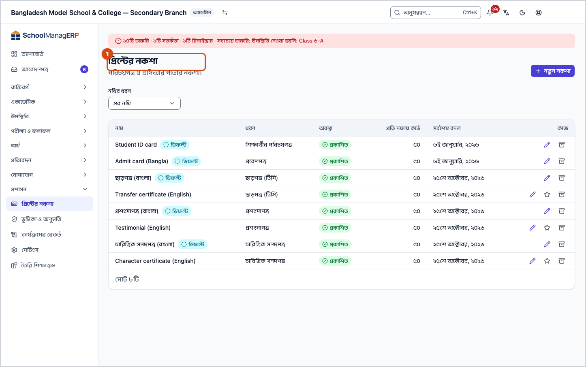

<!-- guide:meta
feature: administration.printTemplates
title: পরিচয়পত্র, সনদ ও পরীক্ষার কাগজ ছাপা
summary: তৈরি নকশা থেকে প্রিন্টের নকশা বানান, প্রকাশ করুন আর ডিফল্ট করুন; প্রিভিউ দেখে নিজের প্রিন্টারে ছাপুন; হারানো কার্ড বাতিল করলে তার কিউআর কোড আর বৈধ দেখায় না।
roles: [ADMIN, ACCOUNTANT, OFFICE_STAFF, EXAM_CONTROLLER]
sources:
  - client-admin/src/routes/_staff/print-templates/index.tsx
  - client-admin/src/routes/_staff/print-templates/$templateId.edit.tsx
  - client-admin/src/routes/_staff/print/document.tsx
  - client-admin/src/routes/_staff/print/preview.tsx
  - client-admin/src/routes/v/$token.tsx
  - client-admin/src/components/print/preview/print-preview.tsx
  - client-admin/src/components/print/preview/run-print.ts
  - client-admin/src/components/print/history/revoke-dialog.tsx
  - ui/src/components/print/print-document/build-print-document.tsx
  - server/src/modules/print/templates/
  - server/src/modules/print/jobs/
  - server/src/modules/print/printers/
  - server/src/modules/print/verify/
labels:
  [
    printTemplates:*,
    printEditor:publish.*,
    printEditor:topbar.*,
    printEditor:fields.*,
    printEditor:help.*,
    printPreview:*,
    certificates:fields.*,
    certificates:help.*,
    examDocuments:fields.*,
    examDocuments:help.*,
    printHistory:actions.*,
    printHistory:revoke.*,
    verify:*,
    nav:items.printTemplates,
    nav:items.printables,
    nav:groups.administration,
  ]
helpIds:
  [
    administration.printTemplates,
    administration.printTemplates.action.create,
    administration.printTemplates.action.publish,
    administration.printTemplates.action.makeDefault,
    administration.printTemplates.action.archive,
    administration.printTemplates.action.print,
    administration.printTemplates.action.confirmRound,
    administration.printTemplates.field.kind,
    administration.printTemplates.field.design,
    administration.printTemplates.field.printer,
    administration.printTemplates.field.batchSize,
  ]
devices: [desktop]
entry: [sidebar, palette]
keywords:
  [প্রিন্ট, ছাপা, নকশা, টেমপ্লেট, আইডি কার্ড, পরিচয়পত্র, সনদ, প্রবেশপত্র, কিউআর, বাতিল, print, template, design, ID card, certificate, QR, revoke]
appVersion: 0.1.0 (1064129d3)
owner: tareq89
lastVerified: 2026-10-25
knownIssues: []
-->

# পরিচয়পত্র, সনদ ও পরীক্ষার কাগজ ছাপা

কার্ড আর সনদ দেখতে কেমন হবে তা একবার ঠিক করুন, তারপর একজন, কয়েকজন বা পুরো শ্রেণির জন্য ছাপুন।

**যেতে হবে:** বাম মেনুতে **প্রশাসন → প্রিন্টের নকশা**। নকশা আর প্রিন্টের কাজ কম্পিউটারে করুন; ফোনে অ্যাপ বলবে **এটি কম্পিউটারে খুলুন**।
**শুরুর আগে:** নকশা বানাতে আপনাকে অ্যাডমিন হতে হবে। ছাপতে হলে অন্তত একটি প্রিন্টার যোগ করা থাকতে হবে ([প্রিন্টার ও ক্যালিব্রেশন](print-templates/printers-and-calibration.md))।

**প্রিন্টের নকশা** হলো একটি নথির চেহারা: পেছনের ছবি, আর নাম, ছবি, শ্রেণি, কিউআর কোড কোথায় বসবে। প্রতিটি নথির ধরনের (যেমন শিক্ষার্থীর পরিচয়পত্র, ছাড়পত্র, প্রবেশপত্র) জন্য আলাদা নকশা। যা-ই ছাপা হয়, সব লেখা থাকে, তাই পরে আবার ছাপা যায় আর হারানো কার্ড বাতিল করা যায়।

[নকশা বানান](#task-main) · [প্রিভিউ দেখে ছাপুন](#preview-print) · [কিউআর কোডে যাচাই](#qr-check) · [সমস্যা ও সমাধান](#trouble)

**এই পাতায় যা আছে**

- [তৈরি নকশা থেকে প্রথম নকশা বানান](#task-main)
- [নকশা তৈরি হয়েছে কি না বুঝবেন কীভাবে](#confirm)
- [অন্য পরিস্থিতিতে](#other)
  - [প্রিভিউ দেখে ছাপুন](#preview-print)
  - [নকশা বদলান ও আবার প্রকাশ করুন](#task-edit)
  - [অন্য নকশাকে ডিফল্ট করুন](#task-default)
  - [নকশা আর্কাইভ করুন](#task-archive)
  - [কিউআর কোডে কার্ড যাচাই, আর হারানো কার্ড বাতিল](#qr-check)
- [সমস্যা ও সমাধান](#trouble)
- [কে কী করতে পারেন](#roles)
- [আরও জানুন](#more)

---

## তৈরি নকশা থেকে প্রথম নকশা বানান 

প্রথম আইডি কার্ড পর্যন্ত পুরো পথ এখানে। প্রিন্টার আগে যোগ না থাকলে আগে [প্রিন্টার যোগ করুন](print-templates/printers-and-calibration.md)।

1. বাম মেনুতে **প্রশাসন → প্রিন্টের নকশা** খুলুন।

   → **প্রিন্টের নকশা** তালিকা আসে। কিছু না থাকলে **একটি নকশা দিয়ে শুরু করুন** লেখা দেখায়।

2. **নতুন নকশা** চাপুন।

   → **নতুন নকশা** জানালা খোলে।

3. **নথির ধরন** বাছুন, যেমন **শিক্ষার্থীর পরিচয়পত্র**।
4. **একটি নকশা বেছে নিন** থেকে একটি তৈরি নকশায় চাপুন। কার্ড লম্বা বা চওড়া, **ক্লাসিক** বা **আধুনিক** হতে পারে।
5. **নাম** দিন, যেমন "শিক্ষার্থী আইডি ২০২৭"। পরে নাম বদলাতে পারবেন।
6. **তৈরি করে এডিটর খুলুন** চাপুন।

   → এডিটর খোলে, নকশা বসানো অবস্থায়। ওপরে **সংরক্ষিত** লেখা আসে। এখনো এটি **শুধু খসড়া**, ছাপায় ব্যবহার হয় না।

7. চাইলে নকশা বদলান ([ডিজাইনারের গাইড](print-templates/designer-guide.md))। তারপর ওপরে **সংস্করণ ১ প্রকাশ করুন** চাপুন।

   → **সংস্করণ ১ প্রকাশ করবেন?** জিজ্ঞেস করে।

8. **প্রকাশ করুন** চাপুন।

   → **সংস্করণ ১ প্রকাশিত হয়েছে** বার্তা আসে। এই ধরনের কোনো ডিফল্ট নকশা না থাকলে অ্যাপ জিজ্ঞেস করে **এটিকে ডিফল্ট করবেন?** — **এটিকে ডিফল্ট করুন** চাপুন।

9. এবার একজন শিক্ষার্থীর পাতা খুলে **আইডি কার্ড প্রিন্ট** চাপুন, আর [প্রিভিউ দেখে ছাপুন](#preview-print)।

> **মনে রাখুন:** প্রকাশ না করা পর্যন্ত নকশাটি কোনো ছাপায় আসে না। এডিটর নিজে থেকে সংরক্ষণ করে, কিন্তু ছাপায় যায় শুধু প্রকাশিত সংস্করণ।

---

## নকশা তৈরি হয়েছে কি না বুঝবেন কীভাবে 

| অবস্থা                       | কীভাবে বুঝবেন                                                                               | এরপর কী                        |
| ---------------------------- | ------------------------------------------------------------------------------------------- | ------------------------------ |
| **শুধু স্ক্রিনে বদলেছে**     | এডিটরের ওপরে **সংরক্ষণ হয়নি…** বা **সংরক্ষণ হচ্ছে…**                                       | **সংরক্ষিত** আসা পর্যন্ত থাকুন |
| **স্কুলের সিস্টেমে পৌঁছেছে** | ওপরে **সংরক্ষিত**; তালিকায় **অবস্থা** ঘরে **শুধু খসড়া**                                   | প্রকাশ করুন                    |
| **ছাপার জন্য তৈরি**          | **সংস্করণ … প্রকাশিত হয়েছে** বার্তা; তালিকায় **প্রকাশিত**, আর ডিফল্ট হলে **ডিফল্ট** চিহ্ন | কাজ শেষ, এখন ছাপা যায়         |

**যাচাই করতে চাইলে:** **প্রশাসন → প্রিন্টের নকশা** তালিকায় নকশাটির **অবস্থা** আর **ডিফল্ট** চিহ্ন দেখুন।

**বার্তা না এলে:** [সমস্যা ও সমাধান](#trouble) দেখুন। এডিটরে **সংরক্ষণ করা যায়নি** দেখালে **আবার চেষ্টা** চাপুন; বের হতে চাইলে অ্যাপ আগে সতর্ক করে।

---

## অন্য পরিস্থিতিতে 

### প্রিভিউ দেখে ছাপুন 

আইডি কার্ড ছাপা শুরু হয় শিক্ষার্থী বা কর্মীর পাতা থেকে ([আইডি কার্ড ছাপা](print-templates/id-cards.md))। সনদ আর পরীক্ষার কাগজের পথ আলাদা পাতায়: [সনদ](print-templates/certificates.md), [পরীক্ষার কাগজপত্র](print-templates/exam-documents.md)। যেখান থেকেই আসুন, শেষে **প্রিন্ট প্রিভিউ** খোলে।

1. **নকশা** দেখুন। শুরুতে ডিফল্ট নকশা বাছাই থাকে।
2. **প্রিন্টার** থেকে **একটি প্রিন্টার বেছে নিন**। প্রিন্টার আপনাকেই বাছতে হয়, কেন তা [এখানে](print-templates/printers-and-calibration.md#why-printer)।

   → প্রিন্টারের ধরন থেকে পাতার মাপ ঠিক হয়: **কার্ড প্রিন্টার** হলে একটি পাতা = একটি কার্ড, **অফিস প্রিন্টার** হলে A4 পাতায় কয়েকটি কার্ড। পরীক্ষার কাগজ সবসময় A4।

3. কোনো কার্ডে **দেখা দরকার** চিহ্ন থাকলে ওপরের তালিকা দেখুন (যেমন **ছবি নেই**, **লেখা জায়গায় ধরছে না**)। ঠিক করে আসুন, নয়তো **জেনেও এই দফা প্রিন্ট করুন** চাপুন।
4. **প্রিন্ট করুন** চাপুন।

   → **প্রিন্ট উইন্ডো খোলা হচ্ছে…**, তারপর ব্রাউজারের প্রিন্ট উইন্ডো খোলে। সেখানে একই প্রিন্টার বাছুন, **Margins: None**, **Scale: 100%** দিন ([প্রিন্ট উইন্ডোর সেটিংস](print-templates/printers-and-calibration.md))।

5. কার্ড বের হলে অ্যাপ জিজ্ঞেস করে **…টি কার্ডই কি ঠিকমতো ছাপা হয়েছে?**

| আপনি চাপলেন               | কী হবে                                                             | লেখা হলো? |
| ------------------------- | ------------------------------------------------------------------ | --------- |
| **হ্যাঁ, সব ছাপা হয়েছে** | দফাটি ছাপা হিসেবে লেখা হয়, পরের দফা খোলে                          | হ্যাঁ     |
| **কিছু ছাপা হয়নি…**      | যেগুলো ঠিকমতো ছাপা হয়নি সেগুলোতে টিক দিন, তারপর সেগুলো আবার ছাপুন | হ্যাঁ     |

→ **লেখা হয়েছে।** বার্তা আসে। সব দফা শেষ হলে যেখান থেকে এসেছিলেন সেখানে ফেরেন।

> **মনে রাখুন:** **প্রিন্ট করুন** চাপলেই ছাপার রেকর্ড তৈরি হয়, কাগজ বের হওয়ার আগেই। তাই উত্তরটি দিন, যাতে ইতিহাস ঠিক থাকে। প্রিন্ট শুরু হলে **নকশা** আর বদলানো যায় না।

**ছাপা ভুল জায়গায় পড়লে** (কিনারা কাটা, একপাশে সরে যাওয়া, ছোট বা বড়): ব্রাউজারের **Scale** 100% কি না দেখুন, তারপর প্রিন্টারটি [ক্যালিব্রেট করুন](print-templates/printers-and-calibration.md)।

### নকশা বদলান ও আবার প্রকাশ করুন 

1. তালিকায় নকশার সারিতে **নকশা সম্পাদনা** চাপুন।
2. বদলান। ওপরে **সংরক্ষিত** আসা পর্যন্ত অপেক্ষা করুন।
3. **সংস্করণ … প্রকাশ করুন** চাপুন, তারপর **প্রকাশ করুন**।

   → **সংস্করণ … প্রকাশিত হয়েছে**। এখন থেকে নতুন ছাপায় এই সংস্করণ লাগে। আগের ছাপা তাদের নিজ সংস্করণেই থাকে, তাই পুরোনো কার্ড আবার ছাপলে আগের চেহারাই আসে।

### অন্য নকশাকে ডিফল্ট করুন 

**ডিফল্ট** নকশা প্রিন্টের সময় আগে থেকে বাছাই থাকে। প্রতিটি নথির ধরনের একটিই ডিফল্ট।

1. তালিকায় নকশার সারিতে **ডিফল্ট করুন** চাপুন।

   → **… ডিফল্ট করবেন?** জিজ্ঞেস করে।

2. নিশ্চিত করুন।

   → সারিতে **ডিফল্ট** চিহ্ন বসে; আগের ডিফল্ট নকশা থেকে চিহ্ন সরে যায়। শুধু প্রকাশিত নকশা ডিফল্ট করা যায়।

### নকশা আর্কাইভ করুন 

1. তালিকায় নকশার সারিতে **আর্কাইভ করুন** চাপুন।

   → **… আর্কাইভ করবেন?** জিজ্ঞেস করে: **প্রিন্টের সময় এটি আর দেখানো হবে না। আগের প্রিন্টের রেকর্ড থাকবে।**

| আপনি চাপলেন      | কী হবে                                        | বদলাল? |
| ---------------- | --------------------------------------------- | ------ |
| **আর্কাইভ করুন** | নকশা তালিকা থেকে সরে যায়, আর প্রিন্টে আসে না | হ্যাঁ  |
| **বাতিল**        | কিছুই বদলায় না                               | না     |

ডিফল্ট নকশা সরাসরি আর্কাইভ হয় না; আগে অন্য একটিকে ডিফল্ট করুন।

### কিউআর কোডে কার্ড যাচাই, আর হারানো কার্ড বাতিল 

প্রতিটি ছাপা কার্ডের কিউআর কোড আলাদা। যে কেউ ফোনে স্ক্যান করলে **নথি যাচাই** পাতা (`/v/<কোড>`) খোলে, লগইন ছাড়াই। পাতাটি ফোনের ছোট পর্দাতেও পড়া যায় (যাচাই হয়নি)।

- সঠিক কার্ডে দেখায় **নথিটি সঠিক ও বৈধ**, সাথে **নথি**, **ধারক**, **বিদ্যালয়**, **ইস্যুর তারিখ**, **কপি**, আর সনদে **ক্রমিক নম্বর**।
- বাতিল করা কার্ডে দেখায় **এই নথিটি বাতিল করা হয়েছে** আর **বাতিলের তারিখ**।
- ছবি, আইডি নম্বর, শ্রেণি বা ফোন নম্বর কখনো দেখায় না। এসিআর কখনো যাচাই পাতায় আসে না।
- কোড ভুল বা অসম্পূর্ণ হলে **নথিটি খুঁজে পাওয়া যায়নি**।

**হারানো কার্ড বাতিল করুন** (শুধু অ্যাডমিন):

1. বাম মেনুতে [**প্রতিবেদন → প্রিন্ট ও ডকুমেন্ট**](../reports/printables.md) খুলুন।
2. কার্ডটির সারিতে **বাতিল করুন** চাপুন।
3. **কারণ** লিখুন (আবশ্যক, সর্বোচ্চ ২৮০ অক্ষর; এটি কর্মীরা দেখেন, সাধারণ মানুষ নয়)।
4. **কার্ড বাতিল করুন** চাপুন।

   → **কার্ড বাতিল হয়েছে** বার্তা আসে। এখন থেকে কিউআর স্ক্যান করলে কার্ডটি বাতিল দেখায়। নতুন কার্ড লাগলে আবার ছাপুন; নতুন কপির কিউআর আলাদা।

> **মনে রাখুন:** বাতিল ফেরানোর কোনো বোতাম নেই। ঠিক কার্ডটি বাছছেন কি না, **কপি** নম্বর মিলিয়ে নিন।

---

## সমস্যা ও সমাধান 

| আপনি যা দেখছেন                                                               | কী করবেন                                                                                                      | কে সাহায্য করতে পারেন |
| ---------------------------------------------------------------------------- | ------------------------------------------------------------------------------------------------------------- | --------------------- |
| **এই নথির জন্য এখনও কোনো নকশা নেই**                                          | **একটি নমুনা থেকে তৈরি করুন** চাপুন, বা অ্যাডমিনকে নকশা প্রকাশ করতে বলুন                                      | অ্যাডমিন              |
| **প্রিন্ট করতে আগে আপনার প্রথম প্রিন্টার যোগ করুন।**                         | **প্রথম প্রিন্টার যোগ করুন** চাপুন ([প্রিন্টার](print-templates/printers-and-calibration.md))                 | অ্যাডমিন              |
| **আপনার ব্রাউজার প্রিন্ট উইন্ডো আটকে দিয়েছে। …**                            | এই সাইটের জন্য পপ-আপ চালু করে আবার **প্রিন্ট করুন** চাপুন                                                     | নিজে                  |
| **প্রিন্ট শুরু করা যায়নি। কিছুই ছাপা হয়নি।**                               | কিছুক্ষণ পর আবার চেষ্টা করুন                                                                                  | নিজে                  |
| **পরের দফা খুলতে আগে বর্তমান দফাটি নিশ্চিত করুন।**                           | **…টি কার্ডই কি ঠিকমতো ছাপা হয়েছে?** প্রশ্নের উত্তর দিন                                                      | নিজে                  |
| **এটি এখন ডিফল্ট নকশা। আগে অন্য একটি নকশাকে ডিফল্ট করুন।**                   | অন্য নকশা প্রকাশ করে **ডিফল্ট করুন**, তারপর আর্কাইভ করুন                                                      | অ্যাডমিন              |
| **এই নামে আগেই একটি নকশা আছে।**                                              | অন্য নাম দিন                                                                                                  | নিজে                  |
| প্রকাশের বোতাম চাপা যাচ্ছে না, **সংরক্ষণ শেষ হওয়া পর্যন্ত অপেক্ষা করুন…**   | **সংরক্ষিত** আসা পর্যন্ত অপেক্ষা করুন, বা **প্রকাশের আগে এগুলো ঠিক করুন:** তালিকা ঠিক করুন                    | নিজে                  |
| ছাপা কাগজে সরে গেছে বা কেটে গেছে                                             | **Scale 100%** আর **Margins None** দিন, তারপর [ক্যালিব্রেট করুন](print-templates/printers-and-calibration.md) | অ্যাডমিন              |
| কর্মীর কার্ড ছাপতে গেলে অনুমতি নেই বলে                                       | কর্মীর কার্ডের জন্য কর্মীর এইচআর তথ্য দেখার অনুমতিও লাগে; অ্যাডমিনকে বলুন                                     | অ্যাডমিন              |
| কিউআর স্ক্যানে **অনেকবার যাচাই করা হয়েছে — এক মিনিট পরে আবার চেষ্টা করুন।** | এক মিনিট অপেক্ষা করে আবার স্ক্যান করুন                                                                        | নিজে                  |

এ নিয়ে আরও সাহায্য: [সমস্যা হলে কী করবেন](../help/troubleshooting.md#print)।

---

## কে কী করতে পারেন 

| ভূমিকা                | নকশা বানানো, প্রকাশ, ডিফল্ট, আর্কাইভ; প্রিন্টার যোগ | আইডি কার্ড ও পরীক্ষার কাগজ ছাপা                      | সনদ দেওয়া | ছাপার ইতিহাস দেখা | কার্ড বাতিল |
| --------------------- | --------------------------------------------------- | ---------------------------------------------------- | ---------- | ----------------- | ----------- |
| অ্যাডমিন              | হ্যাঁ                                               | হ্যাঁ                                                | হ্যাঁ      | হ্যাঁ             | হ্যাঁ       |
| হিসাবরক্ষক            | না                                                  | শুধু আইডি কার্ড (কর্মীর কার্ড নয়); পরীক্ষার কাগজ না | না         | না                | না          |
| অফিস সহকারী           | না                                                  | শুধু আইডি কার্ড (কর্মীর কার্ড নয়); পরীক্ষার কাগজ না | হ্যাঁ      | হ্যাঁ             | না          |
| পরীক্ষা নিয়ন্ত্রক    | না                                                  | হ্যাঁ (কর্মীর কার্ড নয়)                             | না         | হ্যাঁ             | না          |
| একাডেমিক কো-অর্ডিনেটর | না                                                  | না                                                   | হ্যাঁ      | হ্যাঁ             | না          |

কিউআর যাচাই পাতা সবার জন্য খোলা, লগইন লাগে না।

---

## আরও জানুন 

<strong>পাতার অংশগুলো</strong> — প্রিন্টের নকশা তালিকা

1. **প্রিন্টের নকশা** শিরোনাম আর **নতুন নকশা** বোতাম।
2. **নথির ধরন** ছাঁকনি (**সব নথি**)।
3. তালিকা — **নাম**, **ধরন**, **অবস্থা** (**প্রকাশিত** / **শুধু খসড়া**), **প্রতি দফায় কার্ড**, **সর্বশেষ বদল**, আর **কাজ**: **নকশা সম্পাদনা**, **ডিফল্ট করুন**, **আর্কাইভ করুন**।

<strong>ঘরগুলোর অর্থ</strong>

**নতুন নকশা জানালা**

<!-- guide:generated:fields:printTemplates -->

| ঘর                 | কী লিখবেন                                                                                                             | বাধ্যতামূলক? |
| ------------------ | --------------------------------------------------------------------------------------------------------------------- | ------------ |
| নথির ধরন           | নকশাটি কিসের জন্য, যেমন শিক্ষার্থীর পরিচয়পত্র বা ছাড়পত্র (টিসি)। পরে আর বদলানো যায় না।                             | হ্যাঁ        |
| একটি নকশা বেছে নিন | যে তৈরি নকশা থেকে শুরু করবেন। পরে এডিটরে সবকিছু বদলাতে পারবেন।                                                        | হ্যাঁ        |
| নাম                | এই তালিকায় শুধু আপনার স্কুল নামটি দেখে, যেমন শিক্ষার্থী আইডি ২০২৭। দুটি নকশার একই নাম হয় না। পরে নাম বদলাতে পারবেন। | হ্যাঁ        |

<!-- /guide:generated -->

**এডিটর: পাতা ও লেখা**

<!-- guide:generated:fields:printEditor -->

| ঘর                         | কী লিখবেন                                                                                                                                    | বাধ্যতামূলক? |
| -------------------------- | -------------------------------------------------------------------------------------------------------------------------------------------- | ------------ |
| কাগজ                       | একটি কার্ড বা পাতার মাপ: CR80 কার্ড লম্বা, CR80 কার্ড চওড়া, নয়তো মিলিমিটারে নিজের মাপ।                                                     | না           |
| পাশ                        | শুধু সামনে, নাকি সামনে ও পেছনে দুই পাশেই।                                                                                                    | না           |
| প্রতি দফায় কার্ড          | এক দফায় কয়টি কার্ড ছাপা হবে; তারপর অ্যাপ জিজ্ঞেস করে সব ঠিকমতো ছাপা হলো কি না। সর্বোচ্চ ২০০। ভারী নকশা ছোট দফায় বেশি ভালো ছাপা হয়।       | না           |
| পুনরায় ছাপায় লেখা        | ২য় কপি থেকে কার্ডে ছাপা হয়, যেমন "কপি {n}" বা "ডুপ্লিকেট"। না চাইলে খালি রাখুন।                                                            | না           |
| লেখা বেশি লম্বা হলে        | নাম বা অন্য লেখা ঘরে না ধরলে কী হবে: ছোট হবে, পরের লাইনে যাবে, বাড়তিটুকু কেটে যাবে, নয়তো যেমন আছে ছাপা হবে আর ছাপার আগে আপনাকে সতর্ক করবে। | না           |
| সবচেয়ে ছোট আকার (পয়েন্ট) | লেখা এই আকার পর্যন্ত ছোট হবে, এর বেশি নয়। খালি রাখলে সাধারণ মান ধরা হয়।                                                                    | না           |

<!-- /guide:generated -->

**প্রিন্ট প্রিভিউ**

<!-- guide:generated:fields:printPreview -->

| ঘর                | কী লিখবেন                                                                                                                                                                                                | বাধ্যতামূলক? |
| ----------------- | -------------------------------------------------------------------------------------------------------------------------------------------------------------------------------------------------------- | ------------ |
| নকশা              | কার্ডে কোন প্রকাশিত নকশা লাগবে। শুরুতে ডিফল্ট নকশা বাছাই থাকে। প্রিন্ট শুরু হলে আর বদলানো যায় না।                                                                                                       | হ্যাঁ        |
| প্রিন্টার         | কার্ডগুলো কোন প্রিন্টারে যাবে। এর সংরক্ষিত সেটিং (কার্ড না অফিস প্রিন্টার, জায়গা ঠিক করার মাপ) থেকেই পাতার মাপ আর কাগজে কোথায় ছাপা পড়বে তা ঠিক হয়। ব্রাউজারের প্রিন্ট উইন্ডোতেও একই প্রিন্টার বাছুন। | হ্যাঁ        |
| প্রতি দফায় কার্ড | এক দফায় কয়টি কার্ড ছাপা হবে। একটি দফা ছেপে নিশ্চিত করলে পরেরটি খোলে।                                                                                                                                   | না           |

<!-- /guide:generated -->

[**সনদ দেওয়া**](print-templates/certificates.md)

<!-- guide:generated:fields:certificates -->

| ঘর           | কী লিখবেন                                                                                                              | বাধ্যতামূলক? |
| ------------ | ---------------------------------------------------------------------------------------------------------------------- | ------------ |
| কোন সনদ?     | যে সনদটি দেবেন। ছাড়পত্রের জন্য আগে বদলি বা চলে যাওয়ার তথ্য লিখে রাখতে হয়।                                           | হ্যাঁ        |
| সনদের ভাষা   | পুরো সনদ এই এক ভাষায় ছাপা হয়। শুরুতে স্কুলের ডিফল্ট ভাষা বাছাই থাকে।                                                 | না           |
| ক্রমিক নম্বর | আপনি লেখেন না, শুধু মিলিয়ে দেখেন। প্রিন্ট চাপলেই নম্বরটি এই সনদের হয়ে যায়। তার আগে বন্ধ করলে কোনো নম্বর খরচ হয় না। | না           |
| প্রিন্টার    | সনদ কোন প্রিন্টারে ছাপা হবে। আগে প্রিন্টিং সেটিংসে একটি প্রিন্টার যোগ করুন।                                            | হ্যাঁ        |

<!-- /guide:generated -->

**পরীক্ষার কাগজ**

<!-- guide:generated:fields:examDocuments -->

| ঘর                | কী লিখবেন                                                            | বাধ্যতামূলক? |
| ----------------- | -------------------------------------------------------------------- | ------------ |
| কোন প্রবেশপত্র    | সবার, শুধু যাদের প্রবেশপত্র এখনো ছাপা হয়নি তাদের, নয়তো একটি শাখার। | হ্যাঁ        |
| কিসের ভিত্তিতে    | শ্রেণির মেধাস্থান নাকি শাখার মেধাস্থান দেখে মেধা সনদ দেওয়া হবে।     | হ্যাঁ        |
| সেরা কত জন (১–৫০) | ওপর থেকে কত জন সনদ পাবে, ১ থেকে ৫০ জন।                               | হ্যাঁ        |

<!-- /guide:generated -->

<strong>প্রিন্ট কীভাবে কাজ করে</strong> — নকশা, সংস্করণ, ছাপা আর যাচাই

<figure>
  
  <figcaption><em>নকশা থেকে ছাপা কার্ড আর কিউআর যাচাই</em></figcaption>
</figure>

- **সংস্করণ বদলায় না:** প্রতিবার প্রকাশে নতুন নম্বরের সংস্করণ হয়। প্রতিটি ছাপা যে সংস্করণে হয়েছে, সেটির সাথেই থাকে।
- **আগে রেকর্ড, পরে ছাপা:** **প্রিন্ট করুন** চাপলে আগে ছাপার রেকর্ড তৈরি হয়; রেকর্ড না হলে কিছুই ছাপা হয় না।
- **প্রতিটি কপির নিজের কিউআর:** আবার ছাপলে নতুন কপি নম্বর আর নতুন কিউআর। একটি কপি বাতিল করলে শুধু সেটিই বাতিল দেখায়।

**সম্পর্কিত পাতা**

- [**ডিজাইনারের গাইড**](print-templates/designer-guide.md) — এডিটরে নকশা বদলানো আর ছবি তৈরির মাপ।
- [**প্রিন্টার ও ক্যালিব্রেশন**](print-templates/printers-and-calibration.md) — প্রিন্টার যোগ, ছাপা ঠিক জায়গায় আনা।
- [**আইডি কার্ড ছাপা**](print-templates/id-cards.md) — একজন, কয়েকজন বা পুরো শ্রেণির কার্ড, আবার ছাপা।
- [**পরীক্ষার কাগজপত্র**](print-templates/exam-documents.md) — প্রবেশপত্র, সিট লিস্ট, মার্কশিট, ফলাফল সনদ।
- [**সনদ**](print-templates/certificates.md) — ছাড়পত্র, প্রশংসাপত্র; ক্রমিক নম্বর ও রেজিস্টার।
- [**শিক্ষার্থী**](../people/students.md) — শিক্ষার্থীর পাতা থেকে আইডি কার্ড ছাপা শুরু হয়।
- [**কর্মী**](../people/staff.md) — কর্মীর পাতা থেকে কর্মীর কার্ড।
- [**প্রিন্ট ও ডকুমেন্ট**](../reports/printables.md) — ছাপার ইতিহাস, আবার ছাপা ও বাতিল
- [**স্কুলের সেটিংস ঠিক করা**](settings.md) — স্কুলের সেটিংস

---

_সংস্করণ ০.১.০ · শেষ যাচাই ২০২৬-১০-২৫_
