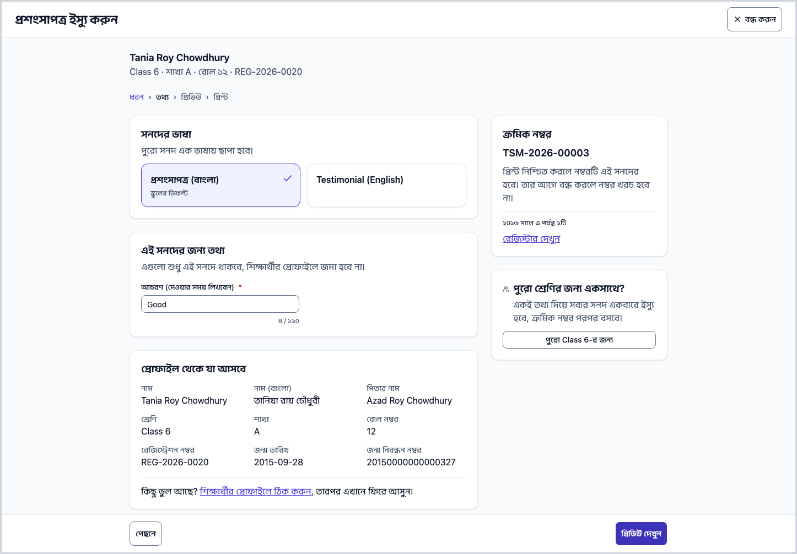
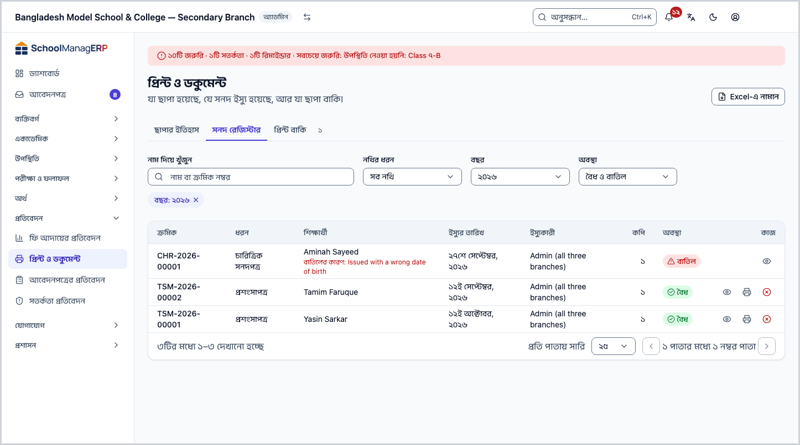

<!-- guide:meta
feature: administration.printCertificates
title: সনদ দেওয়া
summary: ক্রমিক নম্বরসহ শিক্ষার্থীর সনদ দিন, ডুপ্লিকেট হিসেবে আবার ছাপুন, আর বাতিল করলে কিউআর চেকে বাতিল দেখায়।
roles: [ADMIN, EXECUTIVE, OFFICE_STAFF]
sources:
  - client-admin/src/routes/_staff/print/document.tsx
  - client-admin/src/components/print/history/revoke-dialog.tsx
  - server/src/modules/print/jobs/
  - server/src/modules/print/verify/
labels:
  [
    certificates:fields.*,
    certificates:help.*,
    printHistory:revoke.*,
    verify:*,
  ]
helpIds: [administration.printCertificates]
devices: [desktop]
entry: []
keywords:
  [সনদ, ক্রমিক নম্বর, ডুপ্লিকেট, বাতিল, কিউআর, certificate, serial, revoke]
appVersion: 0.1.0 (f3b2a529e)
owner: tareq89
lastVerified: 2026-10-25
knownIssues: []
-->

# সনদ দেওয়া

একজন শিক্ষার্থী বা পুরো শ্রেণিকে সনদ দিন: **ছাড়পত্র (টিসি)**, **প্রশংসাপত্র**, **চারিত্রিক সনদপত্র**, **অধ্যয়ন প্রত্যয়নপত্র** বা **অংশগ্রহণ সনদপত্র**। প্রতিটি সনদ একটি ক্রমিক নম্বর পায় আর রেজিস্টারে থাকে, তাই পরে খুঁজে পাওয়া, আবার ছাপা বা বাতিল করা যায়।

**যেতে হবে:** শিক্ষার্থীর পাতা ([শিক্ষার্থী](../../people/students.md)) → **কাগজপত্র** ট্যাব → **সনদ ইস্যু করুন**। যেকোনো পাতা থেকে **Ctrl+K** চেপে **সনদ ইস্যু করুন** লিখলেও হয়।
**শুরুর আগে:** সনদের ধরনের একটি প্রকাশিত নকশা ([প্রিন্টের নকশা](../print-templates.md)) আর অন্তত একটি প্রিন্টার ([প্রিন্টার ও ক্যালিব্রেশন](printers-and-calibration.md)) লাগবে। NCTB, আলিয়া বা কওমি কারিকুলাম প্রিসেট প্রয়োগ করা থাকলে ছাড়পত্র, প্রশংসাপত্র আর চারিত্রিক সনদের নকশা আগে থেকেই থাকে (যাচাই হয়নি)।

[একটি সনদ](#task-main) · [ক্রমিক নম্বর](#serial) · [পুরো শ্রেণি](#bulk) · [আবার ছাপা](#reprint) · [বাতিল](#revoke) · [সমস্যা ও সমাধান](#trouble)

**এই পাতায় যা আছে**

- [একজনকে সনদ দিন](#task-main)
- [সনদ দেওয়া হয়েছে কি না বুঝবেন কীভাবে](#confirm)
- [অন্য পরিস্থিতিতে](#other)
  - [কোন সনদ কে পায়](#eligible)
  - [ক্রমিক নম্বর](#serial)
  - [পুরো শ্রেণির জন্য একসাথে](#bulk)
  - [আবার ছাপা: প্রতিলিপি](#reprint)
  - [সনদ রেজিস্টার](#register)
  - [সনদ বাতিল করুন](#revoke)
- [সমস্যা ও সমাধান](#trouble)
- [কে কী করতে পারেন](#roles)
- [আরও জানুন](#more)

---

## একজনকে সনদ দিন 

জানালায় চারটি ধাপ: **ধরন**, **তথ্য**, **প্রিভিউ**, **প্রিন্ট**।

1. শিক্ষার্থীর পাতায় **কাগজপত্র** ট্যাবে **সনদ ইস্যু করুন** চাপুন।

   → **সনদ ইস্যু করুন** জানালা খোলে, **কোন সনদ?** প্রশ্নসহ।

2. **ধরন:** সনদটি বাছুন। যে ধরন এখন দেওয়া যাবে না, সেটি ধূসর আর কারণ লেখা থাকে ([কোন সনদ কে পায়](#eligible))। **পরের ধাপ** চাপুন।
3. **তথ্য:**
   - **সনদের ভাষা** বাছুন, বাংলা না ইংরেজি। পুরো সনদ এক ভাষায় ছাপা হয়; শুরুতে **স্কুলের ডিফল্ট** বাছাই থাকে।
   - **এই সনদের জন্য তথ্য** ঘরগুলো পূরণ করুন। এগুলো শুধু এই সনদে থাকবে, শিক্ষার্থীর প্রোফাইলে জমা হবে না।
   - **প্রোফাইল থেকে যা আসবে** অংশে নাম-শ্রেণি দেখুন। ভুল থাকলে **শিক্ষার্থীর প্রোফাইলে ঠিক করুন** চেপে ঠিক করুন, তারপর এখানে ফিরে আসুন।
   - **ক্রমিক নম্বর** অংশে **পরবর্তী** নম্বরটি মিলিয়ে দেখুন। এটি আপনি লেখেন না।

4. **প্রিভিউ দেখুন** চাপুন। সনদটি যেমন ছাপা হবে তেমন দেখুন, তারপর **পরের ধাপ**।
5. **প্রিন্ট:** **প্রিন্টার** বেছে **প্রিন্ট করুন** চাপুন ([কেন নিজে বাছতে হয়](printers-and-calibration.md#why-printer))।

   → ব্রাউজারের প্রিন্ট উইন্ডো খোলে। ছাপা শেষে অ্যাপ জিজ্ঞেস করে সব ঠিকমতো ছাপা হয়েছে কি না; উত্তর দিন।

   → **১টি সনদ ইস্যু হয়েছে** আর **ক্রমিক …** দেখায়। **বন্ধ করুন** চাপুন।

> **মনে রাখুন:** **প্রিন্ট করুন** চাপলেই ক্রমিক নম্বরটি এই সনদের হয়ে যায়। তার আগে জানালা বন্ধ করলে কোনো নম্বর খরচ হয় না।

---

## সনদ দেওয়া হয়েছে কি না বুঝবেন কীভাবে 

| অবস্থা                       | কীভাবে বুঝবেন                                                                                      | এরপর কী      |
| ---------------------------- | -------------------------------------------------------------------------------------------------- | ------------ |
| **শুধু স্ক্রিনে বদলেছে**     | প্রিভিউ দেখছেন, **প্রিন্ট করুন** এখনো চাপেননি                                                      | প্রিন্ট করুন |
| **স্কুলের সিস্টেমে পৌঁছেছে** | সব ঠিকমতো ছাপা হয়েছে কি না প্রশ্ন এসেছে                                                           | উত্তর দিন    |
| **কাজ শেষ**                  | **…টি সনদ ইস্যু হয়েছে**; **কাগজপত্র** ট্যাবের **ইস্যু করা সনদ** তালিকায় সারি, **অবস্থা** **বৈধ** | সনদ দিন      |

**যাচাই করতে চাইলে:** সনদের কিউআর স্ক্যান করুন; **নথি যাচাই** পাতায় **নথিটি সঠিক ও বৈধ** দেখাবে ([কিউআর কোডে যাচাই](../print-templates.md#qr-check))। পাতায় শুধু নথির ধরন, ধারকের নাম, বিদ্যালয়, ইস্যুর তারিখ, কপি আর ক্রমিক নম্বর থাকে।

---

## অন্য পরিস্থিতিতে 

### কোন সনদ কে পায় 

| সনদ                       | কে পায়                                         | না পেলে যা দেখায়                                                                          |
| ------------------------- | ----------------------------------------------- | ------------------------------------------------------------------------------------------ |
| **ছাড়পত্র (টিসি)**       | যার ছাড়ার তথ্য (বদলি বা প্রত্যাহার) রেকর্ড করা | **আগে ছাড়ার তথ্য (বদলি বা প্রত্যাহার) রেকর্ড করুন।** আর **ছাড়ার তথ্য রেকর্ড করুন** বোতাম |
| **প্রশংসাপত্র**           | বর্তমান বা উত্তীর্ণ শিক্ষার্থী                  | **শুধু বর্তমান বা উত্তীর্ণ শিক্ষার্থীদের জন্য।**                                           |
| **অধ্যয়ন প্রত্যয়নপত্র** | বর্তমান শিক্ষার্থী                              | **শুধু বর্তমান শিক্ষার্থীদের জন্য।**                                                       |
| **চারিত্রিক সনদপত্র**     | যেকোনো শিক্ষার্থী                               | —                                                                                          |
| **অংশগ্রহণ সনদপত্র**      | যেকোনো শিক্ষার্থী                               | —                                                                                          |

যেকোনো ধরনের প্রকাশিত নকশা না থাকলে দেখায় **এখনো কোনো প্রকাশিত টেমপ্লেট নেই।** আর **টেমপ্লেট বানান** বোতাম। ছাড়ার পর আবার ভর্তি হলে ছাড়পত্র আর দেওয়া যায় না; শেষ ঘটনাটিই ধরা হয়।

### ক্রমিক নম্বর 

ক্রমিক নম্বর দেখতে এমন: `TSM-2026-00009`। মানে সনদের কোড, সাল আর পাঁচ অঙ্কের চলতি নম্বর।

| সনদ                   | কোড   |
| --------------------- | ----- |
| ছাড়পত্র (টিসি)       | `TC`  |
| প্রশংসাপত্র           | `TSM` |
| চারিত্রিক সনদপত্র     | `CHR` |
| অধ্যয়ন প্রত্যয়নপত্র | `STD` |
| অংশগ্রহণ সনদপত্র      | `PRT` |
| ফলাফল সনদ             | `RES` |
| মেধা সনদ              | `MRT` |

- স্কুল **স্কুলের সংক্ষিপ্ত কোড (ঐচ্ছিক)** দিলে (সেটিংস → **প্রিন্টিং** → **কাগজপত্র ও সনদ**; ২–৮টি বড় হাতের অক্ষর বা সংখ্যা) সেটি সামনে বসে: `DAHS-TC-2026-00007`।
- প্রতি ধরন আর প্রতি সালে নম্বর আলাদা চলে, ১ থেকে। সাল ধরা হয় ইস্যুর দিনের ঢাকার তারিখ থেকে।
- বাতিল সনদের নম্বরও আর কাউকে দেওয়া হয় না।
- এক সালে এক ধরনের ৯৯৯৯৯টির বেশি সনদ দেওয়া যায় না।

### পুরো শ্রেণির জন্য একসাথে 

ছাড়পত্র ছাড়া অন্য সব সনদ পুরো শ্রেণিকে একবারে দেওয়া যায়।

1. যেকোনো এক শিক্ষার্থীর পাতা থেকে জানালা খুলে ধরন বাছুন।
2. **তথ্য** ধাপে **পুরো শ্রেণির জন্য একসাথে?** অংশে **পুরো …-র জন্য** চাপুন।

   → **… জন শিক্ষার্থী** দেখায়। যারা এই সনদ পাবে না, তারা **… জন এই সনদ পাবে না, তাদের বাদ দেওয়া হয়েছে:** তালিকায় থাকে।

3. সবার জন্য একই তথ্য দিন, তারপর আগের মতো প্রিভিউ আর প্রিন্ট।

   → ক্রমিক নম্বর রোল অনুযায়ী পরপর বসে; শেষে **ক্রমিক … – …** দেখায়।

এক শ্রেণিতে ১০০০ জনের বেশি হলে দেখায় **শ্রেণিটি এক সঙ্গে ইস্যু করার জন্য অনেক বড়। ছোট ছোট দলে ইস্যু করুন।** বেশি সনদ হলে ছাপা দফায় দফায় হয়, প্রতিটি দফার পর প্রশ্নের উত্তর দিন।

### আবার ছাপা: প্রতিলিপি 

**প্রতিবেদন → প্রিন্ট ও ডকুমেন্ট** → **সনদ রেজিস্টার** (বা **ছাপার ইতিহাস**) থেকে সারিটির **আবার ছাপুন** চাপুন।

- নতুন কপিতে **একই ক্রমিক নম্বর** থাকে, কপি নম্বর বাড়ে।
- প্রতিলিপিতে সবসময় **প্রতিলিপি / DUPLICATE** লেখা ছাপা হয়, নকশার লেবেল ফাঁকা থাকলেও, যাতে কেউ আসল বলে ভুল না করে।
- বাতিল সনদ আবার ছাপা যায় না।

### সনদ রেজিস্টার 

[**প্রতিবেদন → প্রিন্ট ও ডকুমেন্ট**](../../reports/printables.md) → **সনদ রেজিস্টার** ট্যাবে ইস্যু করা প্রতিটি সনদ থাকে, বাতিলগুলোও: ক্রমিক, ধরন, শিক্ষার্থী, তারিখ আর অবস্থা। ধরন আর সাল দিয়ে ছাঁকুন। **Excel-এ নামান** চাপলে Excel-এ খোলার মতো CSV ফাইল পাবেন (সর্বোচ্চ ১০,০০০ সারি)।

### সনদ বাতিল করুন 

শুধু অ্যাডমিন পারেন।

1. **প্রতিবেদন → প্রিন্ট ও ডকুমেন্ট** → **সনদ রেজিস্টার**-এ সনদটির সারিতে **বাতিল করুন** চাপুন।

   → **… বাতিল করুন** জানালা খোলে। সতর্কবার্তায় "কার্ড" শব্দ থাকলেও সনদের বেলাতেও একই কাজ করে।

2. **কারণ** লিখুন (আবশ্যক, সর্বোচ্চ ২৮০ অক্ষর; কর্মীরা দেখেন, সাধারণ মানুষ নয়)।
3. **কার্ড বাতিল করুন** চাপুন।

   → রেজিস্টারে সনদটি কারণসহ **বাতিল** দেখায়। কিউআর স্ক্যান করলে **এই নথিটি বাতিল করা হয়েছে** আর বাতিলের তারিখ দেখায়; কারণ দেখায় না।

> **মনে রাখুন:** বাতিল ফেরানোর কোনো বোতাম নেই। ভুল সনদ বাতিল হলে নতুন করে সনদ দিন; সেটি নতুন ক্রমিক নম্বর পাবে।

---

## সমস্যা ও সমাধান 

| আপনি যা দেখছেন                                        | কী করবেন                                                                                                         | কে সাহায্য করতে পারেন |
| ----------------------------------------------------- | ---------------------------------------------------------------------------------------------------------------- | --------------------- |
| **কাগজপত্র** ট্যাবে **সনদ ইস্যু করুন** নেই            | সনদ দেওয়ার অনুমতি লাগে; অ্যাডমিনকে বলুন                                                                         | অ্যাডমিন              |
| **আগে ছাড়ার তথ্য (বদলি বা প্রত্যাহার) রেকর্ড করুন।** | **ছাড়ার তথ্য রেকর্ড করুন** চেপে বদলি বা প্রত্যাহার লিখুন ([শিক্ষার্থী](../../people/students.md))               | অ্যাডমিন              |
| **এখনো কোনো প্রকাশিত টেমপ্লেট নেই।**                  | **টেমপ্লেট বানান** চাপুন বা অ্যাডমিনকে নকশা প্রকাশ করতে বলুন ([প্রিন্টের নকশা](../print-templates.md#task-main)) | অ্যাডমিন              |
| **আগে সেটিংসে একটি প্রিন্টার যোগ করুন।**              | **প্রিন্টিং সেটিংস খুলুন** চাপুন ([প্রিন্টার যোগ](printers-and-calibration.md#task-main))                        | অ্যাডমিন              |
| **শ্রেণিটি এক সঙ্গে ইস্যু করার জন্য অনেক বড়। …**     | একজন একজন করে, বা ছোট দলে দিন                                                                                    | নিজে                  |
| রেজিস্টারে **আবার ছাপুন** নেই                         | সনদটি বাতিল করা, নয়তো সনদ দেওয়ার অনুমতি নেই                                                                    | অ্যাডমিন              |
| **কার্ডটি বাতিল করা যায়নি।**                         | আবার চেষ্টা করুন                                                                                                 | অ্যাডমিন              |
| ছাপা কাগজে সরে গেছে বা কেটে গেছে                      | [মাপ ঠিক করুন](printers-and-calibration.md#calibrate)                                                            | অ্যাডমিন              |

এ নিয়ে আরও সাহায্য: [সমস্যা হলে কী করবেন](../../help/troubleshooting.md#print)।

---

## কে কী করতে পারেন 

| ভূমিকা                | সনদ দেওয়া, আবার ছাপা | রেজিস্টার দেখা | সনদ বাতিল |
| --------------------- | --------------------- | -------------- | --------- |
| অ্যাডমিন              | হ্যাঁ                 | হ্যাঁ          | হ্যাঁ     |
| অফিস সহকারী           | হ্যাঁ                 | হ্যাঁ          | না        |
| একাডেমিক কো-অর্ডিনেটর | হ্যাঁ                 | হ্যাঁ          | না        |
| হিসাবরক্ষক            | না                    | না             | না        |
| পরীক্ষা নিয়ন্ত্রক    | না                    | হ্যাঁ          | না        |

কিউআর যাচাই পাতা সবার জন্য খোলা, লগইন লাগে না।

---

## আরও জানুন 

<strong>সনদ, ক্রমিক নম্বর আর প্রতিলিপি কীভাবে জড়িত</strong>

<figure>
  
  <figcaption><em>সনদ: ইস্যু, প্রতিলিপি, বাতিল</em></figcaption>
</figure>

- একটি ক্রমিক নম্বর একটি সনদের; প্রতিলিপি সেই নম্বরের নতুন কপি, নতুন সনদ নয়।
- ফলাফল সনদ আর মেধা সনদ ছাপা হয় পরীক্ষার পাতা থেকে, তবে সেগুলোও ক্রমিক নম্বর পায় (`RES`, `MRT`) ([পরীক্ষার কাগজপত্র](exam-documents.md#after))।

**সম্পর্কিত পাতা**

- [**প্রিন্টের নকশা**](../print-templates.md) — মূল পাতা; [কিউআর কোডে যাচাই](../print-templates.md#qr-check)।
- [**প্রিন্টার ও ক্যালিব্রেশন**](printers-and-calibration.md) — প্রিন্টার যোগ, মাপ ঠিক করা।
- [**পরীক্ষার কাগজপত্র ছাপা**](exam-documents.md) — ফলাফল ও মেধা সনদ।
- [**আইডি কার্ড ছাপা**](id-cards.md) — শিক্ষার্থী ও কর্মীর কার্ড।
- [**ডিজাইনারের গাইড**](designer-guide.md) — সনদের নকশা।
- [**শিক্ষার্থী**](../../people/students.md) — **কাগজপত্র** ট্যাব, ছাড়ার তথ্য।
- [**প্রিন্ট ও ডকুমেন্ট**](../../reports/printables.md) — ছাপার ইতিহাস, আবার ছাপা ও বাতিল

---

_সংস্করণ ০.১.০ · শেষ যাচাই ২০২৬-১০-২৫_
