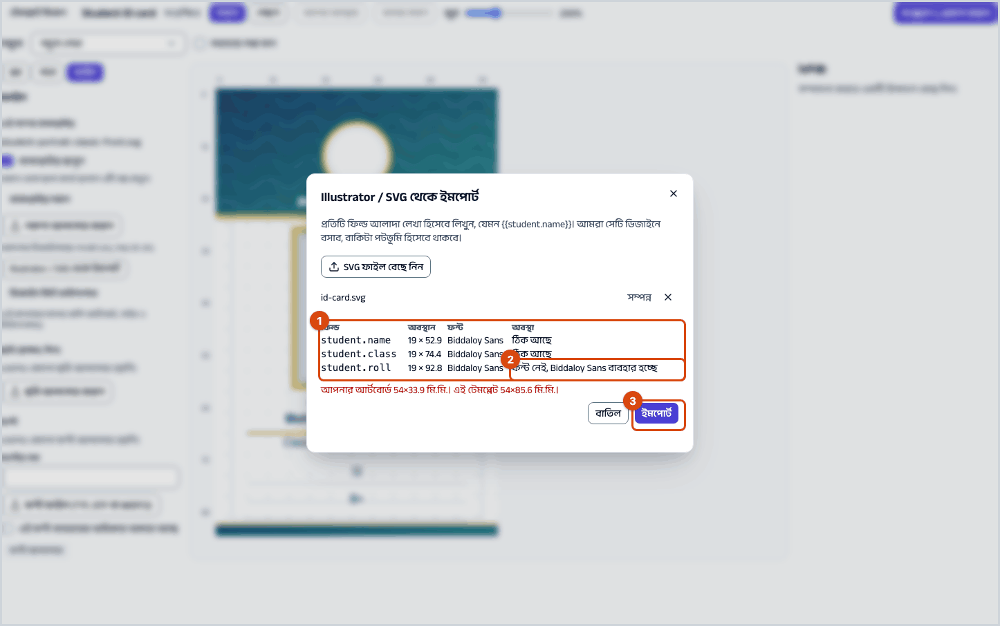

<!-- guide:meta
feature: administration.printDesignerGuide
title: ডিজাইনারের গাইড
summary: ডিজাইন কিট নিন, ডিজাইনারকে পাঠান, আঁকা SVG ইমপোর্ট করুন, ঘরগুলো দেখে নিন আর প্রকাশ করুন।
roles: [ADMIN]
sources:
  - client-admin/src/routes/_staff/print-templates/$templateId.edit.tsx
  - server/src/modules/print/templates/
labels:
  [
    printEditor:publish.*,
    printEditor:topbar.*,
    printEditor:fields.*,
    printEditor:help.*,
  ]
helpIds: []
devices: [desktop]
entry: []
keywords:
  [ডিজাইনার, SVG, কিট, ইমপোর্ট, ঘর, প্রকাশ, designer, import, publish]
appVersion: 0.1.0 (f3b2a529e)
owner: tareq89
lastVerified: 2026-10-25
knownIssues: []
-->

# ডিজাইনারের গাইড

কার্ডের পেছনের ছবি Illustrator, Inkscape, Affinity বা Figma-তে আঁকুন, একটি SVG ফাইল দিন, স্কুল এক ধাপে নকশায় তুলে নেবে।

**যেতে হবে:** নকশার এডিটরে **ফাইল** প্যানেল। এডিটরে যান **প্রশাসন → প্রিন্টের নকশা** থেকে নকশার সারিতে **নকশা সম্পাদনা** চেপে ([প্রিন্টের নকশা](../print-templates.md))।
**শুরুর আগে:** নকশা বদলাতে আপনাকে অ্যাডমিন হতে হবে। বাইরের ডিজাইনার হলে স্কুলের অ্যাডমিনকে ডিজাইন কিট নামিয়ে দিতে বলুন।

**পেছনের ছবি** হলো রং, লোগো, বর্ডার আর স্থায়ী লেখা। যেখানে নাম, শ্রেণি বা রোল বসবে, সেখানে আপনি লেখেন একটি **প্লেসহোল্ডার**, যেমন `{{student.name}}`। ইমপোর্টের সময় অ্যাপ প্রতিটি প্লেসহোল্ডারকে বদলানো যায় এমন ঘরে পরিণত করে আর ছবি থেকে সেই লেখা সরিয়ে দেয়, তাই কিছুই দুবার ছাপা হয় না।

[ছবি এঁকে ইমপোর্ট করুন](#task-main) · [মাপ ও নিরাপদ এলাকা](#safe-bleed) · [সতর্কবার্তার মানে](#trouble)

**এই পাতায় যা আছে**

- [ডিজাইন কিট থেকে ইমপোর্ট পর্যন্ত](#task-main)
- [ইমপোর্ট ঠিক হয়েছে কি না বুঝবেন কীভাবে](#confirm)
- [অন্য পরিস্থিতিতে](#other)
  - [মাপ, নিরাপদ এলাকা ও ব্লিড](#safe-bleed)
  - [লেখা: স্থায়ী লেখা আউটলাইন, প্লেসহোল্ডার লাইভ](#text)
  - [প্রতিটি সফটওয়্যারের এক্সপোর্ট সেটিংস](#export)
  - [ফন্ট আর ছবি (স্বাক্ষর, সিল) আপলোড](#assets)
- [সমস্যা ও সমাধান](#trouble)
- [কে কী করতে পারেন](#roles)
- [আরও জানুন](#more)

---

## ডিজাইন কিট থেকে ইমপোর্ট পর্যন্ত 

1. এডিটরে **ফাইল** প্যানেল খুলে **ডিজাইন কিট ডাউনলোড** চাপুন।

   → দুটি ফাইল নামে: `design-kit.svg` (এই কাগজের মাপের খালি আর্টবোর্ড) আর `design-kit-README.txt` (ইংরেজিতে ছোট নির্দেশনা, বাইরের ডিজাইনারের জন্য)।

2. `design-kit.svg` খুলুন। এতে তিনটি স্তর: **guides** (কিনারা আর ৩ মিমি নিরাপদ এলাকার দাগ), **artwork** (খালি), **fields** (এই নথির প্রতিটি লেখার ঘরের একটি নমুনা `{{…}}`)।
3. **artwork** স্তরে আঁকুন। যেখানে নাম, শ্রেণি ইত্যাদি বসবে, **fields** স্তর থেকে সেই `{{…}}` কপি করে বসান।
4. স্থায়ী লেখা আউটলাইন করুন, প্লেসহোল্ডার লাইভ রাখুন ([লেখা](#text))।
5. **guides** স্তর মুছে SVG হিসেবে এক্সপোর্ট করুন ([এক্সপোর্ট সেটিংস](#export))।
6. এডিটরে **ফাইল** প্যানেলে **Illustrator / SVG থেকে ইমপোর্ট** চাপুন, তারপর **SVG ফাইল বেছে নিন**।

   → একটি তালিকা আসে: **ফিল্ড**, **অবস্থান**, **ফন্ট**, **অবস্থা**। সব ঠিক থাকলে **অবস্থা** ঘরে **ঠিক আছে**।

7. **ইমপোর্ট** চাপুন।

   → পেছনের ছবি বসে, আর প্রতিটি প্লেসহোল্ডার আলাদা ঘর হয়ে যায়। ওপরে **সংরক্ষিত** আসা পর্যন্ত অপেক্ষা করুন।

8. ছবি, স্কুলের লোগো আর কিউআর কোড এডিটরে নিজে বসান; এগুলো প্লেসহোল্ডার লেখা দিয়ে আসে না।
9. নকশা প্রকাশ করুন ([নকশা বদলান ও আবার প্রকাশ করুন](../print-templates.md#task-edit))।

> **মনে রাখুন:** artwork স্তরে যা আঁকা আছে তা বদলায় না। নাম বা রোল সেখানে লিখে ফেললে প্রতিটি কার্ডে একই নাম ছাপা হবে। বদলানো লেখা সবসময় `{{…}}` দিয়ে দিন।

---

## ইমপোর্ট ঠিক হয়েছে কি না বুঝবেন কীভাবে 

| অবস্থা                       | কীভাবে বুঝবেন                                                | এরপর কী                    |
| ---------------------------- | ------------------------------------------------------------ | -------------------------- |
| **শুধু স্ক্রিনে বদলেছে**     | ইমপোর্টের পর ওপরে **সংরক্ষণ হচ্ছে…**                         | অপেক্ষা করুন               |
| **স্কুলের সিস্টেমে পৌঁছেছে** | ওপরে **সংরক্ষিত**; **স্তর** প্যানেলে প্রতিটি ঘর আলাদা দেখায় | প্রকাশ করুন                |
| **ছাপার জন্য তৈরি**          | **সংস্করণ … প্রকাশিত হয়েছে** বার্তা                         | প্রিভিউতে একটি কার্ড দেখুন |

**যাচাই করতে চাইলে:** একজন শিক্ষার্থীর জন্য প্রিন্ট প্রিভিউ খুলে আসল নাম আর ছবি ঠিক জায়গায় বসছে কি না দেখুন।

---

## অন্য পরিস্থিতিতে 

### মাপ, নিরাপদ এলাকা ও ব্লিড 

মাপ মিলিমিটারে। ডিজাইন কিট সবসময় নকশার **পাতার সেটআপ**-এ যে মাপ আছে সেই মাপে আসে।

| **কাগজ**              | চওড়া × লম্বা          |
| --------------------- | ---------------------- |
| **CR80 কার্ড, লম্বা** | ৫৪ × ৮৫.৬ মিমি         |
| **CR80 কার্ড, চওড়া** | ৮৫.৬ × ৫৪ মিমি         |
| **নিজের মাপ**         | পাতার সেটআপে যা দেওয়া |

- **নিরাপদ এলাকা ৩ মিমি:** নাম, ছবি আর লোগো প্রতিটি কিনারা থেকে অন্তত ৩ মিমি ভেতরে রাখুন। প্রিন্টার কিনারা একটু কেটে ফেলতে পারে।
- **ব্লিড:** রং কিনারা পর্যন্ত গেলে আঁকায় রংটি কিনারার একটু বাইরে টেনে দিন। অফিস প্রিন্টার কিনারা পর্যন্ত ছাপে না, তাই সরু সাদা ধার থাকতে পারে; কার্ড প্রিন্টার কিনারা পর্যন্ত ছাপে ([প্রিন্টার ও ক্যালিব্রেশন](printers-and-calibration.md))।

### লেখা: স্থায়ী লেখা আউটলাইন, প্লেসহোল্ডার লাইভ 

- সব **স্থায়ী লেখা** (যেমন স্কুলের নাম) **আউটলাইন** করুন, মানে আকারে রূপান্তর। তাহলে সব কম্পিউটারে একই দেখায়।
- প্রতিটি `{{…}}` **সাধারণ, লাইভ লেখা** রাখুন, আর **প্রতিটি নিজের আলাদা টেক্সট বক্সে**। `নাম: {{student.name}}` এক বক্সে দিলে ইমপোর্ট হবে না।
- প্লেসহোল্ডারে যে ফন্ট, মাপ, রং আর সারিবদ্ধতা দেবেন, ইমপোর্টে সেগুলো কপি হয়।
- কোন প্লেসহোল্ডার চলবে তা নথির ধরনের ওপর নির্ভর করে। ঠিক তালিকা কিটের **fields** স্তরে আছে; সেখান থেকেই কপি করুন।

### প্রতিটি সফটওয়্যারের এক্সপোর্ট সেটিংস 

আগে **guides** স্তর মুছুন।

| সফটওয়্যার            | কীভাবে এক্সপোর্ট করবেন                                                                                                             |
| --------------------- | ---------------------------------------------------------------------------------------------------------------------------------- |
| **Illustrator**       | File → Save As → SVG; SVG Profiles: SVG 1.1, Styling: Internal CSS, Fonts: SVG, Images: Embed, Decimal places: 3, Responsive: বন্ধ |
| **Inkscape**          | **Plain SVG** হিসেবে সংরক্ষণ করুন                                                                                                  |
| **Affinity Designer** | Export → SVG; "Export text as curves" শুধু স্থায়ী লেখার জন্য                                                                      |
| **Figma**             | SVG হিসেবে এক্সপোর্ট; স্থায়ী লেখা আউটলাইন, `{{…}}` লেয়ার টেক্সটই থাকুক                                                           |

### ফন্ট আর ছবি (স্বাক্ষর, সিল) আপলোড 

**ফাইল** প্যানেলে:

- **ফন্ট** → **ফন্টের নাম** আর **ফন্ট ফাইল (TTF, OTF বা WOFF2)** দিন, **এই ফন্ট ব্যবহারের অধিকার আমার আছে** টিক দিয়ে **ফন্ট আপলোড** চাপুন।
- **ছবি (স্বাক্ষর, সিল)** → **ছবি আপলোড করুন**, তারপর **নকশায় যোগ করুন**।
- SVG ছাড়া শুধু পেছনের ছবি দিতে চাইলে **এই পাশের ব্যাকগ্রাউন্ড** অংশে **নকশা আপলোড করুন** (SVG, PNG বা JPG)।

---

## সমস্যা ও সমাধান 

| আপনি যা দেখছেন                                                        | কী করবেন                                                                                               | কে সাহায্য করতে পারেন |
| --------------------------------------------------------------------- | ------------------------------------------------------------------------------------------------------ | --------------------- |
| **… এই ডকুমেন্টের কোনো ফিল্ড নয়। এটি আর্টওয়ার্কেই রয়ে গেছে।**      | নামটি এই নথির জন্য ভুল; কিটের **fields** স্তর দেখে বানান ঠিক করুন                                      | ডিজাইনার              |
| **ফন্ট নেই, Biddaloy Sans ব্যবহার হচ্ছে**                             | ফন্টটি [আপলোড করুন](#assets), বা ডিজাইনারকে স্কুলের ফন্ট নিতে বলুন                                     | অ্যাডমিন              |
| **আপনার আর্টবোর্ড … মি.মি.। এই টেমপ্লেট … মি.মি.।**                   | আর্টবোর্ড কাগজের মাপের নয়; ঠিক মাপে আবার এক্সপোর্ট করুন                                               | ডিজাইনার              |
| **"…" ফিল্ডের সঙ্গে অন্য শব্দ মিশে আছে। …**                           | প্রতিটি `{{…}}` আলাদা টেক্সট বক্সে রাখুন                                                               | ডিজাইনার              |
| **কোনো … লেখা পাওয়া যায়নি। ফাইলটি শুধু পটভূমি হিসেবে ব্যবহার হবে।** | প্লেসহোল্ডার আউটলাইন হয়ে গেছে; লাইভ লেখা রেখে আবার এক্সপোর্ট করুন                                     | ডিজাইনার              |
| **এই ফাইলটি SVG হিসেবে পড়া যায়নি।**                                 | ওপরের সেটিংসে আবার SVG এক্সপোর্ট করুন                                                                  | ডিজাইনার              |
| ছাপায় কিনারার লেখা কেটে যায়                                         | জিনিসগুলো ৩ মিমি নিরাপদ এলাকার ভেতরে আনুন, তারপর [মাপ ঠিক করুন](printers-and-calibration.md#calibrate) | অ্যাডমিন              |

---

## কে কী করতে পারেন 

| ভূমিকা         | ডিজাইন কিট নামানো, ইমপোর্ট, নকশা বদল ও প্রকাশ |
| -------------- | --------------------------------------------- |
| অ্যাডমিন       | হ্যাঁ                                         |
| অন্য সব ভূমিকা | না                                            |

বাইরের ডিজাইনারের অ্যাপে লগইন লাগে না: অ্যাডমিন কিট পাঠান, ডিজাইনার SVG ফেরত দেন, অ্যাডমিন ইমপোর্ট করেন।

---

## আরও জানুন 

<strong>ইমপোর্টে কী হয়</strong>

<figure>
  
  <figcaption><em>SVG থেকে নকশা: পেছনের ছবি আর বদলানো ঘর</em></figcaption>
</figure>

<strong>ফাইল পাঠানোর আগে দেখে নিন</strong>

- [ ] আর্টবোর্ড ঠিক কাগজের মাপের।
- [ ] জরুরি জিনিস কিনারা থেকে ৩ মিমি ভেতরে।
- [ ] স্থায়ী লেখা আউটলাইন করা।
- [ ] প্রতিটি `{{…}}` লাইভ লেখা, নিজের বক্সে।
- [ ] guides স্তর মুছে ফেলা।
- [ ] ছবি এম্বেড করে SVG হিসেবে এক্সপোর্ট।

**সম্পর্কিত পাতা**

- [**প্রিন্টের নকশা**](../print-templates.md) — মূল পাতা: নকশা বানানো, প্রকাশ, ডিফল্ট।
- [**প্রিন্টার ও ক্যালিব্রেশন**](printers-and-calibration.md) — ছাপা ঠিক জায়গায় আনা, আগে থেকে ছাপা কার্ড।
- [**আইডি কার্ড ছাপা**](id-cards.md) — নকশা প্রকাশের পর কার্ড ছাপা।
- [**পরীক্ষার কাগজপত্র**](exam-documents.md) — প্রবেশপত্র, সিট লিস্ট, মার্কশিট, ফলাফল সনদ।
- [**সনদ**](certificates.md) — ছাড়পত্র, প্রশংসাপত্র; ক্রমিক নম্বর ও রেজিস্টার।

---

_সংস্করণ ০.১.০ · শেষ যাচাই ২০২৬-১০-২৫_
