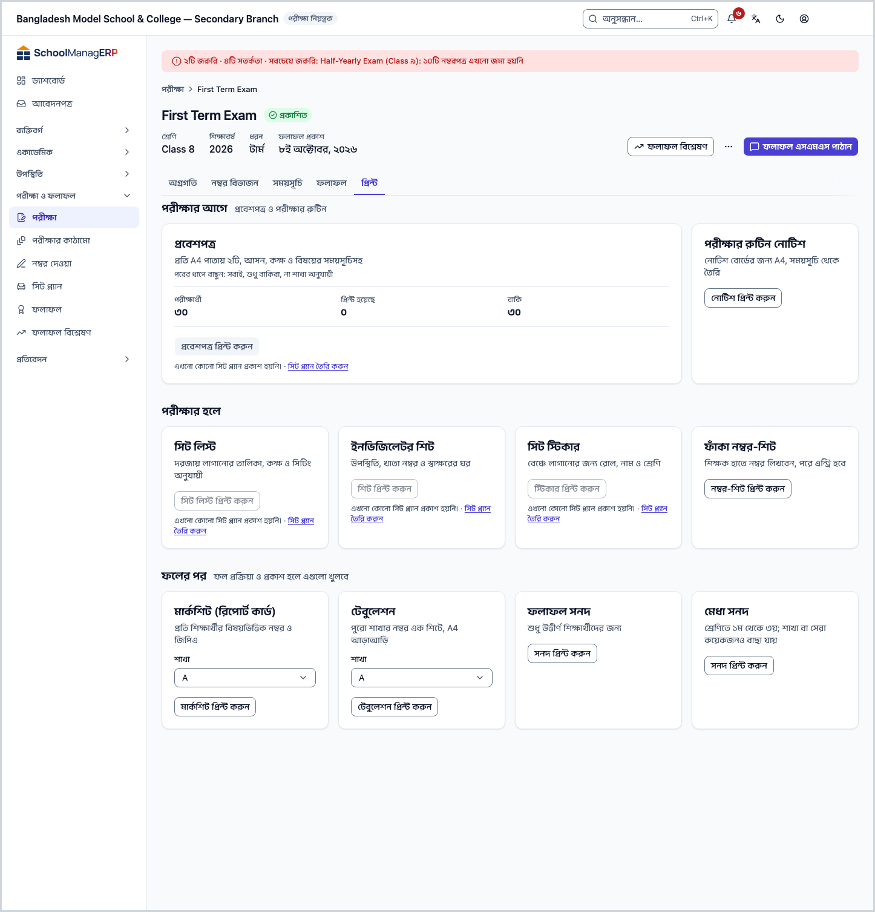
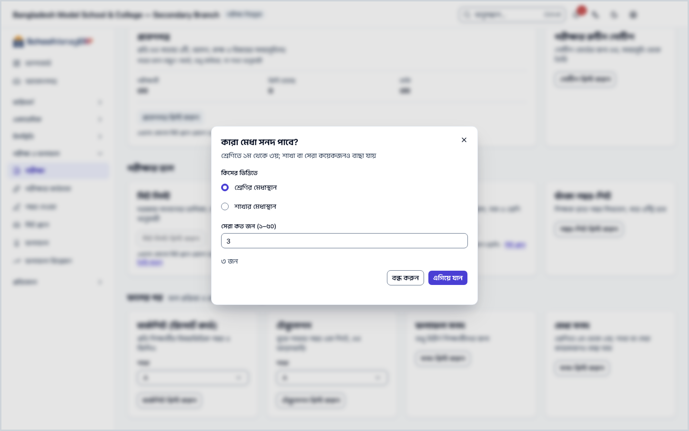

<!-- guide:meta
feature: administration.printExamDocuments
title: পরীক্ষার কাগজপত্র ছাপা
summary: পরীক্ষার প্রবেশপত্র, সিট স্লিপ, নম্বরপত্র ও ফলাফলের কাগজ এক এক করে বা ব্যাচে ছাপুন।
roles: [ADMIN, ACCOUNTANT, OFFICE_STAFF, EXAM_CONTROLLER]
sources:
  - client-admin/src/routes/_staff/print/document.tsx
  - server/src/modules/print/jobs/
labels:
  [
    examDocuments:fields.*,
    examDocuments:help.*,
    printPreview:*,
  ]
helpIds: []
devices: [desktop]
entry: []
keywords:
  [পরীক্ষা, প্রবেশপত্র, সিট স্লিপ, নম্বরপত্র, ফলাফল, ছাপা, exam, admit card, print]
appVersion: 0.1.0 (f3b2a529e)
owner: tareq89
lastVerified: 2026-10-25
knownIssues: []
-->

# পরীক্ষার কাগজপত্র ছাপা

একটি পরীক্ষার সব কাগজ এক জায়গা থেকে ছাপুন: প্রবেশপত্র, রুটিন নোটিশ, সিট লিস্ট, ইনভিজিলেটর শিট, সিট স্টিকার, ফাঁকা নম্বর-শিট, মার্কশিট, টেবুলেশন, ফলাফল সনদ আর মেধা সনদ।

**যেতে হবে:** বাম মেনুতে **পরীক্ষা ও ফলাফল → পরীক্ষা**, পরীক্ষাটি খুলুন, তারপর **প্রিন্ট** ট্যাব। পরীক্ষার পাতায় থাকা অবস্থায় **Ctrl+K** চেপে **প্রবেশপত্র প্রিন্ট করুন** লিখলেও এই ট্যাবে আসবেন।
**শুরুর আগে:** কাগজের ধরন অনুযায়ী একটি প্রকাশিত নকশা ([প্রিন্টের নকশা](../print-templates.md)) আর অন্তত একটি প্রিন্টার ([প্রিন্টার ও ক্যালিব্রেশন](printers-and-calibration.md)) লাগবে।

**প্রিন্ট** ট্যাবে কাগজগুলো তিন ভাগে সাজানো, যে ক্রমে লাগে: **পরীক্ষার আগে**, **পরীক্ষার হলে**, **ফলের পর**। কোনো কাগজ এখনো ছাপা না গেলে তার কার্ডে কারণ আর ঠিক করার বোতাম দেখায়।

[প্রবেশপত্র](#task-main) · [হলের কাগজ](#hall) · [ফলের পরের কাগজ](#after) · [কার্ড ধূসর কেন](#unavailable) · [সমস্যা ও সমাধান](#trouble)

**এই পাতায় যা আছে**

- [প্রবেশপত্র ছাপুন](#task-main)
- [ছাপা হয়েছে কি না বুঝবেন কীভাবে](#confirm)
- [অন্য পরিস্থিতিতে](#other)
  - [পরীক্ষার রুটিন নোটিশ](#routine)
  - [সিট লিস্ট, ইনভিজিলেটর শিট, সিট স্টিকার, নম্বর-শিট](#hall)
  - [মার্কশিট, টেবুলেশন, ফলাফল ও মেধা সনদ](#after)
  - [কার্ড ধূসর কেন](#unavailable)
  - [অভিভাবক নিজে প্রবেশপত্র ছাপলে](#portal)
- [সমস্যা ও সমাধান](#trouble)
- [কে কী করতে পারেন](#roles)
- [আরও জানুন](#more)

---

## প্রবেশপত্র ছাপুন 

1. পরীক্ষার **প্রিন্ট** ট্যাবে **প্রবেশপত্র** কার্ড দেখুন। সেখানে **পরীক্ষার্থী**, **প্রিন্ট হয়েছে** আর **বাকি** সংখ্যা থাকে।
2. **প্রবেশপত্র প্রিন্ট করুন** চাপুন।

   → **প্রিন্ট প্রিভিউ** খোলে।

3. **কোন প্রবেশপত্র?** থেকে বাছুন: **সবাই**, **শুধু বাকিরা** (যাদের এখনো ছাপা হয়নি), না **একটি শাখা**। শাখা বাছলে **শাখা বাছুন** থেকে শাখাটি দিন।
4. **প্রিভিউ** চাপুন, কার্ডগুলো দেখে নিন। প্রতি A4 পাতায় ২টি প্রবেশপত্র, তাতে আসন, কক্ষ আর বিষয়ের সময়সূচি থাকে।
5. প্রিন্টার বেছে **প্রিন্ট করুন** চাপুন ([কেন নিজে বাছতে হয়](printers-and-calibration.md#why-printer))।

   → ব্রাউজারের প্রিন্ট উইন্ডো খোলে। ছাপা শেষে অ্যাপ জিজ্ঞেস করে সব ঠিকমতো ছাপা হয়েছে কি না; উত্তর দিন।

**বকেয়ার সতর্কতা:** স্কুল **বকেয়া থাকলে প্রবেশপত্র আটকান** চালু রাখলে (সেটিংস → **প্রিন্টিং** → **কাগজপত্র ও সনদ**) কার্ডে লেখা থাকে **… জনের বকেয়া আছে। তালিকায় তাদের পাশে চিহ্ন থাকবে, তবুও প্রিন্ট করা যাবে।** আপনি ছাপতে পারবেন; শুধু অভিভাবক পোর্টাল থেকে ছাপতে পারবেন না ([অভিভাবক নিজে ছাপলে](#portal))।

---

## ছাপা হয়েছে কি না বুঝবেন কীভাবে 

| অবস্থা                       | কীভাবে বুঝবেন                                                       | এরপর কী      |
| ---------------------------- | ------------------------------------------------------------------- | ------------ |
| **শুধু স্ক্রিনে বদলেছে**     | কাগজটি স্ক্রিনে দেখাচ্ছে, **প্রিন্ট করুন** এখনো চাপেননি             | প্রিন্ট করুন |
| **স্কুলের সিস্টেমে পৌঁছেছে** | ব্রাউজারের প্রিন্ট উইন্ডো খুলেছে                                    | ছাপুন        |
| **কাজ শেষ**                  | প্রবেশপত্র কার্ডে **প্রিন্ট হয়েছে** সংখ্যা বেড়েছে, **বাকি** কমেছে | বিতরণ করুন   |

**প্রিন্ট করুন** চাপলে আগে ছাপার রেকর্ড রাখা হয়। রেকর্ড রাখা না গেলে **প্রিন্টের রেকর্ড রাখা যায়নি, তাই প্রিন্ট হয়নি। আবার চেষ্টা করুন।** দেখায়, কিছুই ছাপা হয় না।

---

## অন্য পরিস্থিতিতে 

### পরীক্ষার রুটিন নোটিশ 

নোটিশ বোর্ডের জন্য একটি A4, পরীক্ষার সময়সূচি থেকে তৈরি। **পরীক্ষার রুটিন নোটিশ** কার্ডে **নোটিশ প্রিন্ট করুন** চাপুন।

### সিট লিস্ট, ইনভিজিলেটর শিট, সিট স্টিকার, নম্বর-শিট 

প্রথম তিনটির জন্য আগে একটি প্রকাশিত সিট প্ল্যান লাগে ([সিট প্ল্যান](../../exams-results/seat-plans.md))।

| কাগজ                | কী আছে                                                   | বোতাম                      |
| ------------------- | -------------------------------------------------------- | -------------------------- |
| **সিট লিস্ট**       | দরজায় লাগানোর তালিকা, প্রতি সিটিংয়ে কক্ষপ্রতি ১ পাতা   | **সিট লিস্ট প্রিন্ট করুন** |
| **ইনভিজিলেটর শিট**  | উপস্থিতি, খাতা নম্বর ও স্বাক্ষরের ঘর                     | **শিট প্রিন্ট করুন**       |
| **সিট স্টিকার**     | বেঞ্চে লাগানোর জন্য রোল, নাম ও শ্রেণি                    | **স্টিকার প্রিন্ট করুন**   |
| **ফাঁকা নম্বর-শিট** | শিক্ষক হাতে নম্বর লিখবেন, পরে এন্ট্রি হবে; শাখা অনুযায়ী | **নম্বর-শিট প্রিন্ট করুন** |

1. কার্ডের বোতাম চাপুন।

   → নতুন পাতায় কাগজটি খোলে (**কাগজ তৈরি হচ্ছে…**)।

2. **প্রিন্ট করুন** চাপুন। শেষে **বন্ধ করুন** চাপলে পরীক্ষার **প্রিন্ট** ট্যাবে ফিরবেন।

### মার্কশিট, টেবুলেশন, ফলাফল ও মেধা সনদ 

| কাগজ                         | কখন খোলে          | কী করবেন                                                                   |
| ---------------------------- | ----------------- | -------------------------------------------------------------------------- |
| **মার্কশিট (রিপোর্ট কার্ড)** | ফল প্রকাশের পর    | **শাখা** বাছুন, **মার্কশিট প্রিন্ট করুন** চাপুন                            |
| **টেবুলেশন**                 | ফল প্রক্রিয়ার পর | **শাখা** বাছুন, **টেবুলেশন প্রিন্ট করুন**; পুরো শাখা এক A4 আড়াআড়ি পাতায় |
| **ফলাফল সনদ**                | ফল প্রকাশের পর    | **সনদ প্রিন্ট করুন**; শুধু উত্তীর্ণরা পায়, রোল অনুযায়ী সাজানো            |
| **মেধা সনদ**                 | ফল প্রকাশের পর    | **সনদ প্রিন্ট করুন** → **কারা মেধা সনদ পাবে?** জানালায় নিচের ধাপ          |

মেধা সনদের জানালায়:

1. **কিসের ভিত্তিতে** বাছুন: **শ্রেণির মেধাস্থান** না **শাখার মেধাস্থান**।
2. **সেরা কত জন (১–৫০)** দিন।
3. **এগিয়ে যান** চাপুন।

   → প্রিভিউ খোলে, তারপর একইভাবে ছাপুন।

ফলাফল সনদ আর মেধা সনদও ক্রমিক নম্বর পায় (`RES-2026-00001`, `MRT-2026-00001`), প্রতিটি শিক্ষার্থীর জন্য আলাদা; আবার ছাপলে একই নম্বর থাকে ([সনদ](certificates.md#serial))।

### কার্ড ধূসর কেন 

যে কাগজ এখনো ছাপা যায় না, তার কার্ড ধূসর থাকে। কার্ডে কারণ আর ঠিক করার বোতাম দেখায়:

| কার্ডে যা লেখা                          | কোন কাগজে                                          | ঠিক করার বোতাম            |
| --------------------------------------- | -------------------------------------------------- | ------------------------- |
| **এখনো কোনো সিট প্ল্যান প্রকাশ হয়নি।** | প্রবেশপত্র, সিট লিস্ট, ইনভিজিলেটর শিট, সিট স্টিকার | **সিট প্ল্যান তৈরি করুন** |
| **পরীক্ষার সময়সূচি এখনো নেই।**         | রুটিন নোটিশ                                        | **সময়সূচি যোগ করুন**     |
| **নম্বর বিভাজন এখনো করা হয়নি।**        | ফাঁকা নম্বর-শিট                                    | **নম্বর বিভাজন করুন**     |
| **ফল এখনো প্রক্রিয়া হয়নি।**           | টেবুলেশন                                           | **অগ্রগতি দেখুন**         |
| **ফল এখনো প্রকাশ হয়নি।**               | মার্কশিট, ফলাফল সনদ, মেধা সনদ                      | **ফলাফল ট্যাবে যান**      |

নকশা না থাকলে কার্ড ধূসর হয় না; প্রিভিউ খুললে **এই নথির জন্য এখনও কোনো নকশা নেই** দেখায়, সেখান থেকে **একটি নমুনা থেকে তৈরি করুন** ([প্রিন্টের নকশা](../print-templates.md#task-main))।

### অভিভাবক নিজে প্রবেশপত্র ছাপলে 

অভিভাবক পোর্টালে **পরীক্ষার সময়সূচি** পাতায় **প্রবেশপত্র প্রিন্ট করুন** চাপেন। তাতে শুধু তাঁর সন্তানের প্রবেশপত্র থাকে। স্কুল বকেয়ার জন্য আটকালে তিনি দেখেন **প্রবেশপত্র এখন প্রিন্ট করা যাচ্ছে না** আর বকেয়ার কথা; পরিশোধের পর একই পাতা থেকে ছাপতে পারেন।

---

## সমস্যা ও সমাধান 

| আপনি যা দেখছেন                                                           | কী করবেন                                                             | কে সাহায্য করতে পারেন |
| ------------------------------------------------------------------------ | -------------------------------------------------------------------- | --------------------- |
| পরীক্ষার পাতায় **প্রিন্ট** ট্যাব নেই                                    | ছাপার অনুমতি লাগে; অ্যাডমিনকে বলুন                                   | অ্যাডমিন              |
| কার্ড ধূসর                                                               | কার্ডের ঠিক করার বোতাম চাপুন ([কার্ড ধূসর কেন](#unavailable))        | পরীক্ষা নিয়ন্ত্রক    |
| **এই নথির জন্য এখনও কোনো নকশা নেই**                                      | নকশা প্রকাশ করুন ([প্রিন্টের নকশা](../print-templates.md#task-main)) | অ্যাডমিন              |
| **এই পরীক্ষায় কেউ উত্তীর্ণ হয়নি, তাই প্রিন্ট করার মতো ফলাফল সনদ নেই।** | ফল ঠিক আছে কি না দেখুন ([ফলাফল](../../exams-results/results.md))     | পরীক্ষা নিয়ন্ত্রক    |
| **ফলাফল লোড করা যায়নি। আবার চেষ্টা করুন।**                              | আবার **সনদ প্রিন্ট করুন** চাপুন                                      | নিজে                  |
| **কোনো শিক্ষার্থী পাওয়া যায়নি।** (মেধা সনদ)                            | **কিসের ভিত্তিতে** বদলে দেখুন, ফল প্রকাশ হয়েছে কি না দেখুন          | পরীক্ষা নিয়ন্ত্রক    |
| **প্রিন্টের রেকর্ড রাখা যায়নি, তাই প্রিন্ট হয়নি। আবার চেষ্টা করুন।**   | আবার **প্রিন্ট করুন** চাপুন                                          | নিজে                  |
| **প্রিন্ট করার কিছু নেই।**                                               | পরীক্ষার **প্রিন্ট** ট্যাব থেকে আবার খুলুন                           | নিজে                  |
| ছাপা কাগজে সরে গেছে বা কেটে গেছে                                         | [মাপ ঠিক করুন](printers-and-calibration.md#calibrate)                | অ্যাডমিন              |

এ নিয়ে আরও সাহায্য: [সমস্যা হলে কী করবেন](../../help/troubleshooting.md#print)।

---

## কে কী করতে পারেন 

| ভূমিকা             | পরীক্ষার কাগজ ছাপা (প্রিন্ট ট্যাব) | নিজের সন্তানের প্রবেশপত্র |
| ------------------ | ---------------------------------- | ------------------------- |
| অ্যাডমিন           | হ্যাঁ                              | —                         |
| পরীক্ষা নিয়ন্ত্রক | হ্যাঁ                              | —                         |
| অভিভাবক            | না                                 | হ্যাঁ, পোর্টাল থেকে       |

**প্রিন্ট** ট্যাব দেখতে পরীক্ষা পরিচালনার অনুমতি আর ছাপার অনুমতি দুটোই লাগে। হিসাবরক্ষক আর অফিস সহকারীর ছাপার অনুমতি আছে, কিন্তু পরীক্ষার পাতা খোলার অনুমতি নেই, তাই তাঁরা এখান থেকে ছাপতে পারেন না।

---

## আরও জানুন 

<strong>কোন কাগজ কখন খোলে</strong>

<figure>
  
  <figcaption><em>পরীক্ষার কাগজ: কোনটির আগে কী লাগে</em></figcaption>
</figure>

- প্রবেশপত্র প্রকাশিত সিট প্ল্যানের আসন আর কক্ষ নেয়, তাই সিট প্ল্যান না থাকলে প্রবেশপত্রও ধূসর।
- টেবুলেশন ফল প্রক্রিয়ার পরই খোলে; বাকি ফলের কাগজ প্রকাশের পর।

**সম্পর্কিত পাতা**

- [**প্রিন্টের নকশা**](../print-templates.md) — মূল পাতা; নকশা আর প্রিন্ট প্রিভিউ।
- [**প্রিন্টার ও ক্যালিব্রেশন**](printers-and-calibration.md) — প্রিন্টার যোগ, মাপ ঠিক করা।
- [**সনদ**](certificates.md) — ছাড়পত্র, প্রশংসাপত্র ও অন্য শিক্ষার্থী-সনদ।
- [**আইডি কার্ড ছাপা**](id-cards.md) — শিক্ষার্থী ও কর্মীর কার্ড।
- [**পরীক্ষা**](../../exams-results/exams.md) — পরীক্ষা, সময়সূচি, নম্বর বিভাজন।
- [**সিট প্ল্যান**](../../exams-results/seat-plans.md) — সিট প্ল্যান তৈরি ও প্রকাশ।
- [**ফলাফল**](../../exams-results/results.md) — ফল প্রক্রিয়া ও প্রকাশ।
- [**ডিজাইনারের গাইড**](designer-guide.md) — ডিজাইন কিট নিন, ডিজাইনারকে পাঠান, আঁকা SVG ইমপোর্ট করুন, ঘরগুলো দেখে নিন আর প্রকাশ করুন।

---

_সংস্করণ ০.১.০ · শেষ যাচাই ২০২৬-১০-২৫_
