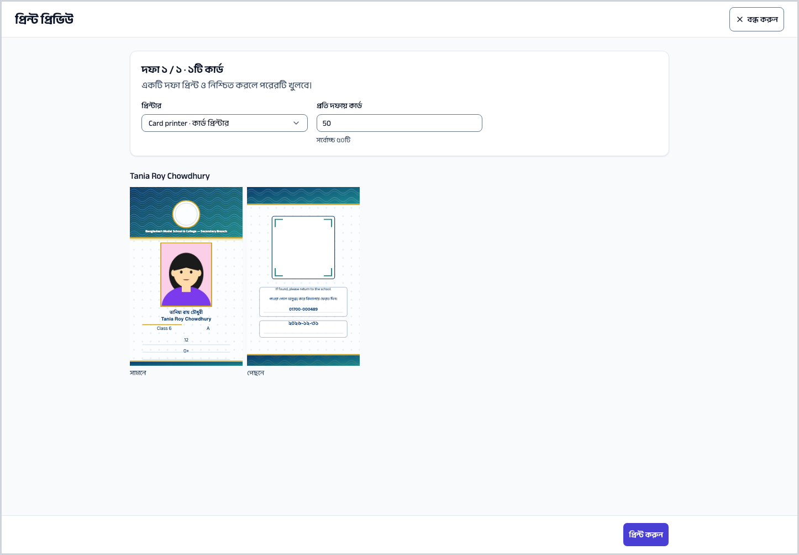
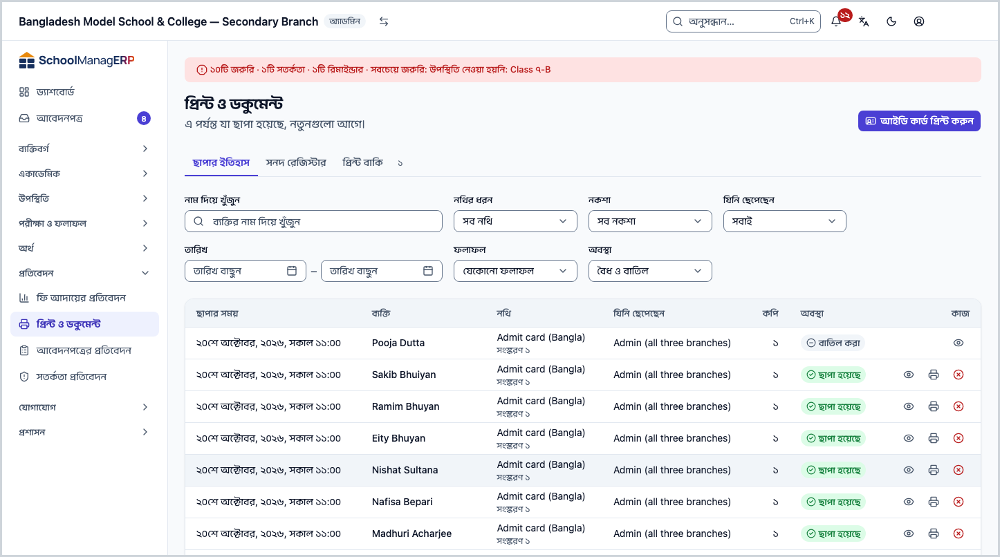

<!-- guide:meta
feature: administration.printIdCards
title: আইডি কার্ড ছাপা
summary: একজন, কয়েকজন বা পুরো শাখার আইডি কার্ড ছাপুন; হারানো কার্ড বাতিল করলে তার কিউআর আর বৈধ দেখায় না।
roles: [ADMIN, ACCOUNTANT, OFFICE_STAFF, EXAM_CONTROLLER]
sources:
  - client-admin/src/routes/_staff/print/document.tsx
  - client-admin/src/routes/_staff/print/preview.tsx
  - client-admin/src/components/print/preview/print-preview.tsx
  - server/src/modules/print/jobs/
  - server/src/modules/print/verify/
labels:
  [
    printPreview:*,
    printHistory:actions.*,
    printHistory:revoke.*,
    verify:*,
  ]
helpIds: [administration.printIdCards]
devices: [desktop]
entry: []
keywords:
  [আইডি কার্ড, ছাপা, কিউআর, বাতিল, ব্যাচ, ID card, print, QR, revoke]
appVersion: 0.1.0 (f3b2a529e)
owner: tareq89
lastVerified: 2026-10-25
knownIssues: []
-->

# আইডি কার্ড ছাপা

একজন, কয়েকজন বা পুরো শাখার শিক্ষার্থী বা কর্মীর আইডি কার্ড ছাপুন, আর দরকারে আবার ছাপুন বা হারানো কার্ড বাতিল করুন।

**যেতে হবে:** শিক্ষার্থীর পাতায় **আইডি কার্ড প্রিন্ট**, বা **শিক্ষার্থী** তালিকা থেকে। কর্মীর কার্ড **কর্মী** তালিকা বা কর্মীর পাতা থেকে।
**শুরুর আগে:** এই নথির ধরনের একটি প্রকাশিত নকশা ([প্রিন্টের নকশা](../print-templates.md)) আর অন্তত একটি প্রিন্টার ([প্রিন্টার ও ক্যালিব্রেশন](printers-and-calibration.md)) লাগবে।

প্রতিটি ছাপা কার্ড একটি **কপি**: প্রথমবার কপি ১, আবার ছাপলে কপি ২, এভাবে। প্রতিটি কপির নিজের কিউআর কোড থাকে, তাই একটি কপি বাতিল করলে শুধু সেটিই অবৈধ হয়।

[একটি কার্ড](#task-main) · [কয়েকজনের কার্ড](#many) · [আবার ছাপা](#reprint) · [হারানো কার্ড বাতিল](#revoke) · [সমস্যা ও সমাধান](#trouble)

**এই পাতায় যা আছে**

- [একজনের কার্ড ছাপুন](#task-main)
- [কার্ড ছাপা হয়েছে কি না বুঝবেন কীভাবে](#confirm)
- [অন্য পরিস্থিতিতে](#other)
  - [কয়েকজনের বা পুরো শাখার কার্ড](#many)
  - [বড় শাখা: দফায় দফায় ছাপা](#batches)
  - [কার্ড আবার ছাপুন](#reprint)
  - [ছাপার ইতিহাস দেখুন](#history)
  - [হারানো কার্ড বাতিল করুন](#revoke)
- [সমস্যা ও সমাধান](#trouble)
- [কে কী করতে পারেন](#roles)
- [আরও জানুন](#more)

---

## একজনের কার্ড ছাপুন 

1. শিক্ষার্থীর পাতা খুলুন ([শিক্ষার্থী](../../people/students.md))। কর্মীর জন্য কর্মীর পাতা ([কর্মী](../../people/staff.md))।
2. **আইডি কার্ড প্রিন্ট** চাপুন। শিক্ষার্থীর **কাগজপত্র** ট্যাবেও এই বোতাম আছে; সেখানে কার্ডের ছবি যোগ বা বদলানো যায়।

   → **প্রিন্ট প্রিভিউ** খোলে, আসল নাম আর ছবিসহ কার্ড দেখায়। ডিফল্ট নকশা বাছাই থাকে।

3. **প্রিন্টার** থেকে **একটি প্রিন্টার বেছে নিন** ([কেন নিজে বাছতে হয়](printers-and-calibration.md#why-printer))।
4. **প্রিন্ট করুন** চাপুন।

   → ব্রাউজারের প্রিন্ট উইন্ডো খোলে। একই প্রিন্টার, **Margins: None**, **Scale: 100%** দিয়ে ছাপুন ([প্রিন্ট উইন্ডোর সেটিংস](printers-and-calibration.md#browser-settings))।

5. অ্যাপ জিজ্ঞেস করে **১টি কার্ডই কি ঠিকমতো ছাপা হয়েছে?** — **হ্যাঁ, সব ছাপা হয়েছে** চাপুন।

   → **লেখা হয়েছে।** বার্তা আসে, আর যেখান থেকে এসেছিলেন সেখানে ফেরেন।

> **মনে রাখুন:** **প্রিন্ট করুন** চাপলেই কার্ডটি ছাপার ইতিহাসে লেখা হয়, কাগজ বের হওয়ার আগেই। তাই শেষের প্রশ্নের উত্তর দিন, যাতে ইতিহাস ঠিক থাকে।

---

## কার্ড ছাপা হয়েছে কি না বুঝবেন কীভাবে 

| অবস্থা                       | কীভাবে বুঝবেন                                           | এরপর কী      |
| ---------------------------- | ------------------------------------------------------- | ------------ |
| **শুধু স্ক্রিনে বদলেছে**     | প্রিভিউতে কার্ড দেখাচ্ছে, **প্রিন্ট করুন** এখনো চাপেননি | প্রিন্ট করুন |
| **স্কুলের সিস্টেমে পৌঁছেছে** | **…টি কার্ডই কি ঠিকমতো ছাপা হয়েছে?** প্রশ্ন এসেছে      | উত্তর দিন    |
| **কাজ শেষ**                  | **লেখা হয়েছে।** বার্তা; ইতিহাসে **ছাপা হয়েছে**        | কার্ড দিন    |

**যাচাই করতে চাইলে:** [**প্রতিবেদন → প্রিন্ট ও ডকুমেন্ট**](#history)-এ সারিটি খুঁজুন, বা কার্ডের কিউআর স্ক্যান করে **নথিটি সঠিক ও বৈধ** দেখুন ([কিউআর কোডে যাচাই](../print-templates.md#qr-check))।

---

## অন্য পরিস্থিতিতে 

### কয়েকজনের বা পুরো শাখার কার্ড 

| কী চান         | কী করবেন                                                                                                |
| -------------- | ------------------------------------------------------------------------------------------------------- |
| কয়েকজন        | **শিক্ষার্থী** (বা **কর্মী**) তালিকায় যাদের কার্ড লাগবে টিক দিন, ওপরে **আইডি কার্ড প্রিন্ট (n)** চাপুন |
| পুরো শাখা      | **শিক্ষার্থী** তালিকায় শ্রেণি আর শাখা ছাঁকুন, **পুরো …-এর আইডি কার্ড প্রিন্ট** চাপুন                   |
| তালিকা না খুলে | **আইডি কার্ড প্রিন্ট** জানালায় **কার জন্য?** বাছুন, তারপর **নাম দিয়ে বাছুন** বা **পুরো শাখা**         |

তারপর প্রিভিউ আর ছাপা একজনের মতোই ([একজনের কার্ড ছাপুন](#task-main))।

কোনো কার্ডে **দেখা দরকার** চিহ্ন থাকলে ওপরে **…টির মধ্যে …টি কার্ড দেখা দরকার** তালিকা দেখায়, যেমন **ছবি নেই** বা **লেখা জায়গায় ধরছে না**। ঠিক করে আসুন, নয়তো **জেনেও এই দফা প্রিন্ট করুন** চাপুন।

### বড় শাখা: দফায় দফায় ছাপা 

বেশি কার্ড হলে অ্যাপ সেগুলো **দফা**-য় ভাগ করে। দফার মাপ নকশার **প্রতি দফায় কার্ড** থেকে আসে (শুরুতে ৫০, সর্বোচ্চ ২০০)। প্রিভিউতে **প্রতি দফায় কার্ড** কমানো যায়, নকশার মানের বেশি নয়।

1. প্রথম দফা ছাপুন।
2. প্রশ্নের উত্তর দিন:

| আপনি চাপলেন               | কী হবে                                                                                                   |
| ------------------------- | -------------------------------------------------------------------------------------------------------- |
| **হ্যাঁ, সব ছাপা হয়েছে** | দফাটি লেখা হয়, পরের দফা খোলে                                                                            |
| **কিছু ছাপা হয়নি…**      | যেগুলো ঠিকমতো ছাপা হয়নি টিক দিয়ে **নিশ্চিত করুন**; তারপর **nটি আবার ছাপুন** চাপলে শুধু সেগুলো ছাপা হয় |

3. সব দফা শেষ না হওয়া পর্যন্ত চালিয়ে যান। উত্তর না দিয়ে পরের দফায় যাওয়া যায় না।

> **মনে রাখুন:** প্রিন্ট শুরু হলে **নকশা** আর বদলানো যায় না। পুরো শাখা একই নকশায় ছাপা হয়।

### কার্ড আবার ছাপুন 

কার্ড ছিঁড়ে গেলে বা ভুল ছাপা হলে:

1. শিক্ষার্থীর **কাগজপত্র** ট্যাবে **ছাপার ইতিহাস**, অথবা [**প্রতিবেদন → প্রিন্ট ও ডকুমেন্ট**](#history) খুলুন।
2. কার্ডটির সারিতে **আবার ছাপুন** চাপুন।

   → **… আবার ছাপুন** জানালা: **কার্ডটি আগের মতোই ছাপা হবে, তবে নতুন কপি হিসেবে এবং নিজস্ব QR কোড সহ।**

3. **প্রিন্টার** বাছুন, **প্রিন্ট** চাপুন।

   → নতুন কার্ড পরের **কপি** নম্বর পায়, আগের নকশার সংস্করণেই ছাপা হয়। নকশায় **পুনরায় ছাপায় লেখা** (যেমন "কপি {n}") থাকলে সেটি কার্ডে ছাপা হয়, যাতে কেউ প্রথম কার্ড ভেবে ভুল না করে।

পুরোনো কপি বৈধই থাকে। হারানো কার্ড হলে আগে সেটি [বাতিল করুন](#revoke), তারপর আবার ছাপুন। বাতিল করা কার্ড থেকে আবার ছাপা যায় না; নতুন কার্ড ছাপুন শিক্ষার্থীর পাতা থেকে।

### ছাপার ইতিহাস দেখুন 

[**প্রতিবেদন → প্রিন্ট ও ডকুমেন্ট**](../../reports/printables.md) → **ছাপার ইতিহাস** ট্যাব।

- কলাম: **ছাপার সময়**, **যিনি ছেপেছেন**, **নথি**, **ব্যক্তি**, **কপি**, **অবস্থা**।
- ছাঁকনি: **নথির ধরন**, **নকশা**, **যিনি ছেপেছেন**, **তারিখ**, **ফলাফল**, **অবস্থা** (**শুধু বৈধ** / **শুধু বাতিল**), আর **নাম দিয়ে খুঁজুন**।
- **দেখুন** চাপলে ঠিক কী ছাপা হয়েছিল তা দেখায়, সামনে ও পেছনে। কিউআর কোড সংরক্ষিত থাকে না, তাই সেখানে দেখায় না।

### হারানো কার্ড বাতিল করুন 

শুধু অ্যাডমিন পারেন।

1. **প্রতিবেদন → প্রিন্ট ও ডকুমেন্ট**-এ কার্ডটির সারিতে **বাতিল করুন** চাপুন।

   → **… বাতিল করুন** জানালা: **এই কার্ডের QR কোড যিনিই স্ক্যান করবেন, দেখবেন এটি আর বৈধ নয়।**

2. **কারণ** লিখুন, যেমন "হারিয়ে গেছে" (আবশ্যক, সর্বোচ্চ ২৮০ অক্ষর; কর্মীরা দেখেন, সাধারণ মানুষ নয়)।
3. **কার্ড বাতিল করুন** চাপুন।

   → **কার্ড বাতিল হয়েছে** বার্তা আসে। সারির **অবস্থা** হয় **বাতিল করা**। কিউআর স্ক্যান করলে **এই নথিটি বাতিল করা হয়েছে** দেখায়।

> **মনে রাখুন:** বাতিল ফেরানো যায় না। শুধু এই কপিটি বাতিল হয়; একই ব্যক্তির অন্য কপি বৈধ থাকে। **কপি** নম্বর মিলিয়ে ঠিক কার্ডটি বাছুন।

---

## সমস্যা ও সমাধান 

| আপনি যা দেখছেন                                       | কী করবেন                                                                                          | কে সাহায্য করতে পারেন |
| ---------------------------------------------------- | ------------------------------------------------------------------------------------------------- | --------------------- |
| **এই নথির জন্য এখনও কোনো নকশা নেই**                  | অ্যাডমিনকে নকশা প্রকাশ করতে বলুন ([প্রিন্টের নকশা](../print-templates.md#task-main))              | অ্যাডমিন              |
| **প্রিন্ট করতে আগে আপনার প্রথম প্রিন্টার যোগ করুন।** | অ্যাডমিনকে [প্রিন্টার যোগ](printers-and-calibration.md#task-main) করতে বলুন                       | অ্যাডমিন              |
| **আপনার ব্রাউজার প্রিন্ট উইন্ডো আটকে দিয়েছে। …**    | এই সাইটের জন্য পপ-আপ চালু করে আবার **প্রিন্ট করুন** চাপুন                                         | নিজে                  |
| **প্রিন্ট শুরু করা যায়নি। কিছুই ছাপা হয়নি।**       | কিছুক্ষণ পর আবার চেষ্টা করুন                                                                      | নিজে                  |
| **পরের দফা খুলতে আগে বর্তমান দফাটি নিশ্চিত করুন।**   | আগের দফার প্রশ্নের উত্তর দিন                                                                      | নিজে                  |
| কার্ডে **ছবি নেই**                                   | শিক্ষার্থীর **কাগজপত্র** ট্যাবে ছবি যোগ করুন                                                      | নিজে                  |
| কর্মীর কার্ড ছাপতে গেলে অনুমতি নেই বলে               | কর্মীর কার্ডে কর্মীর এইচআর তথ্য দেখার অনুমতিও লাগে; অ্যাডমিনকে বলুন                               | অ্যাডমিন              |
| **আবার ছাপুন** কাজ করছে না, কার্ডটি বাতিল করা        | বাতিল কার্ড আবার ছাপা যায় না; শিক্ষার্থীর পাতা থেকে নতুন করে ছাপুন                               | নিজে                  |
| **কার্ডটি বাতিল করা যায়নি।**                        | আবার চেষ্টা করুন                                                                                  | অ্যাডমিন              |
| ছাপা কাগজে সরে গেছে বা কেটে গেছে                     | **Scale 100%**, **Margins None** দিন, তারপর [মাপ ঠিক করুন](printers-and-calibration.md#calibrate) | অ্যাডমিন              |

এ নিয়ে আরও সাহায্য: [সমস্যা হলে কী করবেন](../../help/troubleshooting.md#print)।

---

## কে কী করতে পারেন 

| ভূমিকা             | শিক্ষার্থীর কার্ড ছাপা, আবার ছাপা | কর্মীর কার্ড ছাপা | ছাপার ইতিহাস দেখা | কার্ড বাতিল |
| ------------------ | --------------------------------- | ----------------- | ----------------- | ----------- |
| অ্যাডমিন           | হ্যাঁ                             | হ্যাঁ             | হ্যাঁ             | হ্যাঁ       |
| হিসাবরক্ষক         | হ্যাঁ                             | না                | না                | না          |
| অফিস সহকারী        | হ্যাঁ                             | না                | হ্যাঁ             | না          |
| পরীক্ষা নিয়ন্ত্রক | হ্যাঁ                             | না                | হ্যাঁ             | না          |

কর্মীর কার্ড ছাপতে ছাপার অনুমতির সাথে কর্মীর এইচআর তথ্য দেখার অনুমতিও লাগে; এখন শুধু অ্যাডমিনের তা আছে।

---

## আরও জানুন 

<strong>কপি, কিউআর আর বাতিল কীভাবে জড়িত</strong>

<figure>
  
  <figcaption><em>আইডি কার্ড: ছাপা, আবার ছাপা, বাতিল</em></figcaption>
</figure>

- এক কাজে সর্বোচ্চ ২০০টি কার্ড; এর বেশি হলে দফায় ভাগ হয়।
- আবার ছাপা কার্ড আগের সংস্করণের নকশাতেই আসে, পরে নকশা বদলালেও।

**সম্পর্কিত পাতা**

- [**প্রিন্টের নকশা**](../print-templates.md) — মূল পাতা; [কিউআর কোডে যাচাই](../print-templates.md#qr-check)।
- [**প্রিন্টার ও ক্যালিব্রেশন**](printers-and-calibration.md) — প্রিন্টার যোগ, মাপ ঠিক করা।
- [**ডিজাইনারের গাইড**](designer-guide.md) — কার্ডের পেছনের ছবি আঁকা।
- [**পরীক্ষার কাগজপত্র**](exam-documents.md) — প্রবেশপত্র, সিট লিস্ট, মার্কশিট, ফলাফল সনদ।
- [**সনদ**](certificates.md) — ছাড়পত্র, প্রশংসাপত্র; ক্রমিক নম্বর ও রেজিস্টার।
- [**শিক্ষার্থী**](../../people/students.md) — শিক্ষার্থীর পাতা আর **কাগজপত্র** ট্যাব।
- [**কর্মী**](../../people/staff.md) — কর্মীর পাতা।
- [**প্রিন্ট ও ডকুমেন্ট**](../../reports/printables.md) — ছাপার ইতিহাস, আবার ছাপা ও বাতিল

---

_সংস্করণ ০.১.০ · শেষ যাচাই ২০২৬-১০-২৫_
