<!-- guide:meta
feature: administration.printPrinters
title: প্রিন্টার ও ক্যালিব্রেশন
summary: প্রিন্টার আর কাগজের মাপ যোগ করুন, মাপার পাতা ছাপুন, আর সরানো ঠিক করুন যেন ছাপা ঠিক কার্ডের ওপর পড়ে।
roles: [ADMIN, ACCOUNTANT, OFFICE_STAFF, EXAM_CONTROLLER]
sources:
  - client-admin/src/routes/_staff/print/preview.tsx
  - client-admin/src/components/print/preview/print-preview.tsx
  - client-admin/src/components/print/preview/run-print.ts
  - server/src/modules/print/printers/
labels:
  [
    printPreview:*,
  ]
helpIds: [administration.printPrinters]
devices: [desktop]
entry: []
keywords:
  [প্রিন্টার, ক্যালিব্রেশন, কাগজ, মাপ, সারিবদ্ধ, printer, calibration]
appVersion: 0.1.0 (f3b2a529e)
owner: tareq89
lastVerified: 2026-10-25
knownIssues: []
-->

# প্রিন্টার ও ক্যালিব্রেশন

স্কুলের প্রতিটি প্রিন্টার একবার যোগ করুন আর মাপ ঠিক করুন, যাতে কার্ড ঠিক জায়গায় ছাপা হয়।

**যেতে হবে:** [**সেটিংস → প্রিন্টিং → প্রিন্টার**](../settings.md)।
**শুরুর আগে:** প্রিন্টার যোগ আর মাপ ঠিক করতে আপনাকে অ্যাডমিন হতে হবে। একটি স্কেল (রুলার) হাতের কাছে রাখুন।

**প্রিন্টার** এখানে একটি নাম আর কিছু মাপ: কোন ধরনের প্রিন্টার, কাগজের কিনারায় কতটা ফাঁকা থাকে, আর ছাপা কত মিলিমিটার সরিয়ে দিতে হবে। ছাপার সময় এই তালিকা থেকে প্রিন্টার বাছলে অ্যাপ সেই মাপ পাতায় লাগিয়ে দেয়।

[প্রিন্টার যোগ করুন](#task-main) · [মাপ ঠিক করুন](#calibrate) · [কেন প্রিন্টার নিজে বাছতে হয়](#why-printer) · [সমস্যা ও সমাধান](#trouble)

**এই পাতায় যা আছে**

- [প্রিন্টার যোগ করুন](#task-main)
- [প্রিন্টার যোগ হয়েছে কি না বুঝবেন কীভাবে](#confirm)
- [কেন প্রিন্টার আমাকে নিজে বেছে নিতে হয়](#why-printer)
- [অন্য পরিস্থিতিতে](#other)
  - [মাপের পাতা ছেপে মাপ ঠিক করুন](#calibrate)
  - [প্রিন্ট উইন্ডোর সেটিংস](#browser-settings)
  - [আগে থেকে ছাপা কার্ডে ছাপা](#preprinted)
  - [প্রিন্টার আর্কাইভ করুন](#archive)
- [সমস্যা ও সমাধান](#trouble)
- [কে কী করতে পারেন](#roles)
- [আরও জানুন](#more)

---

## প্রিন্টার যোগ করুন 

1. **সেটিংস → প্রিন্টিং** খুলুন।

   → **প্রিন্টার** অংশ আসে। কোনো প্রিন্টার না থাকলে **আপনার প্রথম প্রিন্টার যোগ করুন** লেখা দেখায়।

2. **প্রিন্টার যোগ করুন** চাপুন।

   → **প্রিন্টার যোগ করুন** জানালা খোলে।

3. **নাম** দিন, যা সবাই চিনবে, যেমন "অফিসের কার্ড প্রিন্টার"।
4. **প্রিন্টারের ধরন** বাছুন:
   - **কার্ড প্রিন্টার** — একবারে একটি কার্ড ছাপে, কিনারা পর্যন্ত।
   - **অফিস প্রিন্টার** — A4 কাগজে অনেক কার্ড ছাপে, পরে কেটে নিতে হয়।
5. **দুই পাশে ছাপা** বাছুন: **দুই পাশ নিজে থেকে ছাপে**, অথবা **আমি নিজে হাতে কাগজ উল্টে দিই**।
6. অফিস প্রিন্টার হলে চাইলে **কার্ডের মাঝে কাটার ফাঁক (মিমি)** দিন।
7. **সংরক্ষণ করুন** চাপুন।

   → প্রিন্টারটি তালিকায় আসে। **সরানো (মিমি)** ঘরে শুরুতে ০ থাকে।

> **মনে রাখুন:** কাগজের কিনারার ফাঁকা জায়গা অ্যাপ নিজে বসায়: কার্ড প্রিন্টারে ০ মিমি, অফিস প্রিন্টারে ৫ মিমি। সাধারণত বদলাতে হয় না।

---

## প্রিন্টার যোগ হয়েছে কি না বুঝবেন কীভাবে 

| অবস্থা                       | কীভাবে বুঝবেন                                | এরপর কী                               |
| ---------------------------- | -------------------------------------------- | ------------------------------------- |
| **শুধু স্ক্রিনে বদলেছে**     | জানালায় **সংরক্ষণ হচ্ছে…**                  | জানালা বন্ধ না করে অপেক্ষা করুন       |
| **স্কুলের সিস্টেমে পৌঁছেছে** | জানালা বন্ধ হয়, প্রিন্টারটি তালিকায় দেখায় | [মাপের পাতা ছাপুন](#calibrate)        |
| **ছাপার জন্য তৈরি**          | মাপের পাতায় ক্রস ঠিক ২০ মিমিতে পড়ে         | কাজ শেষ, প্রিভিউতে এই প্রিন্টার বাছুন |

**যাচাই করতে চাইলে:** যেকোনো প্রিন্ট প্রিভিউতে **প্রিন্টার** তালিকায় নামটি আছে কি না দেখুন।

**সংরক্ষণ না হলে:** জানালায় **প্রিন্টার সংরক্ষণ করা যায়নি।** দেখায়; আবার **সংরক্ষণ করুন** চাপুন।

---

## কেন প্রিন্টার আমাকে নিজে বেছে নিতে হয় 

**প্রিন্ট করুন** চাপলে ব্রাউজার নিজের প্রিন্ট উইন্ডো খোলে, আর সেখানে আপনি প্রিন্টার বাছেন। **সেখানে কোন প্রিন্টার বাছলেন, অ্যাপ তা দেখতে পায় না।** এটি ব্রাউজারের নিয়ম।

কিন্তু প্রতিটি প্রিন্টার একটু আলাদা ছাপে: একটি ১ মিমি ডানে সরিয়ে ছাপে, আরেকটি কিনারায় বেশি জায়গা ছাড়ে। অ্যাপ এটা ঠিক করে দিতে পারে, তবে কোন প্রিন্টার তা জানলে তবেই। তাই ছাপার **আগে** প্রিন্ট প্রিভিউর **প্রিন্টার** ঘরে একই প্রিন্টার বাছুন। প্রিন্টারের ধরন থেকে পাতার মাপও ঠিক হয়: কার্ড প্রিন্টারে একটি পাতা = একটি কার্ড, অফিস প্রিন্টারে A4 পাতায় কয়েকটি কার্ড।

সহজ নিয়ম: **অ্যাপে আর ব্রাউজারের প্রিন্ট উইন্ডোতে একই প্রিন্টার বাছুন।** এই কম্পিউটার আপনার শেষবারের পছন্দ মনে রাখে, এই স্কুলের জন্য আলাদা করে।

---

## অন্য পরিস্থিতিতে 

### মাপের পাতা ছেপে মাপ ঠিক করুন 

প্রতিটি প্রিন্টারে একবার করুন। কাগজ বা কার্ডের ধরন বদলালে আবার করুন। মাপের পাতা শুধু পরীক্ষার পাতা; এটি ছাপার ইতিহাসে লেখা হয় না।

1. তালিকায় প্রিন্টারের সারিতে **মাপের পাতা ছাপুন** চাপুন।

   → ব্রাউজারের প্রিন্ট উইন্ডো খোলে। পাশে **…: মাপ ঠিক করুন** নির্দেশনা আসে।

2. প্রিন্ট উইন্ডোতে একই প্রিন্টার বাছুন, **Margins: None** আর **Scale: 100%** দিন ([প্রিন্ট উইন্ডোর সেটিংস](#browser-settings))। ছাপুন।
3. ছাপা পাতায় **কাগজের ওপরের বাঁ কোণ থেকে প্রথম ক্রস চিহ্ন পর্যন্ত** মাপুন। ঠিক ২০ মিমি হওয়ার কথা।
4. **সরানোর মাপ বদলান** চাপুন।

   → **প্রিন্টার সম্পাদনা** জানালা খোলে, **মাপ ঠিক করা (উন্নত)** অংশ খোলা অবস্থায়।

5. যত মিমি কম-বেশি হলো, লিখুন:

| ক্রস যেখানে পড়ল       | কোন ঘরে                     | কী লিখবেন |
| ---------------------- | --------------------------- | --------- |
| ১ মিমি বেশি **ডানে**   | **ডানে-বাঁয়ে সরান (মিমি)** | −১        |
| ১ মিমি বেশি **বাঁয়ে** | **ডানে-বাঁয়ে সরান (মিমি)** | ১         |
| ০.৫ মিমি বেশি **নিচে** | **ওপরে-নিচে সরান (মিমি)**   | −০.৫      |
| ০.৫ মিমি বেশি **ওপরে** | **ওপরে-নিচে সরান (মিমি)**   | ০.৫       |

মান −১০ থেকে ১০ মিমির মধ্যে হতে হবে। পুরো ছাপা ছোট বা বড় হলে **আকার** বদলান (১ = আসল মাপ, ০.৯০ থেকে ১.১০)।

6. **সংরক্ষণ করুন** চাপুন।

   → তালিকায় **সরানো (মিমি)** ঘরে নতুন মান দেখায়, যেমন **ডানে-বাঁয়ে −১ · ওপরে-নিচে ০**।

7. আবার **মাপের পাতা ছাপুন** চাপুন। নতুন পাতা নতুন মান দিয়েই ছাপা হয়। ক্রস এখন ২০ মিমিতে থাকলে কাজ শেষ, তারপর **হয়েছে** চাপুন। না থাকলে ধাপ ৩ থেকে আবার করুন।

<!-- image pending: মাপের পাতা ছাপা কাগজ, ওপরের বাঁ কোণ থেকে ক্রস পর্যন্ত রুলার; desktop -->

> **মনে রাখুন:** "পরীক্ষা হয়ে গেছে" বা "যাচাই করা" বলে আলাদা কোনো চিহ্ন অ্যাপে নেই। দ্বিতীয়বার ছাপা মাপের পাতায় ক্রস ২০ মিমিতে পড়লেই বুঝবেন প্রিন্টারটি ঠিক আছে।

### প্রিন্ট উইন্ডোর সেটিংস 

প্রতিবার ছাপার সময় ব্রাউজারের প্রিন্ট উইন্ডোতে এগুলো দিন:

| সেটিং               | মান                                    |
| ------------------- | -------------------------------------- |
| Printer             | অ্যাপের **প্রিন্টার** ঘরে যেটি বেছেছেন |
| Margins             | **None**                               |
| Scale               | **100%** ("Fit to page" নয়)           |
| Headers and footers | বন্ধ                                   |
| Background graphics | চালু                                   |

### আগে থেকে ছাপা কার্ডে ছাপা 

স্কুল যদি এমন খালি কার্ড কেনে যাতে নকশা আগেই ছাপা আছে, তাহলে শুধু নাম, ছবি আর কিউআর কোড ছাপাতে হয়।

1. নকশার এডিটরে **ফাইল** প্যানেল খুলুন ([ডিজাইনারের গাইড](designer-guide.md))।
2. **ব্যাকগ্রাউন্ড ছাপুন** বন্ধ করুন।

   → পর্দায় পেছনের ছবি দেখা যায়, কিন্তু ছাপা হয় না। নকশা আবার প্রকাশ করুন ([নকশা বদলান ও আবার প্রকাশ করুন](../print-templates.md#task-edit))।

### প্রিন্টার আর্কাইভ করুন 

1. প্রিন্টারের সারিতে **আর্কাইভ** চাপুন।

   → **… আর্কাইভ করবেন? আগের প্রিন্টের রেকর্ড থাকবে।**

| আপনি চাপলেন | কী হবে                                              | বদলাল? |
| ----------- | --------------------------------------------------- | ------ |
| **আর্কাইভ** | প্রিন্টার তালিকা থেকে সরে যায়, প্রিভিউতে আর আসে না | হ্যাঁ  |
| **বাতিল**   | কিছুই বদলায় না                                     | না     |

---

## সমস্যা ও সমাধান 

| আপনি যা দেখছেন                                    | কী করবেন                                                                                                        | কে সাহায্য করতে পারেন |
| ------------------------------------------------- | --------------------------------------------------------------------------------------------------------------- | --------------------- |
| **সেটিংস → প্রিন্টিং**-এ **প্রিন্টার** অংশই নেই   | এটি শুধু অ্যাডমিন দেখেন; অ্যাডমিনকে বলুন                                                                        | অ্যাডমিন              |
| **আপনার ব্রাউজার প্রিন্ট উইন্ডো আটকে দিয়েছে। …** | এই সাইটের জন্য পপ-আপ চালু করে আবার চেষ্টা করুন                                                                  | নিজে                  |
| **প্রিন্ট উইন্ডো খোলা যায়নি।**                   | পাতা রিফ্রেশ করে আবার **মাপের পাতা ছাপুন** চাপুন                                                                | নিজে                  |
| **সরানো −১০ থেকে ১০ মিমির মধ্যে হতে হবে।**        | ১০ মিমির বেশি সরে থাকলে আগে প্রিন্ট উইন্ডোর **Scale** আর **Margins** দেখুন                                      | নিজে                  |
| ছাপা এখনো সরে যাচ্ছে                              | প্রিভিউ আর প্রিন্ট উইন্ডোতে একই প্রিন্টার বেছেছেন কি না দেখুন, আবার মাপ ঠিক করুন                                | অ্যাডমিন              |
| কার্ডের চারপাশে সরু সাদা ধার                      | অফিস প্রিন্টার কিনারা পর্যন্ত ছাপে না; কার্ড প্রিন্টার নিন, বা নকশায় [ব্লিড](designer-guide.md#safe-bleed) দিন | অ্যাডমিন              |
| পুরো ছাপা একটু ছোট বা বড়                         | **Scale 100%** কি না দেখুন, তারপর **আকার** ঠিক করুন                                                             | অ্যাডমিন              |

এ নিয়ে আরও সাহায্য: [সমস্যা হলে কী করবেন](../../help/troubleshooting.md#print)।

---

## কে কী করতে পারেন 

| ভূমিকা             | প্রিন্টার যোগ, মাপ ঠিক, আর্কাইভ | ছাপার সময় প্রিন্টার বাছা |
| ------------------ | ------------------------------- | ------------------------- |
| অ্যাডমিন           | হ্যাঁ                           | হ্যাঁ                     |
| হিসাবরক্ষক         | না                              | হ্যাঁ                     |
| অফিস সহকারী        | না                              | হ্যাঁ                     |
| পরীক্ষা নিয়ন্ত্রক | না                              | হ্যাঁ                     |

---

## আরও জানুন 

<strong>মাপের পাতা কীভাবে কাজ করে</strong>

<figure>
  
  <figcaption><em>মাপের পাতা থেকে ঠিক সরানোর মাপ</em></figcaption>
</figure>

- মাপের পাতা প্রিন্টারের **এখনকার** সরানোর মাপ আর আকার দিয়ে ছাপা হয়, তাই দ্বিতীয় পাতা দেখায় সংশোধন কাজ করল কি না।
- কার্ড প্রিন্টারে পাতাটি কার্ডের মাপে (৮৫.৬ × ৫৪ মিমি), অফিস প্রিন্টারে A4।

**সম্পর্কিত পাতা**

- [**প্রিন্টের নকশা**](../print-templates.md) — মূল পাতা; [প্রিভিউ দেখে ছাপুন](../print-templates.md#preview-print)।
- [**ডিজাইনারের গাইড**](designer-guide.md) — নিরাপদ এলাকা, ব্লিড, পেছনের ছবি।
- [**আইডি কার্ড ছাপা**](id-cards.md) — একজন, কয়েকজন বা পুরো শাখার কার্ড।
- [**পরীক্ষার কাগজপত্র**](exam-documents.md) — প্রবেশপত্র, সিট লিস্ট, মার্কশিট, ফলাফল সনদ।
- [**সনদ**](certificates.md) — ছাড়পত্র, প্রশংসাপত্র; ক্রমিক নম্বর ও রেজিস্টার।
- [**স্কুলের সেটিংস ঠিক করা**](../settings.md) — স্কুলের প্রোফাইল, একাডেমিক নিয়ম, ফির নিয়ম, যোগাযোগ, প্রিন্টিং, সাইন-ইন, ব্যাকআপ আর সতর্কতা এক পাতায়, নয়টি বিভাগে ঠিক করুন।
- [**চালান**](../../finance/invoices.md) — প্রতিটি পেমেন্টের চালান আর ক্রেডিট নোট খুঁজুন, প্রিন্ট করুন, হোয়াটসঅ্যাপ বা এসএমএসে অভিভাবককে পাঠান।
- [**পেমেন্ট**](../../finance/payments.md) — স্কুলে নেওয়া সব পেমেন্ট খুঁজুন, একটি পেমেন্ট খুলে দেখুন টাকা কোন বিলে গেল, রসিদ আবার প্রিন্ট করুন, আর ভুল পেমেন্ট পুরোটা বাতিল করুন।
- [**পেমেন্ট রেকর্ড করুন**](../../finance/record-payment.md) — এক বা একাধিক শিক্ষার্থীর বকেয়া বিলের টাকা নিন — টাকা পুরনো বিল থেকে ভাগ হয়, দরকারে ছাড় দিন, নগদে ফেরত হিসাব করুন বা জমা টাকায় রাখুন।

---

_সংস্করণ ০.১.০ · শেষ যাচাই ২০২৬-১০-২৫_
