<!-- guide:meta
feature: administration.roles
title: ভূমিকা ও অনুমতি
summary: স্কুলের প্রতিটি কর্মী-ভূমিকা কী দেখতে ও করতে পারে, এক পাতায় পাশাপাশি দেখুন। পাতাটি শুধু দেখার জন্য; এখান থেকে কিছু বদলায় না।
roles: [ADMIN]
sources:
  - client-admin/src/routes/_staff/roles/index.tsx
  - client-admin/src/routes/_staff/roles/-role-card.tsx
  - client-admin/src/routes/_staff/staff/-detail/permissions-tab.tsx
  - client-admin/src/route-permissions.ts
  - shared/src/enums/permissions.ts
  - shared/src/enums/audiences.ts
labels:
  [
    staff:rolesAccess.*,
    staff:roles.*,
    staff:roleDescriptions.*,
    staff:permissions.groups.*,
    nav:items.rolesAccess,
    nav:groups.administration,
  ]
helpIds: [administration.roles]
devices: [desktop]
entry: [sidebar, palette]
keywords:
  [ভূমিকা, অনুমতি, কে কী দেখে, শিক্ষক, হিসাবরক্ষক, অফিস সহকারী, পরীক্ষা নিয়ন্ত্রক, roles, permissions, access]
appVersion: 0.1.0 (63bfc7884)
owner: tareq89
lastVerified: 2026-10-25
knownIssues: []
-->

# ভূমিকা ও অনুমতি

স্কুলের কোন ভূমিকা কী দেখতে ও করতে পারে, এক পাতায় তুলনা করুন।

**যেতে হবে:** বাম মেনুতে **প্রশাসন → ভূমিকা ও অনুমতি**। এই পাতা কম্পিউটারে দেখুন।
**শুরুর আগে:** আপনি অ্যাডমিন হবেন। অন্য কোনো ভূমিকার মেনুতে এই পাতা থাকে না।

প্রতিটি কর্মীর একটি **ভূমিকা** থাকে, যেমন শিক্ষক বা হিসাবরক্ষক। ভূমিকাই ঠিক করে তিনি অ্যাপে কী দেখবেন আর কী করবেন। এই পাতা শুধু দেখায়; এখানে কোনো বোতাম নেই, কিছু বদলায় না। কারও ভূমিকা ঠিক হয় তাঁকে [**কর্মী**](../people/staff.md#task-main) তালিকায় যোগ করার সময়।

[পাতাটি পড়ুন](#task-main) · [কোন ভূমিকা কী পারে](#matrix) · [সমস্যা ও সমাধান](#trouble)

**এই পাতায় যা আছে**

- [একটি ভূমিকার অনুমতি দেখুন](#task-main)
- [কোন ভূমিকা কী পারে, সংক্ষেপে](#matrix)
- [সমস্যা ও সমাধান](#trouble)
- [কে কী করতে পারেন](#roles)
- [আরও জানুন](#more)

---

## একটি ভূমিকার অনুমতি দেখুন 

1. বাম মেনুতে **প্রশাসন** চাপুন, তারপর **ভূমিকা ও অনুমতি** চাপুন।

   → উপরে লেখা **ভূমিকা ও অনুমতি**, নিচে "এই স্কুলে কোন ভূমিকা কী দেখতে ও করতে পারে। শুধু দেখার জন্য।" তারপর সাতটি কার্ড, প্রতিটি ভূমিকার একটি: **অ্যাডমিন**, **হিসাবরক্ষক**, **একাডেমিক কো-অর্ডিনেটর**, **শিক্ষক**, **পরীক্ষা নিয়ন্ত্রক**, **অফিস সহকারী**, **পরিচালনা পর্ষদ সদস্য**।

2. যে ভূমিকা দেখতে চান, তার কার্ড খুঁজুন।

   → কার্ডে আছে ভূমিকার নাম, এক লাইনে তার কাজ, তথ্য দেখার সীমা (যেমন **পুরো স্কুল** বা **শুধু নিজের শাখা**) আর মোট কয়টি অনুমতি, যেমন পরীক্ষা নিয়ন্ত্রকের কার্ডে **১৮টি অনুমতি**।

3. কার্ডের নিচে একটি দল চাপুন, যেমন **ফি (…)**। বন্ধনীতে সেই দলের অনুমতির সংখ্যা।

   → দলটি খুলে যায়, আর সেই দলের প্রতিটি অনুমতি সহজ ভাষায় দেখা যায়। আবার চাপলে বন্ধ হয়।

<!-- image pending: ভূমিকা ও অনুমতি পাতা; ১ · শিরোনাম ও "শুধু দেখার জন্য" লাইন ২ · একটি ভূমিকার কার্ড ৩ · তথ্য দেখার সীমা ৪ · অনুমতির সংখ্যা ৫ · একটি খোলা অনুমতির দল; অ্যাডমিন, desktop -->

> **মনে রাখুন:** এই কার্ডগুলো সেই একই তালিকা থেকে আসে, যা দিয়ে স্কুলের সিস্টেম প্রতিটি কাজের অনুমতি যাচাই করে। তাই কার্ডে যা লেখা, অ্যাপে সেটুকুই করা যায়। তবে শিক্ষকের অনুমতি শুধু তাঁর নিজের শাখার ভেতরেই খাটে।

এই পাতা কিছু সংরক্ষণ করে না, তাই "সংরক্ষিত হলো কি না" দেখার কিছু নেই।

---

## কোন ভূমিকা কী পারে, সংক্ষেপে 

পুরো তালিকা কার্ডেই আছে। এখানে মূল কথাগুলো।

**তথ্য দেখার সীমা.** সব ভূমিকা শুধু নিজের স্কুলের তথ্য দেখে; অন্য স্কুলের কিছু কখনো দেখা যায় না।

| ভূমিকা                                                                                             | কতটা তথ্য দেখেন |
| -------------------------------------------------------------------------------------------------- | --------------- |
| অ্যাডমিন, হিসাবরক্ষক, একাডেমিক কো-অর্ডিনেটর, অফিস সহকারী, পরীক্ষা নিয়ন্ত্রক, পরিচালনা পর্ষদ সদস্য | পুরো স্কুল      |
| শিক্ষক                                                                                             | শুধু নিজের শাখা |

শিক্ষক শুধু সেই শাখাগুলোর শিক্ষার্থী, হাজিরা ও নম্বর দেখেন, যেগুলো তাঁকে দেওয়া আছে ([**শিক্ষক নিয়োগ**](../people/teaching-assignments.md))। কোনো শাখা দেওয়া না থাকলে তালিকা খালি দেখায়। নিজের শাখার বাইরের কারও পাতা খুললে "পাওয়া যায়নি" আসে।

**প্রতিটি ভূমিকা মূলত কী করেন**

| ভূমিকা                | যা করতে পারেন                                                                                                                                                                                                      | যা পারেন না                                                                   |
| --------------------- | ------------------------------------------------------------------------------------------------------------------------------------------------------------------------------------------------------------------ | ----------------------------------------------------------------------------- |
| অ্যাডমিন              | স্কুলের সবকিছু: কর্মী, শিক্ষার্থী, অভিভাবক, ফি, পেমেন্ট, পরীক্ষা, ফলাফল, রুটিন, প্রিন্ট, সেটিংস, ব্যাকআপ, কার্যক্রমের রেকর্ড। টাকার ঝুঁকির কাজ অনুমোদন আর পেমেন্ট বাতিল শুধু অ্যাডমিনই পারেন।                      | —                                                                             |
| হিসাবরক্ষক            | ফি কাঠামো তৈরি ও বদল, ফির বিল তৈরি, পেমেন্ট নেওয়া, চালান, ছাড়ের নিয়ম, স্বয়ংক্রিয় বিল, হিসাবের প্রতিবেদন, বার্তা পাঠানো। শিক্ষার্থী ও অভিভাবক যোগ ও সম্পাদনা, ফাইল থেকে শিক্ষার্থী আমদানি, পরিচয়পত্র প্রিন্ট। | ফির কাজ অনুমোদন, পেমেন্ট বাতিল, শিক্ষার্থী বা ফি কাঠামো মোছা, পরীক্ষা, সেটিংস |
| একাডেমিক কো-অর্ডিনেটর | শিক্ষার্থী, ফলাফল, নম্বর আর প্রতিবেদন দেখা; কর্মীর ছুটি অনুমোদন; আবেদনপত্র দেখা ও সিদ্ধান্ত; প্রোগ্রাম চালানো; শিক্ষার্থীর অবস্থা (যেমন স্কুল ছাড়া) বদল; সনদ ইস্যু; সতর্কবার্তা পাঠানো।                           | টাকা নেওয়া বা বিল তৈরি, নম্বর দেওয়া, সেটিংস                                 |
| শিক্ষক                | নিজের শাখায়: হাজিরা নেওয়া, নম্বর দেওয়া, বাড়ির কাজ দেওয়া ও দেখা, সিলেবাস সাজানো, শিক্ষার্থীর নোট লেখা, প্রোগ্রামের অগ্রগতি লেখা। নিজের শাখার শিক্ষার্থী, অভিভাবক ও ফি দেখা।                                    | নিজের শাখার বাইরে কিছু, টাকা নেওয়া, ফলাফল প্রকাশ                             |
| পরীক্ষা নিয়ন্ত্রক    | পুরো স্কুলের পরীক্ষা সাজানো, আসন পরিকল্পনা, নম্বর দেখা, ফলাফল তৈরি ও প্রকাশ, ডকুমেন্ট প্রিন্ট।                                                                                                                     | নম্বর দেওয়া, টাকা, শিক্ষার্থী যোগ                                            |
| অফিস সহকারী           | ভর্তির আবেদন দেখা, শিক্ষার্থী ও অভিভাবক যোগ ও সম্পাদনা, ফাইল থেকে আমদানি, শিক্ষার্থীর রেকর্ড, বার্তা পাঠানো, প্রিন্ট ও সনদ, আবেদনপত্র দেখা ও নিজের ধাপে সিদ্ধান্ত। ফি ও চালান শুধু দেখা।                           | টাকা নেওয়া, শিক্ষার্থী মোছা, সেটিংস                                          |
| পরিচালনা পর্ষদ সদস্য  | শুধু দেখা: ড্যাশবোর্ড, পর্ষদের প্রতিবেদন, কর্মী মূল্যায়ন, ক্যালেন্ডার।                                                                                                                                            | শিক্ষার্থীর তথ্য দেখা, কোনো কিছু বদলানো                                       |

পরিচালনা পর্ষদ সদস্য ছাড়া প্রতিটি কর্মী-ভূমিকা নিজের হাজিরা দিতে ও দেখতে পারেন, আর নিজের জন্য আবেদন করতে পারেন ([**আবেদনপত্র**](../applications/applications.md))।

---

## সমস্যা ও সমাধান 

| আপনি যা দেখছেন                                  | কী করবেন                                                                                        | কে সাহায্য করতে পারেন |
| ----------------------------------------------- | ----------------------------------------------------------------------------------------------- | --------------------- |
| মেনুতে **ভূমিকা ও অনুমতি** নেই                  | এই পাতা শুধু অ্যাডমিনের। আপনি অ্যাডমিন না হলে আপনার ভূমিকার কার্ড দেখতে অ্যাডমিনকে বলুন।        | অ্যাডমিন              |
| একজন কর্মী একটি বোতাম দেখছেন না                 | তাঁর ভূমিকার কার্ডে সেই কাজের অনুমতি আছে কি না দেখুন। না থাকলে এটি ঠিক আচরণ।                    | অ্যাডমিন              |
| কারও ভূমিকা বদলাতে চান                          | এই পাতা থেকে হয় না। [**কর্মী**](../people/staff.md) পাতা দেখুন।                                | অ্যাডমিন              |
| শিক্ষক বলছেন তাঁর তালিকা খালি                   | তাঁকে কোনো শাখা দেওয়া আছে কি না দেখুন: [**শিক্ষক নিয়োগ**](../people/teaching-assignments.md)। | অ্যাডমিন              |
| একটি নতুন ভূমিকা বা নিজের মতো অনুমতি বানাতে চান | হয় না। স্কুলে এই সাতটি ভূমিকাই আছে, আর প্রতিটির অনুমতি ঠিক করা।                                | —                     |

---

## কে কী করতে পারেন 

| ভূমিকা                                                                                           | এই পাতা দেখা | কিছু বদলানো          |
| ------------------------------------------------------------------------------------------------ | ------------ | -------------------- |
| অ্যাডমিন                                                                                         | হ্যাঁ        | এখানে কিছু বদলায় না |
| হিসাবরক্ষক, একাডেমিক কো-অর্ডিনেটর, শিক্ষক, পরীক্ষা নিয়ন্ত্রক, অফিস সহকারী, পরিচালনা পর্ষদ সদস্য | না           | না                   |

এই পাতা খুলতে কর্মী তালিকা দেখার অনুমতি লাগে, যা শুধু অ্যাডমিনের আছে। অন্য ভূমিকা সরাসরি ঠিকানা দিয়ে খুললেও পাতাটি খোলে না; তার বদলে একটি বার্তা আসে।

---

## আরও জানুন 

<strong>পাতার অংশগুলো</strong> — ভূমিকা ও অনুমতি

1. শিরোনাম **ভূমিকা ও অনুমতি** আর "শুধু দেখার জন্য" লাইন।
2. ভূমিকার কার্ড — নাম আর এক লাইনের বর্ণনা।
3. তথ্য দেখার সীমা — **পুরো স্কুল** অথবা **শুধু নিজের শাখা**।
4. অনুমতির সংখ্যা।
5. অনুমতির দল — যেমন **ফি**, **উপস্থিতি ও ছুটি**, **আবেদনপত্র**; চাপলে খোলে।

<!-- image pending: ভূমিকা ও অনুমতি পাতা, পাঁচটি অংশ নম্বর দিয়ে চিহ্নিত; অ্যাডমিন, desktop -->

<strong>ভূমিকা কীভাবে কাজ করে</strong> — কে কতটা দেখে

<figure>
  
  <figcaption><em>কোন ভূমিকা কতটা দেখে</em></figcaption>
</figure>

- **একজন, একটি ভূমিকা:** এক স্কুলে একজন কর্মীর একটি ভূমিকা থাকে।
- **অনুমতি দুবার যাচাই হয়:** মেনু শুধু সেই পাতাগুলো দেখায় যার অনুমতি আছে। কেউ সরাসরি ঠিকানা দিয়ে খুললেও স্কুলের সিস্টেম আবার যাচাই করে কাজ আটকে দেয়।
- **সুপার অ্যাডমিন:** এই নামে একটি প্ল্যাটফর্মের ভূমিকা আছে, যা কোনো স্কুল দিতে পারে না। তাই কার্ডে এটি নেই।
- **অভিভাবক ও শিক্ষার্থী:** তাঁরা কর্মী নন; তাঁদের আলাদা অ্যাপ আছে, আর শুধু নিজের পরিবার বা নিজের তথ্য দেখেন।

**সম্পর্কিত পাতা**

- [**কর্মী**](../people/staff.md) — কর্মী যোগ আর ভূমিকা ঠিক করা।
- [**শিক্ষক নিয়োগ**](../people/teaching-assignments.md) — কোন শিক্ষক কোন শাখা দেখবেন।
- [**কার্যক্রমের রেকর্ড**](audit-logs.md) — কে কখন কী বদলেছেন।
- [**আবেদনপত্র**](../applications/applications.md) — কোন ভূমিকা কোন আবেদনে সিদ্ধান্ত দেন।

---

_সংস্করণ ০.১.০ · শেষ যাচাই ২০২৬-১০-২৫_
