<!-- guide:meta
feature: administration.seatCoupon
title: কুপন ব্যবহার করা
summary: সিট কেনার সময় কুপন লিখুন, টাকা দেওয়ার আগে নতুন দাম দেখুন, আর কুপনে অর্ডার বিনামূল্যের হলে কী হয় জানুন।
roles: [ADMIN]
sources:
  - client-admin/src/features/billing/BuySeatsDialog.tsx
  - client-admin/src/features/billing/CouponRow.tsx
  - client-admin/src/features/billing/SeatsBillingSection.tsx
  - server/src/modules/coupons/
labels: [billing:coupon.*, billing:buy.*]
helpIds: [administration.seatCoupon]
devices: [desktop]
entry: [sidebar]
keywords: [কুপন, ছাড়, বিনামূল্যে সিট, সিট অর্ডার, coupon, discount, free seats, seat order]
appVersion: 0.1.0 (cce2fcbf9)
owner: tareq89
lastVerified: 2026-11-14
knownIssues: []
-->

# কুপন ব্যবহার করা

সিট কেনার সময় কুপন দিলে আপনার স্কুল ছাড় পায়। কোড লেখেন, নতুন দাম দেখেন, তারপর কেনেন।

**যেতে হবে:** বাম মেনুতে **প্রশাসন → [সেটিংস](settings.md)**, তারপর **সিট ও বিল** বিভাগ, তারপর **সিট কিনুন**। এই পাতা কম্পিউটারে দেখুন।
**শুরুর আগে:** অ্যাডমিন হতে হবে, আর বিডডালয় থেকে পাওয়া কুপন কোড হাতে থাকতে হবে।

কুপন শুধু **সিটের** জন্য। SMS প্যাকেজে কুপন চলে না।

[কুপন ব্যবহার করুন](#task-main) · [কুপনে বিনামূল্যে](#task-free) · [সমস্যা ও সমাধান](#trouble)

**এই পাতায় যা আছে**

- [কুপন ব্যবহার করুন](#task-main)
- [কাজ হয়েছে কি না বুঝবেন কীভাবে](#confirm)
- [অন্য পরিস্থিতিতে](#other)
  - [কুপনে অর্ডার বিনামূল্যের হয়](#task-free)
  - [কোন মাসগুলোতে ছাড় পাবেন](#task-months)
- [সমস্যা ও সমাধান](#trouble)
- [কে কী করতে পারেন](#roles)
- [আরও জানুন](#more)

---

## কুপন ব্যবহার করুন 

1. **প্রশাসন → সেটিংস** খুলুন, **সিট ও বিল** চাপুন, তারপর **সিট কিনুন**।
2. **সিট (শিক্ষার্থী)** আর **মাস** লিখুন। দেখুন [স্কুলের সেটিংস ঠিক করা](settings.md#task-billing)।
3. **কুপন আছে?** চাপুন। **কুপন কোড** নামে একটি ঘর খোলে।
4. কোড লিখে **প্রয়োগ করুন** চাপুন।

   → যাচাই চলার সময় লেখা থাকে **যাচাই হচ্ছে…**। তারপর তিনটি লাইন দেখবেন: **মূল্য**, **কুপন** (বিয়োগ চিহ্নসহ) আর **নতুন মোট**। এখনও কিছু কেনা হয়নি।

5. অন্য যেকোনো অর্ডারের মতো **অর্ডার তৈরি করুন**, তারপর **বিকাশে টাকা দিন** চাপুন।

<figure>
  
  <figcaption><em>সিট অর্ডারে কুপন</em></figcaption>
</figure>

> **প্রয়োগের পরে সিট বা মাস বদলালে?** নতুন মোট মুছে যায়, কারণ ছাড় এই দুইটির ওপর নির্ভর করে। আবার **প্রয়োগ করুন** চাপুন।

---

## কাজ হয়েছে কি না বুঝবেন কীভাবে 

| যা দেখবেন                                                     | এর মানে                                | এরপর                                                  |
| ------------------------------------------------------------- | -------------------------------------- | ----------------------------------------------------- |
| **মূল্য**, **কুপন**, **নতুন মোট**                             | কুপন নেওয়া হয়েছে, নতুন দাম দেখাচ্ছে। | **অর্ডার তৈরি করুন** চাপুন।                           |
| **এই কুপনটি ব্যবহার করা যাবে না।**                            | কোড কাজ করেনি। পাতা কখনো কারণ বলে না।  | কোড মিলিয়ে দেখুন, অথবা বিডডালয়ের কাছে নতুন কোড চান। |
| **অনেকবার চেষ্টা হয়েছে, একটু অপেক্ষা করে আবার চেষ্টা করুন।** | অনেকবার চেষ্টা করা হয়েছে।             | প্রায় ১৫ মিনিট অপেক্ষা করে আবার চেষ্টা করুন।         |

---

## অন্য পরিস্থিতিতে 

### কুপনে অর্ডার বিনামূল্যের হয় 

কুপনে পুরো দাম কমে গেলে **নতুন মোট** ০.০০ হয় আর বোতামটি (**অর্ডার তৈরি করুন** এর বদলে) হয়ে যায় **বিনামূল্যে সিট নিন**। এটি চাপুন। বিকাশের ধাপ নেই।

→ **আপনার সিট চালু হয়েছে। কিছু দিতে হবে না।** **রসিদ নামান** চাপুন। রসিদে লেখা থাকে "কুপনে বিনামূল্যে"। এটিও একটি অর্ডার: অন্য অর্ডারের মতো **অর্ডার** তালিকায় রসিদসহ দেখা যায়।

**উদাহরণ।** প্রতি সিট প্রতি মাসে ১০.০০ হিসেবে আপনি ২০০ সিট, ৩ মাসের জন্য লিখলেন, আর কুপনে ৫০ শতাংশ ছাড়। **মূল্য** ৬,০০০.০০, **কুপন** ৩,০০০.০০, **নতুন মোট** ৩,০০০.০০। বিকাশে ৩,০০০.০০ টাকা দেবেন। ১০০ শতাংশ কুপন হলে মোট ০.০০, আর আপনি **বিনামূল্যে সিট নিন** চাপবেন।

বিনামূল্যের অর্ডার ফেরত দেওয়া যায় না।

### কোন মাসগুলোতে ছাড় পাবেন 

কুপন **একটি অর্ডারে** চলে। কিছু কুপন শুধু অর্ডারের প্রথম কয়েক মাসে ছাড় দেয়, যেমন ১২ মাসের প্রথম ৩ মাস। **নতুন মোট** এটা আগেই হিসাব করে, তাই যে দাম দেখছেন সেটাই দেবেন। পরে নতুন অর্ডারে সিট কিনলে ছাড় ছাড়াই দাম হবে, যদি না আবার কুপন প্রয়োগ করেন।

---

## সমস্যা ও সমাধান 

| যা দেখবেন                                                     | কী করবেন                                                                        | কে সাহায্য করবে |
| ------------------------------------------------------------- | ------------------------------------------------------------------------------- | --------------- |
| **এই কুপনটি ব্যবহার করা যাবে না।**                            | কোড অক্ষরে অক্ষরে মিলিয়ে দেখুন। ইংরেজি বড় বা ছোট হাতের অক্ষর কোনো ব্যাপার না। | বিডডালয়        |
| **অনেকবার চেষ্টা হয়েছে, একটু অপেক্ষা করে আবার চেষ্টা করুন।** | অপেক্ষা করুন, তারপর আর একবার চেষ্টা করুন।                                       | —               |
| **অর্ডার তৈরি করা যায়নি। আবার চেষ্টা করুন।**                 | আবার **অর্ডার তৈরি করুন** চাপুন।                                                | —               |
| **কুপন আছে?** লাইনটি নেই                                      | অ্যাডমিন হিসেবে **সিট ও বিল** খুলুন।                                            | —               |

---

## কে কী করতে পারেন 

| ভূমিকা                 | কুপন ব্যবহার |
| ---------------------- | ------------ |
| অ্যাডমিন               | হ্যাঁ        |
| স্কুলের অন্য সব ভূমিকা | প্রবেশ নেই   |

---

## আরও জানুন 

<strong>কুপন কেন কখনো কারণ বলে না?</strong>

যাতে কেউ অন্য স্কুলের কুপনের কোড আন্দাজ করতে না পারে। সব ব্যর্থতায় একই বাক্য দেখায়।

**সম্পর্কিত পাতা**

- [**স্কুলের সেটিংস ঠিক করা**](settings.md) — **সিট ও বিল**, যেখানে সিট কেনেন।
- [**SMS প্যাকেজ কেনা**](sms-packages.md) — SMS আলাদা করে কিনতে হয়; সেখানে কুপন চলে না।

---

_সংস্করণ 0.1.0 · সর্বশেষ যাচাই 2026-11-14_
