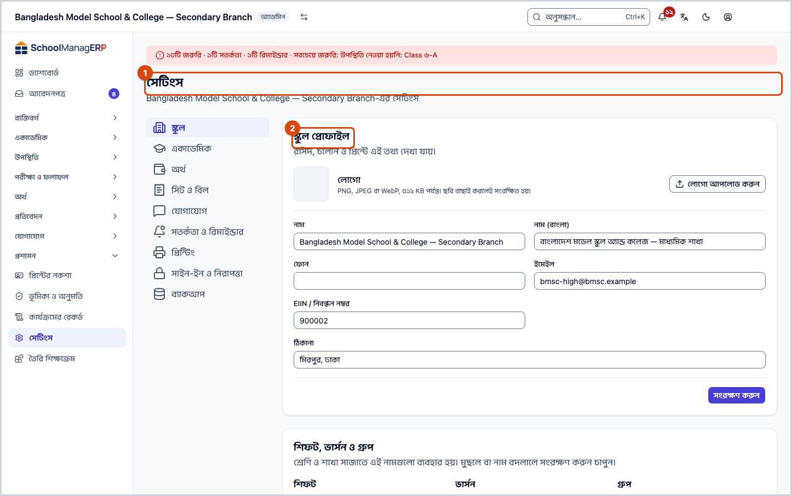
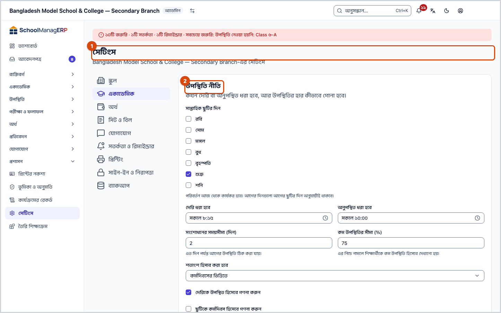
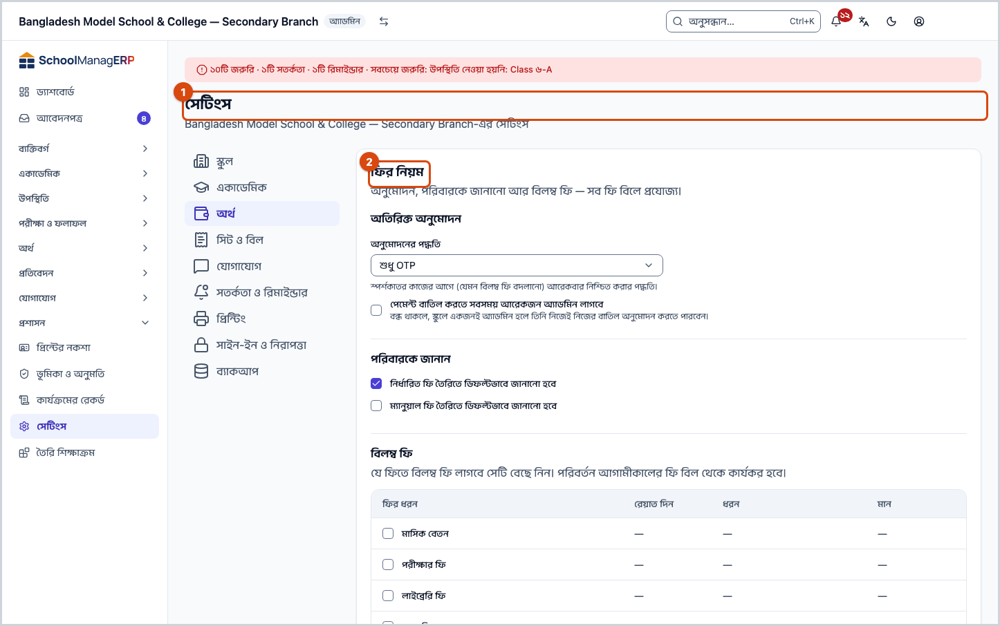
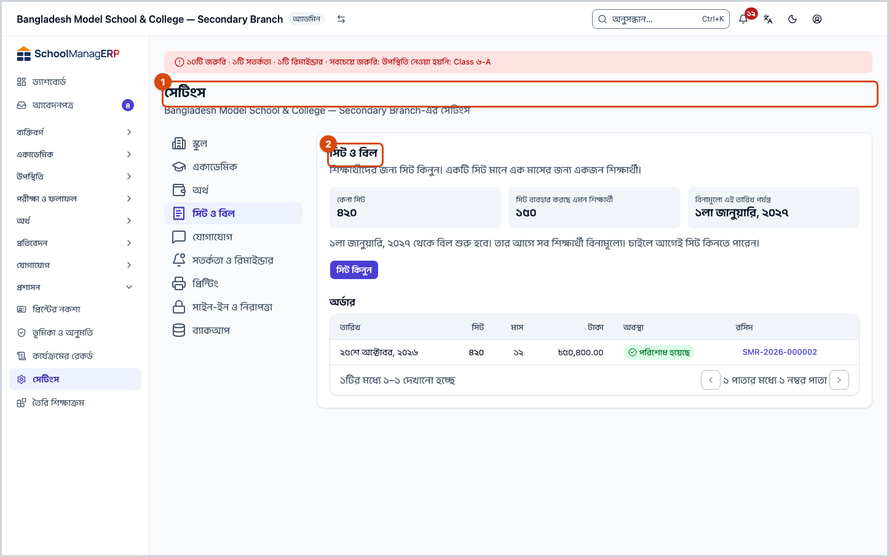
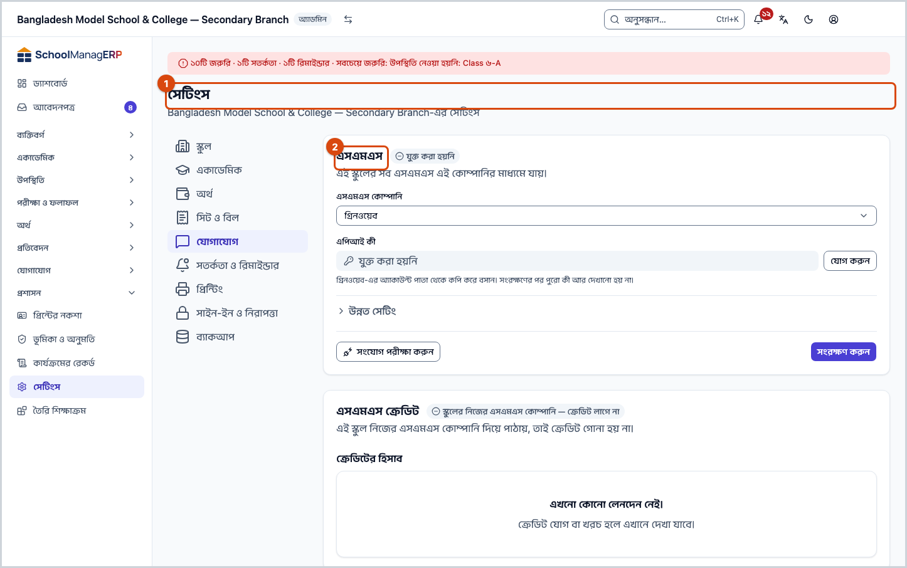
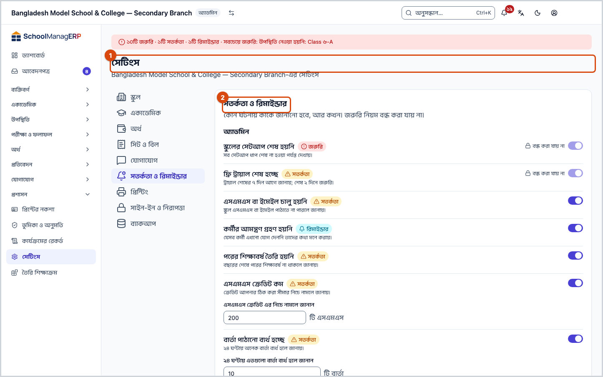
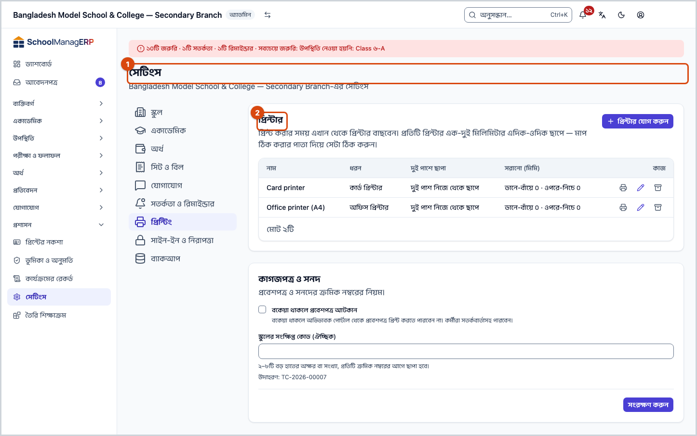
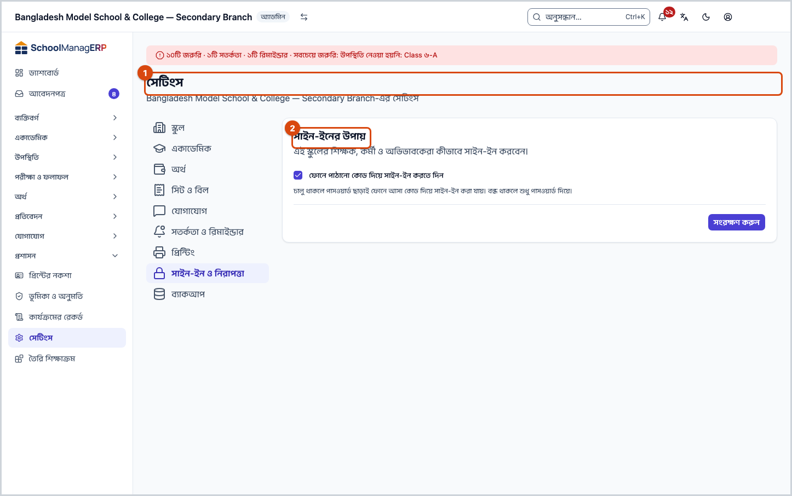
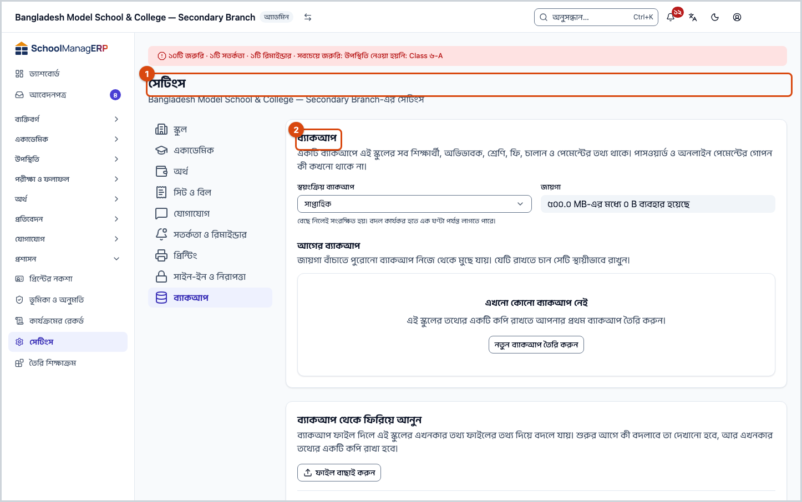

<!-- guide:meta
feature: administration.settings
title: স্কুলের সেটিংস ঠিক করা
summary: স্কুলের প্রোফাইল, একাডেমিক নিয়ম, ফির নিয়ম, যোগাযোগ, প্রিন্টিং, সাইন-ইন, ব্যাকআপ আর সতর্কতা এক পাতায়, নয়টি বিভাগে ঠিক করুন।
roles: [ADMIN]
sources:
  - client-admin/src/routes/_staff/settings.tsx
  - client-admin/src/pages/SchoolSettingsPage.tsx
  - client-admin/src/pages/settings/
  - client-admin/src/features/sign-in-methods/
  - client-admin/src/features/push/
  - client-admin/src/features/billing/
  - client-admin/src/route-permissions.ts
  - server/src/modules/schools/
  - server/src/modules/workbook/
labels:
  [
    settings:*,
    backup:*,
    signInMethods:*,
    push:*,
    evaluations:acr.criteriaSettings.*,
    curriculumPreset:settingsLink.*,
    bulkImport:confirm,
    bulkImport:chooseFile,
    bulkImport:fileWrongType,
    nav:items.settings,
    nav:groups.administration,
  ]
helpIds:
  [
    administration.settings,
    administration.settings.field.logo,
    administration.settings.section.organisation#task-school,
    administration.settings.section.attendance#task-academics,
    administration.settings.field.autoAbsentEnabled,
    administration.settings.field.approvalMode,
    administration.settings.field.requireSecondApprover,
    administration.settings.section.lateFees#task-finance,
    administration.settings.action.buySeats#task-billing,
    administration.settings.field.smsProvider,
    administration.settings.section.smsCredit#task-communication,
    administration.settings.section.guardianSmsFallback#task-alerts,
    administration.settings.section.printers#task-printing,
    administration.settings.field.otpLoginEnabled,
    administration.settings.section.backup#task-backup,
    administration.settings.field.schedule,
    administration.settings.section.restore#task-restore,
  ]
devices: [desktop]
entry: [sidebar, palette]
keywords:
  [সেটিংস, স্কুল প্রোফাইল, লোগো, উপস্থিতি নীতি, বিলম্ব ফি, অনুমোদন, শিফট, settings, school profile, logo, late fee, প্রিন্টার, ব্যাকআপ, পুনরুদ্ধার, সাইন-ইন, printer, backup, restore, sign-in]
appVersion: 0.1.0 (94db6def4)
owner: tareq89
lastVerified: 2026-10-25
knownIssues: []
-->

# স্কুলের সেটিংস ঠিক করা

স্কুল কীভাবে চলবে, তার নিয়মগুলো এক পাতায় ঠিক করুন।

**যেতে হবে:** বাম মেনুতে **প্রশাসন → [সেটিংস](#task-main)**। এই পাতা কম্পিউটারে দেখুন।
**শুরুর আগে:** আপনাকে অ্যাডমিন হতে হবে। অন্য কোনো ভূমিকার মেনুতে এই পাতা থাকে না।

**সেটিংস** পাতাটি কয়েকটি **বিভাগে** ভাগ করা, যেমন **স্কুল** বা **অর্থ**। বাঁ দিকের তালিকায় একটি বিভাগ চাপলে ডান দিকে তার অংশগুলো খোলে। প্রতিটি অংশের নিজের **সংরক্ষণ করুন** বোতাম আছে; একটি অংশ সংরক্ষণ করলে অন্য অংশ বদলায় না।

[একটি সেটিং বদলান](#task-main) · [স্কুল](#task-school) · [একাডেমিক](#task-academics) · [অর্থ](#task-finance) · [সমস্যা ও সমাধান](#trouble)

**এই পাতায় যা আছে**

- [একটি সেটিং বদলান](#task-main)
- [সংরক্ষিত হলো কি না বুঝবেন কীভাবে](#confirm)
- [বিভাগগুলো](#other)
  - [স্কুল: প্রোফাইল, লোগো, শিফট, ভাষা ও ক্যালেন্ডার](#task-school)
  - [একাডেমিক: উপস্থিতি, মূল্যায়ন, ড্যাশবোর্ড ও আরও](#task-academics)
  - [অর্থ: ফির নিয়ম](#task-finance)
  - [সিট ও বিল](#task-billing)
  - [যোগাযোগ](#task-communication)
  - [সতর্কতা ও রিমাইন্ডার](#task-alerts)
  - [প্রিন্টিং](#task-printing)
  - [সাইন-ইন ও নিরাপত্তা](#task-security)
  - [ব্যাকআপ](#task-backup)
- [সমস্যা ও সমাধান](#trouble)
- [কে কী করতে পারেন](#roles)
- [আরও জানুন](#more)

---

## একটি সেটিং বদলান 

1. বাম মেনুতে **প্রশাসন** চাপুন, তারপর **সেটিংস** চাপুন।

   → উপরে লেখা **সেটিংস**। বাঁ দিকে বিভাগের তালিকা: **স্কুল**, **একাডেমিক**, **অর্থ**, **সিট ও বিল**, **যোগাযোগ**, **সতর্কতা ও রিমাইন্ডার**, **প্রিন্টিং**, **সাইন-ইন ও নিরাপত্তা**, **ব্যাকআপ**। প্রথমে **স্কুল** খোলা থাকে।

2. বাঁ দিকে যে বিভাগ বদলাতে চান, সেটি চাপুন।

   → ডান দিকে সেই বিভাগের অংশগুলো দেখা যায়, যেমন **স্কুল প্রোফাইল** বা **উপস্থিতি নীতি**।

3. একটি অংশে ঘরগুলো বদলান। কোনো অংশের নিচে **উন্নত সেটিং** লেখা থাকলে, সেটি চাপলে কম দরকারি ঘরগুলো খোলে।

4. সেই অংশের নিচে **সংরক্ষণ করুন** চাপুন।

   → বোতামের পাশে **সংরক্ষিত হয়েছে** আসে।

> **মনে রাখুন:** **সংরক্ষণ করুন** চাপার আগে কিছুই স্কুলের সিস্টেমে যায় না। শুধু লোগো আলাদা: ছবি বাছাই করলেই সেটি সংরক্ষিত হয়।

---

## সংরক্ষিত হলো কি না বুঝবেন কীভাবে 

| অবস্থা                       | কীভাবে বুঝবেন                              | এরপর কী                |
| ---------------------------- | ------------------------------------------ | ---------------------- |
| **শুধু স্ক্রিনে বদলেছে**     | ঘরে নতুন মান আছে, কিন্তু কোনো বার্তা আসেনি | **সংরক্ষণ করুন** চাপুন |
| **স্কুলের সিস্টেমে পৌঁছেছে** | বোতামের পাশে **সংরক্ষিত হয়েছে** বার্তা    | কাজ শেষ                |

**যাচাই করতে চাইলে:** পাতাটি রিফ্রেশ করুন। সংরক্ষিত মানগুলোই ঘরে ফিরে আসবে।

**বার্তা না এলে:** [সমস্যা ও সমাধান](#trouble) দেখুন। ঘরে যা লিখেছেন, পাতা না ছাড়লে তা থেকে যায়।

---

## বিভাগগুলো 

### স্কুল: প্রোফাইল, লোগো, শিফট, ভাষা ও ক্যালেন্ডার 

এই বিভাগে চারটি অংশ আছে।

**১. স্কুল প্রোফাইল.** "রসিদ, চালান ও প্রিন্টে এই তথ্য দেখা যায়।"

| ঘর                       | কী লিখবেন                                                         |
| ------------------------ | ----------------------------------------------------------------- |
| **নাম**                  | স্কুলের নাম। ফাঁকা রাখা যায় না।                                  |
| **নাম (বাংলা)**          | বাংলায় স্কুলের নাম।                                              |
| **ফোন**, **ইমেইল**       | স্কুলের যোগাযোগ।                                                  |
| **EIIN / নিবন্ধন নম্বর** | সরকারি নিবন্ধন নম্বর।                                             |
| **ঠিকানা**               | স্কুলের ঠিকানা।                                                   |
| **লোগো**                 | PNG, JPEG বা WebP ছবি, ৫১২ KB আর প্রতি পাশে ২০৪৮ পিক্সেলের মধ্যে। |

লোগো বসাতে **লোগো আপলোড করুন** চাপুন আর ছবি বাছুন। ছবি বাছাই করলেই সংরক্ষিত হয়, **সংরক্ষণ করুন** লাগে না। স্কুলের সিস্টেম ছবিটি সর্বোচ্চ ৫১২×৫১২ পিক্সেলের PNG করে রাখে। লোগো সরাতে **লোগো সরান** চাপুন; "স্কুলের লোগো সরাতে চান?" প্রশ্নে **সরান** চাপুন। তখন রসিদ ও প্রিন্টে আর লোগো দেখায় না, পরে আবার আপলোড করা যায়।

**২. শিফট, ভার্সন ও গ্রুপ.** শ্রেণি ও শাখা সাজানোর নাম, যেমন শিফট "প্রভাতি" বা ভার্সন "ইংরেজি"। ঘরে নাম লিখে **যোগ করুন** চাপুন; একটির পাশে **নাম পরিবর্তন** বা **মুছুন** চাপুন। তারপর **সংরক্ষণ করুন** চাপুন।

- একই তালিকায় দুটি একই নাম রাখা যায় না।
- নাম বদলালে যে শ্রেণি ও শাখায় নামটি ছিল, সেগুলোতেও নতুন নাম বসে, একসাথে।
- যে নাম এখনও কোনো শ্রেণি বা শাখায় আছে, তা মোছা যায় না। তখন বার্তা আসে, আর কিছুই সংরক্ষিত হয় না। বরং নাম বদলান।

**৩. ভাষা, সংখ্যা ও তারিখ.** "সব পাতায় সংখ্যা, টাকা ও তারিখ যেভাবে দেখাবে।"

| ঘর                              | কী বাছবেন                                                                                                                                                                                                     |
| ------------------------------- | ------------------------------------------------------------------------------------------------------------------------------------------------------------------------------------------------------------- |
| **স্কুলের পাঠানো বার্তার ভাষা** | **বাংলা (বাংলাদেশ)** বা **ইংরেজি (বাংলাদেশ)**। এই স্কুলের SMS, ইমেইল, চিঠি ও সতর্কবার্তা এই ভাষায় যায়। এতে কারও পর্দা বদলায় না: পর্দার ভাষা প্রত্যেকে নিজে বেছে নেন ([ভাষা বদলানো](../start/language.md))। |
| **সংখ্যা পদ্ধতি**               | **বাংলা (০-৯)** বা **ল্যাটিন (0-9)**                                                                                                                                                                          |
| **সপ্তাহের প্রথম দিন**          | সপ্তাহ কোন দিনে শুরু                                                                                                                                                                                          |
| **শিক্ষাবর্ষ শুরুর মাস**        | ১ থেকে ১২-র একটি মাস                                                                                                                                                                                          |
| **মুদ্রা**                      | প্রতীক, **প্রতীকের অবস্থান**, **দশমিক ঘর** (০ থেকে ৪), **সংখ্যা গ্রুপিং** (**লাখ/কোটি** বা **হাজার**); নিচে একটি নমুনা দেখায়                                                                                 |

**উন্নত সেটিং** খুললে আরও ঘর আসে: **সময় অঞ্চল**, **মুদ্রার কোড**, ফোন নম্বরের নিয়ম, ঠিকানার ঘর আর পরিচয় নম্বর যাচাইয়ের নিয়ম। অ্যাপ নিজেই বলে: "সাধারণত বদলানোর দরকার হয় না; ভুল মান দিলে ফোন বা পরিচয় নম্বর যাচাই কাজ নাও করতে পারে।" কোনো ঘরে ভুল থাকলে অংশটি নিজে থেকে খুলে যায়।

**৪. ক্যালেন্ডার.** "পরীক্ষা, ছুটি ও টার্ম এই তথ্য দিয়ে সাজানো হয়।"

- **গ্রেডিং পিরিয়ডকে আপনি কী নামে ডাকেন?** — **টার্ম**, **সেমিস্টার** বা **ট্রাইমেস্টার**।
- **দেশ** — সরকারি ছুটির তালিকা এই দেশ থেকে আসে।
- **সপ্তাহের শুরু / সাপ্তাহিক ছুটি** — এখানে শুধু দেখায়। বদলাতে **সপ্তাহের প্রথম দিন বদলান** (উপরের অংশ) বা **সাপ্তাহিক ছুটি বদলান (একাডেমিক)** চাপুন।

ছুটি ও অনুষ্ঠান যোগ করা হয় [**ক্যালেন্ডার**](../people/calendar.md) পাতায়।

### একাডেমিক: উপস্থিতি, মূল্যায়ন, ড্যাশবোর্ড ও আরও 

প্রতিটি অংশ আলাদা করে সংরক্ষণ করতে হয়।

**উপস্থিতি নীতি.** "কখন দেরি বা অনুপস্থিত ধরা হবে, আর উপস্থিতির হার কীভাবে গোনা হবে।"

| ঘর                                  | কী করে                                                                                           |
| ----------------------------------- | ------------------------------------------------------------------------------------------------ |
| **সাপ্তাহিক ছুটির দিন**             | কোন দিন স্কুল বন্ধ। "পরিবর্তন আজ থেকে কার্যকর হবে। আগের দিনগুলো আগের ছুটির দিন অনুযায়ীই থাকবে।" |
| **দেরি ধরা হবে**                    | এই সময়ের পরে এলে দেরি।                                                                          |
| **অনুপস্থিত ধরা হবে**               | এই সময়ের পরে এলে অনুপস্থিত।                                                                     |
| **সংশোধনের সময়সীমা (দিন)**         | এত দিন পর্যন্ত আগের উপস্থিতি ঠিক করা যায়; ০ থেকে ৩৬৫।                                           |
| **কম উপস্থিতির সীমা (%)**           | এর নিচে নামলে শিক্ষার্থী "কম উপস্থিতি"; ০ থেকে ১০০।                                              |
| **শতাংশ হিসাব করা হবে**             | **কর্মদিবসের ভিত্তিতে** বা **চিহ্নিত দিনের ভিত্তিতে**।                                           |
| তিনটি টিকবক্স                       | দেরিকে উপস্থিত গোনা, ছুটিকে কর্মদিবস গোনা, আর ভবিষ্যতের তারিখ চিহ্নিত করতে দেওয়া।               |
| **অনুপস্থিতির স্বয়ংক্রিয় বার্তা** | অনুপস্থিত হলে অভিভাবককে নিজে থেকে জানানো, আর **পাঠানোর সময়সীমা**।                               |
| **শিফটভেদে সময়**                   | শিফট থাকলে প্রতিটির নিজের দেরি ও অনুপস্থিত সময়। সারি ফাঁকা রাখলে স্কুলের সময়ই চলে।             |
| **পিরিয়ড উপস্থিতি**                | চালু করলে শিক্ষকেরা রুটিনের প্রতিটি পিরিয়ডে উপস্থিতি নিতে পারেন।                                |
| **বিশেষ সময়সূচি (রমজান, শীতকাল)**  | শুধু কিছু তারিখে আলাদা পিরিয়ডের সময় ও দেরির সময়।                                              |

**অনুপস্থিতির স্বয়ংক্রিয় বার্তা** টিক দিলে একটি প্রশ্ন আসে: **অনুপস্থিতির স্বয়ংক্রিয় বার্তা চালু করবেন?** — "এটি চালু করলে প্রতিদিন প্রতিটি অনুপস্থিত শিক্ষার্থীর অভিভাবককে স্বয়ংক্রিয়ভাবে একটি বিজ্ঞপ্তি পাঠানো হবে।" **হ্যাঁ, চালু করুন** চাপুন, তারপর **সংরক্ষণ করুন**।

**আগমন বার্তা।** দুটি সুইচ, শুরুতে দুটিই বন্ধ: **আগমন বার্তা পাঠান** চালু করলে অভিভাবক সন্তান পৌঁছালে বার্তা চাইতে পারেন (তাঁদের উপস্থিতি পাতায় তখন **পৌঁছানোর খবর** কার্ড দেখা যায়), আর **আগমন বার্তায় SMS অনুমতি** চালু করলে বার্তা SMS-এও যেতে পারে, এতে স্কুলের SMS ক্রেডিট খরচ হয়। শুধু প্রথমটি চালু থাকলে বার্তা অ্যাপে যায়। প্রথমটি বন্ধ করলে SMS-ও বন্ধ হয়ে যায়, তাই আবার চালু করলে SMS আবার টিক দিতে হয়। **সংরক্ষণ করুন** চাপুন। অভিভাবক ও শিক্ষক কীভাবে ব্যবহার করবেন: [অভিভাবক](../portal/attendance.md#task-arrival), [শ্রেণি শিক্ষক](../academics/my-class.md#task-arrival)।

**বিশেষ সময়সূচি** যোগ করতে **বিশেষ সময়সূচি যোগ করুন** চাপুন। একটি নাম (৬০ অক্ষরের মধ্যে), **শুরুর তারিখ**, **শেষের তারিখ**, শিফট আর যে পিরিয়ডের সময় বদলাতে চান তা দিন। একই শিফটে দুটি এন্ট্রির তারিখ মিলে গেলে সংরক্ষণ হয় না। প্রতিদিনের হাজিরা কীভাবে নেওয়া হয়: [**হাজিরা**](../attendance/attendance.md)।

**মূল্যায়ন.** **নতুন ঘটনার প্রতিবেদন জমা হলে এসএমএস পাঠান**। এসএমএসে শুধু জানানো হয় যে একটি নতুন প্রতিবেদন আছে, ভেতরের লেখা নয়। পুশ নোটিফিকেশন সবসময় চালু থাকে। দেখুন: [**মূল্যায়ন**](../people/evaluations.md)।

**ড্যাশবোর্ড.** তিনটি অংশ:

- **ঝুঁকিপূর্ণ শিক্ষার্থী** — যেকোনো ২টি সংকেত মিললে শিক্ষার্থী তালিকায় আসে। সংকেতগুলো: **টানা অনুপস্থিত (দিন)** (১–৩০), **গত ৩০ দিনের উপস্থিতি এর কম হলে (%)** (১–১০০), **সর্বশেষ প্রকাশিত পরীক্ষায় ফেল করা বিষয় (কমপক্ষে)** (১–২০), **সবচেয়ে পুরোনো বকেয়া এর বেশি দিনের হলে (দিন)** (১–৩৬৫)। সংরক্ষণের কয়েক মিনিট পরে তালিকা বদলায়।
- **কমিটি** — **উপস্থিতির লক্ষ্য (%)** (১–১০০), কমিটির উপস্থিতি চার্টে একটি রেখা।
- **সকালের সারসংক্ষেপ** — **পাঠানোর সময়**। ছুটির দিনে পাঠানো হয় না।

দেখুন: [**ড্যাশবোর্ড**](../dashboard/dashboard.md)।

[**পাঠ পরিকল্পনা.**](../academics/syllabus.md) শিক্ষক প্রতিটি পিরিয়ডের অবস্থা না জানালে কে, কখন জানবে।

- **অবস্থা জানানোর শেষ সময়** — একই স্কুল-দিনে; এর পরে জানালে দেরি গোনা হয়।
- **শিক্ষককে মনে করানোর সময়** — পরের স্কুল-দিনে, শুধু বাকি থাকলে।
- **একাডেমিক কো-অর্ডিনেটর ও অ্যাডমিনকে জানানো হবে** — এত স্কুল-দিন না জানালে; ১ থেকে ১০, ছুটির দিন গোনা হয় না।
- **সাপ্তাহিক সারাংশ পাঠানোর সময়** — সপ্তাহের শেষ কর্মদিবসে, অভিভাবক ও পরিচালনা কমিটিকে।
- **অভিভাবকের সাপ্তাহিক সারাংশ এসএমএসেও পাঠান** — পুশ সবসময় যায়, খরচ নেই। এসএমএস চালু করলে প্রতি সপ্তাহে ক্রেডিট লাগে।

উপরের **এখনকার সেটিংয়ে যা হয়** বাক্সে এখনকার নিয়ম সহজ ভাষায় দেখায়।

**বাড়ির কাজ.** দুটি টিকবক্স, চালু না করা পর্যন্ত দুটিই বন্ধ: **বাড়ির কাজ দিলে বা বদলালে অভিভাবককে এসএমএস পাঠান** (নতুন কাজ, আর পরে শেষ তারিখ সরানো, কাজ বাতিল বা অন্য শাখা বা শিক্ষার্থীকে দেওয়া) আর **বাড়ির কাজ জমা না হলে অভিভাবককে এসএমএস পাঠান**। দেখুন: [**বাড়ির কাজ**](../academics/homework.md)।

**আবেদনপত্র.** **অভিভাবককে SMS-এ সিদ্ধান্ত জানান** — শুধু চূড়ান্ত সিদ্ধান্ত (অনুমোদিত বা নামঞ্জুর)। অ্যাপের বিজ্ঞপ্তি সবসময় যায়। দেখুন: [**আবেদনপত্র**](../applications/applications.md)।

মূল্যায়ন, পাঠ পরিকল্পনা, বাড়ির কাজ আর আবেদনপত্রের এসএমএস যায় শুধু তখনই, যখন [**যোগাযোগ**](#task-communication) বিভাগে এসএমএস কোম্পানি যুক্ত আছে। না থাকলে অংশে একটি সতর্কবার্তা আর **যোগাযোগ › এসএমএস কোম্পানি যুক্ত করুন** লিংক দেখায়।

**এসিআরের মানদণ্ড.** প্রতিটি এসিআরে যে মানদণ্ড ধরে নম্বর দেওয়া হয়। **মানদণ্ড যোগ করুন** চাপুন; প্রতিটিতে **কোড**, **অংশ** (**অংশ ২: কাজের মান** বা **অংশ ৩: ব্যক্তিগত গুণাবলি**), **নাম (বাংলা)** আর **নাম (ইংরেজি)** দিন। ক্রম বদলাতে **উপরে নিন** / **নিচে নিন**। তারপর **মানদণ্ড সংরক্ষণ করুন**।

- কোড আর দুটি নামই লাগে; প্রতিটি কোড আলাদা হতে হয়।
- প্রতিবার সংরক্ষণে একটি নতুন সংস্করণ হয়। পরিবর্তন শুধু নতুন এসিআরে খাটে; আগে শুরু হওয়া এসিআর আগের মানদণ্ডেই থাকে।

**পাঠ্যক্রম প্রিসেট.** এখানে শুধু একটি কার্ড আর তার লিংক। প্রিসেট বসানো হয় [**পাঠ্যক্রম প্রিসেট**](curriculum-preset.md) পাতায়।

### অর্থ: ফির নিয়ম 

এই বিভাগে একটি অংশ: **ফির নিয়ম**। "অনুমোদন, পরিবারকে জানানো আর বিলম্ব ফি — সব ফি বিলে প্রযোজ্য।"

**অতিরিক্ত অনুমোদন**

| ঘর                                                  | কী করে                                                                                                                        |
| --------------------------------------------------- | ----------------------------------------------------------------------------------------------------------------------------- |
| **অনুমোদনের পদ্ধতি**                                | স্পর্শকাতর কাজের আগে আরেকবার নিশ্চিত করার পদ্ধতি: **শুধু OTP** অথবা **OTP অথবা পাসওয়ার্ড**।                                  |
| **পেমেন্ট বাতিল করতে সবসময় আরেকজন অ্যাডমিন লাগবে** | চালু থাকলে বাতিলে সবসময় দ্বিতীয় একজন লাগে। বন্ধ থাকলে, স্কুলে একজনই অ্যাডমিন হলে তিনি নিজেই নিজের বাতিল অনুমোদন করতে পারেন। |

**পরিবারকে জানান** — দুটি টিকবক্স: **নির্ধারিত ফি তৈরিতে ডিফল্টভাবে জানানো হবে** আর **ম্যানুয়াল ফি তৈরিতে ডিফল্টভাবে জানানো হবে**। বিল তৈরির সময় পরিবারকে জানানোর টিক শুরু থেকেই দেওয়া থাকবে কি না, তা এগুলো দিয়ে ঠিক হয় ([**তৈরি হওয়া ফির বিল**](../finance/generate-fees.md), [**স্বয়ংক্রিয় বিল**](../finance/recurring-schedules.md))।

**জরিমানা পরিশোধের সময় (দিন)** — নতুন জরিমানা তৈরির এত দিন পরে পরিশোধ করতে হবে; ১ থেকে ৬০ (শুরুতে ৭)। কার্যকর করতে **সংরক্ষণ করুন** চাপুন। দেখুন: [**জরিমানা**](../finance/fines.md)।

**বিলম্ব ফি** — "যে ফিতে বিলম্ব ফি লাগবে সেটি বেছে নিন।" প্রতিটি ফির ধরনের একটি সারি (বিলম্ব ফি নিজে বাদে):

| ঘর             | কী লিখবেন                                                          |
| -------------- | ------------------------------------------------------------------ |
| টিকবক্স        | এই ফিতে বিলম্ব ফি লাগবে কি না।                                     |
| **রেয়াত দিন** | বিলের শেষ তারিখের পর এত দিন বিলম্ব ফি লাগে না; ০ থেকে ৬০।          |
| **ধরন**        | **শতাংশ** বা **নির্দিষ্ট পরিমাণ**।                                 |
| **মান**        | শতাংশ হলে ০ থেকে ১০০; নির্দিষ্ট পরিমাণ হলে শূন্য বা তার বেশি টাকা। |

"পরিবর্তন আগামীকালের ফি বিল থেকে কার্যকর হবে।" একটি বিলে বিলম্ব ফি একবারই বসে; শুধু যে বিলের শেষ তারিখ আছে আর টাকা বাকি আছে, তাতে। জরিমানায় কখনো বিলম্ব ফি লাগে না ([**জরিমানা**](../finance/fines.md))।

> **মনে রাখুন:** বিলম্ব ফি আর অনুমোদনের পদ্ধতি টাকার সাথে জড়িত। বদলানোর আগে হিসাবরক্ষকের সাথে কথা বলে নিন।

### সিট ও বিল 

এই বিভাগে একটি অংশ: **সিট ও বিল**। "একটি সিট মানে এক মাসের জন্য একজন শিক্ষার্থী।" উপরে তিনটি ঘর: **কেনা সিট**, **সিট ব্যবহার করছে এমন শিক্ষার্থী**, আর **পরিশোধ করা আছে এই তারিখ পর্যন্ত** (বিনামূল্যের সময়ে **বিনামূল্যে এই তারিখ পর্যন্ত**)।

**সিট কিনুন**

1. **সিট কিনুন** চাপুন।
2. **সিট (শিক্ষার্থী)** আর **মাস** লিখুন। সিট আগে থেকেই বসানো থাকে: যত শিক্ষার্থীর সিট নেই তত, তবে কমপক্ষে ১০০।
3. নিচে **মোট** দেখুন। দাম প্রতি সিট প্রতি মাসে ১০ টাকা, তাই মোট = সিট × মাস × ১০ টাকা। আসল দাম সার্ভার আবার হিসাব করে।
4. **অর্ডার তৈরি করুন** চাপুন। অর্ডারটি **টাকার অপেক্ষায়** অবস্থায় তৈরি হয়।
5. **বিকাশে টাকা দিন** চাপুন। আপনাকে বিকাশের পাতায় নেওয়া হবে। টাকা দেওয়ার পর বিকাশ আপনাকে এই অংশে ফেরত পাঠায়।

| ঘর                   | কী লিখবেন                             |
| -------------------- | ------------------------------------- |
| **সিট (শিক্ষার্থী)** | ১ থেকে ১,০০,০০০-এর একটি পূর্ণ সংখ্যা। |
| **মাস**              | ১ থেকে ২৪-এর একটি পূর্ণ সংখ্যা।       |

**কবে থেকে চালু হয়.** এখন যত সিট চালু আছে, তত বা তার বেশি কিনলে এটা নবায়ন: এখনকার সিট শেষ হওয়ার দিন থেকে চালু হয়, মাস বাড়ে। কম কিনলে টাকা দেওয়ার দিন থেকে চালু হয়, সিট যোগ হয়।

**বিকাশ থেকে ফেরার পর** অংশে একটি বার্তা দেখায়:

| বার্তা                                               | মানে                                                        |
| ---------------------------------------------------- | ----------------------------------------------------------- |
| **টাকা পাওয়া গেছে। আপনার সিট চালু হয়েছে।**         | কাজ শেষ। রসিদ **অর্ডার** তালিকায় পাবেন, ইমেইলেও যায়।      |
| **বিকাশের সাথে আপনার পেমেন্ট মিলিয়ে দেখা হচ্ছে। …** | অপেক্ষা করুন; পাতা নিজে থেকে বদলায়, সর্বোচ্চ ২ মিনিট দেখে। |
| **বিকাশের নিশ্চিতকরণের জন্য এখনও অপেক্ষা করছি। …**   | ২ মিনিট পার হয়েছে। কয়েক মিনিট পরে তালিকা আবার দেখুন।      |
| **এই অর্ডারের টাকা দেওয়া হয়নি। …**                 | নতুন করে সিট কিনে আবার টাকা দিন।                            |

**অর্ডার** তালিকায় শেষ ২০টি অর্ডার দেখায়: **তারিখ**, **সিট**, **মাস**, **টাকা**, **অবস্থা** আর **রসিদ**। পরিশোধ হওয়া অর্ডারের রসিদ নম্বর চাপলে রসিদ খোলে।

**মেয়াদ.** বিনামূল্যের সময় শেষ হলে যত সিট কেনা আছে, তত সক্রিয় শিক্ষার্থীই রাখা যায়। মেয়াদ শেষের ৩০ দিন আগে থেকে **আপনার সিট … তারিখে শেষ হবে।** বার্তা দেখায়। সিটের চেয়ে বেশি সক্রিয় শিক্ষার্থী থাকলে, পরিশোধিত মেয়াদ শেষের পর ৭ দিন স্কুলটি শুধু দেখা যায়, তারপর স্থগিত হয়। টাকা দিলে আবার চালু হয়।

> **মনে রাখুন:** এই অংশে সত্যিকারের টাকা লাগে। টাকা কেটে গেলে কিন্তু অর্ডার পরিশোধিত না দেখালে কিছুক্ষণ অপেক্ষা করুন; দুবার টাকা দেবেন না।

### যোগাযোগ 

এই বিভাগে পাঁচটি অংশ: **এসএমএস**, **এসএমএস ক্রেডিট**, **হোয়াটসঅ্যাপ**, **মেসেঞ্জার** আর **ইমেইল**। **এসএমএস**, **হোয়াটসঅ্যাপ**, **মেসেঞ্জার** আর **ইমেইল** অংশের মাথায় **যুক্ত আছে** বা **যুক্ত করা হয়নি** লেখা থাকে। এটি সংরক্ষিত তথ্য থেকে আসে, লেখার সময় বদলায় না।

**সংযোগ পরীক্ষা করুন** বোতাম ঘরে এখন যা লেখা আছে তা দিয়েই পরীক্ষা করে, সংরক্ষণ ছাড়াই। ঠিক থাকলে **সংযোগ ঠিক আছে** দেখায়; তারপর **সংরক্ষণ করুন** চাপুন।

গোপন কী বা টোকেন সংরক্ষণের পর পুরোটা আর দেখানো হয় না, শুধু **যুক্ত আছে — শেষে …**। বদলাতে **বদলান**, সরাতে **মুছুন** চাপুন।

**এসএমএস** — "এই স্কুলের সব এসএমএস এই কোম্পানির মাধ্যমে যায়।"

| ঘর                           | কী লিখবেন                                                                   |
| ---------------------------- | --------------------------------------------------------------------------- |
| **এসএমএস কোম্পানি**          | **গ্রিনওয়েব** বা **মিমএসএমএস**।                                            |
| **এপিআই কী**                 | কোম্পানির অ্যাকাউন্ট পাতা থেকে কপি করুন।                                    |
| **প্রেরকের নাম (Sender ID)** | শুধু মিমএসএমএসে, আর তখন দিতেই হবে। কোম্পানি যে নাম অনুমোদন করেছে সেটিই দিন। |
| **এপিআই ঠিকানা (ঐচ্ছিক)**    | **উন্নত** অংশে। ফাঁকা রাখলে কোম্পানির নিজের ঠিকানা চলে।                     |

**এসএমএস ক্রেডিট** — এই অংশ শুধু দেখার, এখানে কিছু বদলানো যায় না। দুই রকম হয়:

- **স্কুলের নিজের এসএমএস কোম্পানি — ক্রেডিট লাগে না**: স্কুল নিজের কোম্পানিতে টাকা দেয়, তাই ক্রেডিট গোনা হয় না।
- **প্ল্যাটফর্মের ক্রেডিট**: প্রতিটি এসএমএস পাঠাতে ক্রেডিট লাগে। ক্রেডিট শুধু প্ল্যাটফর্মের সুপার অ্যাডমিন যোগ করেন।

এক ক্রেডিট = এসএমএসের এক অংশ। ইংরেজি বার্তা এক অংশে ১৬০ অক্ষর (লম্বা হলে প্রতি অংশে ১৫৩)। বাংলা বার্তা এক অংশে ৭০ অক্ষর (লম্বা হলে প্রতি অংশে ৬৭)। তাই বাংলা বার্তায় বেশি ক্রেডিট লাগে।

| ঘর                        | মানে                                                                  |
| ------------------------- | --------------------------------------------------------------------- |
| **হাতে আছে**              | এখন খরচ করা যায় এমন ক্রেডিট।                                         |
| **পাঠানোর জন্য আটকে আছে** | পাঠানো শুরু হওয়া এসএমএসের জন্য আলাদা করে রাখা। না গেলে **ফেরত** আসে। |

নিচে **ক্রেডিটের হিসাব**, নতুনগুলো আগে, এক পাতায় ২৫টি: **যোগ হয়েছে**, **আটকে রাখা**, **খরচ**, **ফেরত** বা **সমন্বয়**। প্ল্যাটফর্মের ক্রেডিটে, ক্রেডিট কম থাকলে গণ বার্তা বা রিমাইন্ডার পাঠানো আটকে যায়। কম ক্রেডিটের সতর্কতা কখন আসবে, তা ঠিক করুন [সতর্কতা ও রিমাইন্ডার](#task-alerts) বিভাগে।

**হোয়াটসঅ্যাপ** — Meta Business অ্যাকাউন্টের তথ্য।

| ঘর                        | কী লিখবেন                                                      |
| ------------------------- | -------------------------------------------------------------- |
| **ফোন নম্বর আইডি**        | দিতেই হবে। Meta-র WhatsApp Manager-এ পাবেন; এটি ফোন নম্বর নয়। |
| **অ্যাক্সেস টোকেন**       | Meta Business থেকে কপি করুন।                                   |
| **এপিআই ভার্সন (ঐচ্ছিক)** | **উন্নত** অংশে। ফাঁকা রাখলে ঠিক করা ভার্সন চলে।                |

**মেসেঞ্জার** — স্কুলের ফেসবুক পেজ।

| ঘর                  | কী লিখবেন                                  |
| ------------------- | ------------------------------------------ |
| **ফেসবুক পেজ আইডি** | দিতেই হবে। পেজের ‘About’ অংশের নিচে পাবেন। |
| **অ্যাক্সেস টোকেন** | Meta Business থেকে কপি করুন।               |

**ইমেইল** — "এই স্কুলের ইমেইল এই সার্ভার দিয়ে পাঠানো হয়।"

| ঘর                             | কী লিখবেন                                  |
| ------------------------------ | ------------------------------------------ |
| **ইমেইল সার্ভার (SMTP)**       | দিতেই হবে।                                 |
| **সার্ভারের ব্যবহারকারীর নাম** | দিতেই হবে।                                 |
| **যে ঠিকানা থেকে ইমেইল যাবে**  | দিতেই হবে; সঠিক ইমেইল ঠিকানা।              |
| **সার্ভারের পাসওয়ার্ড**       | সার্ভারের পাসওয়ার্ড।                      |
| **পোর্ট**                      | **উন্নত** অংশে; ১ থেকে ৬৫৫৩৫। সাধারণত ৫৮৭। |

### সতর্কতা ও রিমাইন্ডার 

এই বিভাগে একটি অংশ: **সতর্কতা ও রিমাইন্ডার**। "কোন ঘটনায় কাকে জানানো হবে, আর কখন। জরুরি নিয়ম বন্ধ করা যায় না।"

**নিয়মের তালিকা.** নিয়মগুলো কাকে জানায় সেই অনুযায়ী দলে সাজানো। প্রতিটি সারিতে নাম, গুরুত্বের চিহ্ন আর একটি সুইচ। জরুরি নিয়মে **বন্ধ করা যায় না** লেখা থাকে, সুইচ চাপা যায় না। নতুন স্কুলে সব নিয়ম চালু থাকে। কিছু নিয়মের সাথে একটি সংখ্যার ঘর থাকে:

| ঘর                                            | কী লিখবেন              | শুরুতে |
| --------------------------------------------- | ---------------------- | ------ |
| **প্রথম পিরিয়ড শুরুর পর কত সময় দেওয়া হবে** | ০ থেকে ১২০ মিনিট       | ১৫     |
| **পিরিয়ড শুরুর কত আগে শিক্ষককে মনে করাবে**   | ০ থেকে ৬০ মিনিট        | ১০     |
| **এসএমএস ক্রেডিট এর নিচে নামলে জানান**        | ০ থেকে ১,০০,০০০ এসএমএস | ২০০    |
| **২৪ ঘণ্টায় এতগুলো বার্তা ব্যর্থ হলে জানান** | ১ থেকে ১০০০ বার্তা     | ১০     |

**উপস্থিতি অনেক দেরি হলে একাডেমিক কো-অর্ডিনেটর ও অ্যাডমিনকেও জানান** — একটি টিকবক্স, শুরুতে চালু।

**কখন রিমাইন্ডার যাবে**

| ঘর                                        | শুরুতে |
| ----------------------------------------- | ------ |
| **সকালের রিমাইন্ডার**                     | ০৭:০০  |
| **সন্ধ্যার রিমাইন্ডার (পরের দিনের জন্য)** | ১৭:০০  |

**পুশ বিজ্ঞপ্তির নীরব সময়** — **নীরব সময় শুরু** (শুরুতে ২১:০০) আর **নীরব সময় শেষ** (শুরুতে ০৭:০০)। "এই সময়ে শুধু জরুরি সতর্কতা শব্দ করে আসবে, বাকিগুলো সময় শেষ হলে।"

**যে অভিভাবকের অ্যাপ নেই**

| ঘর                                      | কী করে                                                                                                 |
| --------------------------------------- | ------------------------------------------------------------------------------------------------------ |
| **অ্যাপে না পৌঁছালে এসএমএস পাঠান**      | চালু করলে যে অভিভাবকের অ্যাপ বা পুশ নেই, তাঁকে এসএমএস যায়। শুরুতে বন্ধ। নীরব সময়ে এই এসএমএস যায় না। |
| **একজন অভিভাবককে দিনে সর্বোচ্চ এসএমএস** | সুইচ চালু থাকলেই দেখায়; ০ থেকে ১০, শুরুতে ২।                                                          |

> **মনে রাখুন:** এই এসএমএসে ক্রেডিট খরচ হয়। ক্রেডিট না থাকলে এসএমএস যায় না ([এসএমএস ক্রেডিট](#task-communication))।

### প্রিন্টিং 

এই বিভাগে দুটি অংশ: **প্রিন্টার** আর **কাগজপত্র ও সনদ**। বিভাগটি দেখতে প্রিন্ট টেমপ্লেট সামলানোর অনুমতি লাগে, যা অ্যাডমিনের আছে।

**প্রিন্টার** — "প্রিন্ট করার সময় এখান থেকে প্রিন্টার বাছবেন।" কোনো প্রিন্টার না থাকলে **প্রিন্টার যোগ করুন** বোতাম দেখায়। তালিকার প্রতিটি সারিতে তিনটি কাজ: **মাপের পাতা ছাপুন**, **সম্পাদনা** আর **আর্কাইভ**।

| ঘর                                                      | কী লিখবেন                                                  |
| ------------------------------------------------------- | ---------------------------------------------------------- |
| **নাম**                                                 | দিতেই হবে; ৮০ অক্ষরের মধ্যে।                               |
| **প্রিন্টারের ধরন**                                     | **কার্ড প্রিন্টার** অথবা **অফিস প্রিন্টার**।               |
| **দুই পাশে ছাপা**                                       | প্রিন্টার নিজে উল্টায়, নাকি আপনি হাতে কাগজ উল্টে দেন।     |
| **কার্ডের মাঝে কাটার ফাঁক (মিমি)**                      | শুধু অফিস প্রিন্টারে; ০ থেকে ২০।                           |
| **ডানে-বাঁয়ে সরান (মিমি)** / **ওপরে-নিচে সরান (মিমি)** | **মাপ ঠিক করা (উন্নত)** অংশে; −১০ থেকে ১০।                 |
| **আকার**                                                | **মাপ ঠিক করা (উন্নত)** অংশে; ০.৯০ থেকে ১.১০, ১ = আসল মাপ। |

**মাপের পাতা ছাপুন** চাপলে একটি পরীক্ষার পাতা ছাপা হয় আর তিন ধাপের নির্দেশ আসে: প্রথম ক্রস চিহ্ন পর্যন্ত মাপুন (ঠিক ২০ মিমি হওয়ার কথা), কম-বেশি যা হলো **সরানোর মাপ বদলান**-এ লিখুন, তারপর আবার ছাপুন। এই পাতা কোনো প্রিন্টের রেকর্ডে যায় না। আর্কাইভ করলে আগের প্রিন্টের রেকর্ড থাকে। বিস্তারিত: [**প্রিন্টার ও ক্যালিব্রেশন**](print-templates/printers-and-calibration.md)।

**কাগজপত্র ও সনদ** — "প্রবেশপত্র ও সনদের ক্রমিক নম্বরের নিয়ম।"

| ঘর                                 | কী করে                                                                                                                       |
| ---------------------------------- | ---------------------------------------------------------------------------------------------------------------------------- |
| **বকেয়া থাকলে প্রবেশপত্র আটকান**  | চালু থাকলে বকেয়া থাকা শিক্ষার্থীর প্রবেশপত্র অভিভাবক পোর্টাল থেকে প্রিন্ট হয় না; কর্মীরা সতর্কবার্তাসহ পারেন। শুরুতে বন্ধ। |
| **স্কুলের সংক্ষিপ্ত কোড (ঐচ্ছিক)** | ২ থেকে ৮টি বড় হাতের অক্ষর বা সংখ্যা; প্রতিটি ক্রমিক নম্বরের আগে ছাপা হয়। নিচে একটি উদাহরণ নম্বর দেখায়।                    |

দেখুন: [**পরীক্ষার কাগজপত্র**](print-templates/exam-documents.md), [**সনদ**](print-templates/certificates.md)।

### সাইন-ইন ও নিরাপত্তা 

এই বিভাগে একটি অংশ: **সাইন-ইনের উপায়**। "এই স্কুলের শিক্ষক, কর্মী ও অভিভাবকেরা কীভাবে সাইন-ইন করবেন।"

| ঘর                                         | কী করে                                                                                              | শুরুতে |
| ------------------------------------------ | --------------------------------------------------------------------------------------------------- | ------ |
| **ফোনে পাঠানো কোড দিয়ে সাইন-ইন করতে দিন** | চালু থাকলে পাসওয়ার্ড ছাড়াই ফোনে আসা কোড দিয়ে সাইন-ইন করা যায়। বন্ধ থাকলে শুধু পাসওয়ার্ড দিয়ে। | চালু   |

> **সাবধান:** বন্ধ করার আগে নিশ্চিত হোন যে সবার পাসওয়ার্ড আছে। যিনি শুধু কোড দিয়ে ঢোকেন, বন্ধের পর তাঁকে পাসওয়ার্ড দিয়ে ঢুকতে হবে।

- **একাধিক স্কুল:** কেউ কয়েকটি স্কুলে থাকলে, যেকোনো একটি স্কুলে এই সুইচ বন্ধ থাকলেই তাঁর কোড দিয়ে সাইন-ইন বন্ধ। তখন নতুন স্কুল যোগ করতেও আগে পাসওয়ার্ড দিয়ে সাইন-ইন করতে হয়।
- **এখানে যা নেই:** নিজের পাসওয়ার্ড, গুগল বা ফেসবুক যুক্ত করা আর নিজের ডিভাইস প্রত্যেকে নিজের অ্যাকাউন্টের **নিরাপত্তা** পাতায় দেখেন ([**আপনার অ্যাকাউন্ট**](../start/account.md#task-methods))। সেখানে শেষ উপায়টি সরাতে চাইলে আগে একটি পাসওয়ার্ড দিতে হয়। পুশ নোটিফিকেশনও প্রত্যেকে নিজে চালু করেন ([**সতর্কতা দেখা ও মেটানো**](../dashboard/alerts.md)); স্কুলের নীরব সময় [**সতর্কতা ও রিমাইন্ডার**](#task-alerts)-এ।

### ব্যাকআপ 

এই বিভাগে দুটি অংশ: **ব্যাকআপ** আর **ব্যাকআপ থেকে ফিরিয়ে আনুন**। বিভাগটি দেখতে ব্যাকআপ সামলানোর অনুমতি লাগে, যা অ্যাডমিনের আছে।

**একটি ব্যাকআপে কী থাকে:** এই স্কুলের তথ্য একটি .xlsx ফাইলে, প্রতিটি ধরনের জন্য আলাদা শিট: স্কুলের প্রোফাইল, শিক্ষাবর্ষ, শ্রেণি, শাখা, বিষয়, ছুটি, ব্যবহারকারী, শিক্ষক, অভিভাবক, শিক্ষার্থী, ভর্তি, ফি, চালান, পেমেন্ট, পরীক্ষা ও ফলাফল, রুটিন আর আরও কিছু।

**কখনো থাকে না:** পাসওয়ার্ড আর অনলাইন পেমেন্টের গোপন কী। এগুলোও এখনো থাকে না: শিক্ষার্থীর উপস্থিতির সেশন ও রেকর্ড, উপস্থিতির যন্ত্র, শিক্ষার্থীর ওয়ালেট, ছাড়ের নিয়ম, নিয়মিত ফির সময়সূচি, ফি তৈরির রান, টার্ম, এসএমএস ক্রেডিট, আর বেনামি জরিপের উত্তর।

#### ব্যাকআপ নিন 

1. **নতুন ব্যাকআপ তৈরি করুন** চাপুন।

   → "প্রস্তুত হলে আমরা আপনাকে ইমেইল করবো।" **আগের ব্যাকআপ** তালিকায় নতুন সারি আসে: **সারিতে আছে**, তারপর **চলছে**, তারপর **সম্পন্ন হয়েছে**।

2. সারির **ডাউনলোড** চাপুন, অথবা ইমেইলের লিংক খুলুন।

   → লিংকটি এই পাতায় **ব্যাকআপ** বিভাগ খোলে (ঠিকানার শেষে `?backup=<কাজের নম্বর>`) আর ফাইলটি নিজে থেকে ডাউনলোড শুরু হয়।

**স্বয়ংক্রিয় ব্যাকআপ** — **বন্ধ**, **সাপ্তাহিক** বা **দৈনিক**। শুরুতে বন্ধ। বেছে নিলেই সংরক্ষিত হয়; কার্যকর হতে এক ঘণ্টা পর্যন্ত লাগে। স্বয়ংক্রিয় ব্যাকআপ সফল হলে ইমেইল আসে না; ব্যর্থ হলে স্কুলের সব অ্যাডমিন ইমেইল পান। নিজে নেওয়া ব্যাকআপ সফল বা ব্যর্থ, দুই ক্ষেত্রেই যিনি নিয়েছেন তিনি ইমেইল পান।

**কতদিন থাকে**

| নিয়ম                 | কী হয়                                                                                                        |
| --------------------- | ------------------------------------------------------------------------------------------------------------- |
| ডাউনলোডের মেয়াদ      | ব্যাকআপ শেষ হওয়ার পর ৩০ দিন (**স্থায়ীভাবে রাখুন** চাপা ব্যাকআপে নয়)। এরপর **ডাউনলোডের মেয়াদ শেষ** দেখায়। |
| নিজে নেওয়া ব্যাকআপ   | নতুন ৩টি থাকে, পুরোনোগুলো নিজে থেকে মুছে যায়।                                                                |
| স্বয়ংক্রিয় ব্যাকআপ  | নতুন ৮টি থাকে।                                                                                                |
| ফিরিয়ে আনার আগের কপি | ৩০ দিন পর্যন্ত থাকে।                                                                                          |
| মোট জায়গা            | স্কুলপ্রতি ৫০০ MB। বেশি হলে সবচেয়ে পুরোনো ব্যাকআপ মুছে যায়। **জায়গা** ঘরে ব্যবহার দেখায়।                  |

**স্থায়ীভাবে রাখুন** চাপলে সেই ব্যাকআপ নিজে থেকে মোছে না।

#### ব্যাকআপ থেকে ফিরিয়ে আনুন 

> **সাবধান: এটি ফেরানো যায় না।** ফিরিয়ে আনলে এই স্কুলের এখনকার তথ্য ফাইলের তথ্য দিয়ে বদলে যায়। ফাইলে যে সারি নেই, তা মুছে যায় (স্কুলের প্রোফাইল, প্রিন্টার আর প্রিন্ট ডিজাইন মোছে না)। ব্যাকআপের পরে যা যোগ বা বদল করেছেন, তা হারায়।

1. **ফাইল বাছাই করুন** দিয়ে এই অ্যাপের .xlsx ব্যাকআপ দিন (সর্বোচ্চ ৬৪ MB)।

   → ফাইলটি যাচাই হয়। এখনো কিছু বদলায় না। **কী পরিবর্তন হবে** টেবিলে প্রতিটি ধরনের জন্য **তৈরি**, **আপডেট**, **অপরিবর্তিত** আর **মুছে ফেলা** সংখ্যা দেখায়, সাথে সতর্কতা।

2. টেবিলটি ভালো করে দেখুন। লাল লেখায় "…টি রেকর্ড মুছে ফেলা হবে" এলে থামুন আর নিশ্চিত হোন।

3. বাক্সে স্কুলের নাম হুবহু লিখুন। নাম না মিললে **নিশ্চিত করুন** চাপা যায় না। ফাইলে কোনো ত্রুটি থাকলে বা কিছুই বদলানোর না থাকলেও চাপা যায় না।

4. চাইলে **পুনরুদ্ধারকৃত ব্যবহারকারীদের আমন্ত্রণ পাঠান** টিক দিন। ফিরিয়ে আনা ব্যবহারকারীদের পাসওয়ার্ড থাকে না।

5. **নিশ্চিত করুন** চাপুন।

   → আগে এখনকার তথ্যের একটি কপি রাখা হয় (**ফিরিয়ে আনার আগের কপি**)। তারপর একটি একটি ধরন বসানো হয়। শেষে **পুনরুদ্ধার সম্পন্ন হয়েছে** আর প্রতিটি ধরনের সংখ্যা।

**চলার সময়:** স্কুলটি শুধু দেখা যায়, কেউ কিছু সংরক্ষণ করতে পারেন না। একসাথে একটির বেশি পুনরুদ্ধার চলে না।

**ব্যবহারকারী:** আগের ব্যবহারকারীদের পাসওয়ার্ড থাকে। তবে এই স্কুলে প্রত্যেকের ভূমিকা ফাইলের ভূমিকা হয়ে যায়, আর ফাইলে যাঁরা নেই তাঁরা এই স্কুল থেকে সরে যান (যে অ্যাকাউন্ট দিয়ে স্কুলটি প্রথম খোলা হয়েছিল, সেটি থাকে)। **যা বদলায় না:** পেমেন্ট, চালান, শিক্ষার্থীর ফি, পরীক্ষা, নম্বর-ফলাফল, পরীক্ষার অংশ আর গ্রেডিং স্কেল শুধু যোগ হয়; আগের সারি বদলায় বা মোছে না। এগুলো ঠিক করতে হলে অ্যাপেই করুন। অন্য স্কুলের ব্যাকআপ এখানে ফেরানো যায় না; শুধু প্ল্যাটফর্মের সাপোর্ট তা পারে।

**মাঝপথে থেমে গেলে:** "…-এ পুনরুদ্ধার থেমে গেছে" দেখায়। তার আগের ধরনগুলো বসে গেছে। আগের অবস্থায় যেতে **ফিরিয়ে আনার আগের কপি ডাউনলোড করুন** চাপুন, তারপর সেই ফাইলটি একইভাবে ফিরিয়ে আনুন। আলাদা কোনো "আগের অবস্থায় ফিরুন" বোতাম নেই।

**নতুন স্কুলে প্রথম তথ্য:** **স্টার্টার ফাইল ডাউনলোড করুন** দিলে শুধু শিক্ষাবর্ষ, শ্রেণি, শাখা, বিষয় ও ফি কাঠামোর ছোট ফাইল পাবেন। অন্য সিস্টেম থেকে পুরো স্কুল আনতে **খালি টেমপ্লেট ডাউনলোড করুন**। ফাঁকা টেমপ্লেট দিয়ে কিছু মোছে না।

---

## সমস্যা ও সমাধান 

| আপনি যা দেখছেন                                                                                                                    | কী করবেন                                                                                                                    | কে সাহায্য করতে পারেন |
| --------------------------------------------------------------------------------------------------------------------------------- | --------------------------------------------------------------------------------------------------------------------------- | --------------------- |
| মেনুতে **সেটিংস** নেই                                                                                                             | এই পাতা শুধু অ্যাডমিনের।                                                                                                    | অ্যাডমিন              |
| **এই স্কুলের সেটিংস লোড করা যায়নি। পাতাটি রিফ্রেশ করে আবার চেষ্টা করুন।**                                                        | পাতাটি রিফ্রেশ করুন।                                                                                                        | অ্যাডমিন              |
| **সংরক্ষণ করা যায়নি। আবার চেষ্টা করুন।**                                                                                         | ইন্টারনেট দেখে আবার **সংরক্ষণ করুন** চাপুন। ঘরের লেখা হারায় না।                                                            | অ্যাডমিন              |
| **এটি করার অনুমতি আপনার নেই।**                                                                                                    | এই কাজ শুধু অ্যাডমিন পারেন।                                                                                                 | অ্যাডমিন              |
| **ছবিটি আপলোড করা যায়নি। …**                                                                                                     | PNG, JPEG বা WebP ছবি দিন, ৫১২ KB আর ২০৪৮ পিক্সেলের মধ্যে।                                                                  | অ্যাডমিন              |
| **ফাইলটি 512KB এর চেয়ে বড়।**                                                                                                    | ছবিটি ছোট করে আবার দিন।                                                                                                     | অ্যাডমিন              |
| **"…" এখনও শ্রেণি বা শাখায় ব্যবহার হচ্ছে, তাই মোছা যাবে না। বরং নাম বদলান।**                                                     | **সরানো ফেরান** চাপুন, তারপর নামটি বদলান, অথবা আগে সেই শ্রেণি/শাখা থেকে নামটি সরান ([**শ্রেণি**](../academics/classes.md))। | অ্যাডমিন              |
| **একই শিফটের আরেকটি এন্ট্রিতে এই তারিখগুলোর কিছু আছে।**                                                                           | বিশেষ সময়সূচির তারিখ বদলান, যাতে মিলে না যায়।                                                                             | অ্যাডমিন              |
| **কোড এবং দুটি নামই দিতে হবে।** / **প্রতিটি কোড আলাদা হতে হবে।**                                                                  | এসিআরের প্রতিটি সারি পূরণ করুন, কোড আলাদা রাখুন।                                                                            | অ্যাডমিন              |
| এসএমএস যাচ্ছে না, অংশে সতর্কবার্তা                                                                                                | [**যোগাযোগ**](#task-communication) বিভাগে এসএমএস কোম্পানি যুক্ত করুন।                                                       | অ্যাডমিন              |
| **এই ফাইলের ধরন সমর্থিত নয় — একটি .csv বা .xlsx ফাইল বেছে নিন**                                                                  | এই অ্যাপ থেকে নেওয়া .xlsx ব্যাকআপ দিন।                                                                                     | অ্যাডমিন              |
| **এটি সঠিক .xlsx ফাইল নয়। এখান থেকে নামানো ব্যাকআপ ফাইলটিই আপলোড করুন।** / **এই ফাইলটিকে এখানকার ব্যাকআপ হিসেবে চেনা যায়নি। …** | ফাইলটি এই অ্যাপের ব্যাকআপ নয়, অথবা এর শিট বদলানো হয়েছে। ব্যাকআপ যেভাবে নামিয়েছিলেন, সেভাবেই আপলোড করুন।                  | অ্যাডমিন              |
| **ফাইলটি পড়ার জন্য অনেক বড়। …**                                                                                                 | এটি আপনার নামানো ব্যাকআপ ফাইল কি না দেখে নিন।                                                                               | অ্যাডমিন              |
| **ফাইলটি অ্যাপের অন্য একটি সংস্করণে তৈরি, তাই পড়া যায়নি। …**                                                                    | **নতুন ব্যাকআপ তৈরি করুন** চাপুন, আর সেই ফাইল পুনরুদ্ধার করুন।                                                              | অ্যাডমিন              |
| **এখন আরেকটি ফাইল যাচাই হচ্ছে। এক মিনিট অপেক্ষা করে আবার চেষ্টা করুন।**                                                           | এক মিনিট অপেক্ষা করে ফাইলটি আবার দিন।                                                                                       | অ্যাডমিন              |
| **নিশ্চিত করুন** চাপা যায় না                                                                                                     | স্কুলের নাম হুবহু লিখুন। **কী পরিবর্তন হবে** টেবিলে ত্রুটি আছে কি না, বা বদলানোর কিছু আছে কি না, তাও দেখুন।                 | অ্যাডমিন              |
| **এই ব্যাকআপ এত বড় যে এই অ্যাপ থেকে রিস্টোর করা যাবে না। তবে ডাউনলোড করা যাবে।**                                                 | ফাইলটি ডাউনলোড করে রাখুন।                                                                                                   | সাপোর্ট               |
| **ডাউনলোডের মেয়াদ শেষ** / **এই ব্যাকআপের মেয়াদ শেষ হয়ে গেছে — নতুন একটি ব্যাকআপ তৈরি করুন।**                                   | ৩০ দিন পার হয়েছে বা ব্যাকআপটি মুছে গেছে। **নতুন ব্যাকআপ তৈরি করুন** চাপুন।                                                 | অ্যাডমিন              |
| **…-এ পুনরুদ্ধার থেমে গেছে**                                                                                                      | **ফিরিয়ে আনার আগের কপি ডাউনলোড করুন**, তারপর সেটি ফিরিয়ে আনুন।                                                            | অ্যাডমিন              |
| পুনরুদ্ধারের সময় কিছু সংরক্ষণ হচ্ছে না                                                                                           | পুনরুদ্ধার শেষ হওয়া পর্যন্ত অপেক্ষা করুন।                                                                                  | অ্যাডমিন              |
| **আপনার ব্রাউজার প্রিন্ট উইন্ডো আটকে দিয়েছে। …**                                                                                 | এই সাইটের জন্য পপ-আপ চালু করে আবার **মাপের পাতা ছাপুন** চাপুন।                                                              | অ্যাডমিন              |
| বিভাগের তালিকায় **প্রিন্টিং** বা **ব্যাকআপ** নেই                                                                                 | এই দুটি বিভাগ শুধু আলাদা অনুমতি থাকলে দেখায় ([কে কী করতে পারেন](#roles))।                                                  | অ্যাডমিন              |

---

## কে কী করতে পারেন 

| ভূমিকা                                                                                           | এই পাতা দেখা | কিছু বদলানো |
| ------------------------------------------------------------------------------------------------ | ------------ | ----------- |
| অ্যাডমিন                                                                                         | হ্যাঁ        | হ্যাঁ       |
| হিসাবরক্ষক, একাডেমিক কো-অর্ডিনেটর, শিক্ষক, পরীক্ষা নিয়ন্ত্রক, অফিস সহকারী, পরিচালনা পর্ষদ সদস্য | না           | না          |

এই পাতা খুলতে সেটিংস বদলানোর অনুমতি লাগে, যা শুধু অ্যাডমিনের আছে। কিছু বিভাগে আলাদা অনুমতিও লাগে:

| বিভাগ         | যা লাগে                                                |
| ------------- | ------------------------------------------------------ |
| **প্রিন্টিং** | প্রিন্ট টেমপ্লেট সামলানোর অনুমতি (অ্যাডমিনের আছে)      |
| **ব্যাকআপ**   | ব্যাকআপ সামলানোর অনুমতি (অ্যাডমিনের আছে)               |
| **সিট ও বিল** | প্ল্যাটফর্মের সুপার অ্যাডমিনের কাছে এই বিভাগ দেখায় না |

দেখুন: [**ভূমিকা ও অনুমতি**](roles.md)।

---

## আরও জানুন 

<strong>ঘরগুলোর অর্থ</strong>

<!-- guide:generated:fields:settings -->

| ঘর                                              | কী লিখবেন                                                                                                                                                        | বাধ্যতামূলক? |
| ----------------------------------------------- | ---------------------------------------------------------------------------------------------------------------------------------------------------------------- | ------------ |
| নাম                                             | স্কুলের নাম; রসিদ, চালান ও প্রিন্টে দেখা যায়। ফাঁকা রাখা যায় না।                                                                                               | হ্যাঁ        |
| লোগো                                            | PNG, JPEG বা WebP, ৫১২ KB আর প্রতি পাশে ২০৪৮ পিক্সেলের মধ্যে। ছবি বাছাই করলেই সংরক্ষিত হয়।                                                                      | না           |
| শিফট, ভার্সন ও গ্রুপ                            | শ্রেণি ও শাখা সাজানোর নাম। কোনো শ্রেণি বা শাখায় ব্যবহার হচ্ছে এমন মান মোছা যায় না; তার বদলে নাম বদলান।                                                         | না           |
| শিক্ষাবর্ষ শুরুর মাস                            | কোন মাসে শিক্ষাবর্ষ শুরু হয়, ১ থেকে ১২।                                                                                                                         | না           |
| গ্রেডিং পিরিয়ডকে আপনি কী নামে ডাকেন?           | পরীক্ষা ও ফলাফলে গ্রেডিং পিরিয়ডের নাম: টার্ম, সেমিস্টার বা ট্রাইমেস্টার।                                                                                        | না           |
| দেশ                                             | সরকারি ছুটির তালিকা এই দেশ থেকে আসে।                                                                                                                             | না           |
| দেরি ধরা হবে                                    | এই সময়ের পরে এলে শিক্ষার্থীকে দেরি ধরা হয়।                                                                                                                     | হ্যাঁ        |
| অনুপস্থিত ধরা হবে                               | এই সময়ের পরে এলে শিক্ষার্থীকে অনুপস্থিত ধরা হয়।                                                                                                                | হ্যাঁ        |
| সংশোধনের সময়সীমা (দিন)                         | এত দিন পর্যন্ত আগের উপস্থিতি ঠিক করা যায়; ০ থেকে ৩৬৫।                                                                                                           | হ্যাঁ        |
| কম উপস্থিতির সীমা (%)                           | এর নিচে নামলে শিক্ষার্থীকে কম উপস্থিতি হিসেবে দেখানো হয়; ০ থেকে ১০০।                                                                                            | হ্যাঁ        |
| অনুপস্থিতির স্বয়ংক্রিয় বার্তা                 | চালু করলে প্রতিদিন প্রতিটি অনুপস্থিত শিক্ষার্থীর অভিভাবককে নিজে থেকে বার্তা যায়। চালুর আগে একবার নিশ্চিত করতে হয়।                                              | না           |
| আগমন বার্তা                                     | চালু থাকলে অভিভাবক চাইলে সন্তান স্কুলে পৌঁছালে তাঁকে বার্তা যায়।                                                                                                | না           |
| আগমন বার্তায় SMS                               | চালু থাকলে আগমন বার্তা SMS-এও যেতে পারে, এতে স্কুলের SMS ক্রেডিট খরচ হয়।                                                                                        | না           |
| প্রধান শিক্ষক ও অ্যাডমিনকে জানানো হবে           | এত স্কুল-দিন অবস্থা না জানালে প্রধান শিক্ষক ও অ্যাডমিন জানেন; ১ থেকে ১০, ছুটির দিন গোনা হয় না।                                                                  | না           |
| অনুমোদনের পদ্ধতি                                | স্পর্শকাতর কাজের আগে আরেকবার নিশ্চিত করার পদ্ধতি: শুধু OTP, অথবা OTP বা পাসওয়ার্ড।                                                                              | না           |
| পেমেন্ট বাতিল করতে সবসময় আরেকজন অ্যাডমিন লাগবে | চালু থাকলে পেমেন্ট বাতিলে সবসময় দ্বিতীয় একজন লাগে। বন্ধ থাকলে একমাত্র অ্যাডমিন নিজেই অনুমোদন করতে পারেন।                                                       | না           |
| রেয়াত দিন                                      | বিলের শেষ তারিখের পর এত দিন বিলম্ব ফি লাগে না; ০ থেকে ৬০।                                                                                                        | না           |
| মান                                             | শতাংশ হলে ০ থেকে ১০০; নির্দিষ্ট পরিমাণ হলে শূন্য বা তার বেশি টাকা।                                                                                               | না           |
| এসএমএস কোম্পানি                                 | এই স্কুলের সব এসএমএস যে কোম্পানি দিয়ে যায়: গ্রিনওয়েব বা মিমএসএমএস। বদলের আগে সংযোগ পরীক্ষা করুন।                                                              | না           |
| প্রেরকের নাম (Sender ID)                        | শুধু মিমএসএমএসে, আর তখন দিতেই হবে। কোম্পানি যে নাম অনুমোদন করেছে সেটিই দিন।                                                                                      | হ্যাঁ        |
| ফোন নম্বর আইডি                                  | Meta-র WhatsApp Manager-এর লম্বা সংখ্যা, ফোন নম্বর নয়। ফাঁকা রাখা যায় না।                                                                                      | হ্যাঁ        |
| ফেসবুক পেজ আইডি                                 | স্কুলের ফেসবুক পেজের আইডি, পেজের About অংশে পাবেন। ফাঁকা রাখা যায় না।                                                                                           | হ্যাঁ        |
| যে ঠিকানা থেকে ইমেইল যাবে                       | প্রাপক যে ঠিকানা দেখেন। একটি সঠিক ইমেইল ঠিকানা দিন।                                                                                                              | হ্যাঁ        |
| পোর্ট                                           | ১ থেকে ৬৫৫৩৫; সাধারণত ৫৮৭। সার্ভার অন্য নম্বর না বললে বদলাবেন না।                                                                                                | না           |
| বকেয়া থাকলে প্রবেশপত্র আটকান                   | চালু থাকলে বকেয়া থাকা শিক্ষার্থীর প্রবেশপত্র অভিভাবক পোর্টাল থেকে প্রিন্ট করা যায় না। কর্মীরা সতর্কবার্তাসহ প্রিন্ট করতে পারেন। শুরুতে বন্ধ।                   | না           |
| স্কুলের সংক্ষিপ্ত কোড (ঐচ্ছিক)                  | ২ থেকে ৮টি বড় হাতের ইংরেজি অক্ষর বা সংখ্যা। প্রতিটি সনদের ক্রমিক নম্বরের আগে বসে। ফাঁকা রাখা যায়।                                                              | না           |
| নাম                                             | ১ থেকে ৮০ অক্ষর। প্রিন্টের সময় এই নামেই প্রিন্টার বাছবেন।                                                                                                       | হ্যাঁ        |
| ডানে-বাঁয়ে সরান (মিমি)                         | মাপের পাতা ছেপে যত মিমি সরে গেছে, তা লিখুন; −১০ থেকে ১০। ওপরে-নিচে সরানোর ঘরেও একই সীমা।                                                                         | না           |
| আকার                                            | ১ মানে আসল মাপ; ০.৯০ থেকে ১.১০।                                                                                                                                  | না           |
| কার্ডের মাঝে কাটার ফাঁক (মিমি)                  | শুধু অফিস প্রিন্টারে; ০ থেকে ২০ মিমি।                                                                                                                            | না           |
| ফোনে পাঠানো কোড দিয়ে সাইন-ইন করতে দিন          | বন্ধ করলে এই স্কুলের সবাইকে পাসওয়ার্ড দিয়ে সাইন-ইন করতে হয়। কেউ একাধিক স্কুলে থাকলে, যেকোনো একটি স্কুলে বন্ধ থাকলেই তাঁর কোড দিয়ে সাইন-ইন বন্ধ। শুরুতে চালু। | না           |

<!-- /guide:generated -->

<!-- guide:generated:fields:backup -->

| ঘর                                          | কী লিখবেন                                                                                                                                                           | বাধ্যতামূলক? |
| ------------------------------------------- | ------------------------------------------------------------------------------------------------------------------------------------------------------------------- | ------------ |
| স্বয়ংক্রিয় ব্যাকআপ                        | বন্ধ, সাপ্তাহিক বা দৈনিক। বেছে নিলেই সংরক্ষিত হয়; কার্যকর হতে এক ঘণ্টা পর্যন্ত লাগে। স্বয়ংক্রিয় ব্যাকআপ সফল হলে ইমেইল যায় না, ব্যর্থ হলে সব অ্যাডমিন ইমেইল পান। | না           |
| ফাইল বাছাই করুন                             | এই অ্যাপ থেকে নেওয়া .xlsx ব্যাকআপ, সর্বোচ্চ ৬৪ MB। শুধু যাচাই হয়, ‘নিশ্চিত করুন’ চাপার আগে কিছু বদলায় না।                                                        | না           |
| নিশ্চিত করতে স্কুলের নাম লিখুন              | স্কুলের নাম হুবহু লিখুন। না মিললে পুনরুদ্ধার শুরু হয় না।                                                                                                           | হ্যাঁ        |
| পুনরুদ্ধারকৃত ব্যবহারকারীদের আমন্ত্রণ পাঠান | ফিরিয়ে আনা ব্যবহারকারীদের পাসওয়ার্ড থাকে না। টিক দিলে তাঁদের ইমেইলে আমন্ত্রণ যায়। শুরুতে টিক নেই।                                                                | না           |

<!-- /guide:generated -->

<strong>সেটিংস কীভাবে কাজ করে</strong> — বিভাগ, অংশ আর সংরক্ষণ

<figure>
  
  <figcaption><em>সেটিংসের বিভাগ ও অংশ</em></figcaption>
</figure>

- **প্রতিটি অংশ আলাদা:** একটি অংশ সংরক্ষণ করলে শুধু সেই অংশের মান বদলায়।
- **সব পাতায় খাটে:** যেমন **ভাষা, সংখ্যা ও তারিখ** বদলালে সব পাতায় টাকা ও তারিখ নতুনভাবে দেখায়।
- **কে বদলাল:** প্রতিটি সংরক্ষণ [**কার্যক্রমের রেকর্ড**](audit-logs.md)-এ থাকে।

**সম্পর্কিত পাতা**

- [**ভূমিকা ও অনুমতি**](roles.md) — কে সেটিংস খুলতে পারেন।
- [**হাজিরা**](../attendance/attendance.md) — উপস্থিতি নীতি যেখানে খাটে।
- [**তৈরি হওয়া ফির বিল**](../finance/generate-fees.md) — ফির নিয়ম যেখানে খাটে।
- [**পাঠ্যক্রম প্রিসেট**](curriculum-preset.md) — নতুন স্কুলের বিষয় ও শ্রেণি একবারে বসানো।
- [**প্রিন্টার ও ক্যালিব্রেশন**](print-templates/printers-and-calibration.md) — প্রিন্টার যোগ ও মাপ ঠিক করা।
- [**আপনার অ্যাকাউন্ট**](../start/account.md) — নিজের সাইন-ইনের উপায় আর ডিভাইস।
- [**সতর্কতা দেখা ও মেটানো**](../dashboard/alerts.md) — নিজের পুশ নোটিফিকেশন।
- [**পরিচয়পত্র, সনদ ও পরীক্ষার কাগজ ছাপা**](print-templates.md) — প্রিন্টের নকশা; প্রিন্টারের সেটিংস এখানে
- [**বার্তা পাঠান**](../communications/send-message.md) — একজন অভিভাবকের কাছে বার্তা পাঠানো
- [**কার্যক্রমের রেকর্ড**](audit-logs.md) — কে কখন কী বদলেছে

---

_সংস্করণ ০.১.০ · শেষ যাচাই ২০২৬-১০-২৫_
