<!-- guide:meta
feature: administration.smsPackages
title: SMS প্যাকেজ কেনা
summary: আপনার স্কুলের কয়টি SMS বাকি আর কবে শেষ হবে দেখুন, বিকাশে প্যাকেজ কিনুন, আর SMS প্রায় শেষ হলে কী করবেন জানুন।
roles: [ADMIN]
sources:
  - client-admin/src/pages/settings/SmsCreditSection.tsx
  - client-admin/src/pages/settings/SmsCreditSectionView.tsx
  - client-admin/src/pages/settings/SmsBundlesPanel.tsx
  - client-admin/src/pages/settings/BuySmsBundleDialog.tsx
  - client-admin/src/pages/settings/SmsSourceCard.tsx
  - server/src/modules/sms-bundles/
labels: [smsBundles:*, settings:smsCredit.*]
helpIds: []
devices: [desktop]
entry: [sidebar, dashboard:attention]
keywords: [এসএমএস প্যাকেজ, এসএমএস কিনুন, মেয়াদ, বিকাশ, আনমাস্কড SMS, sms package, buy sms, sms credit, bkash]
appVersion: 0.1.0 (cce2fcbf9)
owner: tareq89
lastVerified: 2026-11-14
knownIssues:
  - { id: no-switch-back-button, checked: 2026-11-14, issue: 4145 }
  - { id: no-package-receipt-link, checked: 2026-11-14, issue: 4146 }
-->

# SMS প্যাকেজ কেনা

বার্তা পাঠাতে স্কুলের SMS লাগে। এখানে দেখবেন কয়টি SMS বাকি, বিকাশে আরও কিনতে পারবেন, আর জানবেন কবে মেয়াদ শেষ হবে।

**যেতে হবে:** বাম মেনুতে **প্রশাসন → [সেটিংস](settings.md)**, তারপর **যোগাযোগ** বিভাগ, তারপর **এসএমএস ক্রেডিট** অংশ। এই পাতা কম্পিউটারে দেখুন।
**শুরুর আগে:** অ্যাডমিন হতে হবে। আপনার স্কুলকে **SchoolManagerP SMS** দিয়ে পাঠাতে হবে। নিজের SMS কোম্পানি দিয়ে পাঠালে [আগে বদলে নিন](#task-own)।

SMS কেনা অনেকটা রিচার্জের মতো: একবার টাকা দেন, SMS যোগ হয়, প্রতিটি বার্তা পাঠালে একটি কমে, আর যা খরচ হয়নি তা মেয়াদের তারিখে শেষ হয়ে যায়।

[প্যাকেজ কিনুন](#task-main) · [মেয়াদ](#task-expiry) · [প্রায় শেষ](#task-low) · [নিজের SMS কোম্পানি](#task-own) · [সমস্যা ও সমাধান](#trouble)

**এই পাতায় যা আছে**

- [এই পাতায় যেভাবে আসবেন](#arrive)
- [প্যাকেজ কিনুন](#task-main)
- [টাকা দেওয়া হয়েছে কি না বুঝবেন কীভাবে](#confirm)
- [অন্য পরিস্থিতিতে](#other)
  - [SMS এর মেয়াদ শেষ হলে](#task-expiry)
  - [লাল নোটিশ "এসএমএস প্রায় শেষ বা বন্ধ হয়ে গেছে"](#task-low)
  - [স্কুল নিজের SMS কোম্পানি দিয়ে পাঠায়](#task-own)
  - [প্রেরক হিসেবে নম্বর দেখা যায়](#task-unmasked)
  - [রসিদ](#task-receipt)
- [সমস্যা ও সমাধান](#trouble)
- [কে কী করতে পারেন](#roles)
- [আরও জানুন](#more)

---

## এই পাতায় যেভাবে আসবেন 

**লাল নোটিশ থেকে**

1. ড্যাশবোর্ডে লাল কার্ড দেখবেন **এসএমএস প্রায় শেষ বা বন্ধ হয়ে গেছে**, কয়টি SMS বাকি তাও লেখা থাকে।
2. **এসএমএস কিনুন** চাপুন। → **সেটিংস → যোগাযোগ** খোলে আর সবচেয়ে ছোট প্যাকেজের "…টি SMS কিনুন" জানালা আগেই খোলা থাকে। অন্য প্যাকেজ চাইলে **বাতিল** চাপুন, অথবা **প্যাকেজ** ঘর থেকে বেছে নিন।

**মেনু থেকে**

1. **প্রশাসন → সেটিংস** খুলুন, **যোগাযোগ** চাপুন, তারপর **এসএমএস ক্রেডিট**।

---

## প্যাকেজ কিনুন 

1. **আপনার SMS** এর নিচে দেখুন কয়টি বাকি আর কবে শেষ হবে। **SMS প্যাকেজ** এর নিচে প্রতিটি প্যাকেজে SMS এর সংখ্যা, দাম আর "মেয়াদ … দিন" লেখা আছে।

   → প্রতিটি প্যাকেজে একটি **কিনুন** বোতাম আছে।

2. যে প্যাকেজ চান তার **কিনুন** চাপুন। "…টি SMS কিনুন" নামে একটি জানালা খোলে, তাতে দাম আর দিন লেখা থাকে।
3. **বিকাশে কিনুন** চাপুন।

   → **অর্ডার তৈরি হয়েছে।** "…টি SMS, মূল্য …। যোগ করতে বিকাশে টাকা দিন।"

4. **বিকাশে টাকা দিন** চাপুন। বিকাশের পাতায় যাবেন, সেখানে টাকা দিন। তারপর বিকাশ আপনাকে এই অংশে ফিরিয়ে আনবে।

<figure>
  
  <figcaption><em>প্যাকেজ বাছা থেকে শেষ SMS পর্যন্ত</em></figcaption>
</figure>

> **মনে রাখুন:** এখানে আসল টাকা লাগে। টাকা কেটে গেছে কিন্তু SMS দেখা যাচ্ছে না? একটু অপেক্ষা করুন। দুইবার টাকা দেবেন না।

---

## টাকা দেওয়া হয়েছে কি না বুঝবেন কীভাবে 

| যা দেখবেন | এর মানে | এরপর |
| --- | --- | --- |
| **টাকা পাওয়া গেছে। আপনার SMS যোগ হয়েছে।** | কাজ শেষ। | **আপনার SMS** এর সংখ্যা বেড়েছে। |
| **বিকাশের সঙ্গে আপনার পেমেন্ট মিলিয়ে দেখা হচ্ছে। …** | বিকাশ এখনও উত্তর দেয়নি। | অপেক্ষা করুন। পাতা নিজেই বদলে যাবে। |
| **আমরা এখনও বিকাশের উত্তরের অপেক্ষায় আছি। …** | স্বাভাবিকের চেয়ে বেশি সময় লাগছে। | কিছুক্ষণ পরে এই পাতা আবার দেখুন। |
| **এই অর্ডারের টাকা দেওয়া হয়নি। …** | টাকা দেওয়া সম্পূর্ণ হয়নি। | **কিনুন** চাপুন, আবার টাকা দিন। |
| **পেমেন্ট মেলানো যায়নি। …** | পাতা যাচাই করতে পারেনি। | টাকা কেটে থাকলে আপনার SMS একটু পরেই এখানে দেখা যাবে। |

---

## অন্য পরিস্থিতিতে 

### SMS এর মেয়াদ শেষ হলে 

প্রতিটি প্যাকেজের মেয়াদের তারিখ আছে: যেদিন টাকা দেন সেদিন থেকে প্যাকেজে লেখা দিন গুনে। **আপনার SMS** এর নিচে প্রতিটি অংশে কয়টি বাকি আর কবে শেষ হবে লেখা থাকে। ৭ দিনের মধ্যে শেষ হবে এমন অংশে **শিগগির শেষ হবে** লেখা দেখা যায়।

মেয়াদের তারিখে যে SMS বাকি থাকে তা শেষ হয়ে যায়। সেগুলো আর পাঠানো যায় না। যে অংশের মেয়াদ আগে শেষ হবে, তার SMS আগে খরচ হয়।

**উদাহরণ।** ১ নভেম্বর আপনি ১,০০০ SMS এর একটি প্যাকেজ কিনলেন, মেয়াদ ৩০ দিন। মেয়াদ শেষ ১ ডিসেম্বর। সেদিন ২০০টি খরচ না হয়ে থাকলে ওই ২০০টি শেষ হয়ে যাবে।

মেয়াদ শেষের ৭ দিন আগে থেকে (হলুদ), আর ১ দিন বাকি থাকলে আবার (লাল), একটি কার্ড দেখবেন **কিছু এসএমএস শীঘ্রই মেয়াদ শেষ হবে**। কয়টি আর কোন তারিখে শেষ তা লেখা থাকে। ওই তারিখের আগে বার্তা পাঠিয়ে নিন, অথবা নতুন প্যাকেজ কিনুন।

### লাল নোটিশ "এসএমএস প্রায় শেষ বা বন্ধ হয়ে গেছে" 

SMS কম বাকি থাকলে, বা একটিও না থাকলে, অ্যাডমিনদের এই লাল কার্ড দেখায়। লেখা থাকে "…টি এসএমএস বাকি। কিছু না থাকলে পাঠানো বন্ধ হয়ে যায়, অনুপস্থিতির নোটিশ ও রিমাইন্ডার যায় না।" **এসএমএস কিনুন** চাপুন, একটি প্যাকেজ কিনুন। নতুন প্যাকেজ যোগ হলে কার্ডটি নিজেই সরে যায়।

### স্কুল নিজের SMS কোম্পানি দিয়ে পাঠায় 

স্কুল নিজের SMS কোম্পানি দিয়ে পাঠালে প্যাকেজ দেখা যায়, কিন্তু বদলে না নিলে কেনা SMS ব্যবহার করা যায় না। **কিনুন** চাপলে **SchoolManagerP SMS দিয়ে পাঠান** কার্ড খোলে: "এখন আপনার স্কুল নিজের SMS কোম্পানি দিয়ে SMS পাঠায়। এখানে কেনা SMS ব্যবহার করতে SchoolManagerP SMS-এ যান।"

**বদলে এগিয়ে যান** চাপুন। কেনার জানালা খোলে। যেমন আছে তেমন রাখতে **এখন নয়** চাপুন। একই কার্ড **এসএমএস ক্রেডিট** অংশের নিচেও থাকে, সেখানে বোতামের নাম **SchoolManagerP SMS-এ যান**। নিজের SMS কোম্পানির তথ্য সংরক্ষিত থাকে: "নিজের SMS কোম্পানির তথ্য সংরক্ষিত থাকবে।"

> **এখনও বানানো হয়নি:** কার্ডে লেখা আছে "এক ক্লিকেই আবার ফিরে যেতে পারবেন", কিন্তু নিজের SMS কোম্পানিতে ফিরে যাওয়ার কোনো বোতাম এই পাতায় নেই। আপনার সংরক্ষিত তথ্য থেকে যায়, তাই যোগ হলে কিছু হারায় না।

### প্রেরক হিসেবে নম্বর দেখা যায় 

প্যাকেজের নিচে পড়বেন: "আপাতত SchoolManagerP শুধু আনমাস্কড SMS পাঠায় (প্রেরক হিসেবে আপনার স্কুলের নাম নয়, একটি নম্বর দেখা যায়)।" অর্থাৎ আপাতত অভিভাবকেরা প্রেরক হিসেবে একটি ফোন নম্বর দেখবেন, স্কুলের নাম নয়।

### রসিদ 

টাকা দেওয়া প্রতিটি প্যাকেজের একটি নম্বরওয়ালা রসিদ হয়, সিটের রসিদের মতো একই ধারায়। রসিদ নামানোর লিংক এই পাতায় এখনও নেই; সেটা বানানো হয়নি।

---

## সমস্যা ও সমাধান 

| যা দেখবেন | কী করবেন | কে সাহায্য করবে |
| --- | --- | --- |
| **SMS প্যাকেজ দেখানো যায়নি। আবার চেষ্টা করুন।** | **আবার চেষ্টা করুন** চাপুন। | — |
| **এখন বিক্রির জন্য কোনো SMS প্যাকেজ নেই।** | পরে আবার দেখুন। | বিডডালয় সহায়তা |
| **এখন আমরা SMS বিক্রি করতে পারছি না। একটু পরে আবার চেষ্টা করুন।** | অপেক্ষা করে পরে চেষ্টা করুন। | বিডডালয় সহায়তা |
| **কিছু একটা ঠিক হয়নি। আবার চেষ্টা করুন।** | আবার **বিকাশে কিনুন** চাপুন। | — |
| **বদলানো যায়নি। আবার চেষ্টা করুন।** | আবার **বদলে এগিয়ে যান** (বা **SchoolManagerP SMS-এ যান**) চাপুন। | — |

---

## কে কী করতে পারেন 

| ভূমিকা | বাকি SMS দেখা | প্যাকেজ কেনা |
| --- | --- | --- |
| অ্যাডমিন | হ্যাঁ | হ্যাঁ |
| স্কুলের অন্য সব ভূমিকা | প্রবেশ নেই | প্রবেশ নেই |

---

## আরও জানুন 

<strong>SMS এর মেয়াদ কেন শেষ হয়?</strong>

প্যাকেজ কয়েক দিনের জন্য বিক্রি হয়। মেয়াদ থাকায় সব প্যাকেজ একই রকম লেনদেন থাকে, আর পুরোনো খরচ-না-হওয়া SMS জমে থাকে না।

**সম্পর্কিত পাতা**

- [**স্কুলের সেটিংস ঠিক করা**](settings.md) — যে সেটিংস পাতার ভেতরে এই অংশ।
- [**কুপন ব্যবহার করা**](seat-coupon.md) — সিটের জন্য কুপন।

---

_সংস্করণ 0.1.0 · সর্বশেষ যাচাই 2026-11-14_
