<!-- guide:meta
feature: administration.supportAccess
title: বিডডালয় সহায়তা প্রবেশ
summary: বিডডালয় সহায়তা আপনার স্কুলে ঢুকতে পারবে কি না ঠিক করুন, ৯০ দিনের তালিকা পড়ুন, অনুরোধে অনুমোদন দিন বা "এখন নয়" বলুন, আর চলতি প্রবেশ শেষ করুন।
roles: [ADMIN]
sources:
  - client-admin/src/pages/settings/SupportAccessSection.tsx
  - client-admin/src/pages/settings/SupportAccessSessionsList.tsx
  - client-admin/src/routes/welcome.support-access.tsx
  - client-admin/src/routes/_staff/support-access/
  - server/src/modules/support-access/
labels: [supportAccess:*, supportWelcome:*, supportBanner:*]
helpIds: [administration.supportAccess]
devices: [desktop]
entry: [sidebar, palette]
keywords: [সহায়তা প্রবেশ, বিডডালয় সহায়তা, অনুমতি আছে, প্রতিবার জিজ্ঞাসা, বন্ধ, জরুরি, support access, biddaloy support, emergency]
appVersion: 0.1.0 (485d3ac71)
owner: tareq89
lastVerified: 2026-11-12
knownIssues: []
-->

# বিডডালয় সহায়তা প্রবেশ

বিডডালয়ের কে আপনার স্কুলে ঢুকতে পারবে তা আপনি ঠিক করেন, আর কখন ঢুকেছে তা সবসময় দেখতে পান।

**যেতে হবে:** বাম মেনুতে **প্রশাসন → [সেটিংস](settings.md)**, তারপর **বিডডালয় সহায়তা প্রবেশ** বিভাগ। পাতাটি কম্পিউটারে দেখুন।
**শুরুর আগে:** অ্যাডমিন হোন। এটি শুধু স্কুলের অ্যাডমিন বদলাতে পারেন; বিডডালয় কখনও আপনার হয়ে বদলায় না।

আপনার স্কুলে কোনো সমস্যা হলে বিডডালয় সহায়তা ঢুকে সাহায্য করতে পারে। কে ঢুকেছে, কেন, আর কতক্ষণ ছিল তা আপনি দেখতে পান।

[বাছাই করুন](#task-main) · [তালিকা পড়ুন](#task-list) · [অনুরোধে উত্তর দিন](#task-approve) · [প্রবেশ শেষ করুন](#task-end) · [সমস্যা ও সমাধান](#trouble)

**এই পাতায় যা আছে**

- [কে ঢুকতে পারবে বাছুন](#task-main)
- [সংরক্ষণ হয়েছে কি না বুঝবেন কীভাবে](#confirm)
- [অন্য পরিস্থিতিতে](#other)
  - [জরুরি প্রবেশ](#task-emergency)
  - [গত ৯০ দিন পড়ুন](#task-list)
  - [অনুরোধে অনুমোদন দিন বা এখন নয় বলুন](#task-approve)
  - [চলতি প্রবেশ শেষ করুন](#task-end)
  - [প্রথমবার সাইন-ইনের পাতা](#task-welcome)
- [সমস্যা ও সমাধান](#trouble)
- [কে কী করতে পারেন](#roles)
- [আরও জানুন](#more)

---

## কে ঢুকতে পারবে বাছুন 

1. **প্রশাসন → সেটিংস** খুলে **বিডডালয় সহায়তা প্রবেশ** চাপুন।

   → "আপনার স্কুলকে সাহায্য করতে বিডডালয় সহায়তা লগইন করতে পারবে কি না, তা ঠিক করুন।"

2. তিনটির একটি বাছুন।

   | বাছাই                      | সহজ কথায়                                                                              |
   | -------------------------- | -------------------------------------------------------------------------------------- |
   | **অনুমতি আছে**             | দরকার হলে বিডডালয় সহায়তা লগইন করতে পারবে। কে কখন ঢুকল, তালিকায় দেখতে পাবেন।         |
   | **প্রতিবার জিজ্ঞাসা করুন** | বিডডালয় সহায়তাকে প্রতিবার চাইতে হবে, আর এখানকার একজন অ্যাডমিন অনুমোদন দেবেন।         |
   | **বন্ধ**                   | বিডডালয় সহায়তা লগইন করতে পারবে না। এখন যারা ঢুকে আছে, তাদের সঙ্গে সঙ্গে শেষ করা হবে। |

   বাছাইয়ের নিচে পাতাটি জানায় সংরক্ষণ করলে কী হবে, যেমন "সংরক্ষণ করলে বিডডালয় সহায়তা প্রতিবার আপনার অনুমোদন চাইবে।"

3. **সংরক্ষণ করুন** চাপুন। **বন্ধ** বেছে থাকলে প্রশ্ন আসে "বিডডালয় সহায়তা বন্ধ করবেন?"; **বন্ধ করুন** চাপুন।

   → **সংরক্ষিত হয়েছে।**

<figure>
  
  <figcaption><em>আপনার তিন বাছাই, আর জরুরি প্রবেশ</em></figcaption>
</figure>

---

## সংরক্ষণ হয়েছে কি না বুঝবেন কীভাবে 

| যা দেখবেন                                 | এর মানে                 | এরপর                                       |
| ----------------------------------------- | ----------------------- | ------------------------------------------ |
| বোতামের পাশে **সংরক্ষিত হয়েছে।**         | আপনার বাছাই চালু হয়েছে | —                                          |
| **সংরক্ষণ করা গেল না। আবার চেষ্টা করুন।** | কিছু বদলায়নি           | ইন্টারনেট দেখে আবার **সংরক্ষণ করুন** চাপুন |

---

## অন্য পরিস্থিতিতে 

### জরুরি প্রবেশ 

আপনি **বন্ধ** বেছে থাকলেও জরুরি প্রবেশ থাকে। বিডডালয় সহায়তাকে কারণ দিতে হয়, আর আপনার অ্যাডমিনদের সঙ্গে সঙ্গে জানানো হয়। এতে শুধু দেখা যায়। তালিকায় এটি **জরুরি** নামে থাকে।

### গত ৯০ দিন পড়ুন 

**গত ৯০ দিন**-এর নিচের টেবিলে ("গত ৯০ দিনে বিডডালয় সহায়তার লগইন") ঘর আছে: **কে**, **কখন**, **কারণ**, **ধরন** (**সাধারণ** বা **জরুরি**), **পরিবর্তন** ও **কাজ**। যে প্রবেশে কিছু বদলানো যেত না, সেখানে **শুধু দেখা** লেখা থাকে। যে প্রবেশ এখনও চলছে সেখানে **এখন ঢুকে আছে** দেখা যায়। তার নিচে **বিডডালয় সহায়তার অন্যান্য কাজ**-এ গত ৯০ দিনে আপনার স্কুলে বিডডালয় সহায়তার অন্য কাজ থাকে। তালিকা খালি হলে লেখা আসে ওই সময়ে কেউ লগইন করেনি।

### অনুরোধে অনুমোদন দিন বা এখন নয় বলুন 

**প্রতিবার জিজ্ঞাসা করুন** থাকলে **অনুরোধ**-এর নিচে অনুরোধ দেখা যায়। **খুলুন** চাপুন।

1. পড়ুন "বিডডালয় সহায়তা (নাম) (ভূমিকা) হিসেবে ঢুকতে চায়।", **কারণ**, কখন চাওয়া হয়েছে আর "বৈধ থাকবে (সময়) পর্যন্ত"।
2. **অনুমোদন করুন** চাপুন, অথবা **এখন নয়**। প্রথম উত্তরই চূড়ান্ত, পরে বদলানো যায় না।

   → **অনুমোদন করা হয়েছে। বিডডালয় সহায়তা এখন ঢুকতে পারবে।** অথবা **এখন নয় বলা হয়েছে। বিডডালয় সহায়তাকে জানানো হয়েছে।**

অনুরোধের সময় ফুরালে লেখা আসে "এই অনুরোধের সময় শেষ। বিডডালয় সহায়তা আবার চাইতে পারে।" বেরিয়ে আসতে **সেটিংসে ফিরে যান** চাপুন।

### চলতি প্রবেশ শেষ করুন 

তালিকায় **এখন ঢুকে আছে** লেখা সারিতে **শেষ করুন** চাপুন, তারপর "এই লগইন শেষ করবেন?" প্রশ্নে নিশ্চিত করুন। ব্যক্তিটি এখনই আপনার স্কুল থেকে বেরিয়ে যান। **বন্ধ** বাছলেও চলতি সব প্রবেশ শেষ হয়।

### প্রথমবার সাইন-ইনের পাতা 

একজন অ্যাডমিন প্রথমবার সাইন-ইন করলে **বিডডালয় সহায়তা প্রবেশ** পাতায় **বিডডালয় সহায়তা প্রবেশের অনুমতি দিন** টিক দিতে বলা হয়, তারপর **সংরক্ষণ করে এগিয়ে যান** চাপতে হয়। "আপনি পরে সেটিংসে এটি বদলাতে পারবেন।"

---

## সমস্যা ও সমাধান 

| যা দেখবেন                                 | কী করবেন                            | কে সাহায্য করবেন |
| ----------------------------------------- | ----------------------------------- | ---------------- |
| **এই অংশ খোলা গেল না। আবার চেষ্টা করুন।** | **আবার চেষ্টা করুন** চাপুন          | —                |
| **এই অনুরোধ খুঁজে পাওয়া গেল না।**        | সেটিংসের **অনুরোধ** থেকে আবার খুলুন | —                |
| **এই অনুরোধ আগেই অনুমোদন করা হয়েছে।**    | কিছু করার নেই                       | —                |
| **শেষ করা গেল না। আবার চেষ্টা করুন।**     | আবার **শেষ করুন** চাপুন             | —                |

---

## কে কী করতে পারেন 

| ভূমিকা                 | বাছাই বদলানো, অনুরোধে উত্তর, প্রবেশ শেষ করা |
| ---------------------- | ------------------------------------------- |
| অ্যাডমিন               | হ্যাঁ                                       |
| স্কুলের অন্য সব ভূমিকা | অ্যাক্সেস নেই                               |

---

## আরও জানুন 

<strong>বিডডালয় কেন ঢুকতে পারে?</strong>

কিছু ভেঙে গেলে যিনি আপনার স্কুলের পর্দা দেখতে পান, তিনি কারণটি তাড়াতাড়ি খুঁজে পান। কিন্তু নিয়ন্ত্রণ আপনার হাতেই: আপনি বাছেন, প্রতিটি প্রবেশ দেখেন, আর যেকোনো প্রবেশ শেষ করতে পারেন।

**সম্পর্কিত পাতা**

- [**স্কুলের সেটিংস ঠিক করা**](settings.md) — যে সেটিংস পাতার ভেতরে এই বিভাগ।
- [**স্কুলের কারও হিসেবে ঢোকা**](../platform-owner/login-as.md) — বিডডালয়ের দিকে কী হয়।

---

_সংস্করণ 0.1.0 · সর্বশেষ যাচাই 2026-11-12_
