<!--
guide:meta
feature: administration.website
title: স্কুলের ওয়েবসাইট
summary: কয়েক ধাপে স্কুলের ওয়েবসাইট সাজান, আগে দেখে নিন, প্রকাশ করুন, আর চালু বা বন্ধ করুন।
roles: [ADMIN]
sources:
  - client-admin/src/routes/_staff/website/index.tsx
  - client-admin/src/routes/_staff/website/-wizard.tsx
  - client-admin/src/routes/_staff/website/-theme-card.tsx
  - client-admin/src/routes/_staff/website/pages.tsx
  - client-admin/src/routes/_staff/website/design.tsx
  - client-admin/src/routes/_staff/website/address.tsx
  - client-admin/src/routes/_staff/website/analytics.tsx
  - client-admin/src/routes/_staff/website/gallery.tsx
  - client-admin/src/routes/_staff/website/-gallery-section-card.tsx
  - client-admin/src/routes/_staff/exams/-detail/website-publish-dialog.tsx
  - site/src/pages/[lang]/results.astro
  - site/src/pages/[lang]/gallery.astro
  - client-admin/src/routes/_staff/website/-section-editor-modal.tsx
  - client-admin/src/routes/_staff/website/-announcements-editor.tsx
  - client-admin/src/routes/_staff/website/-draft-editor.tsx
labels: [website:*, nav:items.website, nav:groups.administration]
helpIds: [administration.website]
devices: [desktop]
entry: [sidebar, palette]
keywords: [ওয়েবসাইট, ওয়েব ঠিকানা, প্রকাশ, হোমপেজ, সাইট, প্রিভিউ, website, publish]
appVersion: 0.1.0 (e7daf66d4)
owner: tareq89
lastVerified: 2026-11-07
knownIssues: []
-->

# স্কুলের ওয়েবসাইট

স্কুলের জন্য একটি পাবলিক ওয়েবসাইট সাজান, অন্য কেউ দেখার আগে নিজে দেখুন, তারপর প্রকাশ করুন।

**যেতে হবে:** বাঁ মেনুতে **অ্যাডমিনিস্ট্রেশন → ওয়েবসাইট**। কাজটি কম্পিউটারে করুন।

**শুরুর আগে:** আপনাকে অ্যাডমিন হতে হবে। অন্য ভূমিকার মানুষ এই পাতা দেখেন না ([কে কী করতে পারেন](#roles))।

**ওয়েবসাইট** হলো স্কুলের নিজের ওয়েব ঠিকানায় একটি পাবলিক পাতা। পড়তে লগইন লাগে না। শুধু যা **প্রকাশ** করবেন, তা-ই সবাই দেখতে পায়।

<figure>
  
  <figcaption><em>স্কুলের ওয়েবসাইট কীভাবে চালু হয়</em></figcaption>
</figure>

[ওয়েবসাইট সাজান](#task-main) · [ওয়েব ঠিকানা বদলান](#task-address) · [নিজস্ব ঠিকানা ব্যবহার করুন](#task-own-address) · [দর্শনার্থী দেখুন](#task-visitors) · [বদল প্রকাশ করুন](#task-publish) · [ওয়েবসাইট বন্ধ বা চালু করুন](#task-onoff) · [সমস্যা ও সমাধান](#trouble)

---

## ওয়েবসাইট সাজান 

1. **অ্যাডমিনিস্ট্রেশন → ওয়েবসাইট** খুলুন। ওয়েবসাইট না থাকলে **ওয়েবসাইট সাজান** চাপুন।

   → **স্কুলের ওয়েবসাইট সাজান** পাতা খোলে। তিনটি ধাপ: **ওয়েব ঠিকানা**, **নকশা**, **প্রকাশ**।

2. **আপনার ওয়েব ঠিকানা** ঘরে একটি ছোট নাম লিখুন, যেমন `greenfield`। ৩ থেকে ৩০টি ইংরেজি অক্ষর, সংখ্যা বা হাইফেন দিন। হাইফেন দিয়ে শুরু বা শেষ করবেন না।

   → পাতা দেখে বলে দেয়: **এই ঠিকানাটি খালি আছে।** অথবা **এই ঠিকানা আগেই নেওয়া হয়েছে। অন্য একটি দিন।** চাইলে **আমাদের পরামর্শ করা ঠিকানা** থেকে একটি বাছুন।

3. **পরের ধাপ** চাপুন। একটি **নকশা** বাছুন, তারপর **রং**, তারপর **লেখার ধরন**।
4. **পরের ধাপ** চাপুন। চাইলে স্কুলের লোগো দিন (JPG, PNG বা WebP, ২০ MB-এর কম)। রাখতে **এই ছবি নিন** চাপুন।
5. **প্রকাশ করে চালু করুন** চাপুন।

   → **আপনার ওয়েবসাইট তৈরি।** ওয়েবসাইট চালু হয়, আর সবাই লিংকে গিয়ে দেখতে পায়।

> **মনে রাখুন:** এখানে **প্রকাশ করে চালু করুন** চাপার আগে, অথবা ওভারভিউ পাতায় **প্রকাশ করুন** চাপার আগে, কিছুই পাবলিক হয় না।

---

## পাতা সম্পাদনা 

1. **প্রশাসন → ওয়েবসাইট** খুলুন, তারপর **পাতা** ট্যাবে যান।
2. একটি পাতা বাছুন: **হোম**, **আমাদের কথা**, **পড়াশোনা** ইত্যাদি।
3. কোনো অংশ চালু বা বন্ধ করুন, অথবা উপর-নিচ তীর দিয়ে সরান। প্রচ্ছদ সবসময় সবার উপরে থাকে।
4. অংশের পাশে **সম্পাদনা** চাপুন। বাংলা লেখা দিন, চাইলে ইংরেজিও দিন। ছবির জায়গা থাকলে ছবি দিন।
5. **রাখুন** চাপুন। সম্পাদনার পাতা বন্ধ হবে। → নিচে লেখা আসবে **কিছু বদল এখনও রাখা হয়নি।**
6. **খসড়া সংরক্ষণ** চাপুন। → **রাখা হয়েছে।**

> **মনে রাখুন:** **সারসংক্ষেপ** ট্যাবে **প্রকাশ করুন** না চাপা পর্যন্ত দর্শকেরা কোনো বদল দেখে না। ট্যাব বদলালে না-রাখা বদল থাকে, কিন্তু পাতা রিলোড করলে হারিয়ে যায়।

## ঘোষণা যোগ করুন 

1. **পাতা** ট্যাবের উপরে **ঘোষণা** কার্ড দেখুন।
2. **ঘোষণা যোগ করুন** চাপুন। একসঙ্গে সর্বোচ্চ ৫টি রাখা যায়।
3. বাংলা লেখা দিন (এটা লাগবেই)। ইংরেজি না দিলেও চলে। চাইলে `/` দিয়ে শুরু করে লিংক দিন, যেমন `/notices`।
4. কয়েক দিনের জন্য হলে **শুরুর তারিখ** আর **শেষের তারিখ** দিন।
5. **দেখানোর ধরন** বাছুন: **চলমান লেখা** বা **স্থির লেখা**।
6. **খসড়া সংরক্ষণ** চাপুন।

## নকশা বদলান 

1. **নকশা** ট্যাব খুলুন।
2. অন্য একটি নকশা চাপুন। বাক্সে প্রশ্ন আসে **নকশা বদলাবেন?** আপনার নিজের লেখা থাকবে, শুধু খালি ঘরে নতুন নকশার লেখা বসবে।
3. **নকশা বদলান** চাপুন, তারপর **খসড়া সংরক্ষণ**।
4. আগে দেখতে চাইলে নকশার নিচে **এই নকশা আগে দেখুন** চাপুন।

## রং ও লেখার ধরন বদলান 

1. **নকশা** ট্যাব খুলুন।
2. **রং** অংশে পছন্দের রং চাপুন।
3. **লেখার ধরন** অংশে **বাংলা** আর **ইংরেজি**, দুই ভাষার জন্য একটি করে ফন্ট বাছুন।
4. **খসড়া সংরক্ষণ** চাপুন। ফল দেখতে **আগে দেখুন** চাপুন।

---

## ওয়েব ঠিকানা বদলান 

1. **প্রশাসন → ওয়েবসাইট** খুলুন, তারপর **ঠিকানা** ট্যাব খুলুন।
2. **ওয়েব ঠিকানা** কার্ডে **ঠিকানা বদলান** চাপুন।
3. **নতুন ঠিকানা** ঘরে লিখুন, অথবা **আমাদের পরামর্শ করা ঠিকানা** থেকে একটি চাপুন। → পাতা দেখে নেয়: **এই ঠিকানা খালি আছে।** অথবা **এই ঠিকানা ব্যবহার করা যাবে না। অন্য একটি চেষ্টা করুন।**
4. **ঠিকানা সংরক্ষণ করুন** চাপুন, তারপর **ঠিকানা বদলান** চেপে নিশ্চিত করুন।
   → **ওয়েব ঠিকানা বদলেছে।** পুরনো ঠিকানা ৩০ দিন চালু থাকবে এবং মানুষকে নতুন ঠিকানায় পাঠাবে।

## নিজস্ব ঠিকানা ব্যবহার করুন 

স্কুলের আগে থেকে কেনা ঠিকানা থাকলে, যেমন `www.myschool.edu.bd`, আপনার ওয়েবসাইট সেই ঠিকানাতেও খুলতে পারে। **নিজস্ব ঠিকানা** কার্ডটি শুধু তখনই দেখা যায় যখন আপনার স্কুলের জন্য এটি চালু আছে।

1. **ঠিকানা** ট্যাবে **আপনার ঠিকানা** ঘরে ঠিকানা লিখুন, তারপর **যোগ করুন** চাপুন।
2. কার্ডে দুটি লাইন দেখা যায়: **লাইন ১** আর **লাইন ২**। প্রতিটির **নাম** আর **মান**-এর পাশে **কপি** চাপুন।
3. যেখান থেকে ঠিকানাটি কিনেছেন, সেখানে যান। ওদের ঠিকানার সেটিংয়ে এই দুটি লাইন যোগ করুন।
4. অপেক্ষা করুন। কার্ড নিজে থেকে দেখে নেয়। চিহ্ন বদলায়: **দুটি লাইনের অপেক্ষায়**, তারপর **প্রায় তৈরি**, তারপর **চালু আছে**। কয়েক ঘণ্টা লাগতে পারে।
5. এখনই দেখতে চাইলে **আবার দেখুন** চাপুন। মিনিটে একবার চাপা যায়।

ব্যবহার বন্ধ করতে **এই ঠিকানা সরান** চাপুন, তারপর **সরান** চেপে নিশ্চিত করুন। ওপরের ওয়েব ঠিকানায় আপনার ওয়েবসাইট চালু থাকবে।

## দর্শনার্থী দেখুন 

**দর্শনার্থী** ট্যাব খুলুন। গত ৩০ দিনের **দর্শনার্থী** আর **পাতা দেখা হয়েছে** সংখ্যা দেখা যায়। **দর্শনার্থীর সংখ্যা এখন পাওয়া যাচ্ছে না** দেখলে আপনার ওয়েবসাইটে কোনো সমস্যা নেই। একটু পরে আবার দেখুন।

## ওয়েবসাইটে পরীক্ষার ফল দেখান 

অভিভাবকেরা আপনার ওয়েবসাইটে ফল খুঁজে দেখতে পারেন। আপনার **ফলাফল প্রকাশ** অনুমতি লাগবে, আর পরীক্ষাটি আগে **প্রকাশিত** হতে হবে।

1. পরীক্ষাটি খুলুন, তারপর **ওয়েবসাইটে ফলাফল দেখান** চাপুন ([পরীক্ষা](../exams-results/exams.md#task-website))।
2. **নাম দেখাও** চালু রাখুন, বা বন্ধ করুন। বন্ধ থাকলে শুধু নামের কলাম লুকানো থাকে; রোল, জিপিএ, গ্রেড আর পাস/ফেল দেখা যায়।
3. **ওয়েবসাইটে দেখান** চাপুন। → **ফলাফল এখন ওয়েবসাইটে আছে**।
4. **পাতা** ট্যাবে **ফলাফল পাতা** কার্ডে **আমার ওয়েবসাইটে ফলাফল পাতা দেখান** চালু করুন। তখন শ্রেণি, শাখা ও রোল জানা যে কেউ ফল দেখতে পারবে। **খসড়া সংরক্ষণ** চাপুন, তারপর **সারসংক্ষেপ** ট্যাবে **প্রকাশ** চাপুন। এটি না করা পর্যন্ত পাতা বন্ধ থাকে।

<figure>

<figcaption><em>ফল কীভাবে দর্শনার্থীর কাছে পৌঁছায়</em></figcaption>
</figure>

দর্শনার্থী যা করেন: **ফলাফল** পাতা খুলে **পরীক্ষা**, **শ্রেণি** আর **শাখা** বাছেন। চাইলে একটি **রোল** লেখেন। "আমি মানুষ" বাক্সে টিক দিয়ে ফল দেখান চাপেন। রোল, গ্রেড আর ফল দেখা যায়। ছাপাও যায়।

ফল সরাতে পরীক্ষায় **ওয়েবসাইট থেকে ফলাফল সরান** চাপুন, তারপর নিশ্চিত করুন। ফল সঙ্গে সঙ্গে ওয়েবসাইট থেকে চলে যায়।

**মনে রাখুন:** পরীক্ষা আবার খুললে ফলও ওয়েবসাইট থেকে সরে যায়। আবার ফল প্রকাশ করার পর ওয়েবসাইটে আবার দেখান।

**ওয়েবসাইটে ফলাফল দেখাতে আগে স্কুলের ওয়েবসাইট সাজিয়ে নিন।** এটি দেখলে আগে ওয়েবসাইটের কাজ শেষ করুন ([ওয়েবসাইট সাজান](#task-main))।

## নিজস্ব ঠিকানা: কী আশা করবেন 

নিজস্ব ঠিকানা তখনই চলে, যখন দুটি কাজ হয়েছে। আপনি ঠিকানা কেনার জায়গায় দুটি লাইন যোগ করেছেন, আর আমাদের দল আমাদের দিকের ব্যবস্থা শেষ করেছে। **দুটি লাইনের অপেক্ষায়** লেখা থাকলে আমরা লাইন দুটি এখনও দেখতে পাচ্ছি না।

- **কাজ করেনি** দেখলে দুটি লাইন ভালো করে মিলিয়ে নিন, তারপর **আবার দেখুন** চাপুন। কিছুক্ষণ পরও না হলে ঠিকানাটি ছেড়ে দেওয়া হয়। আপনি আবার যোগ করতে পারবেন।
- **এই ঠিকানা যোগ করা যাবে না। অন্য একটি চেষ্টা করুন।** দেখলে ঠিকানাটি এখানে ব্যবহার করা যাবে না। কারণ যা-ই হোক, লেখাটি সবসময় একই।
- **www** ছাড়া ঠিকানা কিছু বিক্রেতা নেয় না। **www** দিয়ে শুরু হওয়া ঠিকানা ব্যবহার করুন।

যতক্ষণ না চলছে, আপনার ওয়েবসাইট ওপরের ওয়েব ঠিকানাতেই খুলবে।

## দর্শনার্থীর সংখ্যা পড়ুন 

**দর্শনার্থী** ট্যাবে গত ৩০ দিনের **দর্শনার্থী** আর **পাতা দেখা হয়েছে** দেখা যায়। এগুলো শুধু সংখ্যা। কে এসেছেন তা দেখা যায় না। **এখনও কোনো দর্শনার্থী আসেনি।** দেখলে ৩০ দিনে কেউ ওয়েবসাইট খোলেননি। **দর্শনার্থীর সংখ্যা এখন পাওয়া যাচ্ছে না** দেখলে গোনার ব্যবস্থা এখনও চালু হয়নি, বা এখন পাওয়া যাচ্ছে না। আপনার ওয়েবসাইটে কোনো সমস্যা নেই।

## ছবির গ্যালারি 

গ্যালারিতে স্কুলের ছবি **গ্যালারি বিভাগ** নামের দলে সাজানো থাকে, যেমন "বার্ষিক ক্রীড়া"। ২০টি গ্যালারি বিভাগ বানানো যায়, প্রতিটিতে ৬০টি ছবি।

**ছবি যোগ করুন**

1. **অ্যাডমিনিস্ট্রেশন → ওয়েবসাইট** খুলে **গ্যালারি** ট্যাবে যান।
2. **নতুন গ্যালারি বিভাগ** চাপুন, নাম লিখুন, **নাম সংরক্ষণ করুন** চাপুন।
3. **ছবি বেছে নিন** চাপুন। একসাথে অনেক ছবি বাছুন (JPEG, PNG বা WebP, প্রতিটি ৮ এমবির কম)। আগে থেকে কিছু ঠিক করতে হবে না। প্রতিটি ছবি আমরা একই মাপে (৩:২, ১২০০ × ৮০০) কেটে দিই।
4. প্রতিটি ছবিতে **অপেক্ষায়**, তারপর **পাঠানো হচ্ছে**, তারপর **হয়েছে** দেখা যায়। **হয়নি** দেখালে ছবির পাশে **আবার চেষ্টা করুন** চাপুন।
5. **ছবির লেখা** লিখুন (১২০ অক্ষর পর্যন্ত)। না লিখলেও চলবে। যাঁরা স্ক্রিন রিডার ব্যবহার করেন, তাঁদের কাজে লাগে।

**ছবির জায়গা ভরে গেছে। দরকার নেই এমন কিছু ছবি মুছুন।** এটি দেখলে অপ্রয়োজনীয় ছবি মুছুন। জায়গা ১০০ এমবি। ওয়েবসাইটের অন্য ছবির সাথে ভাগ হয় (প্রায় ৭০০টি ছবি ধরে)।

**ক্রম বদলান বা মুছুন**

- ছবি বা গ্যালারি বিভাগের পাশের ওপর-নিচ তীর দিয়ে সরান।
- **ছবি মুছুন** চাপুন, তারপর নিশ্চিত করতে **মুছুন**, বা না মুছতে **রেখে দিন**।
- পুরো বিভাগ সরাতে **এই গ্যালারি বিভাগ মুছুন** চাপুন। একটি বাক্স জানাবে বিভাগের ছবিও মুছে যাবে, আর ফেরানো যাবে না। **বিভাগ মুছুন** চাপুন।

অভিভাবকের অনুমতি ছাড়া শিশুদের মুখের ছবি দেবেন না।

**ওয়েবসাইটে দেখান**

1. **পাতা** ট্যাবে **হোম** পাতা খুলে **ছবির গ্যালারি** অংশ সম্পাদনা করুন।
2. **কোন বিভাগের ছবি দেখাবেন** থেকে একটি বাছুন। বা **যে বিভাগে ছবি আছে (প্রথমটি)** রাখুন। প্রথম পাতায় সর্বোচ্চ ১২টি ছবি দেখায়।
3. দর্শনার্থীরা সব ছবির আলাদা পাতার লিংক পেতে চাইলে **সব ছবির আলাদা পাতা দেখান** চালু করুন।
4. **সংরক্ষণ করুন**, **খসড়া সংরক্ষণ করুন**, তারপর **সারসংক্ষেপ** ট্যাবে **প্রকাশ** চাপুন। ছবি আর তাদের ক্রম সংরক্ষণ করার সাথে সাথেই বদলায়, গ্যালারি পাতা চালু থাকলে ওয়েবসাইটে দেখা যায়; আলাদা করে **প্রকাশ** লাগে না। পাতার সেটিং বদলালে **প্রকাশ** চাপুন।

## ইউটিউব ভিডিও যোগ করুন 

1. **পাতা** ট্যাবে একটি **ভিডিও** অংশ সম্পাদনা করুন।
2. ইউটিউবে **শেয়ার**, তারপর **এম্বেড**, তারপর **কপি** চাপুন। **ইউটিউব ভিডিওর এম্বেড কোড বা লিংক বসান** ঘরে বসান। সাধারণ ভিডিও লিংকও চলবে। নিরাপত্তার জন্য শুধু ইউটিউব চলে।
3. **ভিডিও পাওয়া গেছে** দেখলে নমুনা দেখা যায়। **এটি ইউটিউবের কোড বা লিংক নয়** দেখলে আবার কপি করুন।
4. শিরোনাম ভিডিওর **উপরে** হবে না **নিচে**, বাছুন। চাইলে কত সেকেন্ড পর থেকে শুরু হবে লিখুন।
5. **সংরক্ষণ করুন**, **খসড়া সংরক্ষণ করুন**, তারপর **প্রকাশ** চাপুন।

দর্শনার্থী চালানোর বোতাম চাপলে তবেই ভিডিও লোড হয়। নিজে থেকে চলে না, কুকিও ব্যবহার হয় না। সরাতে **ভিডিও মুছুন** চাপুন।

---

## বদল প্রকাশ করুন 

ওভারভিউ পাতায় দেখবেন **আপনার ওয়েবসাইট চালু আছে** বা **খসড়া**। যে বদল মানুষ এখনও দেখে না, তার জন্য লেখা থাকে **বদলগুলো প্রকাশ হয়নি**।

1. আগে দেখতে **আগে দেখুন** চাপুন।
2. **প্রকাশ করুন** চাপুন। বাক্সে প্রশ্ন আসে **ওয়েবসাইট প্রকাশ করবেন?**
3. নিশ্চিত করুন। → **প্রকাশ হয়েছে।** এখন সবাই আপনার বদল দেখে।

**আপনার ওয়েবসাইটের লিংক** অংশে **লিংক কপি করুন** চাপলে ঠিকানা কপি হয়।

নোটিশ দেওয়ার সময় **ওয়েবসাইটে দেখাও** টিক দিলে, ওয়েবসাইট প্রকাশের পর নোটিশটি সেখানে দেখা যায়। শিক্ষক ও অফিস স্টাফ তখনই দেখা যান, যখন তাঁদের **ওয়েবসাইট প্রোফাইল** ট্যাবে **ওয়েবসাইটে দেখাও** চালু থাকে ([স্টাফ](../people/staff.md))।

---

## হয়েছে কি না বুঝবেন কীভাবে 

**প্রকাশ করুন** চাপার পর দেখবেন **প্রকাশ হয়েছে।** আর ব্যাজে লেখা **আপনার ওয়েবসাইট চালু আছে**। অন্য ব্রাউজারে **আপনার ওয়েবসাইটের লিংক** খুলে মিলিয়ে নিন। **বদলগুলো প্রকাশ হয়নি** থেকে গেলে আবার **প্রকাশ করুন** চাপুন।

---

## অন্য পরিস্থিতিতে 

### ওয়েবসাইট বন্ধ বা চালু করুন 

1. ওভারভিউ পাতায় **ওয়েবসাইট বন্ধ করুন** চাপুন। প্রশ্ন আসে **ওয়েবসাইট বন্ধ করবেন?**
2. নিশ্চিত করুন। মানুষ আর ওয়েবসাইট দেখতে পায় না। কিছু মুছে যায় না।
3. ফিরিয়ে আনতে **ওয়েবসাইট চালু করুন** চাপুন, তারপর নিশ্চিত করুন।

---

## অন্য ট্যাব 

| ট্যাব          | সেখানে কী করবেন                                                               |
| -------------- | ----------------------------------------------------------------------------- |
| **ওভারভিউ**    | অবস্থা, লিংক, প্রকাশ, আগে দেখা, বন্ধ বা চালু, ছবির জায়গা কতটা ব্যবহার হয়েছে |
| **পাতা**       | প্রতিটি পাতার লেখা ও ছবি বদলান, পাতা দেখান বা লুকান                           |
| **নকশা**       | নকশা, রং, লেখার ধরন ও লোগো বদলান                                              |
| **খবর ও লেখা** | লেখা তৈরি, প্রকাশ ও মুছে ফেলা                                                 |
| **জিজ্ঞাসা**   | ওয়েবসাইট থেকে আসা বার্তা পড়ুন, দেখা হয়েছে চিহ্ন দিন                        |
| **ঠিকানা**     | ওয়েব ঠিকানা বদলান, নিজস্ব ঠিকানা যোগ করুন                                    |
| **দর্শনার্থী** | গত ৩০ দিনের দর্শনার্থী ও দেখা পাতার সংখ্যা দেখুন                              |

---

## সমস্যা ও সমাধান 

| কী দেখছেন                                                            | কী করবেন                                                                                   | কে সাহায্য করতে পারেন |
| -------------------------------------------------------------------- | ------------------------------------------------------------------------------------------ | --------------------- |
| **এই ঠিকানা আগেই নেওয়া হয়েছে। অন্য একটি দিন।**                     | অন্য ঠিকানা দিন, বা পরামর্শ থেকে একটি বাছুন।                                               | —                     |
| **অন্য কেউ ওয়েবসাইট বদলেছেন। পাতা নতুন করে খুলে আবার চেষ্টা করুন।** | পাতা নতুন করে খুলে কাজটি আবার করুন।                                                        | অ্যাডমিন              |
| **সংরক্ষণ করা যায়নি। আবার চেষ্টা করুন।**                            | ইন্টারনেট দেখে আবার চেষ্টা করুন।                                                           | —                     |
| **প্রিভিউ এখনো তৈরি নয়। আবার চেষ্টা করুন।**                         | একটু অপেক্ষা করে আবার **আগে দেখুন** চাপুন।                                                 | —                     |
| মানুষ বলছে ওয়েবসাইট খুলছে না                                        | দেখুন **আপনার ওয়েবসাইট চালু আছে** লেখা আছে কি না। না থাকলে **ওয়েবসাইট চালু করুন** চাপুন। | অ্যাডমিন              |

---

## কে কী করতে পারেন 

| ভূমিকা         | ওয়েবসাইট দেখা ও বদলানো |
| -------------- | ----------------------- |
| অ্যাডমিন       | হ্যাঁ                   |
| অন্য সব ভূমিকা | না                      |

---

## আরও জানুন 

**সম্পর্কিত পাতা**

- [**স্টাফ**](../people/staff.md) — **ওয়েবসাইট প্রোফাইল** ট্যাব ঠিক করে শিক্ষক ওয়েবসাইটে কীভাবে দেখা যাবেন।
- [**নোটিশ**](../communications/notices.md) — **ওয়েবসাইটে দেখাও** আর **হোমপেজে পিন করো**।

---

_সংস্করণ 0.1.0 · শেষ যাচাই 2026-11-07_
