<!-- guide:meta
feature: applications
title: আবেদনপত্র
summary: ছুটি, ফি মওকুফ, ছাড়পত্র, প্রশংসাপত্র, শাখা বদলসহ স্কুলের আবেদন জমা দিন, অভিভাবকের কাগজের আবেদন অ্যাপে তুলুন, আর আপনার সিদ্ধান্তের অপেক্ষায় থাকা আবেদন অনুমোদন বা নামঞ্জুর করুন। শেষ ধাপে অনুমোদন হলে ছুটি বা মওকুফের মতো কাজ নিজে থেকে হয়ে যায়।
roles: [ADMIN, ACCOUNTANT, TEACHER, EXECUTIVE, OFFICE_STAFF, EXAM_CONTROLLER]
sources:
  - client-admin/src/routes/_staff/applications/index.tsx
  - client-admin/src/routes/_staff/applications/new.tsx
  - client-admin/src/routes/_staff/applications/$applicationId.tsx
  - client-admin/src/routes/_staff/applications/-list/applications-table.tsx
  - client-admin/src/routes/_staff/applications/-list/bulk-approve.tsx
  - client-admin/src/routes/_staff/applications/-new/type-step.tsx
  - client-admin/src/routes/_staff/applications/-new/subject-card.tsx
  - client-admin/src/routes/_staff/applications/-new/addressee-step.tsx
  - client-admin/src/routes/_staff/applications/-new/attachments-step.tsx
  - client-admin/src/routes/_staff/applications/-detail/decision-dialogs.tsx
  - client-admin/src/routes/_staff/applications/-detail/activity-panel.tsx
  - client-admin/src/features/applications/forms/registry.ts
  - shared/src/enums/applications.ts
  - server/src/modules/applications/applications.controller.ts
  - server/src/modules/applications/application-decisions.controller.ts
  - server/src/modules/applications/application-attachments.controller.ts
  - server/src/modules/applications/reviewer-scope.ts
  - server/src/modules/applications/applications.service.ts
labels:
  [
    applications:*,
    applicationsList:*,
    applicationsNew:*,
    applicationsDetail:*,
    applicationForms:*,
    approval:*,
    nav:items.applications,
    nav:items.applicationDetail,
  ]
helpIds:
  [
    applications,
    applications.action.submit,
    applications.action.approve,
    applications.action.reject,
    applications.action.bulkApprove,
    applications.action.cancelLeave,
    applications.action.withdraw,
    applications.field.addressee,
    applications.field.applicant,
    applications.field.attachments,
  ]
devices: [desktop]
entry: [sidebar, palette]
keywords:
  [আবেদন, আবেদনপত্র, ছুটির আবেদন, ফি মওকুফ, ছাড়পত্র, টিসি, প্রশংসাপত্র, অনুমোদন, নামঞ্জুর, application, leave, approve, reject, waiver, testimonial, ছুটি, মওকুফ]
appVersion: 0.1.0 (63bfc7884)
owner: tareq89
lastVerified: 2026-10-25
knownIssues: []
-->

# আবেদনপত্র

আবেদন জমা দিন, আর আপনার কাছে আসা আবেদনে সিদ্ধান্ত দিন।

**যেতে হবে:** বাম মেনুর সবার উপরে **আবেদনপত্র**। পাশে লেখা থাকে কয়টি আবেদন আপনার অপেক্ষায়, যেমন **৩টি অপেক্ষমাণ**। এই পাতার কাজ কম্পিউটারে করুন।
**শুরুর আগে:** আপনি অ্যাডমিন, হিসাবরক্ষক, একাডেমিক কো-অর্ডিনেটর, শিক্ষক, অফিস সহকারী বা পরীক্ষা নিয়ন্ত্রক হবেন। নিজের ছুটির আবেদনে আপনার একটি কর্মী প্রোফাইল থাকতে হবে ([**কর্মী**](../people/staff.md))। শ্রেণি শিক্ষক হিসেবে সিদ্ধান্ত দিতে আপনাকে শাখার শ্রেণি শিক্ষক করা থাকতে হবে ([**শিক্ষক নিয়োগ**](../people/teaching-assignments.md))।

প্রতিটি আবেদনের একটি **ধরন** আছে, আর ধরন ঠিক করে আবেদনটি কার কার হাত ঘুরে যাবে। যেমন শিক্ষার্থীর ছুটি যায় শ্রেণি শিক্ষকের কাছে; ছাড়পত্র যায় আগে শ্রেণি শিক্ষক, পরে প্রধান শিক্ষকের কাছে। শেষ ধাপে অনুমোদন হলে অনেক ধরনে কাজটি নিজে থেকে হয়ে যায়, যেমন ছুটি হাজিরায় বসে বা মওকুফ ফিতে বসে। সব আবেদনের হিসাব দেখতে [**আবেদনপত্রের প্রতিবেদন**](../reports/applications.md) দেখুন।

[আবেদন জমা দিন](#task-main) · [সিদ্ধান্ত দিন](#task-decide) · [কাগজের আবেদন তুলুন](#task-paper) · [সমস্যা ও সমাধান](#trouble)

**এই পাতায় যা আছে**

- [নিজের জন্য একটি আবেদন জমা দিন](#task-main)
- [আবেদন জমা হয়েছে কি না বুঝবেন কীভাবে](#confirm)
- [অন্য পরিস্থিতিতে](#other)
  - [আপনার কাছে আসা আবেদনে সিদ্ধান্ত দিন](#task-decide)
  - [অনেকগুলো আবেদন একসাথে অনুমোদন](#task-bulk)
  - [অভিভাবক বা অন্য কর্মীর কাগজের আবেদন তুলুন](#task-paper)
  - [আবেদন তুলে নিন](#task-withdraw)
  - [অনুমোদিত ছুটি বাতিল করুন](#task-cancel)
  - [মন্তব্য আর ট্যাগ](#task-comment)
- [কোন আবেদন কার কাছে যায়](#routes)
- [সমস্যা ও সমাধান](#trouble)
- [কে কী করতে পারেন](#roles)
- [আরও জানুন](#more)

---

## নিজের জন্য একটি আবেদন জমা দিন 

উদাহরণ: একজন শিক্ষক দুই দিনের নৈমিত্তিক ছুটি চান।

1. বাম মেনুতে **আবেদনপত্র** চাপুন।

   → **আবেদনপত্র** পাতা খোলে, ট্যাব: **সিদ্ধান্তের অপেক্ষায়**, **আমার আবেদন**। আপনার অপেক্ষায় কিছু না থাকলে **আমার আবেদন** খোলা থাকে।

2. উপরে **নতুন আবেদন** চাপুন।

   → **নতুন আবেদন** পাতা খোলে, উপরে লেখা **ধাপ ১ / …**। ধাপগুলো: **ধরন**, **তথ্য**, **বরাবর**, **সংযুক্তি**, **চিঠি দেখুন**।

3. **কীসের জন্য আবেদন করবেন?** থেকে **কর্মীর ছুটি** বাছুন, তারপর **পরবর্তী** চাপুন।

   → যে ধরন আপনার জন্য খোলা নয়, তা ধূসর থাকে আর নিচে কারণ লেখা, যেমন "শিক্ষার্থীর পক্ষে আবেদন অফিস থেকে নথিভুক্ত হয়"।

4. **তথ্য** ধাপে **ছুটির ধরন** বাছুন (শুরুতে **নৈমিত্তিক**), **শুরুর তারিখ** আর **শেষের তারিখ** দিন, আর **কারণ** লিখুন।

   → ছুটির ধরনের নিচে লেখা থাকে, এই বছর কয় দিন বাকি, যেমন **এই বছর বাকি: ১০ দিন**। পেছনের তারিখের ছুটির জন্যও আবেদন করা যায়।

5. **পরবর্তী** চাপুন। **বরাবর** ধাপে দেখুন কার কাছে যাবে, যেমন **ধাপ: ছুটি অনুমোদনকারী**। চাইলে **ট্যাগ (ঐচ্ছিক)**-এ কাউকে যুক্ত করুন।
6. **পরবর্তী** চাপুন। দরকার হলে **সংযুক্তি (ঐচ্ছিক)**-তে ফাইল দিন, যেমন ডাক্তারের কাগজ।
7. **পরবর্তী** চাপুন। **চিঠি দেখুন** ধাপে চিঠিটি আর **সারসংক্ষেপ** পড়ুন। চিঠিতে লেখা **খসড়া**; জমা দেওয়ার সময় এটি সংরক্ষিত হবে।
8. **আবেদন জমা দিন** চাপুন।

   → সবুজ বার্তা আসে **আবেদন জমা হয়েছে · …**, সাথে আবেদন নম্বর। **আবেদনটি দেখুন** চাপলে আবেদনের পাতা খোলে।

<!-- image pending: নতুন আবেদন, কর্মীর ছুটির তথ্য ধাপ; ১ · ধাপের সারি ২ · ছুটির ধরন ও বাকি দিন ৩ · শুরুর ও শেষের তারিখ ৪ · কারণ ৫ · পরবর্তী; শিক্ষক, desktop -->

> **মনে রাখুন:** আপনি নিজের আবেদনে কখনো সিদ্ধান্ত দিতে পারবেন না, এমনকি অ্যাডমিন হলেও। আপনার আবেদন আপনার **সিদ্ধান্তের অপেক্ষায়** ট্যাবে আসে না।

---

## আবেদন জমা হয়েছে কি না বুঝবেন কীভাবে 

| অবস্থা                       | কীভাবে বুঝবেন                                                                                                          | এরপর কী                                            |
| ---------------------------- | ---------------------------------------------------------------------------------------------------------------------- | -------------------------------------------------- |
| **শুধু স্ক্রিনে লেখা**       | **নতুন আবেদন** পাতা খোলা; চিঠিতে **খসড়া** লেখা                                                                        | **আবেদন জমা দিন** চাপুন                            |
| **স্কুলের সিস্টেমে পৌঁছেছে** | বার্তা **আবেদন জমা হয়েছে · …**; **আমার আবেদন** ট্যাবে আবেদনটি **অপেক্ষমাণ**, সাথে নম্বর আর **ধাপ** (যেমন **১/১ · …**) | সিদ্ধান্তের অপেক্ষা করুন; সিদ্ধান্ত হলে জানানো হয় |

এই পাতা কিছু ফোন বা কম্পিউটারে আলাদা করে রাখে না, তাই "এই ডিভাইসে সংরক্ষিত" অবস্থা নেই। জমার আগে পাতা ছাড়লে লেখা হারিয়ে যায়।

**বার্তা এলো "আবেদন জমা হয়েছে, কিন্তু ফাইল যুক্ত হয়নি।"** আবেদনটি জমা হয়েছে, শুধু ফাইল ওঠেনি। **আবার ফাইল যুক্ত করুন** চাপুন, অথবা আবেদনের পাতা থেকে ফাইল দিন। আবার আবেদন জমা দেবেন না, তাহলে দুটি আবেদন হবে।

---

## অন্য পরিস্থিতিতে 

### আপনার কাছে আসা আবেদনে সিদ্ধান্ত দিন 

1. **আবেদনপত্র** খুলুন। **সিদ্ধান্তের অপেক্ষায়** ট্যাব খোলে।

   → উপরে লেখা, যেমন "আপনার সিদ্ধান্তের অপেক্ষায় ৩টি আবেদন · সবচেয়ে পুরোনোটি ৫ দিন আগের"। প্রতিটি সারিতে: **নম্বর**, **আবেদনকারী**, **ধরন**, **কার জন্য**, **ধাপ**, **অবস্থা**।

2. একটি সারি চাপুন।

   → আবেদনের পাতা খোলে: আবেদনপত্রের চিঠি, **আবেদনের তথ্য**, **সংযুক্তি**, আর পাশে **কার্যক্রম**।

3. তিনটির একটি চাপুন:

| আপনি চাপলেন          | জানালায় যা দিতে হয়                                | কী হয়                                                                                                          |
| -------------------- | --------------------------------------------------- | --------------------------------------------------------------------------------------------------------------- |
| **অনুমোদন করুন**     | **মন্তব্য (ঐচ্ছিক)**                                | পরের ধাপ থাকলে আবেদন সেখানে যায়। শেষ ধাপ হলে **অনুমোদিত** হয়, আর কাজটি নিজে থেকে হয়। আবেদনকারীকে জানানো হয়। |
| **নামঞ্জুর করুন**    | **নামঞ্জুরের কারণ**, বাধ্যতামূলক, ৫০০ অক্ষরের মধ্যে | **নামঞ্জুর** হয়। আবেদনকারী কারণসহ জানতে পারেন।                                                                 |
| **বিবেচনাধীন রাখুন** | **মন্তব্য (ঐচ্ছিক)**                                | **বিবেচনাধীন** হয়; ধাপ বদলায় না। আবেদনকারী দেখেন আবেদনটি দেখা হচ্ছে। পরে অনুমোদন বা নামঞ্জুর করুন।            |

**শেষ ধাপে অনুমোদন হলে যা নিজে থেকে হয়:**

| ধরন                                                     | অনুমোদনের পর                                                                                                     |
| ------------------------------------------------------- | ---------------------------------------------------------------------------------------------------------------- |
| কর্মীর ছুটি                                             | ছুটি কর্মীর হাজিরায় বসে, ছুটির হিসাব থেকে দিন কমে।                                                              |
| শিক্ষার্থীর ছুটি                                        | ওই সময়ের স্কুল খোলার দিনগুলোতে শিক্ষার্থীর হাজিরায় ছুটি বসে। শিক্ষার্থীকে তখনো সক্রিয় থাকতে হবে।              |
| ফি মওকুফ                                                | শিক্ষার্থীর ফিতে ছাড় বসে। অনুমোদনের আগে অ্যাডমিনের যাচাই লাগে (নিচে দেখুন)।                                     |
| ছাড়পত্র (টিসি)                                         | শিক্ষার্থী স্কুল ছেড়েছেন হিসেবে চিহ্নিত হন।                                                                     |
| পুনরায় ভর্তি                                           | শিক্ষার্থী আবার বাছাই করা শাখায় ফেরেন।                                                                          |
| শাখা পরিবর্তন                                           | শিক্ষার্থীর চলতি ভর্তি নতুন শাখায় সরে যায়। অন্য শ্রেণির শাখা হলে শিক্ষার্থী উত্তরণের অনুমতিও লাগে (অ্যাডমিন)। |
| প্রশংসাপত্র, পরিচয়পত্র পুনর্মুদ্রণ, খাতা পুনর্নিরীক্ষা | কিছু নিজে হয় না; অনুমোদনের পর কাজটি হাতে করুন। আবেদনের পাতায় পরের কাজের বোতাম আসতে পারে, যেমন **নম্বর দেখুন**। |
| সাধারণ আবেদন                                            | কিছু নিজে হয় না।                                                                                                |

**ফি মওকুফে অতিরিক্ত যাচাই:** শেষ ধাপে **অনুমোদন করুন** চাপলে "এই কাজটি সম্পন্ন হওয়ার আগে দ্বিতীয় একটি যাচাই প্রয়োজন।" জানালা আসে। একজন অ্যাডমিন সেখানে তাঁর **ইমেইল অথবা ফোন** দেন, তারপর **পাসওয়ার্ড** বা **ওয়ান-টাইম কোড** দিয়ে **যাচাই করুন** চাপেন। শুধু অ্যাডমিনই এই যাচাই দিতে পারেন। যাচাই না হলে কিছুই অনুমোদিত হয় না।

### অনেকগুলো আবেদন একসাথে অনুমোদন 

1. **সিদ্ধান্তের অপেক্ষায়** ট্যাবে সারির বাম পাশে টিক দিন। একবারে সর্বোচ্চ ৫০টি।
2. **নির্বাচিতগুলো অনুমোদন করুন** চাপুন, তারপর জানালায় **অনুমোদন করুন**।

   → প্রতিটি আবেদন তার বর্তমান ধাপে অনুমোদিত হয়। ফলাফল আসে, যেমন **১০টির মধ্যে ৯টি অনুমোদিত হয়েছে**, আর যেটি হয়নি তার কারণ।

ফি মওকুফ একসাথে অনুমোদন করা যায় না; সেগুলো আলাদা করে খুলুন।

### অভিভাবক বা অন্য কর্মীর কাগজের আবেদন তুলুন 

অ্যাডমিন, একাডেমিক কো-অর্ডিনেটর আর অফিস সহকারী কাগজে পাওয়া আবেদন অ্যাপে তুলতে পারেন।

1. **নতুন আবেদন** চাপুন, ধরন বাছুন, যেমন **শিক্ষার্থীর ছুটি**।
2. **কার জন্য?**-তে **শিক্ষার্থী** ঘরে নাম বা রোল দিয়ে খুঁজে শিক্ষার্থী বাছুন।
3. **আবেদনকারী** বাছুন: শিক্ষার্থী নিজে বা তাঁর অভিভাবক। আবেদনকারীর অ্যাপে লগইন না থাকলে **লগইন নেই — নাম লিখুন** বেছে **আবেদনকারীর নাম** লিখুন।

   → লেখা থাকে **কাগজে জমা হিসেবে রেকর্ড হবে**।

4. বাকি ধাপ [নিজের আবেদনের](#task-main) মতোই। জমা দিন।

অন্য কর্মীর কাগজের আবেদনে **অন্য কর্মীর কাগজের আবেদন লিখছি** টিক দিয়ে **কর্মী** বাছুন। পরিচয়পত্র পুনর্মুদ্রণ আর সাধারণ আবেদন কর্মী বা শিক্ষার্থী, দুজনের জন্যই হয়; শিক্ষার্থীর জন্য **শিক্ষার্থীর কাগজের আবেদন লিখছি** টিক দিন।

### আবেদন তুলে নিন 

নিজের আবেদনের পাতায় **তুলে নিন** চাপুন, তারপর জানালায় **তুলে নিন**। আবেদনটি **প্রত্যাহার করা হয়েছে** হয়, আর আর দেখা হয় না। পরে নতুন আবেদন করা যায়। **অপেক্ষমাণ** বা **বিবেচনাধীন** থাকা পর্যন্ত তুলে নেওয়া যায়; সিদ্ধান্ত হয়ে গেলে আর তুলে নেওয়া যায় না।

### অনুমোদিত ছুটি বাতিল করুন 

শুধু অনুমোদিত কর্মীর ছুটি আর শিক্ষার্থীর ছুটি বাতিল করা যায়। নিজের ছুটি নিজে বাতিল করা যায় না।

1. ছুটির আবেদনের পাতায় **ছুটি বাতিল করুন** চাপুন।
2. **বাতিলের কারণ** লিখুন (বাধ্যতামূলক, ৫০০ অক্ষরের মধ্যে)।
3. কর্মীর ছুটি ভুল করে অনুমোদিত হয়ে থাকলে "যেসব দিন নেওয়া হয়ে গেছে সেগুলোও ফেরত দিন" টিক দিন। তাহলে ওই দিনগুলোর হাজিরার ছুটির চিহ্নও মুছে যায়।
4. **ছুটি বাতিল করুন** চাপুন।

   → আজকের পরের দিনগুলোর ছুটি মুছে যায় আর দিনগুলো হিসাবে ফেরত যায়। আবেদন **বাতিল** হয়।

কর্মীর ছুটি বাতিল করতে পারেন যিনি ছুটি অনুমোদন করতে পারেন (অ্যাডমিন, একাডেমিক কো-অর্ডিনেটর)। শিক্ষার্থীর ছুটি বাতিল করতে পারেন অ্যাডমিন, একাডেমিক কো-অর্ডিনেটর বা শিক্ষার্থীর শ্রেণি শিক্ষক।

### মন্তব্য আর ট্যাগ 

আবেদনের পাতার **কার্যক্রম** অংশে সব ঘটনা সময় ধরে থাকে: জমা, প্রতিটি ধাপের অনুমোদন, মন্তব্য, ট্যাগ। **মন্তব্য লিখুন** ঘরে লিখে **মন্তব্য পাঠান** চাপুন; ট্যাগ করা সবাই বিজ্ঞপ্তি পান। **আরও কাউকে যুক্ত করুন** দিয়ে কোনো কর্মী বা পুরো একটি ভূমিকাকে ট্যাগ করুন। ট্যাগ করা ব্যক্তিরা দেখতে ও মন্তব্য করতে পারেন, সিদ্ধান্ত দিতে পারেন না।

---

## কোন আবেদন কার কাছে যায় 

পাতায় ধাপের নামে অ্যাডমিনকে **প্রধান শিক্ষক** লেখা হয়।

| ধরন                    | কার জন্য            | ধাপ ১                                                                                               | ধাপ ২                               |
| ---------------------- | ------------------- | --------------------------------------------------------------------------------------------------- | ----------------------------------- |
| কর্মীর ছুটি            | কর্মী               | অ্যাডমিন বা একাডেমিক কো-অর্ডিনেটর                                                                   | —                                   |
| শিক্ষার্থীর ছুটি       | শিক্ষার্থী          | শ্রেণি শিক্ষক                                                                                       | —                                   |
| ফি মওকুফ               | শিক্ষার্থী          | শ্রেণি শিক্ষক                                                                                       | অ্যাডমিন বা হিসাবরক্ষক (হিসাব শাখা) |
| প্রশংসাপত্র            | শিক্ষার্থী          | শ্রেণি শিক্ষক                                                                                       | অ্যাডমিন                            |
| ছাড়পত্র (টিসি)        | শিক্ষার্থী          | শ্রেণি শিক্ষক                                                                                       | অ্যাডমিন বা একাডেমিক কো-অর্ডিনেটর   |
| পুনরায় ভর্তি          | শিক্ষার্থী          | অ্যাডমিন বা একাডেমিক কো-অর্ডিনেটর                                                                   | —                                   |
| শাখা পরিবর্তন          | শিক্ষার্থী          | শ্রেণি শিক্ষক                                                                                       | অ্যাডমিন                            |
| খাতা পুনর্নিরীক্ষা     | শিক্ষার্থী          | শ্রেণি শিক্ষক                                                                                       | পরীক্ষা নিয়ন্ত্রক                  |
| পরিচয়পত্র পুনর্মুদ্রণ | কর্মী বা শিক্ষার্থী | অফিস সহকারী বা অ্যাডমিন                                                                             | —                                   |
| সাধারণ আবেদন           | কর্মী বা শিক্ষার্থী | যাঁর **বরাবর** লেখা: শ্রেণি শিক্ষক, প্রধান শিক্ষক (অ্যাডমিন), অফিস (অফিস সহকারী) বা নির্দিষ্ট কর্মী | —                                   |

- **শ্রেণি শিক্ষক না থাকলে:** দুই ধাপের আবেদনে প্রথম ধাপ বাদ পড়ে, সরাসরি ধাপ ২-এ যায়। কর্মীর জন্য আবেদনেও শ্রেণি শিক্ষকের ধাপ বাদ পড়ে। শুধু-শ্রেণি-শিক্ষক ধাপের আবেদন (যেমন শিক্ষার্থীর ছুটি) অ্যাডমিন ও একাডেমিক কো-অর্ডিনেটরের **সিদ্ধান্তের অপেক্ষায়** ট্যাবে আসে।
- **অ্যাডমিন ও একাডেমিক কো-অর্ডিনেটর** যেকোনো খোলা আবেদনের যেকোনো ধাপে সিদ্ধান্ত দিতে পারেন (নিজেরটি ছাড়া), যদিও সেটি তাঁদের **সিদ্ধান্তের অপেক্ষায়** ট্যাবে না-ও থাকে; **সব আবেদন** ট্যাব থেকে খুলুন। তবে শেষ ধাপের অনুমোদনে কাজটির নিজস্ব অনুমতিও লাগে: একাডেমিক কো-অর্ডিনেটর ফি মওকুফ আর শাখা পরিবর্তনের শেষ ধাপ অনুমোদন করতে পারেন না।

---

## সমস্যা ও সমাধান 

| আপনি যা দেখছেন                                                                        | কী করবেন                                                                                   | কে সাহায্য করতে পারেন |
| ------------------------------------------------------------------------------------- | ------------------------------------------------------------------------------------------ | --------------------- |
| ধরন ধূসর, নিচে **শিক্ষার্থীর পক্ষে আবেদন অফিস থেকে নথিভুক্ত হয়**                     | শিক্ষার্থীর আবেদন অফিস সহকারী, অ্যাডমিন বা একাডেমিক কো-অর্ডিনেটর তোলেন। তাঁদের কাগজটি দিন। | অফিস সহকারী           |
| ধরন ধূসর, নিচে **আপনার অ্যাকাউন্টে কর্মী প্রোফাইল নেই**                               | অ্যাডমিনকে আপনার কর্মী প্রোফাইল তৈরি করতে বলুন।                                            | অ্যাডমিন              |
| **খাতা পুনর্নিরীক্ষা** তালিকায় নেই                                                   | হিসাবরক্ষক আর অফিস সহকারী এই ধরন দেখেন না, কারণ তাঁরা পরীক্ষার তালিকা দেখতে পারেন না।      | অ্যাডমিন              |
| **এই শিক্ষার্থীর শাখায় এখনও শ্রেণি শিক্ষক নেই। অন্য বরাবর বেছে নিন বা অফিসে জানান।** | সাধারণ আবেদনে অন্য **বরাবর** বাছুন, অথবা শাখায় শ্রেণি শিক্ষক ঠিক করান।                    | অ্যাডমিন              |
| **এই ধাপে আবেদনটির সিদ্ধান্ত আপনার নয়।**                                             | আবেদনটি অন্য ধাপে আছে। **ধাপ** কলামে দেখুন কার কাছে।                                       | —                     |
| **এই অনুমোদন সম্পন্ন করার অনুমতি আপনার নেই।**                                         | শেষ ধাপের কাজটির অনুমতি আপনার নেই। অ্যাডমিনকে অনুমোদন করতে বলুন।                           | অ্যাডমিন              |
| **অন্য কেউ এরই মধ্যে সিদ্ধান্ত দিয়েছেন। পাতাটি নতুন করে আনা হয়েছে।**                | নতুন অবস্থা দেখুন; আর কিছু করতে হবে না।                                                    | —                     |
| **এই দিনগুলোর জন্য ছুটির হিসাবে যথেষ্ট দিন নেই।**                                     | কম দিনের আবেদন করুন, অথবা অন্য ছুটির ধরন বাছুন।                                            | অ্যাডমিন              |
| **এই ছুটির ধরনের জন্য কোনো নিয়ম ঠিক করা নেই। অফিসকে ঠিক করতে বলুন।**                 | ছুটির নিয়ম ঠিক না হওয়া পর্যন্ত এই ধরনের ছুটি অনুমোদন হবে না।                             | অ্যাডমিন              |
| **এটি আগে অনুমোদিত ছুটির সঙ্গে মিলে যাচ্ছে।**                                         | তারিখ বদলে নতুন আবেদন করুন।                                                                | —                     |
| **ফাইল বেশি বা খুব বড়। সর্বোচ্চ ৩টি ফাইল, প্রতিটি ৫ এমবি।**                          | ছোট বা কম ফাইল দিন; শুধু পিডিএফ, জেপিজি বা পিএনজি।                                         | —                     |
| **এই ধরনের আবেদন একসঙ্গে অনুমোদন করা যায় না।**                                       | ফি মওকুফ আলাদা করে খুলে অনুমোদন করুন।                                                      | —                     |
| **এই আবেদন দেখার অধিকার আপনার নেই।**                                                  | আপনি আবেদনকারী, সিদ্ধান্তদাতা বা ট্যাগ করা কেউ নন।                                         | অ্যাডমিন              |
| **আবেদনগুলো আনা যায়নি।**                                                             | **আবার চেষ্টা করুন** চাপুন।                                                                | —                     |

---

## কে কী করতে পারেন 

| ভূমিকা                | নিজের আবেদন                                                  | কাগজের আবেদন তোলা ও **সব আবেদন** দেখা | সিদ্ধান্ত দেন                                                                                   |
| --------------------- | ------------------------------------------------------------ | ------------------------------------- | ----------------------------------------------------------------------------------------------- |
| অ্যাডমিন              | হ্যাঁ                                                        | হ্যাঁ, প্রতিবেদনও                     | প্রধান শিক্ষকের ধাপ, পরিচয়পত্র, সাধারণ আবেদন (প্রধান শিক্ষক বরাবর); যেকোনো ধাপে, নিজেরটি ছাড়া |
| একাডেমিক কো-অর্ডিনেটর | হ্যাঁ                                                        | হ্যাঁ, প্রতিবেদনও                     | কর্মীর ছুটি, ছাড়পত্র, পুনরায় ভর্তি; যেকোনো ধাপে, তবে ফি মওকুফ ও শাখা বদলের শেষ ধাপ নয়        |
| অফিস সহকারী           | হ্যাঁ                                                        | হ্যাঁ, প্রতিবেদনও                     | পরিচয়পত্র পুনর্মুদ্রণ, অফিস বরাবর সাধারণ আবেদন                                                 |
| হিসাবরক্ষক            | কর্মী-ধরন (ছুটি, পরিচয়পত্র, সাধারণ); খাতা পুনর্নিরীক্ষা নয় | না                                    | ফি মওকুফের দ্বিতীয় ধাপ (অ্যাডমিনের যাচাই লাগে)                                                 |
| পরীক্ষা নিয়ন্ত্রক    | কর্মী-ধরন (ছুটি, পরিচয়পত্র, সাধারণ)                         | না                                    | খাতা পুনর্নিরীক্ষার দ্বিতীয় ধাপ                                                                |
| শিক্ষক                | কর্মী-ধরন (ছুটি, পরিচয়পত্র, সাধারণ)                         | না                                    | শ্রেণি শিক্ষক হলে নিজের শাখার শিক্ষার্থীদের আবেদনের শ্রেণি শিক্ষক ধাপ                           |
| পরিচালনা পর্ষদ সদস্য  | না                                                           | না                                    | না; মেনুতে **আবেদনপত্র** থাকে না                                                                |

সবাই সেই আবেদনগুলো দেখতে পান, যা তিনি জমা দিয়েছেন, যাতে তিনি ট্যাগ হয়েছেন বা যাতে তিনি আগে কোনো কাজ করেছেন। নির্দিষ্ট কর্মী বরাবর লেখা সাধারণ আবেদনে সেই কর্মী সিদ্ধান্ত দেন। অন্য স্কুলের আবেদন কখনো দেখা যায় না।

---

## আরও জানুন 

<strong>পাতার অংশগুলো</strong> — আবেদনপত্র তালিকা

1. **আবেদনপত্র** শিরোনাম, কয়টি অপেক্ষায় তার লাইন, **নতুন আবেদন** আর **প্রতিবেদন** বোতাম (প্রতিবেদন শুধু যাঁরা সব আবেদন দেখেন)।
2. ট্যাব — **সিদ্ধান্তের অপেক্ষায়**, **আমার আবেদন**, আর যাঁদের অনুমতি আছে তাঁদের **সব আবেদন**।
3. ছাঁকনি — **খুঁজুন** (নাম বা আবেদন নম্বর), **ধরন**, **অবস্থা**, **শ্রেণি**, **জমার তারিখ**।
4. তালিকা — **নম্বর**, **আবেদনকারী**, **ধরন**, **কার জন্য**, **ধাপ**, **অবস্থা**; **সিদ্ধান্তের অপেক্ষায়** ট্যাবে টিক আর **নির্বাচিতগুলো অনুমোদন করুন**।

<!-- image pending: আবেদনপত্র তালিকা, সিদ্ধান্তের অপেক্ষায় ট্যাব, চারটি অংশ নম্বর দিয়ে চিহ্নিত, দুটি সারিতে টিক; অ্যাডমিন, desktop -->

<!-- image pending: একটি আবেদনের পাতা — চিঠি, আবেদনের তথ্য, কার্যক্রম, অনুমোদন করুন / নামঞ্জুর করুন / বিবেচনাধীন রাখুন; শিক্ষক (শ্রেণি শিক্ষক), desktop -->

<strong>ঘরগুলোর অর্থ</strong> — নতুন আবেদন

<!-- guide:generated:fields:applicationsNew -->

| ঘর                | কী লিখবেন                                                                                                                                              | বাধ্যতামূলক?                       |
| ----------------- | ------------------------------------------------------------------------------------------------------------------------------------------------------ | ---------------------------------- |
| আবেদনের ধরন       | কীসের আবেদন। যে ধরন আপনার জন্য খোলা নয়, তা ধূসর থাকে আর পাশে কারণ লেখা থাকে।                                                                          | হ্যাঁ                              |
| আবেদনকারী         | শিক্ষার্থীর কাগজের আবেদনে যিনি আবেদন করছেন: শিক্ষার্থী নিজে বা তাঁর অভিভাবক। শুধু তখনই আসে, যখন আপনি অন্যের হয়ে আবেদন লিখছেন।                         | অন্যের হয়ে লিখলে হ্যাঁ (অথবা নাম) |
| আবেদনকারীর নাম    | আবেদনকারীর অ্যাপে লগইন না থাকলে তাঁর নাম লিখুন, ১৫০ অক্ষরের মধ্যে। তালিকা থেকে বাছা বা নাম লেখা, যেকোনো একটি।                                          | আবেদনকারী বাছা না থাকলে হ্যাঁ      |
| বরাবর             | শুধু সাধারণ আবেদনে বাছতে হয়: শ্রেণি শিক্ষক, প্রধান শিক্ষক, অফিস বা নির্দিষ্ট কর্মী। অন্য ধরনে কার কাছে যাবে তা অ্যাপ নিজে ঠিক করে, এখানে শুধু দেখায়। | সাধারণ আবেদনে হ্যাঁ                |
| নির্দিষ্ট কর্মী   | বরাবর-এ নির্দিষ্ট কর্মী বাছলে, যাঁর কাছে চিঠি যাবে তাঁকে বেছে নিন।                                                                                     | নির্দিষ্ট কর্মী বাছলে হ্যাঁ        |
| ট্যাগ (ঐচ্ছিক)    | যাঁদের জানিয়ে রাখতে চান, সেই কর্মী বা ভূমিকা। ট্যাগ করা ব্যক্তিরা আবেদন দেখতে ও মন্তব্য করতে পারেন, সিদ্ধান্ত দিতে পারেন না।                          | না                                 |
| সংযুক্তি (ঐচ্ছিক) | সর্বোচ্চ ৩টি ফাইল, প্রতিটি ৫ এমবি পর্যন্ত; শুধু পিডিএফ, জেপিজি বা পিএনজি।                                                                              | না                                 |

<!-- /guide:generated -->

**প্রতিটি ধরনের তথ্য ধাপ**

| ধরন                    | ঘর                                                                                                                                                                                             |
| ---------------------- | ---------------------------------------------------------------------------------------------------------------------------------------------------------------------------------------------- |
| কর্মীর ছুটি            | **ছুটির ধরন**, **শুরুর তারিখ**, **শেষের তারিখ**, **কারণ** — সব বাধ্যতামূলক                                                                                                                     |
| শিক্ষার্থীর ছুটি       | **ছুটির কারণ** (অসুস্থতা, পারিবারিক কারণ, অন্যান্য), **শুরুর তারিখ**, **শেষের তারিখ**, **বিস্তারিত** — সব বাধ্যতামূলক                                                                          |
| ফি মওকুফ               | **মওকুফের ধরন** (শতাংশ বা নির্দিষ্ট টাকা), **শতাংশ (১ থেকে ১০০)** বা **টাকার পরিমাণ**, **যেসব ফিতে প্রযোজ্য** (ফাঁকা রাখলে সব ফিতে), **কবে থেকে (ঐচ্ছিক)**, **কবে পর্যন্ত (ঐচ্ছিক)**, **কারণ** |
| প্রশংসাপত্র            | **উদ্দেশ্য**, যেমন "কলেজে ভর্তির জন্য", ৩০০ অক্ষরের মধ্যে                                                                                                                                      |
| ছাড়পত্র (টিসি)        | **ছেড়ে যাওয়ার তারিখ**, **কোথায় যাচ্ছে (ঐচ্ছিক)**, **কারণ**                                                                                                                                  |
| পুনরায় ভর্তি          | **শ্রেণি**, **শাখা**, **পুনরায় ভর্তির তারিখ** (ভবিষ্যতের নয়), **কারণ**                                                                                                                       |
| শাখা পরিবর্তন          | **যে শাখায় যেতে চান**, **কারণ**                                                                                                                                                               |
| খাতা পুনর্নিরীক্ষা     | **পরীক্ষা**, **বিষয়**, **কারণ**                                                                                                                                                               |
| পরিচয়পত্র পুনর্মুদ্রণ | **কারণ**                                                                                                                                                                                       |
| সাধারণ আবেদন           | **আবেদনের বিষয়** (২০০ অক্ষরের মধ্যে), **আবেদনের বক্তব্য** (৫,০০০ অক্ষরের মধ্যে)                                                                                                               |

লেখার ঘরে অন্তত ৩টি অক্ষর লাগে; **কারণ** আর **বিস্তারিত** ১,০০০ অক্ষরের মধ্যে। শেষের তারিখ শুরুর তারিখের সমান বা পরে হতে হয়।

<strong>আবেদন কীভাবে এগোয়</strong> — ধাপ, সিদ্ধান্ত আর নিজে থেকে হওয়া কাজ

<figure>
  
  <figcaption><em>একটি আবেদনের পথ</em></figcaption>
</figure>

- **অবস্থা:** **অপেক্ষমাণ**, **বিবেচনাধীন**, **অনুমোদিত**, **নামঞ্জুর**, **প্রত্যাহার করা হয়েছে**, **বাতিল**।
- **একই সময়ে দুজন:** দুজন একসাথে সিদ্ধান্ত দিলে প্রথমটিই থাকে; দ্বিতীয়জন বার্তা পান আর পাতা নতুন করে আসে।
- **চিঠি:** জমার সময় একটি আবেদনপত্রের চিঠি তৈরি হয়ে সংরক্ষিত থাকে; আবেদনের পাতায় **প্রিন্ট** দিয়ে ছাপা যায়।
- **ফাইল:** ফাইলের ধরন তার ভেতরের গঠন দেখে যাচাই হয়, শুধু নাম দেখে নয়।

**সম্পর্কিত পাতা**

- [**আবেদনপত্রের প্রতিবেদন**](../reports/applications.md) — ধরন ও অবস্থা অনুযায়ী সব আবেদনের হিসাব।
- [**কর্মী হাজিরা**](../attendance/staff-attendance.md) — অনুমোদিত কর্মীর ছুটি যেখানে দেখা যায়।
- [**শিক্ষক নিয়োগ**](../people/teaching-assignments.md) — কে কোন শাখার শ্রেণি শিক্ষক।
- [**শিক্ষার্থী**](../people/students.md) — শিক্ষার্থীর আবেদন যাঁর জন্য।
- [**ভূমিকা ও অনুমতি**](../administration/roles.md) — কোন ভূমিকা কী করতে পারে।
- [**আবেদন (অভিভাবক ও শিক্ষার্থী)**](../portal/applications.md) — অভিভাবক বা শিক্ষার্থী যেখান থেকে আবেদন পাঠান।

---

_সংস্করণ ০.১.০ · শেষ যাচাই ২০২৬-১০-২৫_
