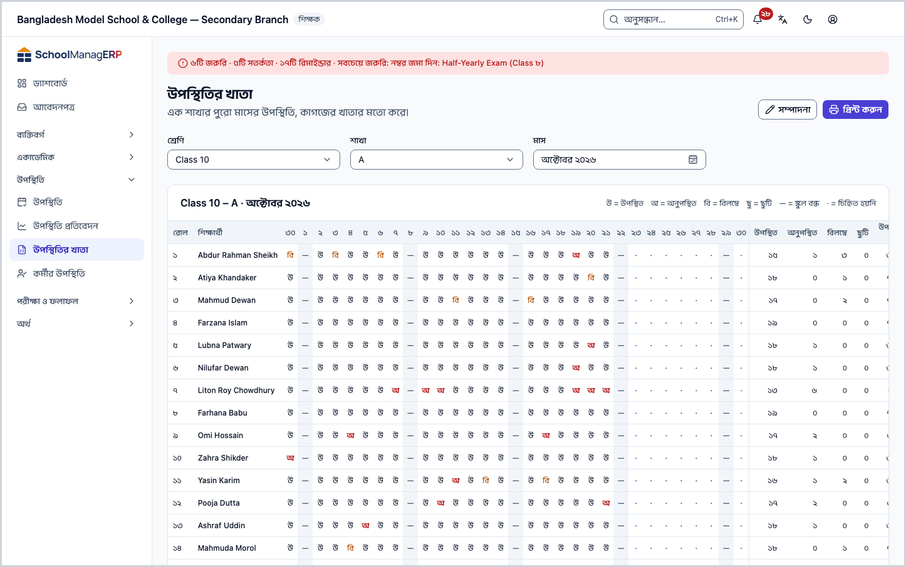
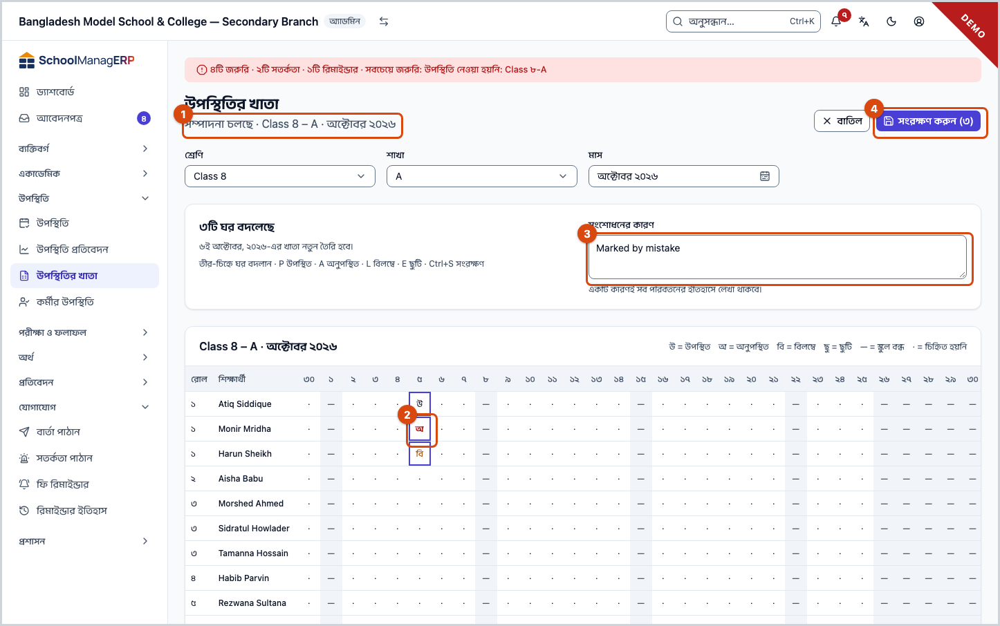
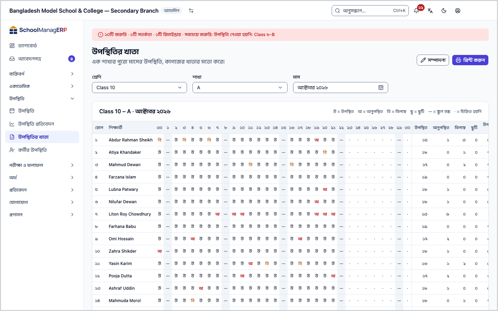

<!-- guide:meta
feature: attendance.attendanceRegister
title: উপস্থিতির খাতা
summary: একটি শাখার পুরো মাসের হাজিরা কাগজের খাতার মতো দেখুন, প্রিন্ট করুন, আর কম্পিউটারে একসঙ্গে কয়েক দিনের ভুল ঠিক করুন।
roles: [ADMIN, ACCOUNTANT, TEACHER, EXECUTIVE, OFFICE_STAFF, EXAM_CONTROLLER]
sources:
  - client-admin/src/routes/_staff/attendance/register.tsx
  - client-admin/src/routes/_staff/attendance/-register-edit-grid.tsx
  - client-admin/src/routes/_staff/attendance/-register-print.css
  - client-admin/src/routes/_staff/attendance/-correction-dialog.tsx
  - client-admin/src/routes/_staff/attendance/-record-history-panel.tsx
  - client-admin/src/routes/_staff/attendance/-subject-summary-tab.tsx
  - server/src/modules/attendance/attendance.controller.ts
  - server/src/modules/attendance/attendance.service.ts
  - server/src/modules/attendance/attendance-summary.controller.ts
  - server/src/modules/attendance/attendance-access.service.ts
labels:
  [
    attendance:register.*,
    attendance:mark.errorToast,
    nav:items.attendanceRegister,
  ]
helpIds:
  [
    attendance.attendanceRegister,
    attendance.attendanceRegister.action.print,
    attendance.attendanceRegister.action.edit,
    attendance.attendanceRegister.action.save,
    attendance.attendanceRegister.field.reason,
  ]
devices: [desktop]
entry: [sidebar, palette]
keywords: [উপস্থিতির খাতা, হাজিরা খাতা, মাসিক খাতা, রেজিস্টার, প্রিন্ট, সংশোধন, attendance register, print]
appVersion: 0.1.0 (a5fdbd4ba)
owner: tareq89
lastVerified: 2026-10-25
knownIssues: []
-->

# উপস্থিতির খাতা

একটি শাখার পুরো মাসের হাজিরা কাগজের খাতার মতো দেখুন, প্রিন্ট করুন, আর কম্পিউটারে একসঙ্গে কয়েক দিনের ভুল ঠিক করুন।

**যেতে হবে:** বাম মেনুতে **উপস্থিতি → উপস্থিতির খাতা**। সম্পাদনা শুধু কম্পিউটারে হয়; ফোনে দেখা যায়।
**শুরুর আগে:** শাখায় শিক্ষার্থী ভর্তি থাকতে হবে ([শিক্ষার্থী](../people/students.md))। শিক্ষক হলে শাখাটি আপনার নামে বরাদ্দ থাকতে হবে ([শিক্ষকের দায়িত্ব](../people/teaching-assignments.md))।

প্রতিদিনের হাজিরা নেওয়া হয় [উপস্থিতি নেওয়া](attendance.md) পাতায়, দিনে একটি খাতা। এই পাতা সেই দিনগুলো পাশাপাশি সাজিয়ে মাসের একটি ছক দেখায়: সারিতে শিক্ষার্থী, কলামে মাসের প্রতিটি দিন, শেষে মোট হিসাব।

[খাতা দেখুন](#task-main) · [প্রিন্ট করুন](#task-print) · [কয়েক দিনের হাজিরা সংশোধন](#task-edit) · [সমস্যা ও সমাধান](#trouble)

**এই পাতায় যা আছে**

- [এই পাতায় যেভাবে আসবেন](#arrive)
- [মাসের খাতা দেখুন](#task-main)
- [সংশোধন সংরক্ষিত হয়েছে কি না বুঝবেন কীভাবে](#confirm)
- [অন্য পরিস্থিতিতে](#other)
  - [খাতা প্রিন্ট করুন](#task-print)
  - [কয়েক দিনের হাজিরা একসঙ্গে সংশোধন](#task-edit)
  - [পুরনো দিনের সংশোধন (শুধু অ্যাডমিন)](#task-old)
  - [ফোনে খাতা](#task-phone)
- [সমস্যা ও সমাধান](#trouble)
- [কে কী করতে পারেন](#roles)
- [জানা সমস্যা](#known-issues)
- [আরও জানুন](#more)

---

## এই পাতায় যেভাবে আসবেন 

**বাম মেনু থেকে:** **উপস্থিতি → উপস্থিতির খাতা**। লেখা থাকে **এখনো শাখা বাছা হয়নি**; নিচের ধাপ ১ থেকে শুরু করুন।

**খোঁজার ঘর থেকে:** উপরের খোঁজার ঘরে (Ctrl+K) "উপস্থিতির খাতা" লিখে বেছে নিন। খোঁজার নিয়ম: [যেকোনো পাতা খুঁজে পাওয়া](../start/find-anything.md)।

অভিভাবক আগমন বার্তা চাইলে নামের পাশে যে ঘণ্টা দেখা যায়, তা হাজিরা নেওয়ার সময় দেখা যায়, এই খাতায় নয়: [নামের পাশে ঘণ্টা](attendance.md#task-bell)।

---

## মাসের খাতা দেখুন 

1. বাম মেনুতে **উপস্থিতি** চাপুন, তারপর **উপস্থিতির খাতা**।
2. **শ্রেণি** ঘরে শ্রেণি বাছুন।
3. **শাখা** ঘরে শাখা বাছুন।
4. **মাস** ঘরে মাস বাছুন। চলতি মাস বসানো থাকে।

   → পুরো মাসের ছক আসে। প্রতিটি ঘরে একটি অক্ষর: **উ** = উপস্থিত, **অ** = অনুপস্থিত, **বি** = বিলম্বে, **ছু** = ছুটি। **—** মানে স্কুল বন্ধ, **·** মানে চিহ্নিত হয়নি। ডান দিকে প্রত্যেকের মোট **উপস্থিত**, **অনুপস্থিত**, **বিলম্বে**, **ছুটি** আর **উপস্থিতি %**।

> **মনে রাখুন:** শতাংশের জায়গায় **—** মানে ওই মাসে শিক্ষার্থীর একটি দিনও চিহ্নিত হয়নি, ০% নয়।

---

## সংশোধন সংরক্ষিত হয়েছে কি না বুঝবেন কীভাবে 

| অবস্থা                       | কীভাবে বুঝবেন                                                                                  | এরপর কী                         |
| ---------------------------- | ---------------------------------------------------------------------------------------------- | ------------------------------- |
| **শুধু স্ক্রিনে বদলেছে**     | সম্পাদনার সময় বদলানো ঘর আলাদা দেখায়; উপরে "৩টি ঘর বদলেছে"। পাতা ছাড়লে এগুলো হারায়।        | **সংরক্ষণ করুন** চাপুন।          |
| **স্কুলের সিস্টেমে পৌঁছেছে** | "২ দিনের খাতা সংরক্ষিত হয়েছে।" বার্তা আসে, আর খাতা সাধারণ দেখায় ফিরে যায়।                   | কাজ শেষ।                        |

এই পাতায় ইন্টারনেট ছাড়া সংরক্ষণ হয় না। ইন্টারনেট না থাকলে [উপস্থিতি নেওয়া](attendance.md#task-offline) পাতা থেকে এক দিনের খাতা ঠিক করুন।

---

## অন্য পরিস্থিতিতে 

### খাতা প্রিন্ট করুন 

1. শ্রেণি, শাখা আর মাস বেছে খাতাটি খুলুন।
2. উপরে **প্রিন্ট করুন** চাপুন।

   → কম্পিউটারের প্রিন্টের ঘর খোলে। কাগজে শুধু খাতার ছকটি আসে, শিরোনাম আর অক্ষরের ব্যাখ্যা সহ; মেনু, ছাঁকনি আর বোতাম আসে না। মাসের সব দিনের কলাম ছাপা হয়।

3. প্রিন্টার বেছে প্রিন্ট করুন, বা PDF হিসাবে রাখুন।

শাখায় শিক্ষার্থী না থাকলে **প্রিন্ট করুন** চাপা যায় না। সম্পাদনার সময় বোতামটি লুকানো থাকে; আগে **সংরক্ষণ করুন** বা **বাতিল** চাপুন।

<!-- unverified: পাতার মাপ (A4 আড়াআড়ি?) আর অনেক শিক্ষার্থী হলে পাতা ভাঙার ধরন — -register-print.css-এর @page অংশ চালিয়ে দেখা হয়নি -->

### কয়েক দিনের হাজিরা একসঙ্গে সংশোধন 

শুধু অ্যাডমিন আর শিক্ষক পারেন, আর শুধু কম্পিউটারে।

1. খাতাটি খুলে উপরে **সম্পাদনা** চাপুন।

   → উপরে লেখা **সম্পাদনা চলছে**। ছকের ঘরগুলো এখন বদলানো যায়। পাশে **সংশোধনের কারণ** ঘর।

2. যে ঘর ভুল, তাতে চাপুন, তারপর কি-বোর্ডে অক্ষর চাপুন: `P` উপস্থিত, `A` অনুপস্থিত, `L` বিলম্বে, `E` ছুটি। `Space` চাপলে উপস্থিত ↔ অনুপস্থিত। তীর-চিহ্নে পাশের ঘরে যান।

   → উপরে "৩টি ঘর বদলেছে" দেখায়। আগে কোনো খাতা ছিল না এমন দিন বদলালে লেখা থাকে "…-এর খাতা নতুন তৈরি হবে।"

3. চাইলে **সংশোধনের কারণ** লিখুন। একটি কারণই সব পরিবর্তনের ইতিহাসে থাকে।
4. **সংরক্ষণ করুন (৩)** চাপুন (বা `Ctrl + S`)।

   → "২ দিনের খাতা সংরক্ষিত হয়েছে।" বার্তা আসে, আর খাতা সাধারণ দেখায় ফেরে।

**কোন দিন বদলানো যায়:**

- ভবিষ্যতের দিন আর স্কুল বন্ধের দিন (**—**) কেউ বদলাতে পারেন না।
- শিক্ষক বদলাতে পারেন শুধু নিজের শাখার, আর শুধু স্কুলের সংশোধনের সময়সীমার (সাধারণত ২ দিন) ভেতরের দিন। আগে কোনো খাতা ছিল না এমন পুরনো দিনেও প্রথমবার হাজিরা বসানো যায়, তবে অন্তত একজনকে চিহ্নিত করতে হয়।
- সময়সীমার বাইরের দিন বা চূড়ান্ত খাতা: [পুরনো দিনের সংশোধন](#task-old)।

**মাঝপথে ছেড়ে দিতে চাইলে:** **বাতিল** চাপুন বা `Esc`। কিছু বদলে থাকলে অ্যাপ জিজ্ঞেস করে **পরিবর্তন বাদ দেবেন?** — **বাদ দিন** চাপলে বদলানো ঘর হারায়।

### পুরনো দিনের সংশোধন (শুধু অ্যাডমিন) 

সময়সীমার বাইরের দিন বদলালে উপরে লেখা আসে "… সংশোধনের সময়সীমার বাইরে, তাই কারণ লিখতে হবে।" আর **সংশোধনের কারণ** ঘরে \* চিহ্ন।

1. ঘরগুলো বদলান, যেমন উপরে।
2. **সংশোধনের কারণ** ঘরে অন্তত ৩ অক্ষর লিখুন, যেমন `অভিভাবকের চিঠি অনুযায়ী ছুটি`।
3. **সংরক্ষণ করুন** চাপুন।

কারণ ছোট হলে ঘরের নিচে লেখা আসে **অন্তত ৩ অক্ষরের কারণ লিখুন।** কে, কখন, কী বদলেছেন তা প্রতিটি শিক্ষার্থীর সারির ইতিহাসে থাকে ([আগের দিনের হাজিরা সংশোধন](attendance.md#task-fix))।

**জরিমানার উপর প্রভাব:** অনুপস্থিতির [জরিমানা](../help/glossary.md#fine) চালু থাকলে তা খাতার **অনুপস্থিত** চিহ্ন থেকে গোনা হয়। তাই অনুপস্থিত বদলালে পরের হিসাবেও তা ধরা পড়ে।

<!-- unverified: ইতিমধ্যে ধরা জরিমানা অনুপস্থিত চিহ্ন বদলালে নিজে থেকে বাদ যায় কি না — fees/fines/fine-sweep.service.ts পুরো পড়া হয়নি -->

### ফোনে খাতা 

ফোনে পুরো ছক দেখতে পাশে সরান। সম্পাদনার বোতাম ফোনে নেই; লেখা থাকে "ফোনে পুরো মাস একসাথে সম্পাদনা করা যায় না। কোনো তারিখে টিপলে সেই দিনের খাতা খুলবে।" ছকের উপরে কোনো তারিখে চাপলে সেই দিনের হাজিরার খাতা [উপস্থিতি নেওয়া](attendance.md#task-fix) পাতায় খোলে।

---

## সমস্যা ও সমাধান 

| আপনি যা দেখছেন                                                                  | কী করবেন                                                                                                                       | কে সাহায্য করতে পারেন |
| ------------------------------------------------------------------------------- | ------------------------------------------------------------------------------------------------------------------------------ | --------------------- |
| **রেজিস্টার লোড করা যায়নি।** (শিক্ষক)                                          | তালিকায় সব শ্রেণি থাকে, কিন্তু আপনি শুধু নিজের বরাদ্দ শাখা খুলতে পারেন। নিজের শাখা বাছুন।                                       | অ্যাডমিন (**শিক্ষকের দায়িত্ব**) |
| **এই শাখায় কোনো শিক্ষার্থী নেই।**                                               | শিক্ষার্থী ভর্তি হলে খাতা দেখা যাবে।                                                                                            | অ্যাডমিন              |
| **কিছুই সংরক্ষণ হয়নি** — "…-এর খাতা অন্য কেউ বদলেছেন।"                         | আপনি সম্পাদনার সময় অন্য কেউ ওই দিনের হাজিরা জমা দিয়েছেন। **মাসটি নতুন করে আনুন** চাপুন, তারপর আবার বদলান।                     | —                     |
| "…চিহ্নিত করা যাবে না: এটি ভবিষ্যতের তারিখ বা স্কুল বন্ধের দিন।"               | **এই দিনগুলো আমার পরিবর্তন থেকে বাদ দিন** চাপুন, তারপর বাকিটা সংরক্ষণ করুন।                                                    | —                     |
| "…শুধু উপস্থিতি সংশোধনের অনুমতি আছে এমন কেউ বদলাতে পারবেন।"                    | দিনটি সময়সীমার বাইরে। **এই দিনগুলো আমার পরিবর্তন থেকে বাদ দিন** চাপুন, আর সংশোধনের জন্য অ্যাডমিনকে বলুন।                      | অ্যাডমিন              |
| **অন্তত ৩ অক্ষরের কারণ লিখুন।**                                                 | **সংশোধনের কারণ** ঘরে একটু বড় করে কারণ লিখুন।                                                                                 | —                     |
| **সম্পাদনা** বোতাম নেই                                                          | ফোনে, বা আপনার ভূমিকায় সম্পাদনা নেই ([কে কী করতে পারেন](#roles))।                                                             | —                     |

---

## কে কী করতে পারেন 

| ভূমিকা                | দেখতে ও প্রিন্ট করতে   | সময়সীমার ভেতরে সংশোধন | সময়সীমার বাইরে সংশোধন |
| --------------------- | ---------------------- | ---------------------- | ---------------------- |
| অ্যাডমিন              | সব শাখা                | হ্যাঁ                  | হ্যাঁ, কারণ লিখে       |
| শিক্ষক                | শুধু নিজের বরাদ্দ শাখা | হ্যাঁ, নিজের শাখার     | না                     |
| একাডেমিক কো-অর্ডিনেটর | সব শাখা                | না                     | না                     |
| হিসাবরক্ষক            | সব শাখা                | না                     | না                     |
| অফিস সহকারী           | সব শাখা                | না                     | না                     |
| পরীক্ষা নিয়ন্ত্রক    | সব শাখা                | না                     | না                     |

যাঁরা সংশোধন করতে পারেন না, তাঁদের পাতায় **সম্পাদনা** বোতাম থাকে না।

---

## জানা সমস্যা 

সংস্করণ ০.১.০-এ কোড দেখে যাচাই করা, ২০২৬-১০-২৫। এই পাতায় এখন কোনো জানা সমস্যা নেই।

---

## আরও জানুন 

<strong>পাতার অংশগুলো</strong> — উপর থেকে নিচে

1. **উপস্থিতির খাতা** — শিরোনাম; ডানে **প্রিন্ট করুন** আর **সম্পাদনা**।
2. **কোন খাতা দেখবেন** — **শ্রেণি**, **শাখা**, **মাস**।
3. **খাতার শিরোনাম ও অক্ষরের ব্যাখ্যা** — যেমন "ষষ্ঠ শ্রেণি – ক · অক্টোবর ২০২৬"।
4. **ছক** — **রোল**, **শিক্ষার্থী**, মাসের প্রতিটি দিন, তারপর মোট।

<strong>কি-বোর্ড শর্টকাট</strong> (সম্পাদনার সময়)

| কি                | কাজ                    |
| ----------------- | ---------------------- |
| `P`               | উপস্থিত                |
| `A`               | অনুপস্থিত              |
| `L`               | বিলম্বে                |
| `E`               | ছুটি                   |
| `Space`           | উপস্থিত ↔ অনুপস্থিত    |
| `←` `→` `↑` `↓`   | পাশের ঘর               |
| `Home` / `End`    | সারির প্রথম / শেষ ঘর   |
| `Esc`             | সম্পাদনা বাতিল         |
| `Ctrl + S`        | সংরক্ষণ করুন           |

<strong>ঘরগুলোর অর্থ</strong>

<!-- guide:generated:fields:attendanceRegister -->

| ঘর            | কী লিখবেন                                                          | বাধ্যতামূলক?                     |
| ------------- | ------------------------------------------------------------------ | -------------------------------- |
| শ্রেণি        | কোন শ্রেণি। বদলালে শাখা খালি হয়।                                  | হ্যাঁ                            |
| শাখা          | কোন শাখা।                                                          | হ্যাঁ                            |
| মাস           | কোন মাসের খাতা। চলতি মাস বসানো থাকে।                               | হ্যাঁ                            |
| সংশোধনের কারণ | কেন বদলাচ্ছেন। অন্তত ৩ অক্ষর। সব পরিবর্তনের ইতিহাসে একই কারণ থাকে। | শুধু সময়সীমার বাইরের দিন বদলালে |

<!-- /guide:generated -->

<strong>খাতা কীভাবে কাজ করে</strong> — দেখা, প্রিন্ট, সংশোধন

<figure>
  
  <figcaption><em>মাসের খাতা: দেখা, প্রিন্ট, সম্পাদনা</em></figcaption>
</figure>

- এক বারে সংরক্ষণ মানে সব দিন একসঙ্গে: একটি দিনে সমস্যা হলে কোনো দিনই সংরক্ষিত হয় না।
- খাতার সংখ্যা আর [উপস্থিতি প্রতিবেদন](attendance-reports.md)-এর সংখ্যা একই জায়গা থেকে আসে।
- যে শাখার আজকের হাজিরা বাকি, তা [ড্যাশবোর্ড](../dashboard/dashboard.md)-এ **উপস্থিতি নেওয়া বাকি** হিসাবে দেখায়।

**সম্পর্কিত পাতা**

- [**উপস্থিতি নেওয়া**](attendance.md) — প্রতিদিনের হাজিরা, এক দিনের খাতা।
- [**উপস্থিতি প্রতিবেদন**](attendance-reports.md) — মাসের হিসাব আর কম উপস্থিতির তালিকা।
- [**শিক্ষকের দায়িত্ব**](../people/teaching-assignments.md) — শিক্ষক কোন শাখার খাতা দেখবেন।
- [**শিক্ষার্থী**](../people/students.md) — শাখায় শিক্ষার্থী ভর্তি।

---

_সংস্করণ ০.১.০ · শেষ যাচাই ২০২৬-১০-২৫_
