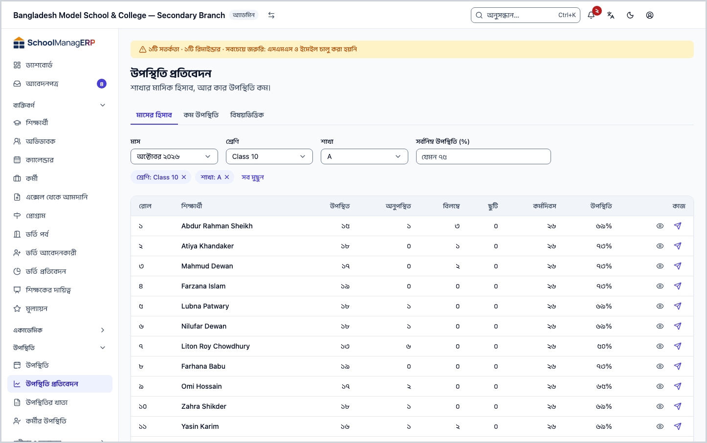
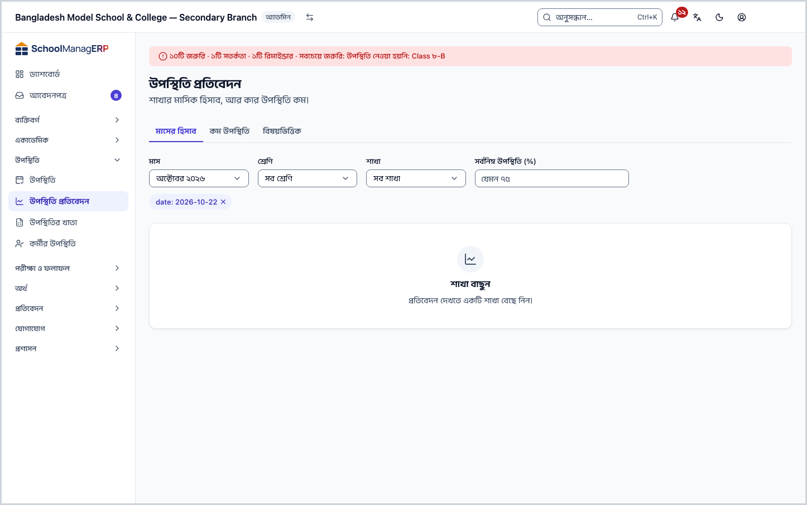
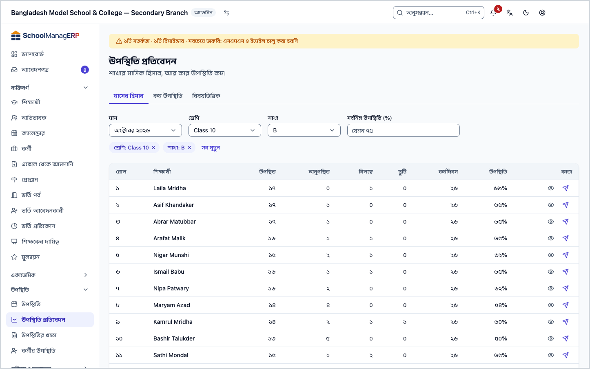

<!-- guide:meta
feature: attendance.attendanceReports
title: উপস্থিতি প্রতিবেদন
summary: একটি শাখার মাসের হাজিরার হিসাব দেখুন, কার উপস্থিতি কম তা খুঁজে বের করুন, আর দরকার হলে রিমাইন্ডার পাঠান।
roles: [ADMIN, ACCOUNTANT, TEACHER, EXECUTIVE, OFFICE_STAFF, EXAM_CONTROLLER]
sources:
  - client-admin/src/routes/_staff/attendance/reports.tsx
  - client-admin/src/routes/_staff/attendance/-subject-summary-tab.tsx
  - server/src/modules/attendance/attendance-summary.controller.ts
  - server/src/modules/attendance/attendance-summary.service.ts
  - server/src/modules/attendance/attendance-access.service.ts
labels:
  [
    attendance:reports.*,
    attendance:mark.rollNumber,
    nav:items.attendanceReports,
  ]
helpIds:
  [
    attendance.attendanceReports,
    attendance.attendanceReports.action.sendReminder,
    attendance.attendanceReports.field.threshold,
    attendance.attendanceReports.section.summary#task-main,
    attendance.attendanceReports.section.flags#task-low,
    attendance.attendanceReports.section.subjects#task-subjects,
  ]
devices: [desktop]
entry: [sidebar, palette]
keywords: [উপস্থিতি প্রতিবেদন, হাজিরার হিসাব, কম উপস্থিতি, শতাংশ, attendance report, low attendance]
appVersion: 0.1.0 (a5fdbd4ba)
owner: tareq89
lastVerified: 2026-10-25
knownIssues: []
-->

# উপস্থিতি প্রতিবেদন

একটি শাখার মাসের হাজিরার হিসাব দেখুন, কার উপস্থিতি কম তা খুঁজে বের করুন, আর দরকার হলে রিমাইন্ডার পাঠান।

**যেতে হবে:** বাম মেনুতে **উপস্থিতি → উপস্থিতি প্রতিবেদন**। এই পাতার কাজ কম্পিউটারে করুন।
**শুরুর আগে:** শাখায় অন্তত কয়েক দিনের হাজিরা নেওয়া থাকতে হবে ([উপস্থিতি নেওয়া](attendance.md))।

প্রতিবেদন নিজে কিছু লেখে না। শিক্ষক প্রতিদিন যে হাজিরা নেন, এই পাতা শুধু তা গুনে দেখায়। তাই হাজিরা ভুল থাকলে প্রতিবেদনও ভুল দেখাবে; ঠিক করতে হয় [উপস্থিতির খাতা](attendance-register.md) থেকে।

[মাসের হিসাব](#task-main) · [কম উপস্থিতি](#task-low) · [রিমাইন্ডার](#task-reminder) · [সমস্যা ও সমাধান](#trouble)

**এই পাতায় যা আছে**

- [এই পাতায় যেভাবে আসবেন](#arrive)
- [একটি শাখার মাসের হিসাব দেখুন](#task-main)
- [হিসাব ঠিক এসেছে কি না বুঝবেন কীভাবে](#confirm)
- [অন্য পরিস্থিতিতে](#other)
  - [কার উপস্থিতি কম, খুঁজুন](#task-low)
  - [রিমাইন্ডার পাঠান](#task-reminder)
  - [বিষয়ভিত্তিক উপস্থিতি](#task-subjects)
- [সমস্যা ও সমাধান](#trouble)
- [কে কী করতে পারেন](#roles)
- [আরও জানুন](#more)

---

## এই পাতায় যেভাবে আসবেন 

**বাম মেনু থেকে:** **উপস্থিতি → উপস্থিতি প্রতিবেদন**। পাতাটি **মাসের হিসাব** ট্যাবে খোলে; নিচের ধাপ ১ থেকে শুরু করুন।

**খোঁজার ঘর থেকে:** উপরের খোঁজার ঘরে (Ctrl+K) "উপস্থিতি প্রতিবেদন" লিখে বেছে নিন। খোঁজার নিয়ম: [যেকোনো পাতা খুঁজে পাওয়া](../start/find-anything.md)।

---

## একটি শাখার মাসের হিসাব দেখুন 

1. বাম মেনুতে **উপস্থিতি** চাপুন, তারপর **উপস্থিতি প্রতিবেদন**।

   → পাতার উপরে তিনটি (বা দুটি) ট্যাব: **মাসের হিসাব**, **কম উপস্থিতি**, আর পিরিয়ড-ভিত্তিক হাজিরা চালু থাকলে অ্যাডমিনের জন্য **বিষয়ভিত্তিক**। মাঝখানে লেখা **শাখা বাছুন**।

2. **মাস** ঘরে মাস বেছে নিন। চলতি মাস বসানো থাকে; আগের ১২ মাস পর্যন্ত বাছা যায়।
3. **শ্রেণি** ঘরে শ্রেণি বাছুন, তারপর **শাখা** ঘরে শাখা।

   → সেই শাখার প্রত্যেক শিক্ষার্থীর এক সারি: **রোল**, **শিক্ষার্থী**, **উপস্থিত**, **অনুপস্থিত**, **বিলম্বে**, **ছুটি**, **কর্মদিবস**, **উপস্থিতি** (শতাংশ)।

4. কোনো শিক্ষার্থীর বিস্তারিত দেখতে সারির শেষে **দেখুন** চাপুন। → [শিক্ষার্থীর পাতা](../people/students.md) খোলে।

> **মনে রাখুন:** শ্রেণি বদলালে শাখার ঘর খালি হয়ে যায়। আবার শাখা বাছুন।

---

## হিসাব ঠিক এসেছে কি না বুঝবেন কীভাবে 

| আপনি যা দেখছেন         | মানে                                                                                     |
| ---------------------- | ---------------------------------------------------------------------------------------- |
| শতাংশের জায়গায় **—** | ওই মাসে শিক্ষার্থীর একটি দিনও চিহ্নিত হয়নি। এটি ০% নয়।                                 |
| শতাংশের পাশে **কম**    | শতাংশটি **সর্বনিম্ন উপস্থিতি (%)** ঘরে লেখা সংখ্যার নিচে। ঘর খালি থাকলে এই চিহ্ন আসে না। |
| **কোনো হিসাব নেই**     | ওই মাসে শাখাটির কোনো হাজিরা নেই। মাস ঠিক বাছা হয়েছে কি না দেখুন।                        |

সংখ্যা মিলিয়ে দেখতে চাইলে একই শাখা ও মাস [উপস্থিতির খাতা](attendance-register.md)-য় খুলুন। দুই পাতার সংখ্যা একই খাতা থেকে আসে।

---

## অন্য পরিস্থিতিতে 

### কার উপস্থিতি কম, খুঁজুন 

1. **কম উপস্থিতি** ট্যাব চাপুন।

   → শাখা না বেছেই পুরো স্কুলের তালিকা আসে: যাদের ওই মাসের উপস্থিতি সীমার নিচে। সারিতে **শ্রেণি** আর **শাখা**-ও থাকে।

2. সীমা বদলাতে **সর্বনিম্ন উপস্থিতি (%)** ঘরে সংখ্যা লিখুন, যেমন `75`। ঘর খালি রাখলে স্কুলের সেটিংসে ঠিক করা সীমা ধরা হয়।
3. চাইলে **শ্রেণি** বা **শাখা** বেছে তালিকা ছোট করুন।

যাদের ওই মাসে একটি দিনও চিহ্নিত হয়নি, তারা এই তালিকায় আসে না। কেউ না থাকলে লেখা থাকে **এই মাসে কেউ সর্বনিম্নের নিচে নেই**।

### রিমাইন্ডার পাঠান 

1. **মাসের হিসাব** বা **কম উপস্থিতি** তালিকায় শিক্ষার্থীর সারির শেষে **রিমাইন্ডার পাঠান** চাপুন।
2. যে ঘর খোলে, সেখানে বার্তা দেখে নিয়ে পাঠান।

<!-- unverified: রিমাইন্ডারের ঘরে ঠিক কী লেখা থাকে আর বার্তা কার কাছে যায় (অভিভাবক?) — students/-send-reminder-dialog.tsx পড়া হয়নি -->

এই বোতাম শুধু অ্যাডমিন, হিসাবরক্ষক আর অফিস সহকারী দেখেন ([কে কী করতে পারেন](#roles))।

### বিষয়ভিত্তিক উপস্থিতি 

স্কুল **সেটিংস › উপস্থিতি নীতি** থেকে পিরিয়ড-ভিত্তিক হাজিরা চালু করলে **বিষয়ভিত্তিক** ট্যাব আসে, তবে শুধু অ্যাডমিনের জন্য (এই সুইচটি স্কুলের সেটিংস থেকে পড়া হয়, আর সেটিংস শুধু অ্যাডমিন খুলতে পারেন)। শাখা আর মাস বাছলে প্রত্যেক শিক্ষার্থীর প্রতিটি বিষয়ে "এসেছে/ক্লাস হয়েছে" দেখায়, যেমন `18/20`। ওই মাসে কোনো পিরিয়ডের হাজিরা না থাকলে লেখা থাকে **এই মাসে কোনো পিরিয়ড উপস্থিতি নেওয়া হয়নি**। পিরিয়ডের হাজিরা কীভাবে নেবেন: [পিরিয়ড অনুযায়ী হাজিরা](attendance.md#task-period)।

---

## সমস্যা ও সমাধান 

| আপনি যা দেখছেন                                  | কী করবেন                                                                                         | কে সাহায্য করতে পারেন            |
| ----------------------------------------------- | ------------------------------------------------------------------------------------------------ | -------------------------------- |
| **শাখা বাছুন**                                  | **শ্রেণি** আর **শাখা** দুটোই বাছুন। মাসের হিসাব একবারে একটি শাখার।                               | —                                |
| **উপস্থিতি প্রতিবেদন লোড করা যায়নি।** (শিক্ষক) | আপনি শুধু নিজের বরাদ্দ শাখার হিসাব দেখতে পারেন। অন্য শাখা বাছলে এই বার্তা আসে। নিজের শাখা বাছুন। | অ্যাডমিন (**শিক্ষকের দায়িত্ব**) |
| **কোনো হিসাব নেই**                              | ওই মাসে হাজিরা নেওয়া হয়নি। শিক্ষককে [হাজিরা নিতে](attendance.md) বলুন, বা অন্য মাস বাছুন।      | শিক্ষক                           |
| শতাংশ ভুল মনে হচ্ছে                             | দিনের চিহ্ন ভুল আছে। [উপস্থিতির খাতা](attendance-register.md#task-edit) থেকে সংশোধন করুন।        | শিক্ষক বা অ্যাডমিন               |

---

## কে কী করতে পারেন 

| ভূমিকা                | মাসের হিসাব ও বিষয়ভিত্তিক | কম উপস্থিতি | রিমাইন্ডার পাঠান |
| --------------------- | -------------------------- | ----------- | ---------------- |
| অ্যাডমিন              | সব শাখা                    | হ্যাঁ       | হ্যাঁ            |
| হিসাবরক্ষক            | সব শাখা                    | হ্যাঁ       | হ্যাঁ            |
| অফিস সহকারী           | সব শাখা                    | হ্যাঁ       | হ্যাঁ            |
| একাডেমিক কো-অর্ডিনেটর | সব শাখা                    | হ্যাঁ       | না               |
| পরীক্ষা নিয়ন্ত্রক    | সব শাখা                    | হ্যাঁ       | না               |
| শিক্ষক                | শুধু নিজের বরাদ্দ শাখা     | না          | না               |

এই পাতা শুধু দেখার। এখানে কেউ হাজিরা বদলাতে পারেন না। প্রতিবেদন ডাউনলোড বা প্রিন্টের বোতাম এই পাতায় নেই; কাগজে দরকার হলে [উপস্থিতির খাতা](attendance-register.md#task-print) প্রিন্ট করুন।

---

## আরও জানুন 

<strong>পাতার অংশগুলো</strong> — উপর থেকে নিচে

1. **উপস্থিতি প্রতিবেদন** — শিরোনাম।
2. **ট্যাব** — **মাসের হিসাব**, **কম উপস্থিতি**, **বিষয়ভিত্তিক**।
3. **ছাঁকনির সারি** — **মাস**, **শ্রেণি**, **শাখা**, **সর্বনিম্ন উপস্থিতি (%)**।
4. **তালিকা** — প্রতি সারির শেষে **দেখুন** আর (অনুমতি থাকলে) **রিমাইন্ডার পাঠান**।

<strong>ঘরগুলোর অর্থ</strong>

<!-- guide:generated:fields:attendanceReports -->

| ঘর                     | কী লিখবেন                                                                      | বাধ্যতামূলক?       |
| ---------------------- | ------------------------------------------------------------------------------ | ------------------ |
| মাস                    | কোন মাসের হিসাব। চলতি মাস বসানো থাকে; আগের ১২ মাস বাছা যায়।                   | হ্যাঁ              |
| শ্রেণি                 | কোন শ্রেণি। বদলালে শাখা খালি হয়।                                              | মাসের হিসাবে হ্যাঁ |
| শাখা                   | কোন শাখা।                                                                      | মাসের হিসাবে হ্যাঁ |
| সর্বনিম্ন উপস্থিতি (%) | শতাংশের সীমা, যেমন ৭৫। খালি থাকলে কম উপস্থিতিতে স্কুলের সেটিংসের সীমা ধরা হয়। | না                 |

<!-- /guide:generated -->

<strong>প্রতিবেদন কীভাবে তৈরি হয়</strong> — খাতা থেকে হিসাব

<figure>
  
  <figcaption><em>হাজিরার খাতা থেকে প্রতিবেদন</em></figcaption>
</figure>

- শতাংশ গোনা হয় শুধু চিহ্নিত দিন থেকে। কোনো দিন চিহ্নিত না থাকলে শতাংশ **—**।
- স্কুল বন্ধের দিন **কর্মদিবস**-এ গোনা হয় না।
- অনুপস্থিতির জন্য স্কুলে [জরিমানা](../help/glossary.md#fine)-র নিয়ম চালু থাকলে, জরিমানাও একই হাজিরার খাতার **অনুপস্থিত** চিহ্ন থেকে গোনা হয়।

**সম্পর্কিত পাতা**

- [**উপস্থিতি নেওয়া**](attendance.md) — প্রতিদিনের হাজিরা, যা থেকে এই হিসাব আসে।
- [**উপস্থিতির খাতা**](attendance-register.md) — একই হিসাব দিনে দিনে, প্রিন্ট আর সংশোধন।
- [**শিক্ষার্থী**](../people/students.md) — একজন শিক্ষার্থীর পুরো তথ্য।
- [**ড্যাশবোর্ড**](../dashboard/dashboard.md) — আজকের উপস্থিতি এক নজরে।

---

_সংস্করণ ০.১.০ · শেষ যাচাই ২০২৬-১০-২৫_
