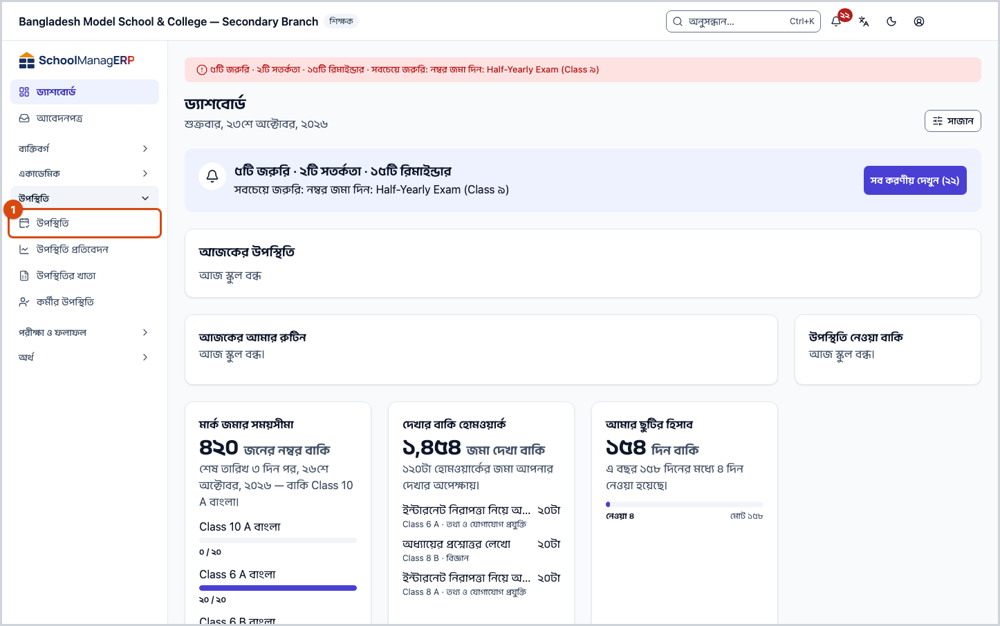
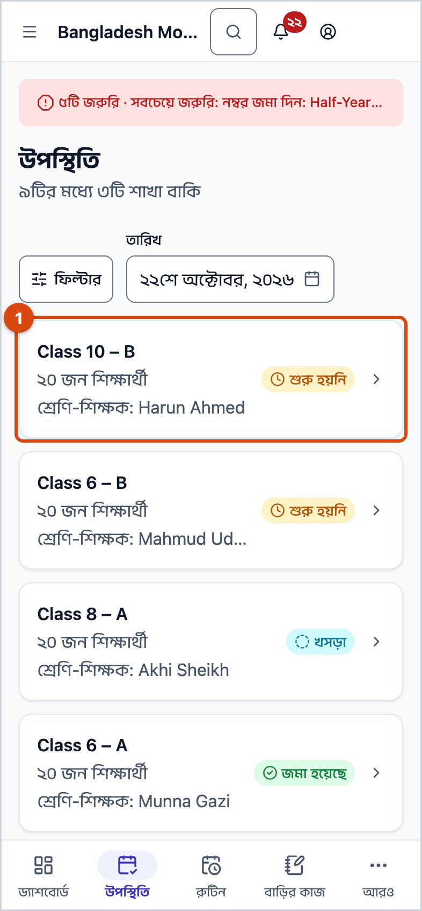

<!-- guide:meta
feature: attendance.attendance
title: উপস্থিতি নেওয়া
summary: প্রতিদিন নিজের শাখার শিক্ষার্থীদের হাজিরা নিন — সবাই উপস্থিত চাপুন, অনুপস্থিতদের নামে চাপুন, তারপর জমা দিন।
roles: [TEACHER, ADMIN, EXECUTIVE, ACCOUNTANT, OFFICE_STAFF, EXAM_CONTROLLER]
sources:
  - client-admin/src/routes/_staff/attendance/index.tsx
  - client-admin/src/routes/_staff/attendance/$sectionId.tsx
  - client-admin/src/routes/_staff/attendance/-*.tsx
labels:
  [
    attendance:list.*,
    attendance:mark.*,
    attendance:period.*,
    attendance:statusControl.*,
    attendance:history.*,
    nav:items.attendance,
  ]
helpIds:
  [
    attendance.attendance,
    attendance.attendance.action.allPresent,
    attendance.attendance.action.submit,
    attendance.attendance.field.date,
  ]
devices: [desktop, phone]
keywords: [হাজিরা, উপস্থিতি, রোল কল, অনুপস্থিত, attendance, roll call, absent]
appVersion: 0.1.0 (7b776974b)
-->

# উপস্থিতি নেওয়া

প্রতিদিন সকালে খাতায় নাম ডেকে হাজিরা নিতে অনেক সময় যায়। খাতা হারায়, মাস শেষে হিসাব মেলাতে আরও সময় লাগে।

SchoolManager-এ আপনি ফোন বা কম্পিউটার থেকে **দুই মিনিটে** হাজিরা নিতে পারেন। যেমন: ক্লাস ১০-খ-তে ২০ জন শিক্ষার্থী। আপনি **সবাই উপস্থিত** চাপলেন, যে দুজন আসেনি তাদের নামে চাপলেন, তারপর **উপস্থিতি জমা দিন** চাপলেন। কাজ শেষ। মাসের খাতা আর প্রতিবেদন নিজে থেকেই তৈরি হয়ে যায়।

**এই পাতায় যা আছে**

- [এক নজরে](#at-a-glance)
- [পাতাটি কোথায় পাবেন](#where)
- [পাতার অংশগুলো](#parts)
- [কাজগুলো](#tasks)
  - [প্রতিদিনের হাজিরা নেওয়া](#task-daily)
  - [কেউ দেরিতে এলে বা ছুটিতে থাকলে](#task-late-leave)
  - [সবাইকে চিহ্নিত না করেই জমা দিলে](#task-unmarked)
  - [ভুল হলে ঠিক করা](#task-fix)
- [কম্পিউটারে দ্রুত কাজ (কি-বোর্ড)](#keyboard)
- [অন্য যেসব অংশের সাথে যুক্ত](#related)
- [ঘরগুলোর অর্থ](#fields)
- [কে কী করতে পারেন](#roles)
- [ভিডিও](#video)

---

## এক নজরে 

<figure>
  
  <figcaption><em>উপস্থিতি কীভাবে কাজ করে</em></figcaption>
</figure>

- প্রতিটি শাখার **প্রতিদিন একটি খাতা** থাকে।
- **শিক্ষক** নিজের শাখার খাতায় হাজিরা নেন।
- সেই খাতা থেকেই **উপস্থিতি প্রতিবেদন** আর মাসভিত্তিক **উপস্থিতির খাতা** তৈরি হয়।
- **প্রশাসক** যেকোনো শাখার খাতা দেখতে ও বদলাতে পারেন।
- সময়মতো হাজিরা না নিলে শিক্ষকের কাছে **মনে করিয়ে দেওয়ার বার্তা** আসে। আরও দেরি হলে প্রধান শিক্ষক আর প্রশাসকের কাছেও যেতে পারে।

প্রতিদিনের কাজটি মাত্র পাঁচ ধাপের:

<figure>
  
  <figcaption><em>প্রতিদিনের হাজিরা, ধাপে ধাপে</em></figcaption>
</figure>

---

## পাতাটি কোথায় পাবেন 

কম্পিউটারে দুই জায়গা থেকে হাজিরার পাতায় যাওয়া যায়:

<figure>
  
  <figcaption><em>১ · বাম মেনুর উপস্থিতি &nbsp; ২ · ড্যাশবোর্ডের "উপস্থিতি নেওয়া বাকি" কার্ড</em></figcaption>
</figure>

1. **বাম পাশের মেনুতে উপস্থিতি।** এটি চাপলে নিচে আরও কয়েকটি নাম খুলে যায়। তার ভেতরের **উপস্থিতি** চাপুন।
2. **ড্যাশবোর্ডের "উপস্থিতি নেওয়া বাকি" কার্ড।** যে শাখাগুলোর হাজিরা এখনো নেওয়া হয়নি, সেগুলো এখানে দেখায়। নামে চাপলে সোজা হাজিরার পাতায় চলে যাবেন।

<figure>
  
  <figcaption><em>মেনু খোলার পর ভেতরের উপস্থিতি</em></figcaption>
</figure>

**ফোনে** আরও সহজ: স্ক্রিনের একদম নিচে **উপস্থিতি** বোতাম আছে। সেটি চাপলেই আপনার শাখাগুলো একটির নিচে একটি দেখাবে।

<figure>
  
  <figcaption><em>ফোনে শাখার তালিকা</em></figcaption>
</figure>

---

## পাতার অংশগুলো 

### শাখার তালিকা

<figure>
  
  <figcaption><em>১ · শিরোনাম &nbsp; ২ · অবস্থা &nbsp; ৩ · তারিখ &nbsp; ৪ · শাখার কার্ড</em></figcaption>
</figure>

1. **উপস্থিতি** — পাতার নাম। নিচে লেখা থাকে কতগুলো শাখা এখনো বাকি, যেমন "৯টির মধ্যে ৩টি শাখা বাকি"।
2. **অবস্থা** — শুধু **বাকি** বা শুধু **সম্পন্ন** শাখা দেখতে চাইলে এখান থেকে বেছে নিন।
3. **তারিখ** — আজকের তারিখ নিজে থেকেই বসানো থাকে। আগের দিনের খাতা দেখতে চাইলে এখানে তারিখ বদলান।
4. **শাখার কার্ড** — শাখার নাম, শিক্ষার্থীর সংখ্যা, শ্রেণি-শিক্ষকের নাম আর খাতার অবস্থা:
   - **শুরু হয়নি** — আজ এখনো কেউ হাজিরা নেননি।
   - **খসড়া** — হাজিরা নেওয়া হয়েছে (নিচের সতর্কবার্তাটি দেখুন)।
   - **জমা হয়েছে** — খাতা চূড়ান্ত।

### হাজিরার পাতা

<figure>
  
  <figcaption><em>১ · শাখা ও অবস্থা &nbsp; ২ · তারিখ &nbsp; ৩ · সারাদিন ও পিরিয়ড &nbsp; ৪ · হিসাব &nbsp; ৫ · সবাই উপস্থিত &nbsp; ৬ · শিক্ষার্থীর নাম &nbsp; ৭ · অবস্থার বোতাম &nbsp; ৮ · উপস্থিতি জমা দিন</em></figcaption>
</figure>

1. **শাখার নাম ও খাতার অবস্থা** — যেমন "Class 10 – B" আর **চিহ্নিত হয়নি**। নিচে মোট শিক্ষার্থীর সংখ্যা।
2. **তারিখ** — কোন দিনের হাজিরা নিচ্ছেন।
3. **সারাদিন ও পিরিয়ড** — প্রতিদিনের হাজিরার জন্য **সারাদিন** রাখুন। আপনার স্কুল পিরিয়ড অনুযায়ী হাজিরা চালু করলে প্রতিটি পিরিয়ডের আলাদা ঘর দেখাবে। তখন নিজের পিরিয়ডের ঘরে চাপুন।
4. **হিসাব** — কতজন উপস্থিত, অনুপস্থিত, বিলম্বে, ছুটিতে, আর কতজন এখনো **অচিহ্নিত**।
5. **সবাই উপস্থিত** — এক চাপে যাদের এখনো চিহ্নিত করা হয়নি, তাদের সবাইকে উপস্থিত করে দেয়।
6. **শিক্ষার্থীর নাম** — নামে চাপলে উপস্থিত ↔ অনুপস্থিত বদলায়।
7. **অবস্থার বোতাম** — বিলম্বে বা ছুটি দিতে এটি চাপুন।
8. **উপস্থিতি জমা দিন** — সব শেষে এটি চাপুন। বাম পাশে লেখা থাকে কতজন এখনো অচিহ্নিত।

---

## কাজগুলো 

### প্রতিদিনের হাজিরা নেওয়া 

<!-- slot:before -->

> **শুরুর আগে**
>
> - আপনি একজন **শিক্ষক**, আর প্রশাসক আপনাকে শাখাটি বরাদ্দ করেছেন।
> - আজ স্কুল খোলা।
> - হাতে ফোন বা কম্পিউটার, ইন্টারনেট সহ। ইন্টারনেট না থাকলেও ভয় নেই — নিচে বলা আছে কী করবেন।

1. প্রথমে বাম পাশের মেনুতে **উপস্থিতি** চাপুন, তারপর ভেতরের **উপস্থিতি**-তে চাপুন। ফোনে থাকলে নিচের **উপস্থিতি** বোতামটিই যথেষ্ট।
   <!-- slot:see -->

   → আপনার শাখাগুলোর তালিকা চলে আসবে। যে শাখার হাজিরা এখনো বাকি, তার পাশে **শুরু হয়নি** লেখা দেখবেন।

2. যে শাখার হাজিরা নেবেন, তার কার্ডে চাপুন।

   → রোল নম্বর অনুযায়ী সব শিক্ষার্থীর নাম দেখবেন। এখনো কাউকে চিহ্নিত করা হয়নি, তাই সবার পাশে **চিহ্নিত হয়নি** লেখা।

3. এবার উপরে ডান দিকের **সবাই উপস্থিত** বোতামটি চাপুন।

   → এক চাপেই সবার পাশে সবুজ **উপস্থিত** চলে আসবে। ভুল করে চেপে ফেলেছেন? নিচের বার্তায় **পূর্বাবস্থায় ফেরান** চাপলেই আগের মতো হয়ে যাবে।

4. এখন যারা আজ আসেনি, তাদের প্রত্যেকের **নামে** একবার করে চাপুন।

   → নামের পাশে লাল **অনুপস্থিত** দেখাবে, আর উপরের হিসাবে **অনুপস্থিত** সংখ্যা একে একে বাড়বে।

5. সবশেষে নিচের **উপস্থিতি জমা দিন** চাপুন।

   → **উপস্থিতি সংরক্ষিত হয়েছে** বার্তা দেখবেন, আর অ্যাপ আপনাকে শাখার তালিকায় ফিরিয়ে নেবে। ব্যস, আজকের কাজ শেষ।

<figure>
  
  <figcaption><em>ধাপ ৪-এর পর: দুজন অনুপস্থিত, উপরের হিসাবে অনুপস্থিত ২</em></figcaption>
</figure>

<figure>
  
  <figcaption><em>পাঁচটি ধাপ একসাথে, কম্পিউটারে</em></figcaption>
</figure>

**ফোনে একই কাজ**, একই পাঁচ ধাপে:

<figure>
  
  
  <figcaption><em>বাঁয়ে: ১ · সবাই উপস্থিত &nbsp; ২ · শিক্ষার্থীর নাম &nbsp; ৩ · উপস্থিতি জমা দিন &nbsp;&nbsp; ডানে: পুরো কাজটি ফোনে</em></figcaption>
</figure>

<!-- slot:check -->

> **কাজ হয়েছে কি না দেখে নিন**
> শাখার তালিকায় আপনার শাখার পাশে এখন আর **শুরু হয়নি** লেখা থাকবে না।


**জানা সমস্যা:** জমা দেওয়ার পরও শাখার পাশে **জমা হয়েছে**-এর বদলে **খসড়া** লেখা দেখাতে পারে, আর শাখাটি "বাকি" হিসাবে গোনা হতে পারে। আপনার হাজিরা ঠিকই সংরক্ষিত হয়েছে। এটি আমরা ঠিক করছি।


<figure>
  
  <figcaption><em>জমা দেওয়ার পরে শাখার তালিকা</em></figcaption>
</figure>

<!-- slot:trouble -->

> **কোনো সমস্যা হলে**
>
> - **"এখনো কোনো শাখা বরাদ্দ হয়নি"** — আপনার নামে এখনো কোনো শাখা দেওয়া হয়নি। প্রশাসককে বললে তিনি **শিক্ষকের দায়িত্ব** পাতা থেকে আপনাকে শাখা দিয়ে দেবেন।
> - **"এই দিন স্কুল বন্ধ"** — দিনটি সাপ্তাহিক ছুটি বা ক্যালেন্ডারে ছুটির দিন। আজ হাজিরা নিতে হবে না।
> - **একটি শাখা তালিকায় নেই** — শাখায় একজনও শিক্ষার্থী না থাকলে, বা সেই শ্রেণির আজ ছুটি থাকলে, শাখাটি তালিকায় আসে না।
> - **"উপস্থিতি সংরক্ষণ করা যায়নি"** — একবার ইন্টারনেট দেখে নিয়ে আবার **উপস্থিতি জমা দিন** চাপুন। আপনার দেওয়া চিহ্নগুলো ঠিকই আছে, নতুন করে দিতে হবে না।
> - **ইন্টারনেট নেই** — তখন বোতামে লেখা থাকবে **ডিভাইসে সংরক্ষণ করুন**। নিশ্চিন্তে চাপুন। ইন্টারনেট ফিরলেই হাজিরা নিজে থেকে পাঠানো হবে; শুধু ততক্ষণ পাতাটি বন্ধ করবেন না।
> - **"আপনি লোড করার পর থেকে এই রেজিস্টার পরিবর্তিত হয়েছে"** — অন্য কেউ একই সময়ে এই খাতায় হাজিরা দিয়েছেন। দুটি তালিকা মিলিয়ে দেখুন, তারপর যেটি ঠিক — **আমারটা রাখুন** বা **তাদেরটা নিন** — সেটি চাপুন।

<figure>
  
  <figcaption><em>স্কুল বন্ধের দিনে পাতাটি এমন দেখায়</em></figcaption>
</figure>

### কেউ দেরিতে এলে বা ছুটিতে থাকলে 

<!-- slot:before -->

> **শুরুর আগে:** হাজিরার পাতাটি খোলা আছে।

1. সেই শিক্ষার্থীর সারির ডান পাশে **অবস্থার বোতাম**টি চাপুন — যেখানে **উপস্থিত** বা **চিহ্নিত হয়নি** লেখা আছে।
   <!-- slot:see -->

   → একটি ছোট তালিকা খুলবে: **উপস্থিত**, **অনুপস্থিত**, **বিলম্বে**, **ছুটি**।

2. যেটি প্রযোজ্য, **বিলম্বে** বা **ছুটি** চাপুন।
3. **বিলম্বে** বেছে নিলে নিচে **বিলম্বের মিনিট** ঘরটি আসবে। কত মিনিট দেরি হয়েছে লিখুন, যেমন `15`। ঠিক না জানলে খালি রাখলেও চলবে।
4. হয়ে গেলে তালিকার বাইরে যেকোনো জায়গায় চাপুন।

<figure>
  
  <figcaption><em>বিলম্বে বেছে নেওয়ার পর বিলম্বের মিনিট ঘর</em></figcaption>
</figure>

<!-- slot:check -->

> **কাজ হয়েছে কি না দেখে নিন:** সারির ডান পাশে এখন হলুদ **বিলম্বে** বা নীল **ছুটি** দেখাবে।

<!-- slot:trouble -->

> **কোনো সমস্যা হলে:** ভবিষ্যতের কোনো তারিখে শুধু **ছুটি** দেওয়া যায়, তা-ও যদি আপনার স্কুল সেটি চালু রাখে। তখন পাতার উপরে লেখা থাকবে "ভবিষ্যতের তারিখ — আগে থেকে শুধু ছুটি চিহ্নিত করা যাবে।"

### সবাইকে চিহ্নিত না করেই জমা দিলে 

<!-- slot:before -->

> **শুরুর আগে:** কয়েকজন শিক্ষার্থীর পাশে এখনো **চিহ্নিত হয়নি** লেখা।

এ অবস্থায় **উপস্থিতি জমা দিন** চাপলে অ্যাপ একবার জিজ্ঞেস করে নেবে, আপনি কী করতে চান:

<!-- slot:see -->

<figure>
  
  <figcaption><em>১ · বাকিদের উপস্থিত চিহ্নিত করুন &nbsp; ২ · যেভাবে আছে জমা দিন &nbsp; ৩ · বন্ধ করুন</em></figcaption>
</figure>

1. **বাকিদের উপস্থিত চিহ্নিত করুন** — বাকি সবাইকে উপস্থিত ধরে নেবে। এরপর আবার **উপস্থিতি জমা দিন** চাপুন।
2. **যেভাবে আছে জমা দিন** — যাদের চিহ্নিত করেননি, তাদের বাদ রেখেই জমা হবে।
3. **✕ (বন্ধ করুন)** — কিছু না বদলে হাজিরার পাতায় ফিরে যাবেন।

<!-- slot:check -->

> **কাজ হয়েছে কি না দেখে নিন:** **উপস্থিতি সংরক্ষিত হয়েছে** বার্তা দেখাবে।

<!-- slot:trouble -->

> **কোনো সমস্যা হলে:** বাংলায় এই প্রশ্নের নিচের **বাতিল** বোতামটি এখন কেটে যায় আর চাপা যায় না। ফিরে যেতে উপরের **✕** চাপুন। এটি আমরা ঠিক করছি।

### ভুল হলে ঠিক করা 

<!-- slot:before -->

> **শুরুর আগে:** আপনি **শিক্ষক**, আর খাতাটি **২ দিনের** বেশি পুরনো নয় (আপনার স্কুল এই সীমা বদলাতে পারে)।

ভুল হতেই পারে। ২ দিনের মধ্যে আপনি নিজেই ঠিক করে নিতে পারবেন:

1. শাখার তালিকায় **তারিখ** ঘরে সেই দিনটি বেছে নিন।
2. শাখার কার্ডে চাপুন।
3. যে শিক্ষার্থীর চিহ্ন ভুল, তার নামে বা **অবস্থার বোতামে** চেপে ঠিক করুন।
4. আবার **উপস্থিতি জমা দিন** চাপুন।

<!-- slot:check -->

> **কাজ হয়েছে কি না দেখে নিন:** **উপস্থিতি সংরক্ষিত হয়েছে** বার্তা দেখাবে।

<!-- slot:trouble -->

> **কোনো সমস্যা হলে:** খাতা ২ দিনের বেশি পুরনো হলে উপরে লেখা থাকবে "এই রেজিস্টারটি ২ দিনের বেশি পুরনো। সংশোধনের জন্য একজন প্রশাসককে বলুন।" তখন আপনি শুধু দেখতে পারবেন; বদলাতে হলে প্রশাসককে বলুন।

<figure>
  
  <figcaption><em>১ · শিক্ষকের জন্য বার্তা &nbsp; ২ · সারির ⋮ বোতাম</em></figcaption>
</figure>

পুরনো খাতায় প্রতিটি সারির ডান পাশে **⋮** বোতাম থাকে। চাপলে **ইতিহাস** দেখা যায়: কে, কখন, কী বদলেছেন।

---

## কম্পিউটারে দ্রুত কাজ (কি-বোর্ড) 

একটি নামে চাপার পর কি-বোর্ড দিয়েও হাজিরা নিতে পারেন:

| কি             | কাজ                    |
| -------------- | ---------------------- |
| `P`            | উপস্থিত                |
| `A`            | অনুপস্থিত              |
| `L`            | বিলম্বে                |
| `V`            | ছুটি                   |
| `Space`        | উপস্থিত ↔ অনুপস্থিত    |
| `↑` `↓`        | আগের / পরের শিক্ষার্থী |
| `Shift + P`    | সবাই উপস্থিত           |
| `Ctrl + Enter` | জমা দিন                |

---

## অন্য যেসব অংশের সাথে যুক্ত 

- **শিক্ষকের দায়িত্ব** — প্রশাসক এখানে আপনাকে শাখা দেন। বরাদ্দ ছাড়া তালিকা খালি থাকে।
- **শ্রেণির রুটিন** — রুটিন প্রকাশ হলে আর পিরিয়ড-ভিত্তিক হাজিরা চালু থাকলে হাজিরার পাতায় পিরিয়ডের ঘর দেখায়।
- **উপস্থিতি প্রতিবেদন** ও **উপস্থিতির খাতা** — এখানে নেওয়া হাজিরা থেকেই তৈরি হয়।
- **ড্যাশবোর্ড** — "উপস্থিতি নেওয়া বাকি" কার্ড আজকের বাকি শাখা দেখায়।
- **সেটিংস › উপস্থিতি নীতি** (শুধু প্রশাসক) — সাপ্তাহিক ছুটির দিন, কত দিন পর্যন্ত শিক্ষক ঠিক করতে পারবেন (শুরুতে ২ দিন), পিরিয়ড-ভিত্তিক হাজিরা।

---

## ঘরগুলোর অর্থ 

<!-- guide:generated:fields:attendance -->

| ঘর                          | কী লিখবেন                                                                                | বাধ্যতামূলক?                      |
| --------------------------- | ---------------------------------------------------------------------------------------- | --------------------------------- |
| তারিখ                       | কোন দিনের হাজিরা। আজকের তারিখ নিজে থেকে বসানো থাকে; ভবিষ্যতের তারিখ বেছে নেওয়া যায় না। | হ্যাঁ                             |
| অবস্থা (প্রতিটি শিক্ষার্থী) | উপস্থিত, অনুপস্থিত, বিলম্বে বা ছুটি।                                                     | না — বাকি থাকলে অ্যাপ জিজ্ঞেস করে |
| বিলম্বের মিনিট              | কত মিনিট দেরিতে এসেছে, শুধু **বিলম্বে** দিলে। ০ থেকে ১৪৪০।                               | না                                |

<!-- /guide:generated -->

---

## কে কী করতে পারেন 

### শিক্ষকের জন্য

- শুধু **নিজের বরাদ্দ করা শাখাগুলো** দেখেন।
- আজকের আর গত ২ দিনের হাজিরা নিতে ও ঠিক করতে পারেন।
- এর চেয়ে পুরনো খাতা শুধু দেখতে পারেন।

### প্রশাসকের জন্য

- **সব শাখা** দেখেন, আজকের বা আগের যেকোনো দিনের হাজিরা নিতে পারেন।
- কোনো শাখার হাজিরা অনেক দেরি হলে আপনার কাছে সতর্কবার্তা আসতে পারে।
- শিক্ষক কোনো শাখার হাজিরা নিতে না পারলে আপনি নিজে নিতে পারেন।


**জানা সমস্যা:** ২ দিনের বেশি পুরনো খাতা বদলে **উপস্থিতি জমা দিন** চাপলে এখন "উপস্থিতি সংরক্ষণ করা যায়নি" দেখায়। কারণ লেখার ঘরটি এখনো পাতায় আসে না। এটি আমরা ঠিক করছি।


### প্রধান শিক্ষক, অধ্যক্ষ, হিসাবরক্ষক, অফিস কর্মী ও পরীক্ষা নিয়ন্ত্রকের জন্য

- **সব শাখার** খাতা দেখতে পারেন, কিন্তু বদলাতে পারেন না। **সবাই উপস্থিত** আর **জমা দিন** বোতাম দেখাবে না।
- **প্রধান শিক্ষক ও অধ্যক্ষ:** কোনো শাখার হাজিরা অনেক দেরি হলে আপনার কাছেও সতর্কবার্তা আসতে পারে।

---

## ভিডিও 

<!-- guide:generated:video:attendance.attendance -->

_ভিডিও শীঘ্রই আসছে।_
<!-- /guide:generated -->

---

_সংস্করণ ০.১.০_
