<!-- guide:meta
feature: attendance.attendance
title: উপস্থিতি নেওয়া
summary: নিজের শাখার শিক্ষার্থীদের হাজিরা নিন, দেরি বা ছুটি চিহ্নিত করুন, এবং ভুল হলে সংশোধন করুন।
roles: [TEACHER, ADMIN, EXECUTIVE, ACCOUNTANT, OFFICE_STAFF, EXAM_CONTROLLER]
sources:
  - client-admin/src/routes/_staff/attendance/index.tsx
  - client-admin/src/routes/_staff/attendance/$sectionId.tsx
  - client-admin/src/routes/_staff/attendance/-*.tsx
  - ui/src/hooks/attendance.ts
  - ui/src/api/mutation-queue.ts
labels:
  [
    attendance:list.*,
    attendance:mark.*,
    attendance:period.*,
    attendance:statusControl.*,
    attendance:conflict.*,
    attendance:history.*,
    common:sync.*,
    nav:items.attendance,
  ]
helpIds:
  [
    attendance.attendance,
    attendance.attendance.action.allPresent,
    attendance.attendance.action.submit,
    attendance.attendance.field.date,
  ]
devices: [desktop, phone]
entry: [sidebar, palette, dashboard:my-pending-sections]
keywords:
  [হাজিরা, উপস্থিতি, রোল কল, অনুপস্থিত, attendance, roll call, absent, routine, timetable]
appVersion: 0.1.0 (7b776974b)
owner: tareq89
lastVerified: 2026-10-23
knownIssues: []
-->

# উপস্থিতি নেওয়া

নিজের শাখার শিক্ষার্থীদের হাজিরা নিন, দেরি বা ছুটি চিহ্নিত করুন, এবং ভুল হলে সংশোধন করুন।

**যেতে হবে:** বাম মেনুতে **উপস্থিতি → উপস্থিতি**। ফোনে স্ক্রিনের নিচের **উপস্থিতি** বোতাম।
**শুরুর আগে:** আপনার নামে অন্তত একটি শাখা বরাদ্দ থাকতে হবে (অ্যাডমিন **শিক্ষকের দায়িত্ব** পাতা থেকে বরাদ্দ করেন)।

প্রতিটি শাখার (যেমন ষষ্ঠ শ্রেণির খ শাখা) প্রতিদিন একটি **হাজিরার খাতা** থাকে। এই পাতায় সেই খাতাই পূরণ করবেন; মাসের খাতা আর প্রতিবেদন তা থেকে নিজে থেকে তৈরি হয়।

[আজকের হাজিরা](#task-main) · [দেরি বা ছুটি](#task-late-leave) · [আগের হাজিরা সংশোধন](#task-fix) · [সমস্যা ও সমাধান](#trouble)

**এই পাতায় যা আছে**

- [এই পাতায় যেভাবে আসবেন](#arrive)
- [আজকের হাজিরা নিন](#task-main)
- [হাজিরা জমা হয়েছে কি না বুঝবেন কীভাবে](#confirm)
- [অন্য পরিস্থিতিতে](#other)
  - [কেউ দেরিতে এলে বা ছুটিতে থাকলে](#task-late-leave)
  - [সবাইকে চিহ্নিত না করে জমা দিতে চাইলে](#task-unmarked)
  - [আগের দিনের হাজিরা সংশোধন](#task-fix)
  - [পিরিয়ড অনুযায়ী হাজিরা](#task-period)
  - [ইন্টারনেট ছাড়া হাজিরা](#task-offline)
- [সমস্যা ও সমাধান](#trouble)
- [কে কী করতে পারেন](#roles)
- [আরও জানুন](#more)

---

## এই পাতায় যেভাবে আসবেন 

**বাম মেনু থেকে:** **উপস্থিতি → উপস্থিতি**। শাখার তালিকা খোলে; নিচের ধাপ ১ থেকে শুরু করুন।

**ড্যাশবোর্ড থেকে:** সাইন ইন করার পর ড্যাশবোর্ডে **উপস্থিতি নেওয়া বাকি** কার্ডে আজ যেসব শাখার হাজিরা বাকি, তাদের নাম থাকে। একটি নামে চাপুন। → সোজা সেই শাখার হাজিরার খাতা খোলে, আজকের তারিখে; নিচের ধাপ ৩ থেকে শুরু করুন।

**খোঁজ থেকে:** উপরের খোঁজার ঘরে (Ctrl+K) "উপস্থিতি" লিখে **উপস্থিতি** বেছে নিন। শাখার তালিকা খোলে।

---

## আজকের হাজিরা নিন 

1. বাম মেনুতে **উপস্থিতি** চাপুন, তারপর ভেতরের **উপস্থিতি** চাপুন। ফোনে নিচের **উপস্থিতি** বোতাম চাপুন।

   → আপনার শাখাগুলোর তালিকা আসবে। যে শাখার হাজিরা বাকি, তার পাশে **শুরু হয়নি** লেখা।

<figure>
  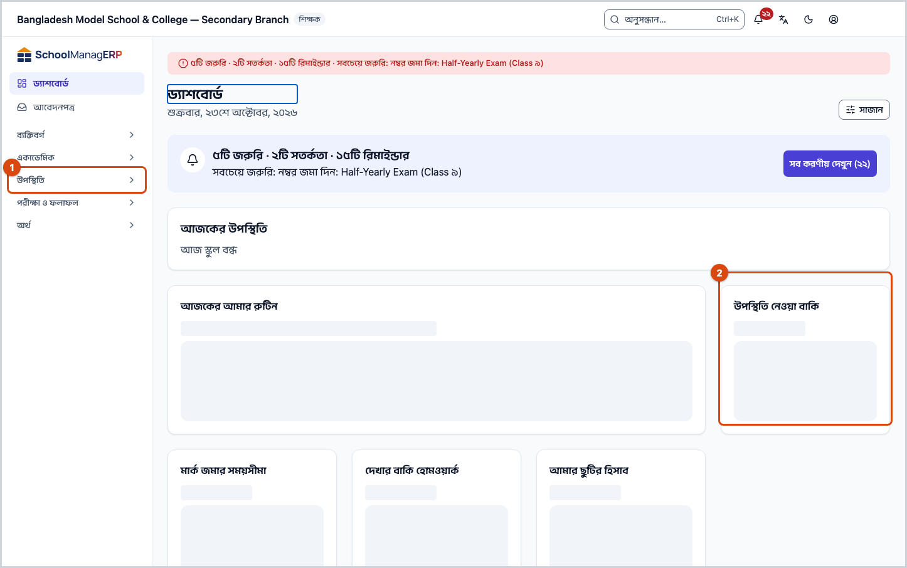
  <figcaption><em>১ · বাম মেনুর উপস্থিতি &nbsp; ২ · ড্যাশবোর্ডের "উপস্থিতি নেওয়া বাকি" কার্ড থেকেও সোজা খাতায় যাওয়া যায়</em></figcaption>
</figure>

2. যে শাখার হাজিরা নেবেন, তার কার্ডে চাপুন।

   → রোল নম্বর অনুযায়ী সব শিক্ষার্থীর নাম আসবে। সবার পাশে **চিহ্নিত হয়নি** লেখা।

3. উপরে ডান দিকে **সবাই উপস্থিত** চাপুন।

   → যাদের এখনো চিহ্নিত করেননি, তারা সবাই সবুজ **উপস্থিত** হবে। আগে থেকে দেওয়া অনুপস্থিত, বিলম্বে বা ছুটির চিহ্ন বদলায় না। ভুল করে চাপলে নিচের বার্তায় **পূর্বাবস্থায় ফেরান** চাপুন।

4. যারা আজ আসেনি, তাদের প্রত্যেকের **নামে** একবার চাপুন।

   → নামের পাশে লাল **অনুপস্থিত** আসবে, আর উপরের হিসাবে **অনুপস্থিত** সংখ্যা বাড়বে।

<figure>
  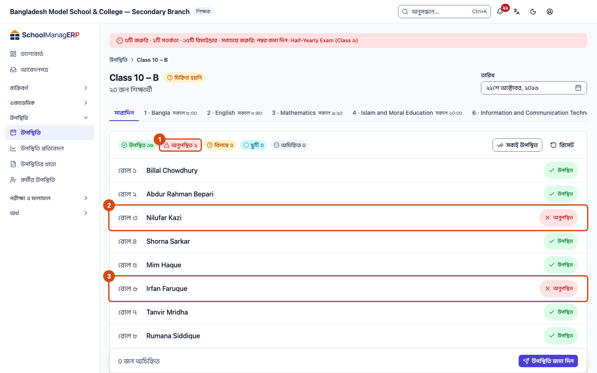
  <figcaption><em>ধাপ ৪-এর পর: দুজন অনুপস্থিত, উপরের হিসাবে অনুপস্থিত ২</em></figcaption>
</figure>

5. জমা দেওয়ার আগে একবার মিলিয়ে নিন: উপরের হিসাবে **অনুপস্থিত**, **বিলম্বে** ও **ছুটি**-র সংখ্যা ঠিক আছে কি না। এরপর নিচে **উপস্থিতি জমা দিন** চাপুন।

   → **উপস্থিতি সংরক্ষিত হয়েছে** বার্তা আসবে, আর অ্যাপ আপনাকে শাখার তালিকায় ফিরিয়ে নেবে।

**ফোনে** একই পাঁচ ধাপ; বোতামগুলো শুধু অন্য জায়গায়:

<figure>
  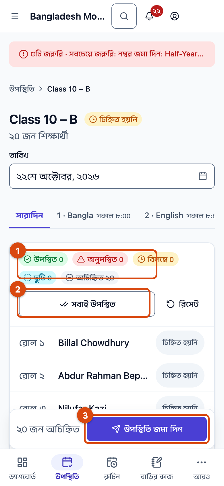
  <figcaption><em>১ · সবাই উপস্থিত &nbsp; ২ · শিক্ষার্থীর নাম &nbsp; ৩ · উপস্থিতি জমা দিন</em></figcaption>
</figure>

> **মনে রাখুন:** নামে বা বোতামে চাপলে চিহ্নটি শুধু আপনার স্ক্রিনে বদলায়। **উপস্থিতি জমা দিন** না চাপা পর্যন্ত স্কুলের সিস্টেমে কিছু যায় না।

---

## হাজিরা জমা হয়েছে কি না বুঝবেন কীভাবে 

একটি চিহ্ন তিন অবস্থায় থাকতে পারে। কোনটিতে আছেন, তা এভাবে বুঝবেন:

| অবস্থা                       | কীভাবে বুঝবেন                                                                                    | এরপর কী                                                            |
| ---------------------------- | ------------------------------------------------------------------------------------------------ | ------------------------------------------------------------------ |
| **শুধু স্ক্রিনে বদলেছে**     | নামের পাশে চিহ্ন আছে, কিন্তু এখনো জমা দেননি। পাতা রিলোড করলেও এই ডিভাইসে চিহ্নগুলো থাকে।         | **উপস্থিতি জমা দিন** চাপুন।                                        |
| **এই ডিভাইসে সংরক্ষিত**      | **ডিভাইসে সংরক্ষিত হয়েছে — অনলাইনে ফিরলে সিঙ্ক হবে** বার্তা। উপরে "১টি পরিবর্তন পাঠানো বাকি"।   | ইন্টারনেট ফিরলে নিজে থেকে পাঠানো হবে — [বিস্তারিত](#task-offline)। |
| **স্কুলের সিস্টেমে পৌঁছেছে** | **উপস্থিতি সংরক্ষিত হয়েছে** বার্তা, আর শাখার তালিকায় শাখাটির পাশে **খসড়া** বা **জমা হয়েছে**। | কাজ শেষ।                                                           |

**যাচাই করতে চাইলে:** শাখার তালিকায় শাখাটির কার্ডে আবার চাপুন। আপনার দেওয়া চিহ্নগুলো প্রতিটি নামের পাশে দেখা গেলে সেগুলো সিস্টেমে আছে।

<figure>
  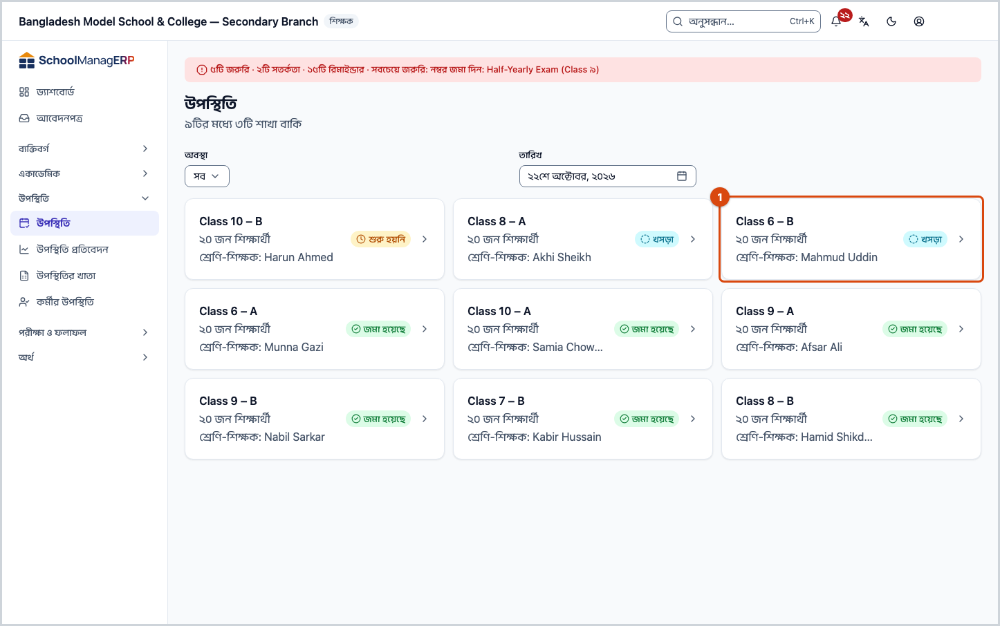
  <figcaption><em>জমা দেওয়ার পর শাখার তালিকা: শাখাটি আর "শুরু হয়নি" নয়</em></figcaption>
</figure>

**বার্তা না এলে:** [সমস্যা ও সমাধান](#trouble) দেখুন। আপনার চিহ্নগুলো মুছে যায়নি।

---

## অন্য পরিস্থিতিতে 

### কেউ দেরিতে এলে বা ছুটিতে থাকলে 

1. সেই শিক্ষার্থীর সারির ডান পাশের **অবস্থার বোতাম** চাপুন (যেখানে **উপস্থিত** বা **চিহ্নিত হয়নি** লেখা)।

   → ছোট একটি তালিকা খুলবে: **উপস্থিত**, **অনুপস্থিত**, **বিলম্বে**, **ছুটি**।

2. **বিলম্বে** বা **ছুটি** চাপুন।
3. **বিলম্বে** হলে নিচে **বিলম্বের মিনিট** ঘর আসবে। ইংরেজি সংখ্যায় মিনিট লিখুন, যেমন `15` (০ থেকে ১৪৪০)। না জানলে খালি রাখা যায়।
4. তালিকার বাইরে চাপুন। সারির ডান পাশে হলুদ **বিলম্বে** বা নীল **ছুটি** দেখাবে।
5. সবশেষে **উপস্থিতি জমা দিন** চাপুন। **উপস্থিতি সংরক্ষিত হয়েছে** বার্তা এলে তবেই চিহ্নটি সিস্টেমে গেছে।

<figure>
  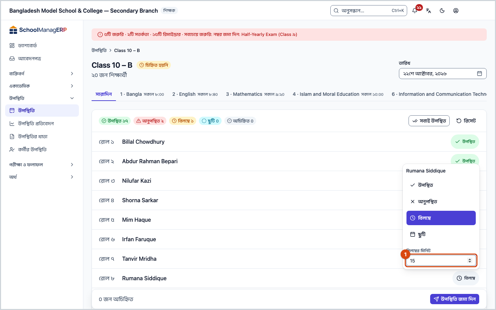
  <figcaption><em>বিলম্বে বেছে নেওয়ার পর বিলম্বের মিনিট ঘর</em></figcaption>
</figure>

**আগাম ছুটি:** শাখার তালিকার **তারিখ** ঘরে ভবিষ্যতের তারিখ বেছে নেওয়া যায় না। স্কুল চাইলে **সেটিংস › উপস্থিতি নীতি** থেকে আগাম ছুটি চালু করতে পারে; তখন ভবিষ্যতের দিনের খাতায় শুধু **ছুটি** দেওয়া যায়, আর খাতার উপরে লেখা থাকে "ভবিষ্যতের তারিখ — আগে থেকে শুধু ছুটি চিহ্নিত করা যাবে।"

### সবাইকে চিহ্নিত না করে জমা দিতে চাইলে 

কারও পাশে **চিহ্নিত হয়নি** থাকা অবস্থায় **উপস্থিতি জমা দিন** চাপলে অ্যাপ জিজ্ঞেস করে:

<figure>
  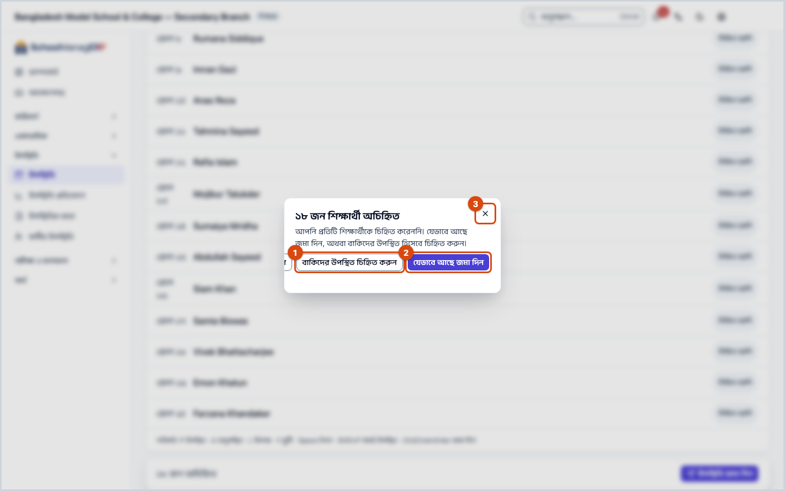
  <figcaption><em>১ · বাকিদের উপস্থিত চিহ্নিত করুন &nbsp; ২ · যেভাবে আছে জমা দিন &nbsp; ৩ · বন্ধ করুন</em></figcaption>
</figure>

| আপনি চাপলেন                      | কী হবে                                                                                                                       | জমা হলো?                                         |
| -------------------------------- | ---------------------------------------------------------------------------------------------------------------------------- | ------------------------------------------------ |
| **বাকিদের উপস্থিত চিহ্নিত করুন** | অচিহ্নিত সবাই **উপস্থিত** হবে। আপনি খাতায় ফিরে যাবেন; আবার **উপস্থিতি জমা দিন** চাপতে হবে।                                  | না, এখনো নয়                                     |
| **যেভাবে আছে জমা দিন**           | শুধু চিহ্নিতদের হাজিরা সিস্টেমে যাবে। অচিহ্নিতরা প্রতিবেদনে **অচিহ্নিত** থাকবে — অনুপস্থিত ধরা হবে না। খাতা অসম্পূর্ণ থাকবে। | হ্যাঁ — **উপস্থিতি সংরক্ষিত হয়েছে** বার্তা আসবে |
| **✕ (বন্ধ করুন)** বা **বাতিল**   | কিছু বদলায় না। আপনার চিহ্নগুলো স্ক্রিনে থাকে।                                                                               | না                                               |

অচিহ্নিতদের পরে চিহ্নিত করতে [আগের দিনের হাজিরা সংশোধন](#task-fix) দেখুন।

### আগের দিনের হাজিরা সংশোধন 

স্কুলের নির্ধারিত সময়সীমার মধ্যে (সাধারণত ২ দিন) আপনি নিজেই ঠিক করতে পারেন:

1. শাখার তালিকায় **তারিখ** ঘরে সেই দিনটি বেছে নিন।
2. শাখার কার্ডে চাপুন।
3. যে শিক্ষার্থীর চিহ্ন ভুল, তার নামে বা **অবস্থার বোতামে** চেপে ঠিক করুন।
4. **উপস্থিতি জমা দিন** চাপুন। **উপস্থিতি সংরক্ষিত হয়েছে** বার্তা এলে সংশোধন সিস্টেমে গেছে।

সময়সীমা পার হলে খাতার উপরে লেখা থাকে "এই রেজিস্টারটি ২ দিনের বেশি পুরনো। সংশোধনের জন্য একজন অ্যাডমিনকে বলুন।" তখন আপনি শুধু দেখতে পারবেন; সংশোধনের জন্য অ্যাডমিনকে বলুন। অ্যাডমিন এমন খাতা বদলালে **কেন এই হাজিরা খাতা বদলাচ্ছেন?** ঘর আসে; সেখানে অন্তত ৩ অক্ষরের একটি কারণ লিখতে হয়, যা অন্য কর্মীরা দেখতে পারেন। প্রতিটি সারির ডান পাশের **⋮** বোতামে **ইতিহাস** দেখা যায়: কে, কখন, কী বদলেছেন।

<figure>
  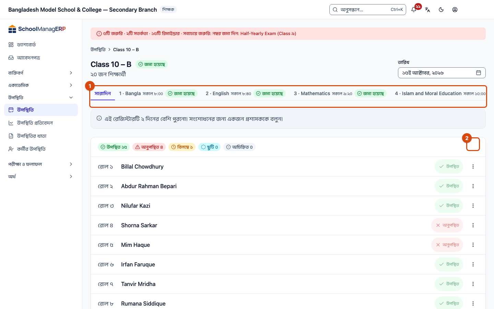
  <figcaption><em>১ · সময়সীমা পার হলে শিক্ষকের জন্য বার্তা &nbsp; ২ · সারির ⋮ বোতাম (ইতিহাস)</em></figcaption>
</figure>

### নামের পাশে ঘণ্টা 

কোনো শিক্ষার্থীর নামের পাশে ছোট ঘণ্টা থাকলে বুঝবেন, অভিভাবক চান শিশু পৌঁছালে তাঁকে বার্তা যাক। ঘণ্টার ওপর ধরে রাখলে বা কার্সর নিলে লেখা দেখা যায়: **অভিভাবক আগমন বার্তা চান**। আগের মতোই শিক্ষার্থীকে উপস্থিত দিন; বার্তা নিজে থেকে যায়। ঘণ্টা শুধু মনে করিয়ে দেয়। অনুরোধে সাড়া দিতে দেখুন [আগমন বার্তার অনুরোধে সাড়া দিন](../academics/my-class.md#task-arrival)।

### পিরিয়ড অনুযায়ী হাজিরা 

স্কুল **সেটিংস › উপস্থিতি নীতি** থেকে পিরিয়ড-ভিত্তিক হাজিরা চালু করলে এবং শ্রেণির রুটিন প্রকাশিত থাকলে খাতার উপরে **সারাদিন** ছাড়াও প্রতিটি পিরিয়ডের ঘর দেখাবে। নিজের পিরিয়ডের ঘরে চাপুন, তারপর উপরের পাঁচ ধাপই। প্রতিটি পিরিয়ডের খাতা আলাদা করে জমা দিতে হয়।

### ইন্টারনেট ছাড়া হাজিরা 

ইন্টারনেট না থাকলে জমা দেওয়ার বোতামে লেখা থাকে **ডিভাইসে সংরক্ষণ করুন**। চাপলে যা হয়:

- **ডিভাইসে সংরক্ষিত হয়েছে — অনলাইনে ফিরলে সিঙ্ক হবে** বার্তা আসে। হাজিরা শুধু এই ফোন বা কম্পিউটারে জমা থাকে; স্কুলের সিস্টেমে এখনো যায়নি।
- পাতার উপরে লেখা থাকে **আপনি অফলাইনে আছেন — ১টি পরিবর্তন পাঠানো বাকি**।
- ট্যাব বন্ধ করলে বা ফোন রিস্টার্ট হলে হাজিরা হারায় না। তবে পাঠানো হয় শুধু অ্যাপ খোলা থাকলে: ইন্টারনেট ফিরলে অ্যাপটি (এই ডিভাইসে) খুলুন বা খোলা রাখুন।
- পাঠানো হলে **১টি অফলাইন পরিবর্তন সংরক্ষিত হয়েছে।** বার্তা আসে। উপরের **আপনার পরিবর্তনগুলো** প্যানেলে তখন লেখা থাকে **আপনার সব পরিবর্তন সংরক্ষিত হয়েছে।**

**পাঠানো না হলে:** ইন্টারনেট ফেরার পরও "পাঠানো বাকি" থাকলে **আপনার পরিবর্তনগুলো** প্যানেল খুলুন।

- **অপেক্ষার সময়ে এটি অন্য কোথাও বদলে গেছে** — অন্য কেউ ইতিমধ্যে এই খাতায় হাজিরা দিয়েছেন। প্যানেল থেকে কোন সংস্করণ রাখবেন তা বেছে নিন।
- **কয়েকবার চেষ্টার পরেও এটি পাঠানো যায়নি** — খাতাটি আবার খুলে চিহ্নগুলো মিলিয়ে **উপস্থিতি জমা দিন** চাপুন। তারপরও না হলে অ্যাডমিনকে জানান।

এ নিয়ে আরও সাহায্য: [সমস্যা হলে কী করবেন](../help/troubleshooting.md#offline)।

---

## সমস্যা ও সমাধান 

| আপনি যা দেখছেন                                          | কী করবেন                                                                                                                          | কে সাহায্য করতে পারেন                 |
| ------------------------------------------------------- | --------------------------------------------------------------------------------------------------------------------------------- | ------------------------------------- |
| **এখনো কোনো শাখা বরাদ্দ হয়নি**                         | আপনার নামে শাখা দেওয়া হয়নি।                                                                                                     | অ্যাডমিন (**শিক্ষকের দায়িত্ব** পাতা) |
| **এই দিন স্কুল বন্ধ**                                   | সাপ্তাহিক ছুটি বা ক্যালেন্ডারের ছুটির দিন। হাজিরা লাগবে না। ভুল মনে হলে অ্যাডমিনকে বলুন।                                          | অ্যাডমিন (ক্যালেন্ডার)                |
| একটি শাখা তালিকায় নেই                                  | শাখায় শিক্ষার্থী নেই, বা সেই শ্রেণির আজ ছুটি। **অবস্থা** ফিল্টারে **সম্পন্ন** বেছে দেখুন, ইতিমধ্যে জমা হয়ে গেছে কি না।          | অ্যাডমিন                              |
| **উপস্থিতি সংরক্ষণ করা যায়নি**                         | ইন্টারনেট দেখে আবার **উপস্থিতি জমা দিন** চাপুন। চিহ্নগুলো স্ক্রিনে থেকে যায়। বারবার হলে অ্যাডমিনকে জানান, স্ক্রিনের বার্তাটি সহ। | অ্যাডমিন                              |
| বোতামে **ডিভাইসে সংরক্ষণ করুন** লেখা                    | ইন্টারনেট নেই। [ইন্টারনেট ছাড়া হাজিরা](#task-offline) দেখুন।                                                                     | —                                     |
| **আপনি লোড করার পর থেকে এই রেজিস্টার পরিবর্তিত হয়েছে** | নিচে দেখুন।                                                                                                                       | —                                     |
| **এই রেজিস্টারটি ২ দিনের বেশি পুরনো…**                  | সংশোধনের সময়সীমা পার। অ্যাডমিনকে বলুন কোন শিক্ষার্থীর কোন তারিখে কী বদলাতে হবে।                                                  | অ্যাডমিন                              |

**"এই রেজিস্টার পরিবর্তিত হয়েছে" এলে:** আপনি খাতাটি খোলার পর অন্য কেউ (যেমন অ্যাডমিন) এতে হাজিরা জমা দিয়েছেন। একটি তালিকা দেখাবে — শুধু যেসব শিক্ষার্থীর চিহ্নে আপনার আর তাঁর মধ্যে মিল নেই, **আপনার চিহ্ন** আর **বর্তমান চিহ্ন** পাশাপাশি।

- **আমারটা রাখুন** — আপনার পুরো খাতাটি (সব শিক্ষার্থীর চিহ্ন) তাঁর সংস্করণের উপর জমা হবে। তালিকায় থাকা শিক্ষার্থীদের তাঁর চিহ্ন বাদ যাবে।
- **তাদেরটা নিন** — আপনার জমা-না-দেওয়া সব চিহ্ন বাদ যাবে, খাতাটি তাঁর সংস্করণে রিলোড হবে। এরপর চাইলে আবার বদলে জমা দিতে পারবেন।

সিদ্ধান্ত নেওয়ার আগে তালিকার শিক্ষার্থীদের নিয়ে তাঁর সাথে কথা বলে নেওয়া ভালো।

<figure>
  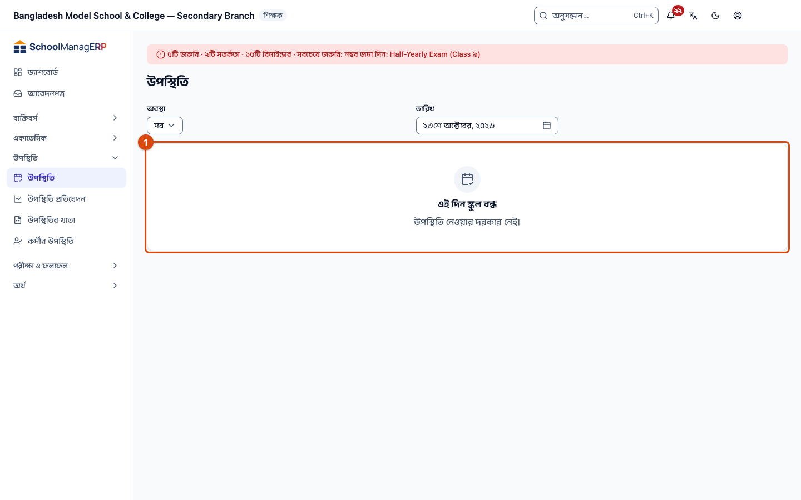
  <figcaption><em>স্কুল বন্ধের দিনে পাতাটি এমন দেখায়</em></figcaption>
</figure>

---

## কে কী করতে পারেন 

| ভূমিকা                                     | কোন শাখা দেখেন | হাজিরা নিতে পারেন | সংশোধন করতে পারেন                                                             | দেরির সতর্কবার্তা পান |
| ------------------------------------------ | -------------- | ----------------- | ----------------------------------------------------------------------------- | --------------------- |
| শিক্ষক                                     | নিজের বরাদ্দ   | হ্যাঁ             | সময়সীমার মধ্যে (সাধারণত ২ দিন)                                               | হ্যাঁ, নিজের শাখার    |
| অ্যাডমিন                                   | সব             | হ্যাঁ, যেকোনো দিন | যেকোনো দিন, কারণ লিখে | হ্যাঁ, অনেক দেরি হলে  |
| একাডেমিক কো-অর্ডিনেটর                      | সব             | না                | না                                                                            | হ্যাঁ, অনেক দেরি হলে  |
| হিসাবরক্ষক, অফিস কর্মী, পরীক্ষা নিয়ন্ত্রক | সব             | না                | না                                                                            | না                    |

যাঁরা হাজিরা নিতে পারেন না, তাঁদের খাতায় **সবাই উপস্থিত** আর **উপস্থিতি জমা দিন** বোতাম থাকে না।

---

## আরও জানুন 

<strong>পাতার অংশগুলো</strong> — শাখার তালিকা আর হাজিরার খাতায় কী কোথায়

**শাখার তালিকা**

<figure>
  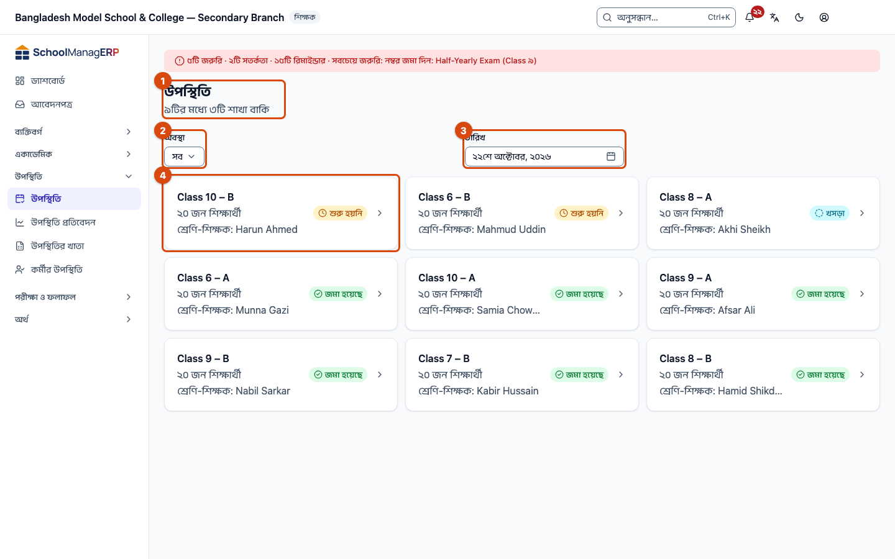
  <figcaption><em>১ · শিরোনাম &nbsp; ২ · অবস্থা &nbsp; ৩ · তারিখ &nbsp; ৪ · শাখার কার্ড</em></figcaption>
</figure>

1. **উপস্থিতি** — পাতার নাম। নিচে কতগুলো শাখা বাকি, যেমন "৯টির মধ্যে ৩টি শাখা বাকি"।
2. **অবস্থা** — শুধু **বাকি** বা শুধু **সম্পন্ন** শাখা দেখতে।
3. **তারিখ** — আজকের তারিখ বসানো থাকে। আগের দিন দেখতে বদলান; ভবিষ্যতের তারিখ বেছে নেওয়া যায় না।
4. **শাখার কার্ড** — নাম, শিক্ষার্থীর সংখ্যা, শ্রেণি-শিক্ষক আর খাতার অবস্থা: **শুরু হয়নি**, **খসড়া** (সিস্টেমে আছে), **জমা হয়েছে** (চূড়ান্ত)।

**হাজিরার খাতা**

<figure>
  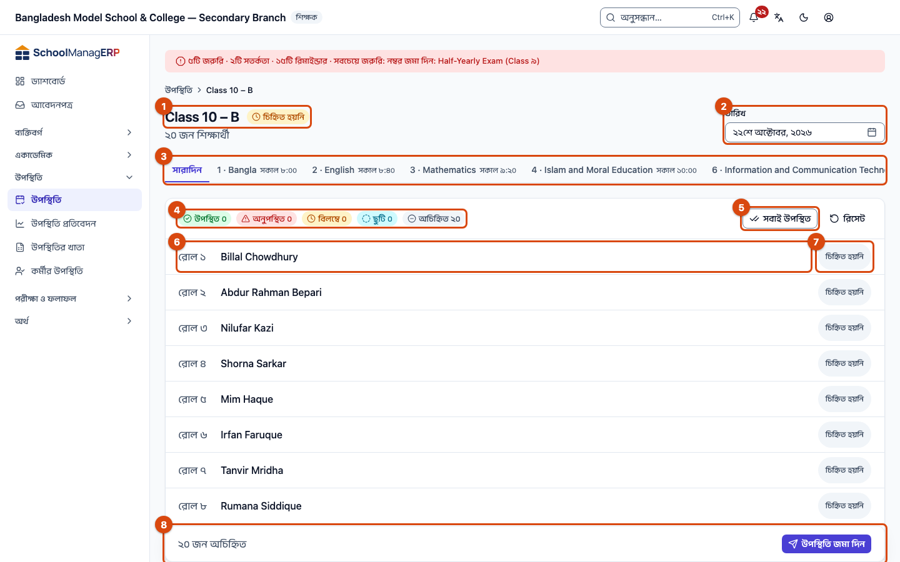
  <figcaption><em>১ · শাখা ও অবস্থা &nbsp; ২ · তারিখ &nbsp; ৩ · সারাদিন ও পিরিয়ড &nbsp; ৪ · হিসাব &nbsp; ৫ · সবাই উপস্থিত &nbsp; ৬ · শিক্ষার্থীর নাম &nbsp; ৭ · অবস্থার বোতাম &nbsp; ৮ · উপস্থিতি জমা দিন</em></figcaption>
</figure>

1. **শাখার নাম ও খাতার অবস্থা** — যেমন "Class 10 – B" আর **চিহ্নিত হয়নি**। নিচে মোট শিক্ষার্থী।
2. **তারিখ** — কোন দিনের হাজিরা।
3. **সারাদিন ও পিরিয়ড** — প্রতিদিনের হাজিরায় **সারাদিন**। পিরিয়ড-ভিত্তিক হাজিরা চালু থাকলে প্রতিটি পিরিয়ডের ঘর।
4. **হিসাব** — উপস্থিত, অনুপস্থিত, বিলম্বে, ছুটি, অচিহ্নিত — কতজন।
5. **সবাই উপস্থিত** — অচিহ্নিত সবাইকে উপস্থিত করে।
6. **শিক্ষার্থীর নাম** — চাপলে উপস্থিত ↔ অনুপস্থিত।
7. **অবস্থার বোতাম** — বিলম্বে বা ছুটি দিতে।
8. **উপস্থিতি জমা দিন** — বাম পাশে কতজন অচিহ্নিত।

<strong>কি-বোর্ড শর্টকাট</strong> (কম্পিউটারে)

একটি নামে চাপার পর:

| কি             | কাজ                    |
| -------------- | ---------------------- |
| `P`            | উপস্থিত                |
| `A`            | অনুপস্থিত              |
| `L`            | বিলম্বে                |
| `V`            | ছুটি                   |
| `Space`        | উপস্থিত ↔ অনুপস্থিত    |
| `↑` `↓`        | আগের / পরের শিক্ষার্থী |
| `Shift + P`    | সবাই উপস্থিত           |
| `Ctrl + Enter` | জমা দিন                |

<strong>ঘরগুলোর অর্থ</strong>

<!-- guide:generated:fields:attendance -->

| ঘর                          | কী লিখবেন                                                                                  | বাধ্যতামূলক?                      |
| --------------------------- | ------------------------------------------------------------------------------------------ | --------------------------------- |
| তারিখ                       | কোন দিনের হাজিরা। আজকের তারিখ বসানো থাকে। তালিকা থেকে ভবিষ্যতের তারিখ বেছে নেওয়া যায় না। | হ্যাঁ                             |
| অবস্থা (প্রতিটি শিক্ষার্থী) | উপস্থিত, অনুপস্থিত, বিলম্বে বা ছুটি। ভবিষ্যতের দিনে (আগাম ছুটি চালু থাকলে) শুধু ছুটি।      | না — বাকি থাকলে অ্যাপ জিজ্ঞেস করে |
| বিলম্বের মিনিট              | কত মিনিট দেরি, শুধু **বিলম্বে** দিলে। ইংরেজি সংখ্যায়, ০ থেকে ১৪৪০।                        | না                                |

<!-- /guide:generated -->

<strong>উপস্থিতি কীভাবে কাজ করে</strong> — খাতা থেকে প্রতিবেদন ও সতর্কবার্তা

<figure>
  
  <figcaption><em>উপস্থিতি কীভাবে কাজ করে</em></figcaption>
</figure>

- প্রতিটি শাখার প্রতিদিন একটি হাজিরার খাতা।
- সেই খাতা থেকেই [**উপস্থিতি প্রতিবেদন**](attendance-reports.md) আর মাসভিত্তিক [**উপস্থিতির খাতা**](attendance-register.md) তৈরি হয়।
- সময়মতো হাজিরা না নিলে শিক্ষকের কাছে মনে করিয়ে দেওয়ার বার্তা আসে; আরও দেরি হলে একাডেমিক কো-অর্ডিনেটর ও অ্যাডমিনের কাছেও।

<strong>পুরো কাজটি একসাথে</strong> — কম্পিউটারে ও ফোনে

<figure>
  
  <figcaption><em>কম্পিউটারে</em></figcaption>
</figure>

<figure>
  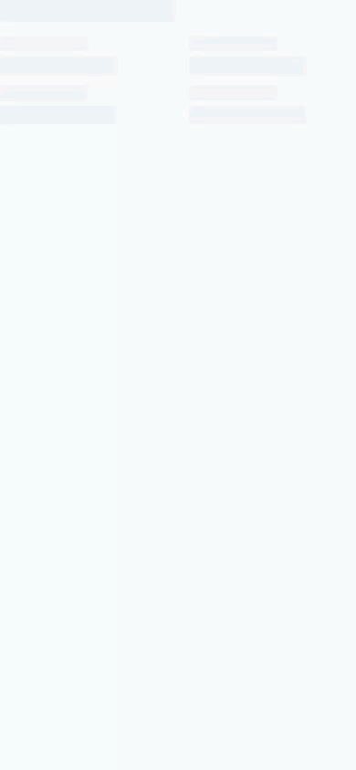
  <figcaption><em>ফোনে</em></figcaption>
</figure>

**সম্পর্কিত পাতা**

- [**শিক্ষককে শ্রেণি-শাখার দায়িত্ব দেওয়া**](../people/teaching-assignments.md) — অ্যাডমিন এখানে শাখা বরাদ্দ করেন।
- [**শ্রেণির সাপ্তাহিক রুটিন সাজানো**](../academics/routine-builder.md) — পিরিয়ড-ভিত্তিক হাজিরার জন্য।
- [**উপস্থিতি প্রতিবেদন**](attendance-reports.md) ও [**উপস্থিতির খাতা**](attendance-register.md) — এখানে নেওয়া হাজিরা থেকে তৈরি।
- [**কর্মীর উপস্থিতি ও ছুটি**](staff-attendance.md) — শিক্ষক ও কর্মীদের নিজেদের হাজিরা আর ছুটি।
- **সেটিংস › উপস্থিতি নীতি** (অ্যাডমিন) — সাপ্তাহিক ছুটি, সংশোধনের সময়সীমা, পিরিয়ড-ভিত্তিক হাজিরা, আগাম ছুটি।
- [**নিজের শ্রেণির খবর এক পাতায় দেখা**](../academics/my-class.md) — এক পাতায় আপনার শাখা, আজকের উপস্থিতিসহ।
- [**শিক্ষার্থী যোগ করা ও তাদের তথ্য দেখা**](../people/students.md) — যে শিক্ষার্থীদের উপস্থিতি এখানে নেওয়া হয়।
- [**স্কুলের সেটিংস ঠিক করা**](../administration/settings.md) — স্কুলের প্রোফাইল, একাডেমিক নিয়ম, ফির নিয়ম, যোগাযোগ, প্রিন্টিং, সাইন-ইন, ব্যাকআপ আর সতর্কতা এক পাতায়, নয়টি বিভাগে ঠিক করুন।
- [**উপস্থিতি**](../portal/attendance.md) — অভিভাবক আপনার নেওয়া উপস্থিতি যেভাবে দেখেন।

---

_সংস্করণ ০.১.০ · শেষ যাচাই ২০২৬-১০-২৩_
