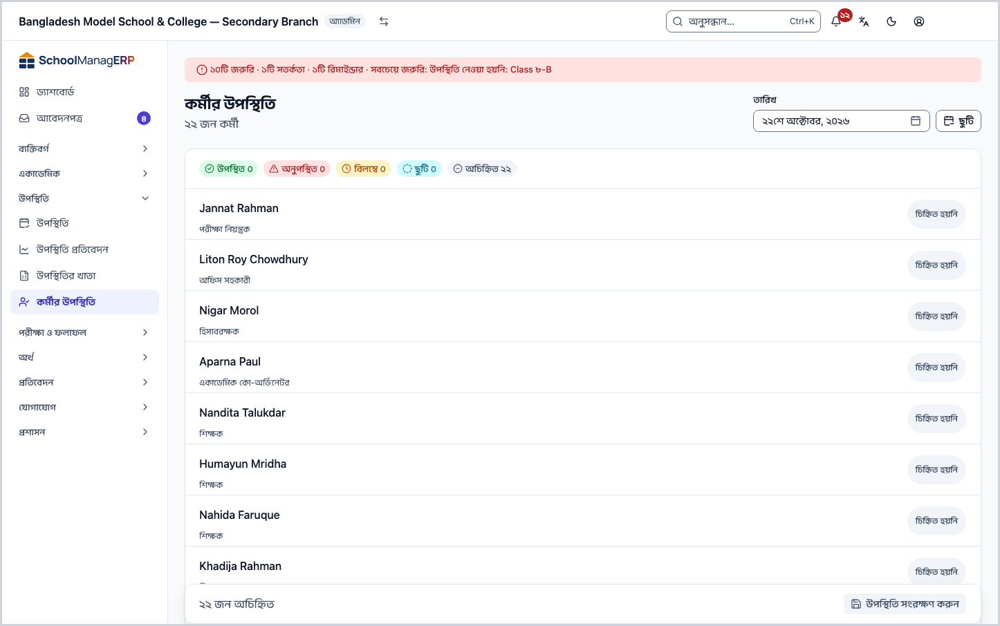
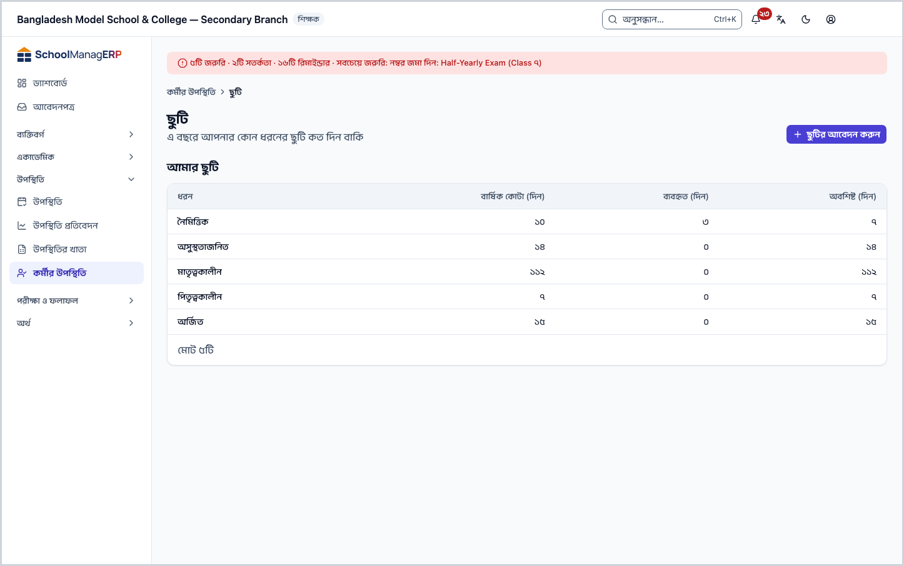

<!-- guide:meta
feature: attendance.staffAttendance
title: কর্মীর উপস্থিতি ও ছুটি
summary: প্রতিদিন শিক্ষক ও কর্মীদের উপস্থিতি সংরক্ষণ করুন, নিজের ছুটির হিসাব দেখুন, ছুটির আবেদন করুন আর অনুমোদন দিন।
roles: [ADMIN, ACCOUNTANT, TEACHER, EXECUTIVE, OFFICE_STAFF, EXAM_CONTROLLER]
sources:
  - client-admin/src/routes/_staff/attendance/staff/index.tsx
  - client-admin/src/routes/_staff/attendance/staff/-staff-attendance-grid.tsx
  - client-admin/src/routes/_staff/attendance/staff/leave.tsx
  - server/src/modules/staff-attendance/staff-attendance.controller.ts
  - server/src/modules/staff-attendance/staff-attendance.service.ts
  - server/src/modules/leave/leave.controller.ts
  - server/src/modules/leave/leave.service.ts
  - server/src/modules/applications/reviewer-scope.ts
labels:
  [
    staffAttendance:grid.*,
    leave:myLeave.*,
    leave:page.*,
    leave:type.*,
    applicationsDetail:actions.approve,
    applicationsDetail:actions.reject,
    applicationsDetail:actions.cancel,
    applications:types.STAFF_LEAVE,
    nav:items.staffAttendance,
    nav:items.leave,
  ]
helpIds:
  [
    attendance.staffAttendance,
    attendance.staffAttendance.action.submit,
    attendance.staffAttendance.action.requestLeave,
    attendance.staffAttendance.action.approveLeave,
    attendance.staffAttendance.field.date,
    attendance.staffAttendance.section.leaveBalance,
  ]
devices: [desktop]
entry: [sidebar, palette]
keywords: [কর্মীর উপস্থিতি, শিক্ষকের হাজিরা, ছুটি, ছুটির আবেদন, ছুটির ব্যালেন্স, staff attendance, leave, leave balance]
appVersion: 0.1.0 (a5fdbd4ba)
owner: tareq89
lastVerified: 2026-10-25
knownIssues: []
-->

# কর্মীর উপস্থিতি ও ছুটি

প্রতিদিন শিক্ষক ও কর্মীদের উপস্থিতি সংরক্ষণ করুন, নিজের ছুটির হিসাব দেখুন, ছুটির আবেদন করুন আর অনুমোদন দিন।

**যেতে হবে:** বাম মেনুতে **উপস্থিতি → কর্মীর উপস্থিতি**। ছুটির জন্য সেই পাতার উপরে **ছুটি** বোতাম।
**শুরুর আগে:** যাঁদের উপস্থিতি নেবেন, তাঁদের কর্মী প্রোফাইল থাকতে হবে ([কর্মী](../people/staff.md))। ছুটির আবেদন করতেও নিজের কর্মী প্রোফাইল লাগে।

শিক্ষার্থীর হাজিরা শাখা ধরে নেওয়া হয় ([উপস্থিতি নেওয়া](attendance.md))। কর্মীর হাজিরা পুরো স্কুলের একটিই তালিকা, দিনে একবার। ছুটির আবেদন অনুমোদন হলে সেই দিনগুলো এই তালিকায় নিজে থেকে **ছুটি** হয়ে যায়।

[আজকের উপস্থিতি](#task-main) · [আমার ছুটি](#task-my-leave) · [ছুটির আবেদন](#task-request) · [অনুমোদন](#task-approve) · [সমস্যা ও সমাধান](#trouble)

**এই পাতায় যা আছে**

- [এই পাতায় যেভাবে আসবেন](#arrive)
- [আজকের কর্মীর উপস্থিতি নিন](#task-main)
- [উপস্থিতি সংরক্ষিত হয়েছে কি না বুঝবেন কীভাবে](#confirm)
- [অন্য পরিস্থিতিতে](#other)
  - [আগের দিনের উপস্থিতি](#task-other-day)
  - [আমার ছুটির হিসাব দেখুন](#task-my-leave)
  - [ছুটির আবেদন করুন](#task-request)
  - [ছুটির আবেদন অনুমোদন বা নামঞ্জুর](#task-approve)
  - [অনুমোদিত ছুটি বাতিল](#task-cancel)
- [সমস্যা ও সমাধান](#trouble)
- [কে কী করতে পারেন](#roles)
- [আরও জানুন](#more)

---

## এই পাতায় যেভাবে আসবেন 

**বাম মেনু থেকে:** **উপস্থিতি → কর্মীর উপস্থিতি**। আজকের তারিখে কর্মীর তালিকা খোলে; নিচের ধাপ ২ থেকে শুরু করুন।

**খোঁজার ঘর থেকে:** উপরের খোঁজার ঘরে (Ctrl+K) "কর্মীর উপস্থিতি" লিখে বেছে নিন। খোঁজার নিয়ম: [যেকোনো পাতা খুঁজে পাওয়া](../start/find-anything.md)।

---

## আজকের কর্মীর উপস্থিতি নিন 

অ্যাডমিন আর একাডেমিক কো-অর্ডিনেটর সব কর্মীকে দেখেন। অন্যরা শুধু নিজের সারি দেখেন ([কে কী করতে পারেন](#roles))।

1. বাম মেনুতে **উপস্থিতি** চাপুন, তারপর **কর্মীর উপস্থিতি**।

   → উপরে **কর্মীর উপস্থিতি**, নিচে "১২ জন কর্মী"। প্রত্যেক কর্মীর নাম, তাঁর ভূমিকা, আর ডানে অবস্থার বোতাম। উপরের হিসাবে **উপস্থিত ০**, **অনুপস্থিত ০**, **বিলম্বে ০**, **ছুটি ০**, **অচিহ্নিত ১২**।

2. যিনি এসেছেন, তাঁর **নামে** চাপুন। → **উপস্থিত** হয়। আবার চাপলে **অনুপস্থিত**।
3. দেরি বা ছুটি হলে সারির ডানের **অবস্থার বোতাম** চেপে **বিলম্বে** বা **ছুটি** বেছে নিন।

4. নিচে বাম পাশে দেখুন কতজন বাকি, যেমন "২ জন অচিহ্নিত"। তারপর **উপস্থিতি সংরক্ষণ করুন** চাপুন।

   → বোতামে **সংরক্ষণ হচ্ছে…**, তারপর বাম পাশে **উপস্থিতি সংরক্ষিত হয়েছে**।

> **মনে রাখুন:** যাঁদের চিহ্নিত করেননি, তাঁদের কিছু পাঠানো হয় না। সবাইকে চিহ্নিত না করেও সংরক্ষণ করা যায়; বাকিদের পরে আবার এসে চিহ্নিত করতে পারবেন।

---

## উপস্থিতি সংরক্ষিত হয়েছে কি না বুঝবেন কীভাবে 

| অবস্থা                       | কীভাবে বুঝবেন                                                                   | এরপর কী                          |
| ---------------------------- | ------------------------------------------------------------------------------- | -------------------------------- |
| **শুধু স্ক্রিনে বদলেছে**     | নামের পাশে চিহ্ন আছে, নিচে "… জন অচিহ্নিত"। তারিখ বদলালে বা পাতা ছাড়লে হারায়। | **উপস্থিতি সংরক্ষণ করুন** চাপুন। |
| **স্কুলের সিস্টেমে পৌঁছেছে** | নিচে বাম পাশে **উপস্থিতি সংরক্ষিত হয়েছে**।                                     | কাজ শেষ।                         |

ইন্টারনেট ছাড়া এই পাতায় সংরক্ষণ হয় না। সংরক্ষণ না হলে লেখা আসে **উপস্থিতি সংরক্ষণ করা যায়নি। আবার চেষ্টা করুন।** — চিহ্নগুলো স্ক্রিনে থাকে, আবার চাপুন।

---

## অন্য পরিস্থিতিতে 

### আগের দিনের উপস্থিতি 

1. উপরের **তারিখ** ঘরে দিনটি বেছে নিন। → তালিকা খালি হয়ে সেই দিনের জন্য খোলে।
2. চিহ্ন দিয়ে **উপস্থিতি সংরক্ষণ করুন** চাপুন।

নিয়ম:

- ভবিষ্যতের দিনে শুধু **ছুটি** দেওয়া যায়।
- স্কুল বন্ধের দিনে সংরক্ষণ হয় না।
- যে দিনে আগে থেকে উপস্থিতি আছে আর যা স্কুলের সংশোধনের সময়সীমার (সাধারণত ২ দিন) চেয়ে পুরোনো, তা বদলাতে **উপস্থিতি সংরক্ষণ করুন**-এর উপরে **কেন এই দিনের হাজিরা বদলাচ্ছেন?** ঘর আসে। অন্তত ৩ অক্ষরের একটি কারণ লিখুন; অন্য কর্মীরা এটি দেখতে পারবেন।

তারিখ বদলালে আগের তারিখের সংরক্ষণ-না-করা চিহ্ন বাদ যায়।

### আমার ছুটির হিসাব দেখুন 

1. **কর্মীর উপস্থিতি** পাতার উপরে **ছুটি** চাপুন।

   → **ছুটি** পাতা খোলে: "এ বছরে আপনার কোন ধরনের ছুটি কত দিন বাকি"। **আমার ছুটি** তালিকায় প্রতিটি ধরন (যেমন **নৈমিত্তিক**, **অসুস্থতাজনিত**), **বার্ষিক কোটা (দিন)**, **ব্যবহৃত (দিন)**, **অবশিষ্ট (দিন)**।

কোটা না থাকলে **সীমা নেই** দেখায়। শুধু অনুমোদিত ছুটি **ব্যবহৃত**-তে গোনা হয়, আর শুধু স্কুল খোলার দিন।

### ছুটির আবেদন করুন 

1. **ছুটি** পাতার উপরে **ছুটির আবেদন করুন** চাপুন।

   → নতুন আবেদনের ফর্ম খোলে, ধরন **কর্মীর ছুটি** বাছা অবস্থায়।

2. ছুটির ধরন আর শুরু ও শেষের তারিখ দিন, তারপর আবেদন জমা দিন।

<!-- unverified: আবেদন ফর্মের ঘর ও বোতামের নাম (applications/new.tsx পড়া হয়নি); ধাপ ২ সাধারণ ভাষায় লেখা -->

আবেদন যায় অ্যাডমিন আর একাডেমিক কো-অর্ডিনেটরের কাছে। অনুমোদন না হওয়া পর্যন্ত ব্যালেন্স কমে না।

### ছুটির আবেদন অনুমোদন বা নামঞ্জুর 

শুধু অ্যাডমিন আর একাডেমিক কো-অর্ডিনেটর। নিজের আবেদন কেউ নিজে অনুমোদন করতে পারেন না।

1. **ছুটি** পাতার নিচে **অপেক্ষমাণ ছুটির আবেদন** চাপুন। → অপেক্ষমাণ কর্মীর ছুটির আবেদনের তালিকা খোলে।
2. একটি আবেদন খুলুন।
3. **অনুমোদন করুন** বা **নামঞ্জুর করুন** চাপুন।

**অনুমোদন করুন** চাপলে অ্যাপ মিলিয়ে দেখে:

| যাচাই                                   | না মিললে       |
| --------------------------------------- | -------------- |
| তারিখগুলোর মধ্যে অন্তত একদিন স্কুল খোলা | অনুমোদন হয় না |
| ওই বছরের অবশিষ্ট ছুটির চেয়ে বেশি নয়   | অনুমোদন হয় না |
| আগে অনুমোদিত অন্য ছুটির সঙ্গে মেলে না   | অনুমোদন হয় না |

অনুমোদন হলে সেই দিনগুলো **কর্মীর উপস্থিতি**-তে **ছুটি** হয়ে যায়; আগে **অনুপস্থিত** দেওয়া থাকলে তা-ও **ছুটি** হয়। আবেদনকারী শিক্ষক হলে তাঁর ক্লাসের বদলি ঠিক করুন: [বদলি শিক্ষক](../academics/routine-substitutions.md)।

### অনুমোদিত ছুটি বাতিল 

অ্যাডমিন বা একাডেমিক কো-অর্ডিনেটর আবেদনটি খুলে **ছুটি বাতিল করুন** চাপতে পারেন। আবেদনকারী নিজে বাতিল করতে পারেন না। বাতিল হলে সামনের দিনগুলোর **ছুটি** চিহ্ন উঠে যায়।

---

## সমস্যা ও সমাধান 

| আপনি যা দেখছেন                                              | কী করবেন                                                                                       | কে সাহায্য করতে পারেন |
| ----------------------------------------------------------- | ---------------------------------------------------------------------------------------------- | --------------------- |
| **এই দিনের কর্মী তালিকা লোড করা যায়নি।**                   | ইন্টারনেট দেখে পাতাটি আবার লোড করুন।                                                           | অ্যাডমিন              |
| **অন্তত ৩ অক্ষরের একটি কারণ লিখুন।**                        | দিনটি সংশোধনের সময়সীমার চেয়ে পুরোনো। ঘরে কেন বদলাচ্ছেন লিখে আবার সংরক্ষণ করুন।               | —                     |
| **এখনও কোনো কর্মী নেই**                                     | **কর্মী যোগ করুন** চাপুন, বা কর্মীর প্রোফাইল দিন ([কর্মী](../people/staff.md))।                | অ্যাডমিন              |
| তালিকায় একজন কর্মী নেই                                     | তাঁর কর্মী প্রোফাইল নেই। [কর্মী](../people/staff.md) পাতা থেকে দিন।                            | অ্যাডমিন              |
| **আপনার কর্মী প্রোফাইল নেই**                                | ছুটির হিসাব শুধু কর্মীদের জন্য। অ্যাডমিনকে আপনার কর্মী প্রোফাইল তৈরি করতে বলুন।                | অ্যাডমিন              |
| **ছুটির নিয়ম এখনো ঠিক করা হয়নি**                          | স্কুলে ছুটির ধরন ও কোটা ঠিক করা হয়নি।                                                         | অ্যাডমিন              |
| সংরক্ষণে **উপস্থিতি সংরক্ষণ করা যায়নি। আবার চেষ্টা করুন।** | ইন্টারনেট দেখুন। স্কুল বন্ধের দিন, বা ভবিষ্যতের দিনে ছুটি ছাড়া অন্য চিহ্ন হলে সংরক্ষণ হবে না। | অ্যাডমিন              |

<!-- unverified: ছুটির কোটা কোন পাতা থেকে বদলায় (server PUT /leave/policies/:type আছে; UI পাতা খোঁজা হয়নি) -->

---

## কে কী করতে পারেন 

| ভূমিকা                | কর্মীর উপস্থিতি নেওয়া       | নিজের ছুটির হিসাব ও আবেদন | ছুটি অনুমোদন ও বাতিল |
| --------------------- | ---------------------------- | ------------------------- | -------------------- |
| অ্যাডমিন              | হ্যাঁ, সব কর্মীর, যেকোনো দিন | হ্যাঁ                     | হ্যাঁ, নিজেরটা ছাড়া |
| একাডেমিক কো-অর্ডিনেটর | হ্যাঁ, সব কর্মীর, যেকোনো দিন | হ্যাঁ                     | হ্যাঁ, নিজেরটা ছাড়া |
| শিক্ষক                | শুধু নিজের, শুধু আজকের       | হ্যাঁ                     | না                   |
| হিসাবরক্ষক            | শুধু নিজের, শুধু আজকের       | হ্যাঁ                     | না                   |
| অফিস সহকারী           | শুধু নিজের, শুধু আজকের       | হ্যাঁ                     | না                   |
| পরীক্ষা নিয়ন্ত্রক    | শুধু নিজের, শুধু আজকের       | হ্যাঁ                     | না                   |

সব ভূমিকার মেনুতে **কর্মীর উপস্থিতি** থাকে। শিক্ষক, হিসাবরক্ষক, অফিস সহকারী আর পরীক্ষা নিয়ন্ত্রক শুধু নিজের উপস্থিতি, শুধু আজকের, আর শুধু একবার দিতে পারেন। **অপেক্ষমাণ ছুটির আবেদন** লিংক শুধু অ্যাডমিন আর একাডেমিক কো-অর্ডিনেটর দেখেন।

---

## আরও জানুন 

<strong>পাতার অংশগুলো</strong> — কর্মীর উপস্থিতি

1. **কর্মীর উপস্থিতি** — শিরোনাম, নিচে কতজন কর্মী।
2. **তারিখ** — কোন দিনের উপস্থিতি; আজকের তারিখ বসানো থাকে।
3. **ছুটি** — ছুটির পাতায় যাওয়ার বোতাম।
4. **হিসাব** — উপস্থিত, অনুপস্থিত, বিলম্বে, ছুটি, অচিহ্নিত।
5. **কর্মীর তালিকা** — নাম, ভূমিকা, অবস্থার বোতাম।
6. **উপস্থিতি সংরক্ষণ করুন** — বাম পাশে কতজন অচিহ্নিত।

<strong>কি-বোর্ড শর্টকাট</strong> (কম্পিউটারে)

একটি নামে থাকার সময়:

| কি      | কাজ                 |
| ------- | ------------------- |
| `Enter` | উপস্থিত             |
| `L`     | ছুটি                |
| `Space` | উপস্থিত ↔ অনুপস্থিত |
| `Tab`   | পরের ঘর             |

<strong>ঘরগুলোর অর্থ</strong>

<!-- guide:generated:fields:staffAttendance -->

| ঘর                     | কী লিখবেন                                                             | বাধ্যতামূলক?                        |
| ---------------------- | --------------------------------------------------------------------- | ----------------------------------- |
| তারিখ                  | কোন দিনের উপস্থিতি। আজকের তারিখ বসানো থাকে। ভবিষ্যতের দিনে শুধু ছুটি। | হ্যাঁ                               |
| অবস্থা (প্রতিটি কর্মী) | উপস্থিত, অনুপস্থিত, বিলম্বে বা ছুটি।                                  | না — অচিহ্নিতদের কিছু পাঠানো হয় না |

<!-- /guide:generated -->

<strong>কর্মীর উপস্থিতি আর ছুটি কীভাবে জোড়া</strong>

<figure>
  
  <figcaption><em>কর্মীর উপস্থিতি আর ছুটি</em></figcaption>
</figure>

- ছুটির ব্যালেন্স প্রতিবার নতুন করে গোনা হয়: কোটা থেকে ওই বছরের অনুমোদিত ছুটির দিন বাদ।
- এক ছুটি দুই বছরে পড়লে প্রতিটি বছর তার নিজের ব্যালেন্সে মেলানো হয়।

**সম্পর্কিত পাতা**

- [**কর্মী**](../people/staff.md) — কর্মী ও তাঁর প্রোফাইল যোগ করুন।
- [**উপস্থিতি নেওয়া**](attendance.md) — শিক্ষার্থীর প্রতিদিনের হাজিরা।
- [**বদলি শিক্ষক**](../academics/routine-substitutions.md) — ছুটিতে থাকা শিক্ষকের ক্লাস কে নেবেন।
- [**ড্যাশবোর্ড**](../dashboard/dashboard.md) — আজকের সারসংক্ষেপ।
- [**আবেদনপত্র**](../applications/applications.md) — ছুটি, ফি মওকুফ, ছাড়পত্র, প্রশংসাপত্র, শাখা বদলসহ স্কুলের আবেদন জমা দিন, অভিভাবকের কাগজের আবেদন অ্যাপে তুলুন।
- [**আবেদনপত্রের প্রতিবেদন**](../reports/applications.md) — আবেদনপত্রের প্রতিবেদন, কর্মীর ছুটির সংখ্যাসহ

---

_সংস্করণ ০.১.০ · শেষ যাচাই ২০২৬-১০-২৫_
