<!-- guide:meta
feature: attendance.uploads
title: হাজিরা শীট আপলোড
summary: এক বা একাধিক শাখার হাজিরা এক্সেল শীটে লিখে আপলোড করুন, কী বদলাবে দেখে নিন, তারপর সেভ করুন। পরে সব আপলোড দেখুন, আর ভুল হলে ঠিক করা ফাইল দিয়ে শুধরে নিন।
roles: [TEACHER, ADMIN, EXECUTIVE, ACCOUNTANT, OFFICE_STAFF, EXAM_CONTROLLER]
sources:
  - client-admin/src/routes/_staff/attendance/import.tsx
  - client-admin/src/routes/_staff/attendance/-import/import-dropzone.tsx
  - client-admin/src/routes/_staff/attendance/-import/import-preview-table.tsx
  - client-admin/src/routes/_staff/attendance/-import/section-date-picker.tsx
  - client-admin/src/routes/_staff/attendance/imports/index.tsx
  - client-admin/src/routes/_staff/attendance/imports/$importId.tsx
  - client-admin/src/routes/_staff/attendance/-imports/import-rows-table.tsx
  - server/src/modules/attendance/import/attendance-import.controller.ts
labels:
  [
    attendanceImport:pick.*,
    attendanceImport:download.*,
    attendanceImport:upload.*,
    attendanceImport:review.*,
    attendanceImport:outcome.*,
    attendanceImport:rowError.*,
    attendanceImport:history.*,
    attendanceImport:detail.*,
    nav:items.upload,
    nav:items.uploads,
  ]
helpIds: [attendance.uploads]
devices: [desktop]
entry: [sidebar, palette]
keywords: [হাজিরা শীট, শীট আপলোড, এক্সেল, হাজিরা আপলোড, attendance sheet, upload attendance, excel, import]
appVersion: 0.1.0 (7c8c659c8)
owner: tareq89
lastVerified: 2026-11-06
knownIssues: []
-->

# হাজিরা শীট আপলোড

এক বা একাধিক শাখার হাজিরা এক্সেল শীটে লিখে আপলোড করুন, কী বদলাবে দেখে নিন, তারপর সেভ করুন। পরে সব আপলোড দেখুন, আর ভুল হলে ঠিক করা ফাইল দিয়ে শুধরে নিন।

**যেতে হবে:** বাম মেনুতে **উপস্থিতি → আপলোড করা শীট**, তারপর **হাজিরা শীট আপলোড** চাপুন। অথবা উপরের খোঁজার ঘরে (Ctrl+K) **হাজিরা শীট আপলোড করুন** লিখুন। কম্পিউটারে করুন।
**শুরুর আগে:** শাখার হাজিরা নেওয়ার অনুমতি থাকতে হবে (শিক্ষক নিজের শাখার, অথবা প্রশাসক)। ওই দিনের হাজিরা হাতের কাছে রাখুন, যেমন কাগজের খাতা।

**শীট** হলো একটি এক্সেল ফাইল, যা অ্যাপ আপনার জন্য বানিয়ে দেয়, আর তাতে আপনার শিক্ষার্থীদের নাম আগেই বসানো থাকে। আপনি শুধু প্রতিটি নামের পাশে ছোট একটি কোড লিখবেন। শেষে **সেভ করুন** না চাপা পর্যন্ত কিছুই সেভ হয় না, তাই আগে দেখে নেওয়া যায়।

[শীট আপলোড করুন](#task-main) · [দেখার পাতা পড়ুন](#task-review) · [আগের আপলোড দেখুন](#task-history) · [ভুল শুধরান](#task-correct) · [সমস্যা ও সমাধান](#trouble)

**এই পাতায় যা আছে**

- [শীট আপলোড করুন](#task-main)
- [সেভ হয়েছে কি না বুঝবেন কীভাবে](#confirm)
- [অন্য পরিস্থিতিতে](#other)
  - [সেভের আগে দেখার পাতা পড়ুন](#task-review)
  - [আগের আপলোড দেখুন](#task-history)
  - [ঠিক করা ফাইল দিয়ে ভুল শুধরান](#task-correct)
- [সমস্যা ও সমাধান](#trouble)
- [কে কী করতে পারেন](#roles)
- [আরও জানুন](#more)

---

## শীট আপলোড করুন 

1. বাম মেনুতে **উপস্থিতি** চাপুন, তারপর **আপলোড করা শীট**। সেই পাতার উপরে **হাজিরা শীট আপলোড** চাপুন। উপরের খোঁজার ঘরে (Ctrl+K) **হাজিরা শীট আপলোড করুন** লিখেও আসা যায়। পাতার নাম **হাজিরা শীট আপলোড**, আর লেখা থাকে **ধাপ ১ / ৩**: **কী পূরণ করবেন বেছে নিন**।
   <!-- shot: attendance-uploads-01-menu.png — Uploaded sheets in the menu and the Upload attendance sheet button (tour step "uploads: menu") -->
2. **শাখা**-র নিচে যে শাখাগুলো চান টিক দিন। একবারে সর্বোচ্চ ১০টি শাখা বাছা যায়। **তারিখ**-এ দিনটি বেছে নিন।
   <!-- shot: attendance-uploads-02-pick.png — sections ticked, date chosen (tour step "uploads: pick") -->
3. **শীট নামান** চাপুন। আপনার কম্পিউটারে `হাজিরা_<শ্রেণি>_<শাখা>_<তারিখ>.xlsx` নামের একটি ফাইল সেভ হয়। স্কুলের ভাষা ইংরেজি হলে নাম শুরু হয় `attendance_` দিয়ে। একাধিক শাখা বাছলে নামে শুধু তারিখ থাকে, যেমন `হাজিরা_<তারিখ>.xlsx`। শুধু সেই শাখাগুলো টিক দিন যার হাজিরা আপনি নেন: ওই দিনে একটিও আপনার না হলে কোনো শীট তৈরি হয় না, পাতায় লেখা আসে **এই দিনে এই শাখাগুলোর একটির হাজিরা আপনি দিতে পারবেন না। কম শাখা বা অন্য তারিখ বেছে নিন।** অন্য কোনো কারণে হলে লেখা আসে **শীট তৈরি করা যায়নি। আবার চেষ্টা করুন।** পাতা নিজে থেকে **ধাপ ২ / ৩**-এ চলে যায়।
   <!-- shot: attendance-uploads-03-download.png — download button (tour step "uploads: download") -->
4. ফাইলটি খুলুন। প্রতিটি শিক্ষার্থীর জন্য শেষ ঘরে একটি কোড লিখুন: `উ`, `অ`, `দে` বা `ছু`। নিচের ছকে প্রতিটির মানে আছে। কোনো শিক্ষার্থীর হাজিরা যেমন আছে তেমন রাখতে ঘরটি খালি রাখুন। ফাইল সেভ করুন।
   <!-- shot: attendance-uploads-04-sheet.png — the sheet in Excel (manual capture, not the app) -->
5. অ্যাপে ফিরে **পূরণ করা শীট আপলোড করুন** ধাপে ফাইলটি **শীটটি এখানে ছাড়ুন, অথবা ফাইল বেছে নিন** লেখা ঘরে ছাড়ুন, অথবা **ফাইল বেছে নিন** চেপে ফাইলটি বাছুন। ফাইল .xlsx বা .csv হতে হবে আর ৫ এমবির কম।
   <!-- shot: attendance-uploads-05-drop.png — the drop box (tour step "uploads: drop") -->
6. **কী বদলাবে দেখুন** চাপুন। **আপনার শীট দেখা হচ্ছে…** লেখা শেষ হওয়া পর্যন্ত অপেক্ষা করুন। **ধাপ ৩ / ৩**, **সেভ করার আগে দেখে নিন**, খোলে।
7. হলুদ ব্যানার আর ছকটি পড়ুন। দেখুন [সেভের আগে দেখার পাতা পড়ুন](#task-review)।
   <!-- shot: attendance-uploads-06-review.png — review table with banner and one error (tour step "uploads: review") -->
8. **২টি বদল সেভ করুন** চাপুন (সংখ্যাটি হলো কতটি হাজিরা বদলাবে)। → এই আপলোডের পাতা খোলে। পাতার নামে "আপলোড" আর তারিখ থাকে। শীটের প্রতিটি সারি তার ফলাফলসহ দেখায়।
   <!-- shot: attendance-uploads-08-detail.png — detail page after saving (tour step "uploads: detail") -->
9. পরে এই আপলোড আবার দেখতে **উপস্থিতি** চাপুন, তারপর **আপলোড করা শীট**। আপনার আপলোড সবার উপরের সারিতে।

| কোড  | মানে                                           |
| ---- | ---------------------------------------------- |
| `উ`  | উপস্থিত                                        |
| `অ`  | অনুপস্থিত                                      |
| `দে` | দেরি (বিলম্বে)                                 |
| `ছু` | ছুটি                                           |
| খালি | বদল নেই: শিক্ষার্থীর হাজিরা যেমন আছে তেমন থাকে |

> **মনে রাখুন:** শীটের রোল আর শাখার নাম দেখে ঠিক হয় কার হাজিরা হবে। **তারিখ**, **শ্রেণি**, **শাখা** আর **রোল** ঘর বদলাবেন না। রোলটি ওই শাখায় না থাকলে সারিতে ভুল দেখায় আর সেটি সেভ হয় না।

---

## সেভ হয়েছে কি না বুঝবেন কীভাবে 

| অবস্থা                             | কীভাবে বুঝবেন                                                                                            | এরপর কী                                                                                                                                                                                                               |
| ---------------------------------- | -------------------------------------------------------------------------------------------------------- | --------------------------------------------------------------------------------------------------------------------------------------------------------------------------------------------------------------------- |
| **সেভ হয়েছে**                     | আপলোডের পাতা খোলে, উপরে **নতুন** আর **বদল**-এর সংখ্যাসহ। আপলোডটি **আপলোড করা শীট**-এর সবার উপরের সারিতে। | হাজিরা দেখতে শাখার খাতা খুলুন।                                                                                                                                                                                        |
| **সেভ হয়েছে, কিছু সারি বাদ গেছে** | আপলোডের পাতায় **ভুল** চাপুন: বাদ যাওয়া সারিগুলো **ভুল** লেখাসহ দেখায়।                                 | ওই সারিগুলো শীটে ঠিক করে আবার আপলোড করুন ([ভুল শুধরান](#task-correct))।                                                                                                                                               |
| **সেভ হয়নি**                      | **সেভ করা যায়নি। কিছুই বদলায়নি।**                                                                      | কিছুই বদলায়নি। আবার চাপুন। বারবার হলে প্রশাসককে বলুন।                                                                                                                                                                |
| **দেখার সময় শেষ**                 | **এই দেখার সময় শেষ**                                                                                    | দেখার সময় কয়েক মিনিটই থাকে। আপলোডের ঘরে ফাইলটি আবার ছাড়ুন। ফাইল বা অনুমতির কারণে সেভ না হলেও পাতা আপলোডের ধাপে ফিরে যায়; নেটওয়ার্ক বা সার্ভারের কারণে না হলে আপনি দেখার পাতাতেই থাকেন, আবার **সেভ** চাপতে পারেন। |

আপলোড কখনো দিনের হাজিরা চূড়ান্ত করে না। শিক্ষক নিজে সেভ করলে যেমন হয়, খাতা তেমনি খসড়াই থাকে, যতক্ষণ না আগের মতো চূড়ান্ত করা হয়।

---

## অন্য পরিস্থিতিতে 

### সেভের আগে দেখার পাতা পড়ুন 

**সেভ করার আগে দেখে নিন** পাতায় শীটের প্রতিটি সারি আছে, ভুলগুলো আগে। একদম উপরে গোনা থাকে: **নতুন**, **বদল**, **অপরিবর্তিত** আর **ভুল**।

1. **ফলাফল** কলাম দেখুন। প্রতিটি সারি **নতুন** (আগে হাজিরা ছিল না), **বদল** (আগের হাজিরা বদলাবে), **অপরিবর্তিত** (এখনকার মতোই) অথবা **ভুল**।
2. **অবস্থা: আগে → পরে** কলামে বদলটি দেখুন। যেমন "অনুপস্থিত → উপস্থিত"।
3. **হলুদ ব্যানারে** "৩টি লেখা হাজিরা বদলে যাবে" লেখা থাকলে বুঝবেন, এই শিক্ষার্থীদের ওই দিনের হাজিরা আগেই ছিল। সেভ করলে সেটি বদলে যাবে। তা না চাইলে **অন্য ফাইল বেছে নিন** চাপুন।
4. **ভুল** সারির জন্য **কী ঠিক করবেন** পড়ুন। দেখুন [সমস্যা ও সমাধান](#trouble)-এর ছক।
5. কিছু সারিতে ভুল থাকলে দুটি উপায় আছে:
   - **ঠিক সারিগুলো সেভ করুন, ভুল সারিগুলো বাদ দিন** বাক্সে টিক দিন। তখন সেভ করলে শুধু ঠিক সারিগুলো সেভ হয়। ভুল সারিগুলো বাদ যায়।
   - অথবা **অন্য ফাইল বেছে নিন** চেপে শীট ঠিক করে আবার আপলোড করুন।

এখনো কিছু বদলায়নি। **সেভ** না চাপা পর্যন্ত হাজিরা বদলায় না।

### আগের আপলোড দেখুন 

1. বাম মেনুতে **উপস্থিতি** চাপুন, তারপর **আপলোড করা শীট**।
2. ছকে নতুনটি আগে থাকে: **কখন**, **কে**, **ফাইল**, **নতুন**, **বদল**, **ভুল** আর **অবস্থা**। **কে** ঘরে নিজের আপলোডে **আপনি** লেখা থাকে, আর নাম জানা না গেলে **একজন কর্মী**। শিক্ষকেরা শুধু নিজের আপলোড করা শীট দেখেন। অন্য ভূমিকা স্কুলের সব আপলোড করা শীট দেখে।
3. **অবস্থা** ঘরে **নতুন ফাইল এসেছে** মানে এই শীটের জন্য পরে একটি সংশোধিত ফাইল আপলোড হয়েছে, আর সেই নতুন আপলোড এই ছকের একই পাতায় আছে। **চলমান** মানে এমন কোনো আপলোড এই পাতায় নেই। **চলমান** আপলোডেও হাতে হাজিরা বদলানো থাকতে পারে। তা খুঁজতে বিস্তারিত পাতার সারিতে **পরে বদলেছে** লেখা দেখুন।
4. সারি চাপলে তার বিস্তারিত পাতা খোলে। **সব**, **বদল** আর **ভুল** দিয়ে সারি ছেঁকে নিন। আপলোডের পরে যে হাজিরা বদলেছে, তাতে **পরে বদলেছে** লেখা থাকে।

কেউ এখনো শীট আপলোড না করলে পাতায় **এখনো কোনো শীট আপলোড হয়নি** লেখা থাকে, সঙ্গে **শীট আপলোড করুন** বোতাম।

### ঠিক করা ফাইল দিয়ে ভুল শুধরান 

ভুল আপলোড দুইভাবে ঠিক করা যায়।

**ঠিক করা ফাইল দিয়ে:**

1. **আপলোড করা শীট** থেকে আপলোডটি খুলুন।
2. **ঠিক করা ফাইল আপলোড করুন** চাপুন। আপলোডের পাতা খোলে।
3. পাতা প্রথম ধাপ থেকে শুরু হয়। ঠিক করা ফাইল তৈরি থাকলে **পূরণ করা শীট আপলোড করুন** চেপে নামানোর ধাপ ছেড়ে যান। না থাকলে আগের মতো নামান, লিখুন, আপলোড করুন আর দেখে নিন। দেখার পাতায় এখনকার হাজিরার সঙ্গে তুলনা হয়।
4. **সেভ** চাপুন। তালিকায় নতুন একটি সারি আসে। প্রথম আপলোডে লেখা থাকে **নতুন ফাইল এসেছে**। প্রথমটি থেকে যায়, কিছু মুছে যায় না।

**হাতে ঠিক করা:** আপলোডের পাতায় কোনো সারির **হাজিরা খাতা খুলুন** কাজটি চেপে ওই দিনের খাতায় হাজিরা বদলান, যেমন [আগের দিনের হাজিরা ঠিক করা](attendance.md#task-fix)-য় আছে।

"পুরো আপলোড ফিরিয়ে নিন" বলে কোনো বোতাম নেই। শুধু যেটুকু ভুল সেটুকু ঠিক করুন।

---

## সমস্যা ও সমাধান 

| যা দেখছেন                                                                                      | কী করবেন                                                                                                                        | কে সাহায্য করতে পারেন |
| ---------------------------------------------------------------------------------------------- | ------------------------------------------------------------------------------------------------------------------------------- | --------------------- |
| **এই ধরনের ফাইল চলবে না — .xlsx বা .csv ফাইল বেছে নিন।**                                       | শীটটি এক্সেল (.xlsx) বা CSV (.csv) হিসেবে সেভ করুন, PDF নয়।                                                                    | —                     |
| **ফাইলটি অনেক বড় — ৫ এমবির কম ফাইল বেছে নিন।**                                                | ফাইল থেকে খালি সারি বা ছবি সরান।                                                                                                | —                     |
| **শীটে … টির বেশি সারি আছে — ভাগ করে আলাদাভাবে আপলোড করুন।**                                   | কম শাখা নিয়ে দুটি শীট বানান।                                                                                                   | —                     |
| **একবারে সর্বোচ্চ ১০টি শাখা বাছা যায়।**                                                       | বাকিগুলো দ্বিতীয় শীটে করুন।                                                                                                    | —                     |
| সারির ভুল: **এই রোলটি …-এ নেই — রোল দেখে নিন।**                                                | রোল ভুল, অথবা শিক্ষার্থী অন্য শাখায় গেছে। শীটে রোল ঠিক করুন।                                                                   | —                     |
| সারির ভুল: **এই শাখা পাওয়া যায়নি — শাখার নাম দেখে নিন।**                                     | শাখার নাম বদলানো হয়েছে, দুটি শাখার একই নাম, অথবা শাখাটি এই শিক্ষাবর্ষের নয়। নতুন শীট নামান।                                   | —                     |
| সারির ভুল: **এই শাখার হাজিরা নেওয়ার অনুমতি আপনার নেই।**                                       | শাখাটি আপনার নামে নেই।                                                                                                          | প্রশাসক               |
| সারির ভুল: **তারিখটি শিক্ষাবর্ষের বাইরে**, **এই তারিখে স্কুল বন্ধ** বা **এই তারিখ এখনো আসেনি** | এই বছরের একটি স্কুলের দিন বাছুন, যা ভবিষ্যতে নয়। তারিখ নামানো শীটের মতো করে লিখুন।                                             | —                     |
| সারির ভুল: **আপনি শুধু নতুন দিন পূরণ করতে পারবেন। লেখা হাজিরা বদলাতে প্রশাসককে বলুন।**         | দিনটি আগেই চূড়ান্ত হয়েছে, অথবা সংশোধনের সময়ের চেয়ে পুরনো।                                                                   | প্রশাসক               |
| সারির ভুল: **অবস্থাটি বোঝা যায়নি — উ, অ, দে বা ছু লিখুন, অথবা খালি রাখুন।**                   | শুধু উপরের ছকের কোডগুলো লিখুন।                                                                                                  | —                     |
| সারির ভুল: **এই শিক্ষার্থী আর তারিখ দুইবার আছে — একটি সারি রাখুন।**                            | দুটি সারির একটি মুছুন।                                                                                                          | —                     |
| সতর্কতা, সারিটি সেভ হয়: **নামটি এই রোলের সাথে মেলে না — রোল দেখে নিন।**                       | রোলটি অন্য শিক্ষার্থীর, তাই হাজিরা সেই শিক্ষার্থীর নামে উঠেছে। রোল ভুল হলে খাতায় হাজিরাটি বদলান, অথবা ঠিক করা ফাইল আপলোড করুন। | —                     |

---

## কে কী করতে পারেন 

| ভূমিকা             | শীট আপলোড              | আগের আপলোড দেখা | চূড়ান্ত হয়ে যাওয়া দিন পূরণ |
| ------------------ | ---------------------- | --------------- | ----------------------------- |
| প্রশাসক            | হ্যাঁ, যেকোনো শাখা     | হ্যাঁ           | হ্যাঁ                         |
| শিক্ষক             | হ্যাঁ, শুধু নিজের শাখা | হ্যাঁ           | না                            |
| একাডেমিক সমন্বয়ক  | না                     | হ্যাঁ           | না                            |
| হিসাবরক্ষক         | না                     | হ্যাঁ           | না                            |
| অফিস কর্মী         | না                     | হ্যাঁ           | না                            |
| পরীক্ষা নিয়ন্ত্রক | না                     | হ্যাঁ           | না                            |

স্কুল যদি শুধু শ্রেণিশিক্ষক, প্রথম পিরিয়ডের শিক্ষক বা হাজিরার মেশিনকে দিনের হাজিরা নিতে দেয়, শীটও একই নিয়ম মানে ([দিনের হাজিরা কে দেবে](attendance.md#task-source))।

---

## জানা সমস্যা 

সংস্করণ ০.১.০-এর কোডে ২০২৬-১১-০৬ তারিখে দেখা হয়েছে। এই পাতায় এখন কোনো জানা সমস্যা নেই।

---

## আরও জানুন 

<strong>আপলোড কীভাবে কাজ করে</strong> — শীট থেকে সেভ হওয়া হাজিরা পর্যন্ত

<figure>
  
  <figcaption><em>একটি আপলোড, ধাপে ধাপে</em></figcaption>
</figure>

- আপলোড শিক্ষকের মতোই হাজিরা লেখে। একই নিয়ম খাটে: আপনার শাখা, সংশোধনের সময়, বন্ধের দিন।
- শীট থেকে আসা হাজিরায় খাতায় **শীট থেকে** ব্যাজ দেখায়।
- আগের দিনের আপলোডে অভিভাবকের কাছে অনুপস্থিতির বার্তা যায় না; স্বয়ংক্রিয় বার্তা শুধু আজকের জন্য।

**সম্পর্কিত পাতা**

- [**উপস্থিতি নেওয়া**](attendance.md) — দিনের হাজিরা খাতা, আর কে তা নিতে পারেন।
- [**উপস্থিতির খাতা**](attendance-register.md) — মাসের ছক, যেখানে শীট থেকে আসা হাজিরায় **শীট থেকে** দেখায়।

---

_সংস্করণ ০.১.০ · শেষ যাচাই ২০২৬-১১-০৬_
