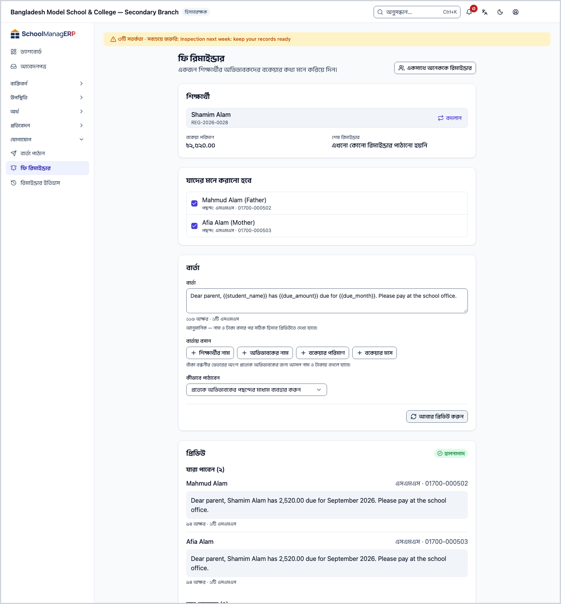
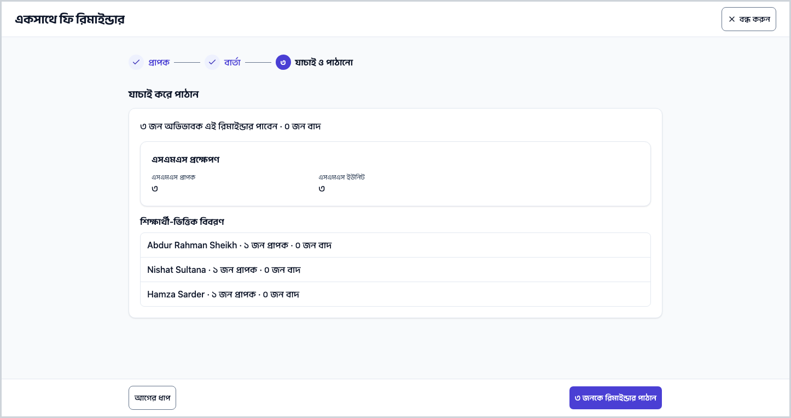

<!-- guide:meta
feature: communications.feeReminders
title: ফি রিমাইন্ডার
summary: একজন শিক্ষার্থীর অভিভাবকদের, বা একসাথে সর্বোচ্চ ৫০০ জন শিক্ষার্থীর অভিভাবকদের বকেয়ার কথা মনে করিয়ে দিন; নাম আর টাকা নিজে থেকে বসে, পাঠানোর আগে প্রিভিউতে দেখুন কে পাবেন, কে বাদ আর কয়টি এসএমএস লাগবে।
roles: [ADMIN, ACCOUNTANT, OFFICE_STAFF]
sources:
  - client-admin/src/routes/_staff/communications/reminders.tsx
  - client-admin/src/routes/_staff/communications/-bulk/bulk-reminder-wizard.tsx
  - client-admin/src/routes/_staff/communications/-bulk/bulk-sms-projection-card.tsx
  - client-admin/src/routes/_staff/communications/-bulk/wizard-steps.tsx
  - client-admin/src/routes/_staff/communications/-shared/recipient-list.tsx
  - client-admin/src/routes/_staff/communications/-shared/template-placeholders.ts
  - client-admin/src/routes/_staff/communications/-shared/placeholder-buttons.tsx
  - client-admin/src/routes/_staff/communications/-shared/skip-reason.ts
  - client-admin/src/routes/_staff/communications/-shared/reminder-limits.ts
  - server/src/modules/communications/communications.controller.ts
  - server/src/modules/communications/single-reminder.service.ts
  - server/src/modules/communications/reminders.service.ts
  - server/src/modules/communications/reminder-recipients.util.ts
  - server/src/modules/communications/reminder-template.util.ts
  - server/src/modules/communications/sms-projection.util.ts
  - server/src/modules/fees/fee-dues.service.ts
labels:
  [
    communications:reminders.*,
    communications:bulk.*,
    communications:recipientList.*,
    communications:skipReasons.*,
    communications:placeholders.*,
    communications:smsCounter.*,
    communications:whatsapp.*,
    communications:notifications.*,
    communications:fields.*,
    communications:help.*,
    communications:helpRequired.*,
    nav:items.feeReminders,
    nav:groups.communications,
  ]
helpIds:
  [
    communications.feeReminders,
    communications.feeReminders.action.preview,
    communications.feeReminders.action.send,
    communications.feeReminders.action.bulkSend,
    communications.feeReminders.field.guardians,
    communications.feeReminders.field.message,
    communications.feeReminders.field.medium,
    communications.feeReminders.field.bulkMediums,
  ]
devices: [desktop]
entry: [sidebar, palette]
keywords:
  [রিমাইন্ডার, ফি রিমাইন্ডার, বকেয়া, মনে করানো, একসাথে রিমাইন্ডার, এসএমএস, প্রিভিউ, বাদ পড়া, এসএমএস ক্রেডিট, fee reminder, bulk reminder, dues, preview, skipped, sms units]
appVersion: 0.1.0 (3f7e424fc)
owner: tareq89
lastVerified: 2026-10-25
knownIssues: []
-->

# ফি রিমাইন্ডার

অভিভাবকদের বকেয়ার কথা মনে করিয়ে দিন: একজন শিক্ষার্থীর জন্য, বা একসাথে অনেকের জন্য।

**যেতে হবে:** বাম মেনুতে **যোগাযোগ → ফি রিমাইন্ডার**। এই পাতার কাজ কম্পিউটারে করুন।
**শুরুর আগে:** আপনি অ্যাডমিন, হিসাবরক্ষক বা অফিস সহকারী হবেন ([কে কী করতে পারেন](#roles))। শিক্ষার্থীর বকেয়া বিল থাকতে হবে ([ফির বিল তৈরি করা](../finance/generate-fees.md))। অভিভাবকের নম্বর বা ইমেইল থাকতে হবে ([অভিভাবক](../people/guardians.md))।

বার্তায় **{শিক্ষার্থীর নাম}**, **{অভিভাবকের নাম}**, **{বকেয়ার পরিমাণ}** আর **{বকেয়ার মাস}** বসালে প্রত্যেক অভিভাবকের জন্য আসল তথ্য বসে। পাঠানোর আগে প্রিভিউ দেখা বাধ্যতামূলক। একসাথে পাঠানো দফার খবর [**রিমাইন্ডার ইতিহাস**](reminder-history.md)-এ।

[একজনকে পাঠান](#task-main) · [একসাথে অনেককে](#task-bulk) · [কে বাদ পড়েন](#task-skipped) · [সমস্যা ও সমাধান](#trouble)

**এই পাতায় যা আছে**

- [একজন শিক্ষার্থীর অভিভাবকদের রিমাইন্ডার পাঠান](#task-main)
- [রিমাইন্ডার গেল কি না বুঝবেন কীভাবে](#confirm)
- [অন্য পরিস্থিতিতে](#other)
  - [একসাথে অনেক শিক্ষার্থীর অভিভাবকদের পাঠান](#task-bulk)
  - [কয়টি এসএমএস লাগবে, পাঠানোর আগে দেখুন](#sms-count)
  - [কে বাদ পড়েন, কেন](#task-skipped)
- [সমস্যা ও সমাধান](#trouble)
- [কে কী করতে পারেন](#roles)
- [আরও জানুন](#more)

---

## একজন শিক্ষার্থীর অভিভাবকদের রিমাইন্ডার পাঠান 

1. বাম মেনুতে **যোগাযোগ** চাপুন, তারপর **ফি রিমাইন্ডার** চাপুন।

   → **ফি রিমাইন্ডার** পাতা খোলে: **একজন শিক্ষার্থীর অভিভাবকদের বকেয়ার কথা মনে করিয়ে দিন।**

2. **শিক্ষার্থী খুঁজুন** ঘরে নাম বা রোল নম্বর লিখে শিক্ষার্থী বাছুন।

   → দেখায় **বকেয়া পরিমাণ** আর **শেষ রিমাইন্ডার** (তারিখ · মাধ্যম, অথবা **এখনো কোনো রিমাইন্ডার পাঠানো হয়নি**)। নিচে **যাদের মনে করানো হবে** তালিকায় সব অভিভাবকে টিক দেওয়া থাকে, প্রত্যেকের পছন্দের মাধ্যম আর নম্বরসহ।

3. যাঁকে পাঠাতে চান না, তাঁর টিক তুলে দিন।
4. **বার্তা** ঘরে লিখুন। নাম বা টাকা বসাতে **বার্তায় বসান**-এর বোতাম চাপুন। যেমন:

   `প্রিয় {অভিভাবকের নাম}, {শিক্ষার্থীর নাম}-এর {বকেয়ার মাস} থেকে {বকেয়ার পরিমাণ} টাকা বকেয়া আছে।`

5. দরকার হলে **কীভাবে পাঠাবেন** বদলান। শুরুতে থাকে **প্রত্যেক অভিভাবকের পছন্দের মাধ্যম ব্যবহার করুন**।
6. **প্রাপকদের প্রিভিউ করুন** চাপুন।

   → **প্রিভিউ** আসে, পাশে **হালনাগাদ** চিহ্ন। **যারা পাবেন (…)** তালিকায় প্রত্যেকের কাছে যাওয়া পুরো বার্তা, আসল নাম ও টাকাসহ; এসএমএস হলে নিচে অক্ষর আর এসএমএসের সংখ্যা। **বাদ পড়েছেন (…)** তালিকায় কারা বাদ আর কেন।

7. সব ঠিক থাকলে **… জনকে রিমাইন্ডার পাঠান** চাপুন।

   → **রিমাইন্ডার পাঠানো হয়েছে** আসে: **পাঠানো হয়েছে (…)** আর **বাদ পড়েছেন (…)**।

> **মনে রাখুন:** প্রিভিউর পর কোনো কিছু বদলালে, এমনকি একটি অক্ষরও, প্রিভিউ লুকিয়ে যায়: **শেষ প্রিভিউয়ের পর ইনপুট বদলেছে — পাঠানোর আগে আবার প্রিভিউ করুন।** পাঠানো বার্তা আর ফেরত আনা যায় না।

---

## রিমাইন্ডার গেল কি না বুঝবেন কীভাবে 

| অবস্থা                   | কীভাবে বুঝবেন                                                                                | এরপর কী                                                          |
| ------------------------ | -------------------------------------------------------------------------------------------- | ---------------------------------------------------------------- |
| **শুধু স্ক্রিনে লেখা**   | ফর্ম খোলা; ছেড়ে যেতে চাইলে সতর্কবার্তা আসে                                                  | প্রিভিউ করুন                                                     |
| **প্রিভিউ হয়েছে**       | **প্রিভিউ** আর **হালনাগাদ** চিহ্ন দেখা যায়; এখনো কিছু যায়নি                                | **… জনকে রিমাইন্ডার পাঠান** চাপুন                                |
| **সারিতে পাঠানো হয়েছে** | একজনের বেলায় **রিমাইন্ডার পাঠানো হয়েছে**; একসাথের বেলায় **রিমাইন্ডার পাঠানো শুরু হয়েছে** | একসাথের দফা [**রিমাইন্ডার ইতিহাস**](reminder-history.md)-এ দেখুন |

এই পাতা কিছু ফোন বা কম্পিউটারে আলাদা করে রাখে না, তাই "এই ডিভাইসে সংরক্ষিত" অবস্থা নেই।

**নিশ্চিত না হলে আবার চাপা নিরাপদ:** উত্তর না এলে, পেজ না ছেড়ে বা রিলোড না করে একই প্রিভিউর পর একই বোতাম আবার চাপলে স্কুলের সিস্টেম আগের ফলই ফেরত দেয় (২৪ ঘণ্টা মনে রাখে); বার্তা দুবার যায় না। পাঠানো হয়ে গেছে দেখানোর পর আবার চাপলে নতুন রিমাইন্ডার যায়।

> **মনে রাখুন:** একই শিক্ষার্থীকে একই দিনে আবার রিমাইন্ডার পাঠাতে অ্যাপ বাধা দেয় না। পাঠানোর আগে **শেষ রিমাইন্ডার** দেখে নিন।

---

## অন্য পরিস্থিতিতে 

### একসাথে অনেক শিক্ষার্থীর অভিভাবকদের পাঠান 

1. **ফি রিমাইন্ডার** পাতার উপরে **একসাথে অনেককে রিমাইন্ডার** চাপুন।

   → **একসাথে ফি রিমাইন্ডার** খোলে, তিন ধাপে: **প্রাপক**, **বার্তা**, **যাচাই ও পাঠানো**।

2. **প্রাপক** ধাপে বকেয়া আছে এমন শিক্ষার্থীদের তালিকা আসে: **শিক্ষার্থী**, **শ্রেণি · শাখা**, **মোট বকেয়া**, **কত মাসের বকেয়া**। **শ্রেণি**, **শাখা**, **মাস**, **বছর** আর **ফির অবস্থা** (**বকেয়া** বা **আংশিক পরিশোধিত**) দিয়ে ছাঁকুন, তারপর টিক দিন।

   → উপরে লেখা **৫০০ জনের মধ্যে … জন শিক্ষার্থী বাছা হয়েছে**। ৫০০-র বেশি বাছলে এগোনো যায় না।

3. **পরের ধাপ: বার্তা** চাপুন। **দফার নাম** দিন, যেমন "মার্চের বকেয়া — সপ্তম শ্রেণি"। **বার্তার টেমপ্লেট** লিখুন। **মাধ্যম**-এ যেগুলো চান টিক রাখুন; শুরুতে তিনটিতেই টিক।
4. **পরের ধাপ: যাচাই** চাপুন, তারপর **প্রাপকদের প্রিভিউ করুন** চাপুন।

   → আসে **… জন অভিভাবক এই রিমাইন্ডার পাবেন · … জন বাদ**, **কারণ অনুযায়ী বাদ পড়া**, **শিক্ষার্থী-ভিত্তিক বিবরণ** আর **এসএমএস প্রক্ষেপণ**।

5. **… জনকে রিমাইন্ডার পাঠান** চাপুন।

   → **রিমাইন্ডার পাঠানো শুরু হয়েছে**: **“…” পটভূমিতে পাঠানো হচ্ছে।** অগ্রগতি দেখতে **পাঠানোর অগ্রগতি দেখুন** চাপুন; [**রিমাইন্ডার ইতিহাস**](reminder-history.md)-এ সেই দফা খোলে।

আগের ধাপে কিছু বদলালে প্রিভিউ পুরোনো হয়ে যায়: **শেষ প্রিভিউয়ের পর আগের ধাপগুলো বদলেছে — পাঠানোর আগে আবার প্রিভিউ করুন।**

### কয়টি এসএমএস লাগবে, পাঠানোর আগে দেখুন 

- **লেখার সময়:** এসএমএস যাবে এমন হলে বার্তার নিচে **… অক্ষর · …টি এসএমএস** আসে, পাশে **আনুমানিক — নাম ও টাকা বসার পর সঠিক হিসাব প্রিভিউতে দেখা যাবে।** কারণ নাম আর টাকা বসলে বার্তা লম্বা হয়।
- **প্রিভিউতে, একজনের বেলায়:** প্রত্যেক প্রাপকের বার্তার নিচে তাঁর আসল অক্ষর আর এসএমএসের সংখ্যা।
- **প্রিভিউতে, একসাথের বেলায়:** **এসএমএস প্রক্ষেপণ** ঘরে **এসএমএস প্রাপক** (কতজন এসএমএস পাবেন) আর **এসএমএস ইউনিট** (মোট কয়টি এসএমএস)। স্কুলে ক্রেডিট গোনা হলে **উপলব্ধ** ক্রেডিটও দেখায়।

একটি এসএমএসে কত অক্ষর ধরে, তা [**বার্তা পাঠান**](send-message.md#sms-count) পাতায় আছে: বাংলায় ৭০ (একাধিক হলে প্রতিটিতে ৬৭), শুধু ইংরেজিতে ১৬০ (একাধিক হলে ১৫৩)।

**ক্রেডিট:** এক এসএমএস = এক ক্রেডিট। পাঠান চাপলে পুরো দফার এসএমএসের সমান ক্রেডিট একবারে আটকে রাখা হয়। ক্রেডিট কম থাকলে একটিও যায় না; একসাথের বেলায় প্রিভিউতেই লেখা আসে **পর্যাপ্ত এসএমএস ক্রেডিট নেই: … ইউনিট প্রয়োজন, মাত্র … উপলব্ধ (… কম)।** যে বার্তা পাঠানো যায় না, তার ক্রেডিট ফেরত আসে।

### কে বাদ পড়েন, কেন 

| বাদের কারণ (অ্যাপে যা লেখা)                         | কখন                                                               |
| --------------------------------------------------- | ----------------------------------------------------------------- |
| **স্মরণ করানোর মতো কোনো বকেয়া নেই**                | শিক্ষার্থীর কোনো বকেয়া, আংশিক পরিশোধিত বা মেয়াদোত্তীর্ণ বিল নেই |
| **কোনো অভিভাবক নথিভুক্ত নেই**                       | শিক্ষার্থীর সাথে কোনো অভিভাবক যুক্ত নেই                           |
| **অভিভাবক নোটিফিকেশন বন্ধ করে রেখেছেন**             | অভিভাবক নোটিফিকেশন বন্ধ রেখেছেন; টিক দিলেও যায় না                |
| **পছন্দের মাধ্যম অনুরোধ করা মাধ্যমগুলোর মধ্যে নেই** | একসাথের বেলায়: অভিভাবকের পছন্দের মাধ্যমে **মাধ্যম**-এ টিক নেই    |
| **পছন্দের মাধ্যমে স্বয়ংক্রিয়ভাবে পাঠানো যায় না** | পছন্দের মাধ্যম ফোন কল বা মেসেঞ্জার                                |
| **পছন্দের মাধ্যমের জন্য ফোন বা ইমেইল নথিভুক্ত নেই** | সেই মাধ্যমের নম্বর বা ইমেইল নেই                                   |

**একসাথের বেলায় কোন অভিভাবক পান:** প্রত্যেক শিক্ষার্থীর প্রধান যোগাযোগের অভিভাবক। প্রধান কেউ না থাকলে, বা প্রধানজন নোটিফিকেশন বন্ধ রাখলে, বাকি সব অভিভাবক। **একজনের বেলায়** টিক দেওয়া সবাই পান। একজন অভিভাবকের দুই সন্তান বাছাই করা থাকলে তিনি প্রত্যেক সন্তানের জন্য আলাদা একটি বার্তা পান।

---

## সমস্যা ও সমাধান 

| আপনি যা দেখছেন                                                       | কী করবেন                                                                                        | কে সাহায্য করতে পারেন |
| -------------------------------------------------------------------- | ----------------------------------------------------------------------------------------------- | --------------------- |
| **প্রাপকদের প্রিভিউ করুন** চাপা যায় না                              | শিক্ষার্থী, অন্তত একজন অভিভাবক আর বার্তা আছে কি না দেখুন; বার্তায় অচেনা বন্ধনী থাকলে ঠিক করুন। | —                     |
| **{…} চেনা যায়নি। নিচের বোতাম দিয়ে নাম বা টাকা বসান।**             | বাঁকা বন্ধনীর লেখা মুছে **বার্তায় বসান**-এর বোতাম দিয়ে বসান।                                  | —                     |
| **একটি বাঁকা বন্ধনী বন্ধ হয়নি। …**                                  | `{` বা `}` একটি বাড়তি আছে; মুছে দিন।                                                           | —                     |
| **প্রিভিউ দেখানো যায়নি — শিক্ষার্থী, অভিভাবক ও বার্তা আবার দেখুন।** | শিক্ষার্থীর বকেয়া না থাকলেও এটি আসে। বকেয়া আছে কি না দেখুন।                                   | হিসাবরক্ষক            |
| **কেউ এই রিমাইন্ডার পাবেন না — প্রত্যেক অভিভাবক বাদ পড়েছেন।**       | **বাদ পড়েছেন** তালিকার কারণ দেখুন; অন্য মাধ্যম বাছুন বা নম্বর যোগ করুন।                        | অফিস সহকারী           |
| **পরপর অনেকবার চেষ্টা হয়েছে — একটু অপেক্ষা করে আবার চেষ্টা করুন।**  | একসাথের প্রিভিউ আর পাঠানো মিনিটে ৫ বারের বেশি নয়। এক মিনিট অপেক্ষা করুন।                       | —                     |
| **পর্যাপ্ত এসএমএস ক্রেডিট নেই: …**                                   | অ্যাডমিনকে ক্রেডিট যোগ করতে বলুন, বা কম শিক্ষার্থী বাছুন, বা অন্য মাধ্যম রাখুন।                 | অ্যাডমিন              |
| **রিমাইন্ডারটি পাঠানো যায়নি।**                                      | একজনের বেলায় ক্রেডিট কম থাকলেও এটি আসে। আবার প্রিভিউ করে পাঠান, না হলে অ্যাডমিনকে বলুন।        | অ্যাডমিন              |
| **সর্বোচ্চ ৫০০ জন শিক্ষার্থী নির্বাচন করুন — এগোতে … জন বাদ দিন।**   | কিছু টিক তুলুন; বাকিদের আলাদা দফায় পাঠান।                                                      | —                     |
| **শিক্ষার্থীর তালিকা লোড করা যায়নি।**                               | পাতা রিলোড করুন।                                                                                | অ্যাডমিন              |

এ নিয়ে আরও সাহায্য: [সমস্যা হলে কী করবেন](../help/troubleshooting.md#sms)।

---

## কে কী করতে পারেন 

| ভূমিকা                                                                  | একজনকে রিমাইন্ডার | একসাথে রিমাইন্ডার |
| ----------------------------------------------------------------------- | ----------------- | ----------------- |
| অ্যাডমিন                                                                | হ্যাঁ             | হ্যাঁ             |
| হিসাবরক্ষক                                                              | হ্যাঁ             | হ্যাঁ             |
| অফিস সহকারী                                                             | হ্যাঁ             | হ্যাঁ             |
| একাডেমিক কো-অর্ডিনেটর, শিক্ষক, পরীক্ষা নিয়ন্ত্রক, পরিচালনা পর্ষদ সদস্য | না                | না                |

**অ্যাডমিন, হিসাবরক্ষক ও অফিস সহকারী:** তিনজনেই দুই রকম রিমাইন্ডার পাঠাতে পারেন; কোড অনুযায়ী কোনো পার্থক্য নেই। ক্রেডিট যোগ করা আর এসএমএস ব্যবস্থা চালু করা অ্যাডমিনের কাজ।

অন্য ভূমিকার বাম মেনুতে **ফি রিমাইন্ডার** থাকে না।

---

## আরও জানুন 

<strong>পাতার অংশগুলো</strong> — একজন শিক্ষার্থী

1. **ফি রিমাইন্ডার** শিরোনাম আর **একসাথে অনেককে রিমাইন্ডার** বোতাম।
2. **শিক্ষার্থী** — খোঁজা, **বকেয়া পরিমাণ**, **শেষ রিমাইন্ডার**, **যাদের মনে করানো হবে**।
3. **বার্তা** — **বার্তা**, **বার্তায় বসান**, **কীভাবে পাঠাবেন**, হোয়াটসঅ্যাপ টেমপ্লেটের ঘর।
4. **প্রাপকদের প্রিভিউ করুন**, তারপর **প্রিভিউ** আর **… জনকে রিমাইন্ডার পাঠান**।

<strong>ঘরগুলোর অর্থ</strong>

<!-- guide:generated:fields:communications -->

| ঘর                         | কী লিখবেন                                                                                                                                                                                                                      | বাধ্যতামূলক?      |
| -------------------------- | ------------------------------------------------------------------------------------------------------------------------------------------------------------------------------------------------------------------------------ | ----------------- |
| কোন অভিভাবককে পাঠাবেন      | বাছা শিক্ষার্থীর একজন অভিভাবক। নিচে তাঁর নম্বর বা ইমেইল দেখায়; না থাকলে পাঠানো যায় না।                                                                                                                                       | হ্যাঁ             |
| কীভাবে পাঠাবেন             | বার্তা পাঠান: এসএমএস, হোয়াটসঅ্যাপ বা ইমেইল; এসএমএস ও হোয়াটসঅ্যাপ যায় অভিভাবকের ফোন নম্বরে, না থাকলে বিকল্প নম্বরে। ফি রিমাইন্ডার: শুরুতে প্রত্যেক অভিভাবকের পছন্দের মাধ্যম; একটি বাছলে এবারের জন্য সবাইকে সেই মাধ্যমে যায়। | না                |
| বার্তা                     | যা পাঠাবেন। এসএমএস হলে নিচে অক্ষর আর কয়টি এসএমএস লাগবে দেখায়। ফি রিমাইন্ডারে নাম, বকেয়ার পরিমাণ বা মাস বসাতে নিচের বোতাম চাপুন; প্রত্যেক অভিভাবকের জন্য আসল তথ্য বসে।                                                       | হ্যাঁ             |
| যাদের মনে করানো হবে        | শুরুতে সব অভিভাবকে টিক থাকে। যিনি নোটিফিকেশন বন্ধ রেখেছেন, টিক দিলেও তিনি পান না।                                                                                                                                              | হ্যাঁ, অন্তত একজন |
| দফার নাম                   | এই দফার নাম; পরে রিমাইন্ডার ইতিহাসে এই নামে খুঁজবেন।                                                                                                                                                                           | হ্যাঁ             |
| মাধ্যম (একসাথে রিমাইন্ডার) | অভিভাবকের পছন্দের মাধ্যম এখানে টিক না থাকলে তিনি বাদ পড়েন। শুরুতে তিনটিতেই টিক।                                                                                                                                               | হ্যাঁ, অন্তত একটি |
| অবস্থা                     | এক অবস্থার দফাগুলোই দেখায়: প্রক্রিয়াধীন, সম্পন্ন, আংশিক ব্যর্থ বা ব্যর্থ। সব দেখতে "সব অবস্থা" রাখুন।                                                                                                                        | না                |

<!-- /guide:generated -->

<strong>রিমাইন্ডার কীভাবে কাজ করে</strong> — বকেয়া, প্রাপক, প্রিভিউ আর ক্রেডিট

<figure>
  
  <figcaption><em>রিমাইন্ডারের ধাপ</em></figcaption>
</figure>

- **কোন বকেয়া:** বকেয়া, আংশিক পরিশোধিত আর মেয়াদোত্তীর্ণ বিল। মুছে ফেলা শিক্ষার্থীর বিল নয়।
- **{বকেয়ার পরিমাণ}:** এই বিলগুলোর মোট বাকি = মোট টাকা − পরিশোধিত − ছাড়।
- **{বকেয়ার মাস}:** সবচেয়ে পুরোনো বকেয়া বিলের মাস।
- **মাধ্যম বদলানো:** **কীভাবে পাঠাবেন**-এ একটি বাছলে শুধু এবারের জন্য; অভিভাবকের পছন্দের মাধ্যম বদলায় না।
- **বার্তার দৈর্ঘ্য:** সর্বোচ্চ ২,০০০ অক্ষর। **দফার নাম** সর্বোচ্চ ২০০ অক্ষর।

**সম্পর্কিত পাতা**

- [**বার্তা পাঠান**](send-message.md) — একজন অভিভাবককে নিজের লেখা যেকোনো বার্তা।
- [**রিমাইন্ডার ইতিহাস**](reminder-history.md) — একসাথে পাঠানো দফা কার কাছে পৌঁছাল।
- [**ফির বিল তৈরি করা**](../finance/generate-fees.md) — বকেয়া আসে এই বিল থেকে।
- [**অভিভাবকের তথ্য দেখা, ঠিক করা ও আমন্ত্রণ পাঠানো**](../people/guardians.md) — নম্বর, পছন্দের মাধ্যম আর প্রধান যোগাযোগ।

- [**শিক্ষার্থীর বকেয়া**](../finance/dues.md) — কে কত বকেয়া দিয়েছে দেখতে

---

_সংস্করণ ০.১.০ · শেষ যাচাই ২০২৬-১০-২৫_
