<!-- guide:meta
feature: communications.messageLog
title: বার্তার তালিকা
summary: স্কুল থেকে পাঠানো প্রতিটি বার্তা (অ্যাপের বিজ্ঞপ্তি নয়) এক জায়গায়: নাম বা ফোন দিয়ে খুঁজুন, অবস্থা দেখুন, কেন ব্যর্থ হলো জানুন, আর কোম্পানির কাছে পৌঁছানোর খবর যাচাই করুন।
roles: [ADMIN, ACCOUNTANT, OFFICE_STAFF]
sources:
  - client-admin/src/routes/_staff/communications/message-log/index.tsx
  - client-admin/src/routes/_staff/communications/message-log/-row-detail.tsx
  - client-admin/src/routes/_staff/communications/-shared/delivery-error.ts
  - server/src/modules/communications/communications.controller.ts
  - server/src/modules/communications/reminders.service.ts
  - server/src/modules/communications/delivery-status.service.ts
labels:
  [
    communications:messageLog.*,
    communications:deliveryErrors.*,
    common:status.communication.*,
    nav:items.messageLog,
    nav:groups.communications,
  ]
helpIds: [communications.messageLog]
devices: [desktop, phone]
entry: [sidebar, palette, page:people.students, page:people.guardians, dashboard:failed-messages]
keywords:
  [বার্তার তালিকা, বার্তার লগ, এসএমএস, পৌঁছেছে, ব্যর্থ, অবস্থা যাচাই, message log, sms, delivered, failed, check status]
appVersion: 0.1.0 (dcf72606a)
owner: tareq89
lastVerified: 2026-10-31
knownIssues: []
-->

# বার্তার তালিকা

স্কুল থেকে পাঠানো প্রতিটি বার্তা এক জায়গায়: কাকে, কবে, কীভাবে, কে পাঠালেন, আর বার্তাটি পৌঁছাল কি না।

অ্যাপের বিজ্ঞপ্তি (পুশ নোটিফিকেশন) এই তালিকায় থাকে না; সেগুলোর হিসাব এখানে পাবেন না।

**যেতে হবে:** বাম মেনুতে **যোগাযোগ → বার্তার তালিকা**। কম্পিউটার বা ফোন, দুটোতেই চলে ([ফোনে](#task-phone))।
**শুরুর আগে:** আপনি অ্যাডমিন, হিসাবরক্ষক বা অফিস সহকারী হবেন ([কে কী করতে পারেন](#roles))।

[একটি বার্তা খুঁজুন](#task-main) · [অবস্থার অর্থ](#confirm) · [অবস্থা যাচাই করুন](#task-check) · [সমস্যা ও সমাধান](#trouble)

**এই পাতায় যা আছে**

- [যেভাবে এখানে আসবেন](#arrive)
- [একটি বার্তা খুঁজে তার বিবরণ দেখুন](#task-main)
- [বার্তার অবস্থার অর্থ](#confirm)
- [অন্য পরিস্থিতিতে](#other)
  - [কোম্পানির কাছে অবস্থা যাচাই করুন](#task-check)
  - [ছাঁকনি দিয়ে তালিকা ছোট করুন](#task-filter)
  - [একজন শিক্ষার্থী বা অভিভাবকের বার্তা](#task-scoped)
  - [**টেস্ট** চিহ্ন](#task-test)
  - [ফোনে](#task-phone)
- [সমস্যা ও সমাধান](#trouble)
- [কে কী করতে পারেন](#roles)
- [আরও জানুন](#more)

---

## যেভাবে এখানে আসবেন 

**বাম মেনু থেকে:** **যোগাযোগ → বার্তার তালিকা**।

**খোঁজ থেকে:** উপরের খোঁজার ঘরে (Ctrl+K) "বার্তার তালিকা" লিখে বেছে নিন। খোঁজ কীভাবে কাজ করে: [যেকোনো পাতা খুঁজে পাওয়া](../start/find-anything.md)।

**শিক্ষার্থী বা অভিভাবকের পাতা থেকে:** শিক্ষার্থীর পাতায় উপরের **আরও অ্যাকশন** (⋯) মেনুতে **বার্তা**; অভিভাবকের পাতায় উপরে **বার্তা** বোতাম। তালিকা খোলে শুধু সেই মানুষের বার্তা নিয়ে ([একজন শিক্ষার্থী বা অভিভাবকের বার্তা](#task-scoped))।

**ড্যাশবোর্ড থেকে:** **যে বার্তা যায়নি** উইজেটে **কোনগুলো দেখুন** চাপলে গত ৭ দিনের ব্যর্থ এসএমএস নিয়ে তালিকা খোলে।

---

## একটি বার্তা খুঁজে তার বিবরণ দেখুন 

ডেমো ও স্টেজিং সাইটে আসলে কিছু পাঠানো হয় না: বার্তাগুলো **টেস্ট ইনবক্সে** জমা হয় ([ডেমো সাইটে কোড ও বার্তা কোথায় যায়?](../start/sign-in.md#task-test-inbox))।

1. বাম মেনুতে **যোগাযোগ** চাপুন, তারপর **বার্তার তালিকা** চাপুন।

   → **বার্তার তালিকা** খোলে: **স্কুল থেকে পাঠানো প্রতিটি বার্তা, নতুনটা আগে।** কলাম: **প্রাপক**, **পাঠানো হয়েছে**, **মাধ্যম**, **মোবাইল বা ইমেইল**, **ধরন**, **কোম্পানি**, **অবস্থা**, **কেন পৌঁছায়নি**।

2. **খুঁজুন** ঘরে প্রাপকের নাম, ফোন নম্বর বা ইমেইল লিখুন। ফোন যেকোনো রূপে লেখা যায়: `01712345678`, `+880 1712-345678` বা `8801712345678`।

   → তালিকা ছোট হয়ে শুধু মিলে যাওয়া বার্তা দেখায়।

3. একটি সারির **বার্তা দেখুন** চাপুন।

   → **বার্তার বিবরণ** জানালা খোলে: **প্রাপক**, **মোবাইল বা ইমেইল**, **মাধ্যম**, **অবস্থা**, **ধরন**, **যিনি পাঠিয়েছেন**, **পাঠানো হয়েছে**, **কোম্পানি**, **কোম্পানির বার্তা নম্বর**, **এসএমএসের ভাগ**, **রিমাইন্ডারের দফা**, **কেন ব্যর্থ হলো**, আর নিচে পুরো **বার্তা**। ইমেইলে **বিষয়**-ও দেখায়। যে তথ্য নেই, তার জায়গায় **—**।

4. বার্তাটি কোনো রিমাইন্ডারের দফার হলে **দফাটি খুলুন** চাপুন; দফার পাতা খোলে ([রিমাইন্ডার ইতিহাস](reminder-history.md))।

<!-- image pending: message-log-01.png, the list with the detail window open (guide:shoot, #3311) -->

---

## বার্তার অবস্থার অর্থ 

| অবস্থা            | অর্থ                                                                       | এরপর কী                                |
| ----------------- | -------------------------------------------------------------------------- | -------------------------------------- |
| **সারিতে আছে**    | এখনো পাঠানোর অপেক্ষায়                                                     | অপেক্ষা করুন                           |
| **পাঠানো হয়েছে** | এসএমএস বা ইমেইল কোম্পানি বার্তাটি নিয়েছে; ফোনে পৌঁছাল কি না এখনো জানা নেই | পারলে [অবস্থা যাচাই করুন](#task-check) |
| **পৌঁছেছে**       | কোম্পানি জানিয়েছে, বার্তাটি ফোনে পৌঁছেছে                                  | কাজ শেষ                                |
| **ব্যর্থ**        | যায়নি, বা কোম্পানি জানিয়েছে পৌঁছায়নি; কারণ **কেন পৌঁছায়নি** ঘরে        | কারণ ঠিক করে আবার পাঠান                |

**ধরন** বলে বার্তাটি কোথা থেকে এল: **হাতে পাঠানো**, **একজনকে রিমাইন্ডার**, **গণ রিমাইন্ডার**, **স্বয়ংক্রিয়**, **সাইন-ইন কোড**, **পরীক্ষার ফল** বা **আসার নোটিশ**।

**বার্তা**-য় যা কখনো দেখায় না:

- **সাইন-ইন কোড** বার্তায় কোড বা লিংক কখনো দেখায় না; তালিকায় শুধু বার্তার বাকি অংশ থাকে।
- ইনভয়েসের লিংক (পেমেন্টের পরের রসিদ, বা রসিদে **অভিভাবককে পাঠান**) দেখায় `…/i/••••••` হিসেবে। অভিভাবক কাজ করা লিংকটিই পেয়েছেন; তালিকায় তা কখনো দেখায় না, কারণ লিংক যার কাছে থাকে সে ৩০ দিন ইনভয়েসটি খুলতে পারে।
- **পরীক্ষার ফল** বার্তায় হিসাবরক্ষক দেখেন **দেখানো হয়নি: যাঁরা পরীক্ষার ফল দেখতে পারেন, শুধু তাঁরাই এই বার্তা পড়তে পারেন।** অ্যাডমিন ও অফিস সহকারী বার্তাটি দেখেন।

এই পাতা কিছু ফোন বা কম্পিউটারে আলাদা করে রাখে না, তাই "এই ডিভাইসে সংরক্ষিত" অবস্থা নেই।

---

## অন্য পরিস্থিতিতে 

### কোম্পানির কাছে অবস্থা যাচাই করুন 

**অবস্থা যাচাই করুন** বোতাম তখনই দেখায়, যখন বার্তাটি **পাঠানো হয়েছে** অবস্থায় আছে, কোম্পানির বার্তা নম্বর আছে, আর যে কোম্পানি পাঠিয়েছে সে পৌঁছানোর খবর দিতে পারে (এখন: ওয়ানকোডসফট)। ডেমো ও স্টেজিং সাইটে বোতামটি দেখায় না।

1. বার্তার **বার্তা দেখুন** চাপুন।
2. **অবস্থা যাচাই করুন** চাপুন।

   → বোতামে **যাচাই হচ্ছে…** লেখা আসে। উত্তর এলে **অবস্থা হালনাগাদ হয়েছে।** দেখায়, আর **অবস্থা** বদলে **পৌঁছেছে** বা **ব্যর্থ** হয়। কোম্পানি এখনো না জানালে **পাঠানো হয়েছে** থাকে।

> **মনে রাখুন:** একটি বার্তা মিনিটে একবারই যাচাই করা যায়। তার আগে চাপলে **এই বার্তার অবস্থা এখন যাচাই করা যাবে না।** দেখায়।

### ছাঁকনি দিয়ে তালিকা ছোট করুন 

তালিকার উপরে: **খুঁজুন**, **মাধ্যম**, **অবস্থা**, **কীভাবে পাঠানো**, **যিনি পাঠিয়েছেন**, **কোম্পানি**, আর **পাঠানো** (**যে তারিখ থেকে পাঠানো**, **যে তারিখ পর্যন্ত পাঠানো**)। ছাঁকনি পাতার ঠিকানায় থাকে, তাই লিংক কাউকে পাঠালে তিনিও একই তালিকা দেখেন।

**যিনি পাঠিয়েছেন** তালিকায় থাকেন স্কুলের সেই কর্মীরা, যাঁরা অন্তত একটি বার্তা পাঠিয়েছেন (নাম ধরে, প্রথম ১০০ জন)।

উদাহরণ: গত মঙ্গলবার একজন অভিভাবককে পাঠানো এসএমএস খুঁজতে **খুঁজুন**-এ তাঁর নম্বর লিখুন, **মাধ্যম**-এ **এসএমএস** বাছুন, আর **পাঠানো**-তে সেই দিনটি দিন।

### একজন শিক্ষার্থী বা অভিভাবকের বার্তা 

শিক্ষার্থী বা অভিভাবকের পাতা থেকে **বার্তা** চাপলে তালিকায় শুধু সেই মানুষের বার্তা আসে। উপরে লেখা থাকে **একজন শিক্ষার্থীর বার্তা দেখানো হচ্ছে।** বা **একজন অভিভাবকের বার্তা দেখানো হচ্ছে।**

এখানেও সব ছাঁকনি আর **অবস্থা যাচাই করুন** চলে, শুধু সেই মানুষের বার্তায়। **সব মুছুন** চাপলেও দেখা সেই মানুষেই থাকে। সব বার্তায় ফিরতে **সব বার্তা দেখুন** চাপুন।

### **টেস্ট** চিহ্ন 

**সেটিংস › যোগাযোগ** থেকে পাঠানো টেস্ট বার্তার বিবরণে **অবস্থা**-র পাশে **টেস্ট** চিহ্ন দেখায়। এটি সত্যিকারের বার্তা, এসএমএস হলে ক্রেডিটও লাগে।

### ফোনে 

ফোনে প্রতিটি বার্তা একটি কার্ড: উপরে প্রাপক আর **পাঠানো হয়েছে**-র সময়, ডানে **অবস্থা**, তার নিচে বাকি ঘরগুলো, আর কার্ডের একদম নিচে **বার্তা দেখুন**।

1. **খুঁজুন** ঘর উপরেই থাকে। বাকি ছাঁকনির জন্য **ফিল্টার** চাপুন (কিছু ছাঁকনি দেওয়া থাকলে পাশে সংখ্যা দেখায়, যেমন **ফিল্টার (2)**)।

   → সব ছাঁকনি নিয়ে নিচ থেকে একটি পাতা খোলে। বাছাই করার সঙ্গে সঙ্গে তালিকা বদলায়।

2. নিচের **…টি ফলাফল দেখুন** চাপুন।

   → পাতাটি বন্ধ হয়ে তালিকা দেখায়।

---

## সমস্যা ও সমাধান 

| আপনি যা দেখছেন                                                                                  | কী করবেন                                                          | কে সাহায্য করতে পারেন |
| ----------------------------------------------------------------------------------------------- | ----------------------------------------------------------------- | --------------------- |
| **কোনো বার্তা পাওয়া যায়নি।**                                                                  | স্কুল এখনো কোনো বার্তা পাঠায়নি।                                  | —                     |
| **এই ফিল্টারে কোনো বার্তা নেই**                                                                 | একটি ছাঁকনি সরান বা তারিখের পরিসর বাড়ান।                         | —                     |
| **বার্তার তালিকা লোড করা যায়নি।**                                                              | পাতা রিলোড করুন।                                                  | অ্যাডমিন              |
| **এই বার্তার অবস্থা এখন যাচাই করা যাবে না।**                                                    | এক মিনিট পরে আবার চাপুন। তবুও না হলে এই বার্তা যাচাই করা যায় না। | —                     |
| **অবস্থা যাচাই করা যায়নি। এক মিনিট পরে আবার চেষ্টা করুন।**                                     | কোম্পানি উত্তর দেয়নি। এক মিনিট পরে আবার চাপুন।                   | অ্যাডমিন              |
| **অবস্থা যাচাই করুন** দেখায় না                                                                 | বার্তাটি **পাঠানো হয়েছে** নয়, বা কোম্পানি পৌঁছানোর খবর দেয় না। | —                     |
| **বার্তা**: **দেখানো হয়নি: যাঁরা পরীক্ষার ফল দেখতে পারেন, শুধু তাঁরাই এই বার্তা পড়তে পারেন।** | এটি পরীক্ষার ফল। অ্যাডমিন বা অফিস সহকারীকে পড়তে বলুন।            | অ্যাডমিন              |
| **কেন পৌঁছায়নি**: **এই স্কুলে … পাঠানোর ব্যবস্থা চালু নেই। …**                                 | অ্যাডমিন **সেটিংস › যোগাযোগ** থেকে চালু করবেন, তারপর আবার পাঠান।  | অ্যাডমিন              |

এ নিয়ে আরও সাহায্য: [সমস্যা হলে কী করবেন](../help/troubleshooting.md#sms)।

---

## কে কী করতে পারেন 

| ভূমিকা                                                                  | তালিকা দেখা | অবস্থা যাচাই |
| ----------------------------------------------------------------------- | ----------- | ------------ |
| অ্যাডমিন                                                                | হ্যাঁ       | হ্যাঁ        |
| হিসাবরক্ষক                                                              | হ্যাঁ       | হ্যাঁ        |
| অফিস সহকারী                                                             | হ্যাঁ       | হ্যাঁ        |
| একাডেমিক কো-অর্ডিনেটর, শিক্ষক, পরীক্ষা নিয়ন্ত্রক, পরিচালনা পর্ষদ সদস্য | না          | না           |

**অ্যাডমিন, হিসাবরক্ষক ও অফিস সহকারী:** তিনজনেই স্কুলের সব বার্তা আর সব ছাঁকনি দেখেন। একটি পার্থক্য: হিসাবরক্ষক **পরীক্ষার ফল** বার্তার লেখা দেখেন না।

অন্য ভূমিকার বাম মেনুতে **বার্তার তালিকা** থাকে না।

---

## আরও জানুন 

<strong>পাতার অংশগুলো</strong>

1. **বার্তার তালিকা** শিরোনাম।
2. ছাঁকনি: **খুঁজুন**, **মাধ্যম**, **অবস্থা**, **কীভাবে পাঠানো**, **যিনি পাঠিয়েছেন**, **কোম্পানি**, **পাঠানো**।
3. তালিকা; সারিতে **বার্তা দেখুন**।
4. **বার্তার বিবরণ** জানালা: **বন্ধ করুন** আর (যখন চলে) **অবস্থা যাচাই করুন**।

<strong>অবস্থা যাচাই কীভাবে কাজ করে</strong>

<figure>
  
  <figcaption><em>একটি বার্তার অবস্থা</em></figcaption>
</figure>

- **উত্তর অনুযায়ী অবস্থা:** পৌঁছেছে → **পৌঁছেছে**; পৌঁছায়নি → **ব্যর্থ**; কোম্পানি এখনো জানে না → **পাঠানো হয়েছে** থাকে; কোম্পানি উত্তর দেয়নি → কিছু বদলায় না।
- **কোন কোম্পানিকে জিজ্ঞেস:** যে কোম্পানি বার্তাটি পাঠিয়েছিল, আর যে অ্যাকাউন্ট দিয়ে পাঠিয়েছিল।
- **মিনিটে একবার:** উত্তর না এলেও এক মিনিটের অপেক্ষা শুরু হয়।
- **একবার চাপ, একবার জিজ্ঞেস:** দুবার তাড়াতাড়ি চাপলেও কোম্পানিকে একবারই জিজ্ঞেস করা হয়।

**সম্পর্কিত পাতা**

- [**রিমাইন্ডার ইতিহাস**](reminder-history.md) — একসাথে পাঠানো রিমাইন্ডারের দফা।
- [**বার্তা পাঠান**](send-message.md) — একজন অভিভাবককে নিজের বার্তা।

---

_সংস্করণ 0.1.0 · সর্বশেষ যাচাই 2026-10-31_
