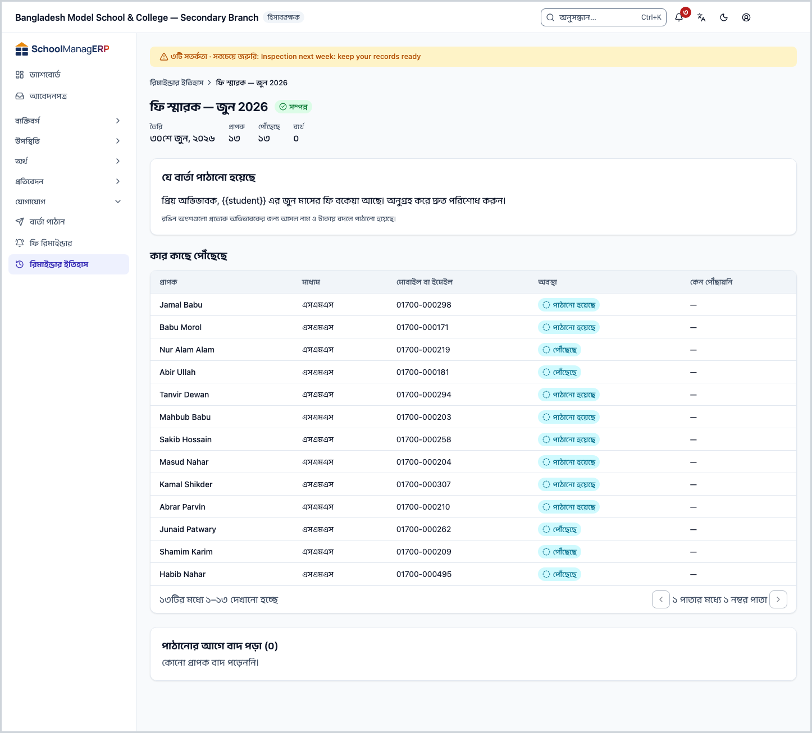
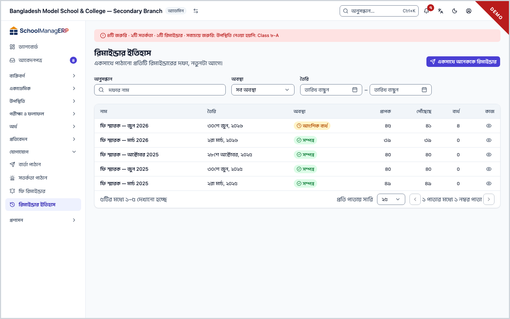

<!-- guide:meta
feature: communications.reminderHistory
title: রিমাইন্ডার ইতিহাস
summary: একসাথে পাঠানো প্রতিটি ফি রিমাইন্ডারের দফা দেখুন, কোন অভিভাবকের কাছে বার্তা গেল আর কার কাছে গেল না, কে আগেই বাদ পড়েছিলেন, আর ব্যর্থদের আবার পাঠান।
roles: [ADMIN, ACCOUNTANT, OFFICE_STAFF]
sources:
  - client-admin/src/routes/_staff/communications/batches/index.tsx
  - client-admin/src/routes/_staff/communications/batches/$batchId.tsx
  - client-admin/src/routes/_staff/communications/-shared/delivery-error.ts
  - client-admin/src/routes/_staff/communications/-shared/skip-reason.ts
  - server/src/modules/communications/communications.controller.ts
  - server/src/modules/communications/reminders.service.ts
  - server/src/modules/communications/reminder-batch-counters.ts
  - server/src/modules/communications/worker/communications.processor.ts
labels:
  [
    communications:batches.*,
    communications:skipReasons.*,
    communications:deliveryErrors.*,
    communications:notifications.*,
    common:status.reminderBatch.*,
    common:status.communication.*,
    nav:items.reminderHistory,
    nav:groups.communications,
  ]
helpIds:
  [
    communications.reminderHistory,
    communications.reminderHistory.action.retryFailed,
    communications.reminderHistory.field.status,
  ]
devices: [desktop]
entry: [sidebar, palette]
keywords:
  [রিমাইন্ডার ইতিহাস, দফা, পৌঁছেছে, ব্যর্থ, আবার পাঠান, পুনঃপ্রেরণ, ডেলিভারি, বাদ পড়া, reminder history, batch, delivered, failed, retry, delivery log, skipped]
appVersion: 0.1.0 (3f7e424fc)
owner: tareq89
lastVerified: 2026-10-25
knownIssues: []
-->

# রিমাইন্ডার ইতিহাস

একসাথে পাঠানো প্রতিটি ফি রিমাইন্ডারের দফা দেখুন: কার কাছে পৌঁছাল, কার কাছে পৌঁছাল না, আর কেন।

**যেতে হবে:** বাম মেনুতে **যোগাযোগ → রিমাইন্ডার ইতিহাস**। এই পাতার কাজ কম্পিউটারে করুন।
**শুরুর আগে:** আপনি অ্যাডমিন, হিসাবরক্ষক বা অফিস সহকারী হবেন ([কে কী করতে পারেন](#roles))। দফা আসে [**ফি রিমাইন্ডার**](fee-reminders.md#task-bulk) পাতা থেকে **একসাথে অনেককে রিমাইন্ডার** পাঠালে।

একজন শিক্ষার্থীর জন্য পাঠানো রিমাইন্ডার আর [**বার্তা পাঠান**](send-message.md)-এর বার্তা এখানে দেখায় না; এখানে শুধু একসাথে পাঠানো দফা।

[দফার খবর দেখুন](#task-main) · [অবস্থার অর্থ](#confirm) · [ব্যর্থদের আবার পাঠান](#task-retry) · [সমস্যা ও সমাধান](#trouble)

**এই পাতায় যা আছে**

- [একটি দফা কার কাছে পৌঁছাল, দেখুন](#task-main)
- [দফা আর বার্তার অবস্থার অর্থ](#confirm)
- [অন্য পরিস্থিতিতে](#other)
  - [ব্যর্থ ডেলিভারিগুলো আবার পাঠান](#task-retry)
  - [পাঠানোর আগে কারা বাদ পড়েছিলেন](#task-skipped)
  - [একটি দফা খুঁজুন](#task-find)
- [সমস্যা ও সমাধান](#trouble)
- [কে কী করতে পারেন](#roles)
- [আরও জানুন](#more)

---

## একটি দফা কার কাছে পৌঁছাল, দেখুন 

ডেমো ও স্টেজিং সাইটে আসলে কিছু পাঠানো হয় না: দফার বার্তাগুলো **টেস্ট ইনবক্সে** জমা হয় ([ডেমো সাইটে কোড ও বার্তা কোথায় যায়?](../start/sign-in.md#task-test-inbox))।

1. বাম মেনুতে **যোগাযোগ** চাপুন, তারপর **রিমাইন্ডার ইতিহাস** চাপুন।

   → **রিমাইন্ডার ইতিহাস** তালিকা খোলে: **একসাথে পাঠানো প্রতিটি রিমাইন্ডারের দফা, নতুনটা আগে।** কলাম: **নাম**, **তৈরি**, **অবস্থা**, **প্রাপক**, **পৌঁছেছে**, **ব্যর্থ**।

2. একটি দফার **দেখুন** চাপুন।

   → দফার পাতা খোলে। উপরে **তৈরি**, **প্রাপক**, **পৌঁছেছে**, **ব্যর্থ** আর অবস্থা। নিচে **যে বার্তা পাঠানো হয়েছে**।

3. **কার কাছে পৌঁছেছে** তালিকা দেখুন: **প্রাপক**, **মাধ্যম**, **মোবাইল বা ইমেইল**, **অবস্থা** আর **কেন পৌঁছায়নি**।

   → দফা **প্রক্রিয়াধীন** থাকলে পাতা নিজে থেকে বারবার হালনাগাদ হয়। শেষ হলে বার্তা আসে, যেমন **রিমাইন্ডারের দফা সম্পন্ন হয়েছে: …টি পাঠানো হয়েছে।**

---

## দফা আর বার্তার অবস্থার অর্থ 

**দফার অবস্থা**

| অবস্থা            | অর্থ                                      | এরপর কী                              |
| ----------------- | ----------------------------------------- | ------------------------------------ |
| **প্রক্রিয়াধীন** | বার্তাগুলো এখনো পাঠানো হচ্ছে              | অপেক্ষা করুন; পাতা নিজে হালনাগাদ হয় |
| **সম্পন্ন**       | সব বার্তা পাঠানো হয়েছে, একটিও ব্যর্থ নয় | কাজ শেষ                              |
| **আংশিক ব্যর্থ**  | কিছু গেছে, কিছু ব্যর্থ                    | [ব্যর্থদের আবার পাঠান](#task-retry)  |
| **ব্যর্থ**        | একটিও যায়নি                              | কারণ দেখুন, ঠিক করে আবার পাঠান       |

**একটি বার্তার অবস্থা** (**কার কাছে পৌঁছেছে** তালিকায়)

| অবস্থা            | অর্থ                                                                               |
| ----------------- | ---------------------------------------------------------------------------------- |
| **সারিতে আছে**    | এখনো পাঠানোর অপেক্ষায়                                                             |
| **পাঠানো হয়েছে** | এসএমএস বা ইমেইল সেবা বার্তাটি নিয়েছে                                              |
| **পৌঁছেছে**       | [অবস্থা যাচাই](message-log.md#task-check) করার পর কোম্পানি জানিয়েছে, ফোনে পৌঁছেছে |
| **পঠিত**          | দেখায় না: অ্যাপ পড়ার খবর রাখে না                                                 |
| **ব্যর্থ**        | যায়নি; **কেন পৌঁছায়নি** ঘরে কারণ                                                 |

উপরের **পৌঁছেছে** সংখ্যা মানে যতগুলো বার্তা সেবা নিয়েছে; ফোনে পৌঁছানো আলাদা করে গোনা হয় না।

এই পাতা কিছু ফোন বা কম্পিউটারে আলাদা করে রাখে না, তাই "এই ডিভাইসে সংরক্ষিত" অবস্থা নেই।

---

## অন্য পরিস্থিতিতে 

### ব্যর্থ ডেলিভারিগুলো আবার পাঠান 

দফা শেষ হলে আর অন্তত একটি ব্যর্থ থাকলে উপরে **ব্যর্থগুলো আবার পাঠান** আসে।

1. **ব্যর্থগুলো আবার পাঠান** চাপুন।

   → **ব্যর্থ ডেলিভারিগুলো আবার পাঠাবেন?** জানালা খোলে। লেখা থাকে নতুন দফার নাম, যেমন **মার্চের বকেয়া — পুনঃপ্রেরণ**।

2. সতর্কবার্তা পড়ুন: যে শিক্ষার্থীদের ডেলিভারি ব্যর্থ, তাঁদের **প্রত্যেক অভিভাবককে** আবার বার্তা যায়, যাঁদের আগের বার্তা পৌঁছেছিল তাঁদেরসহ।
3. **আবার পাঠান** চাপুন।

   → নতুন দফা তৈরি হয় আর তার পাতা খোলে। একই বার্তা, একই মাধ্যম, একই হোয়াটসঅ্যাপ টেমপ্লেট যায়। **{বকেয়ার পরিমাণ}** আর **{বকেয়ার মাস}** পাঠানোর দিনের বকেয়া অনুযায়ী নতুন করে বসে।

> **মনে রাখুন:** আবার পাঠানোর আগে প্রিভিউ হয় না, আর এসএমএস হলে আবার ক্রেডিট লাগে। ব্যর্থের কারণ (যেমন এসএমএস ব্যবস্থা বন্ধ) ঠিক না করে আবার পাঠালে আবার ব্যর্থ হবে।

### পাঠানোর আগে কারা বাদ পড়েছিলেন 

দফার পাতার নিচে **পাঠানোর আগে বাদ পড়া (…)**। কারণ ধরে ভাগ করা, প্রতিটির পাশে **… জন শিক্ষার্থী**। কারণের অর্থ [**ফি রিমাইন্ডার**](fee-reminders.md#task-skipped) পাতায়। কেউ বাদ না পড়লে **কোনো প্রাপক বাদ পড়েননি।**

এঁদের কাছে কিছু যায়নি, তাই **ব্যর্থগুলো আবার পাঠান** এঁদের ধরে না।

### একটি দফা খুঁজুন 

তালিকার উপরে **অনুসন্ধান** ঘরে দফার নাম লিখুন। **অবস্থা** দিয়ে ছাঁকুন, বা **তৈরি**-তে তারিখ দিন। ছাঁকনি পাতার ঠিকানায় থাকে।

---

## সমস্যা ও সমাধান 

| আপনি যা দেখছেন                                                     | কী করবেন                                                                        | কে সাহায্য করতে পারেন |
| ------------------------------------------------------------------ | ------------------------------------------------------------------------------- | --------------------- |
| **এখনও কোনো রিমাইন্ডারের দফা নেই।**                                | **একসাথে অনেককে রিমাইন্ডার** চেপে প্রথম দফা পাঠান।                              | —                     |
| **রিমাইন্ডারের দফা লোড করা যায়নি।** বা **এই দফা লোড করা যায়নি।** | পাতা রিলোড করুন।                                                                | অ্যাডমিন              |
| **ডেলিভারি লগ লোড করা যায়নি।**                                    | পাতা রিলোড করুন।                                                                | অ্যাডমিন              |
| **কেন পৌঁছায়নি**: **এই স্কুলে … পাঠানোর ব্যবস্থা চালু নেই। …**    | অ্যাডমিন **সেটিংস › যোগাযোগ** থেকে চালু করবেন, তারপর আবার পাঠান।                | অ্যাডমিন              |
| **কেন পৌঁছায়নি**: **… স্বয়ংক্রিয়ভাবে পাঠানো যায় না।**          | এই মাধ্যমে অ্যাপ পাঠাতে পারে না। অন্য মাধ্যমে পাঠান।                            | —                     |
| **ব্যর্থগুলো আবার পাঠান** নেই                                      | দফা এখনো **প্রক্রিয়াধীন**, বা কোনো ব্যর্থ নেই।                                 | —                     |
| **এই দফার কোনো সংরক্ষিত বার্তার টেমপ্লেট নেই, …**                  | নিজে আবার পাঠান: [**ফি রিমাইন্ডার**](fee-reminders.md#task-bulk) থেকে নতুন দফা। | —                     |
| **আবার পাঠানোর মতো শিক্ষার্থীসহ কোনো ব্যর্থ ডেলিভারি নেই।**        | ব্যর্থ বার্তাগুলো কোনো শিক্ষার্থীর সাথে যুক্ত নয়; নতুন দফা পাঠান।              | —                     |
| **রিট্রাই শুরু করা যায়নি।**                                       | আবার চেষ্টা করুন। এসএমএস হলে ক্রেডিট কম থাকতে পারে; অ্যাডমিনকে বলুন।            | অ্যাডমিন              |
| **পরপর অনেকবার চেষ্টা হয়েছে — …**                                 | এক মিনিট অপেক্ষা করে আবার চাপুন।                                                | —                     |
| দফা অনেকক্ষণ **প্রক্রিয়াধীন**                                     | কিছু বার্তা এখনো সারিতে। বেশিক্ষণ থাকলে অ্যাডমিনকে বলুন।                        | অ্যাডমিন              |

এ নিয়ে আরও সাহায্য: [সমস্যা হলে কী করবেন](../help/troubleshooting.md#sms)।

---

## কে কী করতে পারেন 

| ভূমিকা                                                                  | দফা দেখা | আবার পাঠানো |
| ----------------------------------------------------------------------- | -------- | ----------- |
| অ্যাডমিন                                                                | হ্যাঁ    | হ্যাঁ       |
| হিসাবরক্ষক                                                              | হ্যাঁ    | হ্যাঁ       |
| অফিস সহকারী                                                             | হ্যাঁ    | হ্যাঁ       |
| একাডেমিক কো-অর্ডিনেটর, শিক্ষক, পরীক্ষা নিয়ন্ত্রক, পরিচালনা পর্ষদ সদস্য | না       | না          |

**অ্যাডমিন, হিসাবরক্ষক ও অফিস সহকারী:** তিনজনেই স্কুলের সব দফা দেখেন, শুধু নিজেরটা নয়; কোড অনুযায়ী কোনো পার্থক্য নেই।

অন্য ভূমিকার বাম মেনুতে **রিমাইন্ডার ইতিহাস** থাকে না।

---

## আরও জানুন 

<strong>পাতার অংশগুলো</strong> — দফার তালিকা

1. **রিমাইন্ডার ইতিহাস** শিরোনাম আর **একসাথে অনেককে রিমাইন্ডার** বোতাম।
2. ছাঁকনি — **অনুসন্ধান**, **অবস্থা**, **তৈরি** (**যে তারিখ থেকে তৈরি**, **যে তারিখ পর্যন্ত তৈরি**)।
3. তালিকা — **নাম**, **তৈরি**, **অবস্থা**, **প্রাপক**, **পৌঁছেছে**, **ব্যর্থ**; সারিতে **দেখুন**।

<strong>একটি দফা কীভাবে এগোয়</strong>

<figure>
  
  <figcaption><em>দফার অবস্থা</em></figcaption>
</figure>

- **অবস্থা ঠিক হয় কীভাবে:** প্রতিটি বার্তা শেষ হলে গোনা হয়। একটিও ব্যর্থ না হলে **সম্পন্ন**; একটিও না গেলে **ব্যর্থ**; বাকি সব **আংশিক ব্যর্থ**।
- **আবার পাঠানো মানে নতুন দফা:** পুরোনো দফা যেমন ছিল থাকে। নতুন দফা পাঠানো হয় শিক্ষার্থী ধরে, অভিভাবক ধরে নয়।
- **হালনাগাদ:** পাতা শুধু **প্রক্রিয়াধীন** অবস্থায় নিজে থেকে নতুন তথ্য আনে।

<strong>ঘরগুলোর সংক্ষিপ্ত সাহায্য (? বোতাম)</strong>

<!-- guide:generated:fields:communications -->

| ঘর                         | কী লিখবেন                                                                                                                                                                                                                      | বাধ্যতামূলক?      |
| -------------------------- | ------------------------------------------------------------------------------------------------------------------------------------------------------------------------------------------------------------------------------ | ----------------- |
| কোন অভিভাবককে পাঠাবেন      | বাছা শিক্ষার্থীর একজন অভিভাবক। নিচে তাঁর নম্বর বা ইমেইল দেখায়; না থাকলে পাঠানো যায় না।                                                                                                                                       | হ্যাঁ             |
| কীভাবে পাঠাবেন             | বার্তা পাঠান: এসএমএস, হোয়াটসঅ্যাপ বা ইমেইল; এসএমএস ও হোয়াটসঅ্যাপ যায় অভিভাবকের ফোন নম্বরে, না থাকলে বিকল্প নম্বরে। ফি রিমাইন্ডার: শুরুতে প্রত্যেক অভিভাবকের পছন্দের মাধ্যম; একটি বাছলে এবারের জন্য সবাইকে সেই মাধ্যমে যায়। | না                |
| বার্তা                     | যা পাঠাবেন। এসএমএস হলে নিচে অক্ষর আর কয়টি এসএমএস লাগবে দেখায়। ফি রিমাইন্ডারে নাম, বকেয়ার পরিমাণ বা মাস বসাতে নিচের বোতাম চাপুন; প্রত্যেক অভিভাবকের জন্য আসল তথ্য বসে।                                                       | হ্যাঁ             |
| যাদের মনে করানো হবে        | শুরুতে সব অভিভাবকে টিক থাকে। যিনি নোটিফিকেশন বন্ধ রেখেছেন, টিক দিলেও তিনি পান না।                                                                                                                                              | হ্যাঁ, অন্তত একজন |
| দফার নাম                   | এই দফার নাম; পরে রিমাইন্ডার ইতিহাসে এই নামে খুঁজবেন।                                                                                                                                                                           | হ্যাঁ             |
| মাধ্যম (একসাথে রিমাইন্ডার) | অভিভাবকের পছন্দের মাধ্যম এখানে টিক না থাকলে তিনি বাদ পড়েন। শুরুতে তিনটিতেই টিক।                                                                                                                                               | হ্যাঁ, অন্তত একটি |
| অবস্থা                     | এক অবস্থার দফাগুলোই দেখায়: প্রক্রিয়াধীন, সম্পন্ন, আংশিক ব্যর্থ বা ব্যর্থ। সব দেখতে "সব অবস্থা" রাখুন।                                                                                                                        | না                |

<!-- /guide:generated -->

**সম্পর্কিত পাতা**

- [**ফি রিমাইন্ডার**](fee-reminders.md) — দফা এখান থেকে পাঠানো হয়।
- [**বার্তা পাঠান**](send-message.md) — একজন অভিভাবককে আলাদা বার্তা।
- [**বার্তার তালিকা**](message-log.md) — স্কুলের পাঠানো প্রতিটি বার্তা, একটি একটি করে, অবস্থা যাচাইসহ।

---

_সংস্করণ ০.১.০ · শেষ যাচাই ২০২৬-১০-২৫_
