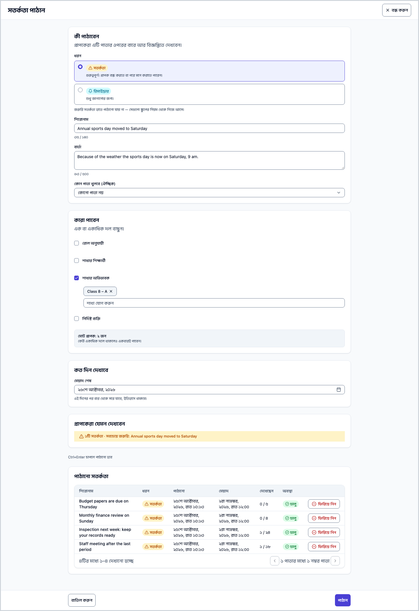
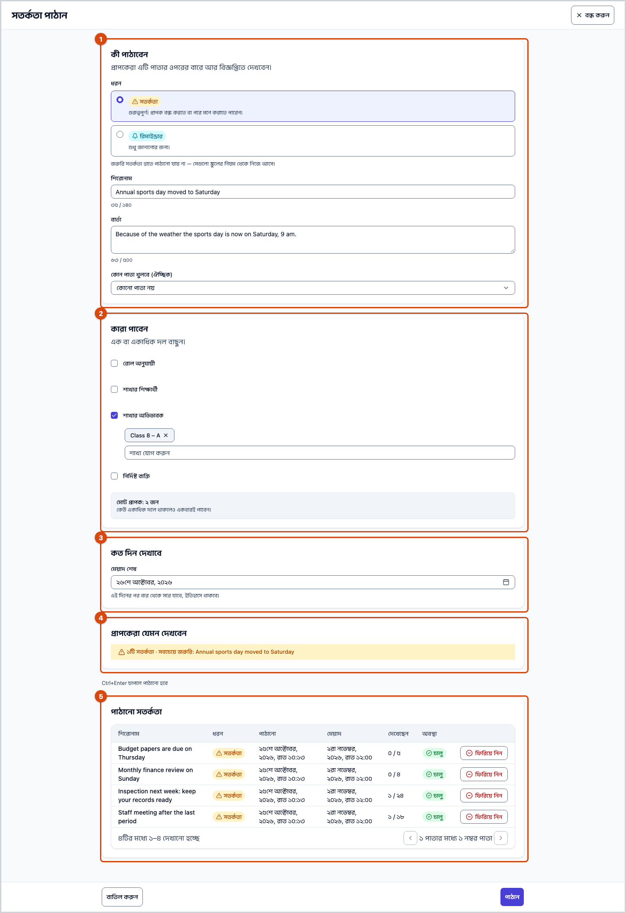

<!-- guide:meta
feature: communications.sendAlert
title: সতর্কতা পাঠান
summary: নিজে একটি ছোট সতর্কতা লিখে বাছাই করা রোল, শাখা, অভিভাবক বা নির্দিষ্ট কর্মীদের পাঠান; মেয়াদ শেষ হওয়া পর্যন্ত এটি তাঁদের ওপরের বারে আর বিজ্ঞপ্তিতে দেখায়, আর চাইলে আগেই ফিরিয়ে নিতে পারেন।
roles: [ADMIN, EXECUTIVE]
sources:
  - client-admin/src/routes/_staff/communications/send-alert.tsx
  - client-admin/src/features/attention/send-alert/send-alert-form.tsx
  - client-admin/src/features/attention/send-alert/audience-picker.tsx
  - client-admin/src/features/attention/send-alert/link-options.ts
  - client-admin/src/features/attention/send-alert/sent-alerts-card.tsx
  - server/src/modules/attention/manual/manual-alerts.controller.ts
  - server/src/modules/attention/manual/manual-alerts.service.ts
labels: [attention:composer.*, attention:roles.*, attention:severity.*, nav:items.sendAlert, nav:groups.communications]
helpIds: [communications.sendAlert]
devices: [desktop]
entry: [sidebar, palette]
keywords: [সতর্কতা, সতর্কতা পাঠান, রিমাইন্ডার, ঘোষণা, অভিভাবকদের জানানো, সতর্কতা ফিরিয়ে নেওয়া, alert, send alert]
appVersion: 0.1.0 (fb209bd7c)
owner: tareq89
lastVerified: 2026-10-25
knownIssues:
  - { id: named-people-first-100-staff, checked: 2026-10-25, issue: 2969 }
  - { id: portal-link-list-misses-pages, checked: 2026-10-25, issue: 2970 }
-->

# সতর্কতা পাঠান

নিজের লেখা একটি ছোট নোটিশ একসঙ্গে অনেককে পাঠান। এটি তাঁদের অ্যাপের ওপরের বারে আর বিজ্ঞপ্তিতে দেখায়।

**যেতে হবে:** বাম মেনুর **যোগাযোগ → সতর্কতা পাঠান**। এই পাতার কাজ কম্পিউটারে করুন।
**শুরুর আগে:** আপনাকে অ্যাডমিন বা একাডেমিক কো-অর্ডিনেটর হতে হবে ([কে কী করতে পারেন](#roles))। অ্যাপে যাঁর অ্যাকাউন্ট আছে, শুধু তিনিই সতর্কতা পান।

সতর্কতা এসএমএস নয়। একজন অভিভাবককে এসএমএস দিতে [**বার্তা পাঠান**](send-message.md) ব্যবহার করুন।

[সতর্কতা পাঠান](#task-main) · [সতর্কতা ফিরিয়ে নিন](#task-withdraw) · [সমস্যা ও সমাধান](#trouble)

**এই পাতায় যা আছে**

- [এই পাতায় যেভাবে আসবেন](#arrive)
- [সতর্কতা পাঠান](#task-main)
- [পাঠানো হলো কি না বুঝবেন যেভাবে](#confirm)
- [অন্য পরিস্থিতিতে](#other)
  - [কারা পাবেন, বাছাই](#task-who)
  - [খোলার জন্য একটি পাতা যোগ করা](#task-link)
  - [সতর্কতা ফিরিয়ে নিন](#task-withdraw)
- [সমস্যা ও সমাধান](#trouble)
- [কে কী করতে পারেন](#roles)
- [জানা সমস্যা](#known-issues)
- [আরও জানুন](#more)

---

## এই পাতায় যেভাবে আসবেন 

**মেনু থেকে:** বাম মেনুতে **যোগাযোগ** চাপুন, তারপর **সতর্কতা পাঠান**।

**খোঁজ দিয়ে:** ওপরের খোঁজার বোতাম চাপুন, "সতর্কতা" লিখুন।

পাতাটি পুরো পর্দা জুড়ে খোলে। **বাতিল করুন** বা বন্ধের বোতাম চাপলে যে পাতা থেকে এসেছিলেন সেখানে ফিরে যান। লিংক থেকে সরাসরি খুলে থাকলে [**বার্তা পাঠান**](send-message.md) পাতায় যান।

---

## সতর্কতা পাঠান 

1. **যোগাযোগ → সতর্কতা পাঠান** খুলুন।

   → **সতর্কতা পাঠান** পাতা খোলে, চারটি অংশসহ: **কী পাঠাবেন**, **কারা পাবেন**, **কত দিন দেখাবে** আর **প্রাপকেরা যেমন দেখবেন**।

2. **ধরন**-এ **সতর্কতা** (গুরুত্বপূর্ণ; প্রাপক বন্ধ করতে বা পরে মনে করাতে পারেন) বা **রিমাইন্ডার** (শুধু জানানোর জন্য) বাছুন।

3. **শিরোনাম** (১৪০ অক্ষর পর্যন্ত) আর **বার্তা** (৫০০ অক্ষর পর্যন্ত) লিখুন।

4. **কারা পাবেন**-এ এক বা একাধিক দলে টিক দিন, তালিকা থেকে নাম যোগ করুন ([কারা পাবেন, বাছাই](#task-who))।

   → একটি ধূসর বাক্সে মোট সংখ্যা দেখায়, যেমন **মোট প্রাপক: ৪৮ জন**, আর **কেউ একাধিক দলে থাকলেও একবারই পাবেন।**

5. **মেয়াদ শেষ**-এ শেষ দিনটি বাছুন। শুরুতে আগামীকাল থাকে। আজ থেকে ৩০ দিনের মধ্যে যেকোনো দিন বাছা যায়।

6. **প্রাপকেরা যেমন দেখবেন** দেখুন। এটি আপনার শিরোনামসহ বারের একটি নমুনা।

7. **পাঠান** চাপুন (বা Ctrl+Enter চাপুন)।

   → **৪৮ জনকে পাঠানো হয়েছে** লেখা আসে, পাতাটি বন্ধ হয়।

> **মনে রাখুন:** শিরোনাম, বার্তা আর অন্তত একজন প্রাপক না থাকলে **পাঠান** ধূসর থাকে। তালিকার ওপরের লাইনে লেখা থাকে কী বাকি, যেমন **আগে শিরোনাম লিখুন।**

---

## পাঠানো হলো কি না বুঝবেন যেভাবে 

আবার **সতর্কতা পাঠান** খুলুন। নিচের **পাঠানো সতর্কতা** তালিকায় আপনার সতর্কতা সবার ওপরে, অবস্থা **চালু**। **দেখেছেন** ঘরে দেখায় যতজন পেয়েছেন তাঁদের মধ্যে কতজন দেখেছেন, যেমন **১২ / ৪৮**।

| অবস্থা             | মানে                                             |
| ------------------ | ------------------------------------------------ |
| **চালু**           | এখন প্রাপকদের বারে আছে।                          |
| **মেয়াদ শেষ**     | **মেয়াদ**-এর দিন পার হয়েছে। বার থেকে সরে গেছে। |
| **ফিরিয়ে নেওয়া** | কেউ **ফিরিয়ে নিন** চেপেছেন। বার থেকে সরে গেছে।  |

---

## অন্য পরিস্থিতিতে 

### কারা পাবেন, বাছাই 

একটি দলে টিক দিন, তারপর তার তালিকা থেকে বাছুন। প্রতিটি বাছাই একটি চিপ হয়ে দেখায়; চিপ চাপলে সরে যায়।

| দল                    | কারা পাবেন                                                             |
| --------------------- | ---------------------------------------------------------------------- |
| **রোল অনুযায়ী**      | স্কুলে ওই রোলের সবাই, যেমন **শিক্ষক** বা **অভিভাবক**।                  |
| **শাখার শিক্ষার্থী**  | বাছাই করা শাখার যে শিক্ষার্থীরা এখন ভর্তি আছে আর যাদের অ্যাকাউন্ট আছে। |
| **শাখার অভিভাবক**     | ওই শিক্ষার্থীদের যে অভিভাবকদের অ্যাকাউন্ট আছে।                         |
| **নির্দিষ্ট ব্যক্তি** | নাম দিয়ে বাছাই করা কর্মীরা।                                           |

একসঙ্গে কয়েকটি দল নেওয়া যায়। কেউ না মিললে বাক্সে লেখা আসে **এই দলগুলোতে কেউ নেই।** আর পাঠানো যায় না।

### খোলার জন্য একটি পাতা যোগ করা 

**কোন পাতা খুলবে (ঐচ্ছিক)** দিলে প্রাপক সতর্কতায় চাপলে সরাসরি সেই পাতায় যান।

- শুধু কর্মীরা পেলে তালিকায় সেই কর্মী-পাতাগুলো থাকে, যা বাছাই করা প্রতিটি রোল খুলতে পারে।
- শুধু অভিভাবক আর শিক্ষার্থী পেলে তালিকায় পোর্টালের পাতা থাকে, যেমন **ফি ও চালান**।
- কর্মীদের সঙ্গে অভিভাবক বা শিক্ষার্থী মেশালে তালিকা বন্ধ থাকে: **সবাই একই অ্যাপ ব্যবহার করলে তবেই লিংক কাজ করে।**

### সতর্কতা ফিরিয়ে নিন 

1. **পাঠানো সতর্কতা**-য় অবস্থা **চালু** এমন একটি সারি খুঁজুন।
2. **ফিরিয়ে নিন** চাপুন।

   → একটি বাক্স জিজ্ঞেস করে **এই সতর্কতা ফিরিয়ে নেবেন?** আর বলে কতজনের বার থেকে সরে যাবে।

3. আবার **ফিরিয়ে নিন** চাপুন।

   → **সতর্কতা ফিরিয়ে নেওয়া হয়েছে**। অবস্থা হয় **ফিরিয়ে নেওয়া**। এটি আবার পাঠানো যায় না; দরকার হলে নতুন একটি লিখুন।

---

## সমস্যা ও সমাধান 

| আপনি যা দেখছেন                                                | কী করবেন                                                                                           | কে সাহায্য করতে পারেন |
| ------------------------------------------------------------- | -------------------------------------------------------------------------------------------------- | --------------------- |
| **এই দলগুলোতে কেউ নেই।**                                      | বাছাই করা মানুষদের অ্যাকাউন্ট নেই, বা শাখায় ভর্তি শিক্ষার্থী নেই। অন্য দল বাছুন।                  | অ্যাডমিন              |
| **দিনে ২০টি সতর্কতার সীমা শেষ। কাল আবার চেষ্টা করুন।**        | যেকোনো ২৪ ঘণ্টায় একটি স্কুল ২০টি সতর্কতা পাঠাতে পারে। ফিরিয়ে নেওয়াগুলোও গোনা হয়। অপেক্ষা করুন। | —                     |
| **খুব বেশিবার চেষ্টা হয়েছে। এক মিনিট পরে আবার চেষ্টা করুন।** | এক মিনিট অপেক্ষা করে আবার **পাঠান** চাপুন।                                                         | —                     |
| **আজ থেকে ৩০ দিনের মধ্যে একটি শেষ তারিখ বেছে নিন।**           | **মেয়াদ শেষ** বদলান।                                                                              | —                     |
| **সংখ্যাটি নতুন করে আনা যায়নি, তাই এটি পুরনো হতে পারে।**     | সংখ্যাটি পুরনো হতে পারে। একটু অপেক্ষা করুন; কোনো দল বদলালে আবার আসে।                               | —                     |
| কোনো অভিভাবক বলছেন পাননি                                      | অ্যাপে তাঁর অ্যাকাউন্ট থাকতে হবে। সতর্কতা এসএমএসে যায় না।                                         | অ্যাডমিন              |
| **জরুরি** ধরন নেই                                             | **জরুরি সতর্কতা হাতে পাঠানো যায় না — সেগুলো স্কুলের নিয়ম থেকে নিজে আসে।**                        | —                     |

---

## কে কী করতে পারেন 

| রোল                   | পাঠাতে আর ফিরিয়ে নিতে পারেন | **পাঠানো সতর্কতা** দেখেন |
| --------------------- | ---------------------------- | ------------------------ |
| অ্যাডমিন              | হ্যাঁ                        | হ্যাঁ                    |
| একাডেমিক কো-অর্ডিনেটর | হ্যাঁ                        | হ্যাঁ                    |

অন্য রোলের বাম মেনুতে **সতর্কতা পাঠান** নেই। তাঁরা শুধু সতর্কতা পান: কর্মীরা [**সতর্কতা দেখা ও মেটানো**](../dashboard/alerts.md)-য়, অভিভাবক ও শিক্ষার্থীরা [**সতর্কতা ও বিজ্ঞপ্তি (অভিভাবক ও শিক্ষার্থী)**](../portal/notifications.md)-য়।

---

## জানা সমস্যা 

| সমস্যা                                                                                                                                      | কার, কখন                               | তথ্য কি জমা থাকে? | আপাতত কী করবেন                                             |
| ------------------------------------------------------------------------------------------------------------------------------------------- | -------------------------------------- | ----------------- | ---------------------------------------------------------- |
| **নির্দিষ্ট ব্যক্তি**-তে শুধু প্রথম ১০০ জন কর্মী আসেন, তাই কিছু কর্মীকে নাম দিয়ে পাওয়া যায় না                                            | যে স্কুলে ১০০-র বেশি কর্মীর অ্যাকাউন্ট | —                 | এর বদলে **রোল অনুযায়ী** নিন                               |
| অভিভাবক ও শিক্ষার্থীর জন্য **কোন পাতা খুলবে**-তে [**হোমওয়ার্ক**](../portal/homework.md) বা [**আবেদন**](../portal/applications.md) পাতা নেই | অভিভাবক বা শিক্ষার্থীকে পাঠানো সতর্কতা | —                 | **কোনো পাতা নয়** বাছুন, বার্তায় লিখে দিন কোথায় যেতে হবে |

---

## আরও জানুন 

<strong>পাতার অংশগুলো</strong>

1. **কী পাঠাবেন**: **ধরন**, **শিরোনাম**, **বার্তা**, **কোন পাতা খুলবে (ঐচ্ছিক)**।
2. **কারা পাবেন**: চারটি দল আর সংখ্যার বাক্স।
3. **কত দিন দেখাবে**: **মেয়াদ শেষ**।
4. **প্রাপকেরা যেমন দেখবেন**: বারের একটি নমুনা।
5. **পাঠানো সতর্কতা**: **শিরোনাম**, **ধরন**, **পাঠানো**, **মেয়াদ**, **দেখেছেন**, **অবস্থা** আর **ফিরিয়ে নিন**।

<strong>একটি সতর্কতা যেভাবে যায়</strong>

<figure>
  
  <figcaption><em>একটি সতর্কতার পথ</em></figcaption>
</figure>

- **কাদের গোনা হয়:** এই স্কুলে যাঁদের অ্যাকাউন্ট চালু, শুধু তাঁরা। অ্যাকাউন্ট নেই এমন শিক্ষার্থী বা অভিভাবক বাদ যান।
- **কত দিন:** **মেয়াদ শেষ**-এর দিনের শেষে, স্কুলের সময় অনুযায়ী, সতর্কতা বার থেকে সরে যায়।
- **সীমা:** যেকোনো ২৪ ঘণ্টায় স্কুলপ্রতি ২০টি সতর্কতা।

**সম্পর্কিত পাতা**

- [**বার্তা পাঠান**](send-message.md) — একজন অভিভাবককে এসএমএস, হোয়াটসঅ্যাপ বা ইমেইল।
- [**সতর্কতা প্রতিবেদন**](../reports/alerts-report.md) — স্কুলের নিয়ম প্রতি মাসে কতগুলো সতর্কতা তুলেছে।
- [**সতর্কতা দেখা ও মেটানো**](../dashboard/alerts.md) — কর্মীরা আপনার পাঠানো সতর্কতা যেখানে দেখেন।
- [**সতর্কতা ও বিজ্ঞপ্তি (অভিভাবক ও শিক্ষার্থী)**](../portal/notifications.md) — অভিভাবক ও শিক্ষার্থীরা যেখানে দেখেন।

---

_সংস্করণ ০.১.০ · শেষ যাচাই ২০২৬-১০-২৫_
