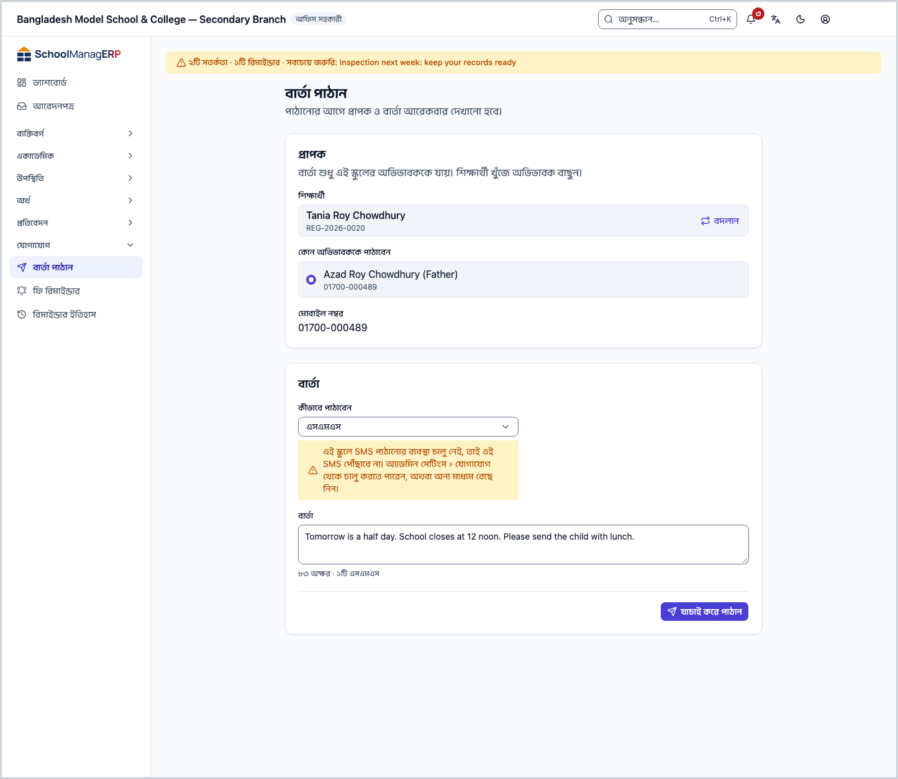
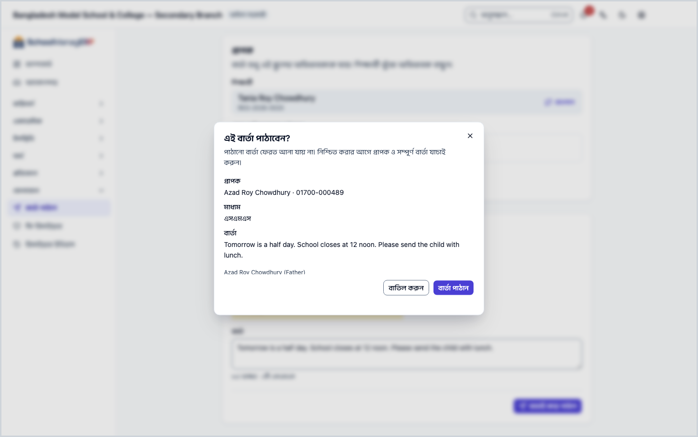

<!-- guide:meta
feature: communications.sendMessage
title: বার্তা পাঠান
summary: একজন শিক্ষার্থীর একজন অভিভাবককে এসএমএস, হোয়াটসঅ্যাপ বা ইমেইলে নিজের লেখা বার্তা পাঠান; পাঠানোর আগে দেখে নিন কয়টি এসএমএস লাগবে, আর পরে দেখুন বার্তা পৌঁছাল কি না।
roles: [ADMIN, ACCOUNTANT, OFFICE_STAFF]
sources:
  - client-admin/src/routes/_staff/communications/send.tsx
  - client-admin/src/routes/_staff/communications/-shared/sms-segment-counter.tsx
  - client-admin/src/routes/_staff/communications/-shared/sms-readiness.ts
  - client-admin/src/routes/_staff/communications/-shared/student-search.tsx
  - client-admin/src/routes/_staff/communications/-shared/whatsapp-template-fields.tsx
  - client-admin/src/routes/_staff/communications/-shared/delivery-error.ts
  - shared/src/sms/segments.ts
  - server/src/modules/communications/communications.controller.ts
  - server/src/modules/communications/communications.service.ts
  - server/src/modules/communications/credits/sms-credit.service.ts
  - server/src/modules/communications/credits/credits.controller.ts
  - server/src/modules/communications/worker/communications.processor.ts
labels:
  [
    communications:mediums.*,
    communications:smsCounter.*,
    communications:send.*,
    communications:whatsapp.*,
    communications:deliveryErrors.*,
    communications:fields.*,
    communications:help.*,
    communications:helpRequired.*,
    nav:items.sendMessage,
    nav:groups.communications,
  ]
helpIds:
  [
    communications.sendMessage,
    communications.sendMessage.action.send,
    communications.sendMessage.field.guardian,
    communications.sendMessage.field.medium,
    communications.sendMessage.field.message,
  ]
devices: [desktop]
entry: [sidebar, palette]
keywords:
  [বার্তা, এসএমএস, হোয়াটসঅ্যাপ, ইমেইল, অভিভাবককে বার্তা, এসএমএস ক্রেডিট, কয়টি এসএমএস, অক্ষর, message, sms, whatsapp, email, guardian, sms credit, segments]
appVersion: 0.1.0 (3f7e424fc)
owner: tareq89
lastVerified: 2026-10-25
knownIssues: []
-->

# বার্তা পাঠান

একজন অভিভাবককে নিজের লেখা একটি বার্তা পাঠান: এসএমএস, হোয়াটসঅ্যাপ বা ইমেইলে।

**যেতে হবে:** বাম মেনুতে **যোগাযোগ → বার্তা পাঠান**। এই পাতার কাজ কম্পিউটারে করুন।
**শুরুর আগে:** আপনি অ্যাডমিন, হিসাবরক্ষক বা অফিস সহকারী হবেন ([কে কী করতে পারেন](#roles))। অভিভাবকের ফোন নম্বর বা ইমেইল তাঁর তথ্যে থাকতে হবে ([অভিভাবক](../people/guardians.md))। স্কুলে [এসএমএস পাঠানোর ব্যবস্থা](../administration/settings.md) চালু থাকতে হবে।

একবারে একজনকেই পাঠানো যায়। বকেয়ার কথা অনেককে একসাথে মনে করাতে [**ফি রিমাইন্ডার**](fee-reminders.md) ব্যবহার করুন।

[বার্তা পাঠান](#task-main) · [কয়টি এসএমএস লাগবে](#sms-count) · [পৌঁছাল কি না](#confirm) · [সমস্যা ও সমাধান](#trouble)

**এই পাতায় যা আছে**

- [একজন অভিভাবককে এসএমএস পাঠান](#task-main)
- [বার্তা পৌঁছাল কি না বুঝবেন কীভাবে](#confirm)
- [অন্য পরিস্থিতিতে](#other)
  - [কয়টি এসএমএস লাগবে, পাঠানোর আগে দেখুন](#sms-count)
  - [ইমেইলে পাঠান](#task-email)
  - [হোয়াটসঅ্যাপে পাঠান](#task-whatsapp)
- [সমস্যা ও সমাধান](#trouble)
- [কে কী করতে পারেন](#roles)
- [আরও জানুন](#more)

---

## একজন অভিভাবককে এসএমএস পাঠান 

1. বাম মেনুতে **যোগাযোগ** চাপুন, তারপর **বার্তা পাঠান** চাপুন।

   → **বার্তা পাঠান** পাতা খোলে। দুটি অংশ: **প্রাপক** আর **বার্তা**।

2. **শিক্ষার্থী** ঘরে নাম বা রোল নম্বর লিখুন, তালিকা থেকে শিক্ষার্থী বাছুন।

   → নিচে **কোন অভিভাবককে পাঠাবেন** আসে। প্রত্যেক অভিভাবকের নামের নিচে তাঁর নম্বর, না থাকলে **এই মাধ্যমের জন্য কোনো ঠিকানা নেই**।

3. একজন অভিভাবক বাছুন।

   → নিচে **মোবাইল নম্বর** ঘরে তাঁর নম্বর দেখায়। নম্বর অভিভাবকের তথ্য থেকেই আসে; এখানে বদলানো যায় না।

4. **কীভাবে পাঠাবেন**-এ **এসএমএস** রেখে দিন।
5. **বার্তা** ঘরে বার্তা লিখুন।

   → নিচে লেখা আসে, যেমন **৯৫ অক্ষর · ২টি এসএমএস**। লেখার সাথে সাথে বদলায়। কীভাবে গোনা হয়, দেখুন [কয়টি এসএমএস লাগবে](#sms-count)।

6. **যাচাই করে পাঠান** চাপুন।

   → **এই বার্তা পাঠাবেন?** জানালা খোলে: **প্রাপক**, **মাধ্যম** আর পুরো **বার্তা**। লেখা থাকে **পাঠানো বার্তা ফেরত আনা যায় না।**

7. সব ঠিক থাকলে **বার্তা পাঠান** চাপুন।

   → **বার্তা পাঠানো শুরু হয়েছে** আসে, আর **ডেলিভারির অবস্থা** দেখায়। পাতা খোলা রাখলে অবস্থা নিজে থেকে হালনাগাদ হয়।

> **মনে রাখুন:** অভিভাবক নোটিফিকেশন বন্ধ রাখলেও এই পাতার বার্তা তাঁর কাছে যায়। জরুরি কথার জন্য এটিই পথ; বকেয়ার রিমাইন্ডার তাঁর কাছে যায় না।

---

## বার্তা পৌঁছাল কি না বুঝবেন কীভাবে 

| অবস্থা                  | কীভাবে বুঝবেন                                                                      | এরপর কী                                |
| ----------------------- | ---------------------------------------------------------------------------------- | -------------------------------------- |
| **শুধু স্ক্রিনে লেখা**  | ফর্ম খোলা; ছেড়ে যেতে চাইলে সতর্কবার্তা আসে                                        | **যাচাই করে পাঠান** চাপুন              |
| **সারিতে আছে**          | **বার্তা পাঠানো শুরু হয়েছে**, অবস্থা **সারিতে আছে**                               | অপেক্ষা করুন; স্কুলের সিস্টেম পাঠাচ্ছে |
| **পাঠানো হয়েছে**       | অবস্থা **পাঠানো হয়েছে**: এসএমএস বা ইমেইল সেবা বার্তাটি নিয়েছে                    | কাজ শেষ                                |
| **পৌঁছেছে** বা **পঠিত** | এখনো দেখায় না: অ্যাপ ডেলিভারি রিপোর্ট রাখে না, তাই **পাঠানো হয়েছে**-ই শেষ অবস্থা | কাজ শেষ                                |
| **ব্যর্থ**              | শিরোনাম **বার্তা পাঠানো যায়নি**, নিচে কারণ                                        | [সমস্যা ও সমাধান](#trouble) দেখুন      |

এই পাতা কিছু ফোন বা কম্পিউটারে আলাদা করে রাখে না, তাই "এই ডিভাইসে সংরক্ষিত" অবস্থা নেই।

**নিশ্চিত না হলে আবার চাপা নিরাপদ:** পাঠানোর সময় জানালা বন্ধ করা যায় না। উত্তর না এলে, পেজ না ছেড়ে বা রিলোড না করে একই বার্তা আবার **বার্তা পাঠান** চাপলে স্কুলের সিস্টেম আগের ফলটিই ফেরত দেয় (২৪ ঘণ্টা মনে রাখে); বার্তা দুবার যায় না। একটি অক্ষরও বদলালে, বা আগেরবার পাঠানো হয়ে গেছে দেখালে, সেটি নতুন বার্তা।

---

## অন্য পরিস্থিতিতে 

### কয়টি এসএমএস লাগবে, পাঠানোর আগে দেখুন 

একটি লম্বা বার্তা কয়েকটি এসএমএস হয়ে যায়, আর প্রতিটির খরচ আলাদা। **বার্তা** ঘরের নিচের লাইন, যেমন **৯৫ অক্ষর · ২টি এসএমএস**, বলে দেয় কয়টি লাগবে। গোনা হয় এভাবে:

| বার্তায় যা আছে                                        | একটিতে কত অক্ষর | একাধিক হলে প্রতিটিতে কত |
| ------------------------------------------------------ | --------------- | ----------------------- |
| শুধু ইংরেজি অক্ষর, সংখ্যা ও চিহ্ন                      | ১৬০             | ১৫৩                     |
| একটিও বাংলা অক্ষর, ইমোজি বা ইংরেজির বাইরের চিহ্ন থাকলে | ৭০              | ৬৭                      |

**উদাহরণ:**

- বাংলায় ৭০ অক্ষর → ১টি এসএমএস। ৭১ অক্ষর → ২টি (৬৭ + ৪)।
- বাংলায় ১৪০ অক্ষর → ৩টি (৬৭ + ৬৭ + ৬)।
- ইংরেজিতে ১৬০ অক্ষর → ১টি। ১৬১ অক্ষর → ২টি।
- ইংরেজি বার্তায় একটি বাংলা শব্দ থাকলেই পুরো বার্তা বাংলার হিসাবে গোনা হয়।
- ইংরেজি বার্তায় `[ ] { } \ ~ ^ |` এই চিহ্নগুলো প্রতিটি দুই অক্ষর হিসাবে গোনা হয়।

**খরচ কাটে কখন:** স্কুলের এসএমএস ক্রেডিট থাকলে একটি এসএমএস মানে এক ক্রেডিট। **বার্তা পাঠান** চাপলেই এই কয়টি ক্রেডিট আটকে রাখা হয়। এসএমএস সেবা বার্তা নিলে ক্রেডিট কাটে। পাঠানো না গেলে, যেমন এসএমএস ব্যবস্থা চালু না থাকলে, আটকে রাখা ক্রেডিট ফেরত আসে। ক্রেডিট কম থাকলে কিছুই পাঠানো হয় না।

> **মনে রাখুন:** এসএমএস ব্যবস্থা চালু না থাকলে বা ক্রেডিট শেষ হলে **কীভাবে পাঠাবেন**-এর নিচে হলুদ সতর্কবার্তা আসে। পাঠানো তবুও আটকায় না, কিন্তু এসএমএস পৌঁছাবে না। অন্য মাধ্যম বাছুন বা অ্যাডমিনকে বলুন।

### ইমেইলে পাঠান 

**কীভাবে পাঠাবেন**-এ **ইমেইল** বাছুন। **বিষয়** ঘর আসে। অভিভাবকের নামের নিচে তাঁর ইমেইল দেখায়, আর **ইমেইল ঠিকানা** ঘরে বসে। বাকি ধাপ একই। ইমেইলে এসএমএস ক্রেডিট লাগে না।

### হোয়াটসঅ্যাপে পাঠান 

**কীভাবে পাঠাবেন**-এ **হোয়াটসঅ্যাপ** বাছুন। বার্তা যায় অভিভাবকের ফোন নম্বরে, না থাকলে বিকল্প নম্বরে।

অভিভাবক গত ২৪ ঘণ্টায় স্কুলকে হোয়াটসঅ্যাপে উত্তর না দিলে সাধারণ বার্তা পৌঁছায় না। তখন **টেমপ্লেটের নাম**, **টেমপ্লেটের ভাষা** আর **টেমপ্লেট প্যারামিটার (কমা দিয়ে আলাদা)** ঘরে অনুমোদিত টেমপ্লেটের তথ্য দিন।

---

## সমস্যা ও সমাধান 

| আপনি যা দেখছেন                                                                  | কী করবেন                                                                                         | কে সাহায্য করতে পারেন |
| ------------------------------------------------------------------------------- | ------------------------------------------------------------------------------------------------ | --------------------- |
| **যাচাই করে পাঠান** চাপা যায় না                                                | একজন অভিভাবক বাছুন, যাঁর এই মাধ্যমের নম্বর বা ইমেইল আছে।                                         | —                     |
| **এই মাধ্যমের জন্য কোনো ঠিকানা নেই**                                            | অন্য মাধ্যম বা অন্য অভিভাবক বাছুন, অথবা [অভিভাবক](../people/guardians.md) পাতায় নম্বর যোগ করুন। | অফিস সহকারী           |
| **এই অভিভাবকের এই মাধ্যমের জন্য নম্বর বা ইমেইল নেই। …**                         | উপরের মতো।                                                                                       | অফিস সহকারী           |
| **এই অভিভাবক বাছাই করা শিক্ষার্থীর সাথে যুক্ত নন।**                             | শিক্ষার্থী আবার বেছে অভিভাবক বাছুন।                                                              | —                     |
| **নম্বর, ইমেইল বা বার্তায় কিছু ঠিক নেই। …**                                    | বার্তা খালি কি না, হোয়াটসঅ্যাপ টেমপ্লেটের তথ্য ঠিক কি না দেখুন।                                 | —                     |
| **এই স্কুলে SMS পাঠানোর ব্যবস্থা চালু নেই, …**                                  | অ্যাডমিন **সেটিংস › যোগাযোগ** থেকে চালু করবেন; আপাতত অন্য মাধ্যম বাছুন।                          | অ্যাডমিন              |
| **এই স্কুলের SMS ক্রেডিট শেষ, …**                                               | অ্যাডমিনকে ক্রেডিট যোগ করতে বলুন; আপাতত অন্য মাধ্যম বাছুন।                                       | অ্যাডমিন              |
| **পাঠানোর জন্য পর্যাপ্ত এসএমএস ক্রেডিট নেই: … ইউনিট প্রয়োজন, মাত্র … উপলব্ধ।** | বার্তা ছোট করুন, বা অ্যাডমিনকে ক্রেডিট যোগ করতে বলুন; আপাতত অন্য মাধ্যম বাছুন।                   | অ্যাডমিন              |
| জানালায় **বার্তাটি পাঠানো যায়নি।**                                            | ইন্টারনেট দেখে আবার **বার্তা পাঠান** চাপুন।                                                      | অ্যাডমিন              |
| **বার্তা পাঠানো যায়নি** — **এই স্কুলে … পাঠানোর ব্যবস্থা চালু নেই। …**         | **সেটিংস › যোগাযোগ খুলুন** চাপুন (অ্যাডমিন)।                                                     | অ্যাডমিন              |
| **বার্তা পাঠানো যায়নি** — **পাঠানো যায়নি।**                                   | **আরেকটি বার্তা পাঠান** চেপে আবার চেষ্টা করুন।                                                   | অ্যাডমিন              |

এ নিয়ে আরও সাহায্য: [সমস্যা হলে কী করবেন](../help/troubleshooting.md#sms)।

---

## কে কী করতে পারেন 

| ভূমিকা                                                                  | বার্তা পাঠানো |
| ----------------------------------------------------------------------- | ------------- |
| অ্যাডমিন                                                                | হ্যাঁ         |
| হিসাবরক্ষক                                                              | হ্যাঁ         |
| অফিস সহকারী                                                             | হ্যাঁ         |
| একাডেমিক কো-অর্ডিনেটর, শিক্ষক, পরীক্ষা নিয়ন্ত্রক, পরিচালনা পর্ষদ সদস্য | না            |

**অ্যাডমিন, হিসাবরক্ষক ও অফিস সহকারী:** তিনজনেই একই পাতা পান; কোড অনুযায়ী কোনো পার্থক্য নেই। শুধু এই স্কুলের শিক্ষার্থীর অভিভাবককেই পাঠানো যায়। এসএমএস ব্যবস্থা চালু করা আর ক্রেডিট দেখা অ্যাডমিনের কাজ।

অন্য ভূমিকার বাম মেনুতে **বার্তা পাঠান** থাকে না।

---

## আরও জানুন 

<strong>পাতার অংশগুলো</strong>

1. **বার্তা পাঠান** শিরোনাম: **পাঠানোর আগে প্রাপক ও বার্তা আরেকবার দেখানো হবে।**
2. **প্রাপক** — **শিক্ষার্থী**, **কোন অভিভাবককে পাঠাবেন**, **মোবাইল নম্বর** বা **ইমেইল ঠিকানা**।
3. **বার্তা** — **কীভাবে পাঠাবেন**, **বিষয়** (ইমেইলে), **বার্তা**, অক্ষর-এসএমএস লাইন, হোয়াটসঅ্যাপ টেমপ্লেটের ঘর।
4. **যাচাই করে পাঠান**।

<strong>ঘরগুলোর অর্থ</strong>

<!-- guide:generated:fields:communications -->

| ঘর                         | কী লিখবেন                                                                                                                                                                                                                      | বাধ্যতামূলক?      |
| -------------------------- | ------------------------------------------------------------------------------------------------------------------------------------------------------------------------------------------------------------------------------ | ----------------- |
| কোন অভিভাবককে পাঠাবেন      | বাছা শিক্ষার্থীর একজন অভিভাবক। নিচে তাঁর নম্বর বা ইমেইল দেখায়; না থাকলে পাঠানো যায় না।                                                                                                                                       | হ্যাঁ             |
| কীভাবে পাঠাবেন             | বার্তা পাঠান: এসএমএস, হোয়াটসঅ্যাপ বা ইমেইল; এসএমএস ও হোয়াটসঅ্যাপ যায় অভিভাবকের ফোন নম্বরে, না থাকলে বিকল্প নম্বরে। ফি রিমাইন্ডার: শুরুতে প্রত্যেক অভিভাবকের পছন্দের মাধ্যম; একটি বাছলে এবারের জন্য সবাইকে সেই মাধ্যমে যায়। | না                |
| বার্তা                     | যা পাঠাবেন। এসএমএস হলে নিচে অক্ষর আর কয়টি এসএমএস লাগবে দেখায়। ফি রিমাইন্ডারে নাম, বকেয়ার পরিমাণ বা মাস বসাতে নিচের বোতাম চাপুন; প্রত্যেক অভিভাবকের জন্য আসল তথ্য বসে।                                                       | হ্যাঁ             |
| যাদের মনে করানো হবে        | শুরুতে সব অভিভাবকে টিক থাকে। যিনি নোটিফিকেশন বন্ধ রেখেছেন, টিক দিলেও তিনি পান না।                                                                                                                                              | হ্যাঁ, অন্তত একজন |
| দফার নাম                   | এই দফার নাম; পরে রিমাইন্ডার ইতিহাসে এই নামে খুঁজবেন।                                                                                                                                                                           | হ্যাঁ             |
| মাধ্যম (একসাথে রিমাইন্ডার) | অভিভাবকের পছন্দের মাধ্যম এখানে টিক না থাকলে তিনি বাদ পড়েন। শুরুতে তিনটিতেই টিক।                                                                                                                                               | হ্যাঁ, অন্তত একটি |
| অবস্থা                     | এক অবস্থার দফাগুলোই দেখায়: প্রক্রিয়াধীন, সম্পন্ন, আংশিক ব্যর্থ বা ব্যর্থ। সব দেখতে "সব অবস্থা" রাখুন।                                                                                                                        | না                |

<!-- /guide:generated -->

<strong>বার্তা কীভাবে যায়</strong> — যাচাই, ক্রেডিট আর ডেলিভারি

<figure>
  
  <figcaption><em>একটি বার্তার পথ</em></figcaption>
</figure>

- **নম্বর কোথা থেকে:** অভিভাবকের তথ্য থেকে। এসএমএস ও হোয়াটসঅ্যাপে ফোন নম্বর, না থাকলে বিকল্প নম্বর; ইমেইলে ইমেইল।
- **সারি:** **বার্তা পাঠান** চাপলে বার্তা সারিতে যায়; স্কুলের সিস্টেম পেছনে পাঠায়। তাই প্রথমে অবস্থা **সারিতে আছে**।
- **ক্রেডিট:** শুধু যে স্কুলে এসএমএস ক্রেডিট গোনা হয়। এক এসএমএস = এক ক্রেডিট। পাঠানোর আগে আটকে রাখা, পাঠানো হলে কাটা, না হলে ফেরত। ফল অস্পষ্ট হলে ক্রেডিট আটকে থাকে, পরে হাতে মেলানো হয়।
- **দুবার যায় না:** পাঠানোর পর উত্তর না এলে, একই খোলা পেজে একই বার্তা আবার চাপলে আগের ফলই ফেরত আসে (২৪ ঘণ্টা রাখা থাকে)। পাঠানো হয়ে গেছে দেখানোর পর আবার চাপলে নতুন বার্তা যায়।

**সম্পর্কিত পাতা**

- [**ফি রিমাইন্ডার**](fee-reminders.md) — বকেয়ার কথা একজন বা অনেক অভিভাবককে।
- [**রিমাইন্ডার ইতিহাস**](reminder-history.md) — একসাথে পাঠানো রিমাইন্ডারের দফা।
- [**বার্তার তালিকা**](message-log.md) — পাঠানো বার্তাটি খুঁজুন, পৌঁছাল কি না দেখুন।
- [**অভিভাবকের তথ্য দেখা, ঠিক করা ও আমন্ত্রণ পাঠানো**](../people/guardians.md) — নম্বর ও ইমেইল এখানে ঠিক হয়।

- [**সতর্কতা পাঠান**](send-alert.md) — একসঙ্গে অনেককে অ্যাপে একটি ছোট নোটিশ।
- [**স্কুলের সেটিংস ঠিক করা**](../administration/settings.md) — স্কুলের সেটিংস

---

_সংস্করণ ০.১.০ · শেষ যাচাই ২০২৬-১০-২৫_
