<!-- guide:meta
feature: communications.staffMessage
title: কর্মীদের বার্তা পাঠান
summary: শিক্ষক বা অফিস কর্মীদের একটি এসএমএস পাঠান; পাঠানোর আগে দেখে নিন কতজন পাবেন, কারা বাদ পড়বেন আর কত ক্রেডিট লাগবে।
roles: [ADMIN, EXECUTIVE]
sources:
  - client-admin/src/routes/_staff/communications/staff-message.tsx
  - client-admin/src/routes/_staff/communications/-staff-message-form.tsx
  - client-admin/src/routes/_staff/communications/send.tsx
  - client-admin/src/routes/_staff/staff/index.tsx
  - client-admin/src/routes/_staff/my-coordination/-notify-dialog.tsx
  - client-admin/src/action-registry.ts
  - server/src/modules/communications/communications.controller.ts
  - server/src/modules/communications/staff-messages.service.ts
  - server/src/modules/communications/dto/staff-message.dto.ts
labels:
  [
    communications:staffMessage.*,
    communications:fields.*,
    communications:help.*,
    communications:helpRequired.*,
  ]
helpIds: [communications.staffMessage]
devices: [desktop]
entry: [palette, page:communications.sendMessage, page:people.staff]
keywords:
  [কর্মীদের বার্তা, শিক্ষকদের এসএমএস, কর্মীদের এসএমএস, এসএমএস ক্রেডিট, staff message, message teachers, sms staff]
appVersion: 0.1.0 (b238c0260)
owner: tareq89
lastVerified: 2026-11-16
knownIssues: []
-->

# কর্মীদের বার্তা পাঠান

শিক্ষক বা অফিস কর্মীদের নিজের লেখা একটি এসএমএস পাঠান। পাঠানোর আগেই দেখতে পাবেন কতজন পাবেন আর কত খরচ হবে।

**যেতে হবে:** **Ctrl+K** চেপে **কর্মীদের বার্তা পাঠান** লিখুন, অথবা [এই পাতায় যেভাবে আসবেন](#arrive) অংশের যেকোনো পথে। এই পাতার কাজ কম্পিউটারে করুন।
**শুরুর আগে:** আপনাকে অ্যাডমিন বা একাডেমিক কো-অর্ডিনেটর হতে হবে ([কে কী করতে পারেন](#roles))। স্কুলে [এসএমএস পাঠানো](../administration/settings.md) চালু থাকতে হবে। বার্তা পেতে হলে কর্মীর [প্রোফাইলে](../people/staff.md) ফোন নম্বর থাকতে হবে।

শিক্ষার্থীর অভিভাবককে পাঠাতে চাইলে [**বার্তা পাঠান**](send-message.md) ব্যবহার করুন। যে শিক্ষক অন্য শিক্ষকদের সমন্বয় করেন, তিনি এই পাতার বদলে [**আমার সমন্বয়**](../academics/my-coordination.md) থেকে পাঠান।

[সব শিক্ষককে বার্তা](#task-main) · [অন্যদের বাছুন](#task-more) · [গেছে কি না](#confirm) · [সমস্যা ও সমাধান](#trouble)

**এই পাতায় যা আছে**

- [এই পাতায় যেভাবে আসবেন](#arrive)
- [সব শিক্ষককে বার্তা পাঠান](#task-main)
- [বার্তা গেছে কি না বুঝবেন কীভাবে](#confirm)
- [অন্য পরিস্থিতিতে](#other)
  - [অন্যদের বাছুন](#task-more)
  - [হোয়াটসঅ্যাপে পাঠান](#task-whatsapp)
  - [যাঁরা বাদ পড়েন](#task-skipped)
- [সমস্যা ও সমাধান](#trouble)
- [কে কী করতে পারেন](#roles)
- [আরও জানুন](#more)

---

## এই পাতায় যেভাবে আসবেন 

**বার্তা পাঠান পাতা থেকে**

1. **যোগাযোগ → বার্তা পাঠান** খুলুন ([বার্তা পাঠান](send-message.md))।
2. **কাদের পাঠাবেন** এর পাশে **কর্মী** চাপুন।

   → **কর্মীদের বার্তা পাঠান** পাতা খোলে।

**কর্মী তালিকা থেকে**

1. [কর্মী তালিকা](../people/staff.md) খুলে যাঁদের পাঠাবেন তাঁদের টিক দিন।
2. তালিকার ওপরে **এসএমএস পাঠান** চাপুন।

   → এই পাতা খোলে, **যাঁদের:** লেখার পাশে আপনার টিক দেওয়া নামগুলো থাকে। **কর্মী তালিকা থেকে এই মানুষদের বাছা হয়েছে।** আবার শুরু করতে **অন্য দল বাছুন** চাপুন। পাতা খুললেই কিছু পাঠানো হয় না।

---

## সব শিক্ষককে বার্তা পাঠান 

1. **কর্মীদের বার্তা পাঠান** খুলুন।

   → **কারা পাবেন** এর নিচে **সব শিক্ষক** আগে থেকেই টিক দেওয়া থাকে।

2. **বার্তা** ঘরে আপনার কথা লিখুন।

   → নিচে অক্ষর আর প্রত্যেকের কয়টি এসএমএস লাগে দেখায়।

3. **কারা পাবেন দেখুন** চাপুন।

   → **পাঠানোর আগে দেখে নিন** অংশে **মোট জন**, **ফোন আছে**, **যত ক্রেডিট লাগবে** আর **ক্রেডিট ব্যালেন্স** দেখায়, সঙ্গে প্রত্যেকের কয়টি এসএমএস লাগে।

4. সংখ্যাগুলো পড়ুন। কেউ বাদ পড়লে [যাঁরা বাদ পড়েন](#task-skipped) দেখুন।
5. **পাঠান** চাপুন।

   → **এই বার্তা পাঠাবেন?** জানালা খোলে: "… জন পাবেন আর … ক্রেডিট খরচ হবে। পাঠানো বার্তা ফেরানো যায় না।"

6. **হ্যাঁ, পাঠান** চাপুন।

   → **বার্তা রওনা হয়েছে** আসে, সঙ্গে কতজন পাবেন। **বার্তার তালিকা দেখুন** চেপে দেখুন, নয়তো **আরেকটি বার্তা পাঠান** চাপুন।

> **মনে রাখুন:** **হ্যাঁ, পাঠান** চাপার আগে কিছুই যায় না। **কারা পাবেন দেখুন** না চাপা পর্যন্ত **পাঠান** ধূসর থাকে। দেখার পর কিছু বদলালে **আপনি কিছু বদলেছেন। পাঠানোর আগে আবার দেখে নিন।** আসে; **আবার দেখুন** চাপুন।

---

## বার্তা গেছে কি না বুঝবেন কীভাবে 

| অবস্থা                       | কীভাবে বুঝবেন                               | এরপর কী                                                |
| ---------------------------- | ------------------------------------------- | ------------------------------------------------------ |
| **শুধু স্ক্রিনে বদলেছে**     | ফর্ম ভরা, কিন্তু **হ্যাঁ, পাঠান** চাপেননি   | **কারা পাবেন দেখুন**, তারপর **পাঠান** চাপুন            |
| **স্কুলের সিস্টেমে পৌঁছেছে** | **বার্তা রওনা হয়েছে**, সঙ্গে "… জন পাবেন।" | প্রত্যেকের অবস্থা দেখতে **বার্তার তালিকা দেখুন** চাপুন |

**যাচাই করতে চাইলে:** **বার্তার তালিকা দেখুন** চাপুন, অথবা **যোগাযোগ → বার্তার তালিকা** খুলুন ([বার্তার তালিকা](message-log.md))। প্রত্যেকের নিজের একটি লাইন থাকে।

**নিশ্চিত না হলে:** স্ক্রিনে **বার্তা গেছে কি না নিশ্চিত হওয়া গেল না। আবার পাঠানোর আগে বার্তার তালিকা দেখুন।** এলে আগে বার্তার তালিকা দেখুন। একই মানুষদের একই বার্তা এক মিনিটের মধ্যে আবার পাঠাতে চাইলে **একই মানুষদের এই বার্তা এইমাত্র পাঠানো হয়েছে। আবার পাঠাতে এক মিনিট অপেক্ষা করুন।** আসে।

---

## অন্য পরিস্থিতিতে 

### অন্যদের বাছুন 

1. **কারা পাবেন** এর নিচে **আরও বাছুন** চাপুন।

   → নতুন বিকল্প খোলে: **ভূমিকা**, **পদবি** আর **নাম ধরে বাছুন**। ওপরে **সব শিক্ষক** ও **সব অফিস কর্মী** থাকে।

2. শুধু নতুন দলটিকে পাঠাতে আগে **সব শিক্ষক**-এর টিক তুলুন। তারপর **সব অফিস কর্মী** টিক দিন, অথবা **ভূমিকা** বা **পদবি** থেকে এক বা একাধিক বাছুন, অথবা **নাম ধরে বাছুন** ঘরে নাম লিখে খুঁজুন।
3. **কারা পাবেন দেখুন** চাপুন, তারপর ওপরের ধাপ ৩ থেকে চালিয়ে যান।

কেউ দুই দলে পড়লেও একবারই বার্তা পান। একবারে সর্বোচ্চ ৫০০ জনকে পাঠানো যায়; বেশি হলে **একবারে সর্বোচ্চ ৫০০ জনকে পাঠানো যায়। কম মানুষ বাছুন।** আসে। বাড়তি বিকল্প বন্ধ করতে **কম বিকল্প দেখান** চাপুন।

### হোয়াটসঅ্যাপে পাঠান 

**কীভাবে পাঠাবেন** এ **হোয়াটসঅ্যাপ** শুধু তখনই দেখায় যখন স্কুল তা চালু করেছে। সবাই একই কথা পাবেন, যা স্কুলের আগে থেকে অনুমোদন করানো টেমপ্লেট থেকে আসে। **টেমপ্লেটের নাম**, **টেমপ্লেটের ভাষা** আর **টেমপ্লেটের মান (কমা দিয়ে আলাদা)** ভরুন। **যা পৌঁছাবে** এ টেমপ্লেটের নাম আর মানগুলো দেখায়, অনুমোদিত টেমপ্লেটের লেখা নয়।

### যাঁরা বাদ পড়েন 

**কারা পাবেন দেখুন** চাপার পর **বাদ পড়েছেন (…)** অংশে নামসহ তাঁদের দেখায় যাঁরা বার্তা পাবেন না: **ফোন নম্বর নেই, তাই বাদ**। তাঁদের জন্য ক্রেডিট লাগে না। তাঁদের [প্রোফাইলে](../people/staff.md) নম্বর দিন, তারপর **আবার দেখুন** চাপুন। কারও ফোন না থাকলে **পাঠানোর মতো কেউ নেই** দেখায়।

---

## সমস্যা ও সমাধান 

| আপনি যা দেখছেন                                                        | কী করবেন                                                                 | কে সাহায্য করতে পারেন |
| --------------------------------------------------------------------- | ------------------------------------------------------------------------ | --------------------- |
| **আগে বার্তা লিখুন।**                                                 | **বার্তা** ঘরে কিছু লিখুন।                                               | —                     |
| **… ক্রেডিট কম পড়ছে** · **ক্রেডিট যোগ করুন, অথবা কম মানুষকে পাঠান।** | কম মানুষ বাছুন, অথবা অ্যাডমিনকে ক্রেডিট যোগ করতে বলুন।                   | অ্যাডমিন              |
| **কেউ মেলেনি। অন্য কাউকে বাছুন।**                                     | আপনার বাছা দলে কেউ নেই। অন্য দল বাছুন।                                   | —                     |
| **এঁদের কারও ফোন নম্বর নেই। …**                                       | [কর্মীর প্রোফাইলে](../people/staff.md) নম্বর দিন, অথবা অন্য মানুষ বাছুন। | অ্যাডমিন              |
| **এই স্কুলে এসএমএস চালু নেই। …**                                      | অ্যাডমিন **সেটিংস › যোগাযোগ** থেকে চালু করবেন।                           | অ্যাডমিন              |
| **এই স্কুলে হোয়াটসঅ্যাপ চালু নেই। এসএমএস হিসেবে পাঠান।**             | **এসএমএস** বাছুন।                                                        | অ্যাডমিন              |
| **কারা পাবেন তা দেখা গেল না। আবার চেষ্টা করুন।**                      | ইন্টারনেট দেখে **আবার দেখুন** চাপুন।                                     | —                     |
| **বার্তা পাঠানো যায়নি। একটু পরে আবার চেষ্টা করুন।**                  | ইন্টারনেট দেখে আবার **পাঠান** চাপুন।                                     | —                     |

---

## কে কী করতে পারেন 

| ভূমিকা                                                            | কর্মীদের বার্তা পাঠান                                             |
| ----------------------------------------------------------------- | ----------------------------------------------------------------- |
| অ্যাডমিন                                                          | হ্যাঁ, যেকোনো কর্মীকে                                             |
| একাডেমিক কো-অর্ডিনেটর                                             | হ্যাঁ                                                             |
| শিক্ষক                                                            | এই পাতায় নয়; আমার সমন্বয়ে **এসএমএস হিসেবে পাঠান** ব্যবহার করেন |
| হিসাবরক্ষক, অফিস সহকারী, পরীক্ষা নিয়ন্ত্রক, পরিচালনা পর্ষদ সদস্য | না                                                                |

অন্য ভূমিকাদের জন্য **কর্মীদের বার্তা পাঠান** নেই: [**বার্তা পাঠান**](send-message.md) পাতার **কর্মী** ট্যাব আর কর্মী তালিকার **এসএমএস পাঠান** বোতাম তাঁদের কাছে দেখায় না। যে শিক্ষক অন্য শিক্ষকদের সমন্বয় করেন, তিনি [আমার সমন্বয়](../academics/my-coordination.md)-এর **শিক্ষকদের জানান** জানালায় **এসএমএস হিসেবে পাঠান** চাপেন; শুধু তাঁর সমন্বয়ের শিক্ষকেরা পান।

---

## আরও জানুন 

<strong>প্রতিটি ঘরের মানে</strong>

<!-- guide:generated:fields:communications -->

| ঘর                         | কী লিখবেন                                                                                                                                                                                                                      | বাধ্যতামূলক?              |
| -------------------------- | ------------------------------------------------------------------------------------------------------------------------------------------------------------------------------------------------------------------------------ | ------------------------- |
| কোন অভিভাবককে পাঠাবেন      | বাছা শিক্ষার্থীর একজন অভিভাবক। নিচে তাঁর নম্বর বা ইমেইল দেখায়; না থাকলে পাঠানো যায় না।                                                                                                                                       | হ্যাঁ                     |
| কীভাবে পাঠাবেন             | বার্তা পাঠান: এসএমএস, হোয়াটসঅ্যাপ বা ইমেইল; এসএমএস ও হোয়াটসঅ্যাপ যায় অভিভাবকের ফোন নম্বরে, না থাকলে বিকল্প নম্বরে। ফি রিমাইন্ডার: শুরুতে প্রত্যেক অভিভাবকের পছন্দের মাধ্যম; একটি বাছলে এবারের জন্য সবাইকে সেই মাধ্যমে যায়। | না                        |
| বার্তা                     | যা পাঠাবেন। এসএমএস হলে নিচে অক্ষর আর কয়টি এসএমএস লাগবে দেখায়। ফি রিমাইন্ডারে নাম, বকেয়ার পরিমাণ বা মাস বসাতে নিচের বোতাম চাপুন; প্রত্যেক অভিভাবকের জন্য আসল তথ্য বসে।                                                       | হ্যাঁ                     |
| যাদের মনে করানো হবে        | শুরুতে সব অভিভাবকে টিক থাকে। যিনি নোটিফিকেশন বন্ধ রেখেছেন, টিক দিলেও তিনি পান না।                                                                                                                                              | হ্যাঁ, অন্তত একজন         |
| দফার নাম                   | এই দফার নাম; পরে রিমাইন্ডার ইতিহাসে এই নামে খুঁজবেন।                                                                                                                                                                           | হ্যাঁ                     |
| মাধ্যম (একসাথে রিমাইন্ডার) | অভিভাবকের পছন্দের মাধ্যম এখানে টিক না থাকলে তিনি বাদ পড়েন। শুরুতে তিনটিতেই টিক।                                                                                                                                               | হ্যাঁ, অন্তত একটি         |
| অবস্থা                     | এক অবস্থার দফাগুলোই দেখায়: প্রক্রিয়াধীন, সম্পন্ন, আংশিক ব্যর্থ বা ব্যর্থ। সব দেখতে "সব অবস্থা" রাখুন।                                                                                                                        | না                        |
| কারা পাবেন                 | বাছাই ছাড়া ফর্ম খুললে শুরুতে “সব শিক্ষক” বাছা থাকে; কর্মী বাছা অবস্থায় খুললে শুধু তাঁরাই বাছা থাকেন। ভূমিকা, পদবি বা নাম ধরে বাছতে “আরও বাছুন” চাপুন। দুই দলে পড়লেও একজন একবারই পান।                                        | হ্যাঁ                     |
| কীভাবে পাঠাবেন             | এসএমএসে স্কুলের এসএমএস ক্রেডিট খরচ হয়। হোয়াটসঅ্যাপে স্কুলের আগে থেকে অনুমোদন করানো টেমপ্লেট লাগে; স্কুল চালু করলে তবেই দেখায়।                                                                                               | না                        |
| বার্তা                     | যা পাঠাবেন। নিচে অক্ষর আর প্রত্যেকের কয়টি এসএমএস লাগে দেখায়। এক ক্রেডিট মানে একজনকে একটি এসএমএস। যাঁর ফোন নম্বর নেই তিনি বাদ পড়েন, নামসহ দেখায়।                                                                            | হ্যাঁ                     |
| হোয়াটসঅ্যাপ টেমপ্লেট      | অনুমোদিত টেমপ্লেটের নাম, ভাষা আর মানগুলো লিখুন। সবাই একই কথা পাবেন। প্রিভিউতে টেমপ্লেটের নাম আর মানগুলো দেখায়, অনুমোদিত টেমপ্লেটের লেখা নয়।                                                                                  | হোয়াটসঅ্যাপ বাছলেই লাগবে |

<!-- /guide:generated -->

<strong>কর্মীদের বার্তা কীভাবে যায়</strong>

<figure>
  
  <figcaption><em>কর্মীদের বার্তার পথ</em></figcaption>
</figure>

- **এক ক্রেডিট** মানে একজনকে একটি এসএমএস। লম্বা বার্তায় একাধিক এসএমএস লাগে; দেখুন [কয়টি এসএমএস](send-message.md#sms-count)।
- **দুবার যায় না:** একই মানুষদের একই বার্তা এক মিনিটের মধ্যে আবার পাঠানো যায় না।

**সম্পর্কিত পাতা**

- [**বার্তা পাঠান**](send-message.md) — শিক্ষার্থীর অভিভাবককে বার্তা।
- [**বার্তার তালিকা**](message-log.md) — প্রত্যেকে পেয়েছেন কি না দেখুন।
- [**কর্মী**](../people/staff.md) — ফোন নম্বর ঠিক করুন; যাঁদের পাঠাবেন তাঁদের বাছুন।
- [**আমার সমন্বয়**](../academics/my-coordination.md) — সমন্বয়কারী শিক্ষকের এসএমএস পাঠানোর পথ।

---

_সংস্করণ ০.১.০ · শেষ যাচাই ২০২৬-১১-১৬_
