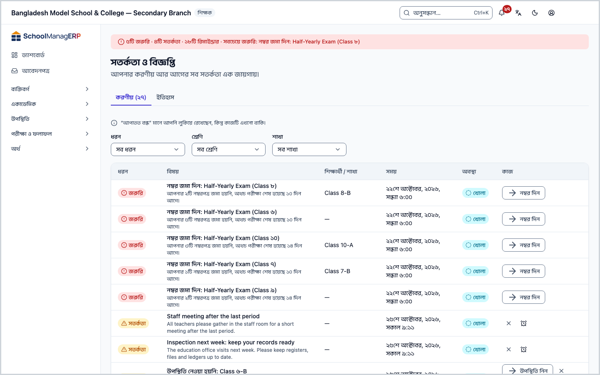
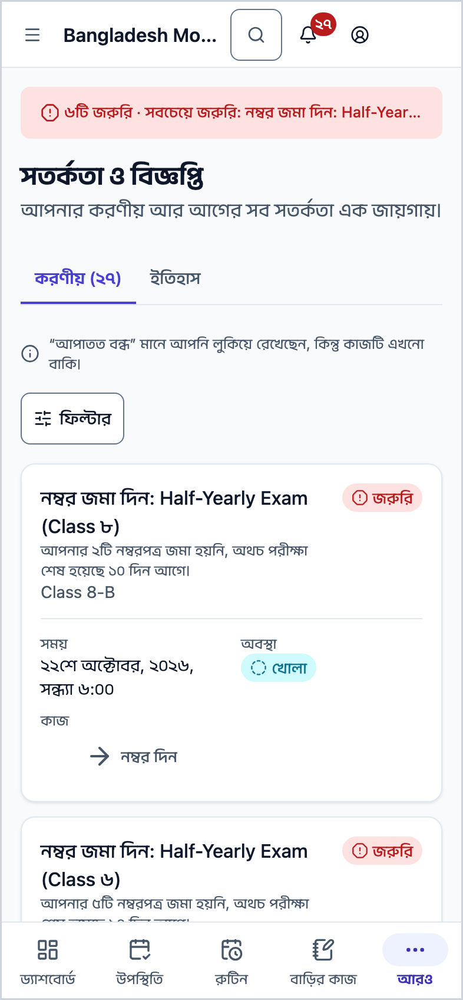
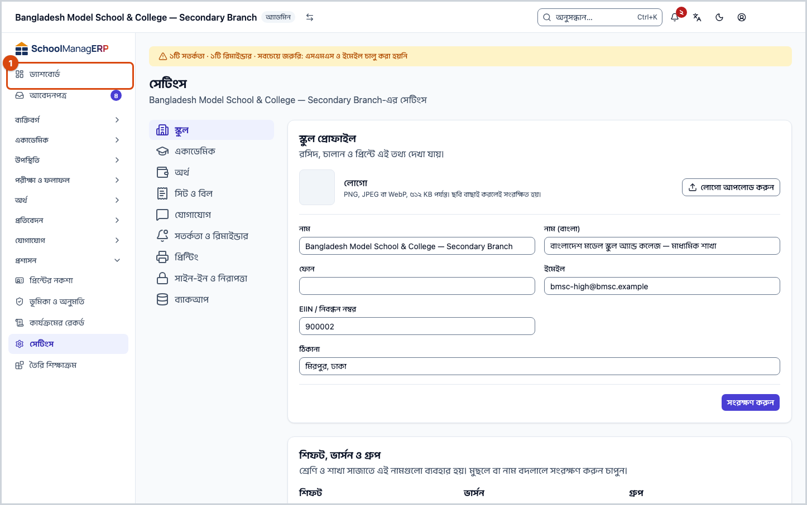

<!-- guide:meta
feature: dashboard.alerts
title: সতর্কতা দেখা ও মেটানো
summary: আপনার করণীয় সতর্কতা দেখুন, কাজ শেষ করুন বা পরে মনে করাতে বলুন, আর কোন সতর্কতা পুশ হবে ঠিক করুন।
roles: [ADMIN, EXECUTIVE, TEACHER, ACCOUNTANT, OFFICE_STAFF, EXAM_CONTROLLER, COMMITTEE]
sources:
  - client-admin/src/routes/_staff/notifications.tsx
  - client-admin/src/features/attention/attention-worklist.tsx
  - client-admin/src/features/attention/attention-center.tsx
  - client-admin/src/features/attention/notification-prefs/**
  - client-admin/src/components/morning-digest-card.tsx
  - client-admin/src/pages/settings/AlertsSection.tsx
  - client-admin/src/dashboard/layout/briefing-slot.tsx
  - shared/src/attention/rule-catalogue.ts
labels:
  [
    attention:worklist.*,
    attention:item.*,
    attention:snooze.*,
    attention:state.*,
    attention:severity.*,
    attention:category.*,
    attention:rules.*,
    attention:roles.*,
    attention:account.title,
    attention:account.subtitle,
    attention:account.urgentHelp,
    attention:settings.title,
    attention:settings.locked,
    attention:modal.seeAll,
    dashboard:digest.*,
    nav:items.notifications,
    nav:items.security,
    nav:notifications.bellLabel,
    nav:notifications.attentionTitle,
    nav:notifications.attentionTodo,
    settings:categories.alerts,
    settings:save.*,
  ]
helpIds: [dashboard.alerts]
devices: [desktop, phone]
entry: [page:dashboard, notification:alert, palette]
keywords: [সতর্কতা, বিজ্ঞপ্তি, করণীয়, রিমাইন্ডার, পরে মনে করান, সকালের সারসংক্ষেপ, পুশ, alerts, notifications, to-do, snooze, morning summary, push]
appVersion: 0.1.0 (6b36c2549)
owner: tareq89
lastVerified: 2026-10-24
knownIssues: []
-->

# সতর্কতা দেখা ও মেটানো

আপনার করণীয় সতর্কতা দেখুন, কাজ শেষ করুন বা পরে মনে করাতে বলুন, আর কোন সতর্কতা পুশ হবে ঠিক করুন।

**যেতে হবে:** উপরে ডান দিকের ঘণ্টা আইকন (**বিজ্ঞপ্তি**) চাপুন, তারপর **সব করণীয় দেখুন**। অথবা ড্যাশবোর্ডের আজকের সারাংশে **সব করণীয় দেখুন (n)**। ফোনেও ঘণ্টা আইকন উপরে ডান দিকে।
**শুরুর আগে:** কিছু লাগে না।

**সতর্কতা** হলো স্কুলের নিয়ম থেকে নিজে থেকে তৈরি হওয়া একটি করণীয় কাজ। যেমন কোনো শাখার হাজিরা সময়মতো না নিলে শিক্ষকের কাছে **উপস্থিতি নেওয়া হয়নি** সতর্কতা আসে। কাজটি শেষ হলে সতর্কতা নিজে থেকে **ঠিক হয়েছে** হয়ে যায়। প্রতিটি সতর্কতার একটি মাত্রা থাকে: **জরুরি**, **সতর্কতা** বা **রিমাইন্ডার**।

**সমন্বয়কও কিছু সতর্কতা পান।** **শ্রেণি সমন্বয়ক** তাঁর শ্রেণির প্রতিটি শাখার **উপস্থিতি নেওয়া হয়নি** সতর্কতা পান, সেটি সতর্কতায় পৌঁছালেই, অ্যাডমিনের আগে। **শ্রেণি সমন্বয়ক** ও **বিষয় সমন্বয়ক** দুজনেই তাঁদের শ্রেণির **নম্বর জমা দেরি** সতর্কতা পান; বিষয় সমন্বয়ক শুধু নিজের বিষয় দেরি হলে। কে সমন্বয়ক: [শিক্ষকের দায়িত্ব](../people/teaching-assignments.md#task-coordinators)।

[করণীয় মেটান](#task-main) · [পরে মনে করান](#task-snooze) · [সকালের সারসংক্ষেপ](#task-digest) · [কোন সতর্কতার মানে কী](#task-kinds) · [সমস্যা ও সমাধান](#trouble)

**এই পাতায় যা আছে**

- [এই পাতায় যেভাবে আসবেন](#arrive)
- [করণীয় সতর্কতা মেটান](#task-main)
- [সতর্কতা মিটেছে কি না বুঝবেন কীভাবে](#confirm)
- [অন্য পরিস্থিতিতে](#other)
  - [পরে মনে করান](#task-snooze)
  - [শুধু কিছু সতর্কতা দেখুন (ফিল্টার)](#task-filter)
  - [আগের সতর্কতা দেখুন (ইতিহাস)](#task-history)
  - [ফোনে সতর্কতা](#task-phone)
  - [সকালের সারসংক্ষেপ](#task-digest)
  - [কোন সতর্কতা আমার কাছে পুশ হবে](#task-push)
  - [স্কুলের সতর্কতা চালু বা বন্ধ (অ্যাডমিন)](#task-school)
  - [কোন সতর্কতার মানে কী](#task-kinds)
- [সমস্যা ও সমাধান](#trouble)
- [কে কী করতে পারেন](#roles)
- [আরও জানুন](#more)

---

## এই পাতায় যেভাবে আসবেন 

**ড্যাশবোর্ড থেকে:**

1. [ড্যাশবোর্ড](dashboard.md)-এর উপরে আজকের সারাংশ, যেমন **২টি জরুরি · ৩টি সতর্কতা**।
2. **সব করণীয় দেখুন (n)** চাপুন। → এই পাতা খোলে, **করণীয়** ট্যাবে।

**ঘণ্টা আইকন থেকে:**

1. উপরে ডান দিকের ঘণ্টা আইকনে চাপুন। → ছোট একটি তালিকা খোলে: **আপনার মনোযোগ দরকার**।
2. **সব করণীয় দেখুন** চাপুন। → এই পাতা খোলে।

**পুশ বিজ্ঞপ্তি থেকে:** ফোন বা কম্পিউটারে একটি সতর্কতার বিজ্ঞপ্তি আসে। চাপলে অ্যাপ খোলে। ফোনে অ্যাপ কীভাবে রাখবেন: [ফোনে খোলা ও অ্যাপ হিসেবে ইনস্টল](../start/phone.md)।

---

## করণীয় সতর্কতা মেটান 

1. **সতর্কতা ও বিজ্ঞপ্তি** পাতায় **করণীয়** ট্যাব খোলা থাকে।

   → উপরে লেখা **আপনার করণীয় আর আগের সব সতর্কতা এক জায়গায়।** নিচে তালিকা: **ধরন**, **বিষয়**, **শিক্ষার্থী / শাখা**, **সময়**, **অবস্থা**, **কাজ**।

2. সবার আগে **জরুরি** সারিগুলো দেখুন। **বিষয়** পড়ে বুঝুন কী করতে হবে। প্রতিটি সতর্কতার মানে নিচে [কোন সতর্কতার মানে কী](#task-kinds) অংশে আছে।
3. সারির **কাজ** ঘরের প্রথম বোতামটি চাপুন (থাকলে)।

   → যে পাতায় কাজটি হয়, সেটি খোলে।

4. সেখানে কাজটি শেষ করুন, যেমন হাজিরা জমা দিন।

   → নিয়ম পরের বার যাচাই করলে সতর্কতাটি **ঠিক হয়েছে** হয়ে **করণীয়** থেকে সরে **ইতিহাস**-এ যায়।

> **মনে রাখুন:** সতর্কতা মেটে কাজ শেষ হলে, সারিতে কিছু চাপলে নয়। **বন্ধ করুন** চাপলে শুধু আপনার তালিকা থেকে লুকায়; কাজটি বাকিই থাকে।

---

## সতর্কতা মিটেছে কি না বুঝবেন কীভাবে 

**অবস্থা** ঘরে চারটি শব্দের একটি থাকে:

| অবস্থা         | মানে                                                   | এরপর কী                           |
| -------------- | ------------------------------------------------------ | --------------------------------- |
| **খোলা**       | কাজটি এখনো বাকি                                        | কাজটি করুন।                       |
| **আপাতত বন্ধ** | আপনি লুকিয়েছেন বা পরে মনে করাতে বলেছেন; কাজ এখনো বাকি | কাজটি করলে মিটবে।                 |
| **ঠিক হয়েছে** | কাজ শেষ, সতর্কতা মিটেছে                                | কাজ শেষ। **ইতিহাস**-এ থাকে।       |
| **মেয়াদ শেষ** | সতর্কতাটি আর প্রযোজ্য নয়                              | কিছু করার নেই। **ইতিহাস**-এ থাকে। |

**যাচাই করতে চাইলে:** **ইতিহাস** ট্যাব খুলুন। সতর্কতাটি সেখানে **ঠিক হয়েছে** অবস্থায় থাকলে কাজটি স্কুলের সিস্টেমে পৌঁছেছে।

**বার্তা না এলে:** কাজ শেষ করার পরও সতর্কতা **খোলা** থাকলে [সমস্যা ও সমাধান](#trouble) দেখুন।

---

## অন্য পরিস্থিতিতে 

### পরে মনে করান 

শুধু **সতর্কতা** মাত্রার খোলা সারিতে, যেটি বন্ধ করা যায়, **পরে মনে করান** বোতাম থাকে। **জরুরি** বা **রিমাইন্ডার** সারিতে এটি নেই।

1. সারির **পরে মনে করান** চাপুন।
2. বেছে নিন: **২ ঘণ্টা পরে**, **কাল সকালে**, **পরের কর্মদিবসে** বা **তারিখ বাছুন…**।
3. **তারিখ বাছুন…** নিলে **কবে মনে করাব** বাক্সে **তারিখ** দিয়ে **মনে করান** চাপুন।

   → সারিটি **আপাতত বন্ধ** হয়, লেখা থাকে **… পর্যন্ত পরে মনে করানো হবে**।

| আপনি চাপলেন      | কী হবে                                    | কাজ মিটল?          |
| ---------------- | ----------------------------------------- | ------------------ |
| **পরে মনে করান** | ঠিক করা সময় পর্যন্ত লুকায়               | না, কাজ বাকি       |
| **বন্ধ করুন**    | আপনার তালিকা থেকে লুকায়                  | না, কাজ বাকি       |
| কাজের বোতাম      | কাজের পাতা খোলে; সেখানে কাজ শেষ করলে মেটে | হ্যাঁ, কাজ শেষ হলে |

কিছু সতর্কতায় **বন্ধ করুন** থাকে না; সেখানে লেখা থাকে **কাজ শেষ না হলে বন্ধ হবে না**।

### শুধু কিছু সতর্কতা দেখুন (ফিল্টার) 

তালিকার উপরে তিনটি ঘর: **ধরন** (যেমন **উপস্থিতি**, **ফি**), **শ্রেণি** আর **শাখা**। একটি বেছে নিলে তালিকা ছোট হয়। সব দেখতে **সব ধরন**, **সব শ্রেণি**, **সব শাখা** বেছে নিন। ট্যাব বদলালে ফিল্টার মুছে যায়।

### আগের সতর্কতা দেখুন (ইতিহাস) 

**ইতিহাস** ট্যাবে **ঠিক হয়েছে** আর **মেয়াদ শেষ** সতর্কতা ১২ মাস থাকে। নিচে **এই ডিভাইসের সাম্প্রতিক বার্তা**: এই ডিভাইসে দেখানো ছোট বার্তা, যেমন ইমপোর্ট শেষ হওয়া। **সব পঠিত করুন** চাপলে সবগুলো পড়া হিসেবে চিহ্নিত হয়।

### ফোনে সতর্কতা 

শিক্ষকেরা সাধারণত ফোনেই সতর্কতা দেখেন। ফোনে:

1. উপরে ডান দিকের ঘণ্টা আইকন চাপুন, তারপর **সব করণীয় দেখুন**।
2. তালিকার প্রতিটি সারি একটি কার্ড হয়ে আসে, উপরে মাত্রার চিহ্ন (**জরুরি**, **সতর্কতা** বা **রিমাইন্ডার**)।
3. কার্ডের কাজের বোতাম চাপুন, অথবা **পরে মনে করান** / **বন্ধ করুন**।

### সকালের সারসংক্ষেপ 

অ্যাডমিন, একাডেমিক কো-অর্ডিনেটর আর শিক্ষক স্কুল খোলার দিনে সকালে একটি পুশ বিজ্ঞপ্তি পান: আজ কয়টা বিষয় তাঁর নজর চাইছে। চাপলে [ড্যাশবোর্ড](dashboard.md) খোলে।

- **কখন:** স্কুলের **সেটিংস**-এ ঠিক করা সময়ে, শুরুতে সকাল ০৭:৩০ ([স্কুলের ড্যাশবোর্ড সেটিংস](customise.md#task-settings))। ছুটির দিনে যায় না। পুশের নীরব সময় চললে, সেই সময় শেষ হলে যায়।
- **কীভাবে:** শুধু পুশ বিজ্ঞপ্তি। এসএমএস বা ইমেইলে যায় না। কোনো করণীয় না থাকলে যায় না।
- **নিজে বন্ধ করতে:** উপরে ডান দিকের **অ্যাকাউন্ট মেনু** থেকে **নিরাপত্তা** ([অ্যাকাউন্ট](../start/account.md))। **সকালের সারসংক্ষেপ** কার্ডে **আমাকে সকালের সারসংক্ষেপ পাঠান** টিক তুলে দিন। → **সেভ হয়েছে**। এটি আপনার সব স্কুলের জন্য একসাথে বন্ধ হয়।

এই ডিভাইসে নোটিফিকেশন বন্ধ থাকলে কার্ডে লেখা থাকে **পেতে হলে এই ডিভাইসে নোটিফিকেশন চালু করুন।**

### কোন সতর্কতা আমার কাছে পুশ হবে 

1. **অ্যাকাউন্ট মেনু** থেকে **নিরাপত্তা** খুলুন।
2. **কোন সতর্কতা আমার কাছে পুশ হবে** কার্ডে যে ধরনের সতর্কতা পুশে চান না, সেটি বন্ধ করুন।

- বন্ধ করলেও সব সতর্কতা অ্যাপের ঘণ্টায় দেখা যায়।
- **জরুরি** সতর্কতা ঠিক না হওয়া পর্যন্ত পুশ হতেই থাকে।

### স্কুলের সতর্কতা চালু বা বন্ধ (অ্যাডমিন) 

1. বাম মেনুতে **সেটিংস**, তারপর বাম পাশের তালিকায় **সতর্কতা ও রিমাইন্ডার**।
2. প্রতিটি নিয়মের পাশে একটি সুইচ। যে নিয়ম স্কুলে চান না, বন্ধ করুন।
3. **সংরক্ষণ করুন** চাপুন। → **সংরক্ষিত হয়েছে**।

কিছু নিয়ম বন্ধ করা যায় না; তাদের পাশে লেখা **বন্ধ করা যায় না**। শুধু জরুরি নয়, কিছু **সতর্কতা** মাত্রার নিয়মও এমন (নিচের তালিকার শেষ কলাম দেখুন)। এই অংশে সকালের ও সন্ধ্যার রিমাইন্ডারের সময় আর পুশের নীরব সময়ও ঠিক করা যায়।

### কোন সতর্কতার মানে কী 

**ধরন** ফিল্টারের নাম অনুযায়ী সাজানো। শুধু সেগুলো আছে যা আজকের অ্যাপে সত্যিই আসে। "কে পান" মানে কোন ভূমিকা পায়; শিক্ষক সাধারণত শুধু নিজের শাখার সতর্কতা পান। কাজ শেষ হলে সতর্কতা নিজে মেটে।

#### সেটআপ

| সতর্কতা                         | কখন আসে                                        | কে পান   | ধরন        | স্কুল বন্ধ করতে পারে? |
| ------------------------------- | ---------------------------------------------- | -------- | ---------- | --------------------- |
| **স্কুলের সেটআপ শেষ হয়নি**     | সব সেটআপ ধাপ শেষ না হওয়া পর্যন্ত দেখায়।      | অ্যাডমিন | জরুরি      | না                    |
| **এসএমএস বা ইমেইল চালু হয়নি**  | স্কুল এসএমএস বা ইমেইল পাঠাতে না পারলে জানায়।  | অ্যাডমিন | সতর্কতা    | হ্যাঁ                 |
| **কর্মীর আমন্ত্রণ গ্রহণ হয়নি** | যেসব কর্মী এখনো যোগ দেননি তাদের কথা মনে করায়। | অ্যাডমিন | রিমাইন্ডার | হ্যাঁ                 |
| **পরের শিক্ষাবর্ষ তৈরি হয়নি**  | বছরের শেষে পরের শিক্ষাবর্ষ না থাকলে জানায়।    | অ্যাডমিন | সতর্কতা    | হ্যাঁ                 |

#### সিস্টেম

| সতর্কতা                        | কখন আসে                                          | কে পান   | ধরন     | স্কুল বন্ধ করতে পারে? |
| ------------------------------ | ------------------------------------------------ | -------- | ------- | --------------------- |
| **এসএমএস ক্রেডিট কম**          | ক্রেডিট আপনার ঠিক করা সীমার নিচে নামলে জানায়।   | অ্যাডমিন | সতর্কতা | হ্যাঁ                 |
| **বার্তা পাঠানো ব্যর্থ হচ্ছে** | ২৪ ঘণ্টায় অনেক বার্তা ব্যর্থ হলে জানায়।        | অ্যাডমিন | সতর্কতা | হ্যাঁ                 |
| **ব্যাকআপ ব্যর্থ**             | শেষ ব্যাকআপ ব্যর্থ হলে বা অনেক পুরোনো হলে জরুরি। | অ্যাডমিন | জরুরি   | না                    |

#### স্কুলের কাঠামো

| সতর্কতা                          | কখন আসে                                | কে পান   | ধরন     | স্কুল বন্ধ করতে পারে? |
| -------------------------------- | -------------------------------------- | -------- | ------- | --------------------- |
| **রুটিন প্রকাশ হয়নি**           | এ বছরের রুটিন প্রকাশ না হলে জানায়।    | অ্যাডমিন | সতর্কতা | হ্যাঁ                 |
| **শ্রেণি শিক্ষক ছাড়া শাখা**     | যে শাখায় শ্রেণি শিক্ষক নেই তা জানায়। | অ্যাডমিন | সতর্কতা | হ্যাঁ                 |
| **শিক্ষক ছাড়া রুটিনের পিরিয়ড** | যে পিরিয়ডে শিক্ষক নেই তা জানায়।      | অ্যাডমিন | সতর্কতা | হ্যাঁ                 |
| **মোবাইল নম্বর ছাড়া অভিভাবক**   | অভিভাবকের ফোন নম্বর না থাকলে জানায়।   | অ্যাডমিন | সতর্কতা | হ্যাঁ                 |

#### উপস্থিতি

| সতর্কতা                   | কখন আসে                                                                | কে পান                                  | ধরন        | স্কুল বন্ধ করতে পারে? |
| ------------------------- | ---------------------------------------------------------------------- | --------------------------------------- | ---------- | --------------------- |
| **উপস্থিতি নেওয়া হয়নি** | প্রথম পিরিয়ডে মনে করায়, সময় পার হলে সতর্ক করে, শেষ সময়ের পর জরুরি। | শিক্ষক, একাডেমিক কো-অর্ডিনেটর, অ্যাডমিন | রিমাইন্ডার | না                    |

#### পিরিয়ড

| সতর্কতা                     | কখন আসে                                               | কে পান                          | ধরন        | স্কুল বন্ধ করতে পারে? |
| --------------------------- | ----------------------------------------------------- | ------------------------------- | ---------- | --------------------- |
| **পিরিয়ড শুরু হচ্ছে**      | প্রতিটি পিরিয়ডের কয়েক মিনিট আগে শিক্ষককে মনে করায়। | শিক্ষক                          | রিমাইন্ডার | হ্যাঁ                 |
| **আজ বদলি পিরিয়ড**         | আজ কোন পিরিয়ড বদলি হিসেবে নিতে হবে তা জানায়।        | শিক্ষক                          | রিমাইন্ডার | হ্যাঁ                 |
| **আজ শিক্ষক ছাড়া পিরিয়ড** | ছুটিতে থাকা শিক্ষকের বদলি না থাকলে জানায়।            | একাডেমিক কো-অর্ডিনেটর, অ্যাডমিন | সতর্কতা    | হ্যাঁ                 |

#### বাড়ির কাজ

| সতর্কতা                           | কখন আসে                                                  | কে পান                      | ধরন        | স্কুল বন্ধ করতে পারে? |
| --------------------------------- | -------------------------------------------------------- | --------------------------- | ---------- | --------------------- |
| **বাড়ির কাজ জমা দেয়নি**         | পিরিয়ড শুরু হলে শিক্ষার্থী, অভিভাবক আর শিক্ষককে জানায়। | শিক্ষার্থী, অভিভাবক, শিক্ষক | সতর্কতা    | হ্যাঁ                 |
| **আজ বাড়ির কাজ জমার দিন**        | সকালে শিক্ষার্থীকে মনে করায়।                            | শিক্ষার্থী                  | রিমাইন্ডার | হ্যাঁ                 |
| **কাল বাড়ির কাজ জমার দিন**       | সন্ধ্যায় শিক্ষার্থী ও অভিভাবককে মনে করায়।              | শিক্ষার্থী, অভিভাবক         | রিমাইন্ডার | হ্যাঁ                 |
| **নম্বর দেওয়ার বাকি বাড়ির কাজ** | জমা পড়া কাজে নম্বর দিতে শিক্ষককে মনে করায়।             | শিক্ষক                      | রিমাইন্ডার | হ্যাঁ                 |

#### আমার শ্রেণি

| সতর্কতা                                 | কখন আসে                                                       | কে পান | ধরন        | স্কুল বন্ধ করতে পারে? |
| --------------------------------------- | ------------------------------------------------------------- | ------ | ---------- | --------------------- |
| **টানা অনুপস্থিত**                      | কোনো শিক্ষার্থী টানা কয়েক দিন না এলে শ্রেণি শিক্ষককে জানায়। | শিক্ষক | রিমাইন্ডার | হ্যাঁ                 |
| **আমার শ্রেণিতে অভিভাবকের যোগাযোগ নেই** | কোন অভিভাবকের ফোন নম্বর নেই তা শ্রেণি শিক্ষককে জানায়।        | শিক্ষক | রিমাইন্ডার | হ্যাঁ                 |

#### ফি

| সতর্কতা                        | কখন আসে                                    | কে পান               | ধরন        | স্কুল বন্ধ করতে পারে? |
| ------------------------------ | ------------------------------------------ | -------------------- | ---------- | --------------------- |
| **বকেয়া ফি**                  | প্রতিদিন মোট বকেয়ার খবর দেয়।             | হিসাবরক্ষক           | রিমাইন্ডার | হ্যাঁ                 |
| **ফি রিমাইন্ডার পাঠানো বাকি**  | যে বকেয়ার রিমাইন্ডার যায়নি তা মনে করায়। | হিসাবরক্ষক           | রিমাইন্ডার | হ্যাঁ                 |
| **এ মাসে ফি ছাড়া শিক্ষার্থী** | যাদের ফি ঠিক করা হয়নি তাদের কথা জানায়।   | হিসাবরক্ষক, অ্যাডমিন | সতর্কতা    | হ্যাঁ                 |
| **নতুন বছরের ফি কাঠামো নেই**   | নতুন বছরের আগে ফি ঠিক না হলে জানায়।       | হিসাবরক্ষক, অ্যাডমিন | সতর্কতা    | হ্যাঁ                 |

#### পরীক্ষা

| সতর্কতা                            | কখন আসে                                                   | কে পান                                              | ধরন        | স্কুল বন্ধ করতে পারে? |
| ---------------------------------- | --------------------------------------------------------- | --------------------------------------------------- | ---------- | --------------------- |
| **নম্বর জমা দেরি**                 | যে শাখার নম্বর দেরি হচ্ছে তা জানায়; শেষ সময়ের পর জরুরি। | একাডেমিক কো-অর্ডিনেটর, পরীক্ষা নিয়ন্ত্রক           | সতর্কতা    | না                    |
| **আমার নম্বর জমা বাকি**            | শেষ সময়ের আগে নম্বর জমা দিতে শিক্ষককে মনে করায়।         | শিক্ষক                                              | সতর্কতা    | না                    |
| **ফলাফল প্রকাশ হয়নি**             | তৈরি হওয়া ফলাফল প্রকাশ না হলে মনে করায়।                 | একাডেমিক কো-অর্ডিনেটর, পরীক্ষা নিয়ন্ত্রক, অ্যাডমিন | রিমাইন্ডার | হ্যাঁ                 |
| **পরীক্ষার সময়সূচি প্রকাশ হয়নি** | পরীক্ষার আগে সময়সূচি প্রকাশ না হলে জানায়।               | পরীক্ষা নিয়ন্ত্রক, অ্যাডমিন                        | সতর্কতা    | হ্যাঁ                 |
| **সিট প্ল্যান নেই**                | পরীক্ষার আগে সিট প্ল্যান না থাকলে জানায়।                 | পরীক্ষা নিয়ন্ত্রক, অ্যাডমিন                        | সতর্কতা    | হ্যাঁ                 |

#### অফিস

| সতর্কতা                              | কখন আসে                                       | কে পান                          | ধরন        | স্কুল বন্ধ করতে পারে? |
| ------------------------------------ | --------------------------------------------- | ------------------------------- | ---------- | --------------------- |
| **ভর্তির আবেদন অপেক্ষায়**           | যাচাই বাকি আবেদনের কথা মনে করায়।             | অফিস সহকারী, অ্যাডমিন           | রিমাইন্ডার | হ্যাঁ                 |
| **ভর্তি শিগগির খুলছে বা বন্ধ হচ্ছে** | ভর্তি খোলা বা বন্ধের আগে মনে করায়।           | অফিস সহকারী, অ্যাডমিন           | রিমাইন্ডার | হ্যাঁ                 |
| **শিক্ষার্থীর তথ্য অসম্পূর্ণ**       | ছবি বা জন্ম নিবন্ধন নম্বর না থাকলে মনে করায়। | অফিস সহকারী, অ্যাডমিন           | রিমাইন্ডার | হ্যাঁ                 |
| **কর্মীর ছুটি অপেক্ষায়**            | সিদ্ধান্ত না হওয়া ছুটির আবেদন জানায়।        | অ্যাডমিন, একাডেমিক কো-অর্ডিনেটর | সতর্কতা    | হ্যাঁ                 |
| **আমার ছুটির সিদ্ধান্ত হয়েছে**      | ছুটি মঞ্জুর বা নামঞ্জুর হলে জানায়।           | যিনি আবেদন করেছেন               | রিমাইন্ডার | হ্যাঁ                 |
| **এসিআর শেষ হয়নি**                  | অসম্পূর্ণ এসিআরের কথা মূল্যায়নকারীকে জানায়। | অ্যাডমিন                        | সতর্কতা    | হ্যাঁ                 |

#### পরিবার

| সতর্কতা                           | কখন আসে                                          | কে পান              | ধরন        | স্কুল বন্ধ করতে পারে? |
| --------------------------------- | ------------------------------------------------ | ------------------- | ---------- | --------------------- |
| **সন্তান আজ অনুপস্থিত**           | সন্তান অনুপস্থিত হলে অভিভাবককে জানায়।           | অভিভাবক             | সতর্কতা    | না                    |
| **ফি জমার সময় কাছে**             | শেষ তারিখের আগে অভিভাবককে মনে করায়।             | অভিভাবক             | রিমাইন্ডার | হ্যাঁ                 |
| **ফি বকেয়া**                     | বকেয়া ফির কথা অভিভাবককে জানায়।                 | অভিভাবক             | সতর্কতা    | হ্যাঁ                 |
| **কাল পরীক্ষা**                   | আগের সন্ধ্যায় শিক্ষার্থী ও অভিভাবককে মনে করায়। | অভিভাবক, শিক্ষার্থী | রিমাইন্ডার | হ্যাঁ                 |
| **ফলাফল প্রকাশিত**                | ফলাফল প্রকাশ হলে শিক্ষার্থী ও অভিভাবককে জানায়।  | অভিভাবক, শিক্ষার্থী | রিমাইন্ডার | হ্যাঁ                 |
| **আজ রুটিনে পরিবর্তন**            | আজকের পরিবর্তন শিক্ষার্থী ও অভিভাবককে জানায়।    | অভিভাবক, শিক্ষার্থী | রিমাইন্ডার | হ্যাঁ                 |
| **আমার যোগাযোগের তথ্য অসম্পূর্ণ** | অভিভাবককে বাকি যোগাযোগের তথ্য দিতে বলে।          | অভিভাবক             | সতর্কতা    | হ্যাঁ                 |

#### সাধারণ

| সতর্কতা               | কখন আসে                                | কে পান              | ধরন        | স্কুল বন্ধ করতে পারে? |
| --------------------- | -------------------------------------- | ------------------- | ---------- | --------------------- |
| **জরিপের উত্তর বাকি** | খোলা জরিপের কথা মনে করায়।             | অভিভাবক, শিক্ষার্থী | রিমাইন্ডার | হ্যাঁ                 |
| **কাল ছুটি**          | ছুটির আগের সন্ধ্যায় সবাইকে মনে করায়। | সবাই                | রিমাইন্ডার | হ্যাঁ                 |

#### বিল

| সতর্কতা                        | কখন আসে                                          | কে পান   | ধরন        | স্কুল বন্ধ করতে পারে? |
| ------------------------------ | ------------------------------------------------ | -------- | ---------- | --------------------- |
| **সিটের মেয়াদ শেষ হয়ে আসছে** | আপনার কেনা সিটের মেয়াদ শেষ হওয়ার আগে জানায়।   | অ্যাডমিন | সতর্কতা    | না                    |
| **সব সিট ব্যবহৃত**             | নতুন শিক্ষার্থীর জন্য সিট না থাকলে জানায়।       | অ্যাডমিন | সতর্কতা    | না                    |
| **অ্যাকাউন্ট নিষ্ক্রিয়**      | স্কুলে অনেক দিন কোনো কাজ না হলে মনে করিয়ে দেয়। | অ্যাডমিন | রিমাইন্ডার | হ্যাঁ                 |

**স্কুলের পাঠানো** সতর্কতা: নিয়ম থেকে নয়, স্কুলের কেউ হাতে লিখে পাঠান। এটি **সতর্কতা** বা **রিমাইন্ডার** হতে পারে, **জরুরি** নয়।

---

## সমস্যা ও সমাধান 

| আপনি যা দেখছেন                      | কী করবেন                                                                                                | কে সাহায্য করতে পারেন |
| ----------------------------------- | ------------------------------------------------------------------------------------------------------- | --------------------- |
| কাজ শেষ করেছি, তবু সতর্কতা **খোলা** | কিছুক্ষণ অপেক্ষা করুন; নিয়ম নির্দিষ্ট সময় পরপর আবার যাচাই করে। তারপরও থাকলে কাজের পাতায় মিলিয়ে নিন। | অ্যাডমিন              |
| **সতর্কতা আনা যায়নি।**             | পাতা রিলোড করুন।                                                                                        | অ্যাডমিন              |
| **পরে মনে করান** বোতাম নেই          | বোতামটি শুধু **সতর্কতা** মাত্রার খোলা সারিতে থাকে।                                                      | —                     |
| **কাজ শেষ না হলে বন্ধ হবে না**      | এই সতর্কতা লুকানো যায় না। কাজটি শেষ করুন।                                                              | —                     |
| **কাজটি হয়নি। আবার চেষ্টা করুন।**  | আবার চাপুন। ইন্টারনেট দেখুন।                                                                            | নিজে                  |
| সকালের সারসংক্ষেপ আসে না            | **নিরাপত্তা** পাতায় টিক আছে কি না, আর এই ডিভাইসে নোটিফিকেশন চালু কি না দেখুন। ছুটির দিনে আসে না।       | অ্যাডমিন              |
| কোনো ধরনের সতর্কতা একদম আসে না      | স্কুল হয়তো নিয়মটি বন্ধ রেখেছে। অ্যাডমিনকে জিজ্ঞেস করুন।                                               | অ্যাডমিন              |

---

## কে কী করতে পারেন 

| ভূমিকা                                                            | নিজের সতর্কতা দেখেন | সকালের সারসংক্ষেপ পান | স্কুলের নিয়ম চালু/বন্ধ |
| ----------------------------------------------------------------- | ------------------- | --------------------- | ----------------------- |
| অ্যাডমিন                                                          | হ্যাঁ               | হ্যাঁ                 | হ্যাঁ                   |
| একাডেমিক কো-অর্ডিনেটর, শিক্ষক                                     | হ্যাঁ               | হ্যাঁ                 | না                      |
| হিসাবরক্ষক, অফিস সহকারী, পরীক্ষা নিয়ন্ত্রক, পরিচালনা পর্ষদ সদস্য | হ্যাঁ               | না                    | না                      |

প্রত্যেকে শুধু নিজের সতর্কতা দেখেন। অভিভাবকেরা নিজের অ্যাপে **সতর্কতা ও বিজ্ঞপ্তি** দেখেন; একাধিক সন্তান থাকলে সেখানে **সন্তান** ফিল্টারও থাকে।

---

## আরও জানুন 

<strong>সতর্কতা কীভাবে কাজ করে</strong> — নিয়ম থেকে ইতিহাস

<figure>
  
  <figcaption><em>সতর্কতা কোথা থেকে কোথায়</em></figcaption>
</figure>

- কিছু নিয়ম প্রতি ৫ মিনিটে, কিছু প্রতি ঘণ্টায়, আর দৈনিক নিয়ম স্কুলের ঠিক করা সকালের রিমাইন্ডারের সময়ে চলে।
- **কাল বাড়ির কাজ জমার দিন**, **কাল পরীক্ষা** আর **কাল ছুটি** চলে সন্ধ্যার রিমাইন্ডারের সময়ে।
- **ঠিক হয়েছে** আর **মেয়াদ শেষ** সতর্কতা ১২ মাস **ইতিহাস**-এ থাকে।

**সম্পর্কিত পাতা**

- [**ড্যাশবোর্ডে আজকের কাজ দেখা**](dashboard.md) — আজকের সারাংশ এই পাতার করণীয় থেকে আসে।
- [**উইজেটগুলোর মানে**](widgets.md) — সতর্কতার পাশাপাশি যে সংখ্যাগুলো দেখায়।
- [**ড্যাশবোর্ড নিজের মতো সাজানো**](customise.md) — সকালের সারসংক্ষেপের সময় যেখানে ঠিক হয়।
- [**স্কুলের সেটিংস ঠিক করা**](../administration/settings.md) — স্কুলের প্রোফাইল, একাডেমিক নিয়ম, ফির নিয়ম, যোগাযোগ, প্রিন্টিং, সাইন-ইন, ব্যাকআপ আর সতর্কতা এক পাতায়, নয়টি বিভাগে ঠিক করুন।
- [**সতর্কতা ও বিজ্ঞপ্তি (অভিভাবক ও শিক্ষার্থী)**](../portal/notifications.md) — অভিভাবক বা শিক্ষার্থীর পাওয়া সতর্কতা।
- [**সতর্কতা পাঠান**](../communications/send-alert.md) — নিজে হাতে সতর্কতা পাঠান।
- [**সতর্কতা প্রতিবেদন**](../reports/alerts-report.md) — এক মাসে কোন নিয়ম কতগুলো সতর্কতা তুলেছে।

---

_সংস্করণ ০.১.০ · শেষ যাচাই ২০২৬-১০-২৪_
